# 单细胞多模态整合算法基准：三类整合任务怎么评估、该选哪个

> 视频来源：[CGM第522期：单细胞多组学整合算法基准研究](https://www.bilibili.com/video/BV1yVULBzExJ/)（Bilibili · CGMonline）｜时长约 47 分钟
> 导读：这是同济大学刘琦课题组傅沙镠在 CGM（华人基因组学在线沙龙）的报告，讲他们如何用 40 个软件、68 个方法对单细胞多模态整合算法做一次系统性「考试」。它的价值不在推荐某个工具，而在把「整合」这件事拆成三类任务、三步评估、若干会骗人的指标，最后给出一张按场景选型的表。字幕为中文 AI 生成，方法名按幻灯片还原，个别识别不清的算法以「另一个算法」中性表述。

## 本讲要解决的核心问题（SCQA）

**背景**：单细胞多组学数据已经多到「十多年前就开始谈整合」的程度 [【跳转到 00:25】](https://www.bilibili.com/video/BV1yVULBzExJ/?t=25)。同一个细胞里同时测转录组、表观组、蛋白组的技术已经成熟，配套的整合算法也发表了几十个。

**冲突**：但主持人开场就说得很直白——「真正能够把它整合起来，我感觉个人的经验就是大家还都在摸索中。不是说你把那些组学数据放在一起，它就能够产生协同效应」[【跳转到 00:50】](https://www.bilibili.com/video/BV1yVULBzExJ/?t=50)。更麻烦的是，每个算法论文都说自己最好，用户没有客观的比较基础。

**疑问**：那到底怎么判断一个整合算法好不好？不同任务能不能用同一套标准？拿到自己的数据该选哪个算法？

**回答（中心思想）**：讲者的做法是把「整合」先按数据形态拆成**配对、非配对、马赛克**三类任务，再对每类任务分别问三个问题——**能不能用、准不准、稳不稳**——最后按「有没有 GPU、细胞量多大」给出选型建议 [【跳转到 06:59】](https://www.bilibili.com/video/BV1yVULBzExJ/?t=419)。贯穿全场的两个反直觉结论是：**深度学习算法在多模态整合上并没有全面胜出**，而**常用的评价指标本身可能是错的**。

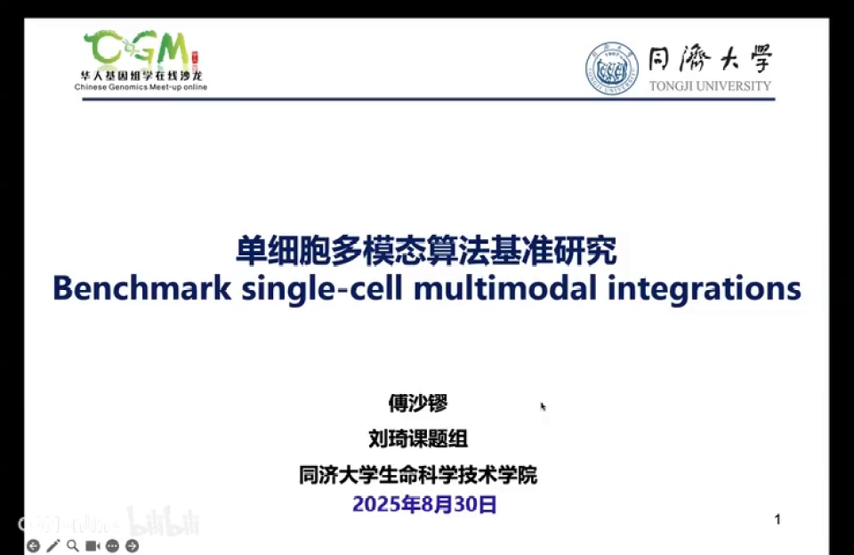

## 一、先给「不同数据集」分型：三类任务，目标完全不同

讲者强调，处理这些数据时「关键不是整合」——整合根据数据类型的不同要分类型 [【跳转到 04:11】](https://www.bilibili.com/video/BV1yVULBzExJ/?t=251)。这是本节最重要的一句话：**「把不同数据集放在一起」不是一个问题，而是三个问题**。

在分型之前，先看这些「不同模态」是怎么来的。讲者引了一张配对多模态测序技术的总览表 [【跳转到 03:38】](https://www.bilibili.com/video/BV1yVULBzExJ/?t=218)：

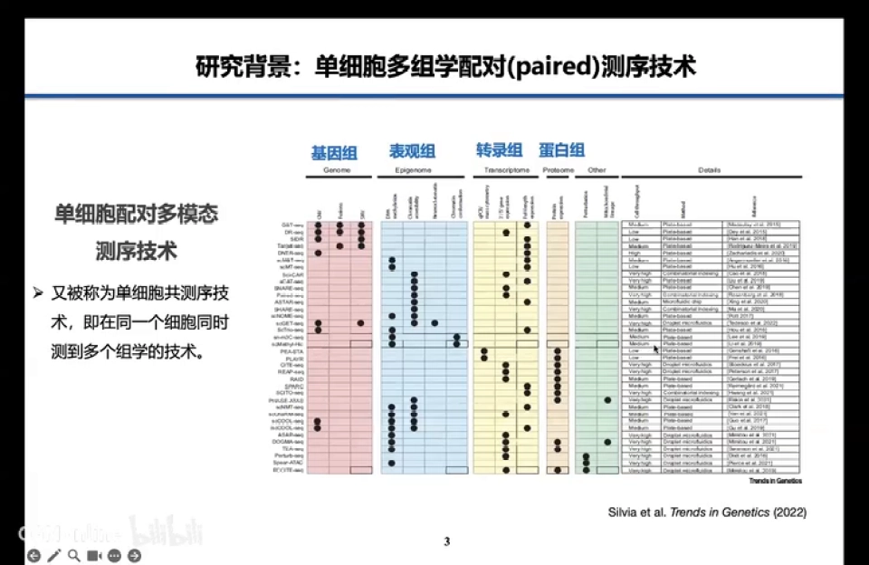

横轴按组学层次分成基因组（Genome）、表观组（Epigenome）、转录组（Transcriptome）、蛋白组（Proteome）四栏，纵向每一行是一种技术（G&T-seq、scM&T-seq、scTrio-seq、scNMT-seq、CITE-seq、REAP-seq、SPLiT-seq 等），黑点表示该技术覆盖了哪几个组学。这张表说明一件事：**「多模态」不是一个统一的形态，而是一张稀疏的覆盖矩阵**——有的技术同时给基因组+表观组+转录组，有的只给转录组+蛋白组。你手上能拿到哪几种模态，直接决定了下面那三类整合任务里你能做哪一类。

### 1.1 配对整合（垂直整合）：细胞相同，特征不同

第一类叫**配对整合**，也叫垂直整合。它的前提是「细胞大家都是一样的，但是在这个细胞里同时测到了不同组学」，整合的对象是**同一批细胞的不同特征** [【跳转到 04:11】](https://www.bilibili.com/video/BV1yVULBzExJ/?t=251)。

因为细胞一一对应关系已知，这类任务的目标是 **joint embedding（共嵌入）**：在低维空间里得到多个组学共同的一个隐空间，找到它们之间共同的细胞状态和关系 [【跳转到 05:39】](https://www.bilibili.com/video/BV1yVULBzExJ/?t=339)。

### 1.2 非配对对角线整合：细胞不同，模态也不同

第二类叫**对角线整合**。它的特征是「细胞也是不一样的，组学类型也是不一样的」，所以数据排成矩阵时只在一条对角线上有值——就像把两块互不相交的数据块沿对角线摆开 [【跳转到 04:36】](https://www.bilibili.com/video/BV1yVULBzExJ/?t=276)。

这类任务的目标不是共嵌入，而是 **alignment（对齐）**：「以 RNA 和 ATAC 为例，两个非配对的整合就是要去找到 RNA 这个模态和 ATAC 模态之间细胞一一的对应关系」[【跳转到 05:14】](https://www.bilibili.com/video/BV1yVULBzExJ/?t=314)。

注意这里的措辞：**「找到一一对应关系」意味着你在猜配对**。这是非配对整合最本质的困难，也是后面评估时最看重「对齐准确性」的原因。

### 1.3 马赛克整合：一半一样，一半不一样

第三类把前两类都涵盖：「当整合的时候，它有一部分细胞或模态是一样的、那一部分是不一样的」，这类被称为**马赛克整合**（mosaic integration）[【跳转到 05:01】](https://www.bilibili.com/video/BV1yVULBzExJ/?t=301)。

马赛克整合最贴近真实场景：你手上有 CITE-seq（RNA + 蛋白）的数据，又有一批只有 RNA 的数据，想把它们放到一起——配对部分已知、非配对部分要猜。

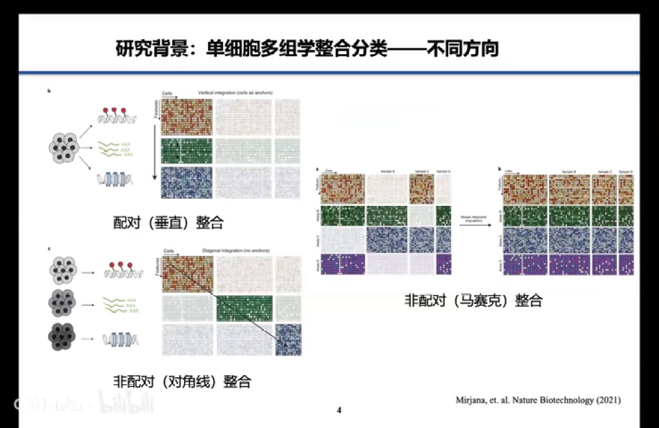

这张幻灯片值得停一下。左边两幅是配对整合与对角线整合的示意：配对整合里所有模态共享同一列细胞；对角线整合里 RNA 块和 ATAC 块没有任何共享的列或行，只有一条对角线在「暗示」两块数据可能对应。右边两幅是马赛克：先按样本排成错落的块（modality 1 覆盖 sample A~C，modality 2 只覆盖一部分），再通过「modality alignment」把缺失的块补上，得到一块完整的、可以联合分析的矩阵。

**这三类形态决定了整合策略完全不同**：配对任务只需要学一个共享的细胞表示；非配对任务必须先解决「谁对应谁」；马赛克任务则要同时做这两件事，还要处理「哪块数据缺失」的问题。

## 二、为什么「直接拼在一起」不行：维度与稀疏度差了一个量级

讲者用两组真实数据说明不同模态之间的差异有多大 [【跳转到 06:04】](https://www.bilibili.com/video/BV1yVULBzExJ/?t=364)：

- **BMMC Multiome**（单细胞 RNA + scATAC 配对数据）：RNA 模态 1 万 3000 维，scATAC 模态 **11 万维**；非零值比例分别是 8.2% 和 **3.1%**。
- **BMMC CITE-seq**（单细胞 RNA + ADT 配对数据）：RNA 模态 1 万 3000 多维，ADT 模态**只有 134 维**；非零值比例分别是 10.4% 和 **83.9%**。

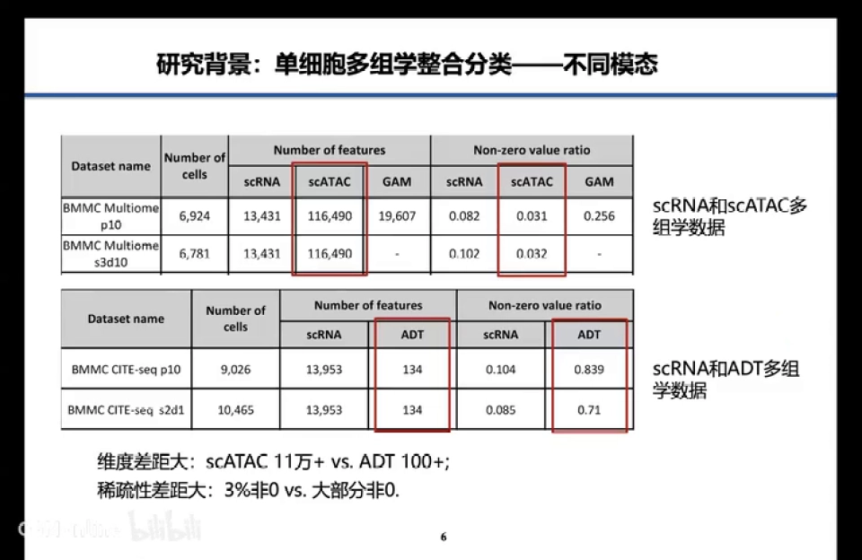

这张表就是「为什么不能直接拼接」的最直接证据：

- **维度差三个量级**：11 万维 vs 134 维。拼接后高维模态会主导距离计算，低维模态几乎不起作用。
- **稀疏度差一个量级**：3% 非零 vs 84% 非零。前者是「几乎全零的稀疏矩阵」，后者是「几乎稠密的连续测量」。
- **噪声结构不同**：ATAC 的零来自「只有两个拷贝的 DNA、很多位点根本测不到」，是**结构性零**；ADT 的零来自抗体捕获失败，是**技术性零**。

讲者的原话是：「对于这种模态的维度和稀疏度都相差很大的多组学整合，其实在算法的设计上也会有很大的不同的考量」[【跳转到 06:54】](https://www.bilibili.com/video/BV1yVULBzExJ/?t=414)。

顺带一提，表格里还有一个 **GAM** 列（gene activity matrix，基因活性矩阵，1 万 9000 维、25.6% 非零）。它的作用下一节会讲——这是「把不同模态拉到共享特征上」的关键一步。

## 三、考试怎么出：40 个软件、68 个方法、六小类任务

讲者团队按前述分类，对 **40 个软件、68 个方法**做了评估，分成三大类、六小类整合任务 [【跳转到 06:59】](https://www.bilibili.com/video/BV1yVULBzExJ/?t=419)：

| 大类 | 小类 | 方法数 |
| --- | --- | --- |
| 配对整合 | scRNA + scATAC | 18 |
| 配对整合 | scRNA + ADT | 14 |
| 配对整合 | 空间多组学 | 3 |
| 非配对对角线整合 | scRNA + scATAC | 14 |
| 马赛克整合 | CITE-seq 引导 | 8 |
| 马赛克整合 | Multiome 引导 | 8 |

对每一类任务，评估的输出也不一样：配对任务看 **joint embedding**，非配对任务看 **对齐后的 embedding**，部分算法还要额外看 **跨模态 imputation**（用一个模态补另一个模态）[【跳转到 07:24】](https://www.bilibili.com/video/BV1yVULBzExJ/?t=444)。

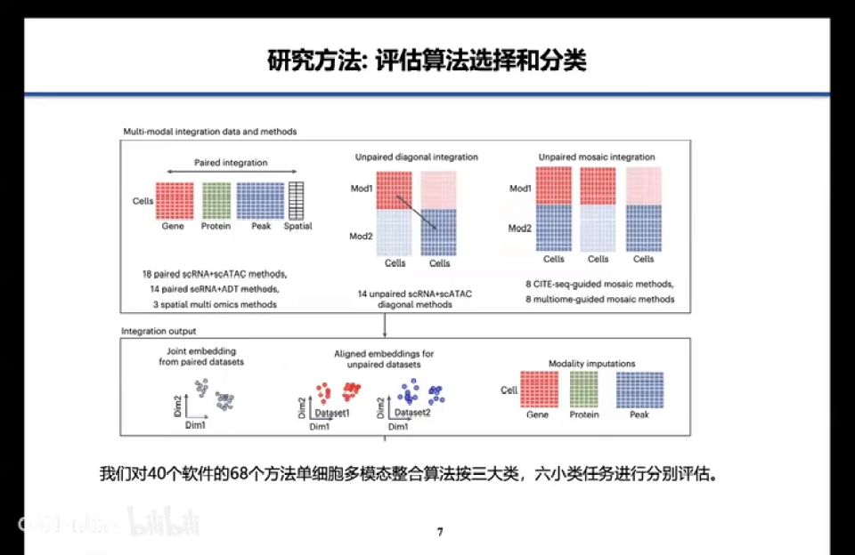

这张图把「三类任务 → 三类输出」的对应关系画得很清楚：配对整合输出 joint embedding（一张 UMAP 上混着两种模态的细胞）；非配对整合输出「各自对齐到同一坐标系的 embedding」（两张 UMAP 上分别是 Dataset1 和 Dataset2，但坐标系共享）；马赛克整合还要额外输出 modality imputation（把缺失的 Gene/Protein/Peak 块补出来）。

## 四、评估三步走：能不能用、准不准、稳不稳

整个评估流程被拆成三步 [【跳转到 07:41】](https://www.bilibili.com/video/BV1yVULBzExJ/?t=461)：

1. **可用性（Usability）**：这个算法能不能跑通？跑不通是为什么？
2. **准确性（Accuracy）**：整合之后对不对？包括 embedding 是否正确、批次是否去掉了、聚类是否保留了生物学结构、细胞对齐是否准确、跨模态 imputation 是否准确。
3. **稳定性（Robustness）**：结果稳不稳？分两个方向——数据质量变差时性能下降多少，以及重复运行多次结果波动多大。

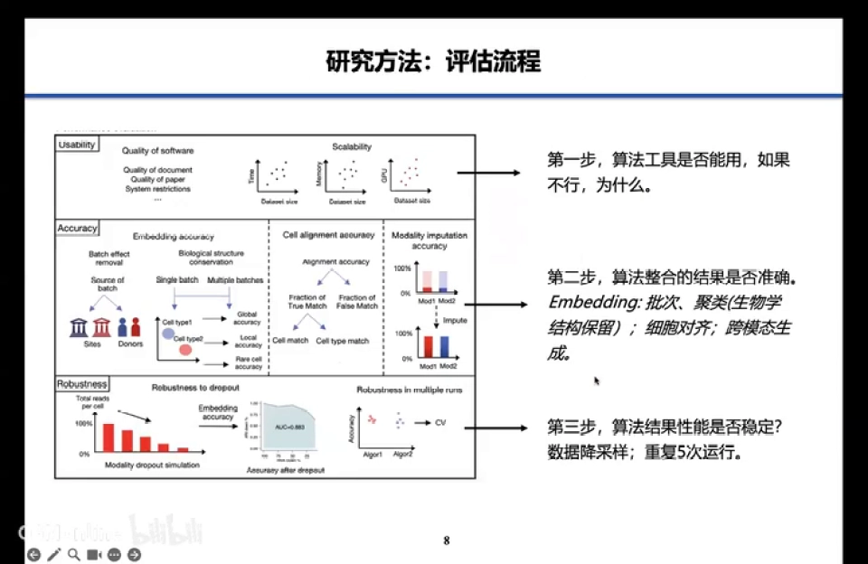

这张流程图是全文的骨架，值得逐块读：

- **可用性**这一栏里，除了「软件质量、文档质量、论文质量、系统限制」，还有一个 **Scalability** 小图：横轴是数据集大小，纵轴分别是时间、内存、GPU 占用。讲者后来把这一项具体化成了「500 个细胞到 50 万细胞，24 小时内、500GB 内存能不能跑通」[【跳转到 14:45】](https://www.bilibili.com/video/BV1yVULBzExJ/?t=885)。
- **准确性**这一栏分四块：批效应去除（batch effect removal）、embedding 准确性（单批次/多批次的聚类、全局/局部准确性、细胞类型/稀有细胞准确性）、细胞对齐准确性（正确配对的比例、错误配对的比例）、模态 imputation 准确性。
- **稳定性**这一栏：左边是模态 dropout 模拟（把总 reads 按比例下采样，看 embedding 准确性怎么掉），右边是多次运行的变异系数（CV）。

## 五、指标本身也可能是错的：轮廓系数为什么会骗人

这是整场报告里最有价值的一段，也是最容易被忽略的一段。

讲者要评估稳定性，就要看「数据质量变差时指标怎么变」。逻辑前提是：**数据质量越差，指标应该越低**。但实测下来，有些指标根本不满足这个前提 [【跳转到 10:25】](https://www.bilibili.com/video/BV1yVULBzExJ/?t=625)：

- **聚类类指标**（图中红色系）确实符合：数据质量越差，聚类准确性越低。
- **去批次类指标**（图中青色系）三个里有两个**反着来**：数据质量越差，指标反而越好。

讲者给的解释很朴素：「当我们数据质量特别差、所有数据点都糊在一起的时候，对于去批次来说，它的数据点都糊在一起，它去批次效果反而是最好的」[【跳转到 11:15】](https://www.bilibili.com/video/BV1yVULBzExJ/?t=675)。

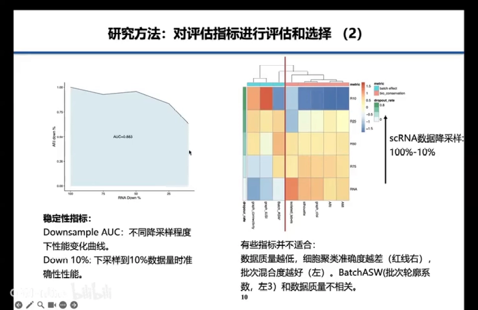

左图的横轴是 RNA 数据保留比例（100% 到 10%），纵轴是 embedding 准确性，曲线下面积（AUC）0.663 就是「总体下降水平」的量化。右图的热图更狠：横轴是各个指标，纵轴是数据质量梯度，颜色是数值高低。可以清楚看到**去批次类指标（BatchASW 等）与数据质量不相关**，而聚类类指标随数据质量单调下降。

更严重的是**批次轮廓系数（BatchASW）**：讲者说它「两边都不符合，既不符合越来越高，也不符合越来越低」[【跳转到 11:40】](https://www.bilibili.com/video/BV1yVULBzExJ/?t=700)。他还引用了一篇 7 月 30 日发表在 *Nature Biotechnology* 的工作，那篇工作直接把整合质量从「整合得不好」调到「越来越好」，发现**其他指标都随金标准变好而变高，唯独轮廓系数对应的批次或聚类指标不符合**，于是认为它不适合用于单细胞整合的评估 [【跳转到 11:49】](https://www.bilibili.com/video/BV1yVULBzExJ/?t=709)。

**这一段的实践含义**：如果你用 BatchASW 或轮廓系数来调参、选算法，你很可能在优化一个和真实质量无关、甚至反向的指标。评估整合效果必须同时看「批次混合」和「生物结构保留」两组指标，且要对指标的单调性做一次 sanity check。

## 六、金标准不能自己造：什么叫「无偏的细胞注释」

评估聚类准确性需要一份细胞类型标签作为金标准。讲者对「无偏」给了两条定义 [【跳转到 13:19】](https://www.bilibili.com/video/BV1yVULBzExJ/?t=799)：

1. **不能只从单细胞 RNA 这一个模态来**。因为 RNA 是细胞聚类和 cell type 的主要来源，很多多模态整合算法用的聚类结果其实就是 RNA 模态的，用它当金标准会**偏向**这类算法。
2. **不能是任何多组学整合算法的聚类结果**。「比如说我们如果用 Seurat v4 去得到这些金标准，那我们再去评估 Seurat v4 的时候，它必然就是最好的」[【跳转到 13:44】](https://www.bilibili.com/video/BV1yVULBzExJ/?t=824)。

这条原则其实超出了「评估」本身：**任何跨数据集的比较，只要参考标签是从被测方法里来的，结论就一定是循环论证**。这也是本节标题里「比较」二字最容易被做错的地方。

## 七、配对任务的结果：老算法赢了，但撞上内存墙

### 7.1 可用性：大部分能到 10 万细胞，三个能到 50 万

在配对 RNA+ATAC 任务上，大部分算法能跑到 10 万细胞，其中三个算法能跑 50 万 [【跳转到 14:45】](https://www.bilibili.com/video/BV1yVULBzExJ/?t=885)。

### 7.2 准确性：Seurat v4 WNN 优于所有深度学习算法

「Seurat v4 因为是大家用得最多的一个，它也不是深度学习算法，但是在配对 RNA 和 ATAC 整合中，它在两类指标中性能都优于其他算法」[【跳转到 15:10】](https://www.bilibili.com/video/BV1yVULBzExJ/?t=910)。代价是它在 50 万细胞时会内存溢出，超过 500GB。

稳定性上，Seurat 在这类任务中依旧排名最好。对深度学习算法，讲者额外评估了「跑五次结果是否一致」：三个算法通过固定随机种子可以保证每次结果相同，其他大部分算法每次跑都有波动，有些影响还比较大 [【跳转到 15:35】](https://www.bilibili.com/video/BV1yVULBzExJ/?t=935)。

### 7.3 imputation：能缓解稀疏性，但只在 cell type 水平

部分配对 RNA+ATAC 算法带 imputation 功能，讲者把它当作「缓解数据稀疏性」的能力来评估：把数据下采样到 10%，看能恢复多少 [【跳转到 16:20】](https://www.bilibili.com/video/BV1yVULBzExJ/?t=980)。

结果：单细胞 RNA 在 **cell type 水平**能恢复到 80% 几到 90% 几，ATAC 在 cell type 水平是 60~80%；但**在单个细胞水平，恢复水平会明显差一些** [【跳转到 16:45】](https://www.bilibili.com/video/BV1yVULBzExJ/?t=1005)。

这个落差很关键：**imputation 恢复的是「群体的平均样子」，不是「这个细胞真实的样子」**。如果你的下游分析需要单细胞级别的精度（比如找稀有细胞亚群），imputation 帮不上太多忙。

### 7.4 RNA+ADT：维度低，所以都能跑

RNA+ADT 任务上，因为 ADT 只有 100 多维，大部分算法都能在 50 万细胞上运行 [【跳转到 17:22】](https://www.bilibili.com/video/BV1yVULBzExJ/?t=1042)。这印证了第二节的判断：**模态的维度直接决定算法的可扩展性**。

讲者还评估了一个实用问题：**要不要把批次信息喂给算法**。结论是 2/3 的算法在有批次信息时性能显著提升（去批次和聚类指标都有明显提高），但也有算法反着来 [【跳转到 18:06】](https://www.bilibili.com/video/BV1yVULBzExJ/?t=1086)。

### 7.5 空间多组学：算法少，效果还不如通用去批次方法

空间 RNA+ADT 配对整合，当时只找到三个算法。讲者拿两个常见的空间转录组去批次方法（Harmony 和一个深度学习方法）作对照，发现**这两个通用方法在聚类和去批次性能上已经优于最好的空间多组学整合算法**，而深度学习那个相对通用方法也没有提升很多 [【跳转到 19:26】](https://www.bilibili.com/video/BV1yVULBzExJ/?t=1166)。

讲者的判断是：「现在这个领域虽然有算法，但是整合的效果其实还是有挺大提升空间的」[【跳转到 20:16】](https://www.bilibili.com/video/BV1yVULBzExJ/?t=1216)。

## 八、非配对任务：先造共享特征，再谈对齐

### 8.1 关键预处理：基因活性矩阵（GAM）

非配对整合有一个专属的预处理步骤：**构建基因活性矩阵（gene activity matrix，GAM）**。做法是把 ATAC 数据找到其中 promoter 的位置，用 promoter 的信号代表基因，从而得到一个「基因 × 细胞」的矩阵 [【跳转到 20:56】](https://www.bilibili.com/video/BV1yVULBzExJ/?t=1256)。

为什么必须做这一步？讲者说得很清楚：「原本两个模态既没有共享的细胞，也没有共享的 feature，这样整合就会比较困难；而构建 GAM 之后，多组学整合就有了共享的 feature，就是基因」[【跳转到 21:21】](https://www.bilibili.com/video/BV1yVULBzExJ/?t=1281)。

这正是本节「整合的几种思路」里的**特征层面**：不要求细胞对齐，也不要求隐空间对齐，而是**先把两个模态翻译成同一种特征语言**（基因），再在共享特征上做整合。

### 8.2 但 GAM 本身成了瓶颈

麻烦在于，大部分算法构建 GAM 都依赖同一个 R 包实现，而这个包在 50 万细胞时会崩 [【跳转到 21:46】](https://www.bilibili.com/video/BV1yVULBzExJ/?t=1306)：

- 老版本直接算 promoter 区域表达量，50 万细胞时**内存超过 500GB**；
- 新版本用 fragment 数据 call 整个基因区域的信号，因为算法设计会把整个矩阵变成一个一维变量，而这个变量**超出了 R 允许的最大变量长度**，直接报错。

结果是：**所有需要生成 GAM 的算法，超过 10 万细胞就跑不动了**——不是因为算法本身不行，而是因为预处理这一步的实现限制 [【跳转到 22:11】](https://www.bilibili.com/video/BV1yVULBzExJ/?t=1331)。

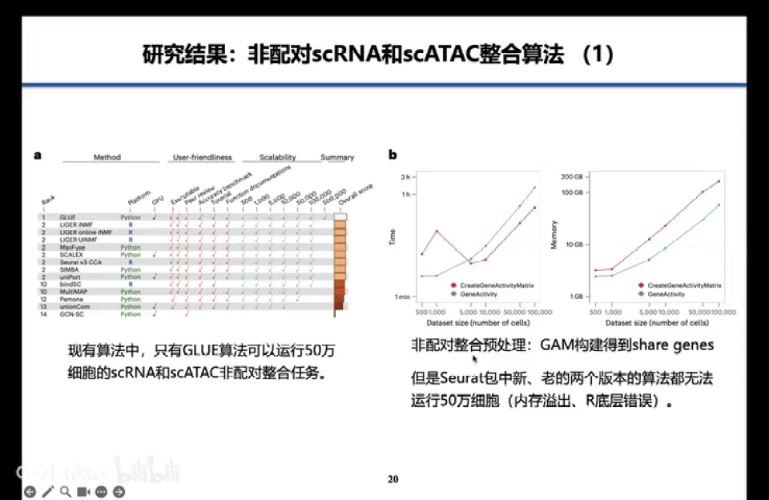

左表是 14 个非配对方法的可用性清单（GLUE、LIGER iNMF、LIGER online iNMF、MaxFuse、Portal、Seurat v3 CCA、SIMBA、uniPort、bindSC、MultiMAP、Pamona、unionCom、GCN-SC 等），右图是 GAM 构建的时间与内存曲线——两条线都随细胞数单调上升，到 10 万细胞时内存已接近 100GB。这张图解释了一个常被忽略的事实：**在单细胞领域，「能不能跑」往往比「准不准」更早成为瓶颈**。

### 8.3 准确性：scGLUE 的对齐准确性接近第二名的两倍

在非配对任务上，scGLUE 在对齐准确性上明显领先：在一个小鼠大脑数据集上，它的细胞对齐指标接近第二名的两倍 [【跳转到 22:36】](https://www.bilibili.com/video/BV1yVULBzExJ/?t=1356)。稳定性上，scGLUE 也是所有算法里性能损失最小的 [【跳转到 23:01】](https://www.bilibili.com/video/BV1yVULBzExJ/?t=1381)。

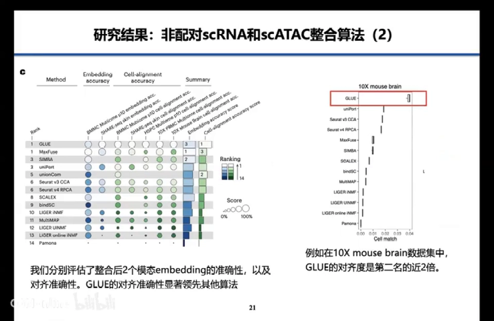

左图是 14 个方法在多个数据集上的 embedding 准确性与对齐准确性排名矩阵（圆点大小表示得分，颜色表示排名），scGLUE 稳定排第一；右图是 10X mouse brain 数据集上的 cell match 指标柱状图，scGLUE 的柱子明显突出，第二名之后断崖式下降。

## 九、马赛克任务：MultiVI 管配对，MIDAS 管全局

马赛克整合的计算资源需求更大：讲者把梯度设到「2 万配对 + 2 万非配对」，这时已经有三个算法在**单卡 24G 显存**下跑不动了 [【跳转到 23:51】](https://www.bilibili.com/video/BV1yVULBzExJ/?t=1431)。

结果分两块看：

- **配对部分**：MultiVI 总体性能最好（用 imputation accuracy 衡量）；
- **非配对部分**：Seurat v5 bridge 总体性能最好（用 alignment 指标衡量）[【跳转到 24:16】](https://www.bilibili.com/video/BV1yVULBzExJ/?t=1456)。

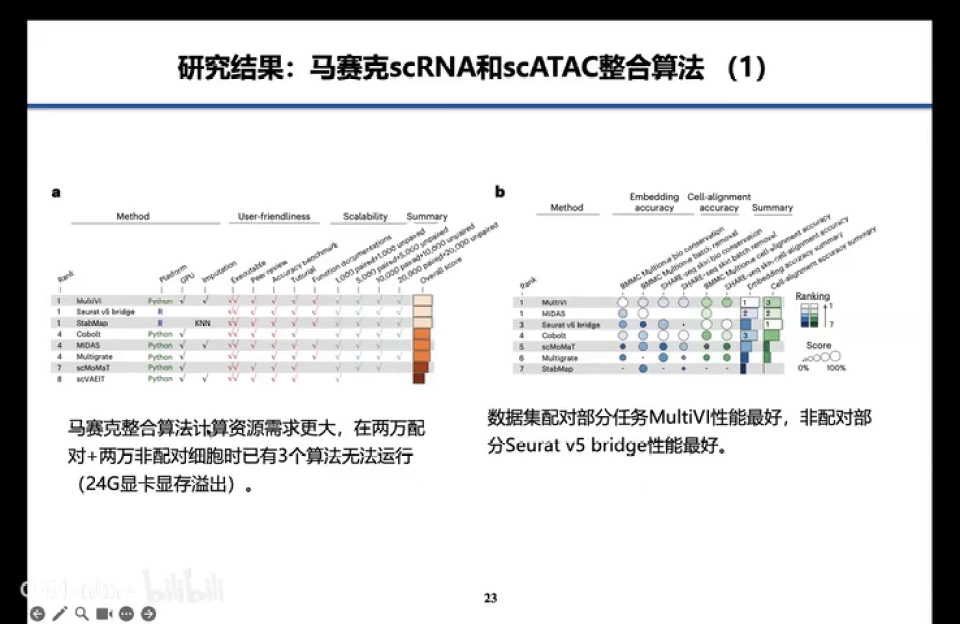

左表是 8 个马赛克方法的可用性（MultiVI、Seurat v5 bridge、StabMap、Cobolt、MIDAS、MultiGrate、scMoMaT、scVAEDT），右表是准确性排名。注意右表里 MIDAS 在「Multiome 引导」的数据集上排名也很靠前——这与下一段的结论一致。

### 9.1 一个反直觉的对比：无监督的 MIDAS 打平有监督的马赛克算法

讲者做了一件很有意思的对照：把**非配对排名第一的 scGLUE**（完全没有配对信息）和**马赛克 top 算法**（有部分配对信息作为监督）放在一起比 [【跳转到 24:41】](https://www.bilibili.com/video/BV1yVULBzExJ/?t=1481)。

结论是「各有千秋」：scGLUE 在部分指标上和马赛克第一梯队差不多，甚至更好一点。「整体上，马赛克的算法现在还没有全面地优于非配对中最好的这个算法」[【跳转到 25:06】](https://www.bilibili.com/video/BV1yVULBzExJ/?t=1506)。

这说明**「有更多信息」不等于「结果更好」**——多出来的配对信息能不能被算法有效利用，是另一回事。

### 9.2 MIDAS：准确性和稳定性双榜靠前

在稳定性上，MIDAS 和 MultiVI 表现最好 [【跳转到 25:36】](https://www.bilibili.com/video/BV1yVULBzExJ/?t=1536)。更值得注意的是，MIDAS 在准确性和稳定性上都排名靠前，而且「已经优于大部分配对的整合算法——就是已经有了部分新模态信息的这些算法——已经相接近，甚至和里面最优的配对算法相比也接近甚至更优」[【跳转到 26:38】](https://www.bilibili.com/video/BV1yVULBzExJ/?t=1598)。

在跨模态生成（用一个模态预测另一个模态）上，MIDAS 在所有指标上都有 0.8~0.9 的相关性水准，优于其他马赛克算法 [【跳转到 28:31】](https://www.bilibili.com/video/BV1yVULBzExJ/?t=1711)。

## 十、一张选型表：按「有没有 GPU、细胞量多大」分叉

讲者把所有结果汇总成一张 guideline 决策树 [【跳转到 28:47】](https://www.bilibili.com/video/BV1yVULBzExJ/?t=1727)：

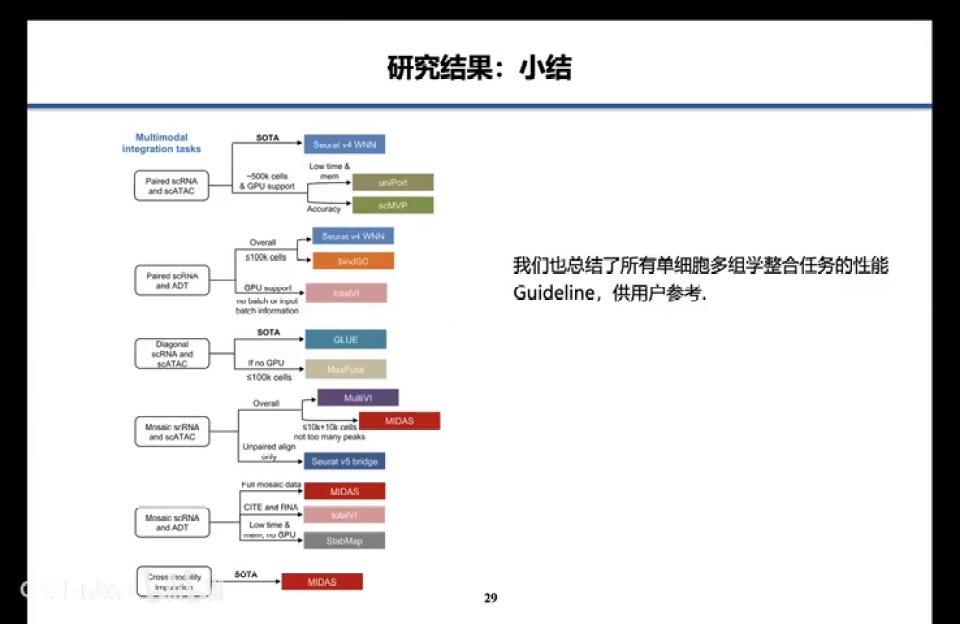

把图里的分叉翻译成文字：

| 任务 | 条件 | 推荐 |
| --- | --- | --- |
| 配对 scRNA + scATAC | 整体最优 | Seurat v4 WNN |
| 配对 scRNA + scATAC | 50 万细胞量级、有 GPU | uniPort / scMVP |
| 配对 scRNA + ADT | 10 万细胞以下 | Seurat v4 WNN |
| 配对 scRNA + ADT | 有 GPU 支持 | bindSC |
| 配对 scRNA + ADT | 没有批次标签 | totalVI |
| 非配对 scRNA + scATAC | 整体最优 | scGLUE |
| 非配对 scRNA + scATAC | 没有 GPU、10 万细胞以下 | MaxFuse |
| 马赛克 scRNA + scATAC | 整体最优 | MultiVI |
| 马赛克 scRNA + scATAC | 非配对部分对齐 | Seurat v5 bridge |
| 马赛克 scRNA + scATAC | 2 万 + 2 万量级 | MIDAS |
| 马赛克 scRNA + ADT | 完整马赛克数据 | MIDAS |
| 马赛克 scRNA + ADT | 只有 CITE-seq 与 RNA | totalVI |
| 马赛克 scRNA + ADT | 低资源、无 GPU | StabMap |
| 跨模态 imputation | 整体最优 | MIDAS |

讲者在问答里把这张表又口头总结了一遍 [【跳转到 31:09】](https://www.bilibili.com/video/BV1yVULBzExJ/?t=1869)：

- **配对任务相对容易**，因为共有信息多。Seurat v4 WNN 不是深度学习，是 weighted nearest neighbor，但「已经足够在配对的任务上比较稳定地执行」。
- **非配对和马赛克任务**，scGLUE 和 MIDAS 这两个「国产算法」值得优先尝试——scGLUE 出自北京大学高歌老师团队，MIDAS 出自军事医学研究院。讲者的评价是「尤其 scGLUE 算法，它整个性能是遥遥领先于其他算法的」。
- **不要用 Seurat v3 这类老版本**去处理非配对/马赛克任务，「它相对于 top 的算法性能就会相差很大了」。

## 十一、局限与陷阱：这份报告自己承认的边界

### 11.1 深度学习没有赢，而且赢不了的原因很具体

讲者在问答里说得很直接：在单细胞 RNA 领域，现在的潮流是用足够多的数据让算法自己学，但在多模态数据上，「我们发现深度学习算法直接上是上不太行的，而且现在整个性能比较好的是非深度学习的算法」[【跳转到 38:44】](https://www.bilibili.com/video/BV1yVULBzExJ/?t=2324)。

这是本节最该记住的一条经验：**方法的新旧和效果没有必然关系**。评估驱动选型，而不是论文驱动选型。

### 11.2 大模型的维度瓶颈：ATAC 加不进去

被问到虚拟细胞和 foundation model 时，讲者指出一个具体的工程障碍：RNA 和蛋白还行，但**加上 ATAC 这个维度，维度会特别高**。所以现在很多多模态大模型干脆不加 ATAC，或者把 ATAC 降到 100 维甚至更低再用 [【跳转到 33:44】](https://www.bilibili.com/video/BV1yVULBzExJ/?t=2024)。

原因很实在：「你用现在的比如 Transformer、BERT 或者 GPT 这个模型的话，会远远超出可用的计算资源、GPU 所需要的量」[【跳转到 34:14】](https://www.bilibili.com/video/BV1yVULBzExJ/?t=2054)。

这直接呼应第二节的观察：**跨模态整合的第一个障碍是量纲和维度，不是算法思想**。

### 11.3 模态多不是问题，模态「特点」才是问题

有人问能不能同时整合转录组、蛋白组、空间转录组、甲基化、ATAC 这么多维度。讲者的回答是：「模态多并不是问题，现在很多算法无论多少个维度其实都能整合。它的难点是你要考虑不同模态的特点」[【跳转到 45:10】](https://www.bilibili.com/video/BV1yVULBzExJ/?t=2710)。

他给了三类不同的「特点」：

- **高维高稀疏**：甲基化、ATAC；
- **低维低稀疏**：ADT、蛋白；
- **多两维空间信息**：空间转录组——但它「并不代表一个表达量」，所以处理方式又不一样 [【跳转到 45:35】](https://www.bilibili.com/video/BV1yVULBzExJ/?t=2735)。

### 11.4 马赛克的定义很宽，评估里只取了最经典的一种

讲者承认，马赛克整合的范围非常广，他们为了可比性只取了「配对 + 非配对」这个最经典的情形 [【跳转到 36:14】](https://www.bilibili.com/video/BV1yVULBzExJ/?t=2174)。所以如果你手上的场景是「两个生物背景差异很大的数据集」，它严格来说也属于马赛克范畴，但这份基准没有覆盖。

讲者给了一条实用的替代方案：如果马赛克算法效果不好，就**两个数据分别整合，再把 latent 整合到一起**——「这涉及到一个去批次，就是整合加去批次的一个传统思路」[【跳转到 37:04】](https://www.bilibili.com/video/BV1yVULBzExJ/?t=2224)。

### 11.5 怎么判断「整合成功了」：看共同细胞类型有没有对上

这是本节最实操的一条验证方法。讲者的建议是：整合之后看各自得到的 latent embedding，「如果它里面有共同的 cell type，比如都有 T 细胞、都有特定的细胞，你可以看到这个特定细胞在你马赛克整合之后效果怎么样；如果效果比较好的话，那说明这个整合算法效果就是比较好的」[【跳转到 36:39】](https://www.bilibili.com/video/BV1yVULBzExJ/?t=2199)。

换句话说：**用「已知该在一起的细胞有没有在一起」来验证整合，而不是用「聚类看起来漂不漂亮」来验证**。这与第五节「轮廓系数会骗人」是同一件事的两面。

### 11.6 算法是动态的，基准会过期

讲者明确说这些算法「都是动态的，譬如说半年以后、一年以后这个情况又会发生很多变化」，他们的评估不是长期重心，「有些新的出来之后简单评估一下」[【跳转到 38:14】](https://www.bilibili.com/video/BV1yVULBzExJ/?t=2294)。

所以这张选型表应该当作**某个时间点的快照 + 一套可复用的评估方法**来用，而不是当成永久结论。

## 小结

- **「整合不同数据集」是三个问题**：配对整合求共嵌入，非配对整合求对齐，马赛克整合两者都要。任务类型决定目标函数，也决定评估指标。
- **不能直接拼接的物理原因是量纲**：scATAC 11 万维、3% 非零，ADT 134 维、84% 非零。维度与稀疏度差三个量级，噪声结构（结构性零 vs 技术性零）也完全不同。
- **非配对整合的关键一步是造共享特征**：用 promoter 把 ATAC 翻译成基因活性矩阵（GAM），让两个模态有共同的「基因」坐标——这是特征层面的整合思路。
- **评估要问三个问题**：能不能用（含 50 万细胞的可扩展性）、准不准（embedding + 对齐 + imputation）、稳不稳（降采样 + 重复运行）。
- **指标本身会骗人**：去批次类指标在数据质量变差时反而变好；批次轮廓系数（BatchASW）与数据质量不相关，已被独立工作认为不适合用于单细胞整合评估。
- **金标准必须无偏**：不能来自单一 RNA 模态，更不能来自被测算法自己，否则是循环论证。
- **结果反直觉**：配对任务上非深度的 Seurat v4 WNN 打赢所有深度学习算法；非配对任务上 scGLUE 对齐准确性接近第二名两倍；马赛克任务上无监督的 MIDAS 打平有部分监督的算法。
- **验证整合是否成功**：看已知共同细胞类型在整合空间里有没有对上，而不是看聚类图好不好看。

## 关键术语速查

| 术语 | 一句话解释 |
| --- | --- |
| 配对整合（垂直整合） | 同一批细胞上测了多个模态，整合目标是学一个共享的细胞表示（joint embedding） |
| 非配对整合（对角线整合） | 两个模态来自不同细胞，整合目标是猜出细胞之间的一一对应关系（alignment） |
| 马赛克整合 | 一部分细胞/模态重叠、一部分不重叠的整合，同时要做对齐和共嵌入 |
| Joint embedding | 共嵌入，把多个模态的细胞投到同一个低维隐空间 |
| GAM（基因活性矩阵） | 用 promoter 区域的 ATAC 信号代表基因表达，造出两个模态共享的「基因」特征 |
| Imputation | 用一个模态的数据推断另一个模态，常用来缓解单细胞数据的稀疏性 |
| BatchASW | 批次轮廓系数，衡量批次混合程度的指标；本报告指出它与数据质量不相关 |
| Downsample AUC | 把数据按比例下采样后画性能曲线、算曲线下面积，用来量化「数据变差时性能掉多少」 |
| WNN | Weighted Nearest Neighbor，Seurat v4 的多模态加权最近邻方法 |
| SOTA | State of the art，当前最优 |