# 单细胞标准化方法全流程：LogNormalize、高变基因与 SCTransform 的取舍

> 视频来源：[【Broca】单细胞测序数据标准化方法，全流程详解！（附完整代码）](https://www.bilibili.com/video/BV17MmhBNEvx/)（Bilibili · Broca区想发言）｜时长约 20 分钟
> 导读：这支视频用一份真实的 Seurat 对象，把标准化拆成「NormalizeData → FindVariableFeatures → ScaleData」三步，再对照 SCTransform 这条新路线，逐行看代码、看默认参数、看运行结果。本文按「每一步在假设什么、换一种做法会怎样」重新组织，操作细节从简，重点放在方法的选择后果上。

## 本讲要解决的核心问题（SCQA）

**背景**：单细胞数据经过质控之后，剩下的每个细胞测到的 UMI 总数仍然差别很大——讲者举的例子是，有的细胞测了 2 万个 reads，有的测了 5 万个 reads，原始 count 根本不在一个量级上。直接拿这些数比大小是不合理的。

**冲突**：于是我们做标准化。但标准化并不只有一种做法：Seurat 的默认路线是「除以总 counts 再取对数」，官方新推荐的 SCTransform 则把 counts 建模成负二项分布、取残差。两条路线给出的「表达值」不是同一个东西，而高变基因、降维、聚类全都建立在这个值之上。更要紧的是，讲者在实测中发现：把两种方法塞进同一个对象里，结果会互相覆盖。

**疑问**：标准化到底在除掉什么、保留什么？不同方法各自的假设是什么？换了方法，下游会变哪些东西？我该怎么为自己的数据挑一个？

**回答（中心思想）**：**标准化不是「把数据洗一下」，而是分析假设的第一次显式声明**——你声明了「哪些细胞间差异是技术性的、应该除掉」，后面所有结论都建立在这个声明上。所以选方法的标准不是「哪个更准」，而是「哪个假设和你的下游问题匹配」。本文把 Seurat 的两条路线（LogNormalize 三步链、SCTransform 一步到位）放进同一张族谱里对照，并给出三条选择判据。

> 说明：QC 指标（`nGene`、线粒体比例）怎么定阈值、分位数法、`subset` 过滤，以及 `NormalizeData → ScaleData` 的逐条操作步骤，已在本系列 **2.4.5 数据标准化与质量控制** 中写过，本文不重复；本文只讨论「方法背后的假设」与「换方法之后会变什么」。

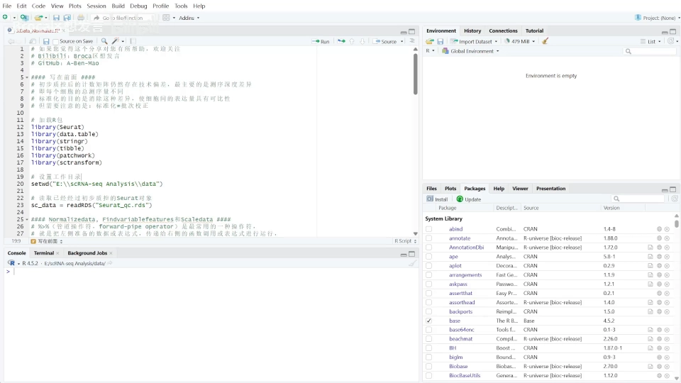

## 一、标准化要除掉的只有一件事：测序深度

讲者开篇给了一个很朴素的解释：质控过滤掉的是低质量细胞和低表达基因，但**技术噪音并没有因此消失**，其中最主要的一项就是不同细胞的测序深度不一样 [【跳转到 00:50】](https://www.bilibili.com/video/BV17MmhBNEvx/?t=50)。

这件事的后果是：一个「测得深」的细胞，几乎每个基因的 count 都会比一个「测得浅」的细胞高。如果你直接比较两个细胞的某个基因，你分不清差异来自生物学（这个细胞确实表达得多）还是来自技术（这个细胞被测得更深）。标准化的任务就是把后者除掉，让不同细胞之间的表达量具有可比性 [【跳转到 01:15】](https://www.bilibili.com/video/BV17MmhBNEvx/?t=75)。

这里讲者特别提醒了一句容易被混淆的话：**标准化和批次校正是两件事**。标准化只能解决技术差异的一部分——它处理的是「同一批、同一实验内，细胞之间测序深度的不均」，而不同批次、不同实验之间的系统性偏移，标准化管不了 [【跳转到 01:15】](https://www.bilibili.com/video/BV17MmhBNEvx/?t=75)。

把这句话翻译成「假设」的语言，本节的第一个要点就出来了：

- **要除掉的**：每个细胞测到的 UMI 总数差异（测序深度、捕获效率）；
- **要保留的**：细胞类型、细胞状态、扰动响应这些生物学差异；
- **不能靠它解决的**：批次效应（属 5.1.3 的话题）。

顺带澄清一个从 bulk RNA-seq 带过来的误会：bulk 里 RPKM/FPKM/TPM 要除以基因长度，是因为测的是片段、长基因天然会捞到更多片段；而 3′ 端单细胞计数用的是 UMI，一个转录本分子无论多长都只贡献一个 UMI，所以**单细胞的标准化不需要基因长度校正**。这也是为什么单细胞的公式看起来比 bulk 简单得多。

## 二、传统路线是一条三步链，而不是一个动作

Seurat 的传统做法是三个函数串起来，讲者用管道符把它们写成一行 [【跳转到 02:30】](https://www.bilibili.com/video/BV17MmhBNEvx/?t=150)：

```r
sc_data <- sc_data %>%
  NormalizeData() %>%          # 对 UMI 计数进行标准化
  FindVariableFeatures() %>%   # 对高变基因进行筛选
  ScaleData()                  # 对基因表达进行缩放（均值为 0、方差为 1）
```

这三步各自解决的问题完全不同，值得分开看 [【跳转到 03:20】](https://www.bilibili.com/video/BV17MmhBNEvx/?t=200)：

| 步骤 | 它在处理什么 | 它输出的值是什么 |
| :--- | :--- | :--- |
| `NormalizeData` | 细胞之间的测序深度差异 | 归一化后的表达量（不再是 count） |
| `FindVariableFeatures` | 基因太多、大部分基因没有信息量 | 一份「高变基因」名单（默认 2000 个） |
| `ScaleData` | 基因之间的量纲差异、以及协变量影响 | 标准化后的矩阵（均值 0、方差 1） |

讲者强调，这三步是**下游降维、聚类、批次校正的基础**，是整个分析里非常关键的一环 [【跳转到 00:25】](https://www.bilibili.com/video/BV17MmhBNEvx/?t=25)。从「链」的角度看，这句话的含义比听起来更重：链头（归一化）换了，链中间（高变基因名单）会变，链尾（降维聚类的结果）也就跟着变。后面几节会逐环拆开。

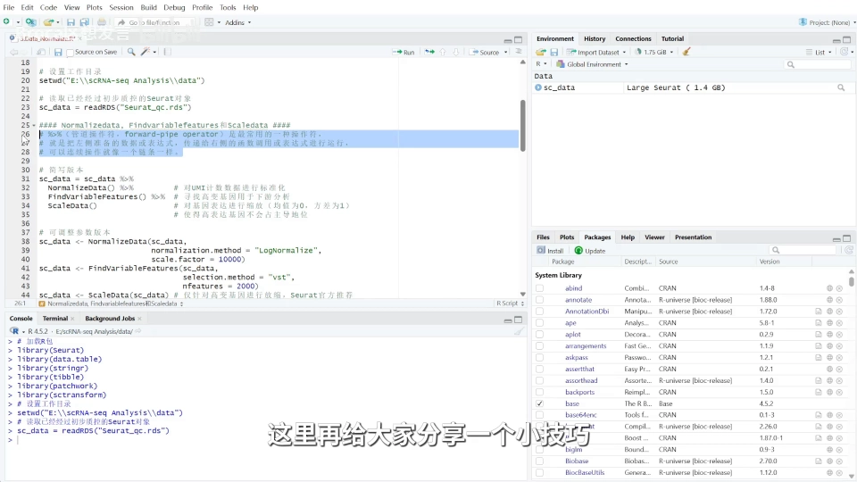

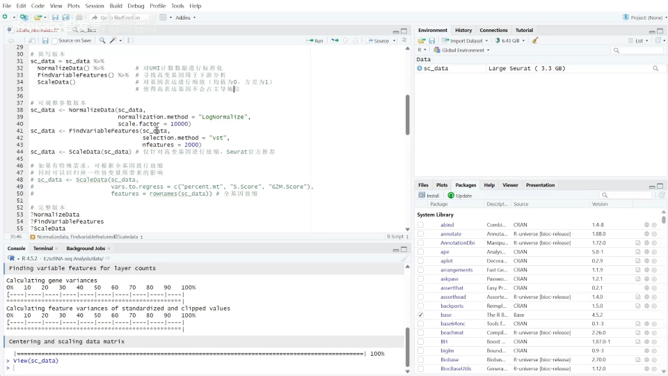
## 三、LogNormalize：一行公式背后藏着一个强假设

`NormalizeData` 不写任何参数时，默认走的都是 `LogNormalize`，缩放因子是 10000 [【跳转到 05:25】](https://www.bilibili.com/video/BV17MmhBNEvx/?t=325)。讲者在这里还演示了一个很实用的习惯：在 R 里打一个半角问号加函数名，右下角就会弹出帮助页，`normalization.method = "LogNormalize"`、`scale.factor = 10000` 这些默认值一目了然 [【跳转到 06:40】](https://www.bilibili.com/video/BV17MmhBNEvx/?t=400)。

公式本身很简单——把每个细胞的 counts 除以该细胞的总 counts，乘上 10000，再取对数：

$$
\text{expr}_{c,g} = \ln\left(1 + \frac{\text{count}_{c,g}}{\sum_{g'} \text{count}_{c,g'}} \times 10^{4}\right)
$$

其中 $c$ 是细胞，$g$ 是基因，$\ln(1+x)$ 就是常说的 `log1p`。讲者在口述时先说了「乘以 1000」，随即自己改口成 10000，实际默认值是 10000 [【跳转到 05:50】](https://www.bilibili.com/video/BV17MmhBNEvx/?t=350)。

这个公式里有两个动作，各自都带着假设，值得单独拎出来：

**第一个动作：除以该细胞的总 counts。** 这一步等价于假设「每个细胞的总 RNA 量相同」——你把这个细胞测到的所有 UMI 当成 100%，然后看每个基因占多少。问题是真实细胞的总 RNA 量并不相同：大细胞和小细胞、活跃细胞和静息细胞，转录本总量本来就有差别。你把它除掉了，就等于**把「细胞大小/转录活跃度」这个真实的生物学差异也一起当成了技术噪音**。这是总量缩放类方法（CPM、每万计数、LogNormalize 都属于这一族）的共同代价。

**第二个动作：取对数。** 取对数的目的是压缩动态范围、稳定方差——单细胞表达量跨度可以有好几个数量级，不压缩的话少数极高表达的基因会在降维里压倒一切。但 `log1p` 里的那个「1」是**伪计数**（pseudo-count），它是人为加的，作用只是避免 $\ln(0)$。代价是：它对零值和低表达值的处理是「拍平」的——0 变成 0，1 变成 $\ln 2 \approx 0.693$，2 变成 $\ln 3 \approx 1.099$，低端的差异被放大，高端的差异被压缩。所以同一份数据，log 变换前后「哪些基因变化最大」的排序是会变的。

**小结这一节**：LogNormalize 的假设是「细胞总 RNA 相同 + 对数能稳定方差」。它简单、快、被验证得最多，所以是默认值；但它的假设在真实数据里并不严格成立。

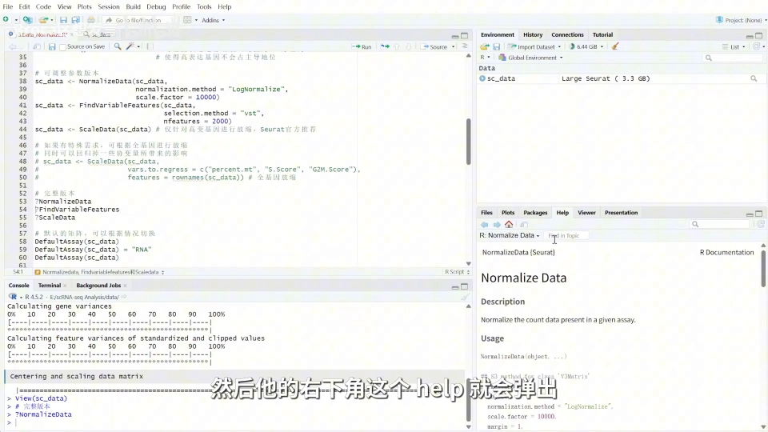

## 四、高变基因：为什么只留 2000 个

`FindVariableFeatures` 在中文教程里常被叫做「寻找高变基因」，默认选出 2000 个最具代表性的变异基因 [【跳转到 03:45】](https://www.bilibili.com/video/BV17MmhBNEvx/?t=225)。

讲者给的理由很直白：基因那么多，不可能挨个分析；而且很多基因在不同组织、不同细胞里的表达其实并没有差异，分析它们只是增加噪音。所以我们要找的是「具有特异性、具有变异性」的那一批基因 [【跳转到 04:10】](https://www.bilibili.com/video/BV17MmhBNEvx/?t=250)。

这里有一个容易被忽略的耦合关系，也是本节最想强调的一点：**高变基因是在归一化后的值上算出来的**。`FindVariableFeatures` 读的是 `NormalizeData` 写进去的那一层数据，所以：

- 换一种归一化方法 → 每个基因的「方差」变了 → 高变基因名单变了；
- 名单变了 → 后面只用这 2000 个基因做降维 → 降维的坐标变了；
- 坐标变了 → 聚类、细胞注释、乃至扰动效应的比较，全都跟着变。

换句话说，**归一化 → 高变基因 → 降维是一条链，链头换了，链尾全变**。这也解释了为什么「我用的是默认参数」这句话在单细胞分析里其实是一个方法学声明。

默认参数方面，讲者演示了 `selection.method = "vst"`、`nfeatures = 2000`，并说明这个 2000 是官方用不同数据算过之后给出的一个比较好的数，一般不建议随便改 [【跳转到 07:30】](https://www.bilibili.com/video/BV17MmhBNEvx/?t=450)。

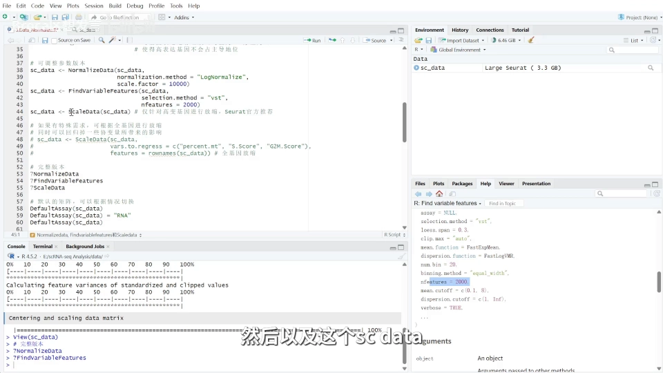跑完之后画一张高变基因图，红色点是选中的 2000 个高变基因，图上会同时标出 `Variable count: 2000` 与 `Non-variable count: 30637`——也就是说，3 万多个基因里，真正进入下游分析的只有这 2000 个 [【跳转到 10:55】](https://www.bilibili.com/video/BV17MmhBNEvx/?t=655)。

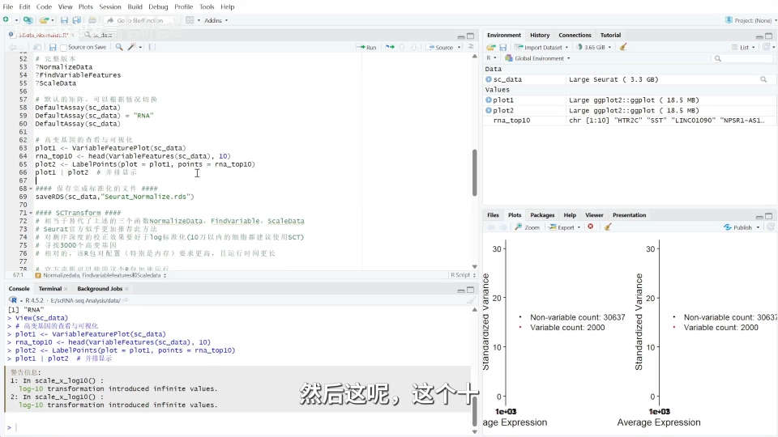

## 五、ScaleData：把量纲拉平，以及「回归掉协变量」的争议

第三步 `ScaleData` 做的是放缩：把表达值转成均值为 0、方差为 1 的矩阵，目的是让高表达的基因不会在后续降维中占主导地位 [【跳转到 04:10】](https://www.bilibili.com/video/BV17MmhBNEvx/?t=250)。

一个细节值得注意：`ScaleData` 默认**只对高变基因放缩**，而不是全部基因。讲者的解释是——本来咱们也就只分析这 2000 个基因，没必要把所有基因都放缩一遍 [【跳转到 07:30】](https://www.bilibili.com/video/BV17MmhBNEvx/?t=450)。如果确实需要全基因放缩，可以显式写 `features = rownames(sc_data)` 把行名全部当作 feature 传进去 [【跳转到 09:35】](https://www.bilibili.com/video/BV17MmhBNEvx/?t=575)。

`ScaleData` 还有一个更值得讨论的参数：`vars.to.regress`。讲者给出的示例是：

```r
sc_data <- ScaleData(sc_data,
  vars.to.regress = c("percent.mt", "S.Score", "G2M.Score"),
  features = rownames(sc_data))   # 全基因放缩
```

`percent.mt` 是线粒体基因比例，`S.Score` 和 `G2M.Score` 是细胞在 S 期、G2M 期的周期评分。所谓「回归」，讲者的定义是：**在原有数据中剔除这些因素对原有数据的影响** [【跳转到 09:10】](https://www.bilibili.com/video/BV17MmhBNEvx/?t=550)。

这一步在方法学上是有争议的，原因正好呼应上一节的「假设」框架：

- 回归掉线粒体比例，等于假设「线粒体比例高带来的表达变化全是技术性的」。但线粒体比例高本身可能就是某种真实状态（比如应激、凋亡倾向），一刀切回归会把这类生物学信号一起减掉；
- 回归掉细胞周期评分，等于假设「细胞周期不是你要研究的东西」。如果你研究的恰好是增殖相关基因的扰动响应，这一步就会把效应抹平；
- 而且回归是在**归一化后的值**上做的，误差会叠加：归一化假设错了一次，回归又假设错一次。

所以这一节的态度应该是：`vars.to.regress` 不是「开了更好」，而是「开了就多声明一条假设」。它默认是关的（`vars.to.regress = NULL`），这个默认值本身是有道理的。

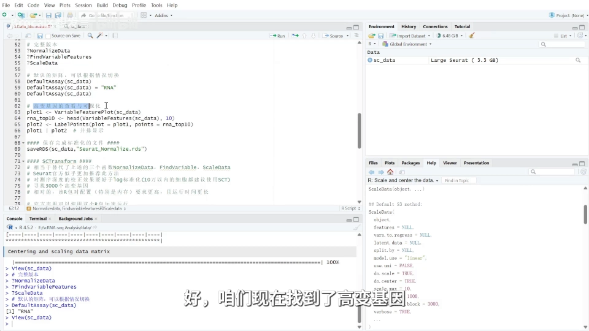

## 六、把方法排成族谱：差别不在「准不准」，而在「假设什么」

视频只演示了 Seurat 里的两条路线，但要把它们放对位置，需要先看一眼整个族谱。按「假设」而不是按「软件」分类，主流的归一化可以归成四支：

| 方法族 | 它假设什么 | 输出的值是什么 | 典型实现 |
| :--- | :--- | :--- | :--- |
| 总量缩放（CPM / 每万计数） | 每个细胞的总 RNA 量相同 | 相对丰度 | `scale.factor` 缩放 |
| 对数变换（log1p） | 方差随均值增长，取对数可稳定 | 压缩后的相对丰度 | `LogNormalize` |
| 基于池化的缩放（pooling） | 单个细胞的缩放因子估不准，可以互相「借」计数 | 校正后的缩放因子 | scran 的思路 |
| 正则化负二项回归 / 残差 | counts 服从负二项分布，方差可由均值预测 | 残差（可正可负） | `SCTransform`、Pearson residuals |

逐支解释一下后两支，因为它们是视频里 SCTransform 的理论背景：

**池化（pooling）**：LogNormalize 的缩放因子是「这个细胞自己的总 counts」，细胞测得越浅，这个估计就越不稳。scran 那类方法的思路是：先把细胞按表达相似度粗分组，组内细胞的 counts 加起来得到一个「池」，用池的总量去估计组内每个细胞的缩放因子。这样低深度细胞不会因为「总共只测到几百个 UMI，某个基因恰好占了很大比例」而出现高表达假象。它的代价是需要先分组，且分组本身又引入一层假设。

**正则化负二项回归 / Pearson 残差**：这两支不再问「除以多少」，而是问「在这个基因的平均表达水平下，观测到的 count 偏离期望有多远」。把 counts 建模为负二项分布，用基因的平均表达去预测它的方差，然后取观测值与期望值之间的残差：

$$
\text{residual}_{c,g} = \frac{\text{count}_{c,g} - \mu_{c,g}}{\sqrt{\sigma^{2}_{c,g}}}
$$

其中 $\mu_{c,g}$ 是该细胞该基因的期望 count，$\sigma^{2}_{c,g}$ 是负二项模型给出的方差。`SCTransform` 用的是正则化负二项回归得到的残差，Pearson residuals 则是把这个残差用解析式直接算出来。两者都**同时完成了归一化与方差稳定**——因为除以标准差这个动作本身就把「大方差」压下去了。

这一支有一个解释上的陷阱，必须记住：**残差不再是表达量，它可以是负数**。看到某个基因的残差是 $-2$，你不能说「这个基因的表达是负的」，只能说「比模型期望低了两个标准差」。这是换方法要付的解释成本。

**所以族谱的读法是**：总量缩放假设「总 RNA 相同」，SCTransform 假设「负二项」，Pearson 残差假设「解析近似」。没有哪一支是「正确」的，它们是对同一份 counts 的三种不同建模。

## 七、SCTransform：一行代码换掉整条链

SCTransform 是 Seurat 官方现在比较推荐的新方法，讲者对它的定位是：相对传统 LogNormalize **更稳健、更准确**，而且选出的高变基因更多 [【跳转到 11:59】](https://www.bilibili.com/video/BV17MmhBNEvx/?t=719)。

它的默认高变基因数是 **3000** 个，而不是 2000 个。讲者同样用问号查帮助页，`variable.features.n = 3000`、`do.correct.umi = TRUE`、`n_cells = 5000` 这些默认值都能看到 [【跳转到 12:24】](https://www.bilibili.com/video/BV17MmhBNEvx/?t=744)。

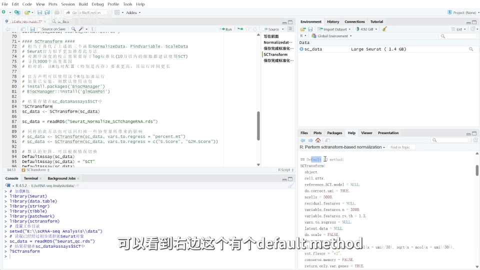

官方给它的优点是三条 [【跳转到 12:49】](https://www.bilibili.com/video/BV17MmhBNEvx/?t=769)：

1. 校正测序深度的效果更好；
2. 更少受技术噪音影响；
3. 在 10 万个以内的细胞规模上非常稳定。

**它最大的价值是「一行顶三步」**：`SCTransform` 一行代码就同时完成了标准化、寻找高变基因、放缩三件事 [【跳转到 14:04】](https://www.bilibili.com/video/BV17MmhBNEvx/?t=844)。这正好对应上一节的族谱——它不是「另一种除以总数的方法」，而是把整条链换成了一个统计模型。

代价也很具体，讲者讲得很实在：

- **配置要求高、耗时长**：这份 1.4 G 的数据，讲者说自己的机器「至少也得运行十几二十分钟」，所以视频里直接读取了之前跑好的结果 [【跳转到 13:14】](https://www.bilibili.com/video/BV17MmhBNEvx/?t=794)；
- **结果文件翻倍**：因为 SCTransform 不是覆盖原来的 RNA 层，而是在原始数据上**又增加了一组数据**，相当于把 RNA 复制一份再标准化，形成一个新的 assay [【跳转到 14:54】](https://www.bilibili.com/video/BV17MmhBNEvx/?t=894)。讲者后来在文件管理器里直接对比：传统路线存出来是 675 MB，SCTransform 存出来是 1.36 GB，差不多翻倍 [【跳转到 16:34】](https://www.bilibili.com/video/BV17MmhBNEvx/?t=994)。

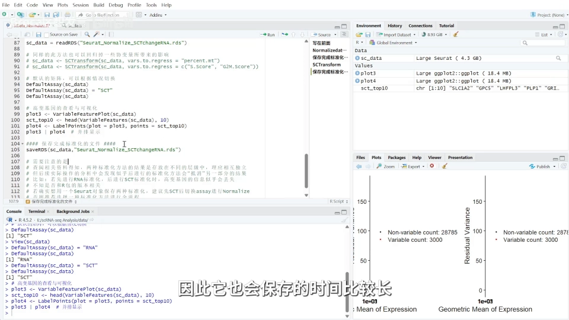

跑完 SCTransform 之后有一个必须知道的变化：**默认 assay 从 `RNA` 变成了 `SCT`**。讲者演示了 `DefaultAssay(sc_data)` 的返回值，以及怎么切回 `RNA`、再切回 `SCT` [【跳转到 15:19】](https://www.bilibili.com/video/BV17MmhBNEvx/?t=919)。这个细节重要，是因为后续所有函数（画图、找差异基因）默认都作用在当前 assay 上——你以为在分析 RNA 层，其实在分析 SCT 层，是很常见的翻车点。

高变基因图也跟着变了：纵轴从「标准化方差」变成了「残差方差」，标注是 `Variable count: 3000` [【跳转到 16:59】](https://www.bilibili.com/video/BV17MmhBNEvx/?t=1019)。这张图本身就是「换了方法、换了值」最直观的证据。

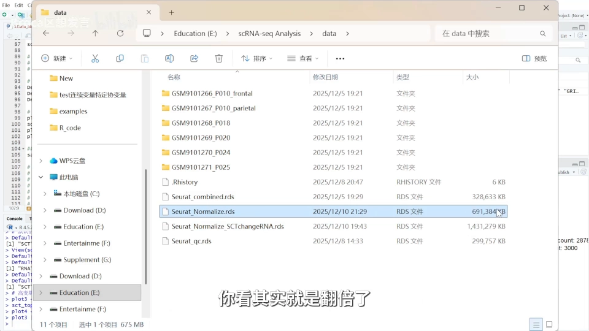

## 八、两种方法不能混用：一个实测出来的坑

讲者在这里分享了一个「查资料查不到、自己踩出来」的问题，是这支视频最有价值的部分之一。

按理说，两种方法的结果分别存在不同的 assay 里，理论上应该相互独立 [【跳转到 17:24】](https://www.bilibili.com/video/BV17MmhBNEvx/?t=1044)。但讲者发现：如果先做传统的 normalize、再做 SCT，也就是想把两种标准化结果同时保存在一个 Seurat 对象里，**高变基因的一些特征会被覆盖或者清空** [【跳转到 17:49】](https://www.bilibili.com/video/BV17MmhBNEvx/?t=1069)。讲者坦言不知道原因出在哪里。

他给出的建议是三条 [【跳转到 18:14】](https://www.bilibili.com/video/BV17MmhBNEvx/?t=1094)：

1. **要么只做传统路线**：`NormalizeData` + `FindVariableFeatures` + `ScaleData`，然后保存；
2. **要么只做 SCTransform**，不要两个混用；
3. 如果实在要同时保留，**先跑 SCTransform，把 default assay 切成 RNA，再做传统 normalize**——按他的测试这样能较好地保存两种结果。

但他随即说「我觉得没什么必要」：两个都算，文件太大，后期读取花的时间更多。如果目的是对比两种方法，不如**存成两个文件、分别做后续分析** [【跳转到 18:39】](https://www.bilibili.com/video/BV17MmhBNEvx/?t=1119)。

这个坑的方法学含义比操作技巧更重要：**归一化结果不是「数据的一个属性」，而是「对象的一个状态」**。它存在哪个 assay、当前默认 assay 是哪个、什么时候被覆盖，都会影响你后面读到的数。所以做方法对比时，最稳的做法是「一个方法一个对象、一个对象一个文件」，而不是在一个对象里来回切。

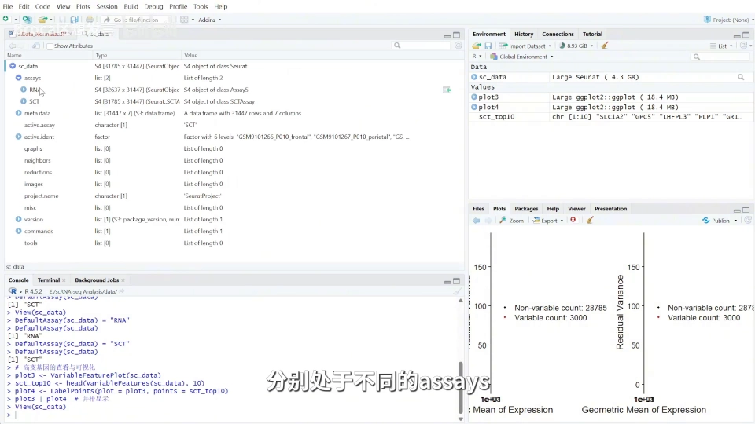

## 九、怎么选：三条判据

讲者最后的总结很克制：经过质控之后，两种标准化方法**选其一即可**；传统路线更快更便捷，SCTransform 一行解决但配置与时间成本更高 [【跳转到 19:29】](https://www.bilibili.com/video/BV17MmhBNEvx/?t=1169)。如果把这句话展开成可操作的判据，可以归成三条：

**判据一：下游要做什么。**

- 如果下游是**降维、聚类、可视化**，你需要的是「方差稳定、量纲可比」的值，SCTransform / Pearson 残差这类方法更合适，因为它们同时做了归一化和方差稳定；
- 如果下游是**差异表达**，尤其是 pseudobulk 那类把细胞聚合成样本再比较的做法，**原始 counts 配一个合适的计数模型通常比归一化后的值更稳**——因为归一化会破坏 counts 的方差结构，而计数模型恰恰要吃这个结构。具体方法见 5.2.2，本文不展开。

**判据二：数据规模。**

- 细胞数很大时，pooling 类方法的优势明显——它本来就是为大规模数据设计的，用「池」来稳定单个细胞的缩放因子估计；
- 反过来，SCTransform 在 10 万个细胞以内很稳定 [【跳转到 12:49】](https://www.bilibili.com/video/BV17MmhBNEvx/?t=769)，但计算成本随规模上升，讲者用 1.4 G 数据跑了十几二十分钟就是例子。

**判据三：可解释性。**

- 总量缩放和 log1p 给出的仍然是「表达量」，你可以说「这个基因在 A 细胞里表达更高」；
- SCTransform / Pearson 残差给出的是「残差」，它可正可负，你只能说「比期望高/低多少个标准差」。如果你要和实验的人对话、要解释「这个基因表达上调了几倍」，残差不是好语言。

一句话收束：**没有「最好的归一化」，只有「和你下游问题匹配的归一化」**。

## 十、归一化是分析假设的第一次显式声明

回到开篇的中心思想。这一节做的所有选择，本质上都是在回答同一个问题：**「细胞之间的差异里，哪些是技术性的、应该除掉？」**

- 选择 LogNormalize，你声明了「总 RNA 量相同、对数能稳定方差」；
- 选择 SCTransform，你声明了「counts 服从负二项、方差可由均值预测」；
- 打开 `vars.to.regress`，你又追加声明了「线粒体比例和细胞周期是噪音」。

这些声明一旦做出，后面所有「生物学发现」都建立在它上面：高变基因名单是它的产物，降维坐标是它的产物，聚类边界是它的产物。**归一化不是预处理，而是建模的第一步。**

还有一条与前面章节的呼应值得记住：**零值问题在归一化这一步会被放大**。伪计数把 0 变成 0、把 1 变成 0.693，log 变换改变了零与低值之间的距离；而残差类方法干脆把「0 与期望的偏离」直接写进了数值里。所以 2.4.1 讲过的 dropout，并不是一个只在质控阶段才需要考虑的问题——它在归一化里换了副面孔继续存在。

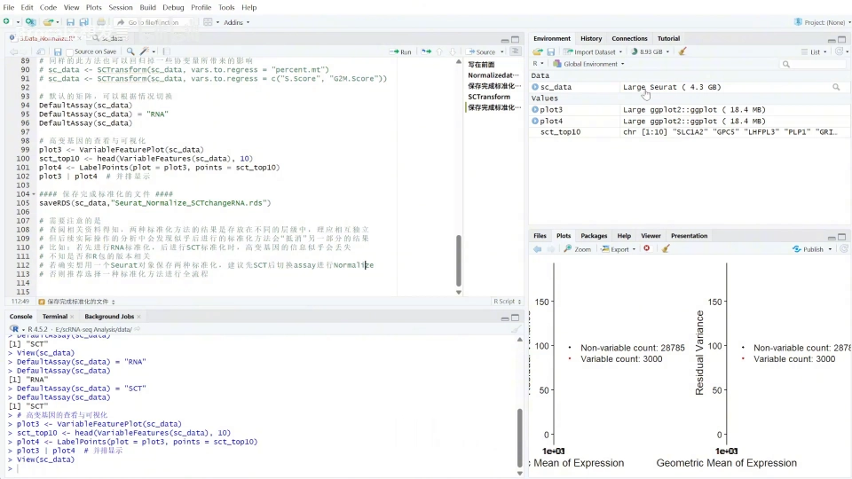

## 小结

- **标准化只除掉一件事**：细胞之间测序深度的不均；批次效应它管不了，那是 5.1.3 的话题。
- **传统路线是三步链**：`NormalizeData`（去深度）→ `FindVariableFeatures`（选 2000 个高变基因）→ `ScaleData`（拉到均值 0、方差 1）。
- **LogNormalize 的公式带着两个假设**：除以总 counts 假设「总 RNA 相同」，`log1p` 的伪计数改变了零与低值的行为。
- **高变基因是在归一化后的值上算的**，所以换归一化 → 换名单 → 换降维 → 换聚类，链头换了链尾全变。
- **`vars.to.regress` 是追加假设而不是优化**：回归线粒体比例、细胞周期，可能把真实生物学信号一起减掉，默认是关闭的。
- **SCTransform 一行顶三步**：默认 3000 个高变基因，更稳健，但耗时、占内存、文件翻倍，且默认 assay 会变成 `SCT`。
- **两种方法不要混用**：先 normalize 再 SCT 会覆盖高变基因特征；要对比就存成两个文件。
- **选择判据三条**：下游任务（降维聚类 vs 差异表达）、数据规模、可解释性。

## 关键术语速查

| 术语 | 一句话解释 |
| :--- | :--- |
| 测序深度 | 一个细胞里被测到的 UMI 总数，是标准化要除掉的主要技术差异 |
| `LogNormalize` | Seurat 默认归一化：count 除以细胞总 counts、乘 10000、取 `log1p` |
| `scale.factor` | 上面的 10000，把相对丰度放大到一个便于阅读的量级 |
| `log1p` | $\ln(1+x)$，加 1 是为了避免 $\ln(0)$，这个 1 就是伪计数 |
| 伪计数（pseudo-count） | 为避免零值人为加上的常数，会改变零与低表达值之间的相对距离 |
| 总量缩放（CPM） | 除以总量再乘常数的一族方法，假设每个细胞总 RNA 相同 |
| 池化（pooling） | scran 的思路：用一组细胞合并的 counts 来稳定单个细胞的缩放因子 |
| 高变基因（HVG） | 在细胞间变异最大的基因，默认取 2000 个（SCT 为 3000 个）进入降维 |
| `vst` | Seurat 选高变基因的默认方法，先按表达水平分层再比方差 |
| `ScaleData` | 把表达值放缩到均值 0、方差 1，避免高表达基因主导降维 |
| `vars.to.regress` | 在放缩时回归掉的协变量（如线粒体比例、细胞周期评分），默认 NULL |
| `SCTransform` | Seurat 官方推荐的新方法，用正则化负二项回归取残差，一行完成三步 |
| 正则化负二项 | 用基因平均表达预测其方差，并对参数估计做正则化以稳定结果 |
| Pearson 残差 | 用解析式算出的负二项残差，同时实现归一化与方差稳定 |
| assay | Seurat 对象里存放一份表达数据的层级，`RNA` 与 `SCT` 是两个不同的 assay |
| `DefaultAssay` | 当前默认作用的 assay，后续函数默认都作用在它上面 |
