# 单细胞降维与聚类全流程：PCA 负责算，分辨率负责分，UMAP 只负责看

> 视频来源：[【Broca】单细胞测序分析，降维与聚类全过程讲解！（附完整代码）](https://www.bilibili.com/video/BV1nrmQBAESq/)（Bilibili · Broca区想发言）｜时长约 24 分钟
> 简要导读：这是 Seurat 标准流程里"质控与标准化之后、细胞注释之前"的那一段。UP 主一边跑代码一边讲每一步在做什么，重点落在两件初学者最容易被卡住的事上：**PC 该选几个**、**resolution 该选多大**。本文按"降维 → 聚类 → 可视化"的顺序整理，并把他反复强调的"UMAP 上的远近不能当距离用"单独拎出来讲。

## 本讲要解决的核心问题（SCQA）

**背景**：单细胞数据经过质控与标准化后，每个细胞仍然带着几千到几万个基因的表达值。我们想知道的却是"这些细胞分几类、每类是什么"，而这件事在几万维空间里既看不见、也算不动。

**冲突**：于是大家都会跑 `RunPCA` → `FindClusters` → `RunUMAP` 这三行代码，图也出来了、颜色也画上了。但图上的群到底是"数据的客观结构"还是"参数选出来的结果"？PC 取 10 个和取 40 个、resolution 取 0.5 和取 2，出来的群数可以差一倍——**同一份数据，换参数就换结论**。

**疑问**：降维、聚类、可视化这三步各自到底在做什么？哪些参数真正决定结论？图和群能不能直接当成细胞类型？

**回答（中心思想）**：这三步是三种不同的动作——**PCA 把维度压下来并保留全局结构，是"算"的基础；图聚类在 PCA 空间里按相似度分组，分几群由 resolution 决定；UMAP/tSNE 只做二维展示，不参与计算**。所以分辨率没有"正确值"，只有"对当前问题合适"；聚类结果是"某个分辨率下的划分"，不是"真实的细胞类型清单"。细胞类型要靠下一步的注释（marker、参考映射）来给名字。

## 一、为什么单细胞必须先降维：几千个基因画不到一张图上

UP 主把降维的必要性说得非常直接（[【跳转到 00:25】](https://www.bilibili.com/video/BV1nrmQBAESq/?t=25)）：单细胞数据本质上是一个**高维矩阵**，每一行是一个细胞，每一列是一个基因，一个细胞就带着成千甚至更多的基因表达值。这样的数据有两个问题：

1. **看不见**：人眼只能理解二维、三维的图，几万维没法直接可视化；
2. **噪声多**：绝大多数基因在绝大多数细胞里都是 0 或接近 0，真正携带生物学差异的只是少数方向，其余都是干扰信息。

所以第一步要做的，是**把几千几万个基因压缩成少量"但能够代表生物学差异"的维度**（[【跳转到 00:50】](https://www.bilibili.com/video/BV1nrmQBAESq/?t=50)）。承担这个任务的是 **PCA（Principal Component Analysis，主成分分析）**。

这里有个容易被忽略的细节：**降维不只是为了画图，它同时在做去噪**。UP 主在讲 `RunPCA` 的目的时说得很清楚——把几千个基因降成几十个 PC，既是对数据去噪，也是为后续的聚类和可视化提供输入（[【跳转到 05:25】](https://www.bilibili.com/video/BV1nrmQBAESq/?t=325)）。换句话说，**后面聚类用的不是原始表达矩阵，而是 PCA 空间里的坐标**。这一点决定了 PCA 的质量会一路传导到聚类结果。

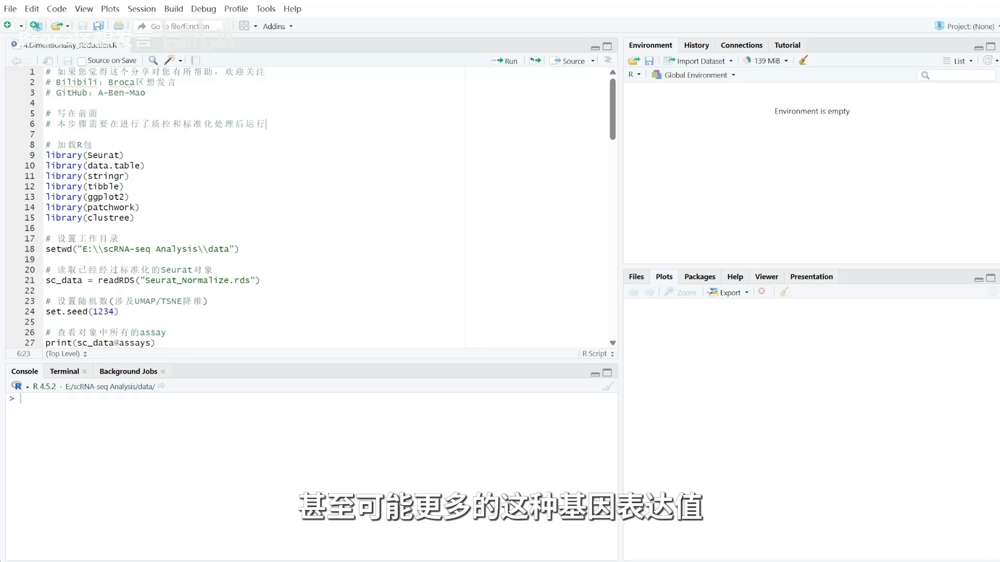

## 二、PCA：把相关基因压成主成分，它负责"算"

### 2.1 第一张图先回答"样本混没混"

`RunPCA` 之后，UP 主画的第一张图是 **PC1 对 PC2 的散点图**，每个点是一个细胞，颜色代表样本来源（[【跳转到 05:50】](https://www.bilibili.com/video/BV1nrmQBAESq/?t=350)）。这张图的读法很具体：

- **点之间的距离反映的是"在主要变异方向上的相似程度"**——两个细胞在 PC1/PC2 上靠得近，说明它们在这些主要变异方向上表现相似；
- 但它的**主要用途不是看细胞类型，而是检查数据质量**：在同一个组织、同一个实验条件下测的多个样本，颜色应该是**混在一起**的。

UP 主的判断标准是：如果一块区域里既有紫色、又有蓝色、又有绿色、又有橙色，就说明样本是混匀的，这是我们想要的情况（[【跳转到 06:40】](https://www.bilibili.com/video/BV1nrmQBAESq/?t=400)）。反过来，**如果不同样本各自成团、颜色几乎不重叠，就极大可能存在批次效应**（[【跳转到 07:05】](https://www.bilibili.com/video/BV1nrmQBAESq/?t=425)）。

他这份数据在这张图上分成了 6 个大团，颜色彼此交叠，因此判断数据质量较好、大类细胞都已经被捕捉到，后续聚类往往比较顺利。这个"先看 PCA 图再往下走"的习惯很值得学：**批次问题在二维 PCA 上就能看出苗头，不必等到 UMAP 才发现**。

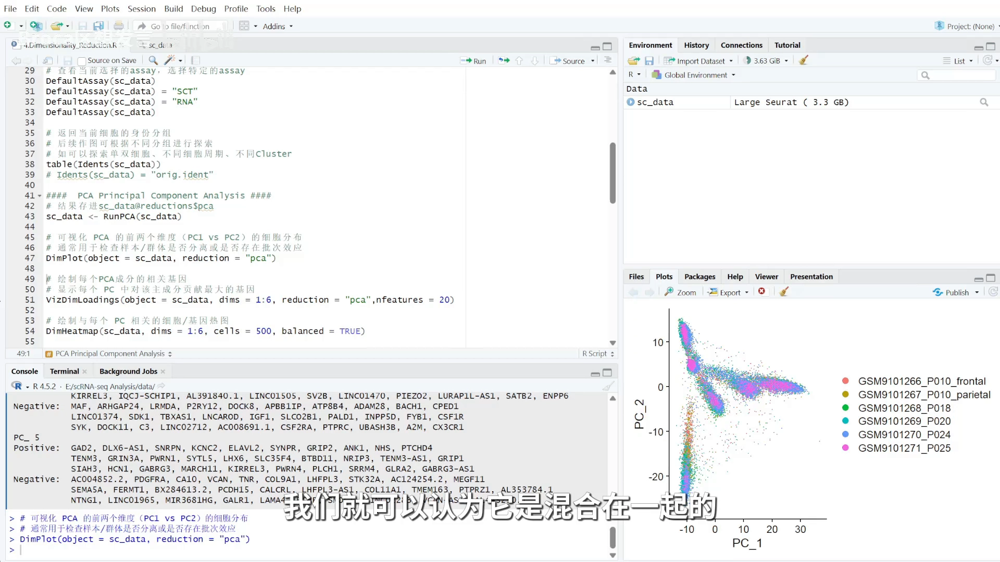

### 2.2 主成分本身没有生物学意义，要回看基因

这是本讲第一个"反直觉"的点。UP 主强调：**主成分分析是一种数学方法，这些成分往往没有固定的生物学意义**（[【跳转到 07:30】](https://www.bilibili.com/video/BV1nrmQBAESq/?t=450)）。PC1 不是一个基因、也不是一条通路，它只是数据方差最大的那个方向。

那怎么把"数学的主成分"翻译成"生物学的话"？靠**看每个 PC 上贡献最大的基因**：

- `VizDimLoadings` 画出每个 PC 上上调、下调最明显的基因（[【跳转到 08:06】](https://www.bilibili.com/video/BV1nrmQBAESq/?t=486)）；
- `DimHeatmap` 则把每个 PC 里高表达/低表达的基因与细胞画成热图（[【跳转到 09:07】](https://www.bilibili.com/video/BV1nrmQBAESq/?t=547)）。

UP 主举了一个很实用的例子：如果 PC1 上高表达的基因是 MKI67、TOP2A 这类，那这个主成分大概率与**细胞周期**有关（[【跳转到 08:31】](https://www.bilibili.com/video/BV1nrmQBAESq/?t=511)）。这就是把数学成分解释成生物学含义的标准做法。他还提醒，**这几张图通常不会出现在论文正文，最多作为补充图**——它们是给自己看的诊断图，不是结论。

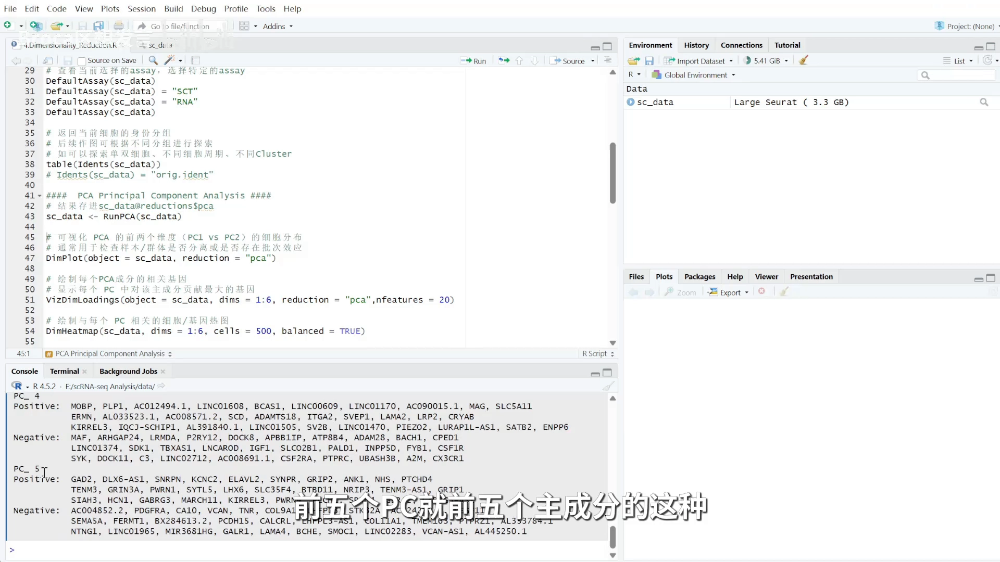

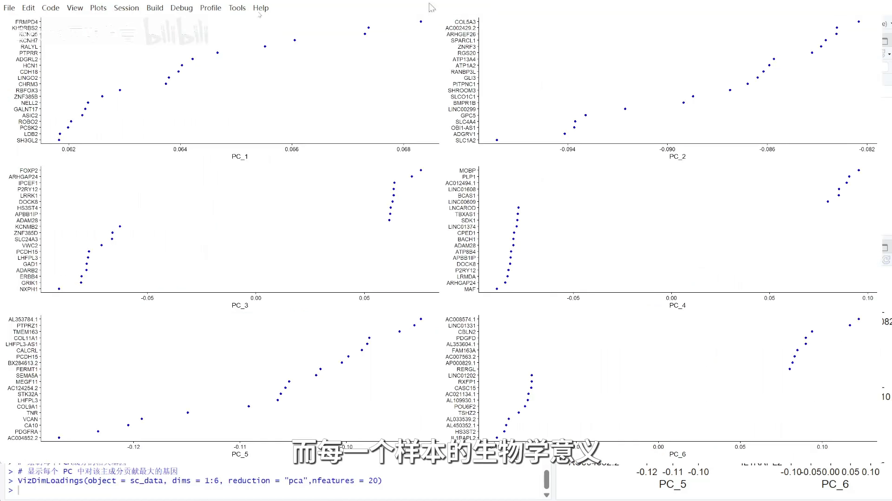

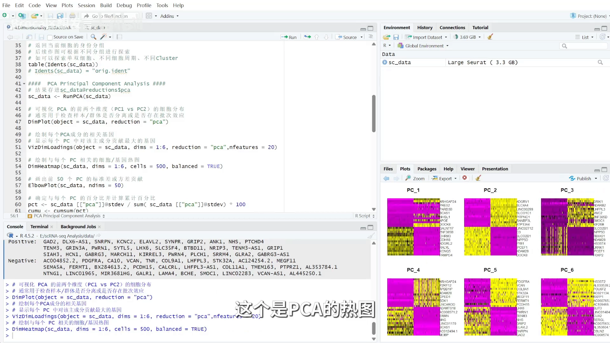

### 2.3 选多少个 PC：肘部 + 累计贡献 80%~90%

PCA 会把数据分成很多个主成分，但**并不是每一个主成分都值得放进下游分析**。UP 主给了两把尺子（[【跳转到 10:10】](https://www.bilibili.com/video/BV1nrmQBAESq/?t=610)）：

**第一把尺子是肘部（elbow）**。`ElbowPlot` 画出每个 PC 的标准差——可以理解为"解释变异的能力"。曲线一开始陡降，然后逐渐变平；**曲线变平的位置就是肘部**，也就是 PC 数量的参考点。

**第二把尺子是累计方差贡献**。代码是先把每个 PC 的方差占比算出来，再累加：

$$
\text{pct}_k = \frac{\sigma_k}{\sum_{i=1}^{50}\sigma_i}\times 100\%,\qquad \text{cumu}_k=\sum_{i=1}^{k}\text{pct}_i
$$

其中 $\sigma_k$ 是第 $k$ 个主成分的标准差。UP 主的经验是**取累计贡献落在 80%~90% 之间的那个 PC 数**（[【跳转到 11:25】](https://www.bilibili.com/video/BV1nrmQBAESq/?t=685)）。他当场念出了自己数据的数值：28 个 PC 时贡献度还不到 80%，到 33 个 PC 约 80%，到 40~41 个 PC 约 90%。

由此得到一条可以直接照抄的经验值：**一般选 20~40 个 PC**。他这份数据作为演示选了 40 个（[【跳转到 11:50】](https://www.bilibili.com/video/BV1nrmQBAESq/?t=710)）。

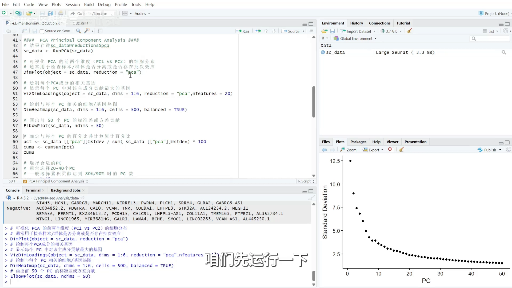

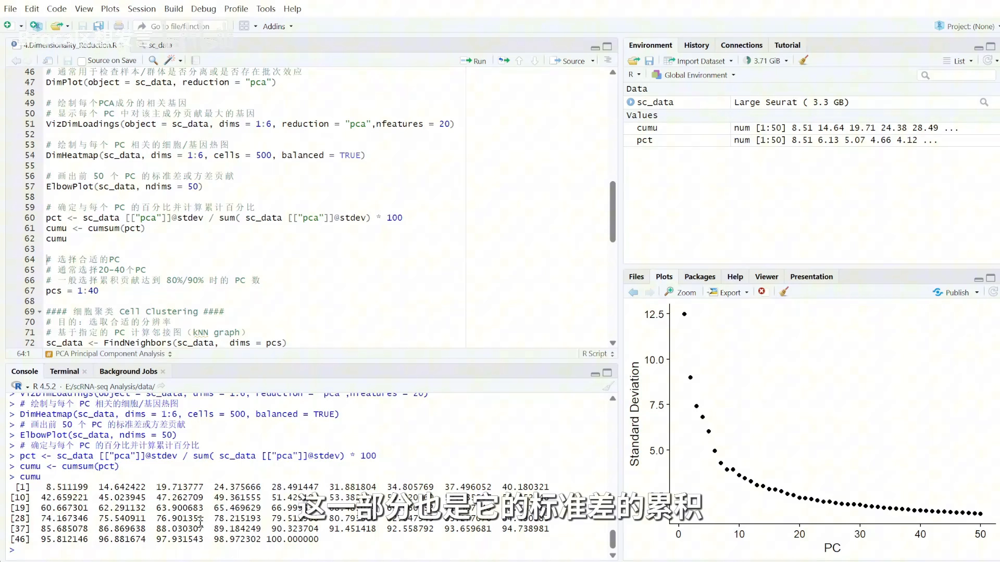
## 三、聚类：在 PCA 空间里建图、找社区，分辨率决定分几群

### 3.1 先建 KNN 图，再找社区

选好 PC 数之后，`FindNeighbors` 做的是：**在主要变异空间里找出哪些细胞彼此更邻近**——UP 主的说法是"就是哪些细胞是邻居、它们挨得更近"（[【跳转到 12:15】](https://www.bilibili.com/video/BV1nrmQBAESq/?t=735)）。

这一步的产物是一张 **KNN 图（k-nearest neighbor graph，k 近邻图）**：每个细胞是一个节点，和它最相似的 $k$ 个细胞之间连一条边。有了这张图，聚类问题就变成了图上的"社区发现"问题——**同一社区里的细胞彼此连接密集，不同社区之间连接稀疏**。

这也解释了一件事：**聚类的输入是 PCA 坐标，不是原始表达矩阵**。所以前面 PC 选少了、选多了，都会改变这张图，进而改变聚类结果。

### 3.2 resolution：调大群更碎，调小群更粗

`FindClusters` 里最关键的参数就是 **resolution（分辨率）**。UP 主的解释非常直白（[【跳转到 12:40】](https://www.bilibili.com/video/BV1nrmQBAESq/?t=760)）：

- **分辨率小** → 看得更"整体" → cluster 数量更少（它没有能力把群拆开）；
- **分辨率大** → 看得更"精细" → cluster 数量更多。

他紧接着补了一句本讲最重要的话：**"当然这里没有一个最优解。"**（[【跳转到 13:30】](https://www.bilibili.com/video/BV1nrmQBAESq/?t=810)）这一点值得反复强调——resolution 不是模型里那个"调对了就收敛"的超参数，它更像是**显微镜的放大倍数**：放大 10 倍还是 40 倍，取决于你想看细胞核还是看组织。

### 3.3 用 clustree 把"分辨率谱"一次看全

既然没有唯一解，做法就是**把一整串分辨率都跑一遍，再挑**。UP 主的代码是把 resolution 从 0.1 到 2、步长 0.1 的每个值都跑一次聚类，然后用 **clustree** 包画成树状图（[【跳转到 13:55】](https://www.bilibili.com/video/BV1nrmQBAESq/?t=835)）。

这张图的读法：

- **横向**：越往左分辨率越高，节点越多；
- **节点大小**：代表该 cluster 里的细胞数；
- **连线**：表示低分辨率下的一个群，在高分辨率下分裂成了哪几个群。

UP 主在这张图上指出，最右边一列（resolution = 0.1）分出 15 个 cluster，往左依次增加 0.1，到 resolution = 2 时 cluster 数目"非常大"（[【跳转到 14:35】](https://www.bilibili.com/video/BV1nrmQBAESq/?t=875)）。**同一份数据，从 15 群到几十群，只是参数不同**——这就是"聚类数不是生物学事实"最直观的演示。

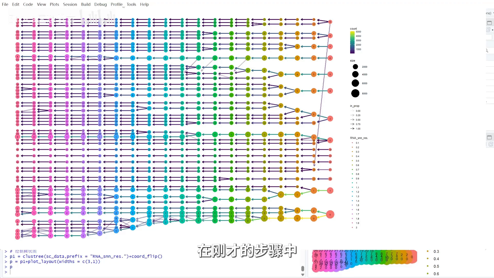

### 3.4 怎么挑一个"合适"的分辨率

UP 主给了一套可操作的判断标准（[【跳转到 15:25】](https://www.bilibili.com/video/BV1nrmQBAESq/?t=925)）：

1. **大部分 cluster 稳定存在**——在相邻的多个分辨率下都出现，说明这个群是稳的；
2. **少数 cluster 随分辨率提高而合理分裂**——比如一个大群在高分辨率下拆成两个亚群，这是正常的；
3. **没有出现大规模的"爆炸式分裂"**——如果一个群往下突然裂成一大堆，说明分辨率已经过头了。

他自己的习惯是**选 0.5~1 之间**（[【跳转到 15:50】](https://www.bilibili.com/video/BV1nrmQBAESq/?t=950)）。判断的具体手法是看 clustree 里"下一步"有没有剧烈分叉：如果某个分辨率下每个节点都往下分成两个、两个、两个……那就说明分得太细了。

还有一个非常实用的**硬约束**：**每个 cluster 最好大于 100 个细胞**（[【跳转到 16:15】](https://www.bilibili.com/video/BV1nrmQBAESq/?t=975)）。原因是下一步的细胞注释要在每个群里找差异基因、比对 marker，细胞数太少的群既做不了统计，也支撑不起结论。**分得太细的直接后果不是"更精确"，而是"注释做不下去"**——这是分辨率与注释之间最重要的一条耦合。

他最终在这份数据上选了 **resolution = 0.5**（[【跳转到 16:40】](https://www.bilibili.com/video/BV1nrmQBAESq/?t=1000)）。

## 四、UMAP 与 tSNE：只负责"看"，不负责"算"

### 4.1 为什么 PCA 之后还要再降一次

到这里数据已经在 PCA 空间里了，为什么还要 UMAP？UP 主的理由很明确（[【跳转到 02:05】](https://www.bilibili.com/video/BV1nrmQBAESq/?t=125)）：**PCA 是线性降维，不太适合直接展示复杂的细胞结构**。线性方法只能找"直线方向"上的最大方差，而细胞类型之间的关系往往是非线性的（比如一个类型分化出两支）。

所以用 **UMAP 和 tSNE 这类非线性降维，把细胞投射到二维空间**，目的是**更直观地展示细胞群体的结构**，以及查看不同 cluster 之间的分离情况、是否存在批次效应（[【跳转到 02:30】](https://www.bilibili.com/video/BV1nrmQBAESq/?t=150)）。

### 4.2 UMAP 与 tSNE 的分工：一个看关系，一个看边界

UP 主对这两个方法的比较很到位（[【跳转到 18:25】](https://www.bilibili.com/video/BV1nrmQBAESq/?t=1105)）：

- **UMAP 更擅长保留局部特征，同时兼顾一定的全局关系**。它的细胞远近**能够反映**不同 cluster 的相似程度——比如 cluster 1 和 cluster 21 的基因表达相似度，肯定比 cluster 1 和 cluster 8 更近（[【跳转到 18:50】](https://www.bilibili.com/video/BV1nrmQBAESq/?t=1130)）。
- **tSNE 的优点是把 cluster 画得非常分明**，每个群都是独立的一坨，边界清楚；有些在 UMAP 上挨得特别近的群（他点名了 20、28、9、10、11 这几个），在 tSNE 上就分得开（[【跳转到 19:15】](https://www.bilibili.com/video/BV1nrmQBAESq/?t=1155)）。

因此在论文正文里 **UMAP 用得更多**，因为它能呈现全局关系；而 **tSNE 适合用来确认小群体能不能被分离出来**（[【跳转到 21:20】](https://www.bilibili.com/video/BV1nrmQBAESq/?t=1280)）。

### 4.3 必须记住的一条：簇间距离不能当距离用

这是整支视频里最该抄进笔记的一句提醒。UMAP 和 tSNE 都是**非线性、且带随机性**的嵌入方法，它们优化的目标是"让邻居还是邻居"（保留局部邻域），而不是"让距离等于距离"。后果是：

- **同一个群里点的疏密、两个群之间的空白宽度，都不代表生物学差异的大小**；
- 图上"离得远"只说明在这套嵌入里没有被拉近，**不能推出"这两类细胞差得多"**；
- 反过来，图上"挨得近"也不等于"是同一种细胞"——UP 主正是用这一点来解释为什么 tSNE 上还要再确认一遍小群体。

所以正确的用法是：**UMAP/tSNE 用来"看结构、发现异常"，不用来"测量差异"**。真要比较两个群差多少，要回到表达矩阵（差异表达、模块打分等）。

### 4.4 四张图各查什么

UP 主最后一次性画了四张图，每张的用途不同（[【跳转到 20:05】](https://www.bilibili.com/video/BV1nrmQBAESq/?t=1205)）：

| 图 | 上色依据 | 用来查什么 |
| :--- | :--- | :--- |
| UMAP | cluster | 有多少个群、群之间是否清晰分离、是否存在过度切分 |
| UMAP | 样本来源 | 每个群里不同样本是否充分混合，即是否存在批次效应 |
| tSNE | cluster | 小群体能否被分离出来 |
| tSNE | 样本来源 | 同上，换一个嵌入再确认一次 |

第二张图（UMAP 按样本上色）尤其重要：**如果一个 cluster 里不同样本充分混合，说明整合效果理想；如果某个 cluster 只有一种颜色、和其他颜色几乎不重叠，就要警惕技术因素的影响**（[【跳转到 20:30】](https://www.bilibili.com/video/BV1nrmQBAESq/?t=1230)）。他也留了余地——有些群本来就可能只来自某个样本（比如某种组织特异的细胞），这是合理的；但出现这种情况时，**至少要有意识地怀疑一次**。若确认是技术因素，才需要引入去批次效应的方法（这属于下一小节的内容）。

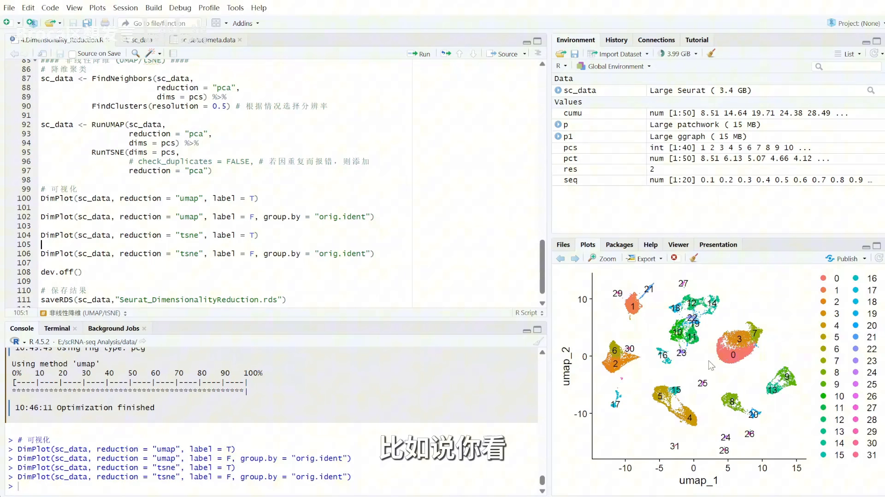

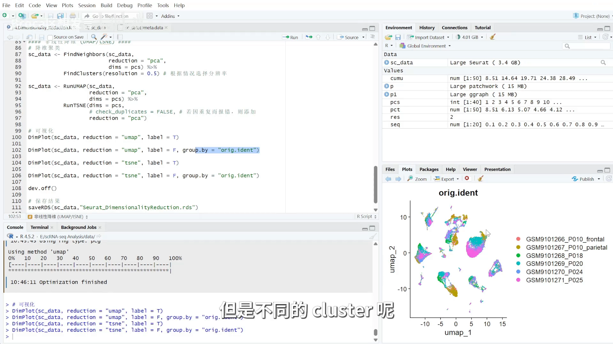

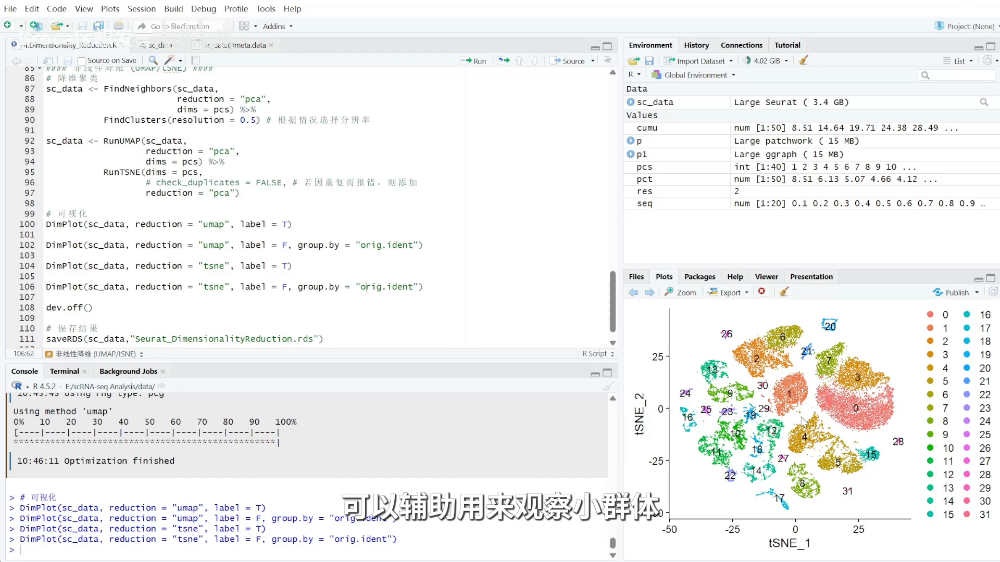

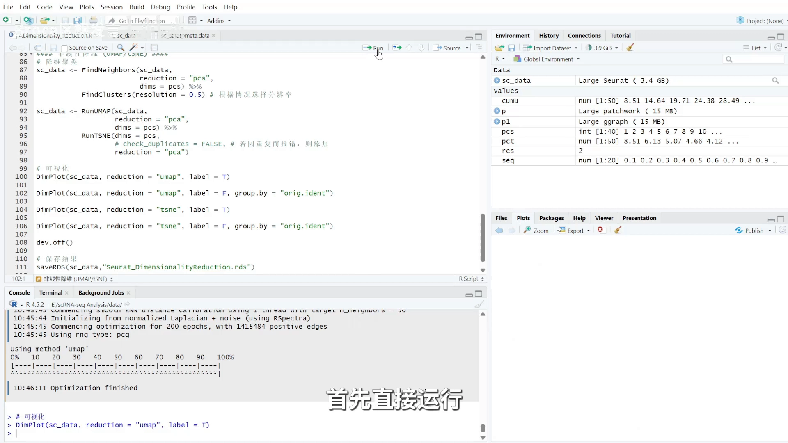

## 五、这条流水线为什么是后面所有分析的地基

UP 主在结尾把整条链路捋了一遍（[【跳转到 22:10】](https://www.bilibili.com/video/BV1nrmQBAESq/?t=1330)）：

```
质控 + 标准化后的数据
  → 选好 default assay
  → RunPCA（选 PC 数：肘部 / 累计贡献 80~90% / 经验 20~40）
  → FindNeighbors（在 PCA 空间建 KNN 图）
  → FindClusters（选分辨率：clustree 看谱系 → 0.5~1，每群 >100 细胞）
  → RunUMAP / RunTSNE（只做二维展示）
  → 得到可解释的 Seurat 对象 → 进入细胞注释
```

他还补充了一个对象结构上的细节：**降维结果都放在 `reductions` 这一层里**，`pca`、`umap`、`tsne` 都在那儿，所有画图函数取的就是这里面的数据（[【跳转到 22:35】](https://www.bilibili.com/video/BV1nrmQBAESq/?t=1355)）。理解这个层级很实用——它提醒你 **PCA 坐标和 UMAP 坐标是两套东西，各存在一处，不能混用**。

为什么说这是"地基"？因为后面每一个分析都建立在这一步的分组上：

- **细胞注释**：注释的对象就是这些 cluster，分辨率定得太细会让注释无从下手；
- **扰动比较**：对照组和处理组的差异表达，通常是"在某个细胞类型内部"做的，细胞类型分错了，比较就没有意义；
- **整合与跨数据集分析**：整合后的群要能和原来的群对上，靠的还是这套降维-聚类坐标；
- **预测模型**：模型的标签、评价的分组，都来自这里的注释结果。

一句话收束：**降维给你坐标，聚类给你组，注释给你名字**。前两步是数学，第三步才是生物学；而数学部分一旦参数选错，后面的生物学解释就会一路错下去。

## 小结

- **降维是为了"能算 + 能看"**：PCA 把几千个基因压成几十个主成分，既去噪，也为聚类提供输入；聚类用的是 PCA 坐标，不是原始表达矩阵。
- **PCA 的第一张图先查数据质量**：按样本上色，颜色混在一起说明没有明显批次效应，各自成团则要警惕。
- **主成分没有生物学意义**，要靠 `VizDimLoadings` / `DimHeatmap` 回看贡献最大的基因，才能翻译成"细胞周期"这类生物学解释。
- **PC 数用两把尺子定**：肘部 + 累计方差贡献 80%~90%，经验值 20~40 个。
- **resolution 没有最优解**：调大群更碎、调小群更粗；用 clustree 把 0.1~2 的谱系一次看全，选"多数群稳定、少数群合理分裂、没有爆炸式分裂"的那一档，常见区间 0.5~1。
- **分辨率受注释反向约束**：每个 cluster 最好大于 100 个细胞，分得太细会导致注释做不下去。
- **UMAP 保留局部兼顾全局、tSNE 边界更分明**；两者都只用于展示，**簇间距离不可解释**。
- **聚类 ≠ 细胞类型**：聚类是"某个分辨率下的划分"，细胞类型要靠下一步的注释来命名。

## 关键术语速查

| 术语 | 一句话解释 |
| :--- | :--- |
| PCA（主成分分析） | 线性降维方法，把相关基因压成互不相关的主成分，保留全局结构，是后续聚类的基础 |
| 主成分（PC） | PCA 输出的新坐标轴，本身无生物学意义，需回看其载荷基因来解释 |
| ElbowPlot | 画每个 PC 的标准差，曲线走平处（肘部）作为 PC 数的参考 |
| 累计方差贡献 | 前 $k$ 个 PC 解释的方差占比之和，常取 80%~90% 对应的 $k$ |
| KNN 图 | 每个细胞与最相似的 $k$ 个细胞连边构成的图，聚类的输入 |
| Louvain / Leiden | 图上的社区发现算法，用于把 KNN 图切成若干 cluster |
| resolution（分辨率） | 聚类粒度参数，越大 cluster 越多越碎；没有唯一正确值 |
| clustree | 把多个分辨率下的聚类结果画成树状图，用于挑选分辨率 |
| UMAP | 非线性降维，擅长保留局部邻域并兼顾一定全局关系，用于二维可视化 |
| tSNE | 非线性降维，倾向把不同群画得边界分明，适合确认小群体 |
| over-clustering（过度聚类） | 分辨率过高导致同一细胞类型被拆成多个群 |
| reductions | Seurat 对象中存放降维结果的层级，`pca`、`umap`、`tsne` 都在其中 |
