# Harmony 最快、CCA 最狠：四种单细胞整合方法的整合力度与速度权衡

> 视频来源：[14. 手把手教学多种整合方法：Harmony/CCA/RPCA/JointPCA](https://www.bilibili.com/video/BV1Vn4y197Un/)（B 站 · UP 主「生信幻想家」）｜时长约 10 分钟
> 导读：这是一节**纯实操的对照实验**——同一份三样本数据，用 Seurat V5 的同一个函数把 CCA、RPCA、JointPCA、Harmony 各跑一遍，再走完全相同的下游流程出 UMAP 对比。本文按「先定目标 → 一个函数四种方法 → 三件准备 → 四段代码 → 下游不变 → 结果对比 → 选型判据」组织，覆盖视频全部内容。字幕为 B 站 AI 转写，「P4 校正」等明显误识已按上下文校正为「批次校正」。

**本文与本小节另一篇的关系**：批次效应到底从哪来、ComBat 与 CellAnova 的公式长什么样、「过度整合」为什么危险——这些已经在姊妹篇《批次效应校正是一把双刃剑：从 ComBat 到 CellAnova》里讲透了，**本文不重复**，只接着往下走一步：当你已经决定要整合，手上这几种具体方法该怎么挑。

## 本讲要解决的核心问题（SCQA）

**背景**：手上是三个样本的单细胞数据（视频里用的是第七节课已经做完标准化、去质控、去细胞周期影响的那份 pbmc 数据）。直接降维聚类，你会看到细胞按「来自哪个样本」分成一团团——这就是批次效应。

**冲突**：Seurat V5 把 CCA、RPCA、JointPCA、Harmony 四种整合方法塞进了**同一个函数** `IntegrateLayers()`，换方法只需要改一个参数名。选择太多反而无从下手：官方文档告诉你「都可以用」，但没告诉你它们差在哪、什么时候该用哪个。

**疑问**：这四种方法到底有什么区别？是不是随便选一个都行？选错了会怎样？

**回答（中心思想）**：差别只有三件事——**批次去除的强弱（整合力度）、运行时间、以及对真实生物学异质性的保留程度**；除此之外，它们的用法、下游流程、产出物几乎完全一致。所以正确的做法不是「查资料找最优解」，而是**四个都跑一遍、用同一套下游流程出图、肉眼对比**，再按自己研究的异质性结构来选。视频作者的默认起点是 **Harmony**：它最快，代价是整合力度不强。

## 一、先定目标：整合到什么程度才算「对」

很多人一上来就问「哪个算法最好」，但视频开头先把这个问法拆掉了：**整合力度没有绝对的好坏，取决于你要整合的细胞本身有多大的生物学异质性。**

作者给了两条并列的目标：

| 细胞类型 | 异质性 | 期望的整合结果 |
| --- | --- | --- |
| 免疫细胞等 | 弱 | 来自不同样本的同类细胞**均匀地混在同一个细胞类型里** |
| 肿瘤细胞等 | 强 | **保持自身独特的细胞类型 / 亚型**，不要被硬拉平 |

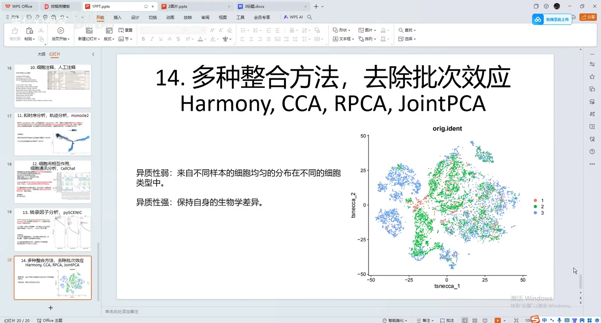

### 1.1 什么叫「异质性弱」

免疫细胞是典型例子。正常组、肿瘤组、健康组、疾病组的免疫细胞**成分差不多**，差别主要是「某类细胞多了一点、少了一点」。

[【跳转到 00:50】](https://www.bilibili.com/video/BV1Vn4y197Un/?t=50)

这类细胞正是整合最该发挥作用的地方：如果三个样本的 T 细胞各自聚成一坨，你会误以为「样本 1 有个特殊 T 细胞亚群」，其实只是批次把它推开了。**把它们混匀，才是还原真相。**

### 1.2 什么叫「异质性强」

肿瘤细胞是反例。它在正常组里**根本不存在**，只出现在肿瘤组；而且不同病人、不同分组的肿瘤细胞彼此差异极大。

[【跳转到 01:15】](https://www.bilibili.com/video/BV1Vn4y197Un/?t=75)

这类细胞如果被整合算法强行拉到一起，你丢掉的是**研究里最值钱的那部分信号**——病人之间的肿瘤异质性恰恰是你要找的东西。所以对强异质性细胞，**宁可让它按样本分开**。

这条区分是后面所有判断的地基：**同一张 UMAP 上，「混得好」对免疫细胞是优点，对肿瘤细胞可能是灾难。**

## 二、四种方法共用同一个入口：Seurat V5 的 `IntegrateLayers()`

Seurat 升级到 V5 之后，整合这件事被收进了一个统一函数。视频里作者的用法极简：

```r
pbmc <- IntegrateLayers(
  object = pbmc, method = CCAIntegration,
  orig.reduction = "pca", new.reduction = "integrated.cca",
  verbose = FALSE)
```

四个参数各管一件事，理解了它们，换方法就只是换个名字：

- `object`：要整合的 Seurat 对象；
- `method`：**用哪种方法**，这是唯一需要改的地方；
- `orig.reduction`：在哪个降维结果上做整合，这里是 `"pca"`；
- `new.reduction`：整合结果存到哪个名字下，这里是 `"integrated.cca"`。

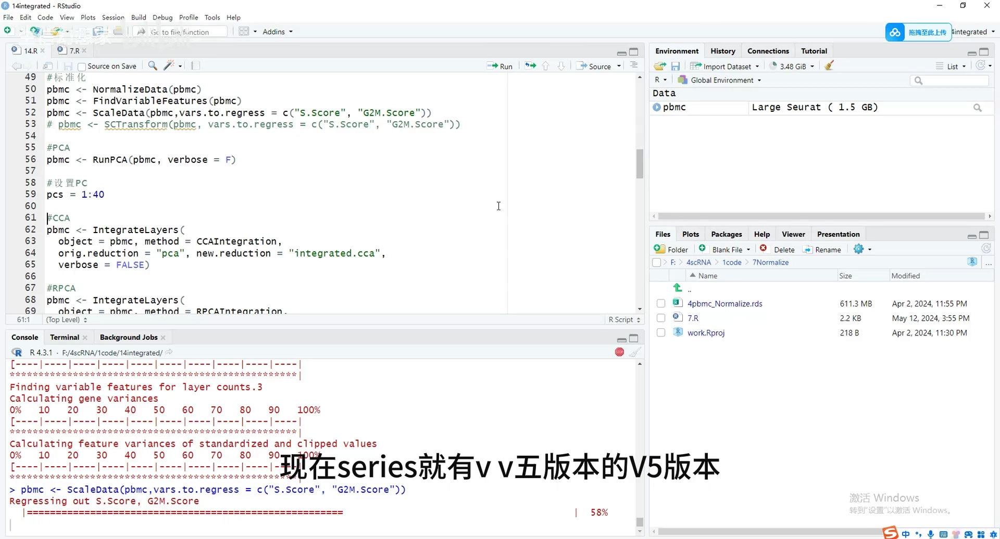

`?IntegrateLayers` 的帮助页会把所有可用的方法函数列出来，视频里作者当场翻了一遍：

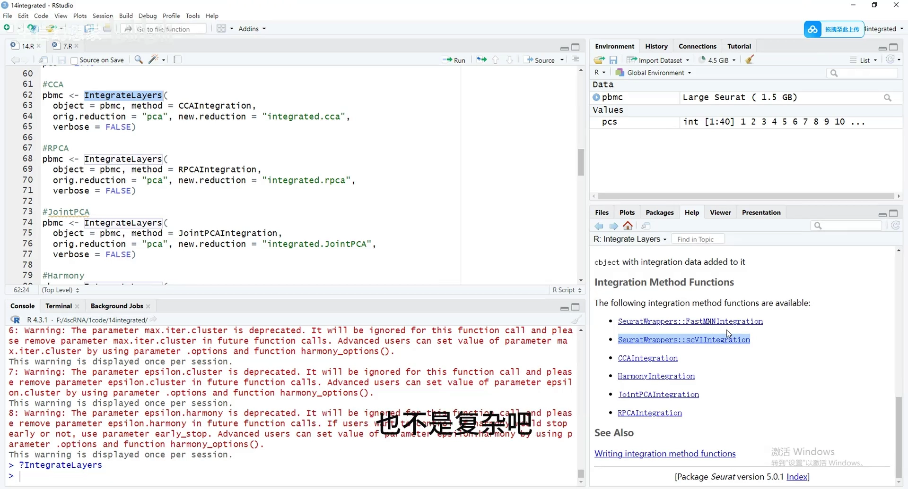

作者的说法是「这个函数实际上整合了多种方法，它整合了六种」，其中**有一个需要先创建 conda 环境**（指 `scVIIntegration`，要用 reticulate 调 Python 的 scVI 包），步骤比较多，视频里跳过了；剩下的四种——**CCA、RPCA、JointPCA、Harmony**——全部现场跑了一遍。

[【跳转到 05:27】](https://www.bilibili.com/video/BV1Vn4y197Un/?t=327)

> **补充背景（视频未展开，仅供初学者定位）**：这四种方法都属于「在降维坐标上做整合」的一族——它们**改的是 PCA 坐标，不动原始表达矩阵**，这一点和姊妹篇里 ComBat 那种直接改表达值的方法有本质区别。CCA 与 RPCA 都是先找跨样本的对应结构再据此对齐（CCA 找得更细，RPCA 更省算力）；JointPCA 把多个样本放进同一个联合 PCA 里一起分解；Harmony 则在已有的 PCA 坐标上反复「聚类 → 按批次修正簇质心」，因此最快、修正幅度也相对温和。视频本身没有讲这些原理，只给了实测对比，所以下面的结论全部以作者的实测为准。

## 三、动手前的三件准备：放开内存、分割 layer、跑好 PCA

### 3.1 先放开内存——整合是这一章最吃资源的步骤

脚本开头除了加载一堆包（Seurat、harmony、SingleR、monocle、CellChat、SCENIC 等），还有一行容易被忽略的设置：

```r
options(future.globals.maxSize = 1e9)
```

作者的解释很实在：**三个样本跑整合基本上要吃到二三十个 G 的内存**，如果样本更多，「可能还是要上服务器才行」。

[【跳转到 02:10】](https://www.bilibili.com/video/BV1Vn4y197Un/?t=130)

这件事值得单独记一笔：**样本数一多，内存与耗时都会跟着涨得很快**（三个样本就要二三十个 G），所以「先在小数据上把流程跑通，再上大样本」是必要的顺序。

### 3.2 分割还是融合：整合算法要求先 split

这一节最容易踩坑。Seurat V5 引入了 layer 的概念，同一份数据可以按样本**分割**成多层，也可以**融合**回一层：

```r
# 分割：按样本把 RNA assay 拆成多层
pbmc[["RNA"]] <- split(pbmc[["RNA"]], f = pbmc$orig.ident)
# 融合：把多层合并回一层
# pbmc <- JoinLayers(pbmc)
```

作者的规则很明确：**「这几个算法合在一起就要求分割，所以我们要分割一下」**。也就是说，`IntegrateLayers()` 的这几种方法都要求数据处于分割状态；下游做完、要保存之前，再用 `JoinLayers()` 融合回去。

[【跳转到 02:40】](https://www.bilibili.com/video/BV1Vn4y197Un/?t=160)

分割完在 RStudio 的对象浏览器里能直接看到结果：`counts.1`、`counts.2`、`counts.3` 三层，`data.1`、`data.2`、`data.3` 三层，而 `scale.data` 只有一份。

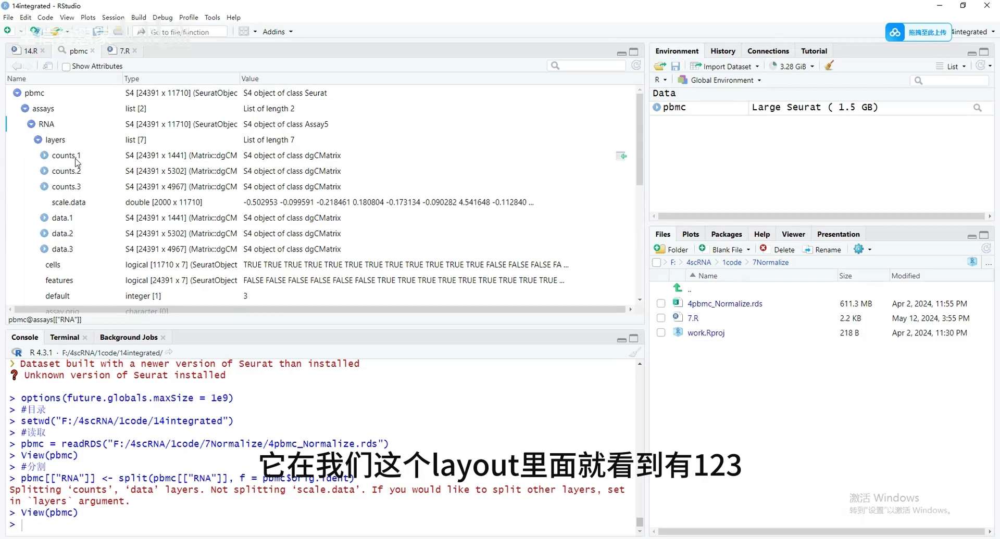

作者顺带解释了另一个常见困惑：**这些标准化、scale 的命令其实可以重复运行**，所以脚本里即使已经标准化过一遍，再跑一次也不会出错（只会多花时间）。他的建议是「其实我们可以不运行这些命令，只需要分割一下」——演示时为了完整才保留。

[【跳转到 03:30】](https://www.bilibili.com/video/BV1Vn4y197Un/?t=210)

### 3.3 标准化 → 高变基因 → scale → PCA → 定 PC 数

分割之后是标准的前处理四连：

```r
pbmc <- NormalizeData(pbmc)
pbmc <- FindVariableFeatures(pbmc)
pbmc <- ScaleData(pbmc, vars.to.regress = c("S.Score", "G2M.Score"))
# pbmc <- SCTransform(pbmc, vars.to.regress = c("S.Score", "G2M.Score"))  # SCT 一行顶上面三行

pbmc <- RunPCA(pbmc, verbose = F)
pcs <- 1:40
```

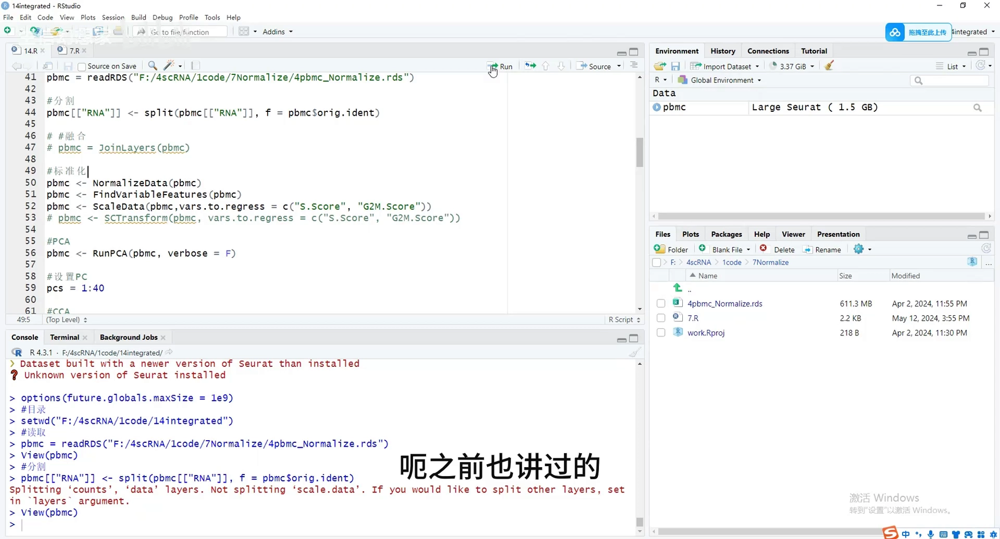

两个要点：

1. **用 SCT 的话，`SCTransform()` 一行就能代替前三行**（标准化 + 高变基因 + scale）；
2. **整合要放在 PCA 之后做**。作者的原话是「这些去除批次效应、整合的方法大多数都是基于 PCA 的，所以一般在 PCA 下面这一步来做这个操作」，这也正是 `IntegrateLayers()` 里 `orig.reduction = "pca"` 的含义。

[【跳转到 03:55】](https://www.bilibili.com/video/BV1Vn4y197Un/?t=235)

PC 数在这里定为 $1{:}40$（即 `pcs <- 1:40`）。这个数不只是 PCA 用的，**后面 `FindNeighbors()`、`RunUMAP()` 也都复用它**，所以值得先定成一个变量。

## 四、四种方法各跑一遍：代码只差一个 `method`

准备工作做完，接下来就是本视频的主体：把四种方法依次套进同一个函数。

```r
# CCA
pbmc <- IntegrateLayers(object = pbmc, method = CCAIntegration,
                        orig.reduction = "pca", new.reduction = "integrated.cca", verbose = FALSE)
# RPCA
pbmc <- IntegrateLayers(object = pbmc, method = RPCAIntegration,
                        orig.reduction = "pca", new.reduction = "integrated.rpca", verbose = FALSE)
# JointPCA
pbmc <- IntegrateLayers(object = pbmc, method = JointPCAIntegration,
                        orig.reduction = "pca", new.reduction = "integrated.JointPCA", verbose = FALSE)
# Harmony
pbmc <- IntegrateLayers(object = pbmc, method = HarmonyIntegration,
                        orig.reduction = "pca", new.reduction = "integrated.harmony", verbose = FALSE)
```

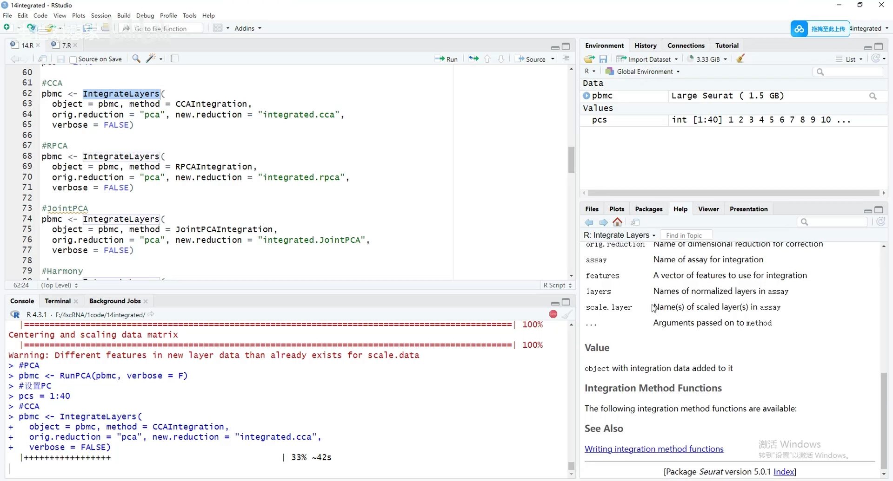

**四段代码唯一的差别就是 `method` 和 `new.reduction` 两个名字。** 整合结果都保存在 `pbmc@reductions` 里，四个结果可以同时存在、随时取用——这正是「都跑一遍再对比」在工程上可行的原因。

[【跳转到 05:27】](https://www.bilibili.com/video/BV1Vn4y197Un/?t=327)

### 4.1 两个版本相关的坑

**坑一：用 SCT 数据要额外声明。** 如果走的是 SCT 路线，调用时要多写一个参数：

```r
pbmc <- IntegrateLayers(object = pbmc, method = CCAIntegration,
                        normalization.method = "SCT",
                        orig.reduction = "pca", new.reduction = "integrated.cca", verbose = FALSE)
```

作者的说法是「如果大家用的是 SCT 的数据，就需要在这里加一行，告诉它我们用的是 SCT 的方法」。

**坑二：fastMNN 现在跑不通。** 作者现场试了 `FastMNNIntegration`，报错：

```
Error in validObject(.Object) : invalid class "LowRankMatrix" object:
  the supplied seed must support extract_array()
```

他坦承「这个错误我找了很久也没找到为什么」，并邀请观众一起找。所以视频里**没有** fastMNN 的结果——这不是方法本身不行，而是当前 Seurat / 依赖版本的兼容问题。

[【跳转到 05:52】](https://www.bilibili.com/video/BV1Vn4y197Un/?t=352)

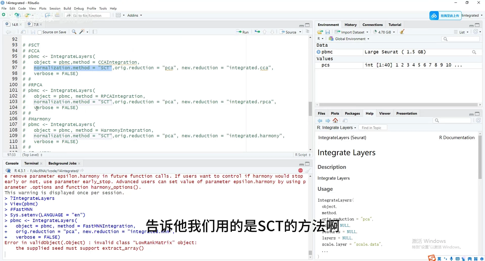

## 五、下游流程完全不变：只把 `reduction` 换个名字

整合跑完，聚类与降维的代码和平时一模一样，唯一要改的是告诉它「用哪个降维结果」：

```r
pbmc <- FindNeighbors(pbmc, reduction = "integrated.cca", dims = pcs)
pbmc <- FindClusters(pbmc, resolution = 1, cluster.name = "cca_clusters")
pbmc <- RunUMAP(pbmc, reduction = "integrated.cca", dims = pcs, reduction.name = "umap.cca")
pbmc <- RunTSNE(pbmc, reduction = "integrated.cca", dims = pcs, reduction.name = "tsne.cca")
```

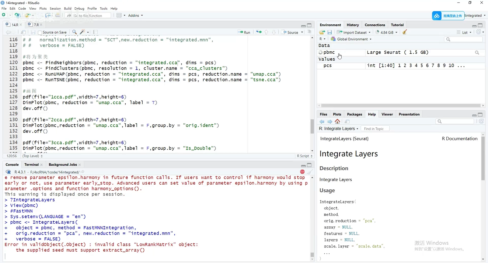

作者强调了两处「命名」的细节，这是同一份对象里跑多种方法时最容易出错的地方：

1. **`reduction.name` 必须另起名字**（`umap.cca`、`tsne.cca`）。如果还用默认的 `umap`，后跑的方法会把先跑的覆盖掉，最后你只剩一张图，前面的对比白做。
2. **`cluster.name` 也要改**（`cca_clusters`）。同理，不同方法的聚类结果要能并存。

[【跳转到 06:17】](https://www.bilibili.com/video/BV1Vn4y197Un/?t=377)

### 5.1 换方法要「成套」改名字

作者的提醒很具体：以 CCA 为例写完后，想换成 RPCA / JointPCA / Harmony，**不能只改 `method`**，后面一连串名字都要跟着改：

```r
# 以 RPCA 为例，从 CCA 版本改过来时要同步替换的四处
reduction      = "integrated.rpca"   # 原来是 "integrated.cca"
cluster.name   = "rpca_clusters"     # 原来是 "cca_clusters"
reduction.name = "umap.rpca"         # 原来是 "umap.cca"
reduction.name = "tsne.rpca"         # 原来是 "tsne.cca"
```

另外出图时 `DimPlot(..., reduction = "umap.cca")` 里的名字也要跟着改。

[【跳转到 07:20】](https://www.bilibili.com/video/BV1Vn4y197Un/?t=440)

这套「名字要成套」的约定，本质上是**用命名空间把四种方法的产物隔开**，让它们能在同一个对象里共存、随时并排比较。

### 5.2 出图与保存

每种方法都出六张图，按三个维度各看一遍：

```r
pdf(file = "1cca.pdf", width = 7, height = 6); DimPlot(pbmc, reduction = "umap.cca", label = T); dev.off()
pdf(file = "2cca.pdf", width = 7, height = 6); DimPlot(pbmc, reduction = "umap.cca", label = F, group.by = "orig.ident"); dev.off()
pdf(file = "3cca.pdf", width = 7, height = 6); DimPlot(pbmc, reduction = "umap.cca", label = F, group.by = "Is_Double"); dev.off()
# 4~6 是同样三张，换成 tsne.cca
```

三个维度分别是：**按 cluster 着色**（看细胞类型结构）、**按 `orig.ident` 着色**（看批次混得怎么样）、**按 `Is_Double` 着色**（看双细胞有没有被整合成奇怪的簇）。

最后一步是把分割的 layer 融合回去再保存：

```r
DefaultAssay(pbmc)   # 确认当前 assay
pbmc <- JoinLayers(pbmc)
saveRDS(pbmc, "14pbmc_UMPA.TSNE.rds")
```

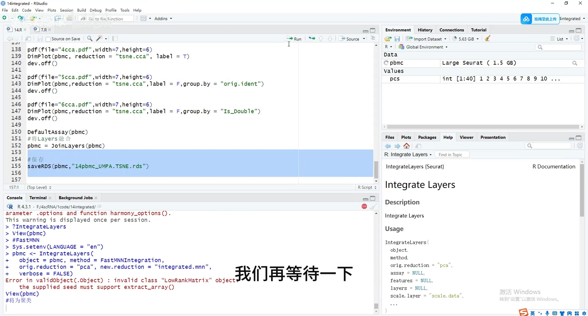

注意顺序：**先出图、再 `JoinLayers()`、最后保存**。因为整合与下游都要求数据处于分割状态，过早融合会打断流程。

## 六、结果对比：谁混得匀，谁留得住异质性

### 6.1 未校正的基线：批次分得清清楚楚

先看没有做任何批次校正的 UMAP（按样本着色）：

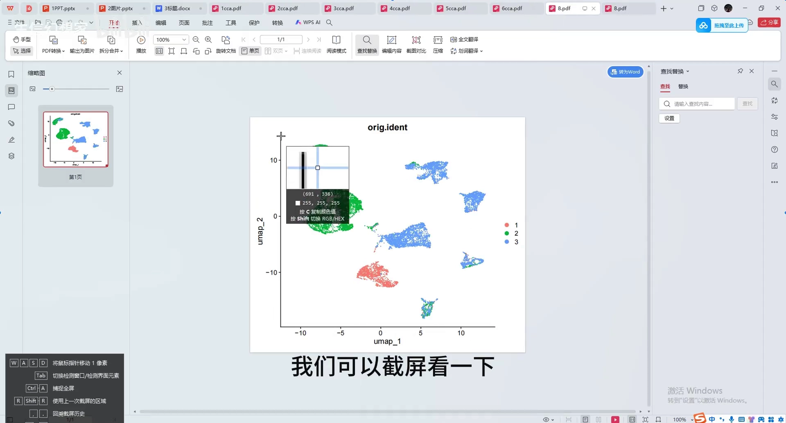

蓝色（样本 3）在左下、右上各自成岛，红色（样本 1）单独一团，绿色（样本 2）占据中部——**这正是典型的批次效应**：同一类细胞因为来自不同样本而被推开。

### 6.2 Harmony 之后：中间那一大团混起来了

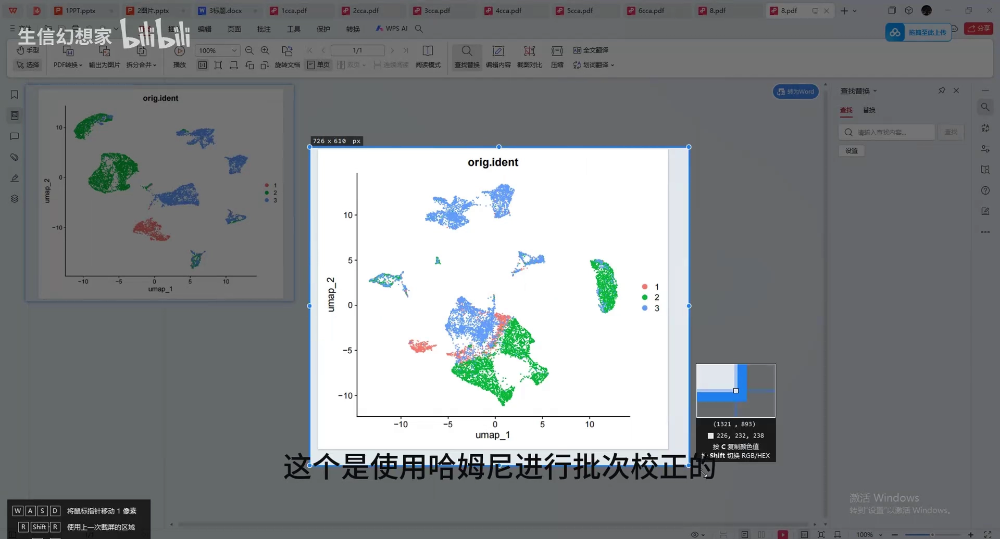

中间那一大团里红、绿、蓝交织在一起，说明**同类细胞被拉到了一起**；但外围那些小簇依然按样本分开——这就是「整合力度不强」的具体表现。

[【跳转到 08:41】](https://www.bilibili.com/video/BV1Vn4y197Un/?t=521)

### 6.3 三张图并排：讲者的逐张点评

作者把未校正、Harmony、CCA 三张图并排放在一起：

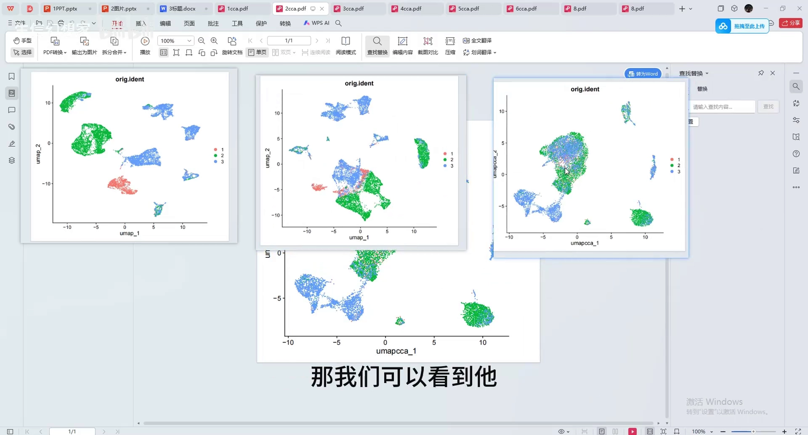

他的点评是逐张来的：

- 未校正那张**批次分得最开**；
- 其中一张「**批次效应很明显**」；
- 另一张「**要好一点点，但还是很明显**」；
- 而整合得相对较好的那张，「**尤其是中间这一坨整合得非常好**」。

[【跳转到 08:59】](https://www.bilibili.com/video/BV1Vn4y197Un/?t=539)

注意他用的措辞：**「中间这一坨」**。也就是说，即便是表现最好的方法，也只是把**主要的、细胞数量最多的那一团**整合好了，边缘的小簇仍然按样本分开。这提醒我们：**「整合成功」往往是局部的、有条件的，不是整张图都均匀混匀。**

### 6.4 关键的反转：整合得最好，不等于该选它

紧接着作者抛出了一个非常重要的限定条件：**这几个数据集来自一个前列腺癌的研究，原文里绝大多数细胞都是肿瘤细胞。**

[【跳转到 09:04】](https://www.bilibili.com/video/BV1Vn4y197Un/?t=544)

回到第一节的判据：肿瘤细胞属于**强异质性**细胞——不同病人的肿瘤本来就不一样，本来就该分开。所以「把中间那一大坨混得特别好」这件事，在这个数据集上**恰恰可能是过度整合**：你混掉的也许不是批次，而是病人之间真实的肿瘤异质性。

这正是本小节的核心风险在实操层面的样子：**同一张 UMAP，对免疫细胞是「整合成功」，对肿瘤细胞就是「信号被抹平」。** 判断标准不是「混得匀不匀」，而是「混掉的是不是批次」——具体怎么查（分批次单独分析、marker 是否还分得开、批次与条件是否正交），姊妹篇已经给过完整清单，这里不再重复。

### 6.5 作者的最终结论

视频最后，作者把四种方法的差异压缩成了一句话：

> 「说白了，这些去除批次效应的方法，就是这个批次去除的强弱、整合的强度，还有运行时间的差异，其他的都差不多，就看大家自己如何选择了。」

[【跳转到 09:29】](https://www.bilibili.com/video/BV1Vn4y197Un/?t=569)

这句话信息量很大：**方法之间的差别是「程度」而不是「种类」**——没有哪个方法在原理上碾压另一个，只有「去得多 / 去得少」和「跑得快 / 跑得慢」。所以选型的重点不是找最强的方法，而是**找到与你的生物学问题匹配的力度**。

## 七、选型判据：五条可以直接照做的规则

把视频里的判断整理成可执行的清单：

**第一条：先看细胞异质性，再选力度。**

- 免疫细胞这类弱异质性细胞为主 → 追求混匀，选整合力度强的（CCA 一类）；
- 肿瘤细胞这类强异质性细胞为主 → 宁可整合得保守，甚至**不做整合**，保住病人间的差异。

**第二条：默认从 Harmony 起步。** 作者明确说「我们为什么比较喜欢用 Harmony 呢？因为它的速度非常快，是这里面最快的」，代价是「整合的力度并不是很强」。探索阶段反复试参数时，速度就是最大的优势。

[【跳转到 00:00】](https://www.bilibili.com/video/BV1Vn4y197Un/?t=0)

**第三条：不要只看文献，四个都跑一遍。** 因为四种方法共用同一个函数、同一套下游流程，多跑一个的边际成本很低；而**你的数据长什么样，只有你的数据知道**。

**第四条：永远保留未整合的结果。** 视频里 `integrated.cca` 等四个结果与原始的 `pca` 一直并存于同一个对象中，随时可以切回去对比或重跑。这是「可回溯」的最低要求。

**第五条：整合后必须回头看 marker。** 混匀不是目的。整合完再画一次已知 marker 的特征图，确认细胞类型之间的界限还在、marker 还分得开——这一步才真正区分「整合成功」与「过度整合」。

### 7.1 实操坑速查

| 现象 | 原因 | 处理 |
| --- | --- | --- |
| `IntegrateLayers` 报错或结果异常 | 数据没有按样本分割 | 先 `split()`，跑完再 `JoinLayers()` |
| 用 SCT 时整合失败 | 没声明归一化方式 | 加 `normalization.method = "SCT"` |
| `FastMNNIntegration` 报 `LowRankMatrix` 错 | 依赖版本兼容问题 | 视频里也未解决，改用其它四种 |
| 跑不动 / 内存爆掉 | 三个样本就要二三十 G，样本越多越吃资源 | 上服务器跑 |
| 只跑了一种方法却只剩一张 UMAP | `reduction.name` 用了默认名被覆盖 | 每种方法单独命名 `umap.cca` / `umap.rpca` … |
| 保存后再打开发现 layer 结构不对 | 忘了 `JoinLayers()` | 出图后、保存前融合回一层 |

## 小结

- **整合力度没有绝对好坏，取决于细胞的生物学异质性**：免疫细胞要混匀，肿瘤细胞要保住差异。这是全篇最前提的一条。
- **四种方法共用 `IntegrateLayers()` 一个入口**，换方法只改 `method` 与 `new.reduction` 两个名字，结果并存于 `reductions` 里，可以随时并排比较。
- **三件准备**：放开内存（三样本约二三十 G）、按 `orig.ident` 分割 layer（整合算法的硬要求）、在 PCA 之上定好 PC 数（$1{:}40$）。
- **下游流程完全不变**，只把 `reduction` 指向整合结果，并给 `cluster.name`、`reduction.name` 另起名字，避免互相覆盖。
- **实测结论**：未校正那张批次分得最开；整合后中间那一大团能混起来，但外围小簇仍按样本分开——**整合成功往往是局部的**。
- **最重要的反转**：这批数据绝大多数是肿瘤细胞，属于强异质性，所以「混得最好」那张反而可能是过度整合。**混掉的是不是批次，才是判据。**
- **作者的总结**：这些方法的差别只有「批次去除的强弱、整合的强度、运行时间」，其他都差不多。
- 一句话收束：**先想清楚哪些差异必须保留，再去挑整合力度——而不是反过来，先挑一个最强的方法把一切都抹平。**

## 关键术语速查

| 术语 | 一句话解释 |
| --- | --- |
| batch effect（批次效应） | 由样本处理、建库、测序等非生物学因素造成的系统性技术差异 |
| integration（整合） | 把多个样本/数据集对齐成可联合分析的整体，通常包含批次校正 |
| `IntegrateLayers()` | Seurat V5 的统一整合入口，通过 `method` 参数切换 CCA / RPCA / JointPCA / Harmony 等 |
| CCA（canonical correlation analysis） | 在样本两两之间寻找相关性最强的共享结构，据此对齐；整合力度强、算力开销大 |
| RPCA（reciprocal PCA） | CCA 的加速版本，用互相投影代替完整 CCA，速度更快、力度略弱 |
| JointPCA | 把多个样本放进同一个联合 PCA 中一起分解，得到跨样本共享的低维空间 |
| Harmony | 在已有 PCA 坐标上迭代「聚类 → 按批次修正簇质心」，速度最快、整合力度相对温和 |
| `orig.reduction` / `new.reduction` | 整合的输入降维（通常是 `pca`）与输出降维的名字 |
| layer（层） | Seurat V5 中同一 assay 内按样本分开存放的矩阵，整合前必须 `split()`、保存前 `JoinLayers()` |
| `Is_Double` | 双细胞标记列，出图时用来检查整合有没有把双细胞聚成异常簇 |
| over-correction（过度整合） | 整合力度过强，把真实的生物学差异当成批次抹掉（判据见姊妹篇） |
