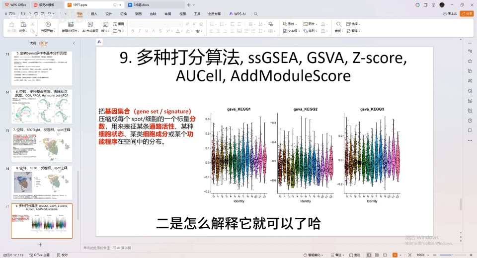
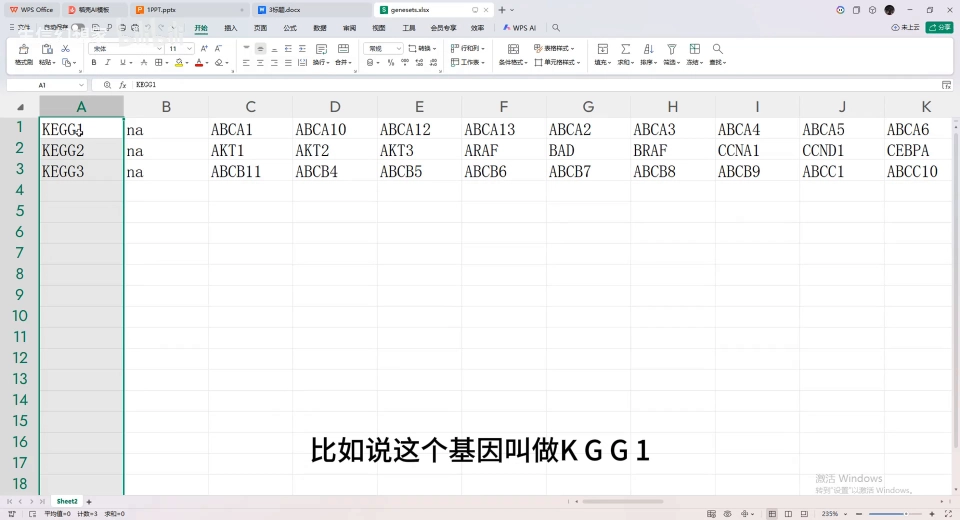
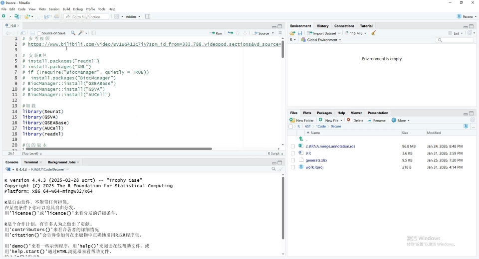
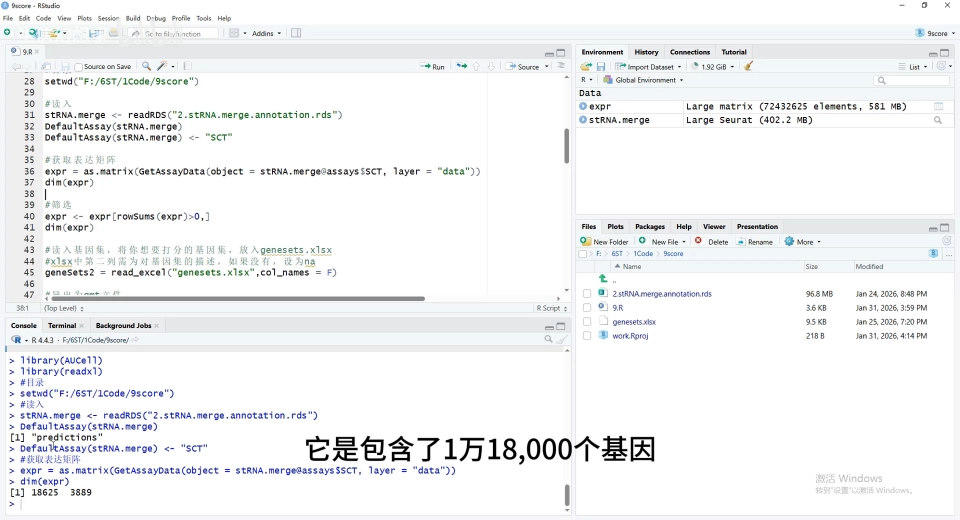
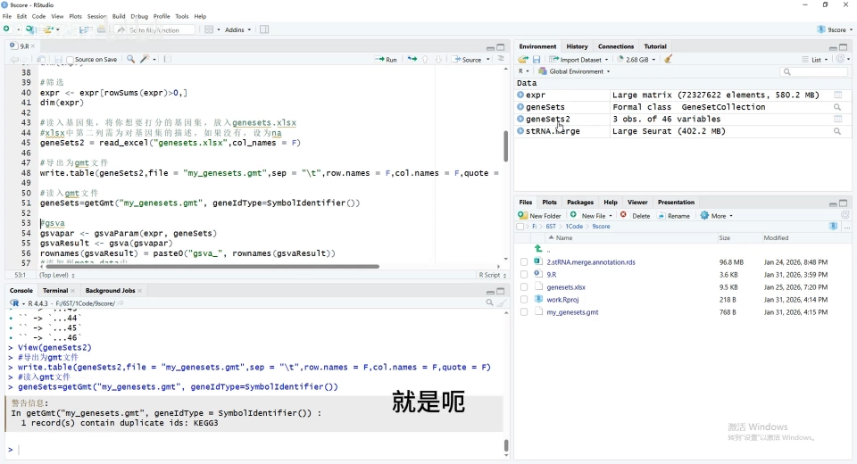
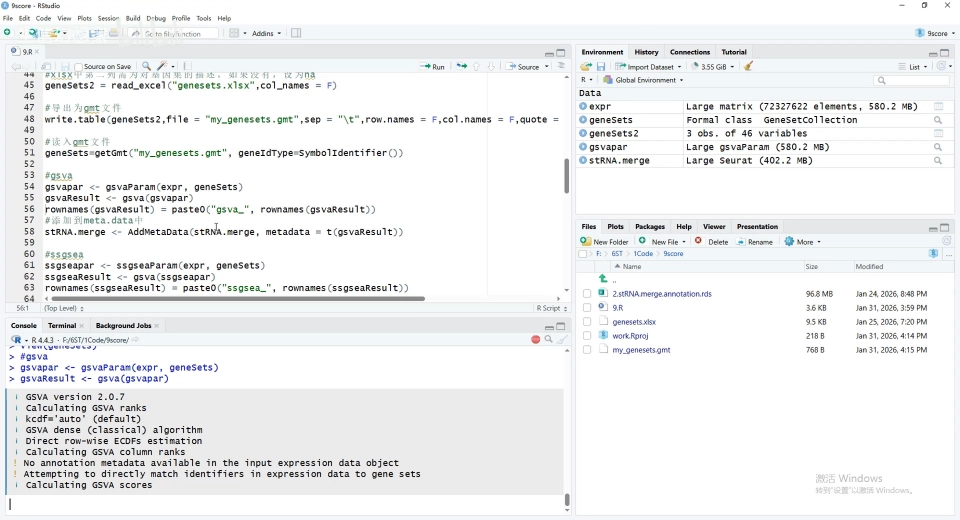
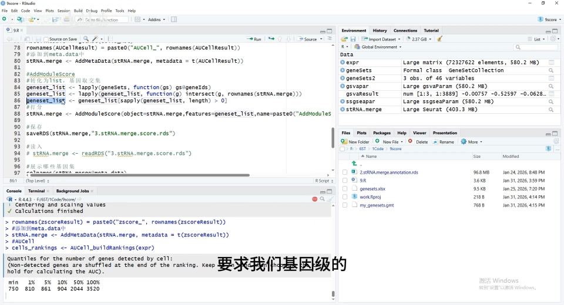
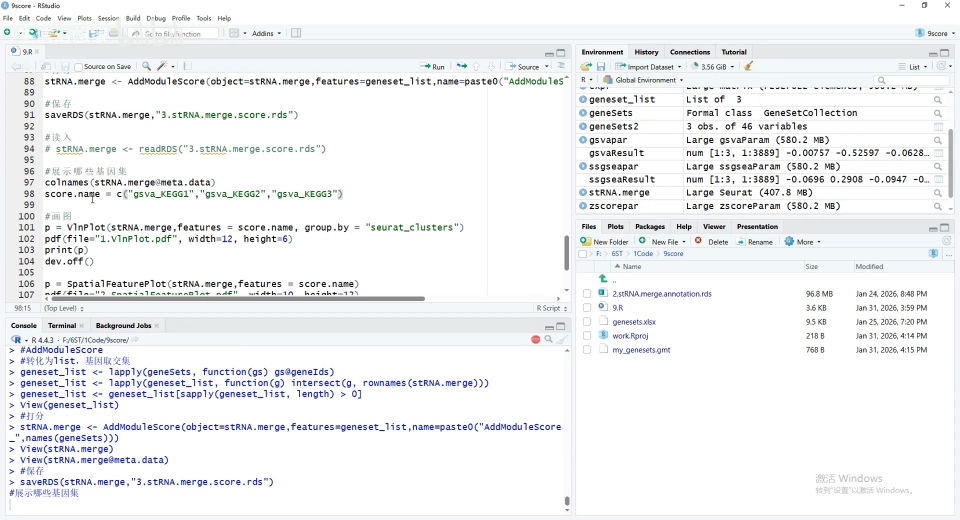
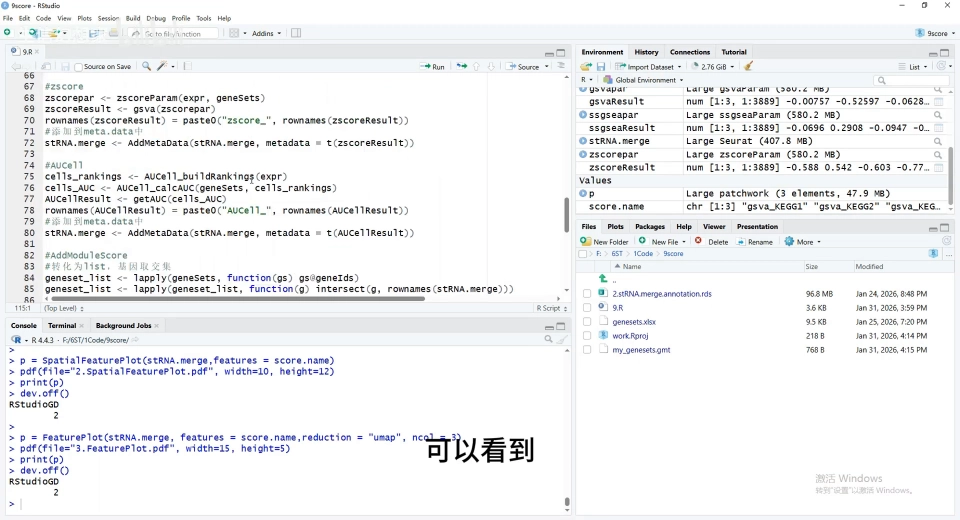

# 五种基因集打分算法：把细胞状态压成一个分数

> 视频来源：[9. ssGSEA, GSVA, Z-score, AUCell, AddModuleScore, 打分算法](https://www.bilibili.com/video/BV1vx62BWEgp/)（B 站 · 生信幻想家）｜时长约 9 分钟
> 这支视频不讲算法公式，只讲**怎么跑、怎么解释**：五种常见的基因集打分方法在 R 里各调哪个函数、结果怎么塞回 metadata、图怎么画。本文按视频顺序整理，并补上"为什么单细胞打分通常不做统计检验"这个常被问到的点。

## 本讲要解决的核心问题（SCQA）

**背景**：单细胞数据里，你能拿到的是每个细胞、每个基因的表达量。想知道"这群细胞的干扰素响应强不强""这个亚型的耗竭程度有多高"，你手上并没有一个叫"干扰素响应"的基因。

**冲突**：单个基因回答不了这种问题——一个基因既不能代表一条通路，也不能代表一种状态。而如果你自己随手挑三个基因取平均，这个分数既不可比、也没法解释。

**疑问**：那怎么把"一个基因集合"变成"每个细胞的一个数"？五种常见算法算出来的分数，含义一样吗？拿到分数之后该怎么用、能不能做统计检验？

**回答（中心思想）**：打分算法做的事只有一件——**把一个基因集压缩成每个细胞的一个标量分数**，用来表征通路活性、细胞状态、细胞成分或某个功能程序。五种方法的差别在于"用什么方式把基因集里的表达压成一个数"，但**共同前提是你给的基因集本身有意义**；分数出来后，重点不是做检验，而是看它在分组、在空间、在 UMAP 上怎么分布。

## 一、为什么需要"打分"：一个基因代表不了一条通路

### 1.1 从"基因的得分"到"基因集的得分"

视频开头把这件事讲得很直白 [【跳转到 00:25】](https://www.bilibili.com/video/BV1vx62BWEgp/?t=25)：不管你处理的是单细胞还是空间转录组，拿到的都是一个表达矩阵，本质上就是"某个基因在各个样本、各个细胞、各个 spot 上的得分"。

counts、TPM 这些都可以看作一种得分。但问题在于：**一个基因不能表征整个通路或整个状态**。要描述"细胞在凋亡""细胞在增殖""细胞对某个药物耐药"，你需要**一群基因** [【跳转到 00:50】](https://www.bilibili.com/video/BV1vx62BWEgp/?t=50)。

### 1.2 基因集是什么

所以打分的第一步不是跑代码，而是**准备一个基因集（gene set / signature）**：

- 它代表一次凋亡、一段生长发育过程、一种免疫响应；
- 也可以代表肿瘤对某类药物的敏感性、耐药性 [【跳转到 01:15】](https://www.bilibili.com/video/BV1vx62BWEgp/?t=75)；
- 本质上就是**一组基因的名单**，外加一个名字。

这里有一个容易被忽略的推论：**打分的可靠性上限，由基因集决定**。算法只是把名单里的表达压成一个数；如果名单选错了（比如把只在某个细胞类型里表达的基因当成"通用状态"），算出来的分数再漂亮也没有意义。

### 1.3 五种方法一览

视频列出的五个方法是：**ssGSEA、GSVA、Z-score、AUCell、AddModuleScore（Seurat 自带）**。视频明确表示不讲原理（"讲原理也没什么意思"），只讲两件事：**怎么做**、**怎么解释** [【跳转到 00:00】](https://www.bilibili.com/video/BV1vx62BWEgp/?t=0)。

从"先验来自哪里"的角度看，这五个方法可以分成两类，这个分类对理解它们的差别很有用：

| 方法 | 打分的思路（一句话） | 典型输出 |
| --- | --- | --- |
| ssGSEA | 把基因集里的基因在细胞内的表达排个序，看这组基因是否富集在高位 | 每个细胞一个富集分数 |
| GSVA | 类似思路的另一种实现，输出富集统计量 | 每个细胞一个分数 |
| Z-score | 先把每个基因标准化，再对基因集取平均 | 每个细胞一个均值 |
| AUCell | 先排序，再看基因集成员在排序顶部的比例（AUC） | 每个细胞一个 0–1 的活性值 |
| AddModuleScore | 目标基因集的平均表达减去表达量匹配的对照基因集的平均表达 | 每个细胞一个校正后的分数 |

其中 **AUCell 与其它四个的差别最明显**：它多了一步排序，所以调用方式不太一样 [【跳转到 05:40】](https://www.bilibili.com/video/BV1vx62BWEgp/?t=340)；**AddModuleScore 的输入格式要求也不同**，需要先把基因列表转成另一种结构 [【跳转到 06:30】](https://www.bilibili.com/video/BV1vx62BWEgp/?t=390)。

## 二、实操：两个输入文件，一条流水线

### 2.1 输入只有两样东西

视频在结尾总结得很干脆 [【跳转到 08:41】](https://www.bilibili.com/video/BV1vx62BWEgp/?t=521)：

1. **表达矩阵**——这里是空间转录组数据，一般是**标准化之后**的，视频里取的是 Seurat 对象的 `SCT` assay 的 `data` 层，不是原始 counts；
2. **基因集**——一个 Excel 表或 GMT 文件。

只要这两样，五种打分都能跑。

### 2.2 基因集怎么整理

基因集用 Excel 整理就行 [【跳转到 03:05】](https://www.bilibili.com/video/BV1vx62BWEgp/?t=185)：

- 第一列：基因集的名字（视频里随手起了 KGG1、KGG2、KGG3）；
- 第二列：描述，一般填 `NA`；
- 第三列往后：这个基因集包含的基因，比如一个集合 44 个基因、另一个 43 个、再一个 30 个。

整理好之后转成 **GMT 格式**（每行一个基因集，第一列名字、第二列描述、后面是基因）。视频的说法是 GMT"比较规整、比较干净"，其实内容和 Excel 一样，只是大部分打分函数认这个格式 [【跳转到 04:50】](https://www.bilibili.com/video/BV1vx62BWEgp/?t=290)。

### 2.3 跑起来：五个函数、一个套路

代码分三步，视频里每一步都展示了对应的 R 脚本 [【跳转到 03:45】](https://www.bilibili.com/video/BV1vx62BWEgp/?t=225)：

**第一步，准备表达矩阵。** 读入 Seurat 对象，做 `SCTransform`，取 `SCT` 的 `data` 层，并删掉全零基因让计算快一点。视频里这个数据集是 **1 万 8 千多个基因、约 3900 个 spot** [【跳转到 04:10】](https://www.bilibili.com/video/BV1vx62BWEgp/?t=250)。

**第二步，把基因集读进来转成 GMT**，然后依次跑五个方法 [【跳转到 04:50】](https://www.bilibili.com/video/BV1vx62BWEgp/?t=290)：

**第三步，把结果塞回 metadata。** 这一步有个小技巧值得学：每种方法算完，**给列名加一个前缀**（`gsva_`、`ssgsea_`、`zscore_`、`AUCell_`、`AddModuleScore_`），否则五个方法的列名会撞在一起 [【跳转到 05:15】](https://www.bilibili.com/video/BV1vx62BWEgp/?t=315)。

跑完之后，metadata 里就多了五组列，每组三列（对应三个基因集）。视频说得很实在：**除了 AUCell 和 AddModuleScore 的调用方式略有不同，其余四个方法的套路完全一样**——表达矩阵加基因集，改个名字，加进 metadata。
## 三、分数出来了：为什么不建议做统计检验

这是视频里最有价值的一段"经验之谈"，也是很多初学者会踩的坑 [【跳转到 02:05】](https://www.bilibili.com/video/BV1vx62BWEgp/?t=125)。

**问题**：既然每个细胞（或每个 spot）都有了一个得分，X 轴是分组、Y 轴是得分，那为什么不直接做两组之间的统计检验？

**视频的回答**：看文章就会发现，单细胞做这种得分之后**一般不做统计检验**。原因是——

> 它的样本、细胞或者 spot 非常多，只要稍微有一点点差异，就都是很有统计学差异的。

也就是说，在几万个细胞面前，**P 值几乎必然显著**，检验通过与否不再提供信息量。视频还顺带提了一句：之前讲的 `FindMarkers` 也是这样，P 值基本上都小于 0.05。

**那替代做法是什么？** 视频给了三种展示方式 [【跳转到 02:30】](https://www.bilibili.com/video/BV1vx62BWEgp/?t=150)：

1. **小提琴图**：X 轴分组、Y 轴得分，直接看分布的形状与位移；
2. **空间分布图**：把得分画回组织切片，看哪个区域高；
3. **热图**：多个基因集 × 多个分组的矩阵。

这个建议背后的逻辑值得记住：**当样本量大到检验恒显著时，应该报告效应量和分布，而不是 P 值**。读者真正想知道的是"高多少、高在哪些细胞上"，而不是"这个差异是不是偶然"。

## 四、画图：两种最常用的展示

### 4.1 小提琴图：看分组之间的分布

视频演示的第一张图是小提琴图 [【跳转到 07:43】](https://www.bilibili.com/video/BV1vx62BWEgp/?t=463)：

- X 轴是分组信息，可以换成细胞类型、spot 类型或其他任何分组；
- Y 轴是得分水平（value）；
- 每个小提琴是一个分组内的得分分布。

标题页上那三张 `gsva_KGG1`、`gsva_KEGG2`、`gsva_KEGG3` 就是这种图 [【跳转到 01:00】](https://www.bilibili.com/video/BV1vx62BWEgp/?t=60)。读法是看**整个分布有没有整体平移**，而不是只看中位数——如果分布形状完全不同（一个单峰一个双峰），说明这个分组内部本身混着两种状态。

### 4.2 空间/降维分布图：看得分落在哪里

第二种是分布图 [【跳转到 07:59】](https://www.bilibili.com/video/BV1vx62BWEgp/?t=479)：把得分映射到空间坐标或 UMAP 上，颜色深浅表示得分高低。

这一步在空间转录组里尤其重要：**同一个基因集在不同组织区域的活性可能完全不同**，而小提琴图会把这种空间结构完全抹平。

## 五、把分数用对：三个提醒

### 5.1 分数是相对的，不是绝对的

五种方法算出来的数值范围和含义都不一样（AUCell 是 0–1 的活性值，Z-score 是标准化后的均值，GSVA 是富集统计量）。所以：

- **同一份数据里比较不同细胞**：可以；
- **跨数据集比较同一个分数**：不行，除非重新标准化；
- **跨方法比较同一个基因集**：也不行，量纲不同。

### 5.2 分数变化要说清"哪些基因在动"

"某基因集的得分从 0.3 升到 0.5"这句话本身没有信息量。有意义的表述是：**这个分数升高，主要由基因集里的哪几个基因贡献**。做法是回去看那几个基因的表达（小提琴图或点图），而不是只报一个总分。

### 5.3 基因集大小与冗余会影响分数

视频里三个示例基因集分别有 44、43、30 个基因 [【跳转到 03:05】](https://www.bilibili.com/video/BV1vx62BWEgp/?t=185)。基因集越大、成员之间越冗余（比如一堆功能相近的干扰素基因），分数就越平滑、越难分辨细微差异；基因集太小（三五个基因）则容易被单个基因的噪声带跑。**这也是 AddModuleScore 要配一个"表达量匹配的对照基因集"的原因**——它想把"高表达基因天然得分高"这个偏差扣掉。

## 小结

- **打分解决的是"一个基因代表不了一条通路"的问题**：把基因集压缩成每个细胞的一个标量分数，用来表征通路活性、细胞状态、细胞成分或功能程序。
- **五种方法（ssGSEA、GSVA、Z-score、AUCell、AddModuleScore）的差别在于"怎么压"**；AUCell 多一步排序、AddModuleScore 输入格式不同，其余套路一致。
- **输入只有两个文件**：标准化后的表达矩阵 + 基因集（Excel 或 GMT）。
- **结果塞回 metadata 时给列名加前缀**，避免五种方法互相覆盖。
- **单细胞打分通常不做统计检验**：细胞数动辄上万，P 值几乎必然显著；应该报告分布与效应量，用小提琴图、空间图、热图来展示。
- **打分的可靠性上限由基因集决定**：基因集选错，算法再对也没用；报分数时必须能说清是哪些基因在动。

## 关键术语速查

| 术语 | 一句话解释 |
| --- | --- |
| gene set / signature（基因集 / 签名） | 一组功能相关基因的名单，用来代表某条通路、某种状态或某个功能程序 |
| gene set scoring（基因集打分） | 把一个基因集里所有基因的表达压成每个细胞的一个标量分数 |
| ssGSEA | 单样本 GSEA：按细胞内表达排序，看基因集成员是否富集在高位，给出每个细胞的富集分数 |
| GSVA | 基因集变异分析：与 ssGSEA 同类思路的另一种实现，输出富集统计量 |
| Z-score | 先把每个基因在各细胞间标准化，再对基因集取平均，得到相对偏离程度 |
| AUCell | 先对每个细胞排序，再用基因集成员在排序顶部的比例（AUC）表示该基因集的活性，取值 0–1 |
| AddModuleScore | Seurat 自带方法：目标基因集平均表达减去表达量匹配的对照基因集平均表达，扣掉"高表达基因天然得分高"的偏差 |
| control gene set（对照基因集） | 与目标基因集表达量分布匹配的随机基因集合，用于校正背景 |
| GMT 格式 | 基因集的标准文本格式：每行一个基因集，第一列名字、第二列描述、后面是基因 |
| spot | 空间转录组的一个测量点，可粗略理解为"一个细胞或一小簇细胞"的位置单元 |
