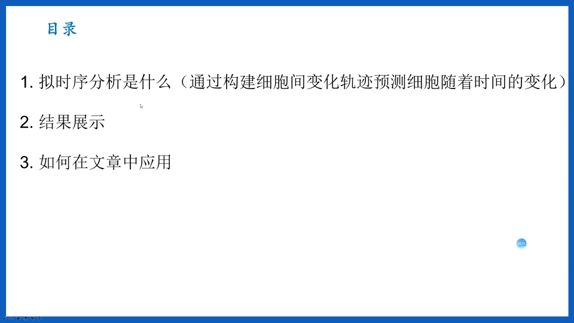
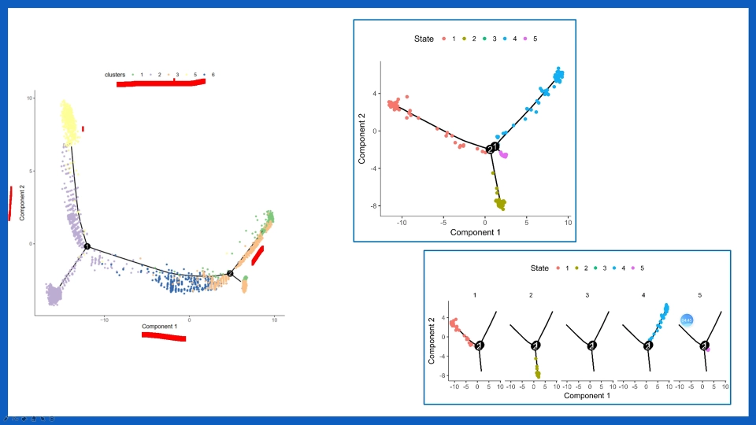
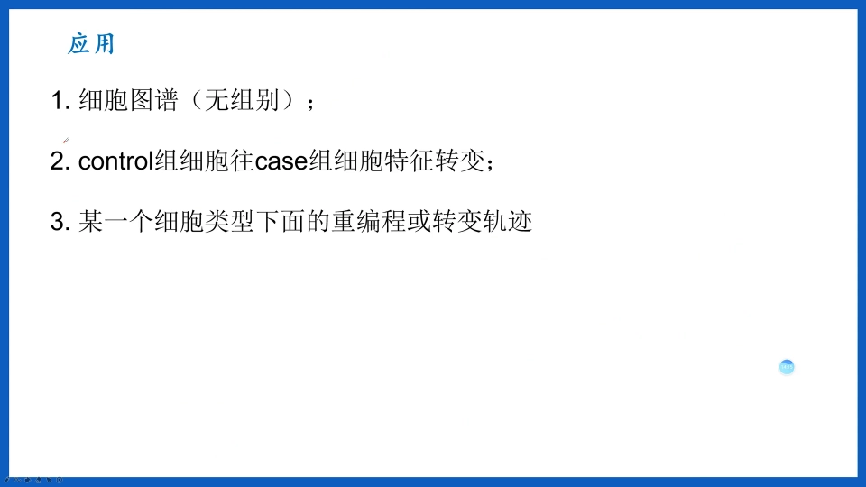
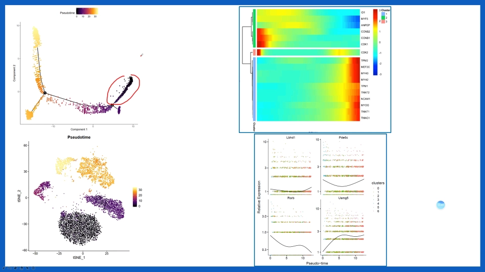
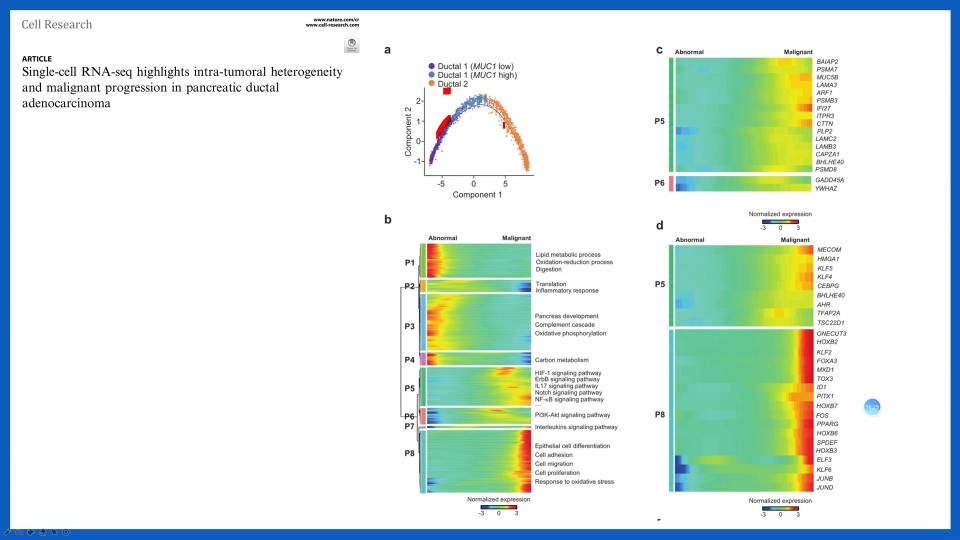
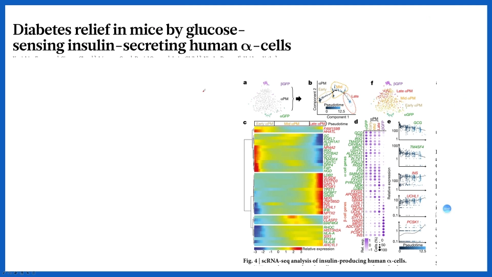
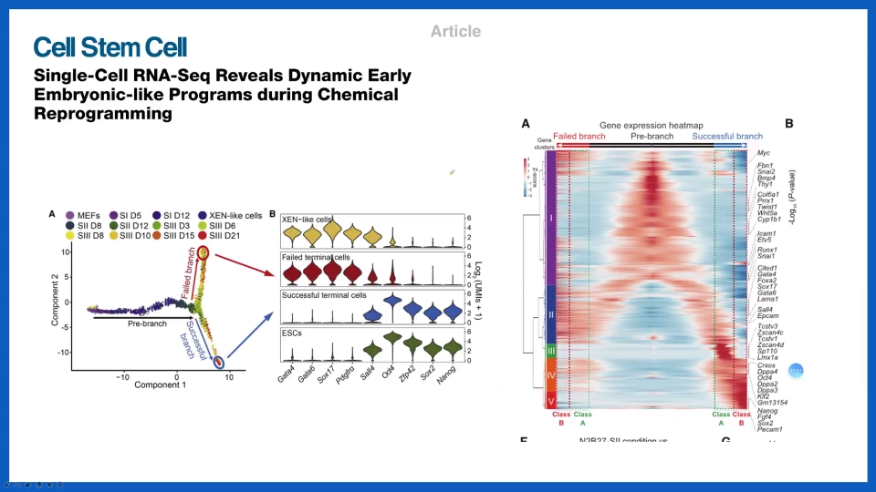
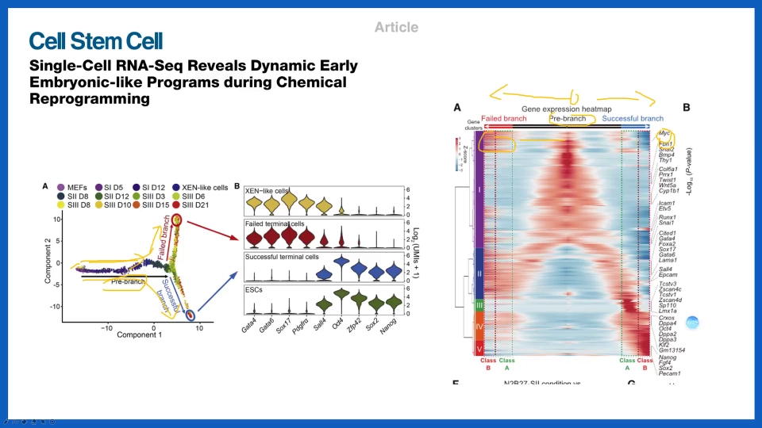

# 拟时序分析怎么读：伪时间排序、state 划分与基因动力学

> 视频来源：[拟时序分析说明](https://www.bilibili.com/video/BV1ev41117Sz/)（B 站 · 迷恋我爱罗）｜时长约 24 分钟
> 这支视频不讲算法公式，只讲**结果怎么读**：拿到一张拟时序图之后，哪条线是轨迹、节点和 state 是什么、起点凭什么定在这里、热图和曲线又在说什么。本文按视频原顺序整理，并把它接回「细胞状态如何被量化」这条主线。

## 本讲要解决的核心问题（SCQA）

**背景**：单细胞分析做到这一步，细胞已经降好维、聚好类、注释好了。接下来常见的一张图是拟时序（pseudotime）图：一堆点被一条黑线串起来，点按颜色深浅排开，后面还跟着一张热图和几条曲线。

**冲突**：这张图看起来很像"细胞在时间上的变化"，但图里没有一个真实的时间点——你没有在 0 小时、24 小时、72 小时分别取样，你只有一批细胞。更麻烦的是，算法只帮你把细胞**排了序**，却没有告诉你**哪一头是开始**。

**疑问**：那么这条"时间轴"到底是什么？图上哪些元素是算法给的、哪些是人指定的？读图时哪些结论能下、哪些不能下？

**回答（中心思想）**：拟时序分析给出的是**一个排序（伪时间）加一棵树（轨迹）**，它把"细胞状态"从一个标签变成一条可以定位的坐标轴；但**方向由人指定、节点由人取舍、含义要靠基因变化来兑现**。所以读拟时序图的关键不是看线画得多漂亮，而是回答三个问题：起点凭什么定在这里？分叉处的细胞差在哪？这条轴上的基因到底怎么动？

## 一、伪时间是什么：用细胞之间的差异去模拟时间

### 1.1 一句话定义

视频给出的定义很朴素：**通过构建细胞间的变化轨迹，来预测细胞随时间的变化** [【跳转到 00:36】](https://www.bilibili.com/video/BV1ev41117Sz/?t=36)。

拆开看是两件事：

- **轨迹（trajectory）**：把细胞按彼此的表达相似度连成一棵树/一条线；
- **伪时间（pseudotime）**：给每个细胞在这棵树上的位置打一个"进度值"，值越小越靠近起点。

所以伪时间不是钟表时间，它是**"距离起点有多远"的一个无量纲数字**。这一点后面还会反复回到。

### 1.2 为什么不能真的去测时间点

做实验的人第一反应是：那我多设几个时间点不就行了？视频解释了这样做的逻辑与局限 [【跳转到 01:11】](https://www.bilibili.com/video/BV1ev41117Sz/?t=71)：

- 时间点设得越密，轨迹越清楚——只取一天、三天、五天，细胞在图上还是散点；密集取样才会连成一条线；
- 但**你不可能无时无刻去监测细胞**，取样本身有成本，而且取样会杀死细胞；
- 于是换一个思路：**同一时刻的一批细胞里，本来就同时存在着处于不同阶段的个体**。用这批细胞之间的差异去"模拟"时间推进，就是拟时序分析。

这个思路有一个隐含假设值得记住：**它假设不同细胞之间的差异，主要来自"进度不同"，而不是"身份不同"**。这也是下面两个前提的由来。

### 1.3 两个前提：没有变化就没有轨迹

视频强调，做拟时序分析前必须自查两件事 [【跳转到 02:41】](https://www.bilibili.com/video/BV1ev41117Sz/?t=161)：

1. **细胞之间真的存在转变关系**。不能拿成纤维细胞、B 细胞、T 细胞放在一起做拟时序——它们是彼此独立的细胞类型，不存在"谁变成谁"的关系。硬做出来的轨迹只是把不相关的点连起来。
2. **这群细胞内部确实在变化**。如果设了不同时间点、但细胞本身没变，做拟时序也没有意义；反过来，即使只有一个时间点，只要同一群细胞里存在 A 亚型和 B 亚型、且两者可以相互转化，拟时序分析依然有用。

第二条其实点出了拟时序分析最常见的用法：**它主要不是用来跨时间点比较，而是用来在一个细胞类型内部给细胞排座次**。

## 二、结果图怎么读：一条线、两类分组、一个起点

### 2.1 轨迹图的基本元素

视频拿实际项目的结果图做示范 [【跳转到 04:21】](https://www.bilibili.com/video/BV1ev41117Sz/?t=261)。这张图的坐标轴跟 tSNE、UMAP 或 PCA 很像，都是两个主成分（Component 1 / Component 2），底子是**高变基因**——换句话说，**它是降维图，只是多画了一条轨迹线**。

图上有三种元素，含义完全不同：

| 元素 | 是什么 | 谁给的 |
| --- | --- | --- |
| 点 | 一个细胞 | 数据 |
| 颜色 | 该细胞所属的 cluster / 样本 / state / 伪时间值 | 你选的映射方式 |
| 黑线与黑圈 | 推断出的轨迹主线和分叉节点 | 算法 |

这张按 cluster 上色的图有一个实用价值：**如果轨迹顺序和聚类结果大体对得上，说明这条轨迹不是凭空画的**；如果某个 cluster 被轨迹线横穿、切成两半，就要怀疑这个 cluster 内部本身是连续的。

### 2.2 节点与分叉：树而不是线

仔细看主线，会发现某些位置"长出"一小段分支，图上还标了 1、2 这样的编号。视频用树的生长来打比方 [【跳转到 05:11】](https://www.bilibili.com/video/BV1ev41117Sz/?t=311)：

- 树一直往前长，如果某群细胞**还符合主干方向**，就继续往前走；
- 一旦它们的表达**不再符合主干**，就会从主干上岔出去，形成一个小分叉；
- 分叉处的细胞与主干细胞**在表达上确实有差异**，否则算法不会把它们分出去。

视频也给了一个务实建议：**分叉不用讲得太细**，除非它非常明显。不明显的小分叉往往只是算法对噪声的响应，写进文章反而给自己挖坑。

### 2.3 cluster 与 state：一个是映射，一个是原生

这是全片最容易被忽略、但最影响读图的一处区分 [【跳转到 06:26】](https://www.bilibili.com/video/BV1ev41117Sz/?t=386)。

- **cluster**：先有聚类结果，再把每个细胞所属的 cluster **映射**到拟时序图上。cluster 是外来的标签，它不知道自己落在轨迹的哪一段。
- **state**：不是映射，而是**算法直接按分叉点划出来的**——每一个分叉点被命名为一个 state（1、2、3、4、5），代表一种表达模式。

视频还演示了 state 的另一种画法：把每个 state 单独拆成小图，各画一条"主干 + 分叉"的示意 [【跳转到 04:46】](https://www.bilibili.com/video/BV1ev41117Sz/?t=286)。

从这张图能读出两件事：大方向上其实只有三个主要 state（1、4 和下面那个 2），state 3 和 5 的细胞很少、几乎看不出来。**"state 有几个"不是越多越好，细胞数太少的 state 通常可以忽略**。

### 2.4 起点：算法不会告诉你，必须由生物学指定

这是全片的核心提醒 [【跳转到 08:56】](https://www.bilibili.com/video/BV1ev41117Sz/?t=536)：

> 计算机能帮你把细胞排好序，但**它没有办法判断哪个位置是起点**，也没有办法判断是"这里的细胞往那边变"还是"那边的细胞往这里变"。这个顺序必须靠生物学意义去判断。

视频给了两种确定起点的方法：

**方法一：用组别与细胞占比（有对照组时最省事）**

如果数据里有 case 组和 control 组，就看轨迹两端哪一端**对照组的细胞多**——大部分 control 细胞聚集的那一端，就是起点。逻辑很直白：处理之前细胞都待在起点，处理后往另一端移动。视频里这张应用清单也把这种情形单列了一条 [【跳转到 14:16】](https://www.bilibili.com/video/BV1ev41117Sz/?t=856)：

**方法二：用基因功能（没有对照组时只能这样）**

看某个 state 或 cluster 里富集了哪些基因。如果富集的是**激活型**基因，说明这一段是早期/起点；如果富集的是终末分化或功能执行的基因，说明它在末端。这需要你对这个细胞类型有先验知识。

**这一步的代价必须说清楚**：起点一换，整条轨迹的方向就反了，"从 A 变成 B"会变成"从 B 变成 A"，而图本身一模一样。所以任何拟时序结论，都必须交代起点是怎么定的——是 control 细胞占比，还是 marker 基因功能。**没交代起点的拟时序图，方向是不可信的。**

### 2.5 伪时间上色图：把进度值画回降维图

定好起点之后，算法就能给每个细胞一个伪时间值，然后按这个值上色 [【跳转到 10:49】](https://www.bilibili.com/video/BV1ev41117Sz/?t=649)。

读这张图要注意颜色深浅的方向：**颜色越深越靠近起点，越浅越靠后**。视频还强调，同一份伪时间值可以映射回轨迹图，也可以映射回原来的 tSNE 图——**映射到 tSNE 上更容易看出伪时间是否被某个 cluster 独占**；如果一个 cluster 内部颜色深浅混杂，说明这个 cluster 内部本身就是一个连续的状态谱。
## 三、落到基因：热图与动力学曲线

伪时间轴本身不是结论。视频反复强调的一点是：**得到时间顺序之后，下一步必须去描绘"这条轴上的基因怎么变"** [【跳转到 12:04】](https://www.bilibili.com/video/BV1ev41117Sz/?t=724)。否则你只是把细胞从一张图挪到了另一张图。

### 3.1 热图：把基因分成几种表达模式

拟时序分析的标准输出之一是一张热图，横轴是伪时间（从起点到终点），纵轴是基因。视频把它拆成三步读 [【跳转到 12:29】](https://www.bilibili.com/video/BV1ev41117Sz/?t=749)：

1. **先确认横轴方向**：左端对应起点位置，右端对应终点位置。方向搞反，所有结论都反。
2. **再看基因被分成几类**：颜色条上的分组（视频里是绿、红、蓝三色）代表算法把基因聚成了几种趋势。
3. **最后读每类趋势的含义**：
   - 一类是**逐渐降低**——这些基因在起点高表达、随进度下降，通常是"起始状态的特征基因"；
   - 一类是**先高后低再升高**——非单调，这类基因在普通的组间差异分析里往往看不出来；
   - 一类是**一直升高**——通常是终点状态的功能基因。

### 3.2 单个基因的曲线：比热图更细的证据

热图看整体趋势，具体到某个基因就要看曲线图 [【跳转到 13:19】](https://www.bilibili.com/video/BV1ev41117Sz/?t=799)：

- 横轴是伪时间，纵轴是该基因的表达量；
- 每个点是一个细胞，点的密集程度反映细胞在哪个进度段更多；
- 曲线是拟合出来的趋势线。

视频举了三种典型形状：**逐渐升高**、**先下调再升高**、**一直下调**。其中"先下调再升高"这一类最值得注意——它在起点和终点都很高，所以在"起点 vs 终点"的差异分析里可能完全没有差异，但它在中间段确实塌下去了。**这正是伪时间相对于差异分析的优势所在**：差异分析只能告诉你"两组不一样"，伪时间能告诉你"在中间某个阶段不一样" [【跳转到 13:44】](https://www.bilibili.com/video/BV1ev41117Sz/?t=824)。

### 3.3 热图之后接功能分析

得到基因趋势之后，视频建议接着做功能层面的解释 [【跳转到 17:45】](https://www.bilibili.com/video/BV1ev41117Sz/?t=1065)：把某一类趋势（比如"一直升高"那一组）的基因拿去做通路/功能描述，就能把"某段轨迹在做什么事"讲出来。

这一步是**人工的、个性化的**，不是图自动生成的。这也是拟时序分析真正产生生物学结论的地方：**趋势分组 → 挑基因 → 功能注释 → 讲一个状态转变的故事**。

## 四、文章里的三种用法与三个案例

### 4.1 三种用法

视频把拟时序分析在文章中的应用归纳为三类 [【跳转到 14:16】](https://www.bilibili.com/video/BV1ev41117Sz/?t=856)：

1. **细胞图谱（没有组别）**：某个细胞类型内部有 A、B 两个亚型，且两者存在转变关系，就单独把这两群细胞拿出来做轨迹。
2. **control 组细胞往 case 组细胞特征转变**：有对照组时，可以研究药物处理、其他处理导致的细胞损伤，或表达谱的整体偏移 [【跳转到 14:56】](https://www.bilibili.com/video/BV1ev41117Sz/?t=896)。
3. **某一细胞类型的重编程或转变轨迹**：比如 CD4 T 细胞向 Th 细胞转变、CD8 T 细胞向细胞毒性 CTL 方向转变，或者干细胞被指定往某个方向重编程 [【跳转到 15:06】](https://www.bilibili.com/video/BV1ev41117Sz/?t=906)。

三类用法有一个共同前提，视频特别强调过：**必须拿同一种具体细胞去做**。把不同细胞类型混在一起做拟时序，不符合生物学意义。

### 4.2 案例一：肿瘤恶变轨迹（一条干净的曲线）

第一篇文章研究胰腺导管腺癌（PDAC）的瘤内异质性 [【跳转到 16:30】](https://www.bilibili.com/video/BV1ev41117Sz/?t=990)。

这个案例的轨迹**非常干净**：没有 1、2、3、4 那种小节点，就是一条完整的、像正态分布一样的曲线。读法是：

- 先只取**导管细胞**做拟时序，而不是把全部细胞丢进去；
- 发现恶化导管细胞大部分落在右端，正常导管细胞落在左端；
- 于是**指定左端为起点**，得到"正常导管 → 恶化导管"的恶变轨迹 [【跳转到 16:55】](https://www.bilibili.com/video/BV1ev41117Sz/?t=1015)；
- 热图把基因分成 P5、P6 等模块：P5 类一直升高，P6 类先升高后略降；
- 再对每一类基因做功能注释——图中能看到脂质代谢、补体级联、氧化磷酸化、Hedgehog 信号、PI3K-Akt 信号、上皮细胞分化、细胞迁移、氧化应激等通路标签。

这张图值得记住的地方是：**轨迹的干净程度本身就是一种证据**。当轨迹是一条没有杂枝的连续曲线时，"这是一条单向的进程"这个假设才站得住。

### 4.3 案例二：α 细胞重编程为 β 细胞（用特征基因验证轨迹）

第二篇文章研究把人 α 细胞重编程为能分泌胰岛素的 β 样细胞 [【跳转到 18:48】](https://www.bilibili.com/video/BV1ev41117Sz/?t=1128)。

它的拟时序图把细胞分成早期、中期、晚期三段，图上其实也有小节点，但作者**没有继续研究这些小节点**，而是直接按左→右的整体趋势来讲 [【跳转到 19:13】](https://www.bilibili.com/video/BV1ev41117Sz/?t=1153)。

热图把基因分成五个模块。判断重编程是否成功，作者用的是**特征基因的方向**：

- α 细胞的特征基因（如 GCG，胰高血糖素）随伪时间**逐渐降低**；
- β 细胞的特征基因（如 INS，胰岛素）随伪时间**逐渐升高**。

这就是前面说的"状态分析最终要落回哪些基因在动"。**"重编程效果好"这句话的证据，不是轨迹画得好看，而是 INS 升、GCG 降**。视频还提到，图上右侧的散点/小提琴图可以进一步核对关键基因在晚期细胞里的表达水平。

### 4.4 案例三：三岔口的重编程（成功与失败两条路）

第三篇文章是化学重编程，轨迹在末端出现一个三岔口 [【跳转到 21:58】](https://www.bilibili.com/video/BV1ev41117Sz/?t=1318)。

读法是：

- 起点之后先有一段**共同路径**，叫 pre-branch（分支前）；
- 然后分成两条：一条叫 **successful branch**（重编程成功），一条叫 **failed branch**（重编程失败）；
- 也就是说，**同一批细胞里，有些重编程成功了，有些失败了**——失败不是噪声，是真实存在的另一条路径；
- 热图按分支排列：横轴从 pre-branch 中点开始，向左是 failed branch、向右是 successful branch [【跳转到 23:26】](https://www.bilibili.com/video/BV1ev41117Sz/?t=1406)。

这种图的信息量比单条轨迹大得多：**同一个基因在两个分支里可以完全相反**（在一个分支里后期升高、在另一个分支里后期很低）。视频的结论很明确：遇到三岔口，**有两种处理方式**——要么只讲 start 到 end 的整体趋势，要么把两个分支分开对比；具体选哪种要看你的实验问题，两种做法在文章里都出现过 [【跳转到 23:51】](https://www.bilibili.com/video/BV1ev41117Sz/?t=1431)。

## 五、四个必须警惕的地方

### 5.1 伪时间是"算法给的排序"，不是真实时间

伪时间的单位不是小时或天，而是"离起点多远"。所以：

- 不能写"细胞在第 3 天变成……"，只能写"在伪时间较晚的一端富集了……"；
- 两个不同数据集算出来的伪时间**数值不可比**——即使都是 0 到 30，起点的定义和轨迹的形状都不一样；
- 伪时间轴上的"中间"只是一个位置，不代表任何特定的生物学阶段。

### 5.2 起点是人为指定的，方向可以被推翻

这是全片最需要记住的一条 [【跳转到 08:56】](https://www.bilibili.com/video/BV1ev41117Sz/?t=536)。算法只排序、不定向；起点靠 control 细胞占比或 marker 基因功能来定。**换一个根节点，整条轨迹的方向就反过来**，而图本身毫无变化。

推论：读别人的拟时序图时，第一件事是找"起点怎么定的"这句话。如果文章只画图不说起点依据，那么"从 A 到 B"的因果方向就不能采信。

### 5.3 cluster 不是 state，别混着讲

cluster 是外部聚类结果映射进来的，state 是算法按分叉点原生划出来的 [【跳转到 06:26】](https://www.bilibili.com/video/BV1ev41117Sz/?t=386)。混着讲会出现自相矛盾的表述，比如"cluster 3 是轨迹的第二个分叉"——cluster 3 本身没有轨迹位置，它只是被映射到了某一段。

### 5.4 小分叉不必强行解释

视频的建议很实在：**分叉不明显的就不要讲太细** [【跳转到 05:36】](https://www.bilibili.com/video/BV1ev41117Sz/?t=336)。小分叉往往只是算法对噪声的响应，硬给它编一个生物学故事，反而会被审稿人追问。同理，细胞数很少的 state（视频里 state 3 和 state 5）直接说明"基本可忽略"比强行分析更诚实。

## 小结

- **伪时间不是时间**：它是在降维图上按表达相似度给细胞排的一个序，单位是"离起点多远"，不是小时或天。
- **做之前先自查两个前提**：细胞之间存在转变关系、这群细胞内部确实在变化；跨细胞类型的轨迹没有生物学意义。
- **一张拟时序图有三种元素**：点（细胞）、颜色（你选的映射：cluster / 样本 / state / 伪时间）、黑线黑圈（算法推断的轨迹与分叉）。
- **cluster 是映射来的，state 是算法按分叉点原生划的**，两者不能混为一谈。
- **起点必须由生物学指定**：有对照组就看 control 细胞占比，没有就看 marker 基因功能；起点一换，方向就反。
- **结论最终要落回基因**：热图把基因分成"逐渐降低 / 先降后升 / 一直升高"几类，曲线图给出单个基因的形状，最后接功能注释。
- **伪时间的独特价值**：能抓到"起点和终点都高、中间塌下去"的非单调基因——这类基因在组间差异分析里看不出来。
- **遇到三岔口有两种讲法**：只讲 start 到 end 的整体趋势，或者把两条分支（如重编程成功 / 失败）分开对比。

## 关键术语速查

| 术语 | 一句话解释 |
| --- | --- |
| pseudotime（伪时间） | 算法给每个细胞的一个"进度值"，表示它在轨迹上离起点有多远，不是真实时间 |
| trajectory inference（轨迹推断） | 按细胞间表达相似度构建一棵树/一条线，用来描述状态之间的连续转变 |
| root node（起点 / 根节点） | 轨迹的起始位置，算法不会自动给出，必须用 control 细胞占比或 marker 功能指定 |
| branch（分支 / 分叉） | 轨迹上细胞不再符合主干时岔出去的一段，代表另一种表达模式或另一条命运路径 |
| state | 算法按分叉点原生划分的细胞组，每个 state 对应一种表达模式；与 cluster 不同，它不是映射来的 |
| pre-branch / failed branch / successful branch | 三岔口轨迹的三段：分支前的共同路径、失败分支、成功分支 |
| gene dynamics（基因动力学） | 基因表达沿伪时间的变化趋势，常见三类：逐渐降低、先降后升、一直升高 |
| component 1 / 2 | 轨迹图的横纵坐标，本质是降维后的两个主成分，底子是高变基因 |
| 拟时序 vs 差异分析 | 差异分析只说"两组不一样"；拟时序能说"在轨迹的某一段不一样"，能抓到非单调变化 |
