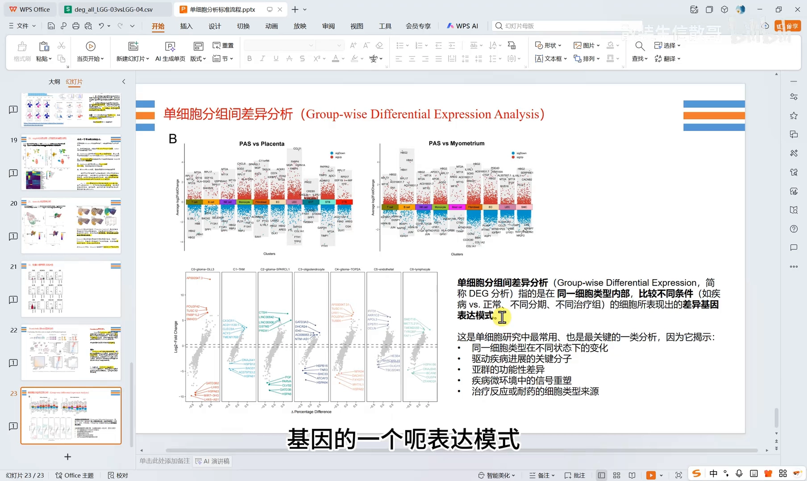
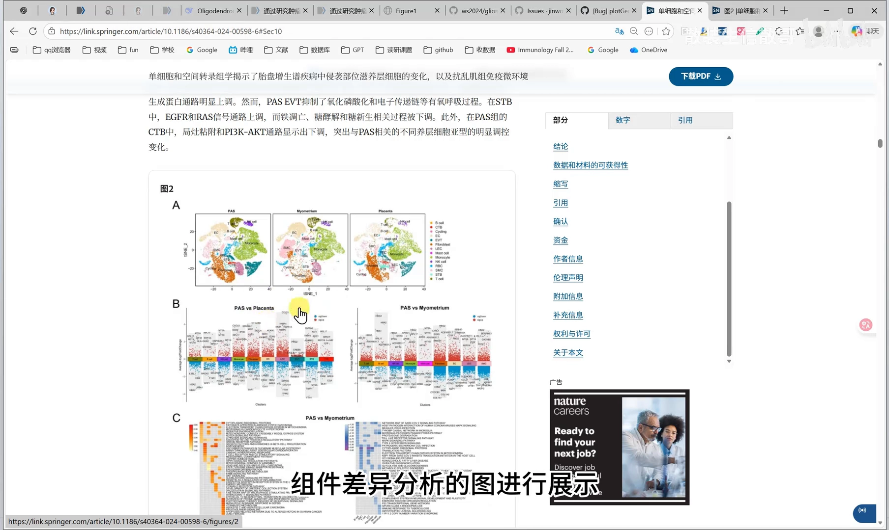
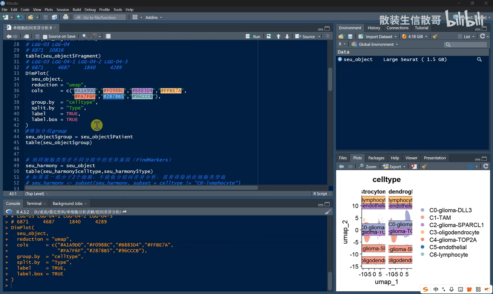
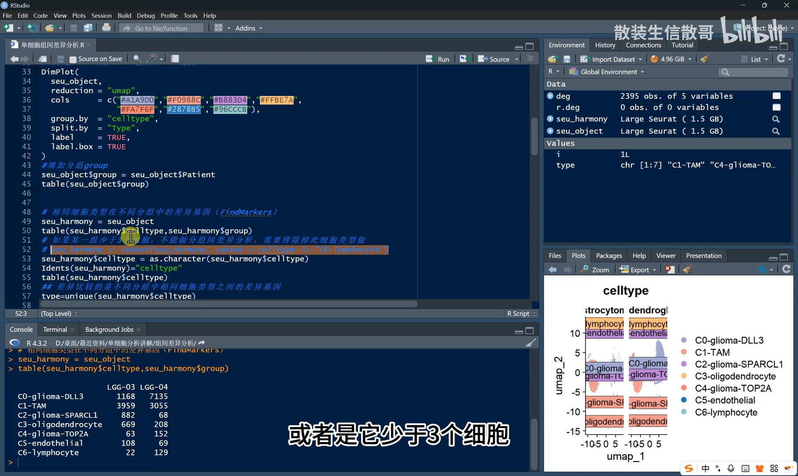
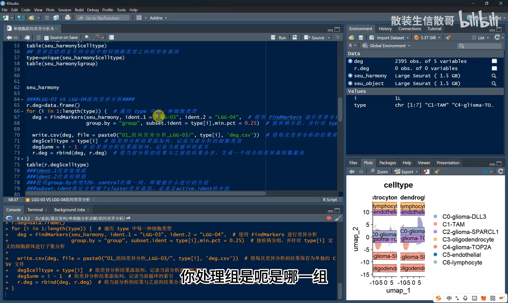
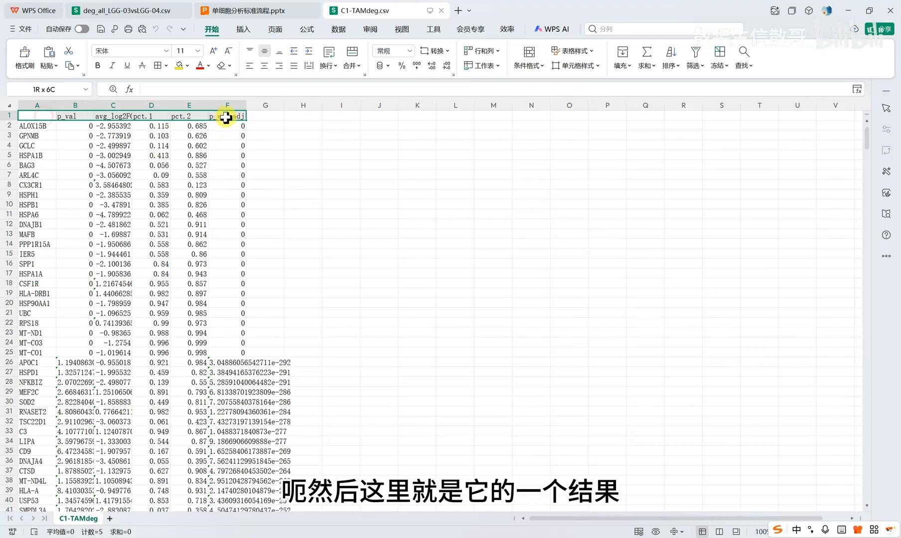
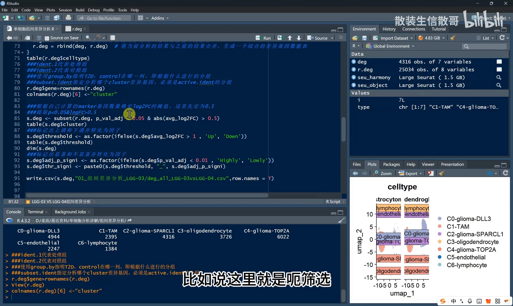
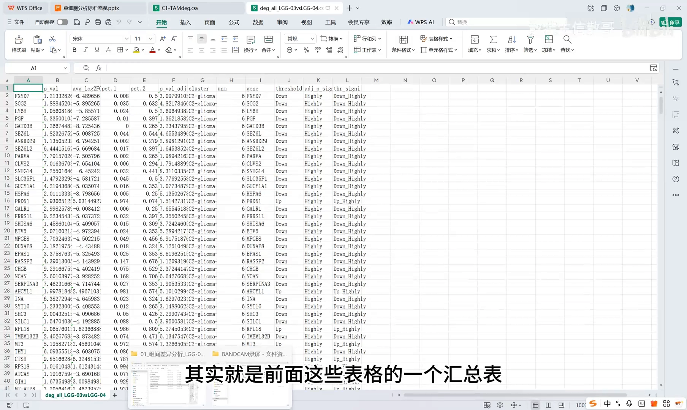
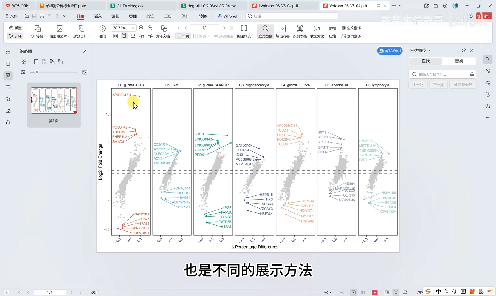

# 单细胞组间差异分析：先确认同一细胞类型在两组里都有细胞

> 视频来源：[26. 单细胞组间差异分析全流程：不同 celltype 中分组差异分析](https://www.bilibili.com/video/BV1gBmNBUEek/)（Bilibili · 散装生信散哥）｜时长约 11 分钟
> 导读：这支视频用一份低级别胶质瘤（LGG）数据，把「在每个细胞类型里做两组差异分析」跑了一遍：先查两组是否都有这类细胞，再定 ident.1 / ident.2，然后循环、合并、画图。本文按「可比性检查 → 指定对照 → 读结果 → 汇总出图」的顺序重述，重点放在每一步在防什么错。

## 本讲要解决的核心问题（SCQA）

**背景**：单细胞数据做完分群和注释，手上有一张「细胞 × 基因」的矩阵和一份细胞类型标签。接下来最常被问的分析是：**疾病和正常之间，同一类细胞发生了什么变化？**

**冲突**：这个分析听起来简单，做起来却容易在第一步就跑偏。如果你直接对全数据做两组比较，比出来的是「细胞类型构成差异」和「表达差异」的混合体；如果你对每个细胞类型都无脑跑一遍差异分析，又会遇到某些细胞类型只存在于其中一组——那种比较根本没有对照可言。

**疑问**：怎么保证「比较」是发生在可比的前提下的？处理组和对照组在代码里怎么指定？跑出来的一堆表格又该怎么读、怎么汇总成文章能用的图？

**回答（中心思想）**：**组间差异分析的前提是「同一细胞类型、两组都有足够细胞」，在这个前提下 ident.1 与 ident.2 才是有意义的对照关系。** 讲者的流程可以概括成四步：先剔除两组不齐的细胞类型，再固定处理组/对照组的身份，然后逐细胞类型循环，最后按阈值汇总成表和图。

> 说明：具体的检验方法与 pseudobulk 聚合策略见本系列 **5.2.2 差异表达与 Pseudobulk**；本文只讲「和谁比、怎么保证可比」这一层。

## 一、比的是「同一细胞类型内部的条件差」，不是「样本差」

讲者给的定义很明确：单细胞的分组间差异分析，是在**同一细胞类型内部**比较不同条件——一般是疾病和正常、不同分期、不同状态——看这类细胞表现出的差异基因表达模式 [【跳转到 00:50】](https://www.bilibili.com/video/BV1gBmNBUEek/?t=50)。

这个定义里有两个关键词，决定了后面所有的操作：

- **同一细胞类型**：T 细胞的疾病组只能和 T 细胞的正常组比。跨细胞类型比（T 细胞 vs B 细胞）得到的是「细胞类型差异」，那是注释阶段就该解决的问题，不是扰动效应。
- **不同条件**：这里的「条件」不限于疾病/正常。讲者特别提到，不同病人在同一细胞类型里也可以比，用来探究个体间差异 [【跳转到 03:17】](https://www.bilibili.com/video/BV1gBmNBUEek/?t=197)。

他还提到这个分析的现实价值：因为要在每个细胞类型里各做一次，输出是一张非常大的表，正好可以放进附表（table S1、S2），也可以做成图放进正文 [【跳转到 01:38】](https://www.bilibili.com/video/BV1gBmNBUEek/?t=98)。

## 二、第一道检查：这个细胞类型在两组里都有细胞吗

这是整支视频最值得记住的一步。讲者的做法是：把数据按分组拆开（`split.by`），看每个细胞类型在两组里的分布 [【跳转到 04:01】](https://www.bilibili.com/video/BV1gBmNBUEek/?t=241)。

判断规则很朴素：**如果某个细胞类型只出现在其中一组，它在另一组里的细胞数是 0，那这个细胞类型就做不了差异分析**——因为对照组里根本没有可以比的对象。讲者的说法是，这说明它是这一组「特有」的细胞类型 [【跳转到 04:01】](https://www.bilibili.com/video/BV1gBmNBUEek/?t=241)。

除了「为 0」，讲者还加了一条更保守的门槛：**某一组里少于 3 个细胞的细胞类型也要剔除**，因为细胞数太少不适合做差异分析 [【跳转到 05:13】](https://www.bilibili.com/video/BV1gBmNBUEek/?t=313)。

这一步看起来只是数据清洗，实际上是**对照组的合法性检查**：差异分析默认「两组各有若干细胞、来自同一类细胞」，一旦某一组是空的或只剩两三个细胞，检验的方差估计就没有意义，跑出来的 p 值只是数值巧合。

## 三、把 ident.1 和 ident.2 定死：谁是处理组，谁是对照组

清洗完之后，讲者把 `Idents` 设为细胞类型，然后进入循环。循环体里的关键参数只有三个 [【跳转到 06:03】](https://www.bilibili.com/video/BV1gBmNBUEek/?t=363)：

- `ident.1`：**处理组**。处理组是哪一组，就把 ident.1 改成这一组；
- `ident.2`：**对照组**；
- `group.by`：按哪一列分组（这里改名为 `group`）；
- `subset.ident`：这一次只在这个细胞类型内部比较。

讲者特意提醒：有的数据不止两组，可能有三组、四组，所以**每次循环前都要想清楚这一次的对照组和处理组分别是哪一组** [【跳转到 06:03】](https://www.bilibili.com/video/BV1gBmNBUEek/?t=363)。

这一句其实是整支视频在 5.2.1 语境下最重要的一句：`ident.1` 与 `ident.2` 的顺序不是格式问题，它决定了后面所有 logFC 的正负号方向。顺序反了，整张表的上调/下调就整体翻转——如果文章里写「处理组上调 X」，图却是按反方向画的，结论就会自相矛盾。

## 四、结果怎么读：logFC 的正负就是「在哪一组更高」

跑完之后每个细胞类型输出一张表，讲者带大家看的是肿瘤相关巨噬细胞（C1-TAM）的结果 [【跳转到 07:01】](https://www.bilibili.com/video/BV1gBmNBUEek/?t=421)。

读法只有一条：**logFC 为正值且数值大，就是处理组里的 top 基因；为负值，就是对照组里的 top 基因** [【跳转到 07:01】](https://www.bilibili.com/video/BV1gBmNBUEek/?t=421)。

注意这里同时给出了 `pct.1` 和 `pct.2`（两组中表达该基因的细胞比例）。上一节讲过的道理在这里同样成立：只看 logFC 会挑到「倍数很大但只有极少数细胞表达」的基因，必须把表达比例一起看。

## 五、汇总：一张表 + 两种图

单个细胞类型的结果没法直接进文章，讲者的做法是三步。

### 5.1 先合成一张大表

把每个细胞类型的结果合并（`rbind`），加一列记录细胞类型，再改名为 `cluster`——因为后面画图的函数只识别 `cluster` 这个列名 [【跳转到 07:46】](https://www.bilibili.com/video/BV1gBmNBUEek/?t=466)。

然后按阈值打标签 [【跳转到 08:11】](https://www.bilibili.com/video/BV1gBmNBUEek/?t=491)：

- 显著性：校正 p 值（`p_val_adj`）小于 0.05 先筛一遍（讲者的示例代码里用了 0.05 与 $\lvert \log_2 FC \rvert > 0.5$ 的组合）；
- 方向：`avg_log2FC` 大于 1 记为 Up，其余记为 Down；
- 显著程度：`p_val_adj` 小于 0.01 记为 Highly，其余记为 Lowly。

### 5.2 得到汇总表

合并后的表里，每一行是一个「细胞类型 × 基因」，带着方向（Up/Down）和显著程度（Highly/Lowly）两列标签 [【跳转到 09:12】](https://www.bilibili.com/video/BV1gBmNBUEek/?t=552)。

讲者说这个表比较大，通常放在附表里 [【跳转到 09:12】](https://www.bilibili.com/video/BV1gBmNBUEek/?t=552)。

### 5.3 再出图

图有两种常见形态：

1. **火山图**：取每个细胞类型里上调和下调各 top5 的基因标注出来，用 `jjVolcano` 之类的函数画 [【跳转到 09:32】](https://www.bilibili.com/video/BV1gBmNBUEek/?t=572)；
2. **分面图**：把七个细胞类型并排，纵轴是 log2 fold change，横轴是两组表达比例之差（Δ Percentage Difference），每格里标出 top 基因 [【跳转到 10:57】](https://www.bilibili.com/video/BV1gBmNBUEek/?t=657)。

第二种图在文献里更常见，因为它一眼能看出「哪一类细胞的反应最强」——这正是组间差异分析要回答的问题：不是「有没有差异」，而是「差异集中在哪一类细胞上」。

## 六、别和 FindAllMarkers 搞混：marker 不等于组间差异

讲者在最后做了一个很重要的区分：这张火山图和 `FindAllMarkers` 得到的火山图**看起来很相似，但含义完全不同** [【跳转到 10:22】](https://www.bilibili.com/video/BV1gBmNBUEek/?t=622)。

- `FindAllMarkers`：对**每一个 cluster** 做「这个 cluster 对比其余所有细胞」，得到的是**细胞类型 marker**——它回答「这群细胞是什么」；
- 本视频的做法：对**每一个细胞类型内部**按分组做「处理组 vs 对照组」，得到的是**条件差异基因**——它回答「这类细胞在两种条件下有什么不同」。

两者的对照完全不同：前者是「这一群 vs 其他所有群」，后者是「同一群内部的两个条件」。把 marker 当成扰动效应，或者反过来，都会把结论引向错误的方向。

## 小结

- **组间差异分析 = 同一细胞类型内部的条件比较**。跨细胞类型的比较得到的是类型差异，不是扰动效应。
- **先做可比性检查**：某个细胞类型只在其中一组出现（细胞数为 0），或者某一组少于 3 个细胞，就不能做差异分析，必须剔除。
- **ident.1 是处理组、ident.2 是对照组**，顺序决定 logFC 的正负；多组数据每次比较前都要重新确认。
- **读结果先看 logFC 的正负**：正 = 处理组更高，负 = 对照组更高；同时看 `pct.1` / `pct.2`，避免挑到「倍数大但几乎没细胞表达」的基因。
- **汇总成「细胞类型 × 基因」的大表**，加上 Up/Down 与显著程度两列，可直接做附表；图优先用分面图，因为能看出反应集中在哪类细胞。
- **marker ≠ 组间差异基因**：`FindAllMarkers` 比的是「这群 vs 其余」，组间差异比的是「同群内的两个条件」。

## 关键术语速查

| 术语 | 一句话解释 |
| :--- | :--- |
| 组间差异分析（group-wise DE） | 在同一细胞类型内部，比较两种条件（如疾病 vs 正常）的表达差异 |
| ident.1 / ident.2 | Seurat 里差异检验的两组身份；ident.1 通常设为处理组，ident.2 为对照组，决定 logFC 方向 |
| `group.by` | 指定按哪一列元数据分组（如 `group`），而不是用当前的 `Idents` |
| `subset.ident` | 只在指定的细胞类型子集内做检验，是「逐细胞类型循环」的关键参数 |
| `pct.1` / `pct.2` | 两组中表达该基因的细胞比例；比例过低时，大倍数差异也难有生理意义 |
| `p_val_adj` | 多重检验校正后的 p 值，筛差异基因时用它而不是原始 p 值 |
| `FindAllMarkers` | 对每个 cluster 与其余所有细胞比较，找的是细胞类型 marker，不是条件差异基因 |
| 分面图（facet） | 把多个细胞类型并排展示，纵轴 log2FC、横轴两组表达比例之差，用来比较各类型的反应强度 |