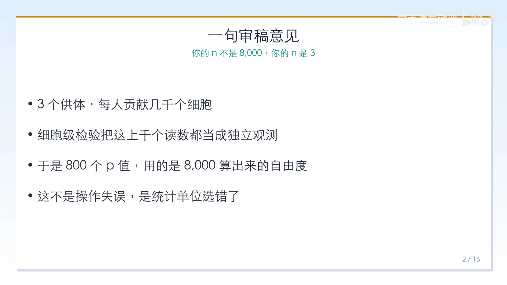
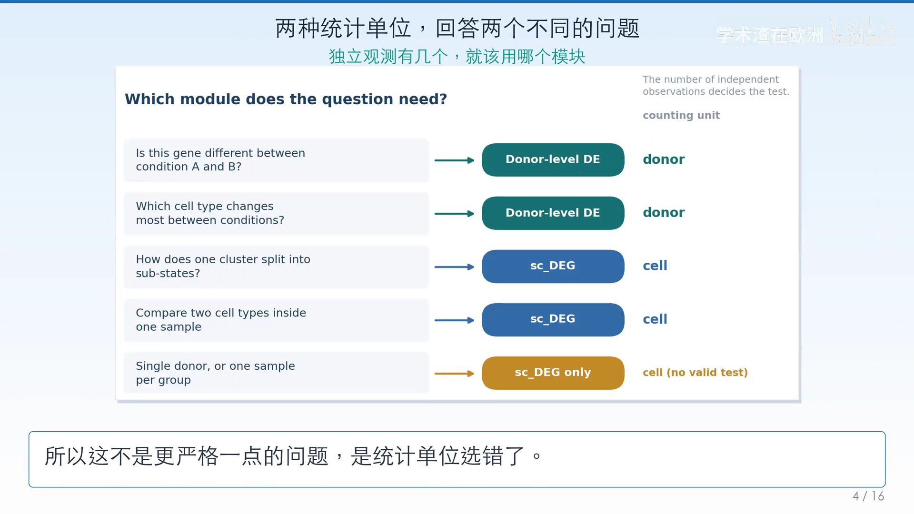
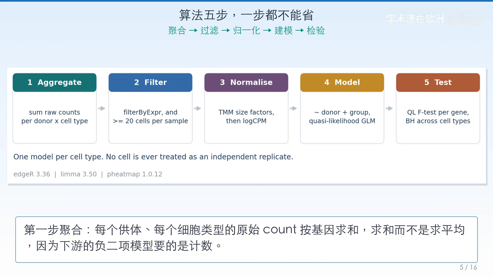
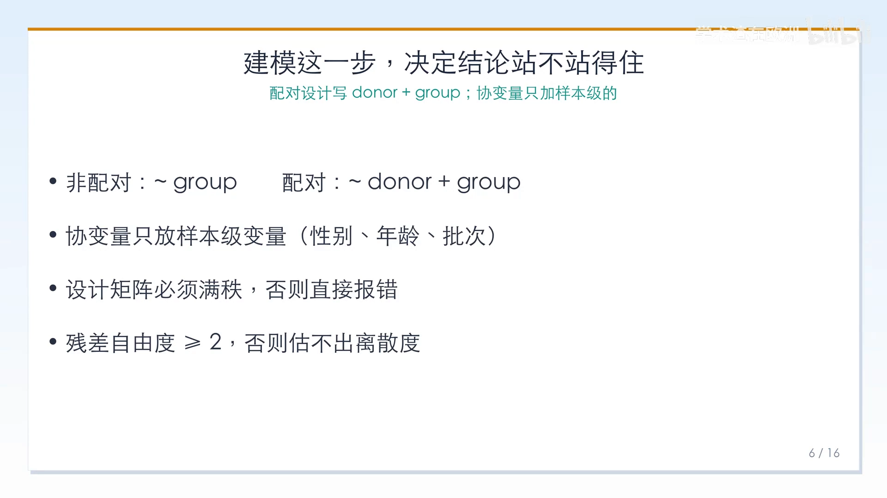
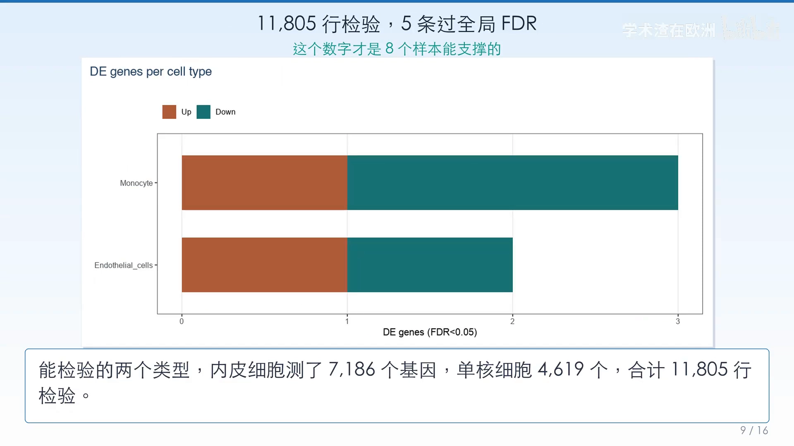
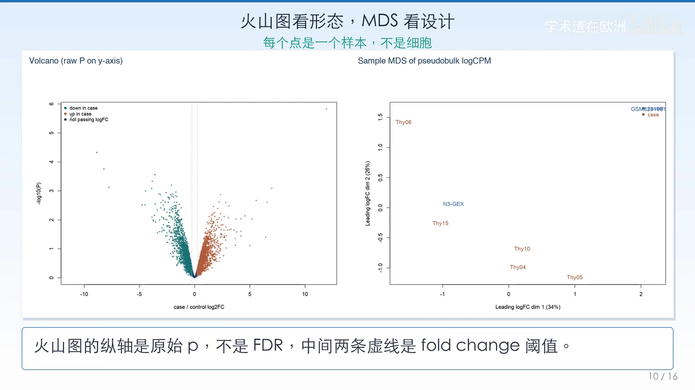
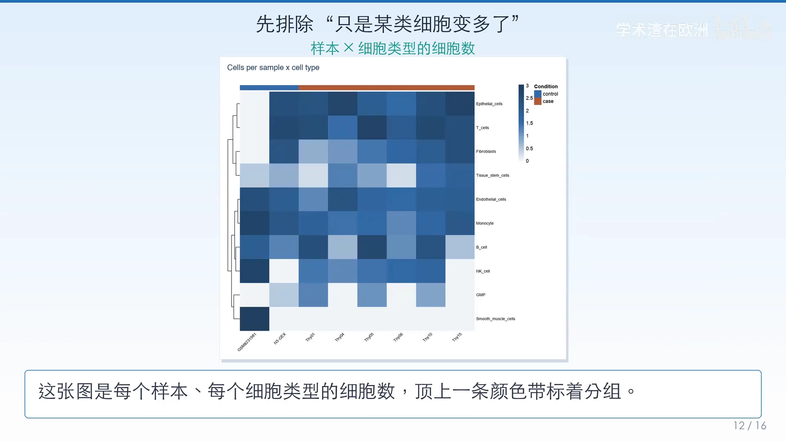
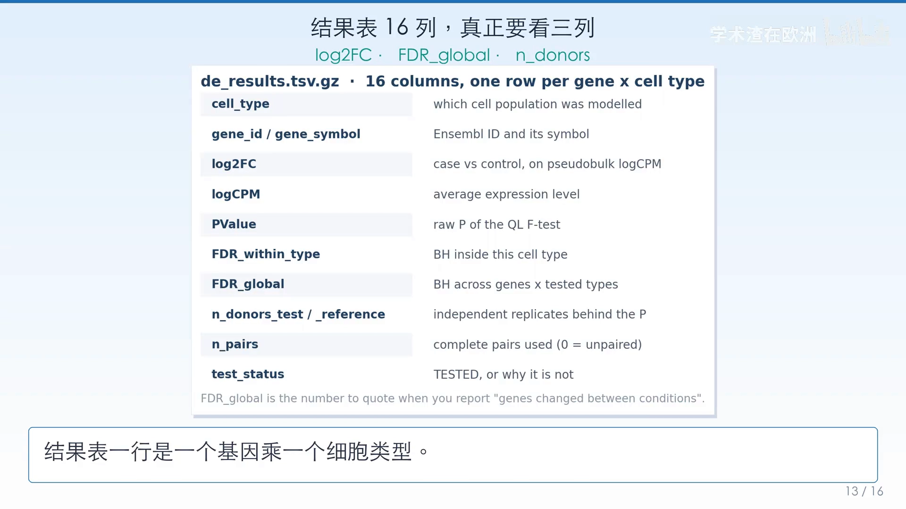
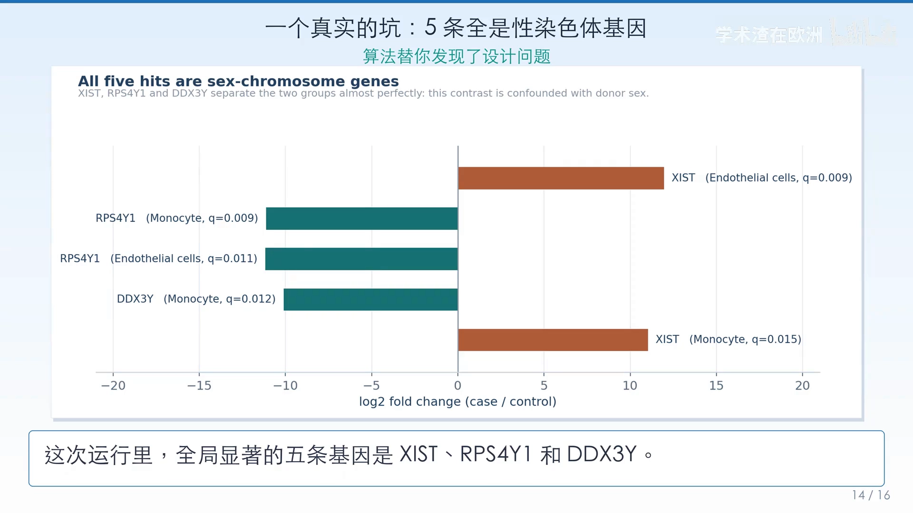
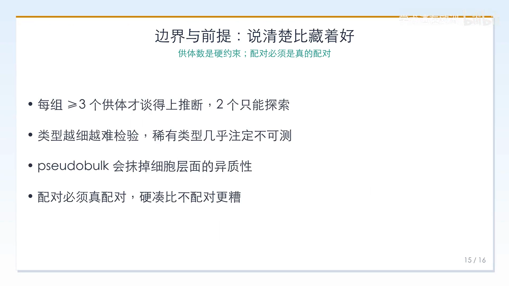

# 细胞是观测，供体才是重复：Donor-level 差异分析的五个步骤与三个前提

> 视频来源：[单细胞差异分析你需要Donor-level DE 来救场](https://www.bilibili.com/video/BV1vssw6cEo8)（Bilibili · 学术渣在欧洲）｜时长约 6 分钟
> 导读：一支信息密度很高的短讲——用一份真实数据把「细胞级 p 值为什么不能用」和「供体级 pseudobulk 怎么做」一次讲完：五步流水线、设计矩阵的两种写法、一次运行里 10 个细胞类型只有 2 个能检验的取舍，以及 5 条显著基因全是性染色体基因这个真实的坑。字幕为 B 站 AI 字幕，pseudobulk / edgeR / quasi-likelihood / TMM 等术语已按画面幻灯片订正。

## 本讲要解决的核心问题（SCQA）

**背景**：单细胞差异分析的常规做法是把细胞按 cluster 拆开、两组细胞逐个基因比较，输出一张几百上千个显著基因的表，再画一张漂亮的火山图。这套流程能跑通，图也好看。

**冲突**：投稿之后，审稿人第一句话往往是「细胞被当成独立重复了吗」。你回头一数，所谓三个重复其实是三个人的细胞，每个人贡献了几千个读数——你的 $n$ 不是 3000，你的 $n$ 是三，而那 800 个 p 值是用上千个细胞算出来的自由度。[【跳转到 00:12】](https://www.bilibili.com/video/BV1vssw6cEo8/?t=12)

**疑问**：既然细胞不能当重复，那什么才算一个观测？把细胞聚合成供体级表达谱之后，具体要走哪几步？样本数不够、细胞类型太细、分组又和性别混在一起时，还能不能下结论？

**回答（中心思想）**：**细胞是观测，供体才是重复。** 把每个供体的每个细胞类型的原始 counts 按基因求和，得到「供体 × 细胞类型」的 pseudobulk 矩阵，再用负二项模型 + 拟似然 F 检验做供体级差异分析。这不是「更严格一点」的问题，而是统计单位选错了的问题——换对单位之后，结论的数量会掉一个量级，但那才是你的样本量能支撑的结论。

## 一、伪重复的代价：p 值随细胞数变小，与生物学效应无关

讲者用一页幻灯片把代价讲清楚了。

三个要点：

- 3 个供体，每人贡献几千个细胞；
- 细胞级检验把这上千个读数**都当成独立观测**；
- 于是 800 个 p 值，用的是 8000 算出来的自由度。

所以结论是：**这不是操作失误，是统计单位选错了。**

### 1.1 两条曲线的对照

讲者给了一张对照图：左边是正确做法——三个供体每个压成一列矩阵，只有三列，不是 114 列；右边是伪重复的代价——横轴是细胞数，纵轴是表观显著性，**细胞越多 p 值越小，和生物学效应无关**。[【跳转到 00:37】](https://www.bilibili.com/video/BV1vssw6cEo8/?t=37)

同一批三个供体，测 1000 个细胞能得到 0.0 几的 p 值；而「按供体」那条线是平的——因为它只承认三个独立观测。[【跳转到 01:02】](https://www.bilibili.com/video/BV1vssw6cEo8/?t=62)

这个对照值得记住：**细胞级 p 值不是「噪声大一点的估计」，而是随细胞数系统性漂移的量**。这意味着你无法通过「多测几个细胞」来提高可靠性——方向本身就错了。

## 二、什么时候用供体，什么时候用细胞

并不是所有问题都该用供体级。讲者给了一张决策表，判断标准是**独立观测有几个**。

| 你想回答的问题 | 用哪个模块 | 计数单位 |
| --- | --- | --- |
| 某个基因在条件 A 和 B 之间有差异吗 | Donor-level DE | 供体 |
| 哪类细胞在两种条件之间变化最大 | Donor-level DE | 供体 |
| 一个 cluster 是怎么裂成亚群的 | sc_DEG | 细胞 |
| 同一份样本里两类细胞怎么比 | sc_DEG | 细胞 |
| 只有一个供体，或每组只有一个样本 | 只能 sc_DEG | 细胞（没有有效检验） |

这张表把边界划得很干净：

- **跨条件的比较**（基因、细胞类型哪个变化最大）→ 供体是单位，因为「条件」是在供体之间变化的。
- **样本内部的比较**（亚群结构、同一份样本里两类细胞的差异）→ 细胞是单位，因为这时没有「跨供体」的问题，细胞就是独立观测。
- **每组只有一个样本** → 没有任何方法能给你可外推的 p 值，细胞级只能当描述。[【跳转到 01:07】](https://www.bilibili.com/video/BV1vssw6cEo8/?t=67)

## 三、五步流水线：聚合 → 过滤 → 归一化 → 建模 → 检验

这是全片最核心的一页。

| 步骤 | 做什么 | 关键点 |
| --- | --- | --- |
| 1 Aggregate | 每个供体、每个细胞类型的原始 counts 按基因**求和** | 求和而不是求平均，因为下游的负二项模型要的是计数 |
| 2 Filter | `filterByExpr` 按表达量剔除低表达基因，同时要求每个样本每个类型**至少 20 个细胞** | 最小细胞数阈值在这一步 |
| 3 Normalise | 用 **TMM** 估计测序深度因子，再算 **logCPM** | 深度归一化，让样本间可比 |
| 4 Model | 负二项广义线性模型 + 拟似然（quasi-likelihood），设计 `~ donor + group` | 每个细胞类型单独建模 |
| 5 Test | 拟似然 **F 检验**（QL F-test），再做两层 BH 校正 | 先类型内校正，再跨类型全局校正 |

幻灯片底部还有一句关键说明：**One model per cell type. No cell is ever treated as an independent replicate.**（每个细胞类型一个模型，任何细胞都不会被当成独立重复。）

### 3.1 为什么第一步必须是求和

讲者在字幕里直接给了理由：求和而不是求平均，因为下游的负二项模型要的是**计数**。[【跳转到 01:32】](https://www.bilibili.com/video/BV1vssw6cEo8/?t=92)

用统计语言说：pseudobulk 的聚合值 $y_{g,s,c}$ 是「样本 $s$ 中细胞类型 $c$ 的所有细胞在基因 $g$ 上的 reads 总和」，

$$
y_{g,s,c} = \sum_{i \in \text{cells}(s,c)} x_{g,i}
$$

这个量仍然是一个「计数」，服从（近似）负二项分布，均值与方差的关系由测序深度和生物学变异共同决定。如果改成求平均，得到的就不是计数，负二项模型的方差结构不再成立，TMM 因子也失去意义。

### 3.2 最小细胞数阈值：20 个

第二步的过滤同时做两件事：按表达量剔除低表达基因（`filterByExpr`），并要求**每个样本、每个细胞类型至少 20 个细胞**。

这个阈值不是可有可无的洁癖。一个「样本 × 细胞类型」组合如果只有 3、5 个细胞，加总出来的表达谱方差极大，会污染离散度估计，进而影响**所有**基因的检验。低于阈值的组合应当丢弃，并在方法里写明。

代价是：丢弃之后某些细胞类型的样本数会变少，可能直接掉出可检验范围——下一节会看到真实运行里 10 个类型只剩 2 个。

### 3.3 两层 BH 校正

第五步的「两层 BH」值得单独说：

- **类型内校正**：每个细胞类型内部，对它自己的那批基因做 BH；
- **全局校正**：把所有成功检验的「基因 × 类型」行放在一起再做一次 BH。

报结论时应该用**全局**那个值。原因很直白：如果你在每个细胞类型里各校正一次，然后挑出「显著的」拼在一起，实际上等于做了很多次独立检验而没有合并校正，假阳性会累积。

## 四、建模这一步，决定结论站不站得住

四条规则：

1. **非配对写 `~ group`，配对写 `~ donor + group`**。配对设计先扣掉供体之间的个体差异，再估条件效应，**功效远高于非配对**。[【跳转到 02:04】](https://www.bilibili.com/video/BV1vssw6cEo8/?t=124)
2. **协变量只放样本级变量**（性别、年龄、批次）。讲者的原话很形象：性别不是每个细胞各有一次，是每个供体一次。
3. **设计矩阵必须满秩**，否则直接报错——不会偷偷丢掉变量。
4. **残差自由度 ≥ 2**，否则估不出离散度。

第 3、4 条是这套流程最诚实的地方：它宁可报错，也不给你一张看起来能用的表。残差自由度这条尤其重要——它等价于「你有几个独立观测」的另一种说法。3 vs 3 的供体设计，加上 `donor` 项之后自由度已经很紧，再想塞性别、年龄、批次进去，很容易就不够了。

> 实践含义：pseudobulk 的设计矩阵能容纳的协变量是**稀缺资源**。每加一个协变量都要问「它值不值得占掉一个自由度」。样本数少的时候，宁可少放协变量、把混杂写在局限性里，也不要硬塞。

## 五、一次真实运行：14678 个细胞，10 个类型，只有 2 个能检验

讲者跑了一份真实数据：**1 万 4678 个细胞、10 个细胞类型、8 个样本**。

他强调：第一件事不是看火山图，而是看**哪些类型根本没法检验**。[【跳转到 02:54】](https://www.bilibili.com/video/BV1vssw6cEo8/?t=174)

结果：只有 2 个类型能进模型，其余 7 个因为对照组不足 2 个供体被跳过，1 个两组都没有细胞。模块的选择是**直接跳过，并把原因写进状态表**——它不会给你 10 张火山图，其中 7 张是假的。[【跳转到 03:06】](https://www.bilibili.com/video/BV1vssw6cEo8/?t=186)

这句话是全片最值得抄下来的一句：**宁可交 2 张真的图，也不要交 10 张假的。**

### 5.1 11805 行检验，5 条过全局 FDR

能检验的两个类型：内皮细胞测了 7186 个基因，单核细胞 4619 个，合计 **11805 行检验**。

加起来真正过**全局 FDR 0.05** 的只有 **5 条**。讲者的评价是：这个数字和细胞级动辄上千个差异基因的观感差得很远，但它才是这 8 个样本能支撑的结论。[【跳转到 03:20】](https://www.bilibili.com/video/BV1vssw6cEo8/?t=200)

### 5.2 先看 MDS，再看火山图

讲者提醒了两个读图细节：

- **火山图的纵轴是原始 p，不是 FDR**，中间两条虚线是 fold change 阈值。[【跳转到 03:45】](https://www.bilibili.com/video/BV1vssw6cEo8/?t=225)
- **右边的 MDS 更值得看**：每个点是一个**样本**，不是细胞。它是唯一一张能让你在看完 p 值之前就发现「两组是不是真的按条件分开」的图。

这个顺序建议非常实用：MDS 上如果两组样本混在一起，后面的差异基因表就没有解释价值。先看设计、再看结果，比反过来省很多时间。

### 5.3 先排除「只是某类细胞变多了」

第三张必看的图是「每个样本、每个细胞类型的细胞数」，顶上一条颜色带标着分组。[【跳转到 04:20】](https://www.bilibili.com/video/BV1vssw6cEo8/?t=260)

讲者的判断逻辑：如果分组效应只是某类细胞变多了，它会**先在这里露出来**。这是 pseudobulk 分析里最容易被忽略的一步——细胞比例变化本身是真实的生物学信号，但它不是「基因表达改变」，两者混在一起会得出错误结论。

## 六、结果表 16 列，真正要看三列

结果表一行是「一个基因 × 一个细胞类型」，共 16 列。讲者说真正要看的是三列：[【跳转到 04:31】](https://www.bilibili.com/video/BV1vssw6cEo8/?t=271)

| 列 | 含义 | 为什么重要 |
| --- | --- | --- |
| `log2FC` | case vs control，在 pseudobulk logCPM 上算 | 天然比细胞级平滑，**报结论用它** |
| `FDR_global` | 跨所有基因、所有成功检验的类型做的 BH 校正 | 报「条件间有变化的基因数」时该引用的数字 |
| `n_donors_test` / `_reference` | 这一行 p 值背后真正的独立重复数 | 让审稿人一眼看到 n 是多少 |

另外两列也值得留意：`FDR_within_type`（类型内 BH）和 `n_pairs`（用了多少个完整配对，0 表示非配对），以及 `test_status`（是 TESTED，还是没检验以及为什么）。

`n_donors` 这一列的设计很聪明：它把「这一行的 p 值建立在几个独立观测上」直接写进结果表，等于提前回答了审稿人的问题。

## 七、算法替你发现的坑：5 条显著基因全是性染色体基因

这是全片最有教学价值的一段。

全局显著的五条基因是 **XIST、RPS4Y1、DDX3Y**：

- XIST 是 X 染色体失活基因，几乎只在女性表达；
- 另外两个在 Y 染色体上。

三个基因同时指向一件事：**这两组的供体性别几乎完全分开了**。讲者的结论是：这不是算法的问题，恰恰是算法替你发现了问题。[【跳转到 04:52】](https://www.bilibili.com/video/BV1vssw6cEo8/?t=292)

这个案例说明两件事：

1. **性染色体基因是最好的混杂探针**。做任何跨条件比较之前，先查一下 XIST / RPS4Y1 / DDX3Y 有没有「差异」——如果有，你的分组和性别是混在一起的，任何结论都要打折。
2. **pseudobulk 的稀疏性反而让混杂暴露得更彻底**。细胞级分析里这些基因也会显著，但会被上千个其他显著基因淹没；样本级分析只剩 5 条，混杂一眼就看出来了。

## 八、边界与前提：说清楚比藏着好

讲者列了四条硬约束：

1. **每组至少 3 个供体**才谈得上推断；只有 2 个只能在探索模式下跑。[【跳转到 05:16】](https://www.bilibili.com/video/BV1vssw6cEo8/?t=316)
2. **细胞类型分得越细，能检验的越少**，稀有类型几乎注定不可检验。
3. **pseudobulk 会抹掉细胞层面的异质性**，所以供体级出阴性结果不代表细胞层面没有变化。
4. **配对必须是真的配对**，把两个不同供体硬凑成一对，比不配对更糟。[【跳转到 05:41】](https://www.bilibili.com/video/BV1vssw6cEo8/?t=341)

第 3 条尤其要记住：pseudobulk 把「同一供体同一类型的所有细胞」压成一个数，细胞之间的分布信息（双峰、亚群、响应异质性）在求和那一步就消失了。所以 pseudobulk 阴性 ≠ 没有响应，只说明「在这个供体群体的平均表达上没测出差异」。

第 4 条是配对设计最常见的误用：配对是为了扣掉个体差异，前提是「同一个体的两次测量」。如果两个供体本来不同源，硬标成一对，模型扣掉的不是个体差异而是随机的组间差异，方差估计会更差。

## 九、补充：DESeq2 / edgeR / limma-voom 怎么选

这一节是我按本小节主题补的，视频里只用了 edgeR 的路线（QL F 检验 + TMM + logCPM），没有横向比较。

| 工具 | 统计模型 | 强项 | 什么时候选它 |
| --- | --- | --- | --- |
| **edgeR**（QL F） | 负二项 + 拟似然 | 拟似然把「基因间方差」和「样本间方差」分开估，对离群样本稳健 | 供体数少（3~5）、担心个别样本带偏结果 |
| **DESeq2** | 负二项 GLM + logFC 收缩 | 收缩估计让低表达基因的效应量更稳，结果表直观 | 需要报告稳定的 log2FC、样本数很少 |
| **limma-voom** | logCPM + 精度权重 + 线性模型 | 支持复杂设计、随机效应、`duplicateCorrelation`，速度快 | 设计矩阵复杂（多协变量、配对 + 批次）、样本数较多 |

三者的**共同前提**是一样的：需要至少 2~3 个生物学重复来估计方差。这就是 pseudobulk 的硬门槛——**没有重复就没有 pseudobulk**。

如果只有 2 vs 2，可以跑，但只能当探索；如果每组只有 1 个样本，任何工具都给不出可外推的 p 值。这时正确的做法不是换工具，而是承认这是描述性分析。

## 小结

- **统计单位**：细胞是观测，供体才是重复。细胞级 p 值随细胞数漂移，与生物学效应无关。
- **决策规则**：跨条件比较用供体级；样本内部的亚群/细胞类型比较用细胞级；每组 1 个样本只能描述。
- **五步流水线**：聚合（求和）→ 过滤（`filterByExpr` + 每样本每类型 ≥ 20 细胞）→ 归一化（TMM + logCPM）→ 建模（NB GLM + 拟似然，`~ donor + group`）→ 检验（QL F 检验 + 两层 BH）。
- **设计矩阵**：配对写 `donor + group`；协变量只放样本级变量；必须满秩；残差自由度 ≥ 2。
- **真实运行的取舍**：10 个细胞类型只有 2 个能检验，11805 行检验只有 5 条过全局 FDR——这才是 8 个样本能支撑的结论。
- **读图顺序**：先看细胞数热图（是不是只是某类细胞变多了）→ 再看 MDS（两组是否真的按条件分开）→ 最后看火山图。
- **混杂自检**：显著基因全是性染色体基因，说明分组和性别混在一起，算法替你发现了设计问题。
- **四条边界**：每组 ≥ 3 个供体；类型越细越难检验；pseudobulk 抹掉细胞异质性；配对必须真配对。

## 关键术语速查

| 术语 | 一句话解释 |
| --- | --- |
| Donor-level DE | 以供体（样本）为独立重复单位的差异表达分析 |
| pseudobulk | 把同一供体同一细胞类型的原始 counts 按基因求和，得到样本级表达谱 |
| 伪重复（pseudoreplication） | 把同一供体内的细胞当作独立重复，导致 p 值被系统性高估 |
| TMM | edgeR 的归一化方法，估计样本间的测序深度因子 |
| logCPM | 每百万计数取对数，让不同深度的样本可比 |
| 拟似然（quasi-likelihood） | 在负二项模型上再估一个「额外离散度」，使检验对离群样本稳健 |
| QL F 检验 | edgeR 基于拟似然的 F 检验，pseudobulk 差异分析的常用检验 |
| `filterByExpr` | edgeR 的基因过滤函数，按表达量和样本量剔除低表达基因 |
| MDS | 多维标度，把样本按表达谱相似度投影到二维，每个点是一个样本 |
| `FDR_global` | 跨所有基因、所有可检验细胞类型做的 BH 校正值，报结论时使用 |
| `n_donors` | 某一行检验背后的独立重复数，即真正的 n |