# P 值只对一次检验负责：从多重检验校正到 Q 值的完整推导

> 视频来源：[多重检验校正以及转录组测序中的 P 值与 Q 值](https://www.bilibili.com/video/BV1HyZnY2EZn/)（Bilibili · 基迪奥生物）｜时长约 42 分钟
> 导读：这是一场偏基础的技术分享，讲者从「什么是 H0 假设」一路推到「BH 公式怎么算、Q 值为什么会大于 1」。本文按视频顺序完整覆盖这条链路，并在每节末尾点一句它对单细胞扰动分析的含义——因为扰动实验里「一个扰动 × 上万个基因」的检验规模，正是多重检验问题最尖锐的场合。

## 本讲要解决的核心问题（SCQA）

**背景**：单细胞扰动分析的标准动作，是把扰动组和对照组的细胞放在一起，对每个基因做一次差异检验，然后按 $p < 0.05$ 挑出「显著差异基因」。这在早期的 bulk 转录组里就是这么做的，看起来天经地义。

**冲突**：一旦检验次数从 1 次变成上万次，这套做法就出问题了。讲者用一句话点破：单次检验时 5% 的犯错概率非常低，但检验 1 万次，5% 乘以 1 万次，最后假阳性的次数就变成 500 次了 [【跳转到 24:09】](https://www.bilibili.com/video/BV1HyZnY2EZn/?t=1449)。也就是说，哪怕这 1 万个基因**完全没有差异**，按 $p < 0.05$ 过滤也能得到 500 个「差异基因」。

**疑问**：那到底该信哪个数字？P 值和 Q 值、FDR 到底是不是一回事？阈值该定 5% 还是 25%？

**回答（中心思想）**：**P 值只对一次检验负责，Q 值对所有检验负责**。前者回答「这一次检验我犯错的可能性有多大」，后者回答「按这个阈值筛出来的阳性结果里，错的占多大比例」。所以扰动分析报结论时，必须把「效应有多大」（logFC、分布距离）和「校正后的显著性」（Q 值/FDR）一起报——只看 P 值，你无法区分「效应很大」和「细胞数很多」。

## 一、统计检验的本质：先有一个期望分布，再看观测值偏得多远

### 1.1 H0 假设与「小概率事件不可能发生」

讲者先强调，这堂课不是生物统计学，只讲最基础的概念。统计的前提是**建立一个期望值**：先有一个 H0 假设，说我们的观测值和期望值一样；还有一个 H1 假设，说观测值和期望值不一样。在 RNA-seq 里，H0 就是「两组样本的表达量一致」，也就是没有差异表达 [【跳转到 02:06】](https://www.bilibili.com/video/BV1HyZnY2EZn/?t=126)。

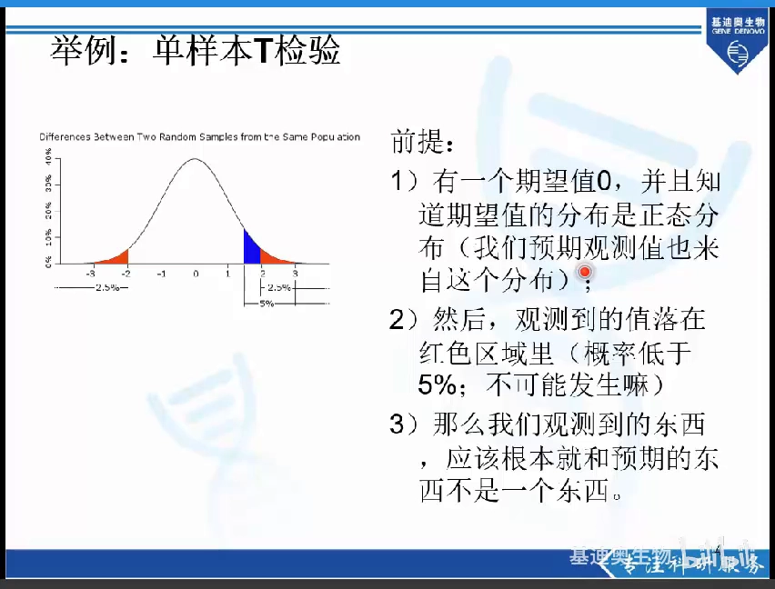

判断方法很朴素：如果差异细微到属于随机误差，我们就认为两组没有差异；如果观测值落在一个抽样分布最两端的 5%、甚至最极端的 1%，我们就认为这是随机分布下的**小概率事件**。统计学上认为小概率事件不可能发生，于是推断：这两者的差异不属于随机误差，而是某些因素导致的 [【跳转到 03:10】](https://www.bilibili.com/video/BV1HyZnY2EZn/?t=190)。

这里有个容易被忽略的点：**5% 这个阈值本身就是「允许犯错」的声明**。你说「$p<0.05$ 就有差异」，等价于承认「有 5% 的概率，我把其实没差异的东西判成了有差异」。

### 1.2 富集分析是同一套逻辑

讲者用一张通路富集分析的表格说明，这种「先有期望分布、再证明目标偏离期望」的理念贯穿所有高通量分析 [【跳转到 03:35】](https://www.bilibili.com/video/BV1HyZnY2EZn/?t=215)。

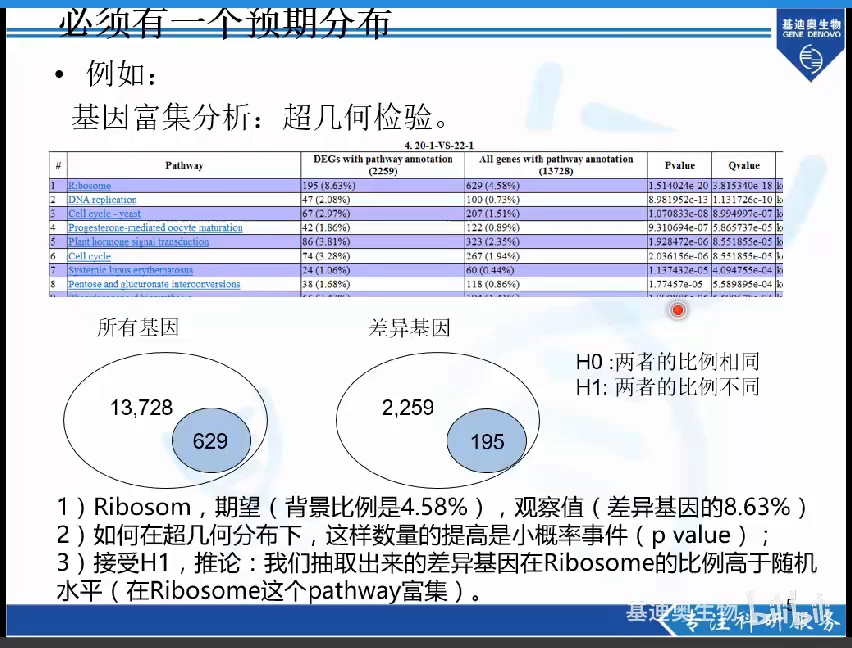

以核糖体（Ribosome）通路为例：差异基因有注释的一共 2259 个，属于这个通路的是 195 个；背景是物种整个基因组的 13728 个基因，落在该通路里的有 629 个。于是：

- **期望值**：629 / 13728 = 4.58%，即如果差异基因完全随机抽出来，属于该通路的比例应该是 4.58% 左右；
- **观测值**：195 / 2259 = 8.63%。

当然抽样有随机性，可能是 4.49%，也可能是 5%。但 8.63% 和 4.58% 的差距是否已经大到不属于随机误差的范围？如果是，就接受 H1，认为差异基因在该通路富集 [【跳转到 04:50】](https://www.bilibili.com/video/BV1HyZnY2EZn/?t=290)。这就是富集分析的基本理念。

### 1.3 差异分析：本质是问「偏离误差方差多远」

差异表达是同样的逻辑。做任何实验，数据都有一个整体变异范围；中间那个圆形区域是我们估计出来的误差方差，外面更大的方形是总体方差 [【跳转到 06:28】](https://www.bilibili.com/video/BV1HyZnY2EZn/?t=388)。

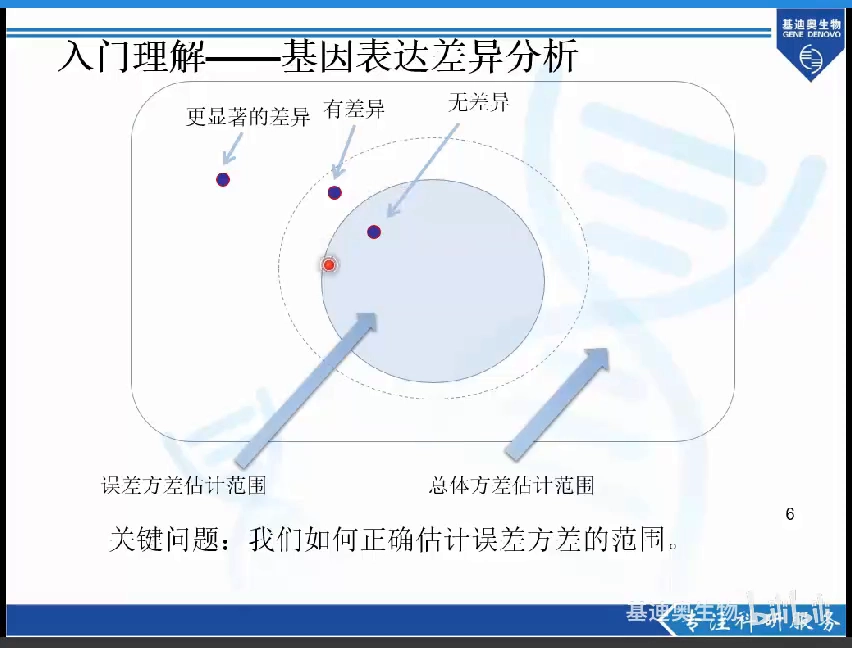

落在误差方差圆内的点判为无差异，落在圆外判为有差异，离得越远越显著。所以差异分析本质上是在问：**我们的差异偏离随机误差多远**。这就把问题逼到了关键处——误差方差本身估得准不准。

## 二、误差估不准，P 值就是假的

### 2.1 技术重复与生物重复

讲者把随机误差拆成两部分。第一是**技术重复**：一模一样的样本测两次，差异属于技术误差。第二是**生物重复**：同一个实验用两个不同的生物学样本，这两个样本之间的差异称为生物重复误差——它显然包含了技术误差，再加上两个生物样本之间的差异 [【跳转到 07:51】](https://www.bilibili.com/video/BV1HyZnY2EZn/?t=471)。

为什么审稿人揪着生物学重复不放？因为处理组和对照组本身就属于不同的生物样本，所以「处理组 vs 对照组」的差异里天然包含生物学差异。如果没有生物学重复，随机误差里属于生物样本之间差异的那部分就被忽略了，误差范围被低估 [【跳转到 10:18】](https://www.bilibili.com/video/BV1HyZnY2EZn/?t=618)。

后果很直接：误差范围估小了，本来落在圆外的点会被判成「有差异」；一旦加入生物学重复、把误差范围扩大，同一个点就变回「没有差异」。所以讲者的结论是——**不设生物学重复，结果里会包含大量假阳性**。

> 对单细胞扰动实验，这一段有直接对应：同一扰动的不同供体/不同批次就是生物学重复，只把细胞当重复会让误差方差严重低估。这也是 5.2.2 讲 pseudobulk 的根本原因——本节不展开操作，只强调它对 P 值的影响。

### 2.2 误差模型的三代演进：正态 → 泊松 → 负二项 → β 负二项

除了技术误差和生物差异，二代测序还有一个**分析误差**：比对误差。讲者说，不同软件、不同算法的差异其实就在于对这几个误差怎么建模 [【跳转到 11:16】](https://www.bilibili.com/video/BV1HyZnY2EZn/?t=676)。

**第一代：泊松分布。** 最早生物公司说二代测序可以不测生物学重复，那时常用泊松分布模型，因为测序 reads 在基因组上的分布符合泊松分布。它的 H0 是：这个基因对应的 reads 数在两个样本里的比例一样——比如总数据量都是 1 万条 reads，样本一里该基因 100 条、样本二里 150 条，H0 认为 100 和 150 没有差异 [【跳转到 12:01】](https://www.bilibili.com/video/BV1HyZnY2EZn/?t=721)。

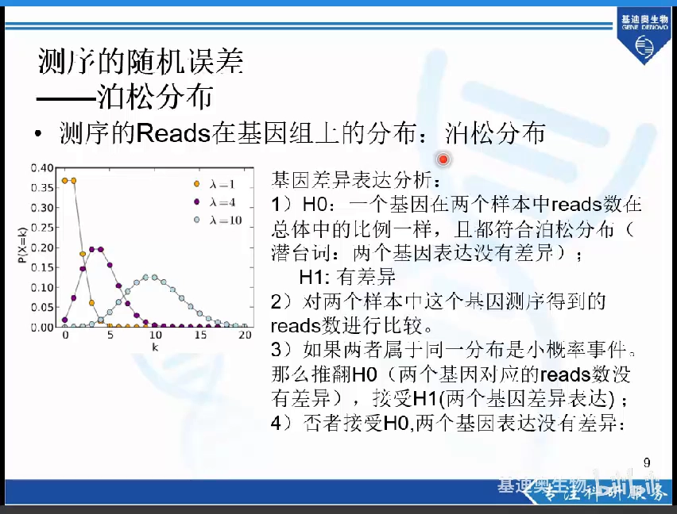

**第二代：负二项分布。** 加入生物学样本后，误差模型要加一层：检测的技术误差属于泊松分布，而生物样本间的差异理论上属于伽马分布。两者叠加就构成负二项分布，其方差为

$$
v = \mu + \alpha \mu^{2}
$$

其中 $v$ 是方差、$\mu$ 是均值、$\alpha$ 是散度因子（dispersion）。edgeR 和 DESeq 都使用负二项分布，只是对散度因子的估算方式不同 [【跳转到 13:25】](https://www.bilibili.com/video/BV1HyZnY2EZn/?t=805)。

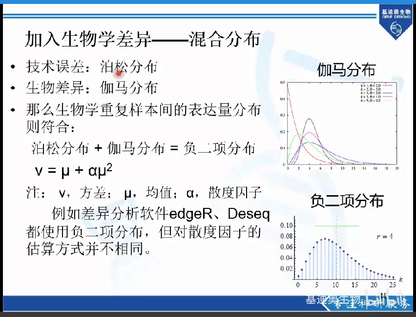

**第三代：β 负二项分布。** 计算表达量时还有一层误差：一条 reads 可能比对到多个可变剪接上，软件要把这条 reads 拆成几份来估算归属，这个重新分配的过程会引入误差。于是误差变成「负二项（生物重复）+ β 分布（多重比对分配）」，新版本的 cuffdiff 就采用了这个假设 [【跳转到 15:05】](https://www.bilibili.com/video/BV1HyZnY2EZn/?t=905)。

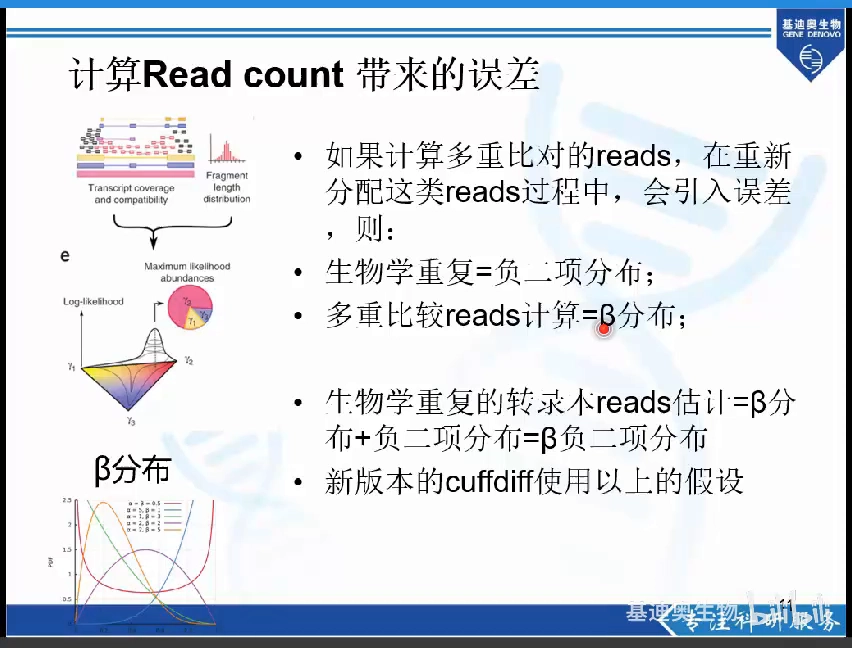

讲者在这里给了一句总结：无论做 GWAS、做差异分析还是做富集分析，**本质上都是对误差进行估算**——随机误差到底属于正态分布（T 检验、方差分析）、负二项分布（基因差异表达），还是超几何分布（富集分析）。误差分布估对了，P 值才有意义。

## 三、不知道分布怎么办：置换与自展

### 3.1 一根针从天花板掉下来

有些分析我们根本不知道随机误差的分布范围，这时才轮到 permutation（置换检验）出场。讲者举了个很直观的例子：天花板挂一根绣花针，让它自由落体掉到地上，落地点服从什么分布？你要建个模型去算空气阻力、风的影响，可能非常复杂 [【跳转到 17:03】](https://www.bilibili.com/video/BV1HyZnY2EZn/?t=1023)。

但既然有计算机，不如直接把这个实验做 1 万次，最后观测这 1 万个点是怎么分布的，也就知道了误差如何分布。

### 3.2 STEM 趋势分析里的置换

真实例子是趋势分析。某个项目里，3380 个基因中有 1381 个被分配到了某一类趋势，软件给出的 P 值是 1.4E-158。这里要检验的是：1381 这个数量是随机分配得到的，还是大大高于随机预期？问题是我们不知道这个数量服从什么分布 [【跳转到 16:13】](https://www.bilibili.com/video/BV1HyZnY2EZn/?t=973)。

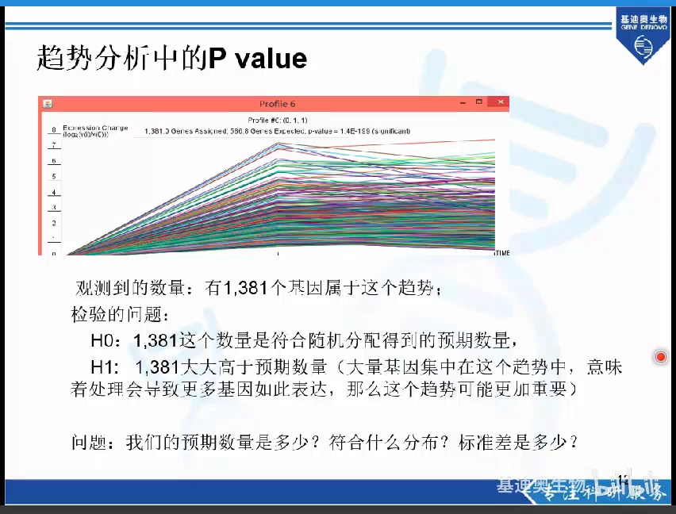

STEM 软件的解法是把三个样本的顺序**随机打乱**，让样本没有明显的时间顺序，再重新分配，记录每次随机分配中该趋势分到的基因数量，反复模拟 1000 次 [【跳转到 18:48】](https://www.bilibili.com/video/BV1HyZnY2EZn/?t=1128)。

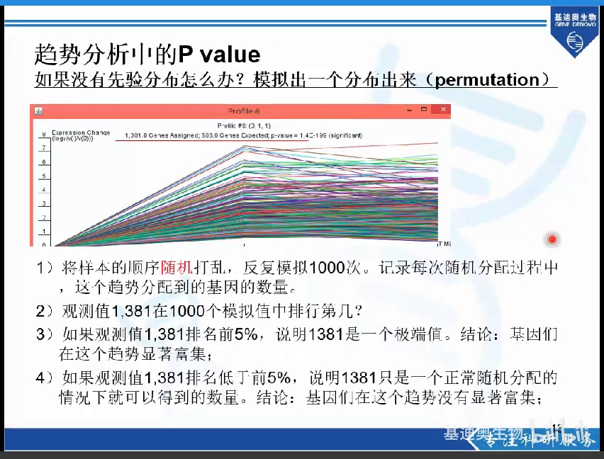

这 1000 个模拟值构成一个经验分布。如果 1381 在这个分布里排名前 5%，说明它是极端值，结论是这些基因在该趋势显著富集；如果低于前 5%，说明 1381 只是随机分配下就能得到的数量，没有显著富集。

### 3.3 自展值（bootstrap）：换一个方向问问题

构建进化树时的自展值用的是同一套随机模拟，但问的问题反过来：做差异表达是想证明差异是**极端**的，而建树是想知道这棵树是不是**稳定、有代表性**的 [【跳转到 20:25】](https://www.bilibili.com/video/BV1HyZnY2EZn/?t=1225)。

做法是对位点做有放回重抽样（resample），构造 100 组新数据，每组都重建一次树，最后看真实树的结构在随机模拟里占多大比例。比如某个节点的自展值是 67%，意思是随机模拟的 100 组里有 67 组支持这个进化关系；100 组全部支持就是 100%。进化分析里一般要求自展值大于 75% 才认为可信。

## 四、多重检验：5% 乘以一万次就是 500 个假阳性

前面讲的都是「单次统计」。问题在于，做 RNA-seq 差异表达时检验次数不是一次，可能是成千上万次。讲者的推演很干脆 [【跳转到 24:09】](https://www.bilibili.com/video/BV1HyZnY2EZn/?t=1449)：

- 单次检验按 $p<0.05$ 判「有差异」，就有 5% 的概率把其实没差异的基因判成有差异，这是**假阳性**；
- 检验 1 万次，5% 乘以 1 万次，假阳性的次数就变成 500 次；
- 哪怕这 1 万个基因完全没有差异，按 P 值 5% 过滤也会得出 500 个「差异基因」。

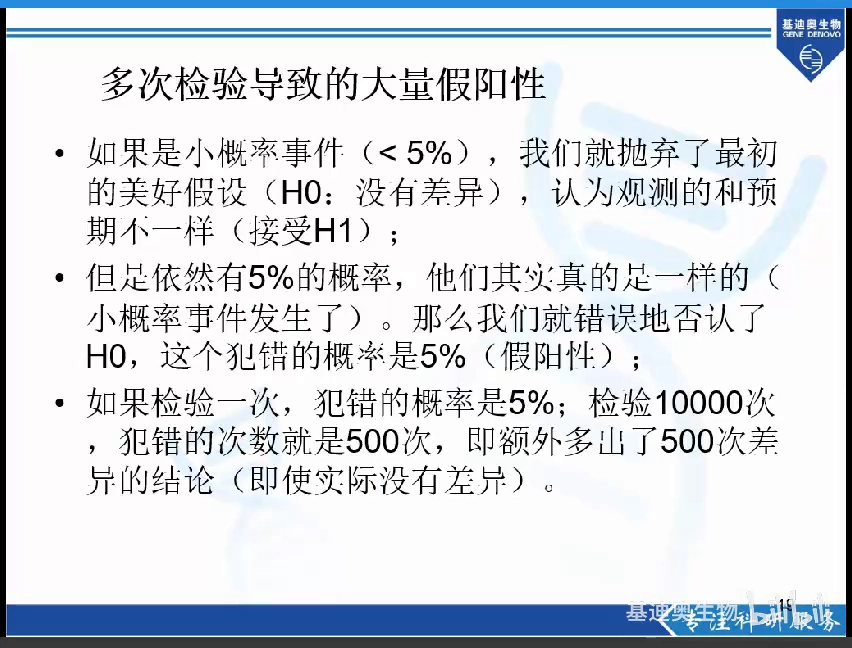

讲者打了个比方：常在河边走，怎能不湿鞋。一次在河边走掉进河里的概率很低，但 365 天天天走、走 10 年，总要掉进去几次。所以原始的单基因 P 值在做多重检验时**太宽松了**，必须提高标准。这就是引入多重检验校正的目的：通过提高阈值来控制假阳性的次数。

## 五、Bonferroni：最严厉，也最容易造成假阴性

最严厉的方法就是 Bonferroni。既然检验 1 万次会有 500 次错误，那就把阈值从 5% 直接除以 1 万，得到

$$
\alpha_{\text{Bonf}} = \frac{0.05}{10000} = 0.000005
$$

即使再检验 1 万次，把这个极小的阈值乘以 1 万，总体错误率依然只有 5%，预期犯错次数不到 1 次 [【跳转到 27:09】](https://www.bilibili.com/video/BV1HyZnY2EZn/?t=1629)。

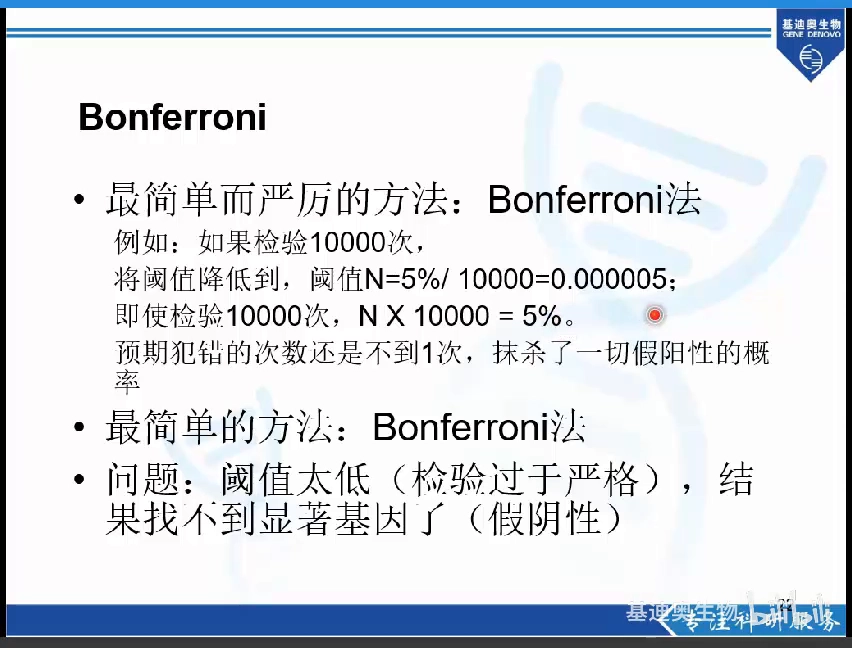

代价也很清楚：**阈值太低、检验过于严格，结果可能找不到显著基因了**，也就是引入大量假阴性。有些差异是真实存在的，只是不那么明显，太严厉就会把真的差异一起杀掉 [【跳转到 28:24】](https://www.bilibili.com/video/BV1HyZnY2EZn/?t=1704)。

所以多重检验校正的目的不是「简单粗暴地一个错都不许有」，而是**在假阳性和假阴性之间取得平衡**。

## 六、FDR：允许犯错，但把犯错比例管住

FDR（False Discovery Rate，错误发现率）就是那个折中方案：它不要求一次错误都不出现，只要求把「假/真阳性的比例」控制在一定范围内 [【跳转到 29:14】](https://www.bilibili.com/video/BV1HyZnY2EZn/?t=1754)。

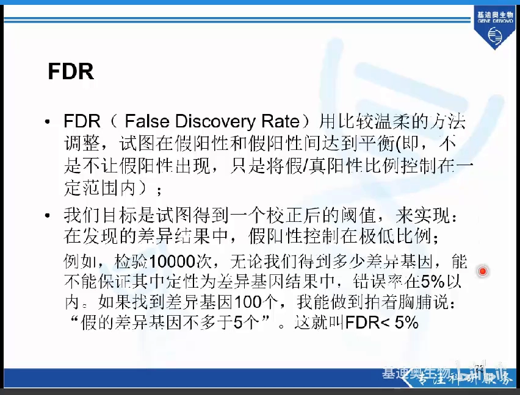

讲者的例子是：检验 1 万次，无论得到多少差异基因，能不能保证「定性为差异基因的结果中错误率在 5% 以内」？如果找到 100 个差异基因，我能拍着胸脯说「假的差异基因不多于 5 个」，这就叫 FDR 小于 5%。

FDR 与 Bonferroni 的直观区别可以一句话概括：**Bonferroni 要求一次犯错的机会都没有，FDR 允许犯错，只是把放错次数控制在某个比例内** [【跳转到 32:56】](https://www.bilibili.com/video/BV1HyZnY2EZn/?t=1976)。

## 七、P 与 Q 的分工：一个对单次负责，一个对全局负责

讲者反复强调过，FDR、Q 值、adjusted P 值在绝大多数场合可以当作同一个东西：Q 值是对 FDR 的参数估计，而 Q 值又是从 P 值校正得到的，所以 Q 值常被称为「校正后的 P 值」[【跳转到 30:54】](https://www.bilibili.com/video/BV1HyZnY2EZn/?t=1854)。

真正需要分清的是 P 和 Q 的**责任范围** [【跳转到 31:19】](https://www.bilibili.com/video/BV1HyZnY2EZn/?t=1879)：

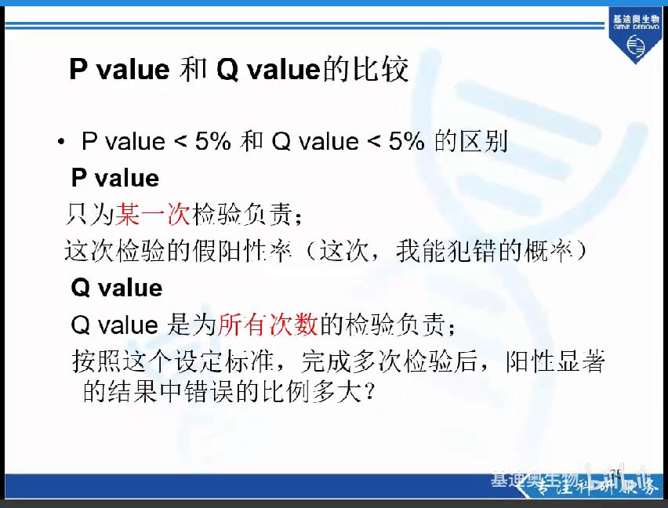

- **P 值只为某一次检验负责**：这次检验的假阳性率有多高；
- **Q 值为所有次数的检验负责**：按这个设定标准做完多次检验后，阳性显著的结果中错误的比例有多大。

举个具体数：如果差异显著的结果有 500 个，FDR 设 10%，那么这 500 个显著结果里最多有 50 个是假的；如果差异基因只有 100 个、Q 值取 0.1，就说这 100 个里错的不会多于 10 个 [【跳转到 31:44】](https://www.bilibili.com/video/BV1HyZnY2EZn/?t=1904)。

> 这一条对扰动分析很实用：当你只讨论「某一个基因在这个扰动下是否变化」时，引用 P 值是可以的，因为它只对这一次检验负责；但当你说「这 300 个基因是这个扰动的响应 signature」时，就必须用 Q 值，因为你关心的是这一批结果里假的有多少。

## 八、BH 公式：Q = P × m / k

从 P 值估算 Q 值的方法很多，用得最多的是 Benjamini 和 Hochberg 的方法（BH 法）。讲者坦言这个公式「虽然不够完美，但简单又好用」，所以大家说 FDR 校正时通常默认就是 BH。

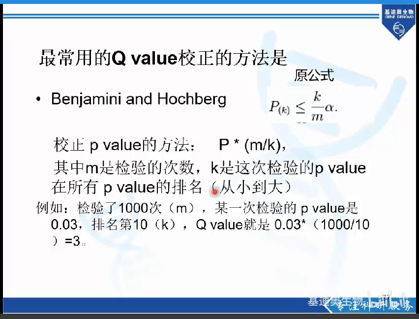

公式是

$$
Q = P \times \frac{m}{k}
$$

其中 $m$ 是检验次数，$k$ 是这次检验的 P 值在所有 P 值中从小到大排序的排名 [【跳转到 34:11】](https://www.bilibili.com/video/BV1HyZnY2EZn/?t=2051)。

讲者给的例子：检验 1000 次（$m=1000$），某次检验的 P 值是 0.03、排名第 10（$k=10$），那么 $Q = 0.03 \times (1000/10) = 3$。注意这个结果**大于 1**——这不是软件算错了，也不是公式错了，BH 只是个估算公式，往下排完全可能大于 1；但从意义上看大于 1 是没有意义的，因为 Q 值通常只用到 0.1 或 0.05 [【跳转到 35:01】](https://www.bilibili.com/video/BV1HyZnY2EZn/?t=2101)。

由公式可以直接推出一个性质：**Q 值必然大于 P 值**。讲者用一张通路富集分析的结果表验证——富集分析对每个通路做超几何检验得到一个 P 值，上百个通路同样要做多重检验校正，校正后那一列 Q 值都大于 P 值 [【跳转到 35:44】](https://www.bilibili.com/video/BV1HyZnY2EZn/?t=2144)。

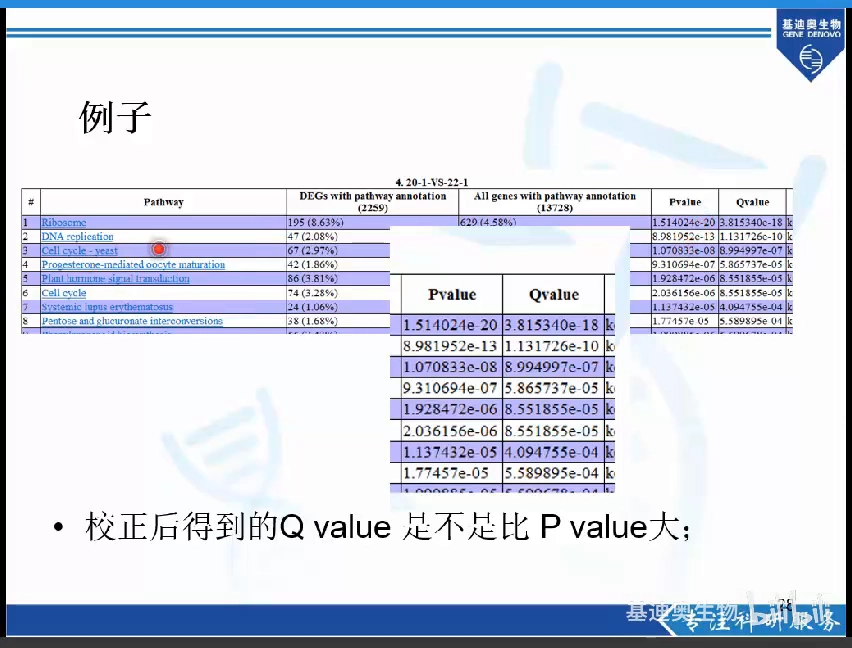

## 九、阈值怎么定：Q 值可以放宽，但要算清代价

Q 值的阈值常见是 0.1%、1%、5%，最宽松的时候可以达到 25%——也就是差异基因的结果中有 25% 是假的 [【跳转到 37:49】](https://www.bilibili.com/video/BV1HyZnY2EZn/?t=2269)。

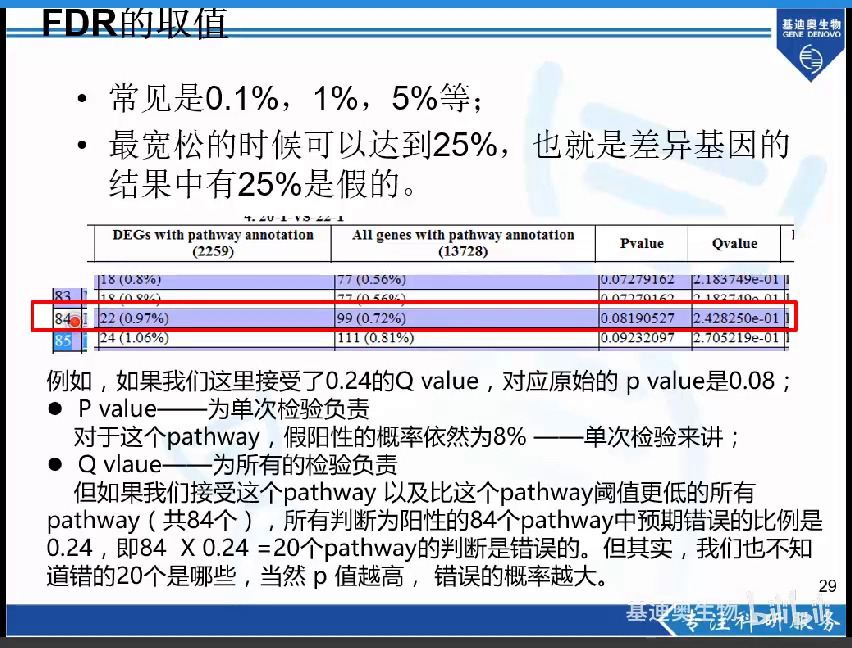

讲者用一个具体通路把 P 与 Q 的差别算了一遍：这个通路在所有通路里排名第 84 位（即 $k=84$），P 值 0.08，Q 值是 0.24（幻灯片写作 2.43e-01）。

- 对**单个通路**而言，它的假阳性概率是 8%，这是单次检验的说法；
- 但如果我以这个通路为界砍一刀，把 1 到 84 位都判为显著，那么这 84 个显著通路里有多少是错的？这时要用 Q 值：$84 \times 0.24 \approx 20$，即预期约 20 条判断是错的。

讲者补了一句很实在的话：我们也不知道错的那 20 个具体是哪些，当然 P 值越高的，错误的概率越大 [【跳转到 39:04】](https://www.bilibili.com/video/BV1HyZnY2EZn/?t=2344)。

## 十、BH 不是终点：Storey 方法与工具实现

BH 公式虽然比 Bonferroni 宽松，但它**依然偏严格**，原因是它的基础假设：所有基因都没有差异。可实际做生物学实验时，1 万个基因里真的就有三五千个是有差异的，那原假设就有问题——理论上应该把真实有差异的基因先过滤掉再建立假设 [【跳转到 40:18】](https://www.bilibili.com/video/BV1HyZnY2EZn/?t=2418)。

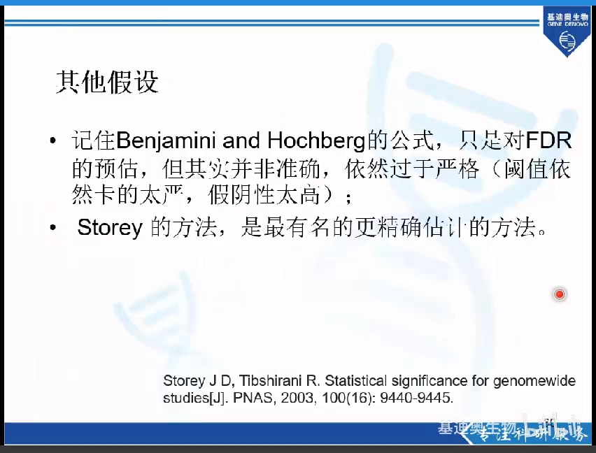

更精确的做法是在 Benjamini 的基础上做优化，最有名的是 Storey 的方法（Storey 与 Tibshirani，2003 年 PNAS）：在做检验之前先预估结果里差异显著的基因到底有多少个，再据此估算 FDR，结果更准确。不过讲者也说，通常情况下用 BH 一般就足够了。

最后是落地：R 里就是 `p.adjust` 命令，`method` 参数可以选 `BH`、`BY`、`bonferroni` 等；要特别注意 `fdr` 与 `BH` 是相同的，因为 `fdr` 默认就用 BH 算法。公式简单，不懂 R 也可以用 Excel 算 [【跳转到 41:33】](https://www.bilibili.com/video/BV1HyZnY2EZn/?t=2493)。

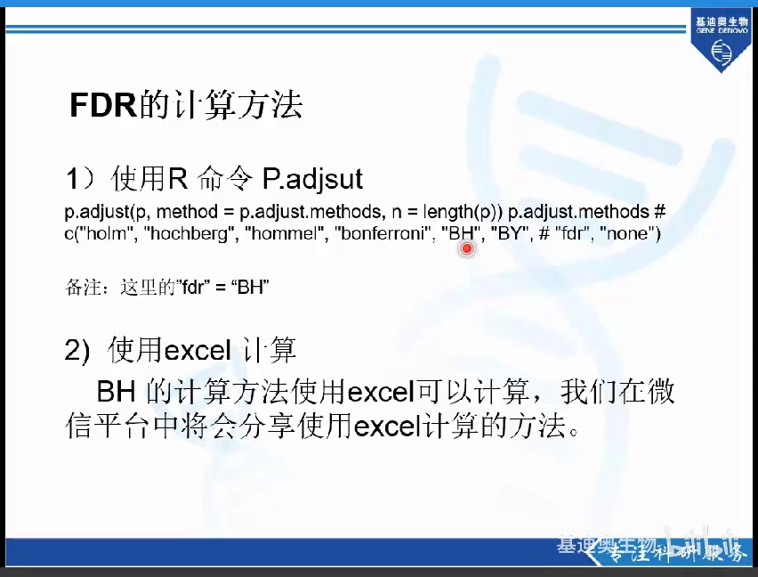

## 小结

- **P 值只对一次检验负责，Q 值对所有检验负责**。前者是「这一次我可能错」，后者是「这批阳性结果里错的占多少」；FDR、Q 值、adjusted P 值在绝大多数场合可以当作同一个东西。
- **检验次数一多，5% 就会被放大**：1 万次检验 × 5% = 500 个假阳性，哪怕真实差异为零。
- **Bonferroni 管住假阳性但制造假阴性**：阈值降到 $\alpha/m$，一次错都不许有，真实但微弱的差异也被杀掉。
- **FDR 是折中**：允许犯错，但把犯错比例控制在阳性结果里；阈值常见 0.1%、1%、5%，最宽松可到 25%。
- **BH 公式是 $Q = P \times m/k$**，所以 Q 必然大于 P，且可能大于 1（大于 1 无意义但公式没错）。
- **P 值可信的前提是误差估得准**：没有生物学重复会低估误差方差、制造假阳性；误差模型从泊松到负二项再到 β 负二项，就是在补这一环。
- **不知道分布就用置换/自展**：打乱样本顺序模拟 1000 次得到经验分布，看观测值是否落在前 5%；建树则用有放回重抽样算自展值。
- **回到扰动分析**：报结论时把效应量（logFC、分布距离、模块得分）和校正后的 Q 值一起报——只看 P 值，你分不清「效应大」和「细胞多」。

## 关键术语速查

| 术语 | 一句话解释 |
| --- | --- |
| H0 / H1 | 零假设与备择假设：H0 说观测值和期望值一样（无差异），H1 说不一样 |
| 假阳性（第一类错误） | 实际没差异却判成有差异，概率就是显著性水平 $\alpha$ |
| 假阴性（第二类错误） | 实际有差异却没检出，阈值越严越容易发生 |
| 技术重复 | 同一样本测两次，差异只反映检测误差 |
| 生物重复 | 不同生物学样本之间的重复，误差里同时包含技术误差与个体差异 |
| 泊松分布 | 只考虑测序随机误差时的 reads 计数模型，等价于「没有生物学重复」的假设 |
| 负二项分布 | 泊松（技术误差）与伽马（生物差异）叠加而成，方差 $v=\mu+\alpha\mu^{2}$，edgeR/DESeq 使用 |
| 散度因子 $\alpha$ | 负二项分布里描述额外变异（超出泊松）大小的参数 |
| 置换检验（permutation） | 打乱样本标签、重复模拟上千次，用经验分布判断观测值是否极端 |
| 自展值（bootstrap） | 有放回重抽样重建上千次，看原始结果在模拟中被支持的比例 |
| Bonferroni 校正 | 阈值取 $\alpha/m$，保证一次假阳性都不出现，代价是假阴性高 |
| FDR | 错误发现率，阳性结果中错误所占的比例，允许犯错但比例受控 |
| Q 值 | 对 FDR 的估计，也是校正后的 P 值；$\text{Q}=\text{FDR}=\text{adjusted }P$ |
| BH 法 | Benjamini-Hochberg 校正，$Q=P\times m/k$，最常用的 FDR 估计公式 |
| Storey 方法 | 先估计真实有差异的基因比例再算 FDR，比 BH 更精确、假阴性更低 |
| 超几何检验 | 富集分析用的检验，比较差异基因中某通路比例与背景比例 |