# 从"哪些基因变了"到"谁在驱动"：SCENIC 推断转录因子调控网络的三步

> 视频来源：[单细胞12｜SCENIC转录因子调控分析](https://www.bilibili.com/video/BV15NQJBGEXy/)（Bilibili · 小简生信）｜时长约 11 分钟
> 简要导读：上一支视频把差异基因变成了通路得分，这支视频接着往下追问一层：这些基因**是被谁推着变的**。它用一套 T 细胞亚群数据，把 SCENIC 的四步（共表达网络 → motif 筛选 → regulon 活性 → 可视化）从原理到代码完整走了一遍。本文按视频顺序整理，并在最后两章补上这套方法在**扰动实验**里的位置：为什么共表达只能给"相关"、而扰动才能给"方向"，以及一条可信的机制链条该长什么样。

## 本讲要解决的核心问题（SCQA）

**背景**：单细胞分析的标准流程是——分群、注释、做差异表达，找到每个亚群相对其他亚群的差异基因。到这一步，你手上有一份"哪些基因在哪些细胞里变了"的清单。

**冲突**：但差异表达只是一个**结果**，不是原因。清单告诉你 Treg 里有一批基因高表达，却没说"是谁让它们高表达的"。而细胞里真正处在上游、决定"哪些基因被开启、哪些被抑制"的，是**转录因子**。更麻烦的是，转录因子本身的 mRNA 表达量往往很低、测不测得到都不一定——**盯着 TF 自己的表达高低，经常看不出结论**。

**疑问**：那能不能不问"某个 TF 高不高"，而问"这个 TF 在哪些细胞里**正在指挥一批下游基因**"？

**回答（中心思想）**：SCENIC 的做法是把问题从"单个基因的表达量"换成"一组基因的协同活性"。它先用共表达找出"可能被同一个 TF 管的一组基因"，再用 motif 把其中"物理上说得通"的部分留下，得到 **regulon（调控子）**；最后用 AUCell 给每个细胞的每个 regulon 打一个活性分。于是你得到的不再是"TF 表达量"，而是**每个细胞里每条调控程序是否在运行**。

## 一、转录因子：从"哪些基因变了"到"谁驱动了这些变化"

视频用的示例数据是一套 T 细胞（约 1 万个细胞），已经注释成 Naive T、Memory/Activated T、CD8+ T、Transitional T、Treg 五个亚群（[【跳转到 00:00】](https://www.bilibili.com/video/BV15NQJBGEXy/?t=0)）。后面的所有分析都建立在这张 UMAP 之上：先把细胞分成亚群，再问"每个亚群里在跑哪套调控程序"。

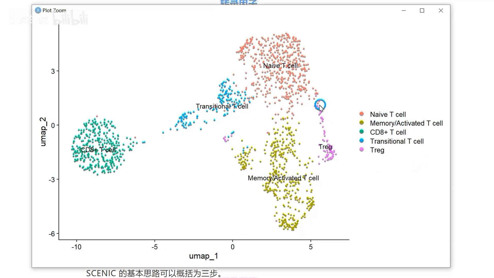

视频对转录因子（transcription factor，TF）给了一个很干净的定义（[【跳转到 00:34】](https://www.bilibili.com/video/BV15NQJBGEXy/?t=34)）：

> 转录因子是一类能够结合特定 DNA 序列、并调控下游基因转录过程的蛋白质。

它在基因表达调控中处于**上游**位置，常被看作决定细胞状态和功能的重要调控者。机制上很好理解：细胞里哪些基因被开启、哪些被抑制，往往不是随机的，而是受转录因子调控；**不同的转录因子识别不同的 DNA 结合位点**，进而促进或抑制相关靶基因的表达。所以转录因子能影响细胞的分化方向、功能维持，以及对**外界刺激**的反应过程。

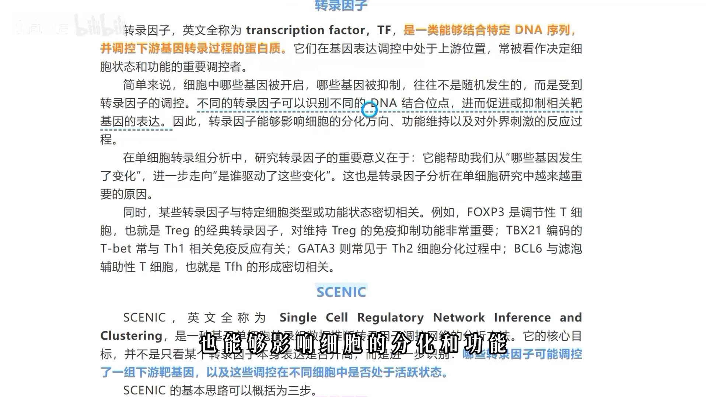

幻灯片列了一组"TF ↔ 细胞类型"的经典对应，这也是为什么转录因子分析在免疫学里特别常见：

| 转录因子 | 对应的细胞类型 / 功能 |
| --- | --- |
| FOXP3 | 调节性 T 细胞（Treg）的经典转录因子，维持其免疫抑制功能 |
| TBX21（编码 T-bet） | 常与 Th1 相关免疫反应有关 |
| GATA3 | 常见于 Th2 细胞分化过程 |
| BCL6 | 与滤泡辅助性 T 细胞（Tfh）的形成密切相关 |

视频把单细胞里做转录因子分析的意义总结成一句话（[【跳转到 00:59】](https://www.bilibili.com/video/BV15NQJBGEXy/?t=59)）：

> 它能帮助我们从"哪些基因发生了改变"，进一步走向"是谁驱动了这些变化"。

这一步的跨越，正是本小节（从基因列表到机制）的核心。

## 二、SCENIC 的三步：共表达 → motif → 活性

SCENIC 的全称是 **Single Cell Regulatory Network Inference and Clustering**（单细胞调控网络推断与聚类），是一种基于单细胞转录组数据推断转录因子调控网络的方法（[【跳转到 02:15】](https://www.bilibili.com/video/BV15NQJBGEXy/?t=135)）。

它的核心目标不是看某个转录因子**本身**表达是否升高，而是进一步识别两件事：

1. **哪些转录因子可能调控了一组下游靶基因**；
2. **这些调控在不同细胞中是否处于活跃状态**。

实现上分三步：

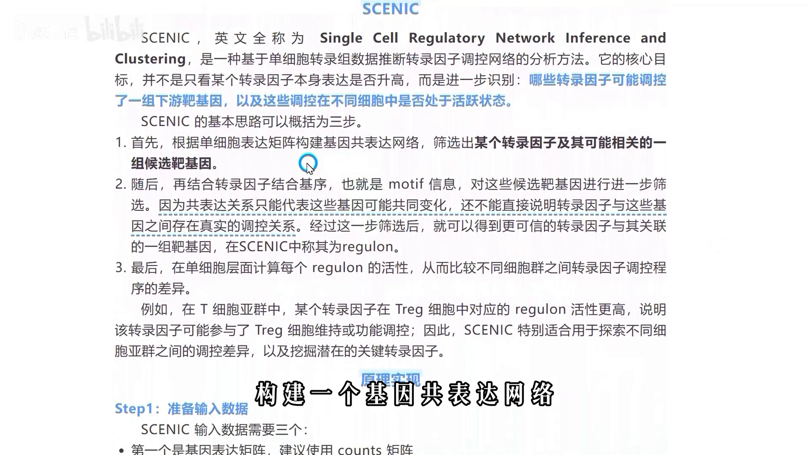

**第一步：共表达网络。** 根据单细胞表达矩阵构建基因共表达网络，筛选出某个转录因子及其可能相关的一组**候选靶基因**。

**第二步：motif 筛选。** 结合转录因子的结合基序（motif）信息，对这些候选靶基因做进一步筛选。为什么必须加这一步？视频给的理由非常关键（[【跳转到 02:40】](https://www.bilibili.com/video/BV15NQJBGEXy/?t=160)）：

> 共表达只能说明这些基因是共同发生变化、一起上调或者下调，但不能直接说明这个转录因子和基因之间存在真实的调控关系。

也就是说，共表达给出的只是**相关性**：两个基因一起变，可能是因为 A 调控 B，也可能是因为 B 调控 A，还可能是因为有个 C 同时管着它们俩。加上 motif 这一步，是引入**独立的物理证据**——如果候选靶基因的调控区域里确实有该 TF 的结合位点，这条边才更像真的。经过这一步，就得到"某个 TF + 它可能调控的一组靶基因"，SCENIC 把这样一组关系称为 **regulon（调控子）**。

**第三步：算活性。** 在单细胞层面计算每个 regulon 的活性，从而比较不同细胞群之间转录因子调控程序的差异（[【跳转到 03:05】](https://www.bilibili.com/video/BV15NQJBGEXy/?t=185)）。视频举的例子很直观：如果某个 TF 在 Treg 中对应的 regulon 活性更高，就说明这个 TF 可能参与了 Treg 的维持或功能调控。

> 注意这里的一个观念转变：**SCENIC 的输出不是"某个 TF 表达高"，而是"某个 TF 的调控程序在运行"**。一个 TF 的 mRNA 可能只有几个 counts（单细胞里极难稳定检出），但它管的 20 个靶基因同时偏高，这个信号是可以被稳定打分的。

## 三、第一步：准备三个输入文件

视频强调 SCENIC 运行非常吃时间，所以代码里用的是**已经跑好的结果**，但代码本身都可以运行（[【跳转到 04:52】](https://www.bilibili.com/video/BV15NQJBGEXy/?t=292)）。输入一共三样：

1. **基因表达矩阵**——建议使用 counts 矩阵；
2. **细胞对应的分组注释信息**（这里是 T 细胞亚型）；
3. **motif 注释文件和数据库文件**。

第三样最容易出错，值得拆开看（[【跳转到 03:55】](https://www.bilibili.com/video/BV15NQJBGEXy/?t=235)）：

- **motif 注释文件**：描述 motif 和转录因子之间的对应关系。视频用的是 **mc9nr**，对应 motif collection version 9；代码里从 RcisTarget 包中直接载入 `motifAnnotations_hgnc_v9`。
- **motif 数据库文件**：描述基因与 motif 的相关信息，需要从 **cisTarget** 数据库网站下载到本地。视频用了两个 `.feather` 文件：
  - `hg19-500bp-upstream-7species.mc9nr.feather`——关注基因**上游 500 bp** 区域的 motif 信息；
  - `hg19-tss-centered-10kb-7species.mc9nr.feather`——关注以**转录起始位点（TSS）为中心、上下 10 kb** 范围的 motif 信息。

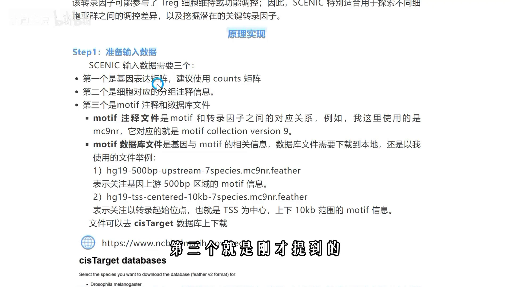

这里有一条硬性要求：**下载的数据库文件必须和注释文件版本一致**。视频里用的是 V9 版本，那么下载数据库时就必须下 V9 版本——"这里需要确认好版本"（[【跳转到 04:20】](https://www.bilibili.com/video/BV15NQJBGEXy/?t=260)）。版本不一致时，motif 编号对不上，第二步的筛选就全错了。

## 四、代码：从表达矩阵到 scenicOptions

代码开头导入四个包：`SCENIC`、`AUCell`、`RcisTarget`、`GENIE3`（[【跳转到 05:17】](https://www.bilibili.com/video/BV15NQJBGEXy/?t=317)）。然后按"三个输入"依次准备：

- 表达矩阵：从 Seurat 对象里取原始 counts，`GetAssayData(Tcell, assay = "RNA", layer = "counts")`，再转成普通矩阵；
- 细胞分组：用细胞名和 Seurat 对象里的亚型列（T_subtype）拼一个 data.frame，行名是细胞名；
- motif 注释：从 RcisTarget 载入 `motifAnnotations_hgnc_v9`，赋给 `motifAnnotations_hgnc`。

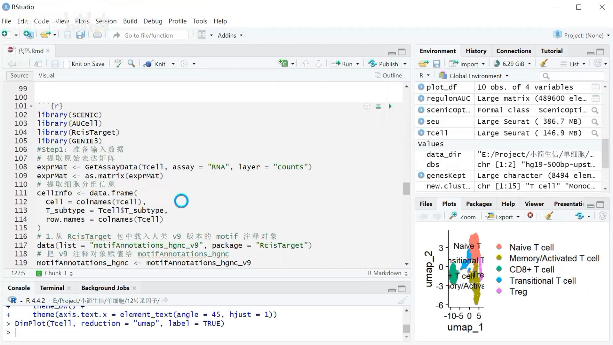

最后初始化一个 **scenicOptions 配置对象**——可以理解为 SCENIC 的总配置文件，后面所有分析都用这里面设置的参数（[【跳转到 05:42】](https://www.bilibili.com/video/BV15NQJBGEXy/?t=342)）：

- `org = "hgnc"`：指定物种为人类，基因命名体系用 HGNC；
- `dbDir`：cisTarget 数据库文件所在的目录；
- `dbs`：上面指定的两个数据库文件名；
- `datasetTitle`：本次分析的项目名称；
- `nCores`：并行计算使用的线程数。

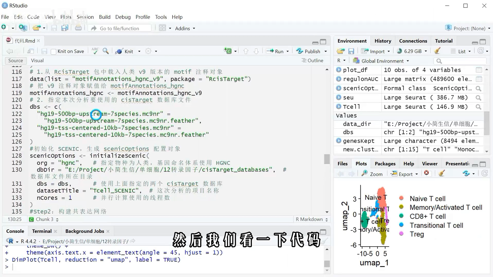

## 五、第二步：共表达网络与 GENIE3

这一步的目标，是从单细胞表达数据里找出"哪些转录因子与哪些基因具有相似的表达变化模式"，从而得到**初步的**候选调控关系（[【跳转到 06:07】](https://www.bilibili.com/video/BV15NQJBGEXy/?t=367)）。

实际分析中有三个预处理动作：

1. **基因过滤**：去除表达过低、或仅在极少数细胞中出现的基因。代码里的标准是"至少在 1% 的细胞中表达"。
2. **log2(x+1) 转换**：对过滤后的表达矩阵做对数变换，压缩表达量的动态范围。
3. **算相关性 + GENIE3**：先计算基因之间的相关性，再用 GENIE3 推断转录因子与候选靶基因之间的共表达关系。

GENIE3 的基本思想，幻灯片写成了一个公式：

$$
y_j = f_j\left(TF_1, TF_2, \dots, TF_p\right)
$$

其中 $y_j$ 表示第 $j$ 个目标基因的表达量，$TF_1 \sim TF_p$ 表示候选转录因子集合。GENIE3 通过**随机森林等回归树模型**，评估每个转录因子对目标基因表达的**贡献大小**，从而得到一组转录因子与候选靶基因之间的**加权连接关系**（[【跳转到 06:57】](https://www.bilibili.com/video/BV15NQJBGEXy/?t=417)）。

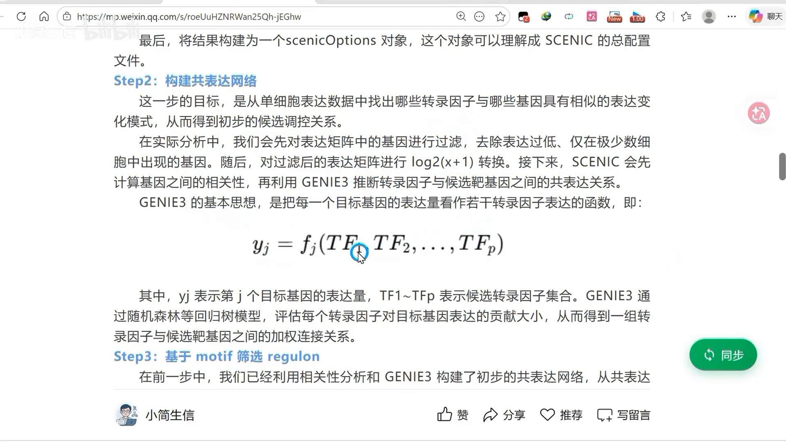

这一步得到的结果是**初筛**——视频特意纠正了自己的措辞：这时候还不能叫"调控靶基因"，只能叫**候选靶基因**，因为"这是刚开始构建共表达网络"（[【跳转到 06:32】](https://www.bilibili.com/video/BV15NQJBGEXy/?t=392)）。这个用词上的谨慎很值得学：共表达网络里的边，本质上都是假说。

## 六、第三步：用 motif 把"相关"筛成"可能调控"

第三步用第二步的结果，结合 motif 信息做筛选（[【跳转到 07:38】](https://www.bilibili.com/video/BV15NQJBGEXy/?t=458)）：

> 如果某个候选靶基因的调控区域中，富集了对应转录因子的结合 motif，那么这个基因更有可能是真正受到该转录因子调控的靶基因。

经过这一步，就可以把**某个转录因子及其可能调控的一组靶基因**定义为一个 regulon（[【跳转到 08:03】](https://www.bilibili.com/video/BV15NQJBGEXy/?t=483)）。代码上分两小段：先把共表达模块提取出来，再结合 motif 信息筛选。

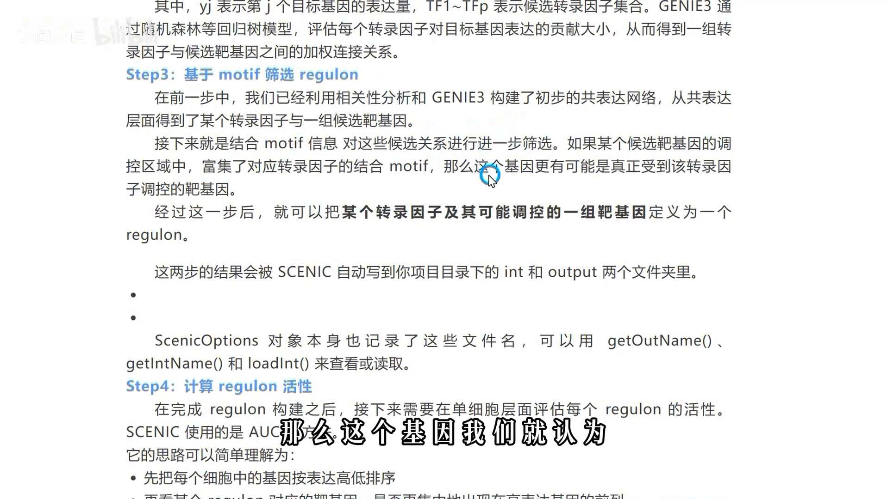

注意这一步的措辞仍然是"**更可能**"——motif 富集是必要条件，不是充分条件。一个基因的启动子区有某个 motif，不代表那个 TF 在这个细胞类型里真的结合上去了。这正是 GRN 推断的固有局限：它给的是**排序后的假说**，不是已证实的因果边。

## 七、第四步：AUCell 给每个细胞算 regulon 活性

有了 regulon，接下来要在单细胞层面评估每个 regulon 的活性。SCENIC 用的是 **AUCell** 方法，思路可以拆成三句（[【跳转到 08:32】](https://www.bilibili.com/video/BV15NQJBGEXy/?t=512)）：

1. 先把每个细胞中的基因按表达高低排序；
2. 再看某个 regulon 对应的靶基因，是否更集中地出现在**高表达基因的前列**；
3. 如果一个 regulon 的靶基因在某个细胞中整体排名更靠前，那么这个 regulon 在该细胞中的活性就更高。

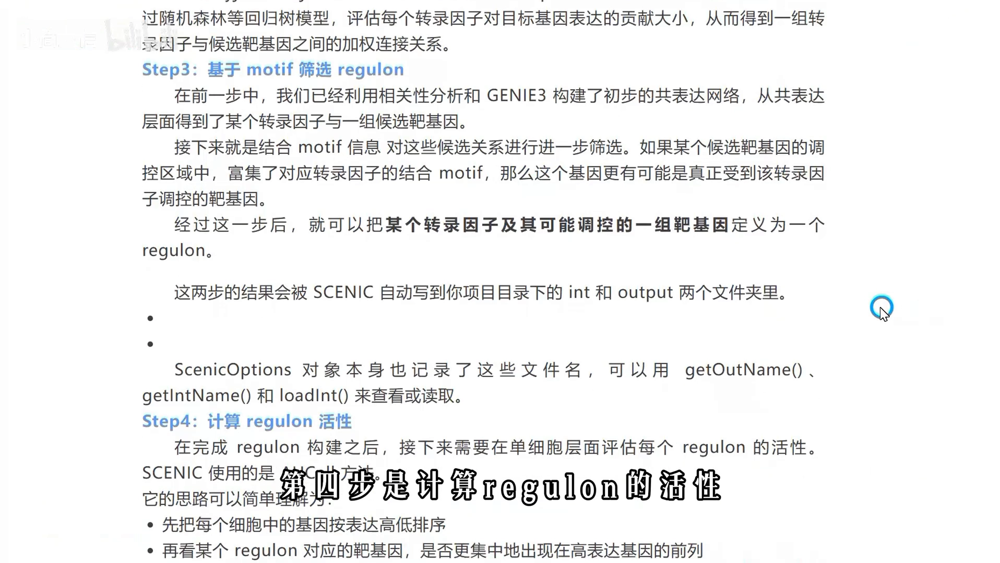

> 这套"看基因集是否集中在排序顶端"的逻辑，和通路分析里的 GSEA / ssGSEA 是同一个思想——只不过这里排序的是**单个细胞内的基因**，被打分的是**一个 regulon**。所以如果你理解了 ssGSEA 为什么不需要对照组，也就理解了 SCENIC 为什么能给每个细胞单独打分。

结果是一个矩阵 `regulonAUC`（[【跳转到 08:57】](https://www.bilibili.com/video/BV15NQJBGEXy/?t=537)）：

- **行** = regulon；
- **列** = 细胞；
- **数值** = 该 regulon 在该细胞中的活性强弱。

在此基础上，还可以对 regulon 活性做**二值化**处理，判断某个 regulon 在细胞中更偏"激活"还是"不激活"。

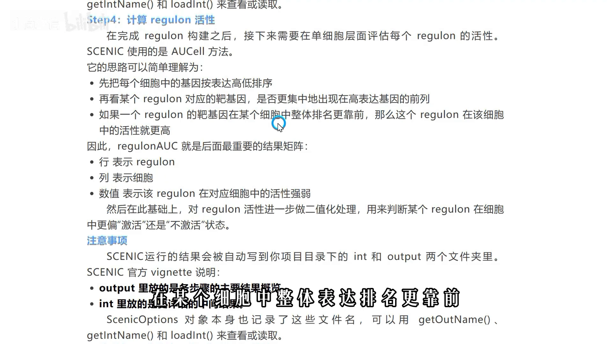

### 一个实操上的坑：结果不在内存里，而在文件夹里

视频专门提醒：SCENIC 运行的结果会被自动写到项目目录下的 **int** 和 **output** 两个文件夹里（[【跳转到 09:22】](https://www.bilibili.com/video/BV15NQJBGEXy/?t=562)）：

- **output** 放的是各步骤的主要结果；
- **int** 放的是更详细的中间结果。

也就是说，它**不是**像 Seurat 那样直接生成一个对象留在内存里。想拿这些文件，可以用 `ScenicOptions` 对象自带的 `getOutName()`、`getIntName()`、`loadInt()` 来查看或读取。不知道这一点的人，跑完 SCENIC 会发现环境变量里只有一个配置对象，以为结果丢了。

## 八、可视化：热图、dotplot 与小提琴图

regulon 活性矩阵本质上就是一个数值矩阵，所以常规的可视化方法都能用（[【跳转到 10:25】](https://www.bilibili.com/video/BV15NQJBGEXy/?t=625)）：

- **热图**：横坐标是 T 细胞亚群类型，纵坐标是转录因子，右侧括号里的数字（如 `FOXN3 (21g)`）表示这个 regulon 有 21 个靶基因（[【跳转到 10:30】](https://www.bilibili.com/video/BV15NQJBGEXy/?t=630)）；
- **dotplot**：点的大小表示该 regulon 在该亚群中被激活的细胞比例（ActiveFrac），颜色表示平均活性（MeanAUC）（[【跳转到 10:41】](https://www.bilibili.com/video/BV15NQJBGEXy/?t=641)）；
- **小提琴图**：看活性值在亚群内的分布，以及亚群之间的活性差异（[【跳转到 10:48】](https://www.bilibili.com/video/BV15NQJBGEXy/?t=648)）。

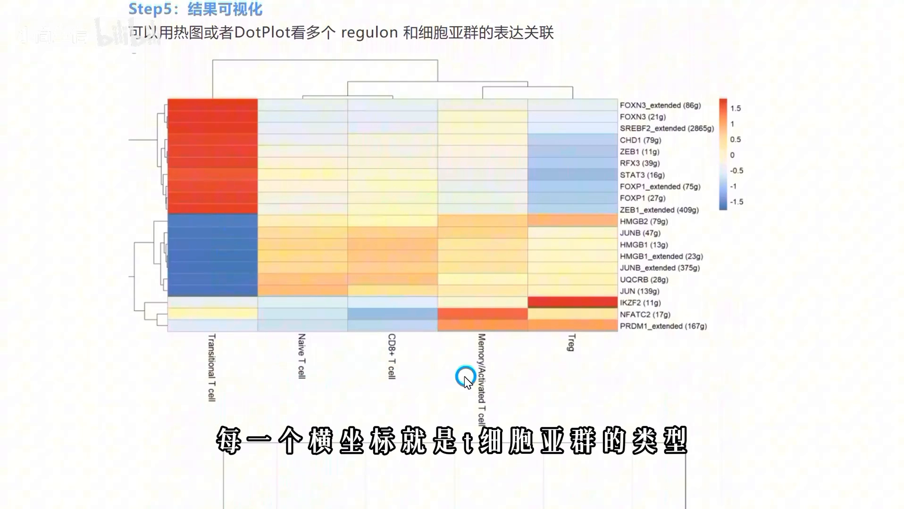

这张热图值得仔细看：左侧（Transitional T cell）整体偏红的一组 regulon 包括 FOXN3、SREBF2、ZEB1、CHD1、RFX3、STAT3、FOXP1 等；而 IKZF2、NFATC2、PRDM1 在 Treg 一列明显偏高。IKZF2（Helios）与 NFATC2 都是 Treg 相关的经典因子，PRDM1（Blimp-1）则与效应/终末分化相关——这正是"regulon 活性"比"TF 表达量"更好读的地方：**它把一组靶基因的共同信号压缩成了一个可比较的分数**。

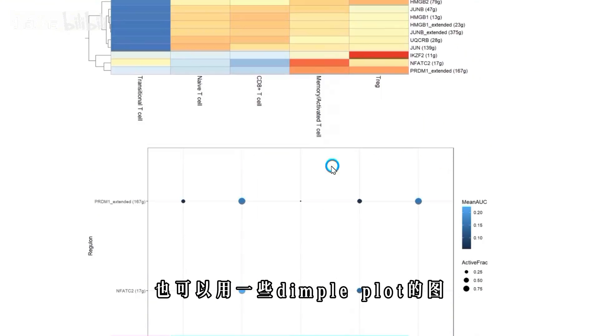

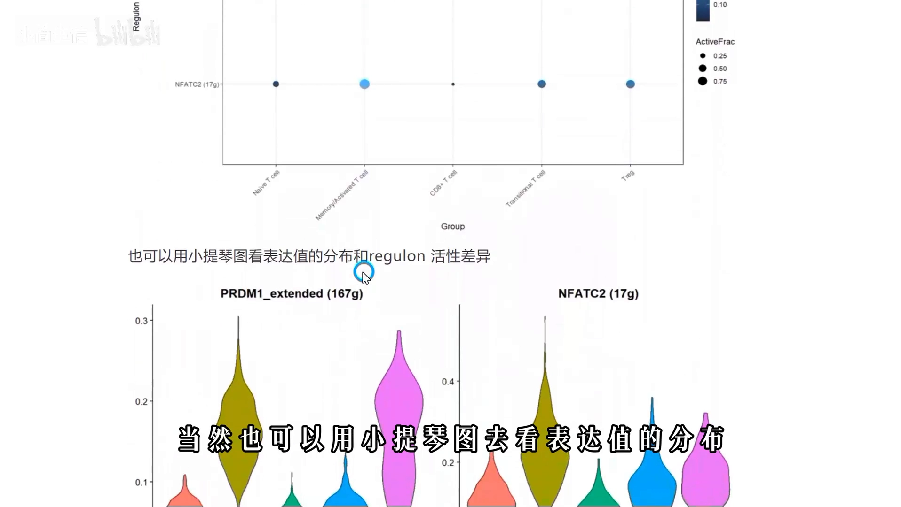

## 九、GRN 的三条主流路线，SCENIC 只是其中一条

视频只讲了 SCENIC，但把它的位置放清楚，才知道该在什么时候用它、什么时候不该用（这一节是把视频方法放回方法学版图后的补充）：

| 路线 | 依据 | 代表方法 | 能给什么 | 给不了什么 |
| --- | --- | --- | --- | --- |
| 共表达 + 先验 | 表达相关性 + motif / ChIP 等先验 | SCENIC（GENIE3 + RcisTarget + AUCell） | regulon 及其在单细胞层面的活性 | 边的**方向**仍来自先验，不是数据本身 |
| 扰动数据反推 | 敲掉 A 后哪些基因跟着变 | Perturb-seq / CROP-seq 类设计 | **有向**的、可干预验证的边 | 需要专门的扰动实验，通量有限 |
| 多组学 | ATAC + RNA，增强子–基因连接 | SCENIC+ 等 | 调控元件层面的机制 | 数据要求高，成本大 |

SCENIC 属于第一条：它用 motif 数据库**借来**方向（"TF 结合在靶基因上游"这个先验），所以它的方向性来自注释，不来自你的数据。

## 十、扰动数据为什么能给"方向"：这是 Perturb-seq 的独特价值

这是本小节最想强调的一点，也是 SCENIC 这类纯观测方法的天花板所在。

**共表达只能给相关。** 如果 A 和 B 在细胞间总是同高同低，可能的方向有三种：A → B、B → A、C → A 且 C → B。SCENIC 用 motif 把"A 是转录因子、且 B 的调控区有 A 的结合位点"这一支挑出来，但**它没有做任何干预**——它看到的所有变异都来自细胞之间本来就存在的差异，而不是你施加的处理。

**扰动给的是方向。** 当你敲掉 A，然后观察到 B 的表达随之改变，逻辑就变了：

- 如果 A → B，敲掉 A 会让 B 变；
- 如果 B → A，敲掉 A 不该让 B 变（除非有反馈）；
- 如果是 C 同时管 A 和 B，敲掉 A 也不该让 B 变。

所以"**敲掉 A 后 B 变了**"这一条观察，本身就把三种可能砍掉两种。这就是 Perturb-seq / CROP-seq 这类数据被用来**构建和验证 GRN** 的根本原因：它提供的是**干预**，而干预是因果推断唯一可靠的来源。

把两类数据放在一起，最自然的用法是**互补**：

1. 用 SCENIC 在观测数据上得到一张 regulon 层面的候选网络（覆盖广、成本低、但有大量假说）；
2. 用扰动数据去**检验**其中关键的边（覆盖窄、成本高、但方向明确）；
3. 两者一致的边，才值得写进机制模型。

## 十一、一条可信的机制链条长什么样

视频最后没有讲"怎么讲机制故事"，但把 SCENIC 的输出往上接一层，就能看出一个可信的机制链条应该有什么结构（这一节同样是延伸）：

**扰动 → 直接靶点变化 → 下游 TF / 通路激活 → 表型基因变化**

每一环都需要**独立证据**，不能靠同一份数据自证：

- **扰动 → 直接靶点**：需要证明扰动确实生效（knockdown / knockout 效率），且直接靶点在扰动后**早期**就变化——时间序列是区分直接与间接靶点的关键；
- **直接靶点 → 下游 TF**：需要多条 gRNA 复现（避免单条 gRNA 的 off-target），以及 motif / 结合位点证据；
- **下游 TF → 表型基因**：需要正交实验（如抑制剂、过表达、报告基因）把这条边单独拿出来验。

**最需要警惕的是"网络图很好看但不可验证"**：一张几百条边的调控网络，几乎不可能每条都验；能写进结论的，是那些**被两条以上独立证据支持、且方向一致**的边。GRN 推断出的边，默认都是假说。

## 小结

- **差异表达是结果，不是原因**；转录因子分析回答的是"谁驱动了这些变化"。
- **SCENIC 不看 TF 表达量，看 regulon 活性**：一个 TF 的 mRNA 可能测不到，但它管的几十个靶基因同时偏高，这个信号可以被稳定打分。
- **三步走**：共表达网络筛候选靶基因 → motif 筛选得 regulon → 单细胞层面算活性（AUCell）。
- **第二步不可省**：共表达只说明"一起变"，motif 才引入独立的物理证据；但 motif 富集是必要条件而非充分条件。
- **输入版本必须对齐**：motif 注释（mc9nr / V9）与 cisTarget 的 feather 数据库必须是同一版本。
- **结果不在内存里**：SCENIC 把结果写进 int 与 output 两个文件夹，用 `getOutName()` / `loadInt()` 取。
- **SCENIC 的方向性来自先验，不来自数据**；要拿到真正的方向，需要扰动实验。
- **扰动数据给的是因果方向**：敲掉 A 后 B 变了，就把"B → A"和"C 同时管两者"两种解释砍掉了。
- **可信机制链条 = 扰动 → 直接靶点 → 下游 TF / 通路 → 表型基因**，每一环都要独立证据；网络里的边默认是假说。

## 关键术语速查

| 术语 | 一句话解释 |
| --- | --- |
| 转录因子（TF） | 结合特定 DNA 序列、调控下游基因转录的蛋白质，处在表达调控的上游 |
| regulon（调控子） | 一个转录因子 + 它经 motif 筛选后可能调控的一组靶基因 |
| motif | DNA 上的一段短序列模式，是转录因子识别并结合的"地址" |
| GENIE3 | 用随机森林等回归树，把目标基因表达写成候选 TF 表达的函数的共表达推断方法 |
| RcisTarget | 做 motif 富集的工具/数据库包，用来判断基因调控区是否富集某 TF 的结合位点 |
| cisTarget 数据库 | 预先算好的"基因 ↔ motif"注释文件，按基因组区域（上游 500 bp / TSS ±10 kb）区分 |
| AUCell | 通过"靶基因是否集中在表达排序前列"给单细胞算 regulon 活性的方法 |
| regulonAUC | SCENIC 的核心结果矩阵：行是 regulon、列是细胞、数值是活性 |
| 二值化 | 把连续的活性值切成"激活 / 不激活"，便于统计激活细胞比例 |
| 共表达 | 两个基因在细胞间同高同低，只能说明相关，不能说明谁调控谁 |
| 有向性 | 调控关系里"谁在上游"的信息；观测数据给不出，扰动数据能给出 |
| Perturb-seq | 把 CRISPR 扰动与单细胞转录组读出来结合，一次读出"扰动 + 全转录组响应" |