# 阈值切掉的信号去哪了：GSEA、ssGSEA 与 GSVA 三种通路打分方法

> 视频来源：[转录组学05｜三类富集方法详解：GSEA、ssGSEA 与 GSVA](https://www.bilibili.com/video/BV1twgSzhEfH/)（Bilibili · 小简生信）｜时长约 16 分钟
> 简要导读：这是一支"先讲原理、再跑代码"的实操视频。它从一个很具体的问题出发——用差异基因做 GO/KEGG 富集，结果被那把显著性阈值切掉了什么——然后把 GSEA、ssGSEA、GSVA 三种"以表达排序为核心"的方法依次拆开，每种都给一段可运行的 R 代码。本文按视频顺序整理原理与代码要点，并在最后一章把方法放回**扰动实验**的场景里，说明单细胞扰动分析中这几个分数该怎么读、哪些地方必须自己把关。

## 本讲要解决的核心问题（SCQA）

**背景**：做扰动实验（敲掉一个基因、加一个药）之后，常规做法是先算差异表达、拿到一张差异基因列表，再把这批基因丢进 GO / KEGG 做富集分析，看哪些通路被"显著富集"。这一步的统计工具是超几何分布：给定一个从全基因组里抽出来的基因列表，问某条通路里的基因被抽中的比例是不是高于随机期望。

**冲突**：这个做法有两个隐含假设——"显著表达改变的基因才重要"、"通路的功能由少量显著基因主导"。但真实的生物系统未必如此：一条关键信号通路里的基因可能**每一个的变化都很小、单独看都不显著，可是方向完全一致**。这种"整体一致、个体不显著"的信号，会被显著性阈值整条通路地切掉。而阈值本身是人为选的（log2FC 绝对值大于 1、校正 p 值小于 0.05），换一个阈值，结论可能就变了。

**疑问**：如果不靠"切一刀"筛基因，还能用什么来评估一条通路是不是活跃？

**回答（中心思想）**：把评估对象从"一小撮显著基因"换成**全部基因的表达排序**，用排序位置而不是显著性来判断一个基因集是否集中在表达谱的某一端。GSEA 用组间比较得到的 log2FC 排序，ssGSEA 把同一套算法搬到单个样本内部，GSVA 则把比较的维度从"细胞/样本内"换到"样本间"。三者输出的是同一种东西——**通路 × 样本的得分矩阵**，而不再是"显著 / 不显著"的二元判决。

## 一、ORA 的天花板：结论被那把阈值决定了

视频开篇先回顾了上一集的内容：GO 和 KEGG 通路富集是"先找差异基因，再结合超几何分布判断通路的富集概率"（[【跳转到 00:00】](https://www.bilibili.com/video/BV1twgSzhEfH/?t=0)）。这套流程（通常称为 ORA，过表达分析）的问题在于：

> 你通路富集的结果是受差异基因控制的，换句话说，是由你少部分筛选出来的基因决定的。

也就是说，最终报告里的通路，反映的是"**那批通过了阈值的基因**讲了什么故事"，而不是"细胞里发生了什么"。视频把 ORA 的隐含假设明确写在了幻灯片上（[【跳转到 00:50】](https://www.bilibili.com/video/BV1twgSzhEfH/?t=50)）：

- 显著表达改变的基因才重要；
- 通路的功能是由少量显著基因主导的。

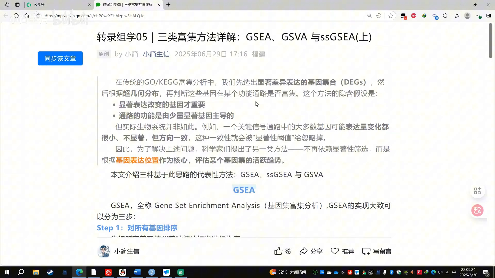

幻灯片紧接着给出了反例：一个关键信号通路中的大多数基因，表达量变化都很小、不显著，但方向一致——这种一致性会被"显著性阈值"给忽略掉。于是科学家提出了另一类方法：**不再依赖显著性筛选，而是根据基因的表达位置作为核心，评估某个基因集的活跃趋势**。

这就是本文要讲的三种方法：GSEA、ssGSEA、GSVA。视频用一句话概括了它们的关系：ssGSEA 就是"单样本的 GSEA"，而 GSVA 与 ssGSEA 输入相同、只是打分方式不同（[【跳转到 01:15】](https://www.bilibili.com/video/BV1twgSzhEfH/?t=75)）。

## 二、GSEA：把"一张基因列表"换成"一条排好队的基因"

### 2.1 第一步：给所有基因排队

GSEA（Gene Set Enrichment Analysis，基因集富集分析）的核心是：**它不用差异基因，它用所有的基因**（[【跳转到 01:40】](https://www.bilibili.com/video/BV1twgSzhEfH/?t=100)）。做法分三步，第一步是排序：

把全部基因按某种统计标准从大到小排成一个队。幻灯片列了三种可选指标：

- **log2FoldChange**（视频里最常用的一种）；
- **signal-to-noise ratio（SNR）**，信噪比；
- **其他个性化指标**，例如 limma / edgeR / DESeq2 输出的 test statistic。

视频里还补了一句很实在的话：你熟悉之后会发现，找差异基因的这几个包都会给你输出一个统计量，你也可以用别的统计量，甚至"狠一点用机器学习的什么指标都可以"；但通常还是用 log2FC。为什么说可能有更好的？因为**只用 log2FC 就丢掉了 p 值里的信息**（一个变化大但极不稳定的基因和一个变化同样大但非常稳定的基因，log2FC 是一样的），所以有些做法会把 log2FC 和 p 值做一个转换（[【跳转到 02:05】](https://www.bilibili.com/video/BV1twgSzhEfH/?t=125)）。

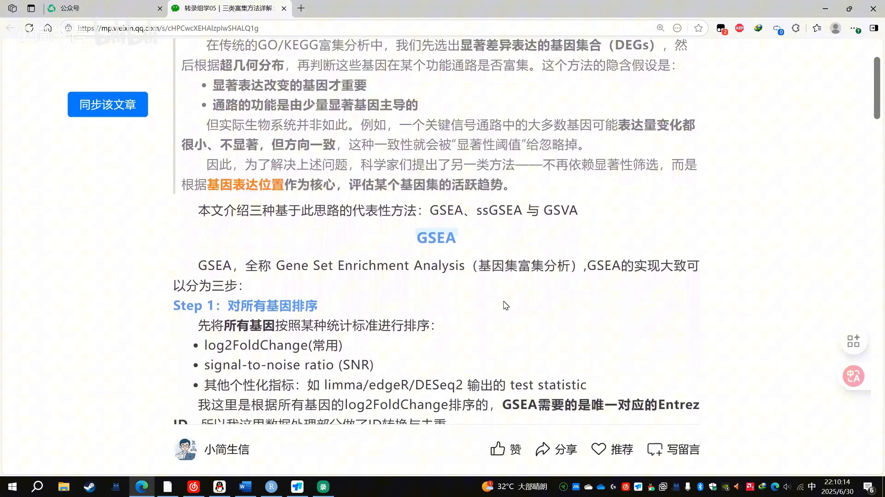

### 2.2 第二步：沿着队伍走一遍，得到富集得分 ES

排好队之后，给一个基因集（或者说一条通路——"通路本质上也就是一个大的、有相互作用的基因集"），GSEA 这样判断这条通路的活性（[【跳转到 02:55】](https://www.bilibili.com/video/BV1twgSzhEfH/?t=175)）：

> 从老大开始去比对：如果老大这个基因在基因集里，就提高一个得分；如果不在，就稍微降一点分。然后开始看老二，这样找找找，最后所有基因找完了之后就会出一条线。

这条线就是**富集得分曲线（running enrichment score）**，曲线偏离零最远的那个峰值就是这条通路的**富集得分 ES（enrichment score）**。把这段话写成公式就是：沿着排序后的基因列表逐个走，命中基因集就按权重往上加，没命中就往下减，累加值记为

$$
\mathrm{ES} = \max_{k}\ \Bigl\lvert \sum_{i=1}^{k} \Delta_i \Bigr\rvert , \qquad
\Delta_i = \begin{cases}
+\ \text{命中权重} & i \in \text{基因集} \\
-\ \text{未命中惩罚} & i \notin \text{基因集}
\end{cases}
$$

视频强调"这部分比较抽象，我们到代码部分再讲一下结果"，并给了一个很好记的总结：**遍历所有的基因，在就加分，不在就稍微减点分**（[【跳转到 03:45】](https://www.bilibili.com/video/BV1twgSzhEfH/?t=225)）。

### 2.3 代码：从差异结果表到排序向量

实操部分用的是 UP 主反复使用的"老演员"数据集——一张差异分析结果表，里面有所有基因的 log2FC（[【跳转到 04:01】](https://www.bilibili.com/video/BV1twgSzhEfH/?t=241)）。注意这里的心态转换：

- 平时：log2FC 绝对值大于 1 且校正 p 值小于 0.05 → 判定为差异基因；
- 现在：**不筛了**，所有基因的 log2FC 直接拿来排队。

第一步是数据处理，原因是 ID 体系不匹配：GO / KEGG 数据库里的通路信息用的是 **ENTREZ ID**，而表达矩阵里通常是 **ENSEMBL ID**。更麻烦的是，一个 ENTREZ ID 可能对应多个 ENSEMBL ID，所以这一步实际是两个动作——**转换 ID，然后去重**：同一个 ENTREZ ID 只保留变化最大的那条记录（log2FC 更大的那条）（[【跳转到 04:26】](https://www.bilibili.com/video/BV1twgSzhEfH/?t=266)）。

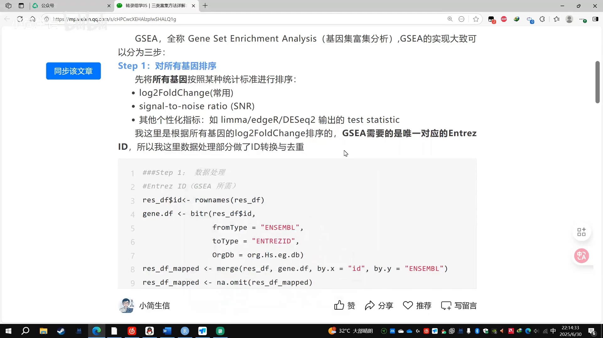

第二步是构建排序向量：按 log2FC 排序，把这些 ENTREZ ID 命名上去，得到"从高到低一直往下排"的一个命名向量（[【跳转到 05:16】](https://www.bilibili.com/video/BV1twgSzhEfH/?t=316)）。**有了这个排序向量，就可以直接跑 GSEA 了**，剩下的只是告诉函数用哪个物种、哪个基因集库。

### 2.4 代码：gseGO / gseKEGG 的参数与结果表

视频演示了 GO 的版本，并说明了几个关键参数（[【跳转到 06:31】](https://www.bilibili.com/video/BV1twgSzhEfH/?t=391)）：

- 一行指定物种；
- 一行传入刚才排好序的命名向量；
- 一行指定 GO 的三个模块（BP 生物过程 / CC 细胞组分 / MF 分子功能）；
- 然后是筛选标准：**基因集大小最小 10、最大 1000**，p 值小于 0.05。

KEGG 版本（gseKEGG）因为不涉及三个模块，只需要指定物种。

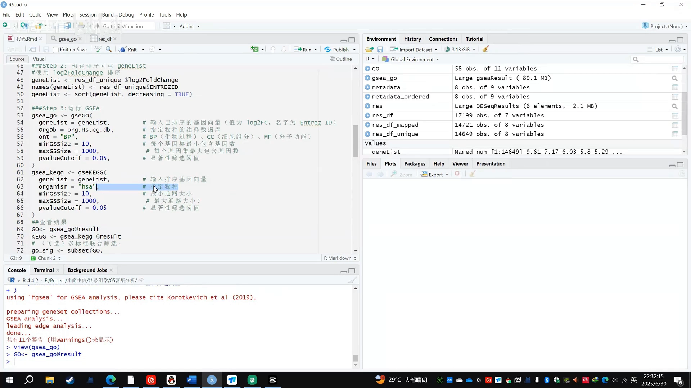

结果表的列值得逐个认一遍（[【跳转到 06:56】](https://www.bilibili.com/video/BV1twgSzhEfH/?t=416)）：

| 列名 | 含义 |
| --- | --- |
| ID | 通路的编号（如 GO:0046323） |
| Description | 通路的文字描述 |
| setSize | 这条通路包含几个基因 |
| enrichmentScore | 富集得分 ES |
| NES | 标准化后的富集得分 |
| pvalue / p.adjust / qvalue | 原始 p 值、校正 p 值、q 值 |
| rank | 峰值在排序列表中的位置 |
| leading_edge | 贡献最大的那批基因及其统计量 |

其中 **NES 是"标准化后的 ES"**，视频给的理由很关键：每个通路的得分可能不在一个数量级，所以要按得分做标准化，"让结果可比"。

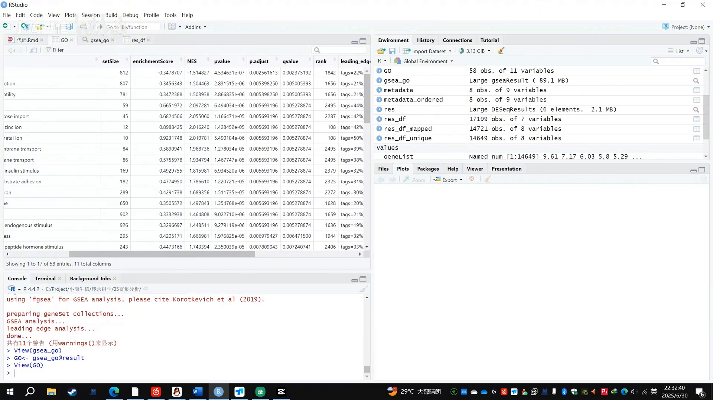

跑完之后视频里出现了一个很常见的尴尬场面：**p 值小于 0.05 的通路有 58 条**，"这么多通路我们肯定不能都用"（[【跳转到 07:21】](https://www.bilibili.com/video/BV1twgSzhEfH/?t=441)）。UP 主给的解法是两条路：

1. 你有感兴趣的通路、或者自己的基因集 → 直接画它的 GSEA 图；
2. 没有 → 用**多项标准联合筛选**，把阈值收得更严。

代码里给出的联合筛选条件就是四个条件的交集：`p.adjust < 0.05`、`abs(NES) > 1`、`setSize` 在 15 到 300 之间、`qvalue < 0.2`（[【跳转到 08:11】](https://www.bilibili.com/video/BV1twgSzhEfH/?t=491)）。

### 2.5 怎么读一张富集曲线

视频用一条葡萄糖相关的通路（D-glucose import）做了示范。画图的函数是 gseaplot2()：第一个参数是 GSEA 结果对象，第二个参数 geneSetID 指定要画哪条通路——**这个 ID 必须是结果表里真实存在的一行**，第三个参数是图的标题（[【跳转到 08:11】](https://www.bilibili.com/video/BV1twgSzhEfH/?t=491)）。

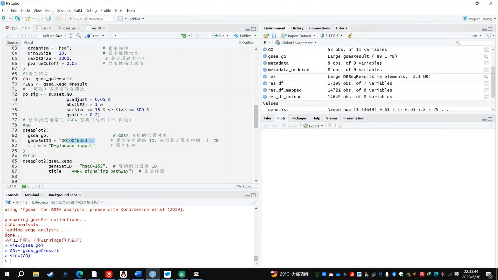

一张标准的 GSEA 图从上到下是三块（[【跳转到 08:36】](https://www.bilibili.com/video/BV1twgSzhEfH/?t=516)）：

- **绿色曲线**：富集得分曲线。命中基因集就上升，没命中就下降；最高点（0.6 往上）就是这条通路的 ES。
- **黑色竖线**：这条通路里的每个基因在排序列表中的位置。竖线密集地挤在左侧，说明这条通路的基因大多落在 log2FC 很高的一端。
- **灰色/彩色条带**：排序所用的指标本身（这里是 log2FC），从最负到最正。

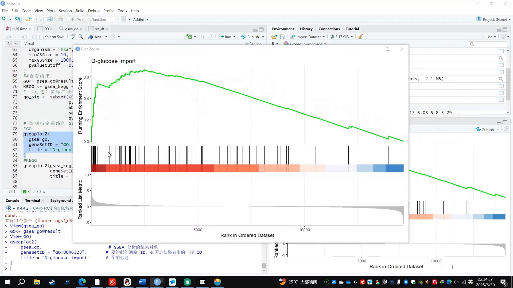

视频里还有一句方法论上的感叹值得记住：**"其实你原理知道了，这个结果真的很简单"**——曲线的形状不是玄学，就是"加分 / 减分"的累加结果（[【跳转到 09:01】](https://www.bilibili.com/video/BV1twgSzhEfH/?t=541)）。
## 三、ssGSEA：没有对照组的时候，把 GSEA 搬到单个样本上

### 3.1 问题的来源：log2FC 需要"两组"

GSEA 有一个前提：它要按 log2FC 排序，而 log2FC 是表达倍数的变换，**它一定需要你有一个分组**——疾病组 vs 健康组、扰动组 vs 对照组（[【跳转到 09:31】](https://www.bilibili.com/video/BV1twgSzhEfH/?t=571)）。

可是如果你手上只有一组样本、甚至只有一个样本，没有分组，就根本算不出 log2FC——"你总不能拿两组一样的去比，没什么意义"。这时候你依然想知道"这条通路在这个样本里活不活跃"，怎么办？

### 3.2 解法：用样本自己的表达值排序

ssGSEA（single-sample GSEA）就是 GSEA 的单样本版本（[【跳转到 09:56】](https://www.bilibili.com/video/BV1twgSzhEfH/?t=596)）。既然没有 log2FC，那就**用每个样本自己内部的基因表达值排序**，然后照搬 GSEA 的走法：从排第一的基因开始比对，在基因集里就加分，不在就稍微降点分。

结果是：**每一个样本都得到自己的一套 ES**，最终拼成一个"通路 × 样本"的得分矩阵（[【跳转到 10:21】](https://www.bilibili.com/video/BV1twgSzhEfH/?t=621)）。

这里有一个必须注意的输入差异：因为用的是表达矩阵而不是排序后的 log2FC，**不能用 counts 矩阵**，应该用标准化后的矩阵——"不同的标准化都可以，包括你用 TPM、log 转换之后的都可以"（[【跳转到 11:11】](https://www.bilibili.com/video/BV1twgSzhEfH/?t=671)）。

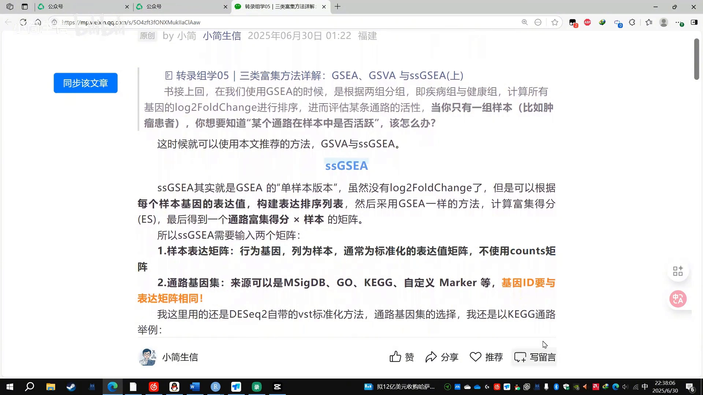

### 3.3 代码：两个输入，一个矩阵

代码只需要两样东西：**样本的表达矩阵**和**通路 / 基因集信息**（[【跳转到 11:25】](https://www.bilibili.com/video/BV1twgSzhEfH/?t=685)）。

- 表达矩阵：视频用的是 DESeq2 自带的 **VST**（方差稳定变换）结果；
- 基因集：从 KEGG 通路信息里选。`kegg_list` 拿到的表第一列是通路 ID、第二列是描述，可以选一个或多个通路——"如果你的研究是针对一个通路的话，只输入一个也行"，演示里随便选了三个。

接下来的那行代码做的是 **ENTREZ ID → ENSEMBL ID 的转换**（因为表达矩阵的行名是 ENSEMBL ID）：如果你本来就用 ENSEMBL ID，改一下参数；如果你用 ENTREZ ID，就不需要转换，只需要去重（[【跳转到 12:15】](https://www.bilibili.com/video/BV1twgSzhEfH/?t=735)）。

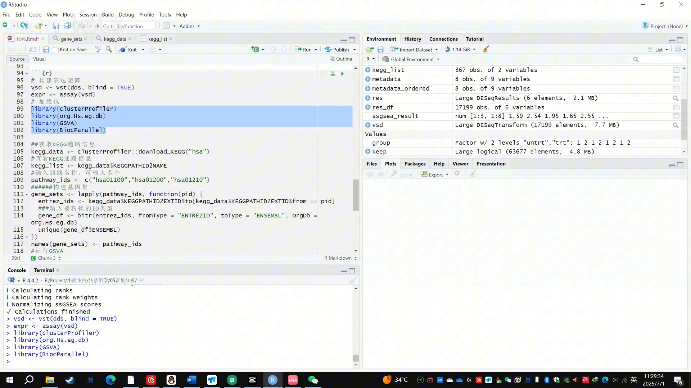

然后直接运行 ssGSEA，得到的就是"通路 × 样本"的矩阵，每个格子里是这条通路在这个样本里的得分（[【跳转到 12:40】](https://www.bilibili.com/video/BV1twgSzhEfH/?t=760)）。可视化方式是热图——行是通路、列是样本、颜色是得分，可以一眼看出哪几条通路在哪几个样本里整体偏高。

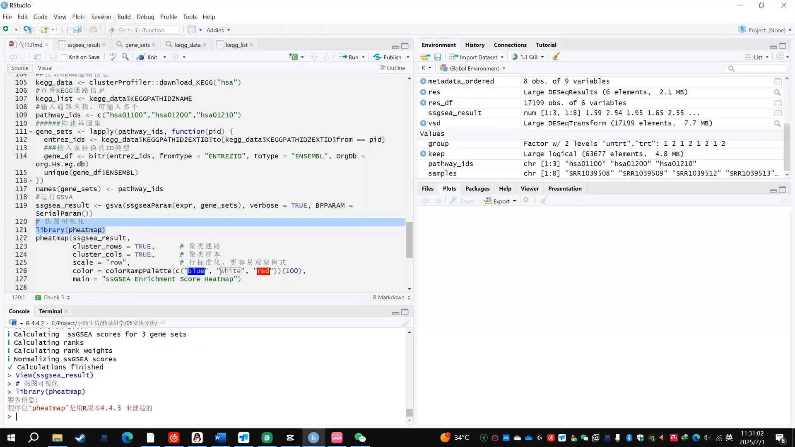

> 视频里用的写法是：ssGSEA 和 GSVA 共用同一个 gsva() 入口，只是把算法参数换成 ssgseaParam。这一点在下一节会再次出现。

```r
ssgsea_result <- gsva(ssgseaParam(expr, gene_sets), verbose = TRUE,
                      BPPARAM = SerialParam())
```

## 四、GSVA：把"样本之间"的比较做进打分里

### 4.1 与 ssGSEA 的差别只有一处：谁在排序

GSVA（Gene Set Variation Analysis）和 ssGSEA 一样，用的都是基因的表达矩阵。差别在于排序的对象（[【跳转到 13:15】](https://www.bilibili.com/video/BV1twgSzhEfH/?t=795)）：

- **ssGSEA**：在**每个样本内部**，把这个样本的所有基因按表达量排序；
- **GSVA**：看的是**每个基因在样本之间**的排序，然后用核密度估计建模，再在样本间比较。

核密度估计这一步，幻灯片给了公式：

$$
\hat{f}_i(x) = \frac{1}{Nh}\sum_{j=1}^{N} K\!\left(\frac{x - x_{i,j}}{h}\right)
$$

其中 $x_{i,j}$ 是第 $i$ 个基因在第 $j$ 个样本里的表达量，$N$ 是样本数，$K$ 是核函数，$h$ 是带宽。直观理解：**把每个基因在所有样本上的表达分布"抹平"成一条平滑曲线**，再看这个基因在某个样本里落在这条曲线的什么位置。

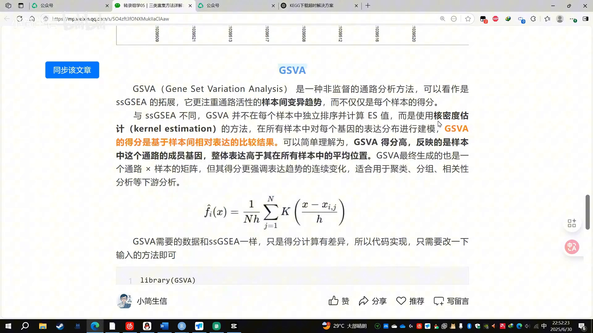

### 4.2 一个具体的例子

视频用"七个样本 + 一个基因集"讲清了 GSVA 的得分含义（[【跳转到 13:40】](https://www.bilibili.com/video/BV1twgSzhEfH/?t=820)）：

1. 先看基因集里的第 1 个基因：它在一号样本里表达高 → 一号样本这个基因的得分就高；七号样本低 → 七号就低一点。
2. 再看第 2 个基因，同样处理；一直看完这 100 个基因。
3. 如果最后发现，一号样本里**大部分基因**的整体表达都比二三四五六七号高，那么一号样本这条通路的 GSVA 得分就比较高。

所以 GSVA 得分的准确含义是：**这个样本里，这条通路的成员基因整体表达"高于所有样本平均位置"的程度**（[【跳转到 14:30】](https://www.bilibili.com/video/BV1twgSzhEfH/?t=870)）。视频特意强调了两点：

- 它**不是**"这个样本里这条通路表达得高"的绝对量，而是**样本间相对比较的结果**；
- 因此它更适合做**聚类、分组、相关性**这类下游分析——因为它输出的是连续变化的趋势值，而不是一个内部自洽的绝对活性。

### 4.3 代码：只改一个参数

因为输入完全一样（VST 后的表达矩阵 + 同一份转换好的基因集列表），GSVA 的代码和 ssGSEA 几乎逐行相同，**只需要把算法参数从 `ssgseaParam` 换成 `gsvaParam`**（[【跳转到 15:10】](https://www.bilibili.com/video/BV1twgSzhEfH/?t=910)）。结果同样是"通路 × 样本"的矩阵，同样用 pheatmap 画热图（[【跳转到 15:35】](https://www.bilibili.com/video/BV1twgSzhEfH/?t=935)）。

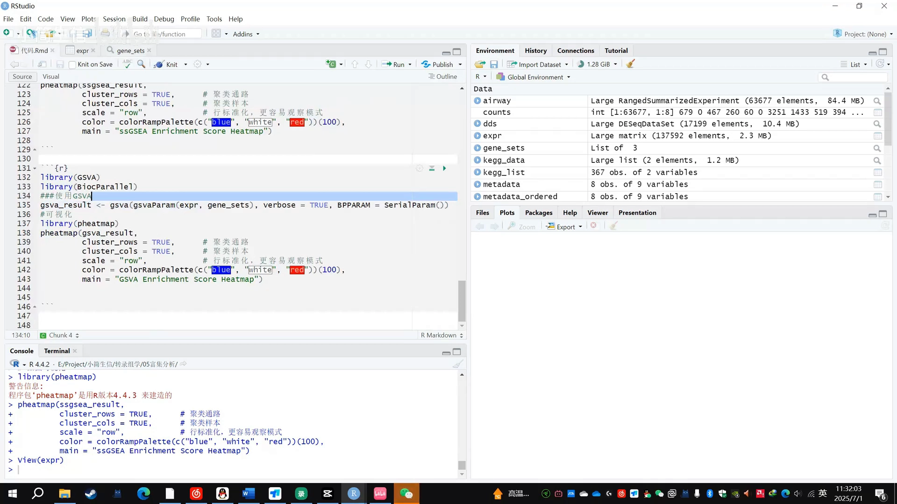

视频最后留了一个开放式的建议：**"感兴趣的可以去比对一下它和 ssGSEA 有什么区别"**——同一个矩阵、两种算法，热图的聚类形状往往很像，但个别通路的排序会变。这本身就是一次很好的方法学自查。

## 五、三种方法怎么选：先问"我有没有对照组"

把三种方法放在一起，选择标准其实只有一条：**你手上有没有一个可以比较的分组**。

| 方法 | 输入 | 排序对象 | 输出 | 什么时候用 |
| --- | --- | --- | --- | --- |
| GSEA | 全部基因的 log2FC（或检验统计量） | 基因在**组间差异**上的排序 | 通路列表（含 NES、p 值、leading edge） | 有明确的扰动组 / 对照组，想要"哪些通路整体偏移" |
| ssGSEA | 标准化表达矩阵 + 基因集 | 每个样本**内部**的基因表达排序 | 通路 × 样本得分矩阵 | 没有分组，或想给每个样本一个通路分数 |
| GSVA | 同上（标准化表达矩阵 + 基因集） | 每个基因**在样本之间**的排序，核密度建模 | 通路 × 样本得分矩阵 | 同上，但更看重样本间的连续变化趋势，便于聚类 |

三者的共同点，也是这支视频最想传达的一点：**它们都不再对基因"切一刀"**。判断依据从"这个基因显不显著"变成了"这个基因集在排序里落在什么位置"，于是"变化都小、但方向一致"的通路终于能被看见。

## 六、放回扰动场景：分数算出来之后，还有四个地方要自己把关

视频讲的是方法本身，用的是 bulk 转录组的数据集。但它的结论对单细胞扰动实验同样成立，而且**在单细胞里更容易出问题**。下面四点是把这套方法用到扰动数据分析时，必须自己交代清楚的（这一节是把视频的方法放回扰动场景后的延伸，不是视频原文）：

**第一，背景基因集要用"这次实验真正测到的基因"。** ORA 的超几何分布需要一个"背景"——从多大的基因池里抽出了这张列表。如果背景用全基因组（约 2 万个基因），而你的单细胞数据实际只检测到 1 万多个基因，那些**根本没被测到的基因**就会被当成"没被抽中"，系统性压低或抬高富集显著性。正确做法是：背景 = 本次实验检测到的基因（在 GSEA 里则体现为排序向量只包含检测到的基因）。

**第二，基因集冗余会把一个信号报成十条通路。** GO / KEGG 里大量条目高度重叠（父子条目、同一复合物的不同写法）。视频里"58 条通路 p 值小于 0.05、不能都用"的场面，很大一部分就是冗余造成的。处理办法是去冗余（如 `clusterProfiler` 的 `simplify`）或按层级选代表条目，而不是硬挑几条好看的写进文章。

**第三，必须报方向，而不只是 p 值。** GSEA 的 NES 带符号：正值表示这条通路的基因整体偏向排序的"上调端"，负值表示偏向下调端。视频里那条 D-glucose import 的曲线是往上升的，说明它的基因集中在高 log2FC 一侧。在扰动实验里，"敲掉 A 之后某通路被激活"和"被抑制"是完全相反的生物学结论，只报 p 值等于把结论丢掉一半。

**第四，细胞数一多，"什么都显著"。** 单细胞数据的细胞数动辄上万，把每个细胞当成一个样本来做检验，p 值会小到没有信息量——几乎每一条通路都"显著"。这时候唯一有意义的读法是**效应量**：NES 有多大、ssGSEA / GSVA 得分在扰动组和对照组之间差多少、这个差值在供体之间是否稳定。换句话说，单细胞场景下**通路分析的瓶颈不在显著性，而在效应量与重复**。

> 关于"怎么得到这张基因列表"（差异表达与 pseudobulk），以及"效应量怎么算、检验怎么做"，属于本系列相邻小节的内容，这里不展开。

## 七、从通路到机制：这里还差一步"有向性"

通路分析回答的是"**哪一群基因一起动了**"，它给出的仍然是一张**没有方向的清单**——你可以说"凋亡通路整体下调"，但说不了"是谁把凋亡压下去的"。

这一步需要基因调控网络（GRN）：把基因放进"谁调控谁"的有向图里。而扰动数据在这里有一个共表达数据给不了的东西——**方向**。共表达只能告诉你 A 和 B 一起变；敲掉 A 之后 B 跟着变，才说明 A 在 B 的上游。这也是本小节另一篇博客（SCENIC 推断转录因子调控网络）要处理的问题。

## 小结

- **ORA 的天花板是阈值**：它只看得见"过了线的基因"，一条"人人变化都小、但方向一致"的通路会被整条切掉。
- **GSEA 换掉了评估对象**：不筛基因，而是把全部基因按 log2FC（或检验统计量）排序，沿着队伍走一遍，命中加分、未命中减分，曲线的峰值就是 ES。
- **ES 不能直接跨通路比**，要标准化成 NES；结果表里还要看 setSize、p.adjust、qvalue 和 leading_edge。
- **GSEA 需要分组**；没有对照组时用 **ssGSEA**（样本内部排序）或 **GSVA**（基因在样本间排序 + 核密度估计），两者输出都是"通路 × 样本"矩阵。
- **ssGSEA / GSVA 不能用 counts 矩阵**，要用标准化后的表达（如 VST、TPM、log 转换）。
- **GSVA 的得分是相对位置，不是绝对活性**：它回答"这个样本比别的样本高多少"，因此适合聚类与相关性分析。
- **p 值小于 0.05 的通路往往有几十条**，必须靠多项标准联合筛选（如 `abs(NES) > 1`、setSize 范围、qvalue）收敛到可解释的少数几条。
- **放到扰动场景还要多问四句**：背景基因集对不对、基因集是否冗余、方向报了没有、效应量够不够大。

## 关键术语速查

| 术语 | 一句话解释 |
| --- | --- |
| ORA（过表达分析） | 拿一张差异基因列表，用超几何分布问"某通路的基因是不是被抽多了" |
| GSEA | 用全部基因的排序代替基因列表，看某个基因集是否集中在排序的一端 |
| ES（富集得分） | 沿排序列表"命中加分、未命中减分"累加出的曲线峰值 |
| NES | 标准化后的 ES，消除不同基因集之间的数量级差异，带方向（正 / 负） |
| leading edge | 对富集得分贡献最大的那批基因，通常就是通路里真正起作用的子集 |
| ssGSEA | GSEA 的单样本版本，在每个样本内部按表达量排序打分 |
| GSVA | 对每个基因在样本间排序并用核密度估计建模，得分反映样本间的相对位置 |
| 核密度估计 | 用核函数把一堆离散取值"抹"成一条平滑曲线，用来比较某个值在分布中的位置 |
| ENTREZ ID / ENSEMBL ID | 两套基因编号体系；GO / KEGG 通路多用 ENTREZ ID，表达矩阵多用 ENSEMBL ID |
| setSize | 一条通路里包含的基因数；太小不稳、太大太泛，通常要设上下限 |
| qvalue | 用 FDR 思路估计的"假阳性比例"，比原始 p 值更适合大规模多重检验 |
| VST | DESeq2 的方差稳定变换，把 counts 转成近似同方差的表达值，可用于 ssGSEA / GSVA |
