# 同一个治疗，五种结局：非小细胞肺癌新辅助治疗后的五类免疫微环境亚型

> 视频来源：[一作讲堂丨单细胞测序揭示非小细胞肺癌新辅助治疗后的免疫微环境异质性](https://www.bilibili.com/video/BV1T2dNYVERu/)（Bilibili · 百奥智汇「一作讲堂」，主讲：北京大学 刘泽道博士）
> 简要导读（100 字以内）：一位论文第一作者用 21 分钟讲完一篇 Cell 文章的分析链条——从"50% 患者没缓解"这个平均数出发，把患者拆成五类微环境亚型、把 T 细胞拆成不同状态、把 non-MPR 再拆成两群。本文按"先看分布、再看均值"的顺序重排这条链条，并补上量化异质性时该用哪些指标。

## 本讲要解决的核心问题（SCQA）

**背景**：新辅助免疫治疗（anti-PD-1 联合化疗）已经成为局部晚期非小细胞肺癌（NSCLC）的优选方案，手术后取下的肿瘤标本可以直接做单细胞转录组测序，读出里面浸润的免疫细胞。

**冲突**：治疗是同一个方案，结局却分成好几截。约 50% 的患者达不到主要病理缓解（MPR，即肿瘤细胞退变 ≥ 90%），约 25% 的患者在手术后仍然复发；而"耐药机制不清楚"和"缺一个预测复发的标志物"这两件事，恰好都卡在"我们把所有患者当成一个人来平均"上。

**疑问**：如果响应不是均匀发生的，那它到底在哪些层次上不均匀？每一层的异质性该怎么度量、怎么验证，才不至于把"一部分人的故事"讲成"所有人的结论"？

**回答（中心思想）**：这项研究的全部力量来自一件事——**先看分布，再看均值**。它先在患者层面把人群拆成五类免疫微环境亚型，再在细胞层面拆出不同状态（CCR8⁺ 激活型 Treg、FGFBP2⁺ NK 样 T 细胞、耗竭前体 Texp），最后把"未缓解"这一群再拆成 Treg-high 与 Treg-low 两半。每一步拆完，"平均效应"就消失一次，而每一次消失都换来一个可用的生物学结论。

> 边界说明：细胞状态打分（module score）与伪时间、RNA velocity 的方法原理见本系列 **5.1.4**；细胞状态变化与细胞比例变化的判读逻辑、以及邻域水平的组成检验（Milo 一类）见 **3.4.3**；扰动效应的模块化读出见 **3.4.4**。本文不重复这些内容，只把它们当作"已经算好的响应分数"来使用，专讲**异质性本身怎么被度量、以及平均什么时候会骗人**。

## 一、先看分布，再看均值：一个 50% 掩盖了两种失败

### 1.1 "一半人没缓解"是一个平均数，不是一条结论

讲者一开始就把临床问题摆成两句话：约 50% 的患者达不到 MPR 或 pCR，而耐药机制并不清楚；约 25% 的患者在手术后复发，而临床上缺一个预测复发的标志物 [【跳转到 04:26】](https://www.bilibili.com/video/BV1T2dNYVERu/?t=266)。

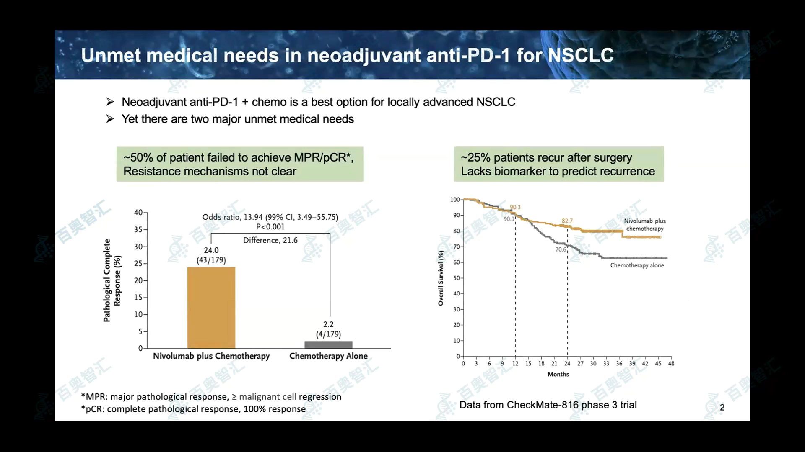

注意这两个数字的写法：它们都是"比例"，不是"平均强度"。这一点很重要——**在扰动数据里，最容易被误读的量就是均值**。把 234 例患者的所有细胞混成一份 pseudobulk，你会得到一个"中等程度"的转录组变化；但这个变化对"完全缓解的那一半"和"完全没反应的那一半"都不成立。讲者没有从均值出发，而是从"谁和谁不一样"出发，这是整场讲座的方法论基调。

### 1.2 缓解率其实是连续分布，二分只是为了说话方便

研究纳入 334 例初治可切除 NSCLC，接受 2～4 个周期 anti-PD-1 联合化疗后手术；对其中 234 例术后标本做了 scRNA/TCR-seq 与 FFPE 免疫组化 [【跳转到 05:12】](https://www.bilibili.com/video/BV1T2dNYVERu/?t=312)。幻灯片右下角那张"肿瘤面积变化"的瀑布图值得多看两眼：横轴是患者，纵轴是存活肿瘤细胞占比的变化，每一根柱子是一个患者。

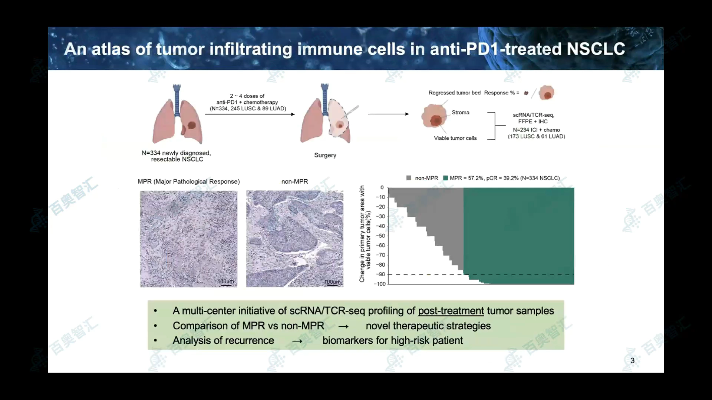

这张图说明：**MPR / non-MPR 是一条人为的阈值线**（存活肿瘤 ≤ 10%），而真实的退缩幅度是一条从 0% 到 100% 的连续谱。把连续谱切成两组，是为了临床沟通方便，不是为了统计方便。一旦你把它当成"两类人"，后面所有的"平均响应率"就都变成了对一条阈值线的描述，而不是对生物学的描述。

### 1.3 先排除混杂，再谈异质性

在拆亚型之前，讲者先做了一件常被跳过的事：把临床因素与 MPR 的关系逐个过了一遍——年龄、性别、吸烟、铂类种类、周期数、中心、病理类型、anti-PD-1 药物、淋巴结分期、第二化疗药、分期 [【跳转到 05:48】](https://www.bilibili.com/video/BV1T2dNYVERu/?t=348)。

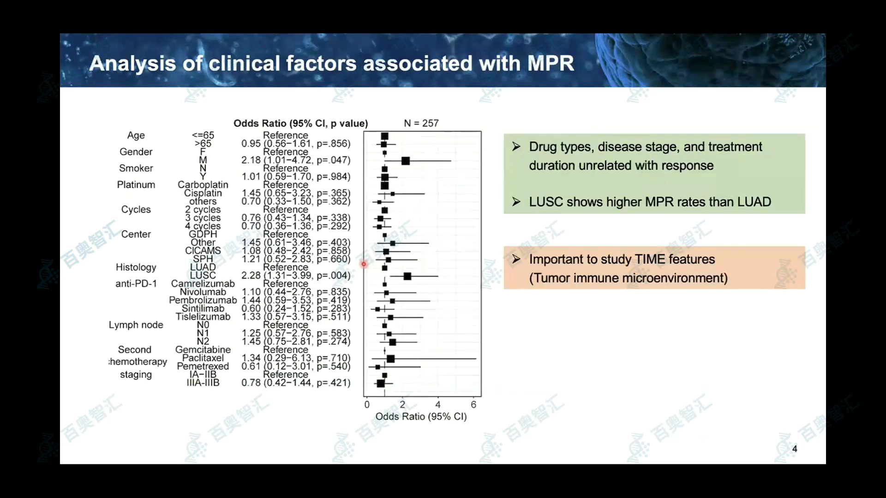

结论是：药物类型、疾病分期、治疗时长都与响应无关，唯一有差别的是肺鳞癌（LUSC）的缓解率略高于肺腺癌（LUAD）。这一步的意义在于：**异质性要先排除"混杂造成的假异质性"，剩下的才可能是生物学异质性**。如果这里查出"用某个药的患者响应率明显更高"，那么后面所有的亚型故事都可能只是在复述用药习惯。这个顺序不能颠倒。

## 二、第一层异质性：患者之间，五类免疫微环境亚型

### 2.1 用"细胞组成"给患者分类

讲者用了一个很朴素的类比：一个框子里放五个篮球加一个绿球，和放五个绿球加一个蓝球，性质显然不一样 [【跳转到 06:35】](https://www.bilibili.com/video/BV1T2dNYVERu/?t=395)。细胞组成就是这样一个"配比指纹"——不看单个基因表达多少，只看各类免疫细胞占 CD45⁺ 细胞的比例。

### 2.2 五类亚型，五种响应率

按免疫细胞亚群的相对丰度聚类，222 例患者被分成五类微环境亚型：TIME-NK、TIME-BE（B 细胞富集）、TIME-Teff、TIME-Treg、TIME-Mye（髓系富集）[【跳转到 07:00】](https://www.bilibili.com/video/BV1T2dNYVERu/?t=420)。

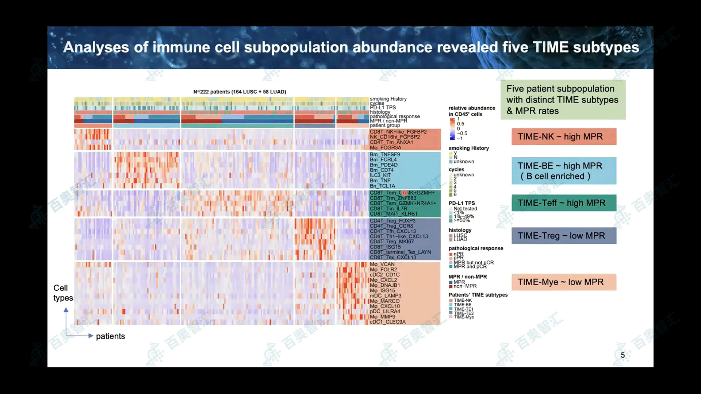

前三种（NK 富集、B 细胞富集、效应 T 富集）对应高 MPR 率，后两种（Treg 富集、髓系富集）对应低 MPR 率。这里有一个容易被忽略的读图细节：热图的列是患者、行是细胞亚群，颜色是相对丰度——**它展示的是"分布"，不是"均值"**。如果只报一句"整体 MPR 率 57.2%"，这五类亚型之间的差距就被完全抹平了。

### 2.3 为什么"组成"可以当作分层变量

因为组成是**可测量的、可重复的、且与结局单调相关**的量。它满足分层变量的三个要求：在同一个患者身上稳定（不是随机噪声）、在患者之间有足够大的差异（不是所有人都差不多）、并且与你要解释的结局有方向性关联。反过来，如果一个变量虽然与结局相关，但在患者之间差异很小，那它就没有分层价值——**分层的前提是分布本身是宽的**。

## 三、第二层异质性：同一类细胞，不同的状态

### 3.1 FGFBP2⁺ NK 样 T 细胞：会杀，但不是 anti-PD-1 的靶子

TIME-NK 亚型里富集的是表达 FGFBP2 的 NK 细胞与 NK 样 T 细胞 [【跳转到 07:56】](https://www.bilibili.com/video/BV1T2dNYVERu/?t=476)。

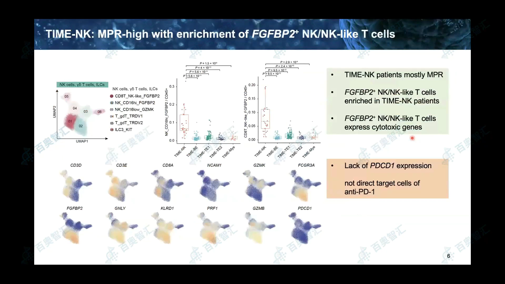

这页幻灯片把"状态"讲得很清楚：这群细胞表达 GZMB、PRF1 等细胞毒性基因，提示有直接杀伤功能；但它**不表达 PDCD1**，也就是说它不是 anti-PD-1 抗体直接靶向的细胞类型。一个细胞"有杀伤力"和"是某个药的靶点"是两件事——这正是状态层面的异质性：同一个治疗，对不同状态的细胞意味着完全不同的机制。

### 3.2 克隆扩增：状态之外还要看"这一群是不是真的在干活"

单看表达谱，你只能说"这群细胞看起来像杀伤细胞"。要再说一步，就得看克隆性：这群 FGFBP2⁺ NK 样 T 细胞在患者体内是否发生了克隆扩增 [【跳转到 08:46】](https://www.bilibili.com/video/BV1T2dNYVERu/?t=526)。

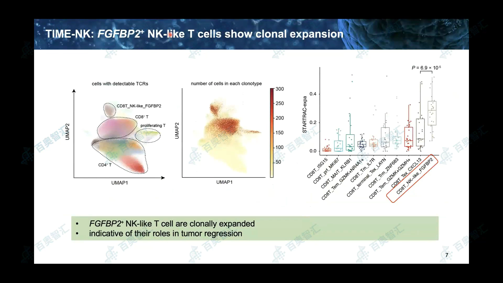

扩增指数显著高于其他 CD8⁺ T 细胞亚群（$P = 6.9 \times 10^{-5}$），说明它参与了肿瘤退缩，而不是旁观者。**"状态 + 克隆性"是两条独立证据**：前者说明它像什么，后者说明它做过什么。

### 3.3 一个反直觉的推论：这群细胞响应的是化疗

如果这群细胞不是 anti-PD-1 的靶点，那它为什么和"高 MPR"绑在一起？讲者的推理是：它可能响应的是联合方案里的**化疗**部分。为了验证，他们额外采集了一组只接受新辅助化疗的队列，发现这群细胞同样在化疗响应者中富集；体外用 NK92 细胞系与肺癌细胞系共培养，卡铂和顺铂处理都提高了 NK 细胞对肿瘤细胞的杀伤 [【跳转到 09:36】](https://www.bilibili.com/video/BV1T2dNYVERu/?t=576)。

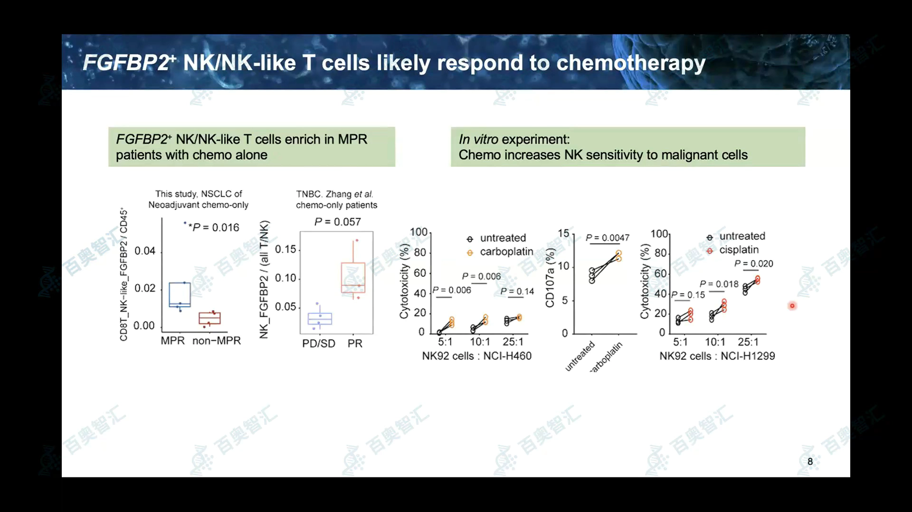

这一步在方法上很关键：**"某个亚型与好结局相关"不等于"这个亚型是免疫治疗的响应者"**。联合治疗里有两个扰动源，异质性分析必须能区分"响应的是哪一个扰动"。讲者还补了一个校准数字：真实世界中仅靠新辅助化疗能达到 MPR 的患者大约只有 5%～20%，与这一亚型的规模相符。

### 3.4 三级淋巴结构：B 细胞要聚成"成熟的结构"才算数

TIME-BE 亚型富集 B 细胞。但 B 细胞多不等于有功能——免疫组化显示这些 B 细胞聚成团，形成三级淋巴结构（TLS），且 MPR 患者中 CD21⁺ 的**成熟** TLS 更多 [【跳转到 10:31】](https://www.bilibili.com/video/BV1T2dNYVERu/?t=631)。

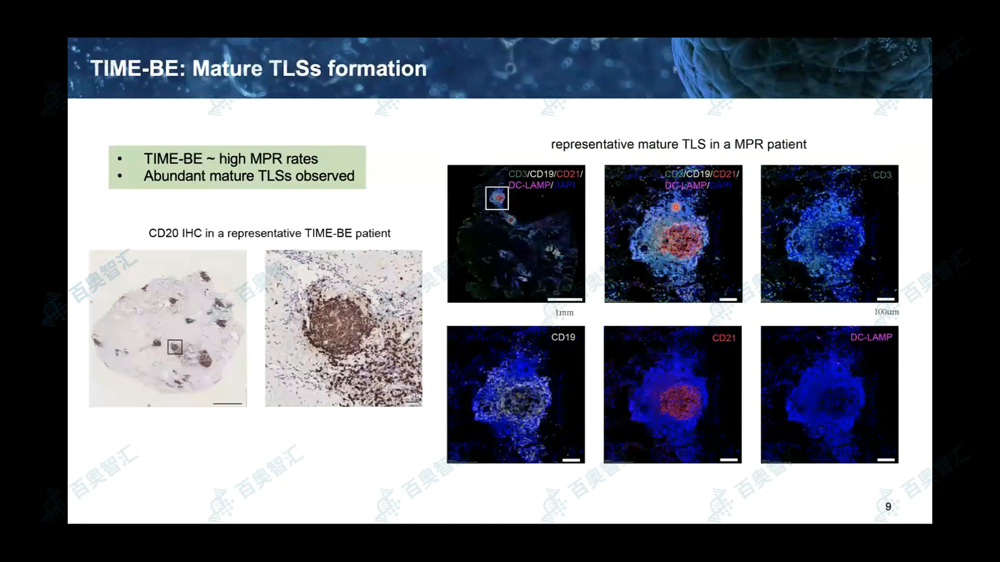

这是"状态异质性"的另一个版本：**同一类细胞，处于不同组织结构状态时，功能完全不同**。数 B 细胞的比例，和数"成熟 TLS 的个数"，是两个不同层次的度量。

### 3.5 CCR8⁺ Treg：抑制性细胞也有激活态和静息态

第三、第四类亚型都富集 T 细胞，但响应率一个高一个低。差别在于 T 细胞的状态：TIME-Teff 富集效应 T 细胞，MPR 率高；TIME-Treg 富集调节性 T 细胞（Treg），MPR 率低 [【跳转到 11:01】](https://www.bilibili.com/video/BV1T2dNYVERu/?t=661)。

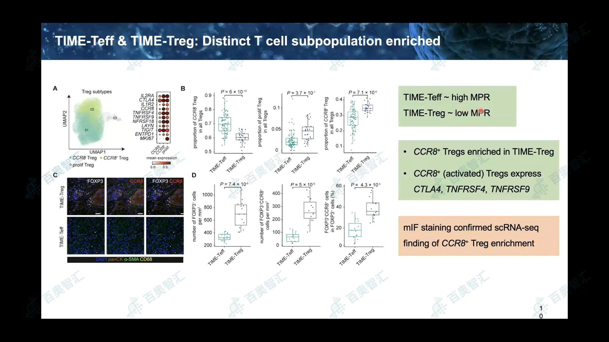

Treg 内部还能再分：CCR8⁺ 的那一部分高表达 CTLA4、TNFRSF4、TNFRSF9，是**激活态**；CCR8⁻ 的相对静息 [【跳转到 11:26】](https://www.bilibili.com/video/BV1T2dNYVERu/?t=686)。在 TIME-Treg 患者里，CCR8⁺ Treg 占全部 Treg 的比例显著更高，多重免疫荧光（mIF）在蛋白层面复现了这个结论。

读到这里可以总结出本小节的第一个操作原则：**"某类细胞变多了"是一个组成结论；"某类细胞变成了什么状态"是一个状态结论。两者必须分开报，混在一起讲就会得出自相矛盾的话。**
## 四、第三层异质性：克隆层面，谁在真正扩增

### 4.1 用 TCR 共享把"抗原特异性"找回来

肿瘤抗原特异性 T 细胞是免疫治疗起效的必要条件，但没法大规模直接验证。讲者借用了文献里的一个替代方案：表达 ENTPD1 的终末耗竭 T 细胞可以作为抗原特异性 T 细胞的近似指代；再通过 TCR 共享，把与它同源的细胞一起圈出来，定义为"耗竭相关 T 细胞"（Tex-relevant cells）[【跳转到 12:36】](https://www.bilibili.com/video/BV1T2dNYVERu/?t=756)。

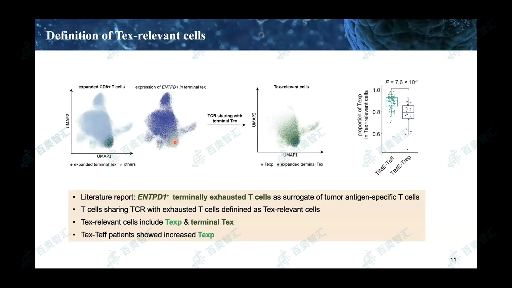

这一步的意义不在于"多找到一个细胞群"，而在于**它把一个连续的表达谱问题，转成了可计数的克隆问题**。克隆是可以数的：一个克隆型里有几个细胞、扩增到多大，都是整数，比"表达强度"更抗噪声。

### 4.2 同一个克隆家族里的两种命运

在 Tex-relevant 细胞内部，还能再分两层：浅色的 **Texp（耗竭前体）** 与深色的 **终末耗竭**。TIME-Teff 患者中 Texp 的比例显著更高（$P = 7.6 \times 10^{-7}$）[【跳转到 12:36】](https://www.bilibili.com/video/BV1T2dNYVERu/?t=756)。

这是本小节最值得记住的一种异质性：**同一群抗原特异性细胞，可以走向"还能救的前体"或"救不回来的终末耗竭"两种命运**。如果只报"抗原特异性 T 细胞总量"，这两种命运会被加在一起；而它们的临床含义完全相反——前体多意味着还有扩增空间，终末耗竭多意味着这支部队已经打光了。

### 4.3 克隆组成条形图怎么读

把每个患者的 T 细胞按克隆型拆开、按克隆大小排序，就得到一张"克隆组成"条形图：TIME-Teff 的 MPR 患者里，最大的几个克隆几乎都由 Texp 与终末耗竭组成；而 TIME-Treg 的 non-MPR 患者里，同样的克隆位置被大段红色的 CCR8⁺ Treg 占据 [【跳转到 13:34】](https://www.bilibili.com/video/BV1T2dNYVERu/?t=814)。

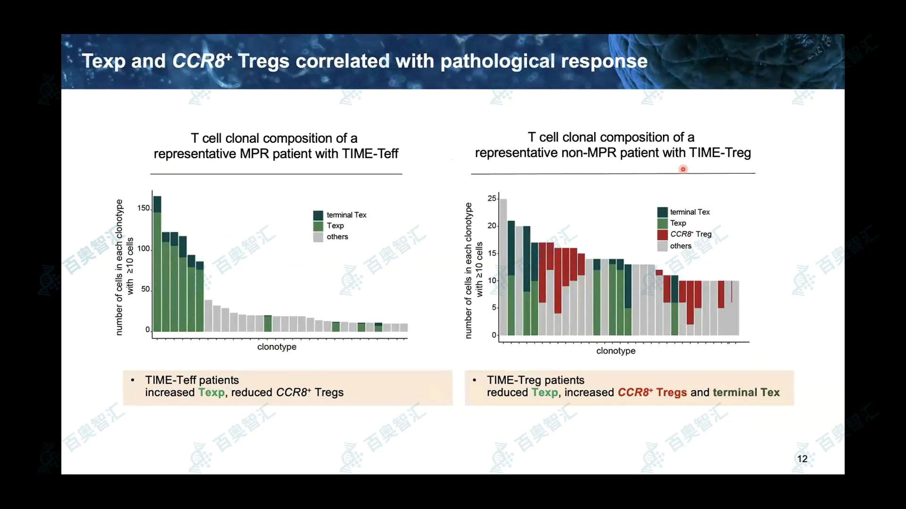

读这类图要抓住一点：**它展示的是"同一个克隆槽位里坐着谁"**，而不是"谁的总量多"。总量相同、组成不同，临床结局可以完全相反。

## 五、平均最会骗人的地方：non-MPR 根本不是一群人

### 5.1 把"未缓解"摊开：42 例与 51 例

如果只看二分结局，non-MPR 是一个整体（93 例）。但把"CCR8⁺ Treg 克隆数"和"Tex-relevant 克隆数"两个维度画成散点，non-MPR 立刻裂成两团：Treg-high non-MPR（42 例）与 Treg-low non-MPR（51 例）[【跳转到 14:47】](https://www.bilibili.com/video/BV1T2dNYVERu/?t=887)。

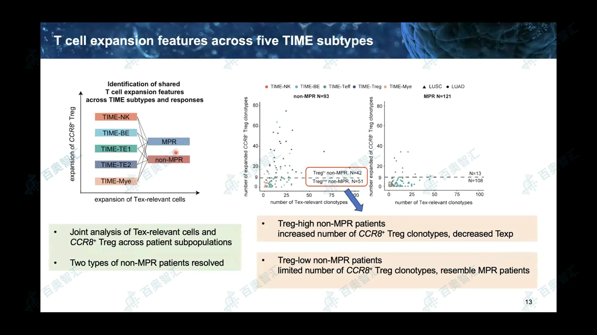

- **Treg-high non-MPR**：CCR8⁺ Treg 克隆数多、Texp 少——免疫被压制住了；
- **Treg-low non-MPR**：CCR8⁺ Treg 克隆数有限，分布上更接近 MPR 患者——他们没缓解，但不是因为免疫被压制。

这就是"平均会骗人"的教科书式例子：**"non-MPR 患者免疫抑制更强"这句话，对 42 例成立，对 51 例不成立。** 而这 51 例恰恰是最需要被单独识别出来的——他们可能有别的耐药原因，也可能根本不需要加强免疫治疗。

### 5.2 三种"平均骗人"的场景，在这项研究里都能对上号

| 场景 | 机制 | 本研究中的对应 |
| :--- | :--- | :--- |
| 双峰被抹平 | 一部分响应、一部分不响应，均值落在两峰之间 | non-MPR 裂成 Treg-high 与 Treg-low 两团 |
| 组成混淆 | 整体均值上升，但每个亚组内部都在下降，只因高值组占比变大 | 五类 TIME 亚型的 MPR 率差异被"整体 57.2%"抹平 |
| 小亚群被稀释 | 响应只发生在少数细胞里，pseudobulk 把它稀释掉 | FGFBP2⁺ NK 样 T 细胞、CCR8⁺ Treg 在全体 CD45⁺ 中占比很低 |

第二种场景值得单独说清楚，因为它最隐蔽。假设有两类患者，A 类占多数、响应率低，B 类占少数、响应率高。当 B 类的比例在某个中心、某个时间段变多时，整体响应率会上升——但**没有任何一类患者变得更容易响应**。这就是组成混淆（compositional confounding），它的数学形式与 Simpson 悖论同源：

$$
\bar{y}_{\text{weighted}} = \frac{\sum_k n_k \bar{y}_k}{\sum_k n_k}
$$

这个加权平均可以随着 $n_k$ 的构成变化而上升，同时每一个 $\bar{y}_k$ 都在下降。

其中 $n_k$ 是第 $k$ 类患者的例数，$\bar{y}_k$ 是该类的响应率。只要 $n_k$ 的构成在变，加权平均就会自己动。**对策只有一个：先分层，再在层内比较**——这也是这项研究先分五类亚型、再在亚型内部看 T 细胞状态的原因。

### 5.3 正确做法是分层，不是换一个"更稳健"的统计量

遇到上面三种情况，常见的错误反应是"换个稳健统计量"，比如改用中位数、改用秩和检验。但中位数在双峰分布上同样落在"没有细胞真正处在的位置"；秩和检验只能告诉你"两个分布不一样"，不能告诉你"哪里不一样、有几群"。

正确的顺序是：

1. **先画分布**（直方图、密度图、小提琴图、散点），确认它是不是单峰；
2. **若不是单峰，先找分层变量**（细胞类型、状态、克隆、患者亚型）；
3. **在层内做比较**，把"层间构成变化"与"层内效应变化"分开报；
4. **最后才谈显著性**——这一步属于 5.2.3 的范围，本文不展开。

## 六、异质性怎么量化：四类指标，各自能看见什么

前面五章讲的都是"这项研究怎么拆"。这一章把它抽象成可复用的工具箱：量化异质性有四类指标，**选哪一类，决定了你能看见什么**。

### 6.1 离散度类：方差、CV、离散指数

最直觉的做法是看离散程度。对某个基因在处理组内的表达 $x_1,\dots,x_N$：

$$
\mathrm{CV} = \frac{\sigma}{\mu}, \qquad \sigma^2 = \frac{1}{N-1}\sum_{i=1}^{N}\left(x_i - \mu\right)^2
$$

但**方差随均值变化**：表达量高的基因天然方差大。直接比较两个基因（或两个扰动）的方差，等于在比较它们的表达水平。正确做法是用均值-方差关系校正：

$$
\mathrm{Var}(x) = \mu + \alpha\,\mu^{2}
$$

其中 $\mu$ 项是泊松抽样噪声，$\alpha\mu^2$ 项是超出泊松的生物学变异。把 $\alpha$（离散指数，dispersion）估出来，才是"扣掉均值效应之后的异质性"。这也解释了为什么单细胞分析里的高变基因筛选要先做方差稳定化——它做的正是这件事。

### 6.2 分布距离类：Earth Mover's Distance

只看均值差（log fold change）会漏掉形状变化。分布距离补上这一块：把处理组的表达分布 $P$ 整体"搬运"成对照组的分布 $Q$，需要搬动的最小"土方量"就是一阶 Wasserstein 距离，也叫 Earth Mover's Distance（EMD）：

$$
W_1(P,Q) = \int_{-\infty}^{+\infty}\left\vert F_P(x) - F_Q(x)\right\vert\,dx
$$

其中 $F_P$、$F_Q$ 是两个分布的累积分布函数。它有两个好处：**同时捕捉均值移动与形状变化**（双峰变单峰、长尾变短尾都会被算进去），而且单位与表达量一致，好解释。代价是它对细胞数敏感，需要足够多的细胞才能稳定估计。

### 6.3 响应比例类：报"有多少细胞响应"，而不是"平均响应多强"

如果每个细胞都能算一个响应分数 $s_i$（怎么算见 5.1.4，本文不重复），那么最贴近生物学问题的量往往不是 $\bar{s}$，而是响应细胞的比例：

$$
f_{\text{resp}} = \frac{1}{N}\sum_{i=1}^{N}\mathbf{1}\left[s_i > \tau\right]
$$

这项研究实际上用的就是这一类指标：Texp 在 Tex-relevant 细胞中的**比例**、CCR8⁺ Treg 在全部 Treg 中的**比例**、CCR8⁺ 细胞在淋巴细胞中的**比例**。它们都是"比例"，不是"平均强度"。原因很实际：比例对单个细胞的分数噪声不敏感，而且可以直接对应到一张免疫组化切片上能数出来的阳性细胞数。

阈值 $\tau$ 怎么定？讲者的做法是取中位数（如 Texp 比例按中位数二分）。这不是唯一选择，但必须**事先声明并固定**，否则阈值会变成调参工具。

### 6.4 熵与多样性类：状态组成的异质性

当你要描述的不是"某个基因的分布"，而是"一个样本里状态组成有多杂"时，用熵：

$$
H = -\sum_{k=1}^{K} p_k \log p_k
$$

$p_k$ 是第 $k$ 类细胞（或状态、克隆）的占比。熵高表示组成分散、没有单一主导群体；熵低表示某一类压倒性存在。这项研究里，五类 TIME 亚型的划分本质上就是把"组成向量"当成特征——**组成向量本身就是一种异质性的表示**，只是它比单一熵值保留了更多方向信息。

### 6.5 指标选择决定你能看见什么

把四类指标并排放，差异一目了然：

| 指标类型 | 能看见 | 看不见 | 本研究中的用法 |
| :--- | :--- | :--- | :--- |
| 均值 / logFC | 整体位移 | 双峰、长尾、亚群 | 只用于描述整体 MPR 率 |
| 离散度（dispersion） | 分布宽窄 | 分布形状、峰的位置 | 未直接使用，属通用工具 |
| 分布距离（EMD） | 形状与位移 | 是哪一群在动 | 未直接使用，属通用工具 |
| 响应比例（$f_{\text{resp}}$） | 有多少细胞在响应 | 响应有多强 | Texp 比例、CCR8⁺ Treg 比例 |
| 熵 / 多样性 | 组成有多杂 | 组成往哪个方向变 | 五类 TIME 亚型的组成特征 |

一句话：**只用均值，就永远看不到双峰。** 这项研究之所以能拆出 Treg-high 与 Treg-low，不是因为它用了更高级的检验，而是因为它一开始就选了"比例 + 分层"这套指标。

## 七、异质性要能落地：从单细胞走到一张病理切片

### 7.1 为什么必须换一种检测手段验证

单细胞测序有两个现实问题：成本高，而且在样本消化处理过程中存在不稳定性。一个只能在测序数据里存在的亚型，临床上用不起来。所以讲者的做法是：把"CCR8 阳性细胞比例"这个单细胞层面发现的指标，翻译成一张 FFPE 切片的免疫组化染色——任何一个病理科都能做 [【跳转到 16:26】](https://www.bilibili.com/video/BV1T2dNYVERu/?t=986)。

### 7.2 结果：总数一样，比例差一倍

在 Treg-high 与 Treg-low 两群 non-MPR 患者之间比较：

- 淋巴细胞总数**没有差异**（$P = 0.55$）；
- CCR8⁺ 细胞数差异显著（$P = 0.0053$）；
- CCR8⁺ 细胞占淋巴细胞的比例差异显著（$P = 0.0049$）；
- 而两群的病理缓解率也没有差异（$P = 0.21$）。

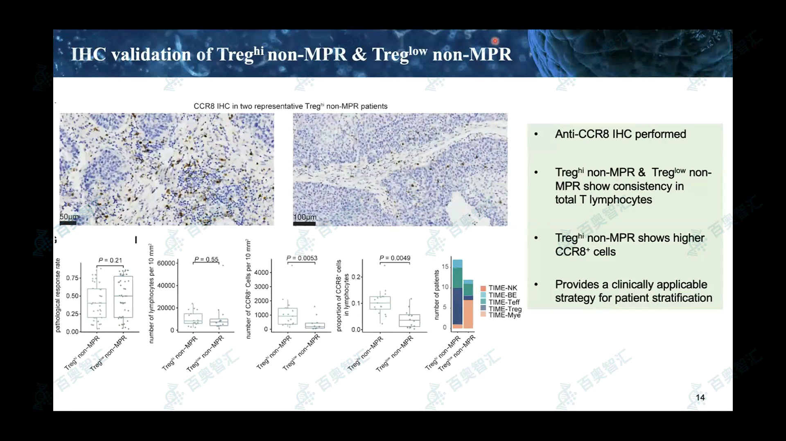

这四行结果合起来说明一件事：**区分这两群人的不是"免疫细胞多不多"，而是"免疫细胞里有多少是激活态 Treg"。** 如果只数淋巴细胞总数，这两群人会完全混在一起——又是一个"用错指标就看不见异质性"的实例。

## 八、异质性是结论还是噪音：先排除技术假象

### 8.1 技术假象的常见来源

在把异质性写进结论之前，必须先排掉这些"假异质性"：

- **低质量细胞与双细胞（doublet）**：一个"同时表达两个谱系标记"的细胞，可能只是两个细胞被包进同一个液滴；
- **环境 RNA（ambient RNA）**：高表达基因会污染所有液滴，制造出"人人都在表达"的假象；
- **消化偏好**：不同细胞类型对解离的耐受度不同，某些脆弱细胞会被系统性丢掉；
- **测序深度与批次**：深度低的细胞看起来"表达谱更稀疏"，容易被误读成"状态不同"。

这些属于 5.1.1（质控与归一化）与 5.1.3（批次校正）的范围，本文不重复做法，只强调顺序：**异质性分析必须在质控与批次处理之后做**，否则你度量的是技术噪声。

### 8.2 这项研究怎么自证

讲者用四条互相独立的证据把结论钉住，这个组合值得当作模板：

1. **正交检测**：单细胞发现的 CCR8⁺ Treg 富集，用多重免疫荧光（mIF）与免疫组化（IHC）在蛋白层面复现；
2. **正交队列**：FGFBP2⁺ NK 样 T 细胞与"化疗响应"的关联，用一组只接受化疗的队列独立验证；
3. **体外机制**：NK92 与肺癌细胞系共培养，卡铂、顺铂处理后杀伤增强；
4. **先排混杂**：所有临床因素先过一遍，确认药物类型、分期、治疗时长与响应无关。

**四条证据里没有一条是"再跑一次同样的分析"。** 这是判断"异质性是真信号还是过拟合"的实用标准：如果你的结论只能在自己的数据、自己的方法里成立，那它很可能只是噪声的一次排列。

## 九、当异质性变成结论：三个直接后果

### 9.1 治疗选择：有些患者可能不需要加强免疫治疗

TIME-NK 亚型的高缓解率，机制上指向化疗而非 anti-PD-1（这群细胞不表达 PDCD1）。如果这个推论成立，那么这类患者"用化疗就可能达到 MPR"——真实世界中单纯化疗的 MPR 率约 5%～20%，正好是这个亚型的量级。**同一个"高响应"标签，背后可以是完全不同的药物。**

### 9.2 复发风险分层：一个比例胜过一条缓解率

在未区分 MPR 与 non-MPR 的全体患者（约 150 例）中，与无复发生存期（RFS）相关的因素包括：病理缓解率、CCR8⁺ Treg 含量、以及 Texp 在 Tex-relevant 细胞中的比例 [【跳转到 17:57】](https://www.bilibili.com/video/BV1T2dNYVERu/?t=1077)。

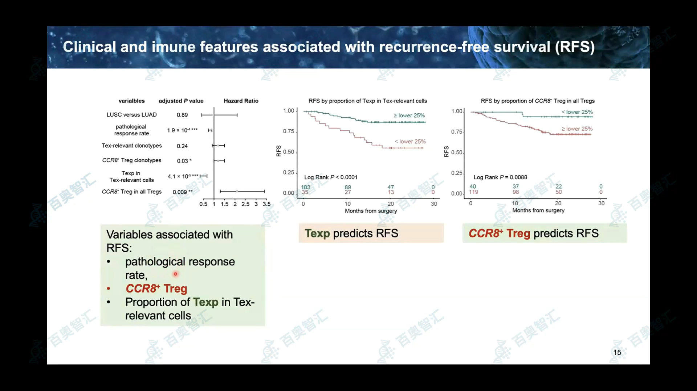

按 Texp 比例分组，两条生存曲线分得很开（Log-rank $P < 0.0001$）；按 CCR8⁺ Treg 比例分组同样有差异（$P = 0.0088$）。更关键的是下一步：把 non-MPR 患者按 Texp 比例再切一刀——

- Texp ≥ 中位数的 non-MPR：风险比 1.32（95% CI 0.4–4.28，$P = 0.65$），**与 MPR 患者没有统计学差异**；
- Texp < 中位数的 non-MPR：风险比 7.73（95% CI 3.43–17.44，$P = 8.26 \times 10^{-7}$）。

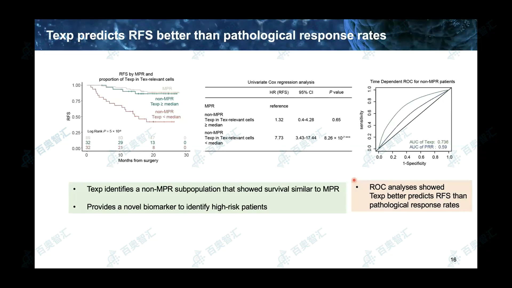

用时间依赖 ROC 比较，Texp 的 AUC 是 0.736，病理缓解率只有 0.59。讲者的结论很直接：**约一半的 non-MPR 患者其实不会复发，而 Texp 比例能把他们挑出来**——这部分人可能不需要后续高强度的辅助化疗。

这正是本小节想说的最后一层：**异质性不是需要被消除的噪声，它本身就是结论。** "non-MPR 预后差"这句话之所以粗糙，是因为它把 42 例高复发风险和 51 例接近 MPR 生存的人放在一起平均。

### 9.3 对试验设计的含义

如果响应者在治疗前就可以被分成机制不同的几群，那么"anti-PD-1 + 化疗 vs 化疗"这类双臂试验的解读就必须分层：某一亚型可能主要由化疗驱动，另一亚型才真正从免疫治疗获益。**不分层的随机对照试验，会把两个方向相反的效应平均成"没有差异"。**

讲者最后用一张图收束全文：免疫细胞丰度分出五类亚型、TCR 扩增状态分出两类 non-MPR、Texp 挑出高复发风险人群 [【跳转到 20:16】](https://www.bilibili.com/video/BV1T2dNYVERu/?t=1216)。三个层次、三次拆分，每一次都是从"一个平均结论"走到"几群不一样的人"。

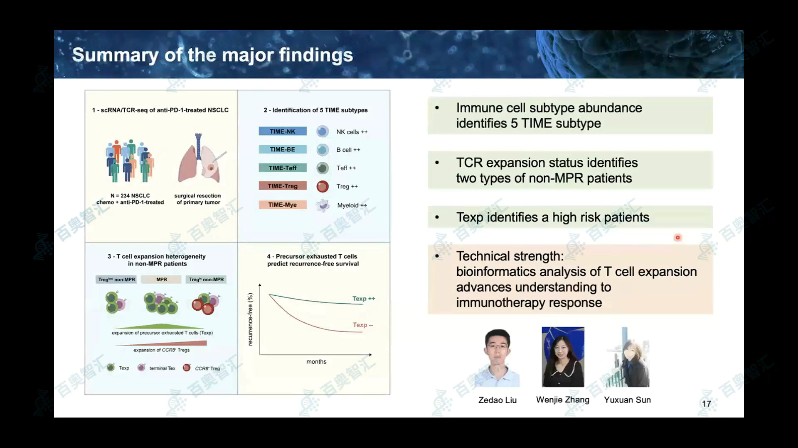

## 小结

- **平均效应是扰动分析里最容易骗人的量**：50% 未缓解、25% 复发这两个数字，掩盖了五类亚型和两群 non-MPR。
- **看分布的顺序是四层**：单基因分布 → 细胞响应分数分布 → 邻域/组成 → 状态组成；不同层次回答不同问题，混用会得出矛盾结论。
- **患者层面**：按免疫细胞组成分出 TIME-NK、TIME-BE、TIME-Teff（高 MPR）与 TIME-Treg、TIME-Mye（低 MPR）五类亚型。
- **细胞状态层面**：FGFBP2⁺ NK 样 T 细胞会杀伤但不表达 PDCD1（响应的是化疗）；CCR8⁺ Treg 是激活态抑制细胞；Texp 与终末耗竭是同一抗原特异性家族里的两种命运。
- **克隆层面**：把 non-MPR 拆成 Treg-high（42 例）与 Treg-low（51 例），前者免疫被压制、后者接近 MPR。
- **量化异质性有四类指标**：离散度（需做均值-方差校正）、分布距离（EMD）、响应比例、熵/多样性；指标选择决定你能看见什么。
- **分层优先于换统计量**：遇到双峰、组成混淆、小亚群稀释，正确反应是先分层再平均。
- **异质性要能被正交方法验证**：mIF/IHC、独立队列、体外实验、混杂排查——四条证据都不是"再跑一遍同样的分析"。

## 关键术语速查

| 术语 | 一句话解释 |
| :--- | :--- |
| MPR / pCR | 主要病理缓解（存活肿瘤 ≤ 10%）／病理完全缓解（无存活肿瘤），都是术后切片的阈值判定 |
| TIME | 肿瘤免疫微环境（tumor immune microenvironment），本文指免疫细胞组成的整体状态 |
| heterogeneity（异质性） | 同一群细胞或同一群患者内部，响应与状态不一致的程度 |
| bimodal response（双峰响应） | 一部分细胞强响应、一部分几乎不响应，分布出现两个峰，均值落在两峰之间 |
| dispersion（离散指数） | 扣掉均值效应后剩下的表达变异，是"校正过的方差" |
| coefficient of variation（CV） | 标准差除以均值，无量纲的离散度；仍受均值影响 |
| Earth Mover's Distance / Wasserstein 距离 | 把一个分布"搬运"成另一个分布所需的最小代价，同时反映均值移动与形状变化 |
| responder / non-responder | 响应者／非响应者，按预设阈值二分的临床标签；本文强调二分内部的异质性 |
| Simpson's paradox（辛普森悖论） | 分组内趋势与合并后趋势方向相反的现象 |
| compositional confounding（组成混淆） | 各亚组占比变化导致整体均值变化，而每个亚组内部并未变化 |
| Texp | 耗竭前体 T 细胞，仍有扩增潜力，与较好的预后相关 |
| Tex / terminal Tex | 耗竭 T 细胞／终末耗竭 T 细胞，ENTPD1⁺ 的终末耗竭细胞被用作抗原特异性 T 细胞的替代指标 |
| CCR8⁺ Treg | 表达 CCR8 的激活态调节性 T 细胞，高表达 CTLA4、TNFRSF4、TNFRSF9，具强抑制功能 |
| TLS | 三级淋巴结构，B 细胞在肿瘤内聚成的功能性结构，成熟者 CD21⁺ |
| Tex-relevant cells | 通过 TCR 共享与终末耗竭 T 细胞同源的细胞集合，含 Texp 与终末耗竭两部分 |
| RFS | 无复发生存期，新辅助治疗背景下衡量长期获益的核心终点 |
| STARTRAC | 基于 TCR 克隆型的扩增与组织分布分析框架，本文用于量化克隆扩增程度 |
