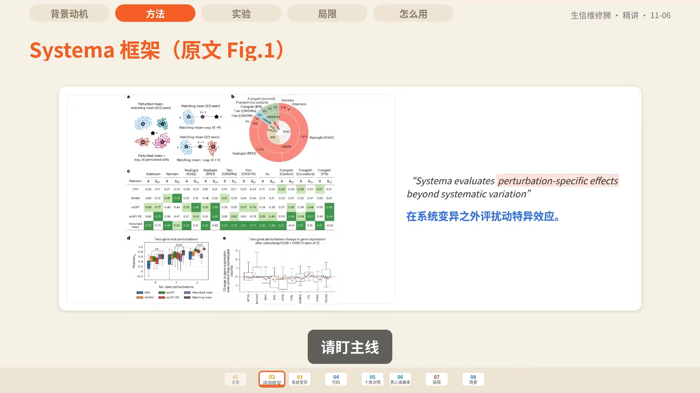
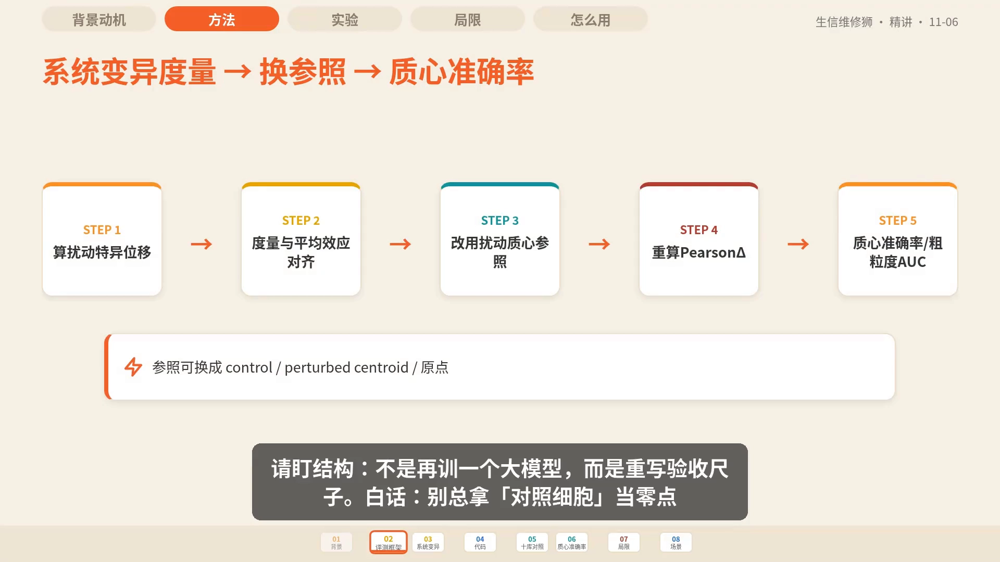
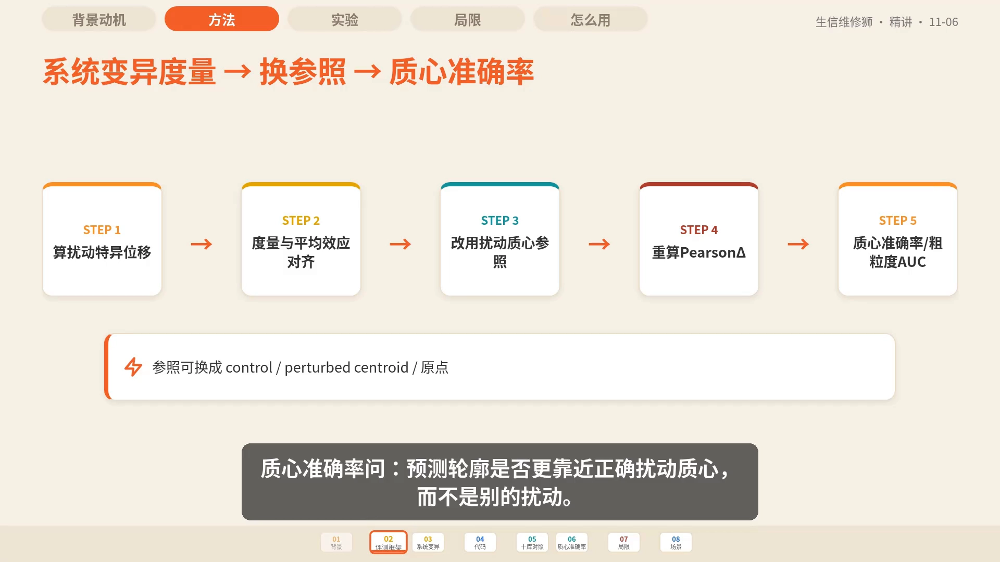
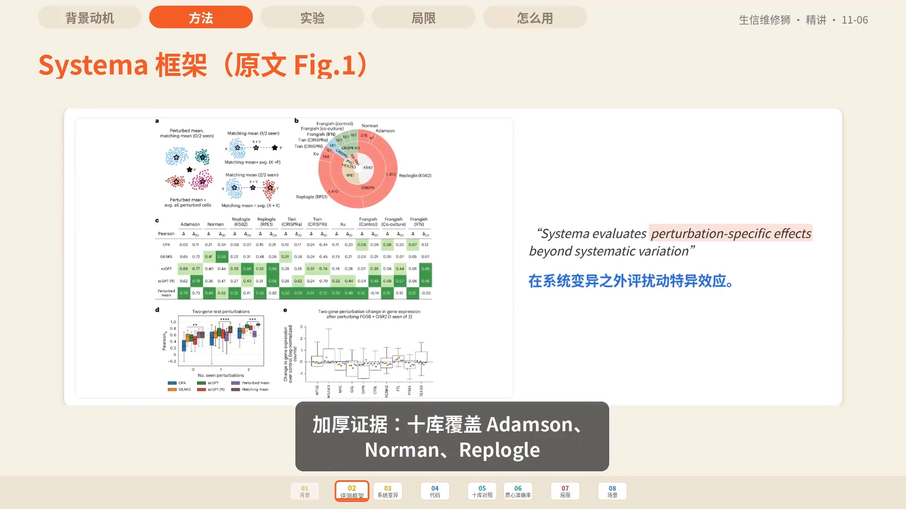
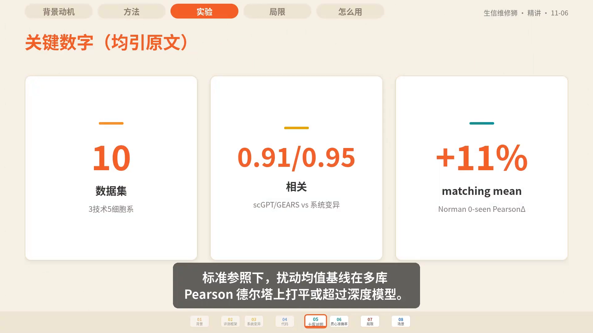
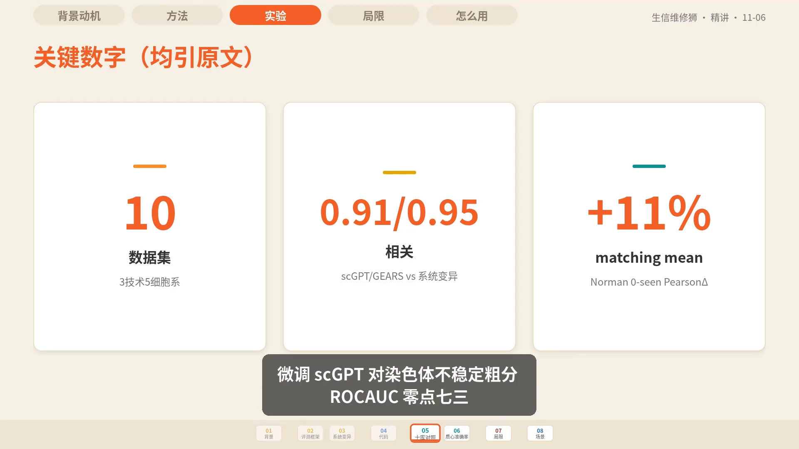
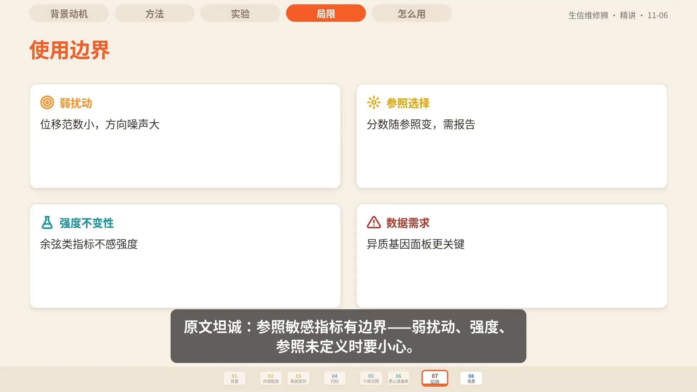
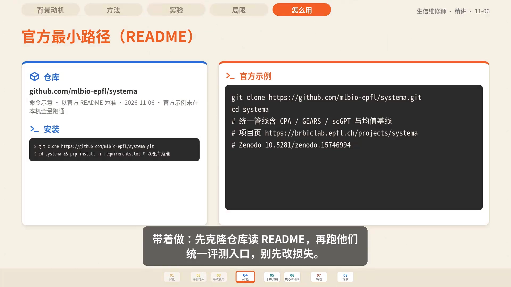
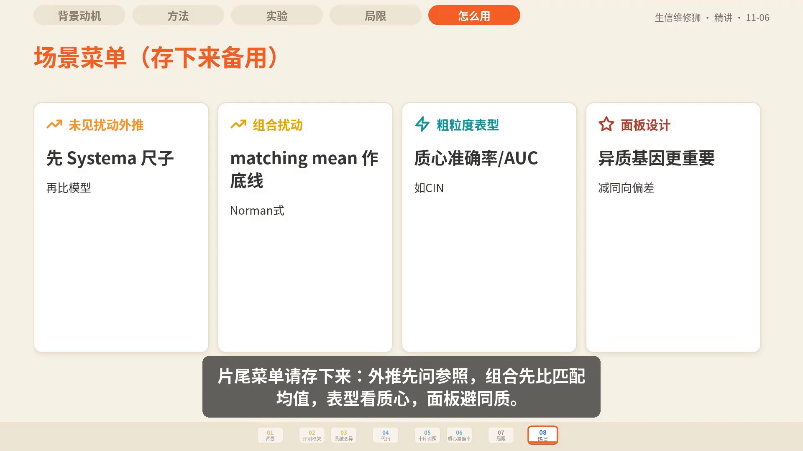

# 扰动预测分数是不是虚高？Systema 用十套库重写了一把验收尺子

> 视频来源：[论文精讲｜Systema：扰动预测去虚高，十库重写验收尺子](https://www.bilibili.com/video/BV13R4i6xEho/)（Bilibili · 生信维修狮）｜时长约 7 分钟
> 导读：这是一支「论文精讲」式的快节奏解读，讲的是 Nature Biotechnology 上 Systema 这篇工作——它没有提出新模型，而是质疑**扰动预测的评分方式本身**。本文按视频的八段结构（背景 → 评测框架 → 系统变异 → 代码 → 十库对照 → 质心准确率 → 局限 → 场景）重排成可读的教程，并把「简单均值基线为什么能打平深度模型」这条主线讲透。

## 本讲要解决的核心问题（SCQA）

**背景**：单细胞扰动组学里最受关注的建模任务是「扰动响应预测」——给定细胞状态和被敲掉的基因，预测扰动后的全转录组表达谱。近几年的论文里，深度模型（CPA、GEARS、scGPT 等）在 Perturb-seq 数据上动辄报出 0.8~0.9 的皮尔逊相关系数，看起来进展神速。

**冲突**：可是把最朴素的基线——「所有扰动细胞相对对照的平均变化量」——放进同一个评测里，它经常和这些深度模型打平，甚至更好。这意味着论文里那些漂亮的相关系数，可能并没有真正衡量「模型学到了这个基因被敲掉后特有的生物学后果」。

**疑问**：那这些分数到底在衡量什么？如果分数是被某种系统性偏差抬高的，我们该用什么尺子来验收「预测未见过的扰动」这件事？

**回答（中心思想）**：标准评测指标 PearsonΔ 会被**系统变异**（systematic variation）抬高——也就是「所有扰动都朝同一个方向移动」的那部分共同位移。Systema 的做法不是再训一个大模型，而是重写验收尺子：先把每个扰动的特异位移从共同位移里剥出来，再换掉参照点、加上质心准确率，最后在十套公开库上重算。结论是：**在标准参照下，扰动均值基线在多个库的 PearsonΔ 上打平或超过深度模型；换参照后深度模型的分数整体塌缩，只有少数信号（如染色体不稳定、核糖体与翻译相关扰动）活了下来。**

## 一、先分清任务设定：seen 与 unseen 决定数字的含义

在讨论「模型强不强」之前，必须先说清评测的是哪一种任务。视频里用「见过几个扰动」来划分，这个划分直接决定了数字能不能比。

### 1.1 三种「见过程度」

视频开篇那张原图（Fig.1a）把匹配基线画成了几种情形，它们对应三种难度完全不同的设定：

- **零样本（0/2 seen）**：训练时两个扰动基因都没见过，要预测它们的组合效应。这才是真正有价值的「外推」。
- **单样本（1/2 seen）**：两个基因里见过一个，另一个是新的。
- **双样本（2/2 seen）**：两个基因都见过，只是没见过它们的组合——本质上是**插值**，最容易。

[【跳转到 00:00】](https://www.bilibili.com/video/BV13R4i6xEho/?t=0)


同一张图右侧还给了「匹配均值」（matching mean）的定义：**只对「同样见过几个扰动」的那批扰动求平均效应**，再把这个平均当作预测。比如零样本设定下，匹配均值就是「所有同样零样本的扰动的平均位移」。这个基线看起来极其简陋，但它是后面所有讨论的主角。

### 1.2 为什么必须区分设定

同一个模型，在「双样本」设定下拿到的相关系数，和在「零样本」设定下拿到的，根本不是一回事：前者只要学会「两个已知扰动叠加起来大致长什么样」，后者要求模型真的理解一个从未见过的基因的功能。**如果不写明是哪种设定，两个数字放在一起比较毫无意义。**

视频里反复强调的实操要求就是：方法学部分必须写清**数据划分种子、HVG 选择、对照类型、参照点是否用了组合扰动质心**。这四项不写，别人无法复现你的划分，也就无法判断你的数字属于哪一档难度。

[【跳转到 00:46】](https://www.bilibili.com/video/BV13R4i6xEho/?t=46)


## 二、痛点：指针走得整齐，不代表每个齿轮都对

### 2.1 一个修表的比喻

视频给了一个很到位的比喻：**修表时指针走得整齐，不代表每个齿轮都对。** 一堆扰动细胞的表达谱整体朝某个方向移动，看起来「预测得很准」，但推动这次移动的可能只是实验系统本身的性质（细胞系、批次、测序深度、CRISPR 效率），而不是「你敲掉的那个基因」特有的生物学后果。

于是作者问了一个很尖锐的问题：**现有扰动模型学到的，到底是「扰动特异的生物学」，还是「扰动相对对照的平均差」？**

[【跳转到 00:41】](https://www.bilibili.com/video/BV13R4i6xEho/?t=41)

### 2.2 系统变异是什么

视频给的定义可以直接写成公式。设第 $i$ 个扰动的平均表达谱为 $\bar{x}_i$，对照细胞的平均表达谱为 $\bar{x}_{\text{ctrl}}$，则该扰动的位移向量（也就是预测任务要预测的 Δ）为：

$$
\delta_i = \bar{x}_i - \bar{x}_{\text{ctrl}}
$$

把所有扰动的位移再求一次平均，得到「平均扰动效应」：

$$
\bar{\delta} = \frac{1}{N}\sum_{i=1}^{N}\delta_i
$$

**系统变异（systematic variation）**就是每个扰动的位移与这个平均效应之间的余弦相似度：

$$
\text{SV}_i = \cos\!\left(\delta_i,\ \bar{\delta}\right) = \frac{\delta_i \cdot \bar{\delta}}{\lVert \delta_i \rVert \, \lVert \bar{\delta} \rVert}
$$



这个值越高，说明第 $i$ 个扰动的位移方向越和「大家都往哪走」一致——也就是越「同向」。当一个数据集里绝大多数扰动的 SV 都很高时，**任何能预测出这个共同方向的模型，都会自动拿到很高的 PearsonΔ**，哪怕它对每个扰动的特异部分一无所知。

[【跳转到 01:26】](https://www.bilibili.com/video/BV13R4i6xEho/?t=86)



### 2.3 一个更隐蔽的坑：面板同质

视频还提醒了另一个让 PearsonΔ 虚高的原因：**基因面板同质**。如果用来算相关性的基因面板（比如 top-N 差异基因）全是同一通路上的基因，它们本来就会一起动，那么相关系数天然就高——这跟模型有没有学到机制无关。所以后面「场景菜单」里专门有一条：**面板设计上，异质基因比同质基因更重要**，因为异质面板才能减少「同向偏差」带来的虚高。
## 三、Systema 的五步尺子：不换模型，换零点

视频把 Systema 的方法拆成五步，这是一个「先诊断、再换尺、最后重算」的流程：

1. **算扰动特异位移**：对每个扰动，算出它相对对照的平均位移 $\delta_i$。
2. **度量与平均效应对齐**：算每个 $\delta_i$ 与总体平均效应 $\bar{\delta}$ 的余弦，得到系统变异分布。
3. **改用扰动质心参照**：不再拿「对照细胞」当零点，而是拿「所有扰动的平均」当零点。
4. **重算 PearsonΔ**：在换过的参照下重新算相关系数，看分数塌不塌。
5. **质心准确率 / 粗粒度 AUC**：换一个不问「数值对不对」、只问「方向对不对」的指标。

[【跳转到 01:11】](https://www.bilibili.com/video/BV13R4i6xEho/?t=71)



### 3.1 关键动作：别总拿「对照细胞」当零点

这是整支视频最核心的一句话。**白话版：别总拿「对照细胞」当零点，改拿所有扰动的平均当零点，才看清谁真正与众不同。**

为什么？因为对照细胞这个零点里混着大量「系统层面」的位移——细胞系状态、批次、技术噪声。所有扰动都被这个共同的零点推着走，于是它们的位移高度同向，PearsonΔ 就被这个共同分量撑起来了。把零点换成「所有扰动的平均」之后，共同分量被减掉，剩下的才是每个扰动**真正特异**的那部分位移。

视频里明确说，参照点可以换成三种：**control（对照质心）/ perturbed centroid（扰动质心）/ 原点**。三种参照给出的分数不一样，所以「换参照后分数塌不塌」才是外推叙事的验收门栓。

[【跳转到 02:03】](https://www.bilibili.com/video/BV13R4i6xEho/?t=123)

### 3.2 质心准确率：换一个问法

PearsonΔ 问的是「你预测的这串数字和真实的这串数字像不像」；**质心准确率（centroid accuracy）**问的是另一个问题：

> 你预测出来的这个表达谱轮廓，是不是更靠近**正确的那个扰动**的质心，而不是别的扰动的质心？

这是一个「分类式」的问法：把预测结果丢进所有候选扰动的质心堆里，看它落在谁旁边。它比 PearsonΔ 更难被共同位移骗——因为共同位移对所有候选质心都贡献了同样的偏移，落在谁旁边取决于特异部分。

视频还提到一个更粗的版本：**粗粒度 AUC**，把扰动按「表型大类」分组（比如染色体不稳定 CIN 这一类），问模型能不能把属于这一大类的扰动排到前面。对「预测错了会怎样」这个问题，粗粒度指标往往比逐基因相关系数更有决策价值。

## 四、十库横比：均值基线在多数库打平甚至超过深度模型

### 4.1 评测规模：10 套库、3 种技术、5 种细胞系

Systema 的评测覆盖十套公开 Perturb-seq 数据，横跨三种扰动技术（CRISPR 敲除、CRISPRi、CRISPRa）和五种细胞系。视频里点名的库包括 **Adamson、Norman、Replogle（K562 与 RPE1）、Frangieh（对照、共培养、IFN 三种条件）、Tian（CRISPRa 与 CRISPRi）、Xu**。

覆盖这么宽，是为了回答一个质疑：**「均值基线打平深度模型」会不会只是某一个库的特殊现象？** 视频的结论是：这个现象在多个库上反复出现，不是个例。

[【跳转到 02:28】](https://www.bilibili.com/video/BV13R4i6xEho/?t=148)



### 4.2 三个必须记住的数字

视频把关键数字单独做了一页，并强调**均引原文**：

| 数字 | 含义 |
| --- | --- |
| 10 | 数据集数量（3 种技术、5 种细胞系） |
| 0.91 / 0.95 | scGPT / GEARS 的分数与系统变异之间的相关系数 |
| +11% | Norman 零样本设定下，匹配均值相对次优方法的提升 |

[【跳转到 04:14】](https://www.bilibili.com/video/BV13R4i6xEho/?t=254)



**第一个数字（10）**说明结论的普适性。**第二个数字（0.91 / 0.95）**是整个论证的支点：它意味着模型分数的高低，几乎可以完全由「这个库的系统变异有多强」来解释——**模型分数高，不是因为模型好，而是因为这个库的扰动本来就都朝一个方向动**。**第三个数字（+11%）**则是最刺眼的一条：在 Norman 的双基因零样本设定里，那个「只对同样见过几个扰动的样本求平均」的匹配均值基线，比最好的深度模型还高出约 11%。

### 4.3 双基因扰动：见过的越多，差距越小

原图 Fig.1d 把双基因测试扰动按「见过几个扰动」分成 0、1、2 三档，画出了各方法的 PearsonΔ。趋势很清楚：**见过的扰动越多（越接近插值），所有方法的分数都往上走；而在 0 见过的零样本档，方法之间的差距被压得很小，匹配均值反而站在前排。**

这正是本小节要讲的那个争议的实证版本：**在严格的 unseen 设定下，简单基线常常与复杂模型持平甚至更好。**

## 五、换参照之后：分数塌缩，但有些信号活下来了

### 5.1 塌缩本身就是一个结论

视频给出的观察是：**换成扰动质心参照后，分数整体塌缩。** 这句话的分量在于——如果模型真的学到了扰动特异的生物学，换一个零点不应该让它的分数掉下来；分数大面积塌缩，说明原来那部分高分主要来自共同位移。

[【跳转到 04:39】](https://www.bilibili.com/video/BV13R4i6xEho/?t=279)

### 5.2 活下来的两类信号

塌缩不等于「模型一无是处」。视频点出了两个在换参照后仍然站得住的信号：

- **染色体不稳定（CIN）的粗表型**：微调过的 scGPT 在 K562 设定下对染色体不稳定这一类粗表型的 ROCAUC 约为 **0.73**。也就是说，虽然逐基因的数值预测不可信，但「这个扰动会不会引起染色体不稳定」这种粗粒度判断，模型确实抓到了一些东西。
- **核糖体与翻译相关扰动**：这一类扰动相对均值基线预测得更准。视频的解释是，这类扰动影响的是一整块功能模块，模块内部的基因高度协同，所以即使在质心参照下也留有可学的结构。

[【跳转到 05:04】](https://www.bilibili.com/video/BV13R4i6xEho/?t=304)



### 5.3 低系统变异的库，虚高更轻

视频还补了一条分库结论：**Frangieh 等低系统变异的库上，虚高更轻**；而 Adamson、Norman 属于高系统变异库，虚高更明显。这意味着「这个模型行不行」这个问题，**必须分库回答**，不能用一个跨库平均分糊过去。

这一条对写论文的人特别有用：如果你的模型在 Adamson、Norman 上分数很高，先别急着写「学会了基因功能」，先看看这两个库的系统变异有多强。

## 六、同屏四件套：怎么写才不算报虚高

视频给了一个非常具体的写作规范——**报告扰动预测结果时，四类数字要同屏出现**，缺一个就容易被读成虚高的柱状图：

1. **标准皮尔逊 Δ**（原来的那个数，作为对照保留）；
2. **系统变异余弦分布**（这个库本身有多「同向」）；
3. **换质心参照后的分数**（共同位移被减掉之后还剩多少）；
4. **质心准确率或粗表型 AUC**（方向对不对、粗粒度表型对不对）。

[【跳转到 01:51】](https://www.bilibili.com/video/BV13R4i6xEho/?t=111)

这个四件套的逻辑，其实就是把「模型能力」和「数据本身的同向性」拆开报告。只报第 1 项，读者无法判断高分来自哪里；四项一起报，读者自己就能算出「扣掉系统变异之后还剩多少」。

视频还建议方法学里写清参照点用的是哪一种（对照质心 / 扰动质心 / 原点），并画一张系统变异余弦的分布图——这张图是判断「这个库适不适合用来证明外推能力」的最快依据。

## 七、使用边界：这把尺子也有量不准的时候

视频专门用一页讲局限，态度相当坦诚：**参照敏感指标有边界**。

[【跳转到 05:31】](https://www.bilibili.com/video/BV13R4i6xEho/?t=331)



### 7.1 弱扰动：位移范数小，方向噪声大

当一个扰动的效应本身很弱时，它的位移向量 $\delta_i$ 的范数 $\lVert \delta_i \rVert$ 很小，方向基本由噪声决定。这时候余弦相似度会剧烈抖动——**别只看余弦，不看强度**。这也是为什么视频说，当扰动强度参照未定义时，要小心使用这类指标。

### 7.2 强度不变性：余弦看不见「有多大」

余弦相似度只看方向，天然对幅度不敏感。一个预测得「方向完全对、幅度只有一半」的模型，余弦分可能很高，但实际用途有限。视频的建议是：**如果扰动强度参照未定义，均方根误差（RMSE）这类参照不敏感的指标反而更稳，但更难解释。** 两类指标要搭配着用。

### 7.3 参照选择：分数随参照变，必须报告

同一份预测结果，换一个参照点，分数会明显变化。这不是缺陷，而是必须被报告的事实。**不写参照就报分数，等于不写单位就报长度。**

### 7.4 数据需求：异质基因面板更关键

前面说过面板同质会让 PearsonΔ 虚高。反过来，**异质基因面板**（覆盖不同通路、不同功能模块的基因）才能减少同向偏差，让分数更接近「模型真的学到了什么」。

## 八、上手路径：官方仓库的最小跑通流程

视频最后给了「带着做」的路径，很具体：

[【跳转到 02:49】](https://www.bilibili.com/video/BV13R4i6xEho/?t=169)



```bash
git clone https://github.com/mlbio-epfl/systema.git
cd systema
pip install -r requirements.txt   # 以仓库为准
```

- **仓库**：`github.com/mlbio-epfl/systema`
- **项目页**：`brbiclab.epfl.ch/projects/systema`
- **数据**：Zenodo `10.5281/zenodo.15746994`（可核对十套库的预处理）

### 8.1 三条执行纪律

1. **先读 README 和评测协议，再跑统一入口**。协议里写着划分种子、HVG、对照类型，这些决定你的数字属于哪一档难度。
2. **别先改损失函数**。视频的提醒很直白：统一管线里已经包含 CPA、GEARS、scGPT 与均值基线四个对照，先跑通再谈改进。
3. **冒烟测试放在 Norman 或 Adamson 子集上**。标准是：在这个子集上，**均值基线不显著差于深度模型**——如果你跑出来的结果不是这样，先怀疑自己的流程，而不是先庆祝模型变强了。

[【跳转到 03:19】](https://www.bilibili.com/video/BV13R4i6xEho/?t=199)

### 8.2 存档清单：让别人能复现

视频给了一份「写进补充材料」的清单，逐项都对应前面提到的坑：

- 仓库提交哈希（版本锁定，避免依赖漂移）
- 数据划分种子
- 参照点（对照质心 / 扰动质心 / 原点）
- HVG 选择方式
- 皮尔逊 Δ
- 质心准确率
- 显存（影响能否复现同一 batch 配置）

### 8.3 场景菜单：四种常见需求怎么用

[【跳转到 05:57】](https://www.bilibili.com/video/BV13R4i6xEho/?t=357)



| 你的需求 | 视频给的做法 |
| --- | --- |
| 未见扰动外推 | 先上 Systema 尺子（换参照 + 质心准确率），再比模型 |
| 组合扰动 | 用 matching mean（按「见过几个扰动」匹配的均值）作底线，Norman 式设定 |
| 粗粒度表型 | 看质心准确率或粗粒度 AUC，如 CIN |
| 面板设计 | 异质基因更重要，减同向偏差 |

## 小结

- **任务设定先于分数**：零样本（0/2 seen）、单样本（1/2）、双样本（2/2）是三种难度，不写清设定，数字不可比。
- **PearsonΔ 会被系统变异抬高**：各扰动位移与平均扰动效应的余弦相似度越高，模型越容易「白拿分」。模型分数与系统变异的相关达到 0.91（scGPT）与 0.95（GEARS）。
- **简单基线常常打平甚至更好**：在十套库的标准参照下，扰动均值基线在多个库的 PearsonΔ 上打平或超过深度模型；Norman 双基因零样本设定下，匹配均值比次优方法高约 11%。
- **换参照是验收门栓**：把零点从「对照细胞」换成「扰动质心」后，分数整体塌缩——塌缩幅度就是虚高的量级。
- **塌缩后仍有真信号**：微调 scGPT 对染色体不稳定粗表型的 ROCAUC 约 0.73，核糖体与翻译相关扰动相对均值基线更准。
- **报告要同屏四件套**：标准 PearsonΔ、系统变异余弦分布、换质心后分数、质心准确率或粗表型 AUC。
- **尺子也有边界**：弱扰动方向噪声大、余弦不感强度、参照未定义时要用 RMSE 类指标兜底。
- **落地含义**：预测结果用来**排优先级**（先做哪些湿实验），而不是替代实验；评测协议写进方法学，和模型结构同等重要。

## 关键术语速查

| 术语 | 一句话解释 |
| --- | --- |
| 扰动响应预测 | 给定细胞状态与被扰动的基因，预测扰动后的全转录组表达谱（通常预测相对对照的变化量 Δ） |
| seen / unseen perturbation | 训练时见过 / 没见过这个扰动。前者是插值，后者才是真正的外推 |
| 零样本、单样本、双样本（0/1/2 seen） | 组合扰动里两个基因分别被见过几个，决定任务难度 |
| PearsonΔ | 在扰动引起的表达变化量上算皮尔逊相关，是扰动预测最常用的指标 |
| 系统变异（systematic variation） | 各扰动位移与「所有扰动的平均位移」的余弦相似度，衡量这个库的扰动有多「同向」 |
| 匹配均值（matching mean） | 只对「见过同样多个扰动」的样本求平均效应作为预测的基线 |
| 扰动质心参照 | 把零点从对照细胞换成所有扰动的平均，用来剥掉共同位移 |
| 质心准确率（centroid accuracy） | 问预测轮廓是否更靠近正确的扰动质心，而不是别的扰动 |
| 粗粒度 AUC | 按表型大类（如染色体不稳定 CIN）评估排序能力的指标 |
| HVG | 高变基因（highly variable genes），评测前选基因面板的常用方式，面板同质会让分数虚高 |
