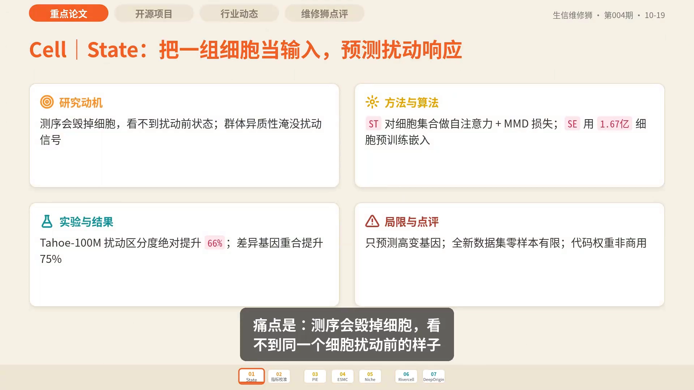
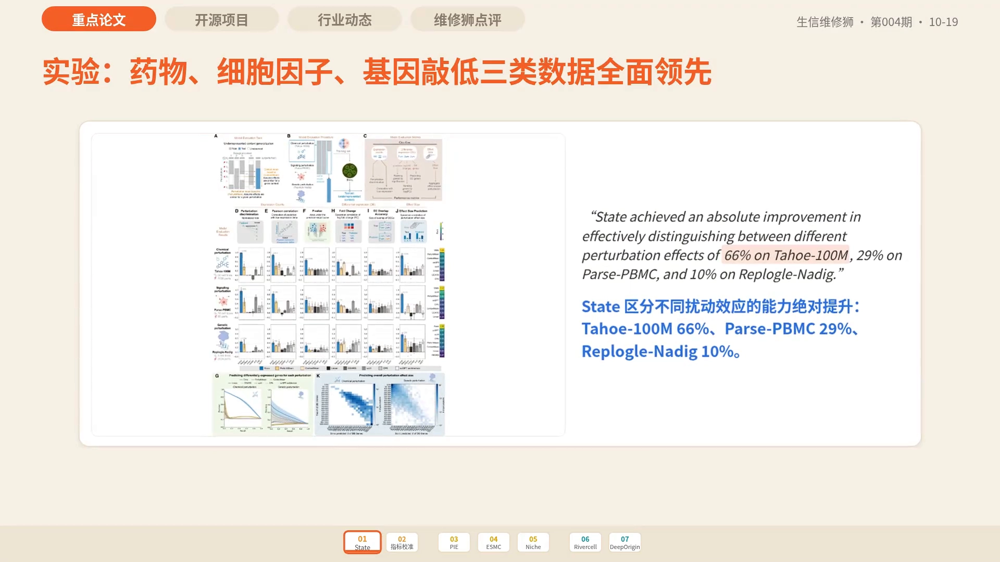
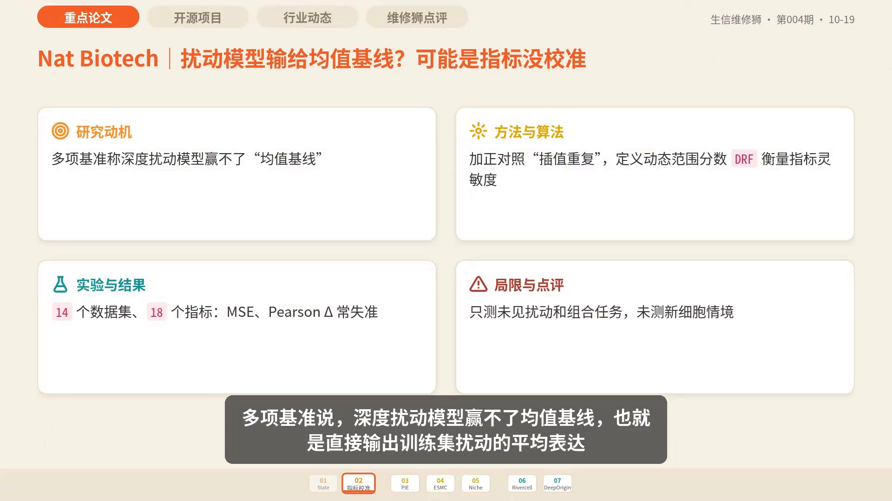
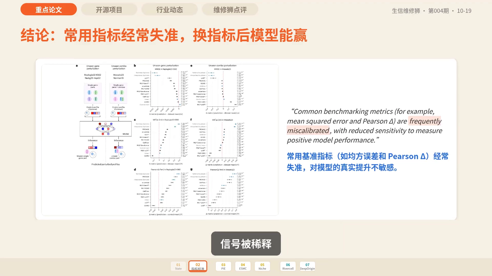
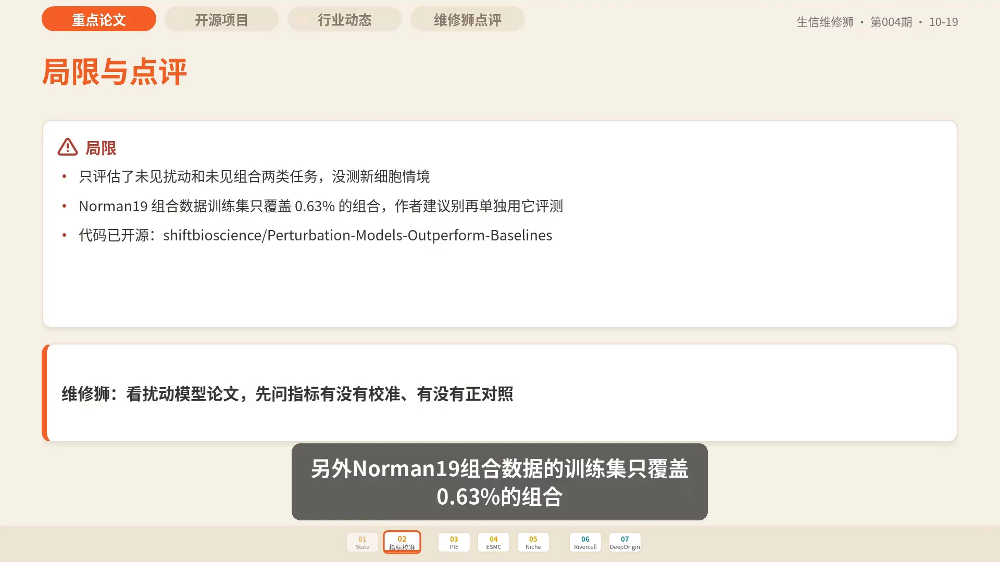
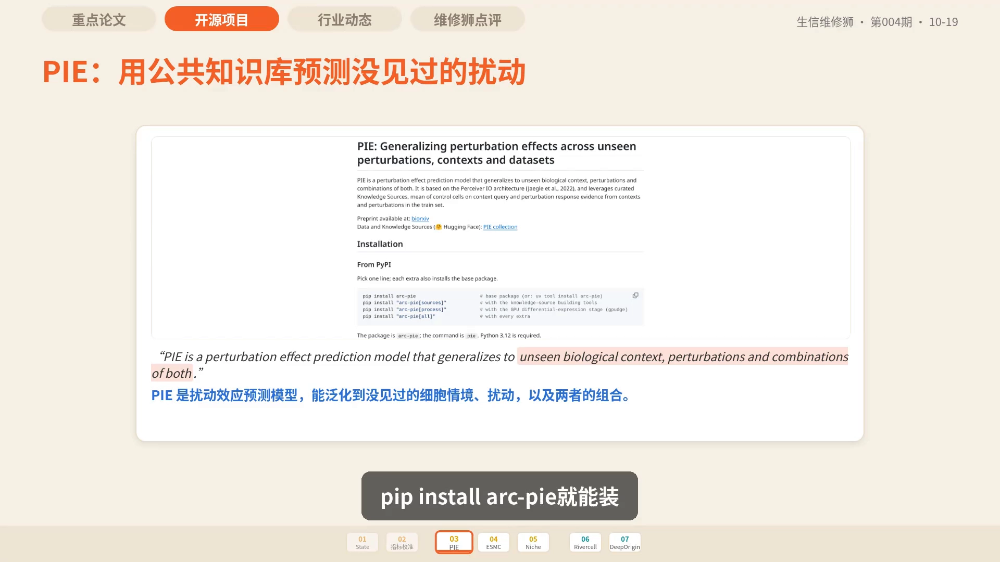
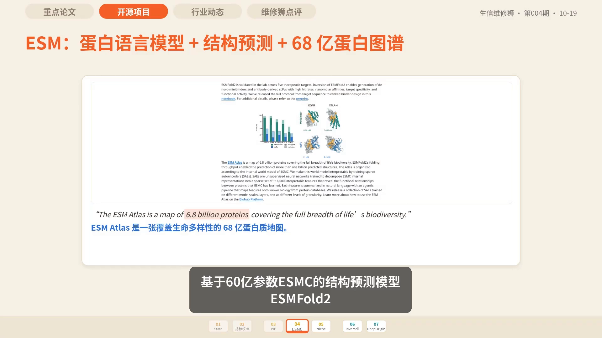
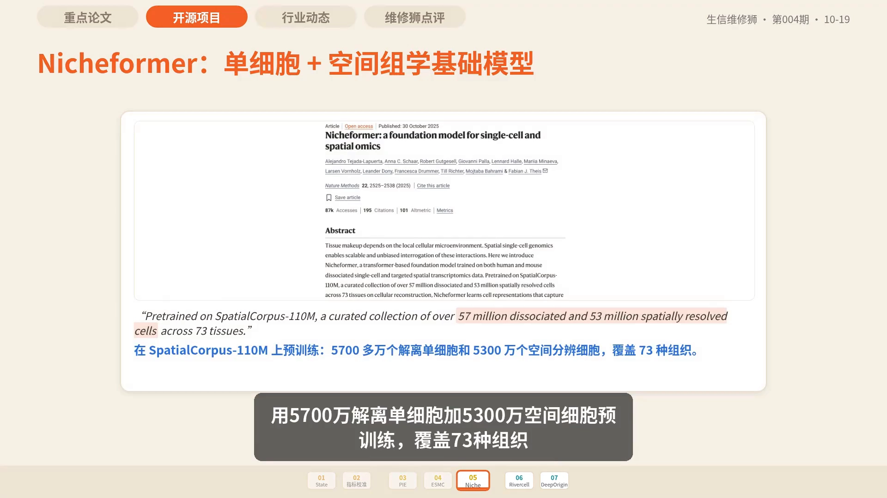
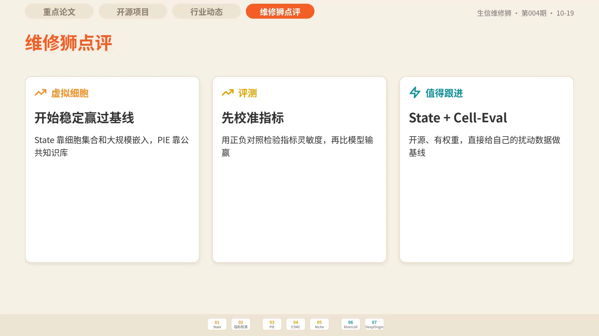

# 扰动预测到底赢不赢均值基线？STATE 与 DRF 尺子给出的两头答案

> 视频来源：[生信×AI日报｜单细胞扰动预测终于跑赢均值基线【10-19】](https://www.bilibili.com/video/BV1EVnj6cEB9/)（Bilibili · 生信维修狮）｜时长约 6 分钟
> 导读：这是一期「论文 + 开源项目 + 行业动态」的日报式速览。它的主线恰好是本小节最核心的争议——**深度扰动模型到底能不能赢过「直接输出平均表达」这个朴素基线**。视频用一篇 Cell（模型这一头：STATE）和一篇 Nature Biotechnology（评测这一头：DRF 指标校准）给出两头答案。本文按「问题 → 模型 → 评测 → 怎么合起来读 → 周边动态」重排，并把日报里顺带提到的开源项目与行业新闻压缩到末尾，方便你只取自己需要的部分。

## 本讲要解决的核心问题（SCQA）

**背景**：单细胞扰动组学里最受关注的建模任务是**扰动响应预测**：给定细胞状态和被敲掉的基因，预测扰动后整个转录组的表达谱（通常预测相对对照的变化量 Δ）。

**冲突**：这个任务一直被质疑——**深度模型连「取平均」的基线都赢不了**。所谓「取平均」，就是直接输出训练集里该扰动（或所有扰动）的平均表达，一行代码就能实现，没有任何「学习」成分。如果连它都赢不了，那这些模型的复杂结构就没有意义。

**疑问**：到底是模型不行，还是**我们用来判输赢的指标不行**？

**回答（中心思想）**：两头都有答案，而且不矛盾。模型这一头，ARC 研究所的 **STATE** 换了一个建模对象——不再预测「单个细胞」，而是把「同条件的一组细胞」当输入，用集合级建模 + 分布对齐损失，在药物、细胞因子、基因敲低三类数据上把扰动区分度提升了 66%（Tahoe-100M）、29%（Parse-PBMC）、10%（Replogle-Nadig）。评测这一头，一篇 Nature Biotechnology 的基准研究指出：**常用的 MSE 与 PearsonΔ 本身是「没校准」的指标**，它们对模型的真实提升不敏感；加上正对照、算出动态范围分数 DRF 之后，换成加权指标，scGPT、GEARS 这类模型大多能赢过无信息基线。**所以正确的顺序是：先校准指标，再判模型输赢。**

## 一、先把「均值基线」和任务设定说清楚

### 1.1 均值基线是什么

设训练集里第 $i$ 个扰动的平均表达谱为 $\bar{x}_i$，对照细胞平均表达谱为 $\bar{x}_{\text{ctrl}}$，那么最朴素的预测就是：

$$
\hat{\delta}_i = \bar{x}_i - \bar{x}_{\text{ctrl}}
$$

如果这个扰动在训练集里出现过，这就是「直接输出训练集里该扰动的平均表达」；如果没见过，就退化成「所有扰动的平均效应」$\bar{\delta} = \frac{1}{N}\sum_i \delta_i$。**这个基线完全不含模型参数**，但它在很多基准里排在前列。

### 1.2 三种难度不同的设定

视频里反复出现的评测任务，其实对应三种不同的「没见过」：

- **未见扰动（unseen gene perturbation）**：训练时没见过这个基因被敲，要预测它的效应；
- **未见组合（unseen combination）**：两个基因分别见过，但没见过它们的联合扰动；
- **未见细胞情境（unseen cell context）**：换一个细胞类型或细胞系。

三者的难度完全不同：未见组合更接近**插值**（两个单扰动效应叠加），未见基因才是真正的**外推**，未见细胞情境则同时考验跨域泛化。**评测报告必须写明是哪一种，否则数字不可比**——这也是视频里那篇基准研究的一条明确局限（它只评估了前两类，没测新细胞情境）。

[【跳转到 01:49】](https://www.bilibili.com/video/BV1EVnj6cEB9/?t=109)

## 二、模型这一头：STATE 把「一组细胞」当输入

### 2.1 痛点：测序会毁掉细胞

STATE 的出发点是一个非常物理的限制：**单细胞测序是破坏性的，你永远看不到同一个细胞在被扰动之前长什么样。** 所以「扰动前 → 扰动后」的配对数据在原理上就拿不到。更麻烦的是，同一个条件下的细胞之间差异很大（群体异质性），**这种异质性常常比扰动本身的信号还大**，于是「扰动效应」很容易被淹没在细胞间的随机波动里。

[【跳转到 00:22】](https://www.bilibili.com/video/BV1EVnj6cEB9/?t=22)

### 2.2 思路：不做一对一配对，做集合到集合

STATE 的解法是换建模对象：

- **ST（State Transition）模块**：不预测「某个细胞扰动后会变成什么」，而是把**同条件的一组细胞**作为输入，用**自注意力**建模细胞之间的差异，再用**最大均值差异（MMD）损失**去对齐预测分布与真实分布。也就是说，模型学的不是「一个点到一个点」的映射，而是「一个分布到一个分布」的映射。
- **SE（State Embedding）模块**：一个 6 亿参数的细胞嵌入模型，用 **1.67 亿个细胞**预训练，专门用来抹掉跨数据集的技术差异。

[【跳转到 00:52】](https://www.bilibili.com/video/BV1EVnj6cEB9/?t=52)

### 2.3 结果：三类扰动数据全面领先

对手包括**线性模型、scVI、CPA 和 scGPT**——注意这个对手清单里既有经典线性基线，也有当前最常被引用的深度模型。STATE 报告的「有效区分不同扰动效应」的绝对提升是：

| 数据集 | 扰动区分度绝对提升 |
| --- | --- |
| Tahoe-100M（药物扰动大规模数据） | 66% |
| Parse-PBMC（外周血单核细胞） | 29% |
| Replogle-Nadig（基因敲低） | 10% |

此外，差异基因重合度在 Tahoe 上提升了 75%。

[【跳转到 01:01】](https://www.bilibili.com/video/BV1EVnj6cEB9/?t=61)

### 2.4 一个更有说服力的检验：零样本药物响应

视频特别点出了一个检验：模型**从没见过 C32 黑色素瘤细胞**，被要求预测它用**曲美替尼**（trametinib，一种 MEK 抑制剂）处理后的表达变化。结果预测出的差异基因和倍数变化**仍明显比基线更贴近实测**。这类「未见细胞系 + 未见药物」的测试，比在见过的组合上刷分更能说明问题。

### 2.5 局限：三条要说清

视频没有回避 STATE 的边界：

- **只预测高变基因**：不是全转录组，而是高变基因面板；
- **全新数据集上零样本能力有限**：跨到完全没见过的数据分布时，优势会缩水；
- **代码和权重都是非商用许可**：能用于研究，不能直接商用。

[【跳转到 01:32】](https://www.bilibili.com/video/BV1EVnj6cEB9/?t=92)

## 三、评测这一头：赢不了基线，可能是指标没校准

### 3.1 争议的原话

那篇 Nature Biotechnology 的基准研究，起点就是多篇基准的共同结论：**深度扰动模型赢不了「均值基线」**——也就是直接输出训练集扰动的平均表达。但作者没有停在「模型不行」这个结论上，而是反过来问：**是不是我们的指标有问题？**

### 3.2 关键设计：加一个「正对照」

作者的做法很巧：**只有负对照不够，还要正对照。**

- **负对照**：无信息预测（比如直接输出均值），它代表「什么都没学到」的下界；
- **正对照**：把**重复同一个扰动的细胞一分为二**，用一半去预测另一半。这叫「插值重复」（interpolating replicate）——它代表「在数据内部可达的最好水平」，是上界。

有了正负对照，就能算出一个**动态范围分数 DRF（dynamic range fraction）**：一个指标能不能把「好预测」和「无信息预测」区分开。DRF 高，说明这个指标对真实提升敏感；DRF 低，说明这个指标无论模型好坏都给差不多的分——那它就没有判别力。

[【跳转到 01:14】](https://www.bilibili.com/video/BV1EVnj6cEB9/?t=74)

### 3.3 结论：MSE 与 PearsonΔ 经常失准

在 **14 个数据集、18 个指标**上算下来，常用的 **MSE 和 PearsonΔ 经常失准**——它们对模型的真实提升不敏感。原文的表述是：常用基准指标（例如均方误差和 PearsonΔ）经常是**没校准的**，会削弱衡量模型真实表现的能力。

为什么会这样？视频给了一个很具体的数字：在 **Replogle K562 全基因组数据**里，**每个扰动平均只有 3.25 个差异基因**。也就是说，一个扰动真正动起来的基因只占极小一部分，剩下上万个基因基本没变。**用全基因组的 MSE 或 PearsonΔ 去评分，信号会被大量「没变」的基因稀释掉**——模型只要把这些没变的基因预测对，分数就很好看，而真正重要的那 3 个基因预测错了也没人发现。

[【跳转到 02:19】](https://www.bilibili.com/video/BV1EVnj6cEB9/?t=139)

### 3.4 换成校准好的指标，模型大多能赢

把指标换成**加权 MSE、加权 R 方**这类「按差异基因显著性加权」的校准版本后，结论翻转了：**scGPT 和 GEARS 大多能赢过无信息基线**。在组合扰动任务上，18 个指标里有 **15 个**赢了**加性基线**（把两个单扰动效应直接相加的基线）。

这句话的分量在于：它同时承认了两件事——**原来的「赢不了基线」结论，很大程度上是指标造成的假象；但换指标之后，模型也确实只是「大多能赢」，不是全面碾压。**

[【跳转到 02:36】](https://www.bilibili.com/video/BV1EVnj6cEB9/?t=156)

### 3.5 三条局限

- **只评估了未见扰动和未见组合两类任务，没测新细胞情境**；
- **Norman 2019 组合数据的训练集只覆盖 0.63% 的组合**，作者建议**别再单独用它评测**——覆盖率这么低，测出来的「组合扰动预测能力」基本没有代表性；
- 代码已开源：`shiftbiosecience/Perturbation-Models-Outperform-Baselines`（仓库名直译就是「扰动模型确实超过基线」，是这篇论文的立场声明）。

## 四、两头答案怎么合起来读

把两篇论文放在一起，能得到一条比「模型行不行」更有用的判断链：

### 4.1 顺序问题：先校准指标，再判输赢

如果指标本身对真实提升不敏感，那么「模型赢不了基线」这个结论也站不住——它可能只是指标看不见差异。**所以评测的正确顺序是：先确认指标有判别力（有正对照、有 DRF），再比较模型。**

### 4.2 「赢」的含义要拆开

即使换了校准指标，视频里的结论也只是「scGPT 和 GEARS **大多**能赢过无信息基线」，组合扰动上 18 个指标赢 15 个。这跟 STATE 报出的「66% / 29% / 10% 绝对提升」是两种量级完全不同的说法：

- **STATE 的提升**：在「区分不同扰动效应」这个特定能力上，相对之前的方法；
- **基准研究的「赢」**：在「相对无信息基线」这个下界上，且只在部分指标上。

两者不能互相替代。**看到「某模型赢过基线」时，要追问：赢的是哪个基线（无信息基线？加性基线？匹配均值？）、哪个指标、哪种设定。**

### 4.3 一句话的实践含义

**均值基线不是用来打败的对手，而是必须默认上场的底线。** 视频里的原话是「先校准指标，再判模型输赢」；换成工程语言就是：任何扰动预测结果，都要同时报出「无信息基线」和「校准后的指标」，否则这个数字没有信息量。

## 五、开源项目：PIE 用公共知识库补上「未见扰动」

视频里的第一个开源项目，正好解决 STATE 的一个短板——**STATE 不能预测完全没见过的扰动**。ARC 研究所 10 月 5 日发布的 **PIE**（Perturbation Effect prediction）走的是另一条路：**不靠大规模扰动数据，靠公共知识库。**

[【跳转到 02:57】](https://www.bilibili.com/video/BV1EVnj6cEB9/?t=177)

### 5.1 输入是什么

PIE 把三类「先验知识」变成输入：

- 细胞系的 **Cellosaurus** 记录（细胞系身份与来源）；
- 基因的 **NCBI 与 GO 注释**（这个基因是干什么的、属于哪个通路）；
- 药物的 **PubChem** 条目（化合物的结构与靶点信息）。

然后基于 **Perceiver IO** 架构直接预测差异基因。原文的定位是：**PIE 是一个扰动效应预测模型，能泛化到没见过的细胞情境、扰动，以及两者的组合。**

[【跳转到 03:10】](https://www.bilibili.com/video/BV1EVnj6cEB9/?t=190)

### 5.2 成绩与安装

- 差异基因分类的 **AUPRC 是最强对手的 1.2 到 3.2 倍**；
- 安装：`pip install arc-pie`（命令是 `pie`，需要 Python 3.12）。

### 5.3 它给的评测流程值得抄

PIE 的仓库里给了一套完整的复现流程，这套流程本身就是「怎么做 unseen 评测」的范本：

- **Replogle 的 4 个细胞系轮流留一个做测试**，分别评测三种情形：未见细胞系、未见扰动、两者都没见过；
- 还能用 **Tahoe 等四个数据集训练零样本预测**。

[【跳转到 03:35】](https://www.bilibili.com/video/BV1EVnj6cEB9/?t=215)

## 六、另外两个开源项目：蛋白与空间组学

这两个和扰动预测关系较远，但视频里占了篇幅，简要记下要点即可。

### 6.1 ESM 三件套：蛋白语言模型 + 结构预测 + 68 亿蛋白图谱

Biohub 新版 ESM3 三件套包括：**ESM C**（基于 60 亿参数的蛋白语言模型）、**ESMFold2**（基于 ESM C 的结构预测模型）、**ESM Atlas**（收录 68 亿个蛋白、超过 10 亿个预测结构的图谱）。此外还放出约 **1.6 万个可解释的稀疏自编码器（SAE）特征**，通过 tapping into ESM 即可使用。

[【跳转到 04:05】](https://www.bilibili.com/video/BV1EVnj6cEB9/?t=245)

### 6.2 NicheFormer：单细胞 + 空间组学基础模型

NicheFormer 发表在 **Nature Methods**，用 **5700 万解离单细胞 + 5300 万空间分辨细胞**预训练，覆盖 **73 种组织**。它的价值在于**把空间领域信息迁移到普通单细胞数据上**：作者发现，只用解离数据训练的模型**恢复不了空间微环境**。安装 `pip install nicheformer`，预训练权重也已放出。

[【跳转到 04:31】](https://www.bilibili.com/video/BV1EVnj6cEB9/?t=271)

## 七、行业动态：两条融资与合作

- **11 月 14 日**：巴黎的 River Cell 完成 **2500 万美元种子轮**，自建扰动数据平台，与实验室合作训练虚拟细胞模型，**Fabian Theis 任科学顾问**。
- **同一天**：Deep Origin 与一家生物技术公司达成**多靶点合作**，用 AI 加物理模型做虚拟筛选，不到三个月就对首个新靶点找到多个苗头化合物，**已获湿实验验证**。

[【跳转到 05:16】](https://www.bilibili.com/video/BV1EVnj6cEB9/?t=316)

## 八、维修狮的三点点评

[【跳转到 05:37】](https://www.bilibili.com/video/BV1EVnj6cEB9/?t=337)

1. **虚拟细胞模型开始稳定赢过均值基线**：STATE 靠「细胞集合 + 大规模嵌入」，PIE 靠「公共知识库」。两条路线的共同点是**都不指望用有限的扰动数据直接学会一切**。
2. **评测比模型更关键**：先用正负对照检验指标灵敏度，再比模型输赢。
3. **最值得跟进的是 STATE + Cell-Eval 这类开源且带权重的方案**：可以直接拿自己的扰动数据做基线。

## 小结

- **争议的原貌**：多项基准说深度扰动模型赢不了「直接输出平均表达」的均值基线；这让整个任务的价值受到质疑。
- **模型这一头**：STATE 把「同条件的一组细胞」当输入，用自注意力 + MMD 损失做分布到分布的映射，SE 用 1.67 亿细胞预训练抹掉技术差异；在 Tahoe-100M、Parse-PBMC、Replogle-Nadig 上扰动区分度绝对提升 66% / 29% / 10%，差异基因重合在 Tahoe 上提升 75%。
- **评测这一头**：常用指标（MSE、PearsonΔ）本身没校准，对真实提升不敏感；加上「插值重复」正对照、算出 DRF 之后，换成加权指标，scGPT、GEARS 大多能赢过无信息基线，组合扰动上 18 个指标赢 15 个。
- **为什么会失准**：Replogle K562 全基因组数据里每个扰动平均只有 3.25 个差异基因，用全基因组指标评分，信号被大量「没变」的基因稀释。
- **任务设定必须写清**：未见扰动、未见组合、未见细胞情境是三种难度；那篇基准研究只测了前两类，Norman 2019 组合数据训练集只覆盖 0.63% 的组合，不宜单独用来评测。
- **正确顺序**：先校准指标（有正对照、有 DRF），再判模型输赢；均值基线是必须默认上场的底线，而不是可以省略的对手。
- **落地建议**：预测结果用来排优先级（先做哪些湿实验），而不是替代实验；报数字时同时给出基线、指标校准状态与任务设定。

## 关键术语速查

| 术语 | 一句话解释 |
| --- | --- |
| 扰动响应预测 | 给定细胞状态与扰动标签，预测扰动后的全转录组表达谱或相对对照的变化量 Δ |
| 均值基线 | 直接输出训练集里该扰动（或所有扰动）的平均表达，不含任何模型参数 |
| 加性基线 | 把两个单扰动效应直接相加来预测组合扰动，组合任务的最低门槛 |
| unseen gene / combo / context | 未见扰动基因 / 未见扰动组合 / 未见细胞情境，三种难度递增的评测设定 |
| 正对照（插值重复） | 把重复同一扰动的细胞一分为二，用一半预测另一半，代表「数据内部可达的最好水平」 |
| DRF（动态范围分数） | 衡量一个指标能否区分「好预测」与「无信息预测」，即指标的判别力 |
| 加权指标 | 按差异基因显著性加权的 MSE / R 方，避免大量「没变」的基因稀释信号 |
| ST / SE | STATE 的两个模块：ST 对细胞集合做自注意力 + MMD 损失，SE 是 6 亿参数、1.67 亿细胞预训练的嵌入模型 |
| MMD（最大均值差异） | 一种衡量两个分布差异的损失，用来对齐预测分布与真实分布 |
| PIE | 基于 Perceiver IO 的扰动效应预测模型，用公共知识库泛化到未见情境与未见扰动 |
| AUPRC | 精确率-召回率曲线下面积，类别不平衡时比 AUC 更能反映差异基因识别的质量 |
| Cell-Eval | 与 STATE 配套的评测工具，用于统一评估扰动预测结果 |
