# 新药可能治什么：用转录组签名做药物重定位的完整链路

> 视频来源：[20220402-人工智能在药物重定位中的应用-研究生课程](https://www.bilibili.com/video/BV1s44y1U7JU/)（Bilibili · vz33）｜时长约 99 分钟
> 简要导读：这是一堂研究生课程录像，讲者用近两个小时把「药物重定位」从定义讲到自己的工具：前半段铺数据库、算法与七类药物表示方式，后半段用银屑病、牙周病、新冠三个案例走完「差异基因 → 签名匹配 → 候选药 → 实验验证」的整条链路。本文按视频顺序整理，并把散落在各处的线索收束成本小节需要的三件事：**药物的三个输入维度、三条建模思路、五个局限**。字幕为 B 站 AI 生成，术语已按上下文订正（如「linux」→ LINCS、「口径」→ cogena、「拆机」→ 差异基因）；视频没有涉及剂量维度，相关段落已在文中标注为本文补充。

## 本讲要解决的核心问题（SCQA）

**背景**：做药物研究时，我们手里常常只有一份转录组数据——疾病组对对照组，得到一串上调、下调的基因。想判断某个化合物能不能治这个病，最直接的办法是把它加到细胞上，再测一次转录组，看它能不能把疾病造成的变化「扳回来」。问题是：能试的化合物太多了，一个个做实验既贵又慢。

**冲突**：于是人们想到反过来做——先把成千上万种化合物作用在细胞上留下的转录组「指纹」全部测好、存成一个库，以后拿到一份疾病数据，只要在库里查「谁的指纹和我的疾病相反」，就能得到候选药。这个思路听起来天衣无缝，但它有三个隐含前提：**药物必须能被表示成可比较的形式**、**细胞背景必须对得上**、**「指纹相反」必须真的等于「机制对症」**。这三个前提每一个都不牢靠。

**疑问**：把药物变成可计算的输入，到底有哪几种做法？从一份差异基因到一份候选药清单，中间要经过哪些环节？这条链路在哪几个地方最容易出错？

**回答（中心思想）**：药物重定位是把「药物 → 靶标 → 疾病」这个因果链，换成「药物签名 ↔ 疾病签名」这个**相关性**链。药物可以用七种不同的画像来表示（结构、图像、副作用、文献、知识图谱、对接、转录组签名），每种画像对应一条独立的推断路径，代价各不相同；而转录组签名这条路之所以成为主流，是因为它最便宜、覆盖最广、且能直接落到「哪些基因被逆转」。但它给出的永远只是**候选**——真正的结论要靠细胞与动物实验，以及「这个药到底通过什么机制起效」的解释。

## 一、药物重定位：为什么「老药新用」比从头做药便宜一个数量级

### 1.1 新药研发的两条曲线都在往下走

讲者用两张图开场（[【跳转到 01:00】](https://www.bilibili.com/video/BV1s44y1U7JU/?t=60)）。左边是 1993 到 2021 年每年 FDA 批准的新药数量：多数年份在二三十个上下，个别年份冲到五六十个，但整体并没有随投入增长而增长。右边更刺眼：纵轴是「每十亿美元投入能产出多少个新药」，1950 年代是三四十个，到 2010 年前后已经跌到 1 以下——也就是**单位资金产出的药物数量在持续下降**。

一句话概括这两张图：新药研发越来越贵、越来越慢，而我们面对的大量疾病（尤其是罕见病）仍然没有药。这正是药物重定位的出发点。

### 1.2 一药多靶与一靶多病：重定位的两条生物学通路

药物重定位（drug repositioning）的定义很朴素：**发现已有药物的新用途**。它之所以可行，是因为「药物 → 靶标 → 疾病」这条链并不是一对一（[【跳转到 02:10】](https://www.bilibili.com/video/BV1s44y1U7JU/?t=130)）：

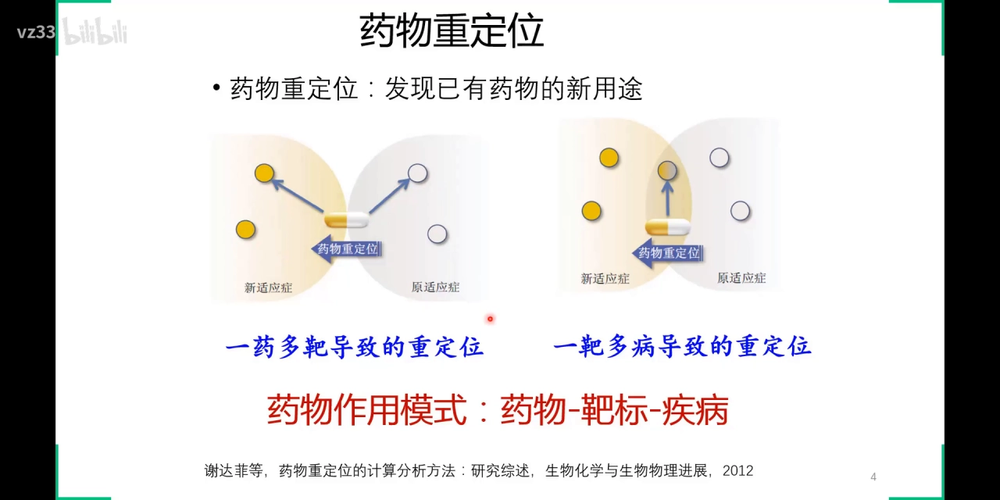

- **一药多靶**：一个药物本来作用于靶标 A，如果通过计算或其他方法发现它还能作用于靶标 B，而 B 与另一个疾病相关，这个药就有了新适应症；
- **一靶多病**：一个靶标可能覆盖多个疾病，那作用于这个靶标的药物也就可以「一药多用」。

这两条路径解释了为什么重定位在生物学上是成立的：不是碰运气，而是**同一个分子在体内本来就在同时拨动多个开关**，只是我们过去只关注了其中一个。

### 1.3 少了临床一期，风险与周期都降下来

传统药物开发和药物重定位的流程对比是这一节最实用的一张图（[【跳转到 04:03】](https://www.bilibili.com/video/BV1s44y1U7JU/?t=243)）：

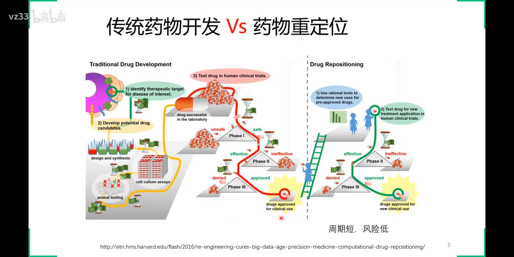

传统路径是：鉴定治疗靶标 → 设计合成化合物 → 细胞实验 → 动物实验 → 临床一期（安全性）→ 二期（有效性）→ 三期（扩大人群）→ 上市 → 四期。重定位路径则从「鉴定已有药物的新用途」开始，做细胞或动物初步验证，然后**直接进入临床二期**——因为药物已经上市，安全性有保证，一期可以跳过。

讲者由此给出三个结论：**周期短、风险低、投入少**。这也是为什么「老药新用」在产业界一直有市场，医生在临床上开 off-label（超说明书用药）本质上也是同一件事的经验版本。

### 1.4 阿司匹林与沙利度胺：两个教科书级例子

**阿司匹林**（[【跳转到 05:38】](https://www.bilibili.com/video/BV1s44y1U7JU/?t=338)）：最早用于解热镇痛，机制长期不清楚，直到 20 世纪 70 年代才确定它抑制前列腺素合成，这个发现 1982 年获得诺贝尔生理学或医学奖。后来发现**低剂量**阿司匹林可以抗血小板，用于预防心血管疾病、心脏病发作和中风。

**沙利度胺（反应停）**（[【跳转到 06:25】](https://www.bilibili.com/video/BV1s44y1U7JU/?t=385)）：早期在欧洲用于失眠和缓解早孕呕吐，结果导致大量婴儿畸形（「海豹儿」），因严重毒副作用撤市；后来又被发现可以治疗麻风性结节性红斑——同一个分子，从灾难变成了适应症。

这两个例子里藏着一个后面会反复出现的提醒：**剂量决定作用**。阿司匹林的解热镇痛与抗血小板是不同剂量下的不同效应，这已经预告了药物扰动独有的「剂量维度」。

## 二、药物怎么表示：七种「药物画像」及其代价

### 2.1 一张分类表：按数据类型分七类

要预测「这个药会让转录组怎么变」，第一个问题不是模型，而是**药物以什么形式进入计算**。讲者按所使用的数据类型把药物重定位分成七类（[【跳转到 30:54】](https://www.bilibili.com/video/BV1s44y1U7JU/?t=1854)）：

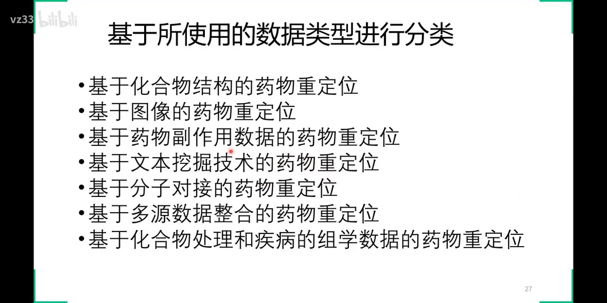

1. 基于**化合物结构**；
2. 基于**图像**（细胞表型）；
3. 基于**药物副作用**数据；
4. 基于**文本挖掘**；
5. 基于**分子对接**；
6. 基于**多源数据整合**；
7. 基于**化合物处理与疾病的组学数据**。

前六类可以理解为「药物的六种侧面画像」，第七类则是直接看**药物在细胞里留下了什么痕迹**。下面按视频顺序把前六类过一遍，重点看每种画像「凭什么能推断新适应症」。

### 2.2 化学结构：青蒿素与双氢青蒿素差一个羟基

结构相似性是最古老的思路：**结构相近的分子，功能往往相近**。视频用的例子是屠呦呦的青蒿素与双氢青蒿素（[【跳转到 31:58】](https://www.bilibili.com/video/BV1s44y1U7JU/?t=1918)）：

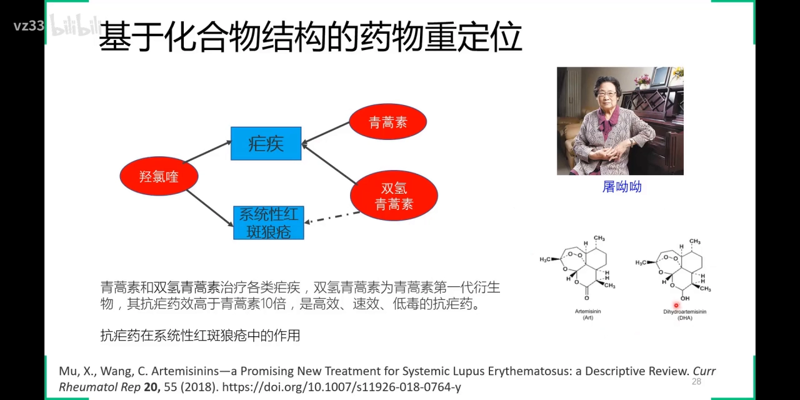

两者的差别只是把一个内酯羰基还原成羟基，但双氢青蒿素的抗疟效果显著高于青蒿素，是高效、速效、低毒的抗疟药。于是可以顺着「相似化合物 → 相似适应症」往下推：

- 羟氯喹既能治疟疾，也用于**系统性红斑狼疮**；
- 那么同样抗疟的青蒿素、双氢青蒿素，是否也能治红斑狼疮？相关临床试验正在进行；
- 2020 年四五月的报道称羟氯喹对新冠效果较好，那么青蒿素类是否也能治新冠？已有大量文献研究，但仍需实验与临床试验证实。

这条推理链的价值在于**可解释**：每一步都能落到具体的分子改动上。它的风险也同样明显——结构相似只是「可能」相似，一旦推错，代价是整条链上的假设全部作废。

### 2.3 细胞表型：给细胞染色，让图像当指纹

第二类画像不看分子，看**细胞长什么样**。Broad Institute（MIT 与哈佛医学院联合创办）的 Anne Carpenter 开发了 CellProfiler，可以对荧光染色的细胞图像做定量（[【跳转到 35:12】](https://www.bilibili.com/video/BV1s44y1U7JU/?t=2112)）：把细胞核、内质网、线粒体等细胞器分别染色，就能量出内质网大小、细胞核大小与质地、各种分类器的数量等指标。把这些指标当特征做聚类，同一个聚类簇里的药物往往性质相似、可能治同一种病。

这类方法的好处是**在测序之外提供了一条正交证据**；代价是它测的是形态，不是分子机制，解释力弱于转录组。

### 2.4 副作用：把副作用矩阵变成药物网络

第三类画像用**副作用**。德国团队开发的 SIDER 数据库把每个药物的副作用整理成一个特征矩阵（[【跳转到 37:04】](https://www.bilibili.com/video/BV1s44y1U7JU/?t=2224)）：

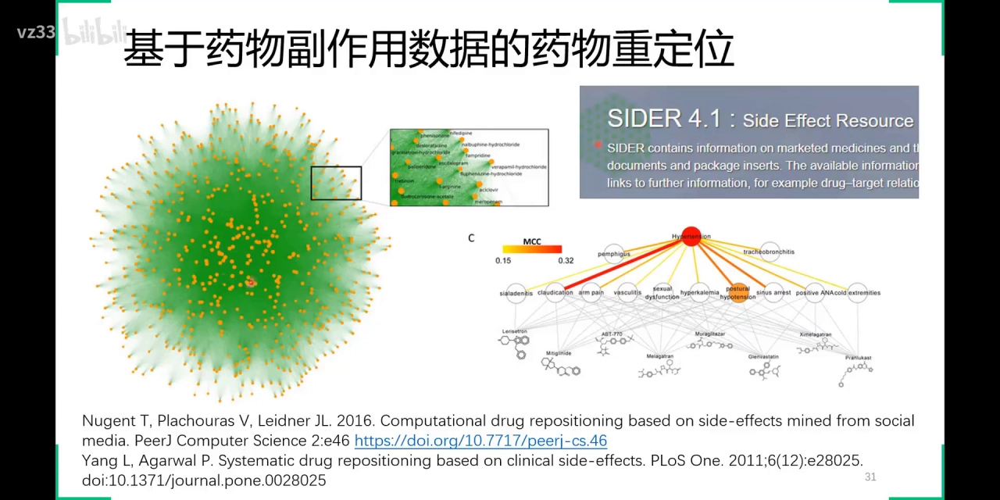

流程是：算药物两两之间的相关性（Spearman 等）→ 卡一个阈值，把全连接网络剪成部分连接网络 → 在网络里做聚类或子聚类发现。如果某个聚类簇里大部分药物都治同一种病，那么簇里其他药物也可能治这个病。

这里要注意一个容易被忽略的细节：副作用相似，本质上是**「毒性表型相似」**，它和「疗效相似」不是一回事。这一点在第八章讲假阳性时会再回来。

### 2.5 文本挖掘：ABC 模型如何把两条文献连成一条假说

第四类画像来自文献。PubMed 提供摘要、PMC 提供全文，对它们做文本挖掘，就能把「药物—基因」和「基因—疾病」两类关系拼起来（[【跳转到 39:07】](https://www.bilibili.com/video/BV1s44y1U7JU/?t=2347)）：

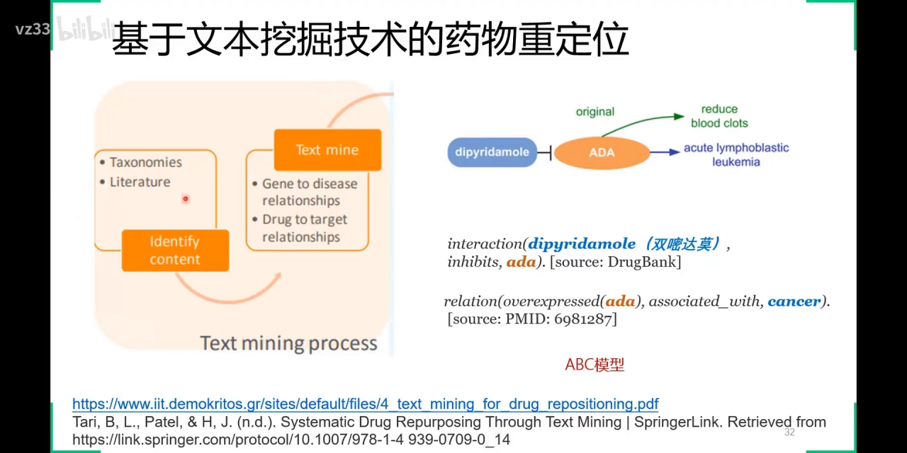

视频给的例子是双嘧达莫（dipyridamole）：DrugBank 记载它抑制 ADA；文献挖掘发现 ADA 在癌症尤其是白血病中高表达。于是 A（双嘧达莫）—B（ADA）—C（白血病）连成一条链，得到「双嘧达莫可能对白血病有用」的假说。模型简单到只有两个三元组，但它把「已有知识」变成了「可检索的新关系」。

### 2.6 知识图谱与分子对接：从通路到口袋

**知识图谱**（[【跳转到 49:26】](https://www.bilibili.com/video/BV1s44y1U7JU/?t=2966)）走的是「机制链」：大部分病毒通过受体介导的内吞作用进入细胞，新冠病毒经肺部 AT2 上皮细胞的 ACE2 受体感染，所以阻断内吞就能抑制病情；而 AAK1 是内吞作用的调节因子，抑制 AAK1 就有可能阻断病毒进入与胞内组装。

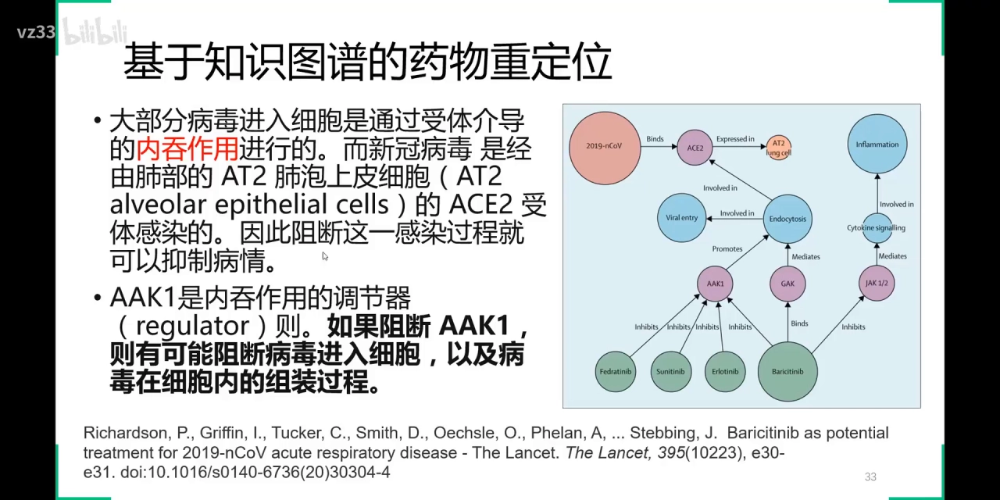

这条链上有四个候选药，其中三个因副作用较大被排除，最终选定巴瑞替尼（baricitinib），后来发表了 Lancet 论文，公司也把它推进到临床试验。

**分子对接**（[【跳转到 51:29】](https://www.bilibili.com/video/BV1s44y1U7JU/?t=3089)）走的是「口袋」：新冠爆发初期，清华的饶子和团队迅速解析并公开了病毒蛋白结构，于是大量研究基于这些结构做对接。视频的例子是瑞德西韦作为小配体插进 S 蛋白与 ACE2 的结合区域，阻断或减弱两者的结合——这和学生化时「酶与底物的锁钥假说」是同一套逻辑。对接的代价是**算力**。

### 2.7 转录组签名：本文主线

七类画像里，前六类各有各的盲区：结构相似不代表功能相似，图像与副作用都是间接表型，文献挖掘依赖已有知识，对接只管「能不能结合」、不管「结合之后细胞怎么变」。

第七类——**基于化合物处理与疾病的组学数据**——直接问最本质的问题：**这个药加进去之后，细胞的转录组变成了什么样？** 讲者说这也是他自己的研究方向。后面五章都围绕这条路展开。
## 三、转录组签名：把药物变成一串上下调基因

### 3.1 基本假设：药物能逆转疾病的变化

这条路线的全部推理，可以压缩成一句话：**疾病造成的表达变化，如果能被一个药物逆转，这个药就可能治这个病**。讲者用 2006 年发表在 Science 上的 Connectivity Map 图来解释这个假设怎么落地（[【跳转到 53:31】](https://www.bilibili.com/video/BV1s44y1U7JU/?t=3211)）：

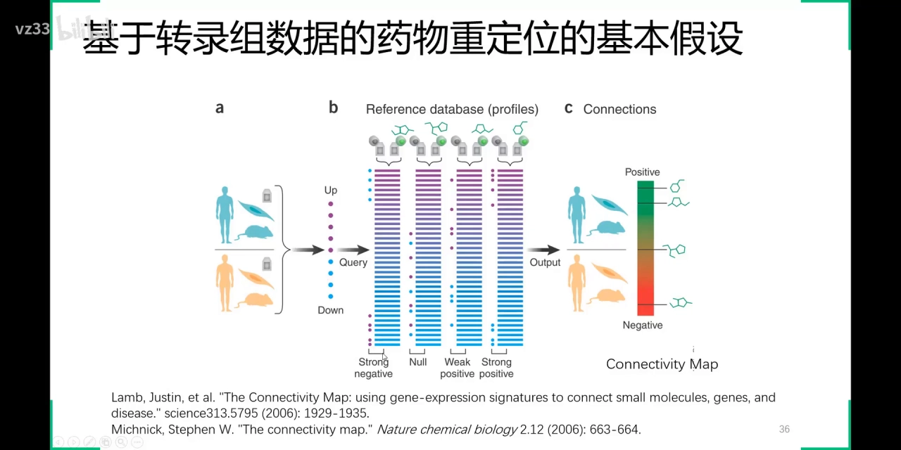

图分三段看：

1. **造签名**：一个细胞分成对照组和实验组，实验组加药，测转录组，和对照比，得到这个药物的「特征谱」——上面是上调基因、下面是下调基因。
2. **建库**：对 1309 种药物重复这件事，就得到一个「药物 × 基因」的参考矩阵，每一列是一个药物的签名。
3. **查库**：拿一份疾病对对照的转录组数据，同样算出上调、下调基因，然后去库里逐列比对，输出一串带方向的连接关系。

### 3.2 connectivity：正相关与负相关分别怎么用

比对结果不是一个「相似度」，而是一个**带方向的分数**（[【跳转到 56:34】](https://www.bilibili.com/video/BV1s44y1U7JU/?t=3394)）。讲者用几个药物做演示：

- 如果**疾病上调的基因恰好落在该药物的下调基因里**，疾病下调的基因恰好落在药物的上调基因里，两者是**强反相关** → 这个药物可能可以治疗这个疾病；
- 如果疾病上调基因与药物上调基因位置一致、疾病下调基因与药物下调基因都排在后面，两者是**强正相关** → 这个药物可能**导致**这个疾病，或者可以用来**造疾病模型**。

同一个查询，方向决定了用法：**反相关找药，正相关造模**。

反过来也成立：如果输入的是某个药物的签名，查询结果里与它正相关的药物，往往机制相似——这就成了**机制推断**的入口。

### 3.3 数据底座：从 CMap 的 1309 种药到 LINCS 的 20 个细胞系

支撑这套查询的数据基础，视频里讲了两代（[【跳转到 10:06】](https://www.bilibili.com/video/BV1s44y1U7JU/?t=606)、[【跳转到 11:18】](https://www.bilibili.com/video/BV1s44y1U7JU/?t=678)）：

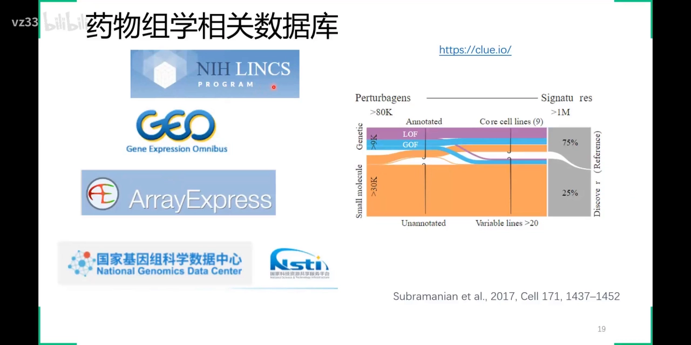

- **CMap（2006）**：用芯片测转录组，涉及 1309 种药物、约 6100 个实例（同一药物在不同条件下重复，所以实例数多于药物数）。
- **LINCS / CLUE**：NIH 几年后发起的「CMap 2.0」，用 L1000 平台，覆盖约 20 个核心细胞系；扰动源不只是小分子，还包括基因的 loss of function（敲低/敲除）与 gain of function（过表达），所以它同时能回答「这个药像不像敲掉某个基因」。

这里有两个必须记住的技术前提，它们直接决定了后面所有结论的可信度：

1. **L1000 只直接测约 978 个 landmark 基因**，其余基因靠推断补全（这套设计的取舍详见本系列 [4.4.2 LINCS 药物诱导表达数据](../../4.4_药物扰动与多模态数据资源/4.4.2_LINCS药物诱导表达数据/)）。也就是说，你查到的「签名」有一大半是算出来的，不是测出来的。
2. **每个条件是细胞群体的平均表达**（bulk），看不到细胞类型差异与响应异质性。要看到后者，需要单细胞层面的药物扰动数据（如 Tahoe-100M，见 [4.4.1](../../4.4_药物扰动与多模态数据资源/4.4.1_Tahoe-100M/)）。

## 四、一次查询的完整流水线：从差异基因到候选药

### 4.1 流程总图：五步走到候选清单

讲者给了一张很干净的总图（[【跳转到 57:34】](https://www.bilibili.com/video/BV1s44y1U7JU/?t=3454)）：

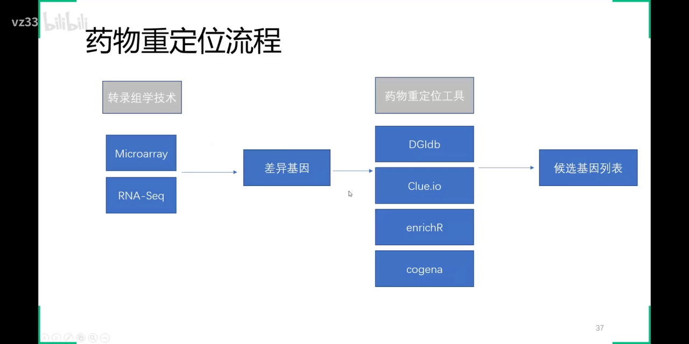

整条链路只有三步：**拿到差异基因 → 丢进查询工具 → 得到候选清单**。真正花时间的不是查询，而是第一步——差异基因从哪来、质量如何。

### 4.2 差异基因从哪来：四条路

**第一条路：GEO 上的芯片数据用 GEO2R**（[【跳转到 60:37】](https://www.bilibili.com/video/BV1s44y1U7JU/?t=3637)）。GEO 里大量早期数据是芯片（如 Affymetrix HG-U133 Plus 2.0 array），GEO2R 可以在网页上勾选对照组与实验组，点下一步就得到 top differentially expressed genes。注意它**只支持芯片，不支持 RNA-seq**。

**第二条路：GEO 上的 RNA-seq 用 GREIN**（[【跳转到 62:37】](https://www.bilibili.com/video/BV1s44y1U7JU/?t=3757)）。输入 GSE 编号，如果这个数据集还没人分析过，可以提交任务，等几天到一周；如果已经有人分析过，直接点进去就能拿到表达丰度并即时做差异分析。

**第三条路：自己测的数据**（[【跳转到 63:37】](https://www.bilibili.com/video/BV1s44y1U7JU/?t=3817)）。拿到 FASTQ → 用 STAR 比对到参考基因组 → 定量 → 标准化与 log 转化 → 用 DESeq2 / limma / edgeR 得到差异基因。这条路需要编程与算力。如果数据来自测序公司，公司报告里通常有表达矩阵和差异基因 Excel 表，但讲者提醒：公司流程往往比较老旧，**建议拿表达矩阵自己用新方法重做**。

**第四条路：在线工具或自研方法**。视频提了两个：一个是基于 Jupyter Notebook 的在线差异分析工具（[【跳转到 64:39】](https://www.bilibili.com/video/BV1s44y1U7JU/?t=3879)），输入样本元信息（哪些是对照、哪些是实验组）与表达矩阵，点提交几分钟就能拿到差异基因和可下载的表格；另一个是讲者自己开发的 **DMF（判别非负矩阵分解）**（[【跳转到 65:41】](https://www.bilibili.com/video/BV1s44y1U7JU/?t=3941)），把表达矩阵分解成 W（样本）与 H（元基因）两个矩阵，H 的每一行是若干基因的组合，从而把基因排序、拿到差异基因，在四个测试数据集上都取得了不错的结果。

拿到差异基因之后还有一道容易踩的坑：**基因 ID 不统一**。Ensembl ID、UniProt ID、Gene Symbol 之间要转换，可用 DAVID、UniProt、bioDBnet 等网站，不需要编程。

### 4.3 三个不用编程的查询工具

**DGIdb**（[【跳转到 68:47】](https://www.bilibili.com/video/BV1s44y1U7JU/?t=4127)）：把差异基因粘进去，点 Find Drug-Gene Interactions，几秒后返回每个基因的靶向药物以及关系类型（拮抗/激动）。它回答的是「**有没有药直接打这个基因**」，适合从差异基因反推靶点。这个数据库由两位同名的 Griffiths 兄弟开发——视频里还讲了个插曲：两人一直以为自己是异卵双胞胎，做了基因检测才发现是同卵双胞胎。

**CLUE / LINCS**（[【跳转到 69:49】](https://www.bilibili.com/video/BV1s44y1U7JU/?t=4189)）：选择 LINCS L1000，把上调基因和下调基因分别填进去，提交后等 10–15 分钟（数据量大），在查询历史里就能看到结果，排序基于 normalized connectivity score。

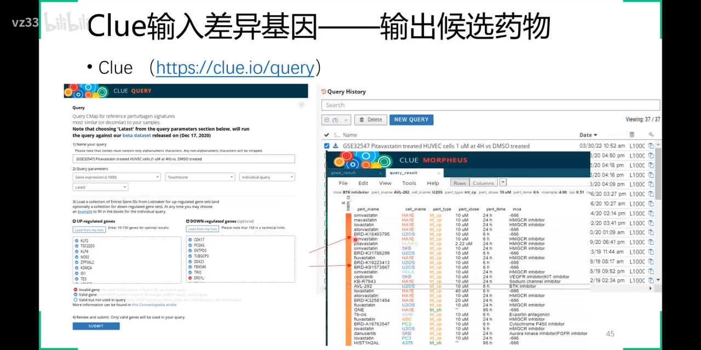

**Enrichr**（[【跳转到 72:53】](https://www.bilibili.com/video/BV1s44y1U7JU/?t=4373)）：注意**不要把上调、下调混在一起输**，要分开查；在 Diseases/Drugs 分类下可以找到疾病与药物的关联，也可以查转录组、本体（Ontology）、细胞类型等富集。它的优点是简单、一次能查很多类富集。

### 4.4 一个演示：匹伐他汀查回一堆他汀

讲者用匹伐他汀（pitavastatin）的差异基因做了一次 CLUE 查询（[【跳转到 71:52】](https://www.bilibili.com/video/BV1s44y1U7JU/?t=4312)）。结果列表里出现大量他汀类药物，还有一些只有 BRD 编号（Broad Institute 内部编号）的化合物——前者说明**查询是有效的**（它找回了同类药物），后者则是**可以进一步研究的新候选**（可能具有匹伐他汀那样的降脂功能）。

这个演示同时说明了签名匹配的两个用途：**验证**（找回已知同类药，增强信心）与**发现**（找出没有名字的编号化合物）。

还有一个操作细节值得记住：如果输入的是**疾病**签名，想让药物「逆转」它，就要把排序**倒过来**看——因为药物引起的基因变化要抵消疾病引起的变化。

## 五、签名匹配的两个盲点与 cogena 的补救

### 5.1 盲点一：只用差异基因，会丢掉「不变但协同」的基因

CMap 类工具默认只用**差异表达基因**建签名。但一组协同工作的基因，可能在某个条件下每一个的变化都不大、单独看都不显著，整体却一致地偏移。只取差异基因，等于把这类「整体偏移」的信号整段丢掉。

### 5.2 盲点二：CMap 只给相似度，不给方向

更关键的是，CMap 输出的只是一个「像不像」的分数。它能告诉你「这个药和这个疾病反相关」，但不能告诉你**这个药是通过哪条通路起作用的**。而药物重定位最终要回答的恰恰是这个——因为只有知道机制，才能判断这个候选药是不是「碰巧相似」。

### 5.3 cogena：共表达基因集 + 10 种聚类 + 超几何检验

讲者的思路是把分析单位从「单个基因」换成「共表达基因集」（[【跳转到 73:53】](https://www.bilibili.com/video/BV1s44y1U7JU/?t=4433)）：一般认为共表达的基因参与同一个生物学过程，所以对共表达基因集做富集分析，比对着差异基因列表做更有针对性，而且**能解析药物的作用方向**。

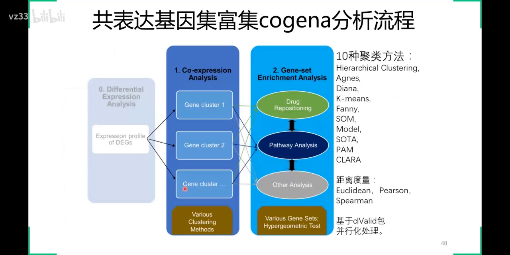

具体流程（[【跳转到 74:55】](https://www.bilibili.com/video/BV1s44y1U7JU/?t=4495)）：

1. **输入**：差异基因的表达矩阵；
2. **共表达分析**：内置 10 种聚类方法（Hierarchical、Agnes、Diana、K-means、Fanny、SOM、Model、SOTA、PAM、CLARA），距离度量支持 Euclidean、Pearson、Spearman，可以一次跑完比较；
3. **基因集富集**：基因集来自两个方向——MSigDB 做通路分析，LINCS/CMap 做药物重定位；
4. **统计**：超几何分布假设检验，结果用 FDR 表示。

它和 CMap 的核心区别是：**cogena 用全部表达基因做聚类，而不是只用差异表达基因**。于是每个基因簇既有「富集了哪条通路」，又有「富集了哪些药物」，两者一对照，药物的作用方式就出来了。

### 5.4 与 WGCNA、CMap 的对比

讲者用同一份银屑病数据做了对比（[【跳转到 79:10】](https://www.bilibili.com/video/BV1s44y1U7JU/?t=4750)）：用 WGCNA 做共表达分析，只有少量基因簇存在富集的通路，大量通路是空白的；而 cogena 的每个簇基本都有结果。这个对比不能理解为「WGCNA 不行」，它只是说明**两种工具的设计目标不同**——WGCNA 面向网络构建，cogena 面向「按簇做富集」。

## 六、四个实战案例：从差异基因到实验验证

### 6.1 银屑病：两条作用方式不同的药同时被找到

银屑病是一种皮肤病/自身免疫病，全世界约 2%–3% 的人患病，治疗药物既有小分子也有大量抗体类。讲者在 GEO 上取了两份公开数据（GSE13355 与 GSE130999）走同一套流程（[【跳转到 76:56】](https://www.bilibili.com/video/BV1s44y1U7JU/?t=4616)）。

先做共表达分析，把差异基因切成 10 个簇（PAM 聚类），再用 STRING 做蛋白相互作用，检验每个簇内部的相互作用数是否显著高于随机期望——簇 1、3、5、7、9 的比值明显偏高，说明这些簇确实是功能相关的模块。接着做通路分析（[【跳转到 78:58】](https://www.bilibili.com/video/BV1s44y1U7JU/?t=4738)）：

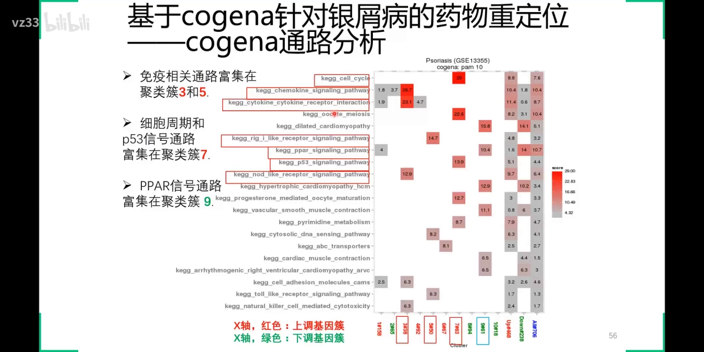

- 免疫相关通路（趋化因子、细胞因子—受体相互作用）富集在**簇 3 和 5**；
- 细胞周期与 p53 信号通路富集在**簇 7**；
- PPAR 信号通路富集在**簇 9**。

然后是药物重定位，结果分成两组，恰好对应两种不同的作用方式：

| 基因簇 | 富集的通路 | 找到的药物 | 作用方式 | 已知局限 |
| --- | --- | --- | --- | --- |
| 簇 5 | 免疫相关 | 三个已用于银屑病的药物（其中一个是免疫抑制剂） | 免疫抑制 | 停药后很快复发 |
| 簇 7 | 细胞周期、p53 | 甲氨蝶呤 + 一批细胞周期阻断剂 | 阻断细胞周期 | 甲氨蝶呤是银屑病一线药 |

簇 7 的结果特别有说服力：甲氨蝶呤是治疗银屑病的一线药物，而它恰好是二氢叶酸还原酶抑制剂、抑制 DNA 合成与细胞复制；同一簇里还聚了一批细胞周期阻断剂（拓扑异构酶抑制剂等）。**「簇 7 富集细胞周期通路」与「簇 7 富集细胞周期阻断剂」这两件事互相印证**，于是可以把这个簇的药物作用方式解释清楚：它们通过阻断细胞周期来治疗银屑病。

同样的分析在 GSE130999 上重复，得到高度类似的结果；而与 CMap 和一个已停止维护的工具相比，cogena 找到的两个标准银屑病药物排名更靠前（[【跳转到 82:01】](https://www.bilibili.com/video/BV1s44y1U7JU/?t=4921)）。

### 6.2 反向用法：甲氨蝶呤能治哪些病

前面是「给疾病找药」，这里反过来「给药找疾病」（[【跳转到 84:01】](https://www.bilibili.com/video/BV1s44y1U7JU/?t=5041)）。输入甲氨蝶呤处理后的差异基因（GSE32008），得到的通路富集里出现了熟悉的细胞周期、p53 与相关受体通路——这正好解释了它为什么能治银屑病；药物重定位则找回大量与甲氨蝶呤相似的药物。

再把甲氨蝶呤的签名当作「疾病基因集」去查疾病，得到一份「它能治哪些病」的清单：其中六种已经是它的已知适应症（小细胞肺癌排第三，还有软组织肉瘤、乳腺癌、结节病等），另外两种处于临床二期（骨关节炎、大肠癌），此外还预测了骨关节炎、口周皮炎、前列腺癌等候选。

这一步的意义在于：**同一个工具，正着用是找药，反着用是找适应症**，而「已上市药物出现在结果里」本身就是一次内部验证。

### 6.3 牙周病：时间序列里的「立即上调」与「延迟上调」

这个案例的实验部分与山东大学合作（[【跳转到 89:13】](https://www.bilibili.com/video/BV1s44y1U7JU/?t=5353)）。牙周病由牙菌斑与细菌的免疫交互引起，涉及的主要菌之一是牙龈卟啉单胞菌，作用的细胞类型主要是牙龈成纤维细胞。实验设计是：把菌加到细胞上，在 2、6、12、24、48 小时各取一次样，每个时间点做转录组测序。

因为是时间序列，分析就多了一个维度：差异分析之后，既可以做经典的 KEGG/GO 富集，也可以做 cogena 的共表达基因集分析，两条线并行、互不重复。

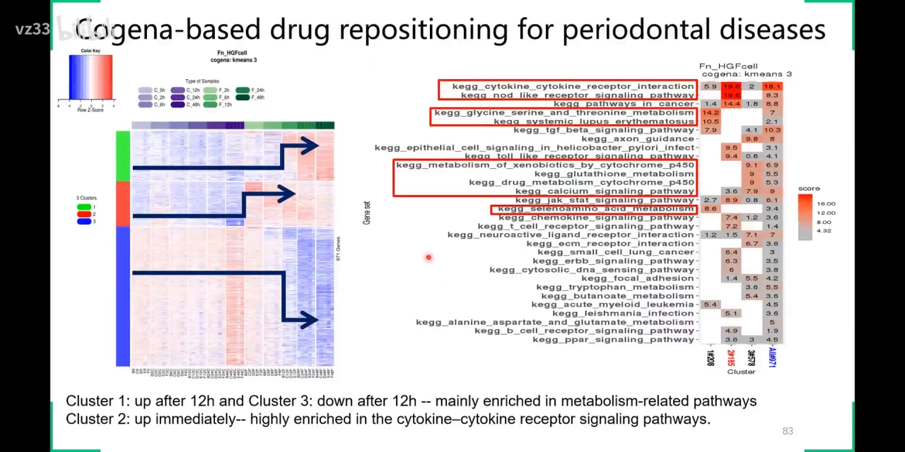

结果分成两类响应模式：

- **延迟型**：簇 1 在 12 小时后才上调、簇 3 在 12 小时后下调，主要富集**代谢相关通路**；
- **立即型**：簇 2 一加菌就上调，高度富集**细胞因子—细胞因子受体相互作用**通路。

药物重定位从这些簇里选出六个候选药，随后用 Western blot 验证通路蛋白，最终证明这类药物可以减少炎症因子并阻断 PI3K/AKT/MAPK 信号通路。

这个案例的价值在于它展示了**时间维度如何改变结论**：如果只取 48 小时一个时间点，簇 2 那条「立即响应」的免疫通路就会被埋在整体变化里。

### 6.4 新冠：8 例重症 BALF 与地塞米松的「对接失败」

最后一个案例是新冠（[【跳转到 92:16】](https://www.bilibili.com/video/BV1s44y1U7JU/?t=5536)）。数据是 8 个重症患者加 20 个健康对照的肺泡灌洗液，做的是**宏转录组**（既包含人，也包含微生物）。任务很明确：找到能把新冠造成的表达变化「恢复成健康人表达谱」的药物。

分析里出现了一个眼熟的基因——AAK1，正是第二章知识图谱里那个内吞调节因子。结果里有三个药物值得关注：沙奎那韦（抗 HIV 药，2020 年三四月已有大量对接结果支持，且本研究的发现早于英国 RECOVERY 试验公布）、一个原本用于 HIV 与 SARS 的药，以及地塞米松。

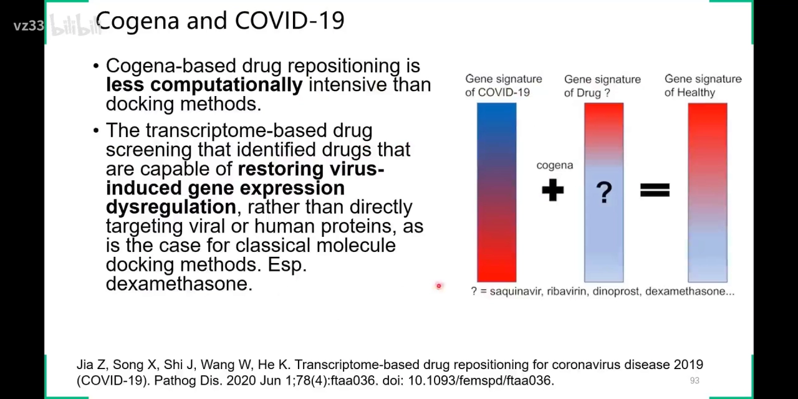

这里有一处非常值得记住的对比（[【跳转到 95:22】](https://www.bilibili.com/video/BV1s44y1U7JU/?t=5722)）：

- **分子对接**需要大量算力，但 cogena 这类基于转录组的方法基本上用个人笔记本就能跑出结果；
- 更重要的是，**地塞米松用对接算不出来**——它不是直接结合病毒或人蛋白的「直接作用」药物，而是一种间接的、类似「微调」的效应。基于转录组的方法问的是「能不能把表达紊乱扳回来」，所以能覆盖这类药物。

而地塞米松恰好是后来被 RECOVERY 试验证实有效的药，国内指南也在那之后把它加了进去。这个例子说明：**对接与转录组签名回答的是两个不同的问题**，前者问「能不能结合」，后者问「结合或不结合之后，细胞状态能不能被拉回来」。

讲者最后把工作整理成可重复研究：代码在 GitHub，提供银屑病、牙周病、新冠（两个：一个经典生信流程、一个药物重定位）的实例，用户改输入就能跑；另外还做了两个网站，一个是基于基因表达谱的药物重定位数据库与网络服务器 **D2Dpage**（[【跳转到 86:08】](https://www.bilibili.com/video/BV1s44y1U7JU/?t=5168)），另一个是能处理多组（如时间序列 2、4、48 小时）数据的分析工具。

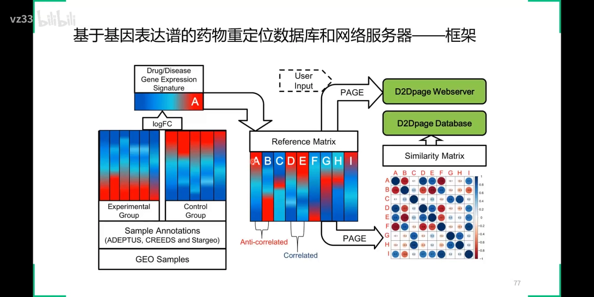

它的验证方式也很直观：输入银屑病的签名，返回的依那西普（etanercept，TNF-α 阻断剂单抗）与银屑病高度负相关——而依那西普确实是治疗银屑病的抗体药。

## 七、把任务说清楚：三个输入维度与三条建模思路

到这里，视频里散落的东西可以收束成本小节真正要回答的问题：**「给定药物 + 细胞背景 + 剂量，预测转录组变化」这个任务，输入和输出到底是什么？**

### 7.1 输入维度一：药物怎么表示

视频第二章的七类方法，本质上是**七种药物表示**。按「信息量 / 代价」排一下：

| 表示方式 | 具体形式 | 优点 | 代价 |
| --- | --- | --- | --- |
| 化学结构 | SMILES、分子指纹、结构相似性 | 可解释、可外推到新化合物 | 结构相似 ≠ 功能相似 |
| 细胞表型 | 染色图像 + CellProfiler 特征 | 正交证据、不依赖测序 | 解释力弱，通量受限 |
| 副作用 | SIDER 副作用矩阵 | 有人体数据、覆盖上市药 | 反映的是毒性，不是疗效 |
| 文献 | 实体关系三元组 | 直接复用已有知识 | 依赖已有报道，无法发现全新关系 |
| 知识图谱 | 通路/机制网络 | 机制清楚、可解释 | 建图成本高，覆盖不全 |
| 分子对接 | 蛋白结构 + 打分 | 能给出结合位点 | 算力大，覆盖不到间接作用药 |
| 转录组签名 | 上调/下调基因列表或全基因排序 | 最贴近「细胞响应」、通量高 | 只有平均效应，受平台与细胞系限制 |

**关键判断**：选哪种表示，取决于你要回答的问题。问「能不能结合」用对接；问「细胞状态能不能被扳回来」用签名；问「有没有全新机制」只能靠签名或表型，因为结构和文献都受限于已知。

### 7.2 输入维度二：细胞背景

同一个药物在不同细胞里引起的转录组变化可以差很远。视频里这条线索出现在三个地方：

- LINCS 覆盖约 20 个核心细胞系，查询时可以选择细胞系；
- 银屑病用皮肤组织的数据，牙周病用牙龈成纤维细胞，新冠用肺泡灌洗液——**每种疾病都挑了最接近病灶的细胞背景**；
- 讲者反复强调「查询结果里出现已知同类药」是有效性的证明，而这本质上是在验证**细胞背景选对了**。

这就是为什么「跨细胞系泛化」是这类模型最重要的评测指标之一：在 A 细胞系训练、在 B 细胞系测试，性能掉多少，直接决定了这个模型能不能用到真实病人身上。

### 7.3 输入维度三：剂量与时间

这是药物扰动比基因扰动多出来的维度。视频只覆盖了其中一半：

- **时间**：牙周病案例是完整的证据——同一批细胞在 2、6、12、24、48 小时取样，簇 2 是「立即上调」，簇 1/3 是「12 小时后才变」，两类响应模式的通路完全不同；
- **剂量**：视频没有涉及。这是本文的补充说明——同一药物不同浓度的效应可能完全相反（低剂量抑制、高剂量毒性），而 CMap/LINCS 的签名通常是**特定浓度、特定时间**下的一个点，把单点签名当成「这个药的全部效应」是这类方法最常见的隐含假设。剂量梯度的实验设计见本系列 [3.2.4 小分子药物与剂量梯度](../../3.2_遗传扰动与药物扰动/3.2.4_小分子药物与剂量梯度/)，元数据组织见 [4.4.4 药物剂量与细胞系信息](../../4.4_药物扰动与多模态数据资源/4.4.4_药物剂量与细胞系信息/)。

### 7.4 三条建模思路

把上面的输入组合起来，预测「药物诱导的表达变化」有三条技术路线：

**思路一：基于表达签名的匹配（不训练模型）**。这就是 CMap / CLUE / cogena 走的路：不学一个从药物到表达的映射，而是直接算「新药的签名」与「已知药物的签名」的相似度。它的优点是**不需要训练数据、结果可解释、能立刻用**；缺点是**只能匹配到库里已有的东西**，遇到全新机制的化合物就无能为力。

**思路二：基于化学结构（训练一个回归/生成模型）**。从 SMILES 或分子指纹出发，学习「结构 → 表达变化」的映射，从而对**没有实测过的新化合物**做预测。这条路在视频里只以「结构相似性重定位」的朴素形式出现（青蒿素 → 双氢青蒿素），更完整的做法（如把化学结构编码与细胞背景一起作为条件输入）属于模型架构话题，见 [5.3.3 表示学习与图神经网络](../5.3.3_表示学习与图神经网络/)。

**思路三：基于基础模型**。把药物表示与细胞状态一起作为条件输入一个预训练的表达模型，直接生成扰动后的表达谱。视频里的 AI 部分只讲到通用神经网络（感知机、CNN、RNN/LSTM、autoencoder、GAN）与标准流程（原始数据 → 特征 → 模型 → 训练/测试划分 → 评估），没有涉及基础模型；这部分内容归 [5.3.5 单细胞基础模型](../5.3.5_单细胞基础模型/)。

三条思路不是互斥的：签名匹配提供「可解释的候选」，结构模型提供「对新化合物的外推」，基础模型提供「跨细胞系、跨剂量的泛化」。真实的应用里往往是先签名匹配缩小范围，再用模型排序。

## 八、五个必须记住的局限

### 8.1 体外细胞系 ≠ 体内

整支视频里，所有预测的落点都是「候选」，而不是「结论」。银屑病的结果要拿细胞和动物验证，牙周病的六个药要用 Western blot 验证通路蛋白，新冠的候选要和 RECOVERY 这样的临床试验对照。讲者反复说的一句话是：**如果能做下游的细胞或动物验证，这就成了一个相对完整的故事**——反过来说，没做验证的预测只是故事的一半。

细胞系与真实病人的差距至少有三层：缺少免疫系统与微环境、缺少药物在体内的代谢与分布、缺少个体差异。这三层都不是算法能补的。

### 8.2 剂量外推危险

（本节为本文补充，视频未涉及剂量。）训练集里没有覆盖的浓度区间，预测不可信。原因很直接：剂量—响应曲线通常是非单调的（低剂量激活、高剂量抑制甚至毒性），而签名库里的每个药物往往只有一个或少数几个浓度点。用一个点的签名去外推整条曲线，等于假设「效应随剂量线性变化」，这个假设在药物里几乎从不成立。

实践上的建议是：**只在训练集覆盖的剂量区间内使用预测**；需要外推时，至少要有同一药物的多个剂量点做内部校准。

### 8.3 签名匹配的假阳性：泛应激与泛增殖

这是视频里最有说服力的一个局限，而且证据来自讲者自己的结果。

在银屑病的簇 7 里，富集了大量的**细胞周期阻断剂**。这既可以解释成「它们通过阻断细胞周期治疗银屑病」，也可以解释成另一件不太妙的事：**任何能抑制增殖、造成应激的化合物，都会在表达谱上留下相似的痕迹**。于是签名匹配很容易匹配到「泛增殖抑制」「泛应激」这类通用响应，而不是特异机制。

同样，簇 5 里那三个「停药后很快复发」的免疫抑制剂，彼此签名相似、临床行为也相似——这既是方法有效的证据，也提醒我们：**相似性可能来自「同一类副作用」，而不是「同一个靶点」**。

判断一个匹配是真机制还是泛响应，一个实用的办法是看它落在哪个簇、这个簇富集了什么通路：如果匹配到的药物全都指向同一条通路（如细胞周期），那更可能是真机制；如果匹配到的药物横跨各种不相干的靶点，只是都能引起应激，那就要警惕。

### 8.4 L1000 只有 978 个 landmark 基因

L1000 平台只直接测约 978 个 landmark 基因，其余基因靠推断补全（细节见 [4.4.2](../../4.4_药物扰动与多模态数据资源/4.4.2_LINCS药物诱导表达数据/)）。这带来两个直接后果：

1. **landmark 基因与全转录组不可直接互换**：你在 L1000 上算出的相似度，不能直接搬到自己的 RNA-seq 数据上比较；
2. **推断出来的那部分基因，误差会传递**：如果某个关键基因不在 landmark 集合里，它的「表达变化」其实是算法猜的。

这也是 cogena 强调「用全部表达基因而不是只用差异基因」的现实理由之一——当你手里有自己的全转录组数据时，没必要把自己限制在 978 个基因上。

### 8.5 预测准 ≠ 机制对

最后一个局限最容易被忽略：一个模型可以预测得很准，但学到的东西完全不是机制。

举个极端情形：如果训练集里「有毒的化合物」恰好都引起一批应激基因上调，模型完全可以只学会「识别有毒化合物」，然后在测试集上表现得很好——因为它预测的「表达变化」确实和实测相关。但它并没有学到「这个药作用于哪个靶点、通过哪条通路起效」。

视频里 cogena 的设计动机，本质上就是在对抗这个局限：CMap 只给相似度，cogena 额外给出「这个簇富集了哪条通路」，于是你不仅能说「这个药像那个药」，还能说「它们都在动细胞周期」。**能说出机制的预测，才是可用于决策的预测。**

## 小结

- 药物重定位的价值来自流程本身：跳过临床一期，周期短、风险低、投入少；它的生物学基础是「一药多靶」与「一靶多病」。
- 药物可以表示成七种画像（结构、图像、副作用、文献、知识图谱、对接、转录组签名），每种画像对应一条独立的推断路径，选哪种取决于你要回答的问题。
- 转录组签名的核心假设只有一句：**疾病造成的表达变化，能被某个药物逆转，这个药就可能治这个病**；反相关找药，正相关造模。
- 一次查询的完整链路是：拿到差异基因（GEO2R / GREIN / 自测序 / 在线工具）→ 统一基因 ID → 丢进 DGIdb / CLUE / Enrichr / cogena → 得到候选清单。
- 签名匹配有两个盲点：只用差异基因会丢掉协同偏移的信号，只给相似度不给作用方向；cogena 用「共表达基因集 + 通路富集」把方向补上。
- 四个案例分别展示了四种用法：银屑病（疾病找药，两条作用方式互相印证）、甲氨蝶呤（药找疾病）、牙周病（时间序列区分立即与延迟响应）、新冠（转录组方法能覆盖对接算不出来的间接作用药）。
- 五个局限要一起记住：体外细胞系不等于体内、剂量外推危险、签名匹配容易匹配到泛应激、L1000 只有 978 个 landmark 基因、预测准不等于机制对。

## 关键术语速查

| 术语 | 一句话解释 |
| --- | --- |
| 药物重定位 | 发现已上市（或已验证）药物的新适应症，跳过临床一期，周期短、风险低 |
| 一药多靶 / 一靶多病 | 重定位成立的两种生物学情形：一个分子拨动多个靶标，或一个靶标覆盖多个疾病 |
| CMap（Connectivity Map） | 2006 年建立的药物转录组签名库，1309 种药物、约 6100 个实例，用芯片测 |
| LINCS / CLUE | CMap 的 2.0 版本，用 L1000 平台，覆盖约 20 个核心细胞系，扰动源含小分子与基因 LOF/GOF |
| L1000 | LINCS 使用的表达测量平台，只直接测约 978 个 landmark 基因，其余靠推断 |
| connectivity score | 带方向的相似度：正相关表示同向（可造模），负相关表示反向（可治疗） |
| 表达签名（signature） | 一个条件相对对照的上调/下调基因列表，是签名匹配的最小输入单位 |
| DGIdb | 药物—基因相互作用数据库，输入差异基因可查「有没有药直接打这个基因」 |
| Enrichr | 在线富集分析工具，可查通路、本体、细胞类型、疾病与药物，注意上调下调要分开输 |
| cogena | 共表达基因集富集工具：10 种聚类方法切基因簇，再对每个簇做通路与药物富集，能解析作用方向 |
| 超几何检验 | 判断某个基因簇里某条通路的基因是否比随机期望更多，cogena 用它做富集，结果用 FDR 表示 |
| D2Dpage | 基于基因表达谱的药物重定位数据库与网络服务器，可算药物与疾病签名的相似性矩阵 |
| 泛应激 / 泛增殖抑制 | 大量不相干化合物都会引起的通用表达响应，是签名匹配假阳性的主要来源 |
| 分子对接 | 用蛋白结构算小分子能否结合到口袋，回答「能不能结合」，算力开销大且覆盖不到间接作用药 |
