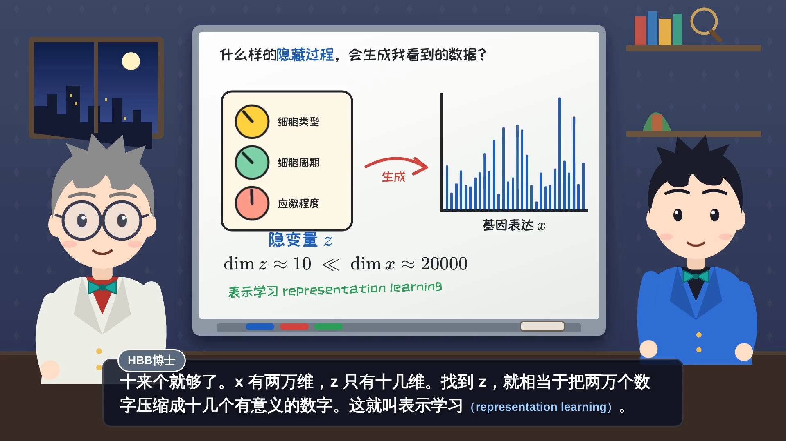
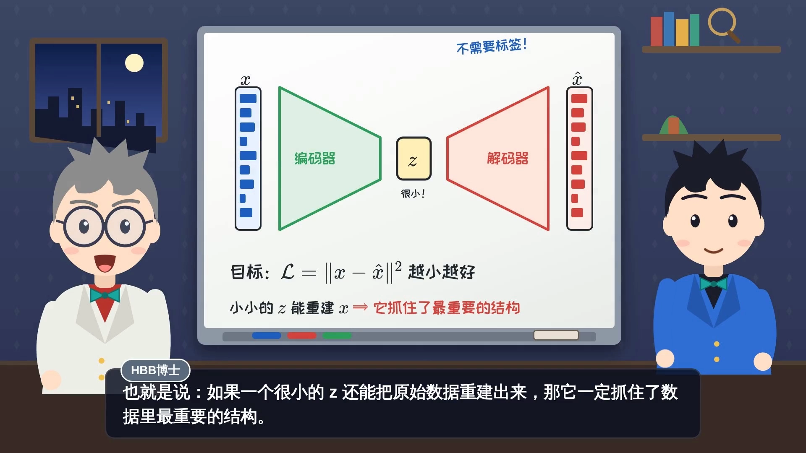
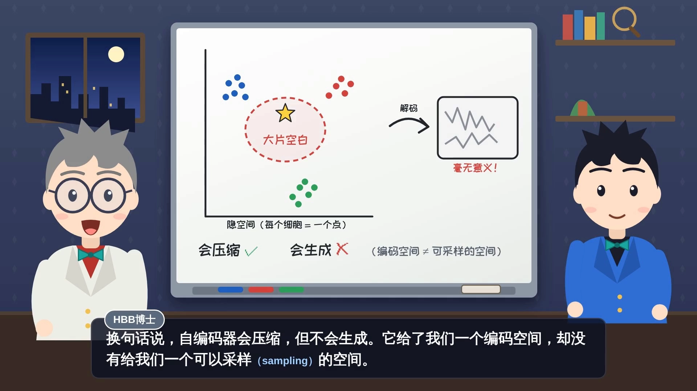
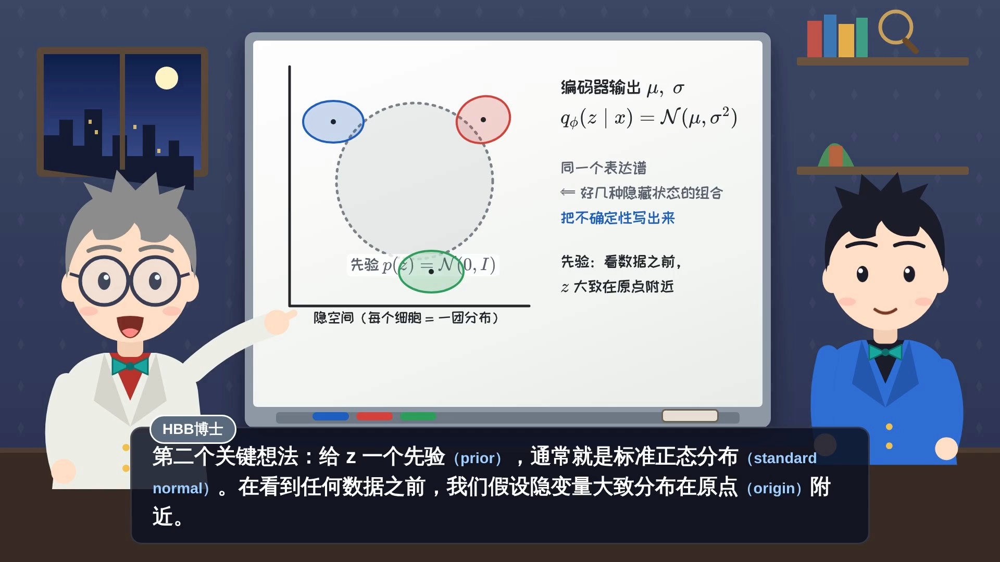
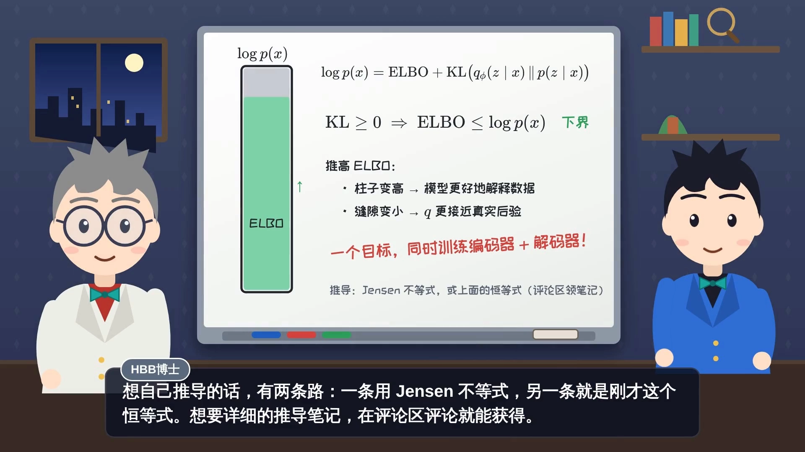
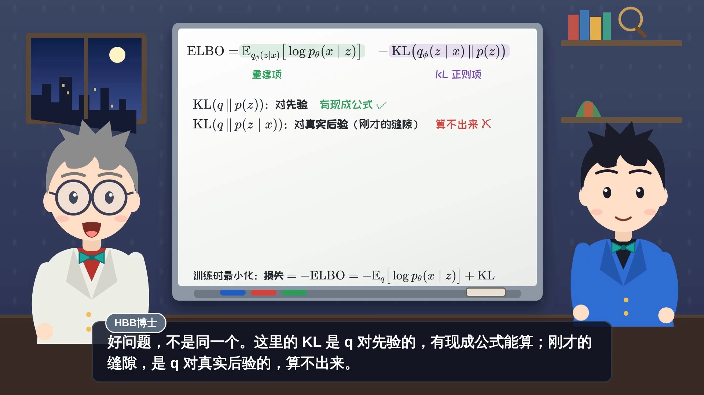
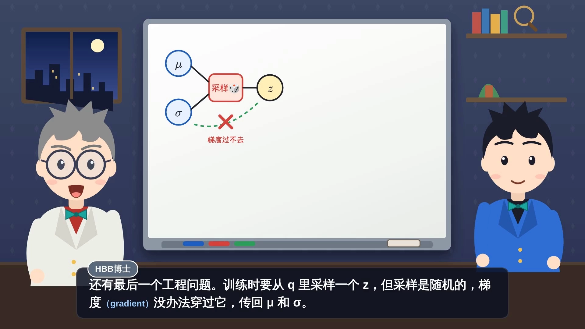
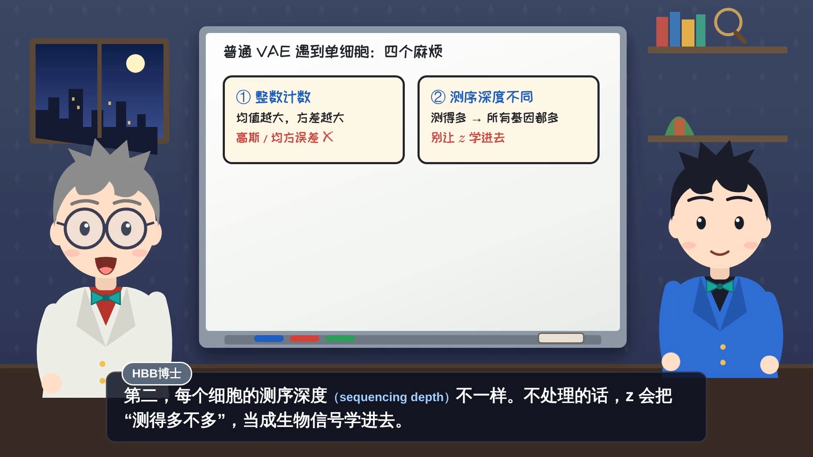
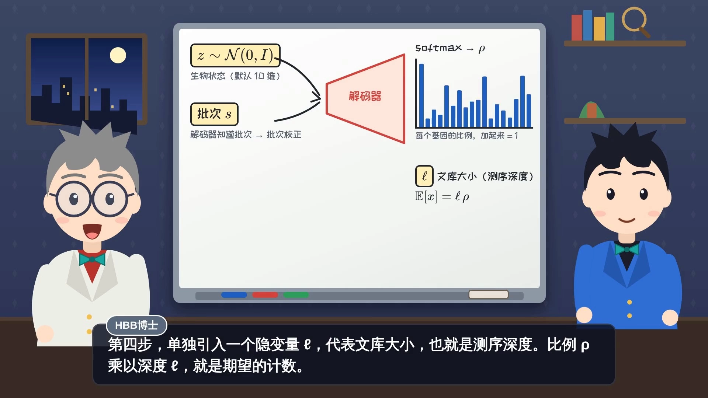

# 从两万个基因到十几个旋钮：VAE 与 scVI 如何学出可计算的细胞嵌入

> 视频来源：[一个视频讲明白 VAE：从变分自编码器到单细胞 scVI](https://www.bilibili.com/video/BV1e2WK6BEs1/)（Bilibili · HBB 的科研笔记）｜时长约 14.5 分钟
> 简要导读：这支动画讲解用一个"神秘箱子"的故事，把**表示学习**从动机讲到公式再讲到落地：为什么要把 2 万维的表达谱压成十几维、为什么普通自编码器不够用、变分自编码器（VAE）的两个关键想法和它的损失函数、以及 scVI 为了适配单细胞计数数据做的四处改造。本文只把 VAE 当作**表示学习工具**来讲（隐空间、编码器、嵌入），生成采样的用法属于另一条线，这里不展开。

## 本讲要解决的核心问题（SCQA）

**背景**：一次单细胞测序实验，每个细胞都留下一长串记录——大约 2 万个基因，每个基因一个计数。我们真正想知道的是：这个细胞是什么类型？它在分化吗？在增殖吗？在应激吗？

**冲突**：答案**没有直接写在数据里**。数据里只有 2 万个充满噪音的数字。而直接拿 2 万维、稀疏、带噪的向量去做聚类、做预测、做扰动比较，几乎没法做。

**疑问**：能不能让机器自己从这 2 万个数字里，找出背后那几个隐藏的生物状态？

**回答（中心思想）**：能，这就是**表示学习**——假设每个细胞内部有几个"旋钮"（细胞类型、细胞周期、应激程度），旋钮转到某个位置，细胞就表达出一套特定的基因。把这十几个旋钮找出来，就等于把 2 万个数字压缩成十几个有意义的数字 [【跳转到 01:45】](https://www.bilibili.com/video/BV1e2WK6BEs1/?t=105)。而要把这件事做得**既能压缩、又能采样**，需要变分自编码器；要让它**说单细胞的语言**，需要 scVI。

---

## 一、换一个提问方式：不问"数据什么意思"，问"什么过程生成了数据"

讲者开篇就把问题重构了一次，这一步很值得学 [【跳转到 01:20】](https://www.bilibili.com/video/BV1e2WK6BEs1/?t=80)：

> 不问"这个数据是什么意思"，而是问"**什么样的隐藏过程会生成我看到的这个数据**"。

就像看到伙伴的表现，去猜他背后有哪些看不见的属性。于是假设每个细胞内部有几个旋钮：细胞类型、细胞周期、应激程度，把它们叫做**隐变量（latent variable）**，记作 $z$。旋钮转到某个位置，细胞就表达出一套特定的基因——也就是说，$z$ 生成了 $x$。

关键的数量关系是：

$$
\dim z \approx 10 \ll \dim x \approx 20000
$$

十来个旋钮就够了。找到 $z$，就相当于把两万个数字压缩成十几个有意义的数字——**这就叫表示学习（representation learning）** [【跳转到 01:45】](https://www.bilibili.com/video/BV1e2WK6BEs1/?t=105)。

顺便说清楚"为什么需要压缩"：原始表达谱维度高、稀疏、噪声大，直接在它上面算距离或做预测，模型要同时对付维度和噪声；压成十几维之后，"这个细胞处于什么状态"才变成一个可以比较、可以插值、可以做加减的量。

## 二、第一版方案：自编码器，能压缩但不会生成

怎么把 $z$ 找出来？最简单的办法叫**自编码器（autoencoder）** [【跳转到 02:10】](https://www.bilibili.com/video/BV1e2WK6BEs1/?t=130)：

- 第一个神经网络叫**编码器**，把 2 万维的 $x$ 压缩成一个很小的 $z$；
- 第二个神经网络叫**解码器**，试着从 $z$ 把原来的 $x$ 还原出来，记作 $\hat{x}$。

训练目标非常朴素，让 $\hat{x}$ 尽量像 $x$：

$$
\mathcal{L} = \lVert x - \hat{x} \rVert^2
$$

谁来告诉他正确答案？**不需要标签**，输入本身就是答案。如果一个很小的 $z$ 还能把原始数据重建出来，那它一定抓住了数据里最重要的结构 [【跳转到 02:57】](https://www.bilibili.com/video/BV1e2WK6BEs1/?t=177)。

### 2.1 自编码器的大问题：点团之间是大片空白

自编码器有一个致命缺点 [【跳转到 03:22】](https://www.bilibili.com/video/BV1e2WK6BEs1/?t=202)：

编码器把每个细胞变成隐空间里的**一个点**，不同类型的细胞汇聚成不同的点团。可是损失函数只关心能不能重建，**根本不在乎这些点放在哪里**。于是点团之间可能有大片空白——如果你在空白处随便挑一个点交给解码器，出来的东西往往毫无意义。

一句话总结：**自编码器会压缩，但不会生成。它给了我们一个编码空间，却没有给我们一个可以采样的空间。**

这一点对扰动预测其实很要命：如果隐空间里有大片空白，那么"把扰动向量加上去"这种操作随时可能落到空白里，解码出来的东西就是垃圾。**隐空间必须是连续、稠密、可插值的**——这正是 VAE 要解决的问题。

## 三、变分自编码器的两个关键想法

### 3.1 想法一：不要把细胞编码成一个点，而是编码成一个分布

编码器现在输出两样东西：均值 $\mu$ 和标准差 $\sigma$，它们定义了一个高斯分布：

$$
q_\phi(z \mid x) = \mathcal{N}(\mu, \sigma^2)
$$

为什么要故意变得不精确？因为**我们本来就不知道真正的 $z$ 是多少**。同一个表达谱可能来自好几种隐藏状态的组合，与其假装知道，不如老老实实把不确定性写出来 [【跳转到 03:47】](https://www.bilibili.com/video/BV1e2WK6BEs1/?t=227)。

### 3.2 想法二：给 $z$ 一个先验

通常就是标准正态分布 $p(z) = \mathcal{N}(0, I)$：在看到任何数据之前，我们假设隐变量大致分布在原点附近。这样一来，所有细胞的分布都被轻轻拉向同一个区域，**空白被填满了**——现在随便从先验里取一个点，解码出来都是像样的细胞 [【跳转到 04:37】](https://www.bilibili.com/video/BV1e2WK6BEs1/?t=277)。

这下既能压缩又能生成了。把它看成一个生成模型，生成的方向是：先从先验抽一个 $z$，再通过解码器得到 $x$ 的分布——注意解码器输出的**不是 $x$ 本身，而是描述 $x$ 的那个分布的参数** [【跳转到 05:02】](https://www.bilibili.com/video/BV1e2WK6BEs1/?t=302)。

### 3.3 "变分"这个词从哪来

可是训练的时候我们手里只有 $x$、没有 $z$。所以要反过来问：看到 $x$ 之后 $z$ 是什么？这就是**后验**。贝叶斯公式告诉我们：

$$
p(z \mid x) = \frac{p(x \mid z)\,p(z)}{p(x)}
$$

麻烦就在分母 $p(x)$：要把所有可能的 $z$ 都积分一遍，而解码器是个神经网络，这个积分根本算不出来。退而求其次，用编码器学一个简单的分布 $q_\phi(z\mid x)$ 去近似这个算不出来的后验，在一族分布里找最好的那个——**这就是"变分"这个词的来历**。所以编码器不只是在压缩，它是在做近似的概率推断 [【跳转到 06:02】](https://www.bilibili.com/video/BV1e2WK6BEs1/?t=362)。
## 四、怎么训练：ELBO、两项拔河、重参数化

### 4.1 ELBO 是 log P(X) 的下界

理想情况下我们想最大化对数似然 $\log p(x)$，让模型给真实数据很高的概率，但刚才说了 $p(x)$ 算不出来。好消息是有一个恒等式 [【跳转到 06:07】](https://www.bilibili.com/video/BV1e2WK6BEs1/?t=367)：

$$
\log p(x) = \mathrm{ELBO} + \mathrm{KL}\big(q_\phi(z\mid x)\,\Vert\,p(z\mid x)\big)
$$

KL 散度永远大于等于零，所以 $\mathrm{ELBO} \le \log p(x)$，它是一个**下界**。关键来了：$\log p(x)$ 跟编码器无关，所以推高 ELBO 的时候，要么"整根柱子变高"（模型更好地解释了数据），要么"上面的缝隙变小"（$q$ 更接近真实后验）。**一个目标，同时训练了解码器和编码器** [【跳转到 06:32】](https://www.bilibili.com/video/BV1e2WK6BEs1/?t=392)。

想自己推导有两条路：一条用 Jensen 不等式，另一条就是上面这个恒等式。

### 4.2 展开后是两项在拔河

把 ELBO 展开正好是两项 [【跳转到 07:42】](https://www.bilibili.com/video/BV1e2WK6BEs1/?t=462)：

$$
\mathrm{ELBO} = \mathbb{E}_{q_\phi(z\mid x)}\big[\log p_\theta(x\mid z)\big] - \mathrm{KL}\big(q_\phi(z\mid x)\,\Vert\,p(z)\big)
$$

- **第一项（重建项）**：从 $q$ 里抽一个 $z$，解码器能不能给原来的 $x$ 很高的概率；
- **第二项（KL 正则项）**：这个细胞的分布 $q$ 离先验有多远，越远罚得越多。

训练时我们想让 ELBO 越大越好，写成要最小化的损失函数就是给它加个负号：

$$
\mathcal{L} = -\mathrm{ELBO} = -\mathbb{E}_{q}\big[\log p_\theta(x\mid z)\big] + \mathrm{KL}\big(q_\phi(z\mid x)\,\Vert\,p(z)\big)
$$

这里讲者专门澄清了一个很容易混的点：**损失里的这个 KL 和刚才那个"缝隙"不是同一个东西**。损失里的 KL 是 $q$ 对**先验**的，有现成公式能算；刚才那个缝隙是 $q$ 对**真实后验**的，算不出来 [【跳转到 08:07】](https://www.bilibili.com/video/BV1e2WK6BEs1/?t=487)。

两项在拔河：重建项想让每个细胞都有自己独特精确的位置，KL 项想让所有细胞都挤在原点附近、整整齐齐。那最后谁赢了呢？很多人会在 KL 前面加一个系数 $\beta$：系数太大就退化成普通自编码器，$\beta$ 太大时 $z$ 什么信息都不带，这叫**后验坍缩（posterior collapse）**。好的模型就是在两者之间找平衡 [【跳转到 08:32】](https://www.bilibili.com/video/BV1e2WK6BEs1/?t=512)。

### 4.3 重参数化技巧：让梯度穿过采样

最后一个工程问题：训练时要从 $q$ 里采样一个 $z$，但**采样是随机的，梯度没办法穿过它**传回 $\mu$ 和 $\sigma$ [【跳转到 08:57】](https://www.bilibili.com/video/BV1e2WK6BEs1/?t=537)。

解决办法叫**重参数化技巧（reparameterization trick）**：先从固定的标准正态里抽一个 $\varepsilon$，然后让

$$
z = \mu + \sigma \odot \varepsilon
$$

分布上完全一样，但随机性被挪到了旁边的 $\varepsilon$ 上——$z$ 变成了 $\mu$ 和 $\sigma$ 的普通函数，梯度可以一路畅通地传回编码器。**不是从会动的分布里抽，而是从固定的分布里抽，再平移缩放。**

训练一步的完整流程是：编码得到 $\mu$ 和 $\sigma$ → 抽 $\varepsilon$ 算出 $z$ → 解码得到 $x$ 的分布 → 算损失（负 ELBO：重建误差加 KL）→ 反向传播，同时更新编码器和解码器 [【跳转到 09:42】](https://www.bilibili.com/video/BV1e2WK6BEs1/?t=582)。

## 五、落到单细胞：四个麻烦与 scVI 的四处改造

### 5.1 普通 VAE 直接用在单细胞数据上会遇到的四个麻烦

讲者在这里的转折很干脆：直接把它用在单细胞数据上不就行了吗？没那么简单 [【跳转到 10:07】](https://www.bilibili.com/video/BV1e2WK6BEs1/?t=607)：

1. **数据是整数计数，而且均值越大方差越大**——用高斯分布、用均方误差都不太对；
2. **每个细胞的测序深度不一样**——不处理的话，$z$ 会把"测得多不多"当成生物信号学进去；
3. **批次效应**——同一种细胞换一个批次测，看起来就不一样；
4. **数据里有大量的零**。

四个麻烦一起来，有没有专门对付它们的模型？有：2018 年发表在 Nature Methods 上的 **scVI**，就是针对这四个问题对变分自编码器做了改造。

### 5.2 scVI 的核心思路：骨架不变，把生成故事写得更像真实的测序过程

| 步骤 | 做什么 | 解决了哪个麻烦 |
| --- | --- | --- |
| 第一步 | 从标准正态里抽一个 $z \sim \mathcal{N}(0, I)$，代表细胞的生物状态（默认 10 维） | —— |
| 第二步 | 解码器同时拿到 $z$ 和**批次标签 $s$**；解码器已经知道批次，$z$ 就不用再记批次信息 | 批次效应（这就是 scVI 做批次校正的原理） |
| 第三步 | 解码器最后一层是 softmax，输出 $\rho$，即每个基因占该细胞总表达的比例，加起来等于 1 | —— |
| 第四步 | 单独引入一个隐变量 $\ell$，代表**文库大小**（测序深度比例）；期望计数 $\mathbb{E}[x] = \ell\rho$ | 测序深度 |
| 第五步 | 计数用**负二项分布**描述，均值是 $\ell\rho$，每个基因还有自己的离散度 $\theta$ | 整数计数、过离散、大量零 |

这里有一句非常关键的工程经验，讲者特意点了出来：**选什么分布，就决定了重建误差怎么算**。假设高斯分布，重建误差就是均方误差；换成负二项，就是负的负二项对数似然。而负二项的方差比均值大，正好描述单细胞数据的**过离散（over-dispersion）** [【跳转到 12:00】](https://www.bilibili.com/video/BV1e2WK6BEs1/?t=720)。

推断部分就是一个标准的编码器：输入计数和批次，输出 $z$ 和 $\ell$ 的近似后验；损失还是负 ELBO——负二项分布下的负对数似然（即重建误差）加上 KL。**换掉解码器的分布，变分自编码器就会说单细胞的语言了** [【跳转到 12:25】](https://www.bilibili.com/video/BV1e2WK6BEs1/?t=745)。

## 六、训练好的嵌入能拿来做什么：四个用途

讲者把 scVI 的产出总结成四件事 [【跳转到 13:03】](https://www.bilibili.com/video/BV1e2WK6BEs1/?t=783)：

1. **$z$ 的均值就是每个细胞的低维表示**，可以直接聚类、画 UMAP；
2. **批次交给了解码器**，不同批次的同类细胞在 $z$ 空间里会混在一起；
3. **$\rho$ 是去掉了测序深度影响、去噪后的表达量**；
4. **在两组细胞的 $\rho$ 上做贝叶斯比较，就能做差异表达分析**。

而且因为用的是小批量随机梯度下降，scVI 可以扩展到上百万个细胞 [【跳转到 13:28】](https://www.bilibili.com/video/BV1e2WK6BEs1/?t=808)。

### 6.1 一个必须分清的区别：建模用的嵌入 vs 可视化用的嵌入

第 1 条用途里藏着本节最重要的一个坑。讲者说"$z$ 的均值可以**直接聚类、画 UMAP**"——注意这里的顺序：

- **$z$ 是建模用的嵌入**。它有明确的几何含义（由 $\mathcal{N}(0,I)$ 先验约束，空间连续、可采样、可插值），距离可以算，可以做向量加减；
- **UMAP 只是把 $z$ 再压到二维给人看**。它只保留局部邻域关系，全局距离没有意义，坐标轴没有物理含义，换一个随机种子或 `n_neighbors` 图就变了，而且不可逆。

所以正确的用法是：**用 $z$ 做聚类、做预测、做扰动比较；用 UMAP 画图汇报。** 反过来做——拿 UMAP 的二维坐标当特征去训练模型——等于让模型去学一堆随机种子决定的数字。这是单细胞分析里最常见的误用之一，也是本节最该记住的一条硬规则。

### 6.2 这套嵌入对扰动预测意味着什么

把 scVI 的思路挪到扰动场景，就是本节主题里的"**扰动感知的表示**"（下面这一段是把视频里的表示学习思路延伸到扰动场景，属于本节的整理，不是视频原文）：

- 编码器把**对照细胞**压成 $z_{\text{ctrl}}$；
- 把扰动信息（敲掉哪个基因、加了什么药、什么剂量）作为额外的条件输入，或者直接在隐空间里做一次位移，得到 $z_{\text{pert}}$；
- 解码器把 $z_{\text{pert}}$ 解回表达谱，就得到了对未见扰动的预测。

这条链路还解释了它和**图网络**的分工：$z$ 这类嵌入是**建图的原料**——细胞与细胞之间的关系，正是由嵌入的相似度或距离算出来的；而基因与基因之间的关系，则由 PPI、共表达、通路这些先验给出。**表示学习决定节点长什么样，图决定信息往哪流**，两者缺一不可。

这正是上一节讲的"操纵器 VI"在工程上的落地方式：**预测扰动 = 在隐空间里做一次可计算的变换**。而它能成立的前提，恰恰是 VAE 相比普通自编码器多做的两件事——**隐空间连续（先验约束）**、**可采样（重参数化）**。普通自编码器的隐空间有大片空白，扰动向量加进去很容易落到空白里，解码出来就是垃圾。

### 6.3 三个仍然要防的陷阱

即便是 scVI 这样成熟的框架，用在扰动预测上仍有三个坑：

- **信息泄漏**：如果隐空间是在"全部数据（含测试扰动）"上训练出来的，测试扰动的信息就已经通过编码器漏进了模型。正确做法是把编码器的训练也放进交叉验证循环，测试扰动只能作为新样本被编码，不能参与训练。
- **过平滑的类比**：VAE 里对应的问题是**后验坍缩**——KL 项压得太狠，$z$ 退化成不带信息的噪声，不同扰动的嵌入全部挤在一起。表现和 GNN 的过平滑很像：区分度消失，预测退化成"所有扰动都差不多"。
- **复杂结构未必赢过线性基线**：一个只做"对照均值 + 平均扰动效应"的线性基线，在很多基准上并不比深度模型差多少。**先跑基线，再谈 VAE 和 GNN**——否则你无法判断收益来自模型，还是来自数据里的简单规律。

## 小结

- **表示学习的动机**：2 万维、稀疏、带噪的表达谱没法直接建模；假设背后有十来个"旋钮"（隐变量 $z$），把它找出来就等于把两万个数字压成十几个有意义的数字。
- **自编码器能压缩但不会生成**：它只关心重建，隐空间里点团之间有大片空白，从空白处采样解码毫无意义。
- **VAE 的两个关键想法**：编码成一个**分布**（$\mu$、$\sigma$）而不是一个点；给 $z$ 一个**标准正态先验**，把隐空间拉向原点附近，填满空白。
- **训练目标**：$\log p(x) = \mathrm{ELBO} + \mathrm{KL}$，ELBO 是下界；展开后是**重建项与 KL 正则项的拔河**，$\beta$ 太大就会后验坍缩。
- **重参数化**：$z = \mu + \sigma \odot \varepsilon$，把随机性挪到 $\varepsilon$ 上，让梯度能传回编码器。
- **scVI 的四处改造**：批次标签进解码器（批次校正）、单独建模文库大小 $\ell$、softmax 输出基因比例 $\rho$、用负二项分布描述计数。**选什么分布就决定了重建误差怎么算。**
- **嵌入的正确用法**：$z$ 用于聚类、预测、扰动比较；**UMAP 只用于可视化，绝不能当特征去做预测**。
- **对扰动预测的意义**：把扰动编码成隐空间里的一次位移，就是"操纵器 VI"的工程实现；前提是隐空间连续且可采样。

## 关键术语速查

| 术语 | 一句话解释 |
| --- | --- |
| 表示学习（representation learning） | 让模型自己从高维原始数据里学出低维、有意义的向量表示 |
| 隐变量（latent variable, $z$） | 数据背后看不见的控制因素，如细胞类型、细胞周期、应激程度 |
| 自编码器（autoencoder） | 编码器压缩 + 解码器重建，用重建误差训练，不需要标签 |
| 变分自编码器（VAE） | 把样本编码成一个分布而非一个点，并用先验约束隐空间的生成模型 |
| 先验 / 后验 | 先验 $p(z)$ 是看数据前的假设（标准正态）；后验 $p(z\mid x)$ 是看到 $x$ 后 $z$ 的分布 |
| 变分推断 | 用一个简单的 $q_\phi(z\mid x)$ 去近似算不出来的真实后验 |
| ELBO | 证据下界，$\log p(x)$ 的下界；训练时最大化它 |
| KL 散度 | 衡量两个分布差多远；在损失里作为正则项把 $q$ 拉向先验 |
| 后验坍缩（posterior collapse） | KL 项过强导致 $z$ 不带信息、不同样本的嵌入趋同 |
| 重参数化技巧 | $z = \mu + \sigma \odot \varepsilon$，让采样操作可反传梯度 |
| 文库大小（library size, $\ell$） | 一个细胞被测到的总计数，代表测序深度 |
| 过离散（over-dispersion） | 方差大于均值的现象，单细胞计数数据的典型特征，用负二项分布刻画 |
| scVI | 2018 年发表于 Nature Methods 的单细胞 VAE 模型，用批次、文库大小和负二项解码器适配计数数据 |
| 后验坍缩 vs 过平滑 | 前者是 VAE 里嵌入失去区分度，后者是 GNN 里节点表示趋同，后果类似 |
