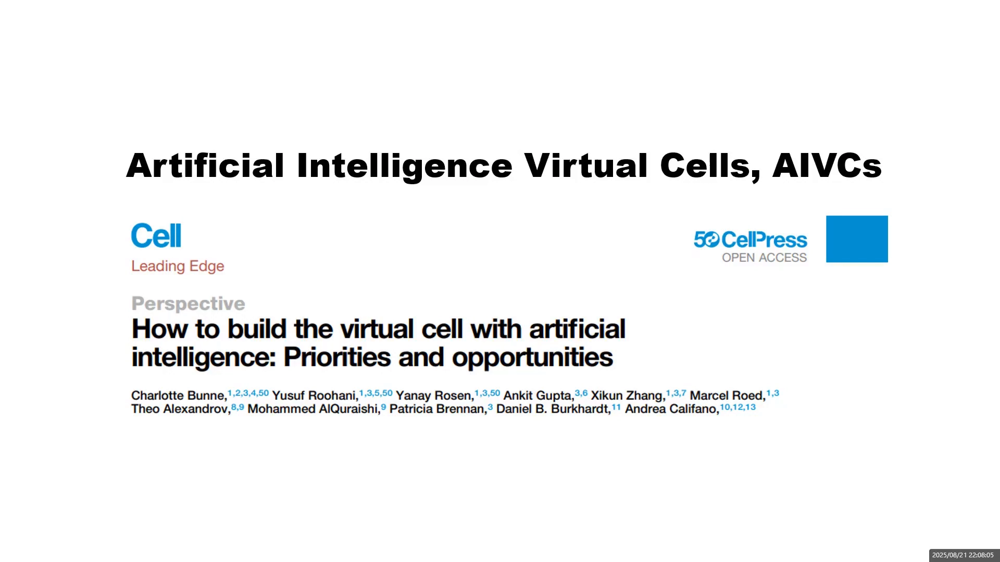
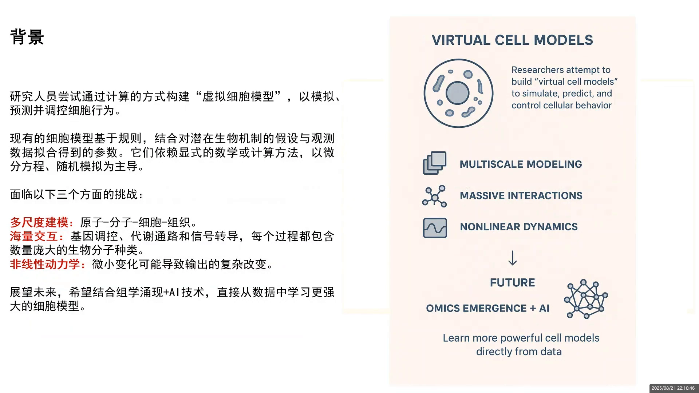
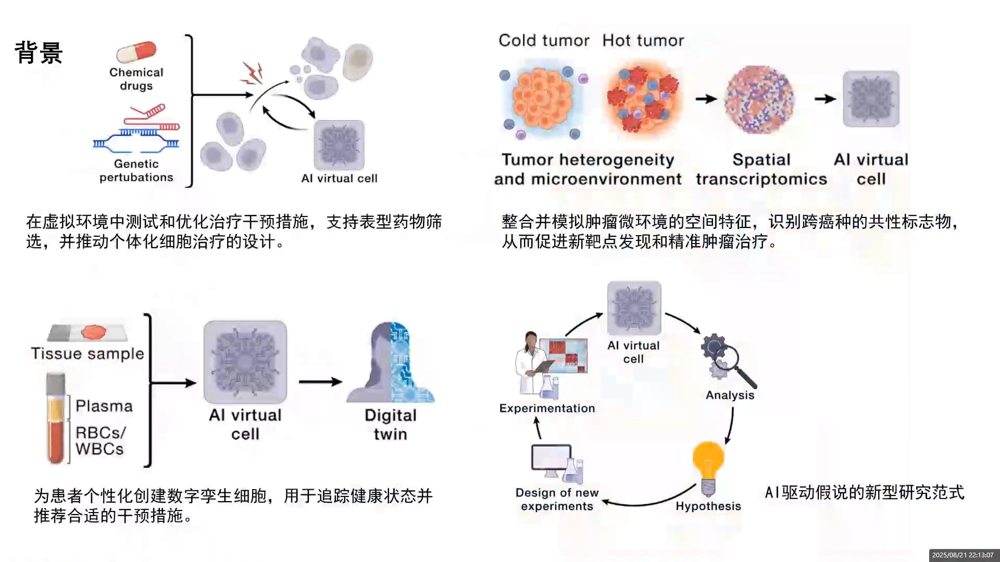
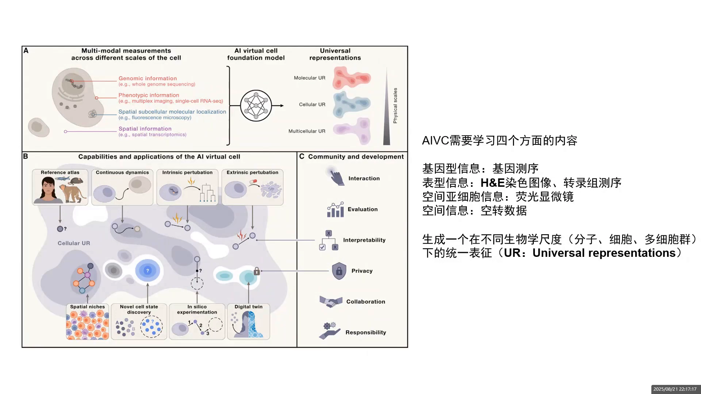
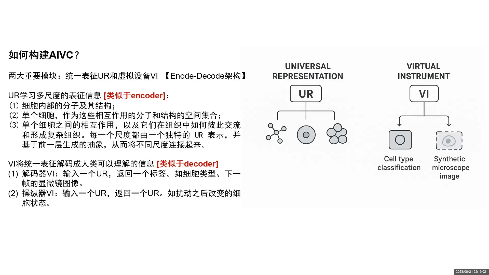
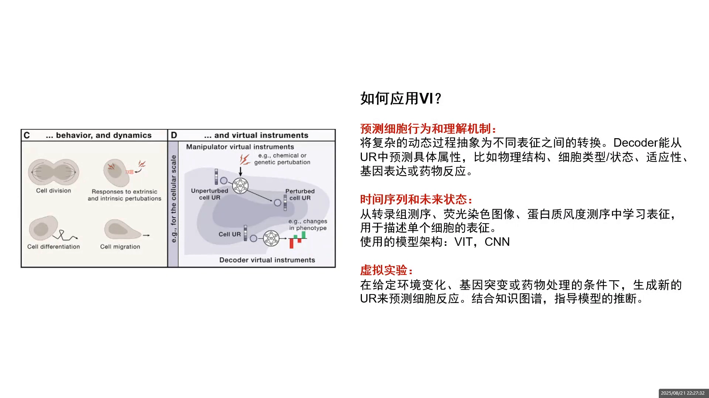
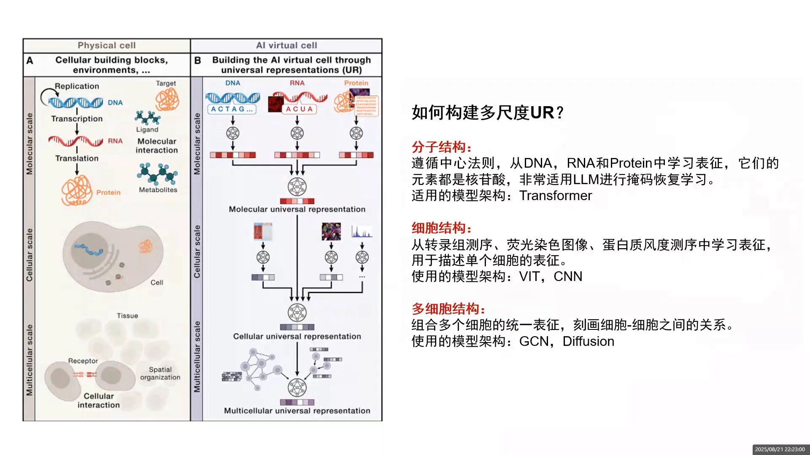
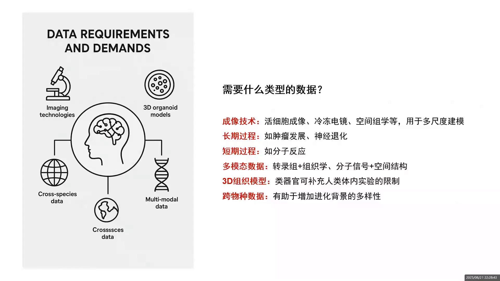

# 虚拟细胞蓝图：通用表征与图网络如何撑起扰动预测

> 视频来源：[虚拟细胞综述：来自 Cell 的最新视角](https://www.bilibili.com/video/BV1mdYXzhERy/)（Bilibili · 陈世神）｜时长约 22 分钟
> 简要导读：这是一次基于 Cell 展望文章《How to build the virtual cell with artificial intelligence》的组会式汇报。它把"扰动预测"拆成两件工程上更具体的事——**先把细胞压成一个可计算的向量（通用表征 UR）**，**再在这个向量上做"加扰动、出新状态"的运算（虚拟设备 VI）**，其中多细胞尺度用图网络来刻画细胞之间的关系。本文按这条主线展开，并在末尾补上四个工程上最容易踩的坑。

## 本讲要解决的核心问题（SCQA）

**背景**：单细胞扰动实验（Perturb-seq 一类）已经积累了大量"某个基因被敲掉之后，细胞表达谱怎么变"的数据，大家自然希望用计算的方式去预测没做过的扰动。

**冲突**：过去我们习惯"显式建模"——把已知的生物机制写成方程、拟合参数。但细胞这个东西，尺度太多、交互太多、又是强非线性，方程写不出来，参数也估不准。

**疑问**：如果不写方程，能不能直接从数据里学一个"细胞的模型"？学出来的东西长什么样，怎么用它做扰动预测？

**回答（中心思想）**：可以，但要分两步走。**第一步是表示学习**——把 2 万维的表达谱压成一个低维的、多尺度的**通用表征（Universal Representation，UR）**，它相当于细胞在计算机里的"身份证"；**第二步是虚拟设备（Virtual Instrument，VI）**——在表征空间里施加扰动，得到扰动后的新表征，再解码成人能看懂的结果。而"多个细胞之间的关系"这一层，天然适合用**图网络**来承载：细胞是节点，细胞之间的相似度或距离是边。**能否预测没见过的扰动，很大程度取决于这张图建得好不好、表征压得干不干净。**

---

## 一、显式建模走不通：三个绕不过去的挑战

整场汇报的骨架来自 Cell 的一篇 Perspective 文章《How to build the virtual cell with artificial intelligence: Priorities and opportunities》 [【跳转到 00:50】](https://www.bilibili.com/video/BV1mdYXzhERy/?t=50)。

视频开篇先解释为什么"老老实实写方程"这条路走不通。细胞是一个既**稳健**又**敏感**的矛盾体：同源重组时同源基因可以互相顶替，复制、转录、翻译过程中丢几个基因，细胞依然能维持原本的功能和状态；但另一方面，一个点的突变、一次微小的外部扰动，就可能让功能紊乱甚至进入疾病状态——肿瘤微环境就是典型例子，癌症经常介于"可控"和"不可控"之间，一个精妙的扰动就可能把它推过临界点 [【跳转到 01:36】](https://www.bilibili.com/video/BV1mdYXzhERy/?t=96)。

现有的细胞模型走的是"基于规则 + 结合对潜在生物机制的假设 + 用观测数据拟合参数"的路子，依赖显式的数学方法，以微分方程、随机模拟为主导。这条路有三个挑战 [【跳转到 03:06】](https://www.bilibili.com/video/BV1mdYXzhERy/?t=186)：

1. **多尺度建模**：生物体的演变涉及从原子、分子、分子交互、细胞间通讯，一直到组织形态的多个尺度信息，可能还要加上个体表型这一层。要在显式模型里同时表达这么多尺度，非常复杂且难以实现。
2. **海量交互**：细胞与细胞之间存在海量的交互，人类已知的就包括基因调控、代谢通路、信号转导，每一条通路都包含数量庞大的生物分子种类和它们之间的复杂交互——想想 GO 通路、想想信号转导的各种模式，这还是**已知**的，未知的通路和交互更是数不胜数。
3. **非线性动力学**：微小的变化可能导致极其复杂的改变。讲者用台风预警打比方：一个非常小的扰动，可能让台风生成，也可能让它消失。参数一旦估不准，"有台风"和"没台风"、"患病"和"没患病"就是两回事 [【跳转到 04:21】](https://www.bilibili.com/video/BV1mdYXzhERy/?t=261)。

结论是：**暂时用显式数学方法实现一个细胞模型比较困难**。于是转向"组学测序数据的涌现 + 现有 AI 技术"，直接从数据里学一个更强的细胞模型。这个转向，就是后面所有表示学习和图网络的出发点。

## 二、学出来的虚拟细胞能干什么：四类用途

在动手之前，先明确目标。讲者把虚拟细胞的用途归成四类 [【跳转到 05:27】](https://www.bilibili.com/video/BV1mdYXzhERy/?t=327)：

- **在虚拟环境里做药物测试**：人为设定扰动（加某种药物、改某个基因），在虚拟环境中测试和优化治疗干预，支持表型药物筛选，推动个体化治疗设计。
- **模拟肿瘤微环境的空间特征**：肿瘤会因极小的变化产生极大改变，可靠的虚拟细胞可以模拟其空间特征，帮助识别跨癌种的共性标志物，促进新靶点发现和精准肿瘤治疗。
- **为患者做"数字孪生"**：抽取患者的组织样本和血液样本，在电脑上克隆出一个虚拟细胞，让健康状况可以被持续监控，并针对性地推荐治疗措施。
- **改变研究范式**：以往是"假设 → 做实验 → 验证 → 再假设"的闭环；有了虚拟细胞，可以先由模型做有效性分析、从中提炼有意义的假设，相当于在环路里插入一个更可靠的研究伙伴 [【跳转到 07:32】](https://www.bilibili.com/video/BV1mdYXzhERy/?t=452)。

注意这四类用途里有三类都直接依赖"**给定一个扰动，预测细胞会变成什么样**"这个能力——这正是 5.3 节的主题，也正是表示学习和图网络要服务的目标。

## 三、表示学习：把细胞压成一个"多尺度的向量"

### 3.1 先决定学什么：四个层面的数据

文章把"要学习的内容"分成四个方面 [【跳转到 08:22】](https://www.bilibili.com/video/BV1mdYXzhERy/?t=502)：

| 层面 | 具体数据 | 说明 |
| --- | --- | --- |
| 基因型信息 | DNA 测序、RNA 测序、蛋白质测序 | 样本或细胞的基本信息 |
| 表型信息 | 转录组测序、H&E 染色图像、冷冻电镜 | 细胞功能由 RNA 表达决定，但形态也是表型 |
| 空间亚细胞信息 | 荧光显微镜 | 讲者坦言自己暂未涉及 |
| 细胞间空间信息 | 空间转录组 | 把基因表达和相对位置一起标出来，能告诉我们两个细胞的远近与空间关系 |

讲者特别提到，空间转录组目前多数还停留在二维数据，但用好了能获得非常多信息 [【跳转到 09:37】](https://www.bilibili.com/video/BV1mdYXzhERy/?t=577)。

### 3.2 学成什么样：UR 就是细胞界的 token embedding

学完这四个层面，目标是得到一个"在不同尺度——分子、细胞、多细胞群——下都统一、都有意义"的表征，文章称之为 **Universal Representation（UR，通用表征）**。

它的直觉可以直接借大语言模型：UR 之于细胞，就像 token 的 embedding 之于文本。单词有 embedding，整个句子也可以有一个 token，整个段落、整篇文章还可以有一个 token——**不同尺度上都有各自的、有意义的一串数字** [【跳转到 10:02】](https://www.bilibili.com/video/BV1mdYXzhERy/?t=602)。

这一步是全文的枢纽，值得停下来想清楚它为什么重要：

- 原始表达谱是 **2 万维、稀疏、噪声大**的计数矩阵，直接在它上面做预测，模型要同时对付维度和噪声；
- 压成几十维的 UR 之后，"这个细胞是什么状态"变成"这个向量在空间里的哪个位置"，**比较、插值、加减这些运算才有意义**；
- 而且 UR 是**跨尺度可组合**的：分子 UR 往上组合成细胞 UR，细胞 UR 再往上组合成细胞群 UR。这种层级结构，正好对应"从基因到细胞到组织"的生物学层级。

> **本节补充**：这里要区分两种"降维"。用于**可视化**的嵌入（UMAP / t-SNE）只保留局部邻域关系，两点之间的远近没有可计算的度量意义；而 UR 这种用于**建模**的嵌入，是要求"距离可算、可以做向量运算"的。这个区别在第七节还会展开成一个陷阱。
## 四、UR 与 VI 的分工：一个编码器—解码器视角

构建虚拟细胞需要两个模块，讲者用一个很干净的类比把它们串起来 [【跳转到 10:57】](https://www.bilibili.com/video/BV1mdYXzhERy/?t=657)：

- **UR ≈ encoder**：从海量数据里学一个统一的高维表征。它要学三层东西：(1) 细胞内部的分子及其结构；(2) 单个细胞，作为这些相互作用的分子和结构的空间集合；(3) 单个细胞之间的相互作用，以及它们在组织中如何彼此交流、形成复杂组织。**每一个尺度都由一个独特的 UR 表示，并基于前一层生成的抽象**，从而把不同尺度连接起来。
- **VI（Virtual Instrument，虚拟设备）≈ decoder**：把统一表征解码成人类能理解的信息。

VI 又分两种，这个区分是本讲最实用的部分：

| 虚拟设备 | 输入 → 输出 | 典型用途 |
| --- | --- | --- |
| 解码器 VI（decoder VI） | 一个 UR → 一个标签 / 一张图 | 从细胞 UR 解码出细胞类型；从一群细胞的 UR 解码出下一帧显微镜图像 |
| 操纵器 VI（manipulator VI） | 一个 UR → 一个新的 UR | 输入对照细胞的 UR，加上药物或基因扰动信息，输出被扰动后的 UR |

**操纵器 VI 就是把"扰动预测"翻译成了"在表征空间里做一次变换"**。拿到对照细胞的 UR，把扰动信息加进去，得到一个受扰动的新 UR；这个新 UR 再交给解码器 VI，就能回答"细胞究竟变好了还是变坏了""这个药物到底有没有效果" [【跳转到 13:27】](https://www.bilibili.com/video/BV1mdYXzhERy/?t=807)。

这一步之所以关键，是因为它把"预测新扰动"从"预测两万个基因的新数值"降级成了"预测一个几十维向量的位移"。后者在数据量有限时明显更可行——这也是表示学习在扰动预测里最核心的价值。

讲者随后给 UR 提了两个更高的要求，其实是两条很硬的批评 [【跳转到 18:37】](https://www.bilibili.com/video/BV1mdYXzhERy/?t=1117)：

1. **一个 UR 不该只服务一个任务**。细胞类型也许不该是"一个细胞对应一个标签"，而应该由一个细胞群、结合上下文关系来判断；UR 应该能预测多种属性、能在不同表征之间转换。而目前很多单细胞大模型的 UR"能做到一些下游任务，但还不够 universal——不够广泛、不够抽象、信息丰度也不够"。
2. **UR 要能预测时间序列和未来状态**，而不只是描述当前这一帧。

## 五、怎么建多尺度的 UR：三个尺度、三类架构

这是全网讲得最具体的一页。文章给了一张"物理细胞 vs AI 虚拟细胞"的对照图，右半边就是把 UR 一级一级搭起来的过程 [【跳转到 14:55】](https://www.bilibili.com/video/BV1mdYXzhERy/?t=895)：

**第一层，分子尺度**：遵循中心法则，从 DNA、RNA、蛋白质中学表征。因为它们的元素都是核苷酸（A、G、C、T、U），非常适合用大语言模型做**掩码恢复**训练，适用的架构是 Transformer。

**第二层，细胞尺度**：从转录组测序、荧光染色图像、蛋白质丰度测量中学习表征，用来描述单个细胞。图像数据和测量数据适合用 ViT、CNN 这类架构。

**第三层，多细胞尺度**：**组合多个细胞的统一表征，刻画细胞—细胞之间的关系**，这里明确点名了两类架构——**GCN 和 Diffusion**。

讲者还描述了具体的拼接方式 [【跳转到 17:00】](https://www.bilibili.com/video/BV1mdYXzhERy/?t=1020)：对每个样本测 DNA、RNA、protein，生成一个"每个样本共有"的 embedding；对每个细胞，根据转录组、单细胞图像、丰度数据各学一个基础模型，再把这四类数据混在一起（拼接、其他融合方式、甚至线性回归都行），得到**细胞级别的 embedding**。有了它之后：

> 细胞和细胞之间的关系，可以由它们的**相似度**度量，也可以由它们的**距离**度量——反正可以构建一个类似图神经网络的结构，然后再去学习一个细胞群的总的 embedding。

这句话信息量很大：它说明**图的边不是天上掉下来的，而是从细胞嵌入算出来的**。也就是说，表示学习和图网络在这里不是两条平行线，而是**串联**的——先有嵌入，才有图。这一点直接决定了第七节要讲的第一个陷阱。

## 六、图怎么建，比网络结构更重要

视频里对"图"的着墨集中在两处：多细胞尺度的 GCN/Diffusion，以及"用相似度/距离构图"。要把这套东西用到扰动预测上，还需要补上"节点是什么、边怎么连"这层工程细节。下面把常见的几种建图方式列清楚（这部分是本节对视频的延伸整理，视频本身只点到"相似度/距离"与"知识图谱"两个方向）。

### 6.1 四类常见的图

| 图的类型 | 节点 | 边的来源 | 在扰动预测里的作用 |
| --- | --- | --- | --- |
| 基因–基因图 | 基因 | PPI（蛋白互作）、共表达网络、通路/GO 关系、TF–靶基因 | 把"扰动这个基因会影响哪些基因"变成图上的传播 |
| 细胞–细胞图 | 细胞 | kNN（表达相似）、同一扰动、同一细胞类型 | 让相似细胞共享信息，抑制单细胞噪声 |
| 二分图 | 细胞 + 扰动 | 哪个细胞受了哪个扰动 | 直接建模"扰动—细胞"的对应关系 |
| 知识图谱 | 基因/通路/蛋白 | GO 通路、蛋白图谱等先验知识 | 讲者在讲虚拟实验时明确提到"结合知识图谱指导模型推断" [【跳转到 19:52】](https://www.bilibili.com/video/BV1mdYXzhERy/?t=1192) |

### 6.2 消息传递的直觉：没见过的基因，靠邻居把信息传过来

GNN 的核心动作叫**消息传递**：每个节点聚合邻居的信息来更新自己的表示，一层一层传下去。不需要推导公式，只要记住两个后果：

- 一个**基因**的表示，会被"与它相关的基因"影响；
- 一个**细胞**的表示，会被"与它相似的细胞"影响。

这对扰动预测的意义非常直接：**假设你要预测敲掉基因 A 的效果，但训练数据里根本没有 A 这个扰动**。如果 A 在 PPI 图上挨着 B 和 C，而 B、C 的扰动数据是有的，那么 A 的表示就可以通过邻居把 B、C 的信息"传"过来——于是模型对 A 也能给出一个合理的、而非随机的预测。这正是 GEARS 这类方法的核心思路：**图的作用是把"已知"搬运到"未知"**。

反过来说，如果一个基因在图上是个**孤岛**（没有任何邻居），那么消息传递对它完全无效，模型只能退化成"预测所有扰动的平均值"。这就引出了下一个问题。

## 七、两类方法怎么结合：三种接法

表示学习和图网络不是二选一，而是三种接法（视频里讲的是第一种，后两种是本节补充的常见做法）：

1. **串联：先压缩，再在图上前传。** 这正是视频描述的路线——先得到细胞级 embedding，再用相似度/距离建图，然后在图上学习细胞群的总 embedding [【跳转到 17:00】](https://www.bilibili.com/video/BV1mdYXzhERy/?t=1020)。预测扰动时就是：对照细胞嵌入 + 基因图 → 预测扰动后的嵌入 → 解码回表达。**优点是每一段都能单独调试，缺点是误差会累积。**
2. **端到端：图网络直接吃表达矩阵与图结构。** 把建好的基因图作为固定输入，让 GNN 在图上做消息传递，直接输出扰动后的表达。省掉了中间表征，但训练数据需求更大，也更难定位问题。
3. **对比学习：把"同一扰动的不同细胞"拉近、"不同扰动"推远。** 这是一种自监督预训练方式，不需要扰动标签的精确数值，只需要"谁和谁是一组"。学出来的嵌入往往比纯重建目标更适合做扰动层面的判别。

选哪种接法，取决于你手上有什么：**扰动种类多但每类细胞少**，适合对比学习先预训练；**基因图可靠**，适合端到端；**数据量一般**，串联最稳。

## 八、四个必须知道的陷阱

这一节是本节最该记住的部分。前三条在视频里有直接或间接的对应，第四条是这套流程里最常见的误用。

### 8.1 图的质量决定上限

图不是免费的午餐，它把**先验知识的噪声**一起带了进来：

- PPI 图本身噪声大、覆盖不全，很多基因（尤其是研究得少的基因）在图上没有边；
- 共表达网络依赖样本组成，换一个数据集，边就变了；
- 通路数据库偏向被研究得多的基因，冷门基因天然被边缘化。

所以"图传播"的收益是**不均匀**的：热门基因受益，孤岛基因毫无收益。评测时如果只报总体平均，很容易掩盖"模型其实只对图上稠密区域有效"这个事实。**先看你的目标基因在图上的度数，再谈 GNN 有没有用。**

### 8.2 过平滑：层数一多，所有节点长得一样

消息传递是"平均邻居"的操作。堆叠几层之后，每个节点的表示会趋同——这就是**过平滑（over-smoothing）**。后果是：不同扰动的细胞被压成几乎相同的向量，模型失去了区分扰动的能力，预测退化成"所有扰动都差不多"。

工程上的对策是常见的几条：层数控制在 2–3 层、加残差连接、用注意力机制让重要的邻居权重更大、或者干脆只保留一跳邻居。**判断有没有过平滑，最直接的办法是看不同扰动的嵌入之间的平均距离随层数怎么变——距离塌缩就是报警信号。**

### 8.3 信息泄漏：建图用了测试集的信息

这是最隐蔽、也最致命的一条。视频里讲细胞关系的边来自"相似度或距离"——如果这个相似度是**用全部数据（含测试集）**算出来的，那么测试集的信息就已经通过图结构漏进了训练过程。

具体场景：

- 用**全部细胞**算共表达网络，再拿这个网络去预测被留出的扰动；
- 用**全部细胞**建 kNN 图，测试细胞因此"认识"了训练细胞；
- 在划分训练/测试之前就做了整合、批次校正或嵌入学习。

这些做法都会让评测分数虚高，而且**虚高的部分在真实使用中完全拿不到**。正确做法是把建图这一步也放进交叉验证的循环里：**训练折内部建图，测试折的细胞只作为新节点接入，不参与边的构建。**

### 8.4 UMAP 嵌入不能用于预测

这是最常见的误用，值得单独强调。UMAP 和 t-SNE 是**可视化**工具：

- 它们只保留**局部邻域**结构，全局距离没有意义——两个点在 UMAP 图上离得远，不代表它们在表达上差得多；
- 坐标轴没有物理含义，换一个随机种子、换一个 `n_neighbors`，图就变了；
- 它们是有损的、非线性的、且**不可逆**的。

所以拿 UMAP 的二维坐标当特征去训练预测模型，等于让模型去学一堆随机种子决定的数字。正确的做法是：**用建模用的嵌入（PCA、VAE 隐变量、模型学出的 UR）做预测，UMAP 只用于画图给人看。** 视频里讲 UR 时反复强调"距离可度量""可以做表征之间的转换"，说的正是这件事的另一面。

## 九、最后一块拼图：数据从哪来

讲者对文章的数据要求部分给了一个很直接的评价——"有点泛泛而谈，相当于什么数据都要" [【跳转到 20:13】](https://www.bilibili.com/video/BV1mdYXzhERy/?t=1213)：

- **成像技术**：活细胞成像、冷冻电镜、空间组学等，用于多尺度建模；
- **长期过程**：肿瘤发展、神经退化这类跨度长的数据；
- **短期过程**：分子反应在短期之内怎么变化；
- **多模态数据**：转录组 + 组织学、分子信号 + 空间结构；
- **3D 组织模型**：类器官可以补充人体内实验的限制；
- **跨物种数据**：增加进化背景的多样性。

但讲者把它收敛到了一句话：**最重要的数据其实只有一种——扰动数据**（药物反应只是扰动数据中的一种）。理由很朴素：做虚拟细胞最大的用处，就是推断细胞受到扰动之后下一阶段会变成什么样，所以**对照组数据和扰动数据这一对实验对照**才是命门 [【跳转到 21:03】](https://www.bilibili.com/video/BV1mdYXzhERy/?t=1263)。

这也顺带解释了为什么这一节的评测特别容易出问题：扰动数据里"对照"和"处理"往往来自两组不同的细胞，不是同一个细胞的前后镜像。**如果划分训练/测试时不小心让同一批实验的对照进了训练集，模型可能只是学会了认批次，而不是学会了预测扰动。**

讲者最后提到今年（视频录制当年）7、8 月发表的一个专门针对扰动数据的虚拟细胞模型 **State**，用了 1 亿多个细胞训练，"效果看起来非常好"，并说如果大家感兴趣可以之后专门介绍 [【跳转到 21:28】](https://www.bilibili.com/video/BV1mdYXzhERy/?t=1288)。

## 小结

- **显式建模走不通的三个原因**：多尺度、海量交互、非线性动力学。出路是从数据里直接学模型。
- **表示学习是第一步**：把 2 万维表达谱压成低维的 **UR（通用表征）**，它像 token 的 embedding，而且在分子、细胞、多细胞群三个尺度上层层组合。
- **UR ≈ encoder，VI ≈ decoder**；VI 又分解码器 VI（UR → 标签/图像）和**操纵器 VI（UR → 新 UR）**。后者把"扰动预测"变成"表征空间里的一次位移"。
- **多尺度 UR 的构建对应三类架构**：分子尺度用 Transformer 做掩码恢复，细胞尺度用 ViT/CNN，**多细胞尺度用 GCN/Diffusion 刻画细胞间关系**。
- **图的边来自细胞嵌入的相似度/距离**——所以表示学习在前，图网络在后，两者是串联的。
- **图怎么建比网络结构更重要**：PPI / 共表达 / 通路 / kNN 各有偏置；消息传递的价值在于把"已知扰动"的信息搬运到"未知扰动"的邻居上，但**孤岛基因拿不到任何收益**。
- **四个陷阱**：图质量决定上限、过平滑让节点趋同、建图引入信息泄漏导致评测虚高、**UMAP 嵌入不能用于预测**。
- **数据上最要紧的只有扰动数据**，而对照组/处理组的划分方式直接决定评测可不可信。

## 关键术语速查

| 术语 | 一句话解释 |
| --- | --- |
| AIVC | Artificial Intelligence Virtual Cell，用 AI 构建的虚拟细胞模型，目标是模拟、预测并调控细胞行为 |
| UR（Universal Representation） | 通用表征：在分子、细胞、多细胞群多个尺度上统一、可计算的向量表示 |
| VI（Virtual Instrument） | 虚拟设备：把 UR 解码成人类可理解信息的模块，分解码器 VI 与操纵器 VI |
| 操纵器 VI | 输入一个 UR、加扰动信息、输出一个新 UR，是"扰动预测"在表征空间里的实现 |
| 掩码恢复（masked recovery） | 遮住输入的一部分让模型预测，用预测值与真实值的差做自监督训练 |
| 消息传递（message passing） | GNN 的基本操作：每个节点聚合邻居信息来更新自己的表示 |
| PPI 图 | 蛋白–蛋白互作网络，把基因连成图的最常用先验 |
| kNN 图 | 按表达相似度把每个细胞连到最近的 k 个邻居，用于细胞–细胞图 |
| 过平滑（over-smoothing） | GNN 层数过多导致所有节点表示趋同、失去区分度 |
| 信息泄漏（data leakage） | 建图/预处理时用到了测试集信息，使评测分数虚高 |
| 对比学习 | 把同组样本拉近、异组推远的自监督训练方式，常用于扰动嵌入预训练 |
