# 用潜在扩散模型生成单细胞表达谱：scLDM 的架构、条件生成与评测陷阱

> 视频来源：[利用潜在扩散模型生成可扩展的单细胞基因表达谱 || Giovanni Palla | MCBRLab](https://www.bilibili.com/video/BV1vEksBvEE3/)（Bilibili · MCBRLab 多组学读书会，主讲 Giovanni Palla）
> 导读（约 100 字）：这是一场带大量现场提问的技术报告。主讲人从「现有单细胞 Transformer 与生成模型长什么样」讲起，逐步拆到 scLDM 的两阶段架构（Transformer VAE + 潜在流匹配）、条件生成与负二项似然，最后用重建、生成、扰动三组指标做评测。文末那段关于「我们可能在自我欺骗」的讨论，是整场最有价值的部分。
> 字幕说明：B 站 AI 字幕（ai-zh）把不少专有名词识别错了，本文按幻灯片与上下文订正（如「ci/CPI」→ scVI、「CFG」→ CFGen、「地板匹配」→ 流匹配、「卷心菜跪姿」→ β-VAE、「冷却库」→ KL 项）。拿不准的人名保持中性表述。

## 本讲要解决的核心问题（SCQA）

**背景**：单细胞扰动数据里，我们真正关心的往往不是「某个基因的平均表达变了多少」，而是「扰动之后，这群细胞变成了什么样」——有多少细胞强烈响应、有多少毫无反应、有没有冒出一个新的亚群。判别式模型只会给出一个数字或一条均值曲线，回答不了这些问题。

**冲突**：生成模型看起来能直接「造出扰动后的细胞群体」，于是可以把扰动预测当成一个生成任务来做：给定细胞类型、细胞系、药物剂量或基因扰动作为条件，采样出这个条件下的表达谱分布。但一旦模型能自由地「造数据」，麻烦就来了——它造出来的东西凭什么可信？只比均值，一堆「平均细胞」也能拿高分；生成模型还可以编造出真实数据里根本不存在的细胞状态，而这种错误极难被发现。

**疑问**：一个能用的单细胞生成模型该长什么样？它怎么把「扰动」变成可以采样的条件？我们又该用什么指标、在什么层面上验证「生成得像」等于「生成得对」？

**回答（中心思想）**：这场报告给出的答案是——把生成拆成**两段**：先用一个 Transformer 自编码器把细胞压进一个低维潜在空间（负责「重建得像」），再在这个潜在空间里用流匹配学一个从噪声到数据的连续变换（负责「采样得对」）；条件（细胞类型、扰动）在第二阶段以嵌入形式注入，用无分类器引导控制强度。而评测必须同时看**重建、分布、逐基因、结构**四个层面，并且清醒地知道：在潜在空间里做扩散模型，模型几乎可以完美记住训练数据，你看到的「泛化」有可能只是解码器的误差。

## 一、先看清战场：单细胞上的 Transformer 与生成模型分成哪几派

主讲人开场先做了一张「地图」，因为后面所有的架构决策都是相对于这张地图做出的。地图的划分标准很朴素：**你拿什么喂给模型**。

### 1.1 第一派：只看「表达没表达」（二值表达）

[【跳转到 02:37】](https://www.bilibili.com/video/BV1vEksBvEE3/?t=157)

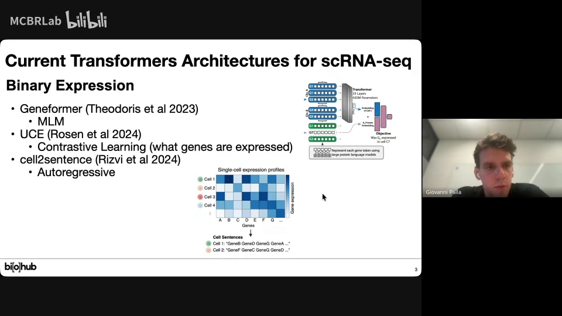

基因表达矩阵是「行是细胞、列是基因」的表格，每个格子是一个整数——这个基因在这个细胞里被测到了几次（数到多少个转录本分子）。第一派的做法是把这个整数丢掉，只保留 0/1：这个基因表达了没有。

为什么可以这么粗暴？因为主讲人的解释是：**细胞类型通常由「哪些基因被表达」决定，而不是由「表达多高」决定**，所以只做二值化分析，就能恢复大部分基因表达和细胞状态的变化。这一派的代表是 Geneformer（掩码语言模型）、UCE（对比学习，学「哪些基因被表达」的表示）、cell2sentence（把细胞当成一句话做自回归）。

### 1.2 第二派：用连续值表示真实表达

[【跳转到 04:17】](https://www.bilibili.com/video/BV1vEksBvEE3/?t=257)

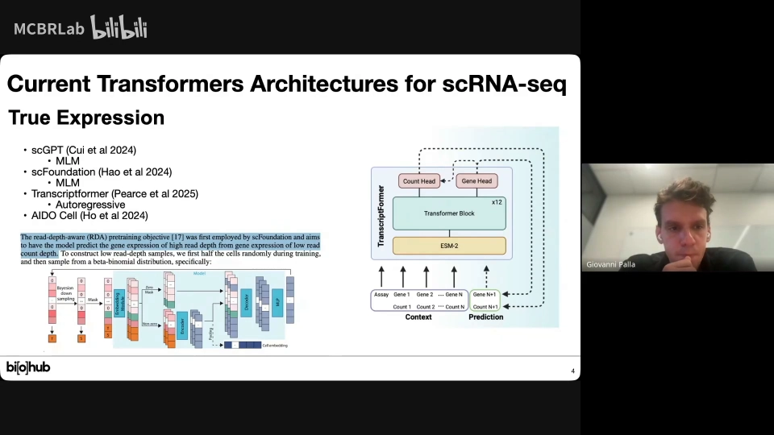

第二派保留表达的连续数值，代表是 scGPT（掩码语言模型）、scFoundation、Transcriptformer（自回归）、AIDO.Cell。幻灯片下方特别标出了 scFoundation 的一个技巧：**read-depth 预训练**——把高测序深度的细胞降采样成低深度版本，让模型学会「从低深度表达预测高深度表达」，相当于把测序深度当成一种可以对齐的噪声。

### 1.3 第三派：真正做生成的模型

[【跳转到 05:32】](https://www.bilibili.com/video/BV1vEksBvEE3/?t=332)

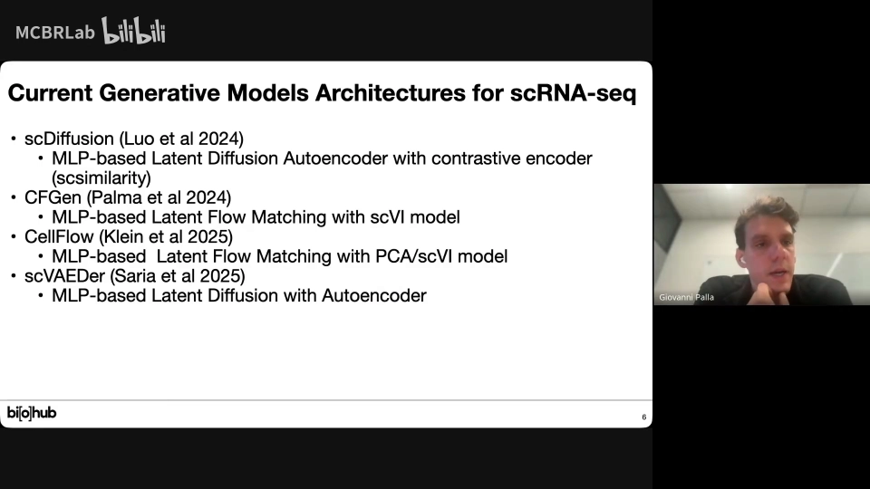

真正以「生成」为目标的模型，主讲人列了四个：scDiffusion（MLP 潜在扩散自编码器 + 对比编码器）、CFGen（MLP 潜在流匹配 + scVI 模型）、CellFlow（MLP 潜在流匹配 + PCA/scVI 表示）、scVAEDER（MLP 潜在扩散 + 自编码器）。

这张幻灯片是整场报告的转折点。因为你会发现，**它们的配方几乎一模一样**：编码器压到低维 → 在低维表示上跑扩散或流匹配 → 解码回基因空间。区别只在编码器用什么（PCA、scVI、对比学习）和生成器用什么（扩散、流匹配）。

### 1.4 共同短板：用 MLP 做自编码器，天花板很低

[【跳转到 07:12】](https://www.bilibili.com/video/BV1vEksBvEE3/?t=432)

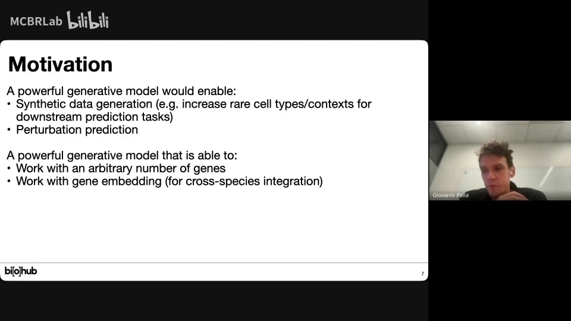

主讲人的判断是：上述工作全部基于 MLP 架构——输入编码器是 MLP，基因集合是固定的输入输出。这带来两个硬限制：

- **基因集合被写死**。你必须在训练前决定用哪 2000 个高变基因，换一个数据集就得重新定义，这对基础模型式的训练是致命的。
- **表示能力有上限**。MLP 压不出足够好的低维表示，后面的扩散模型再好也救不回来。

于是他们的目标很明确：**把 Transformer 用在自编码器的两端**，同时保留「任意数量基因」和「基因嵌入」这两个能力。后者还顺便打开了跨物种整合的门——如果把学习到的基因嵌入换成蛋白质语言模型的嵌入（类似 SATURN 的做法），就有机会在不同物种之间翻译基因特征，而不必依赖一对一的直系同源映射 [【跳转到 12:37】](https://www.bilibili.com/video/BV1vEksBvEE3/?t=757)。

## 二、scLDM：两阶段的「Transformer VAE + 潜在流匹配」

### 2.1 整体结构：先学会重建，再学会采样

[【跳转到 13:32】](https://www.bilibili.com/video/BV1vEksBvEE3/?t=812)

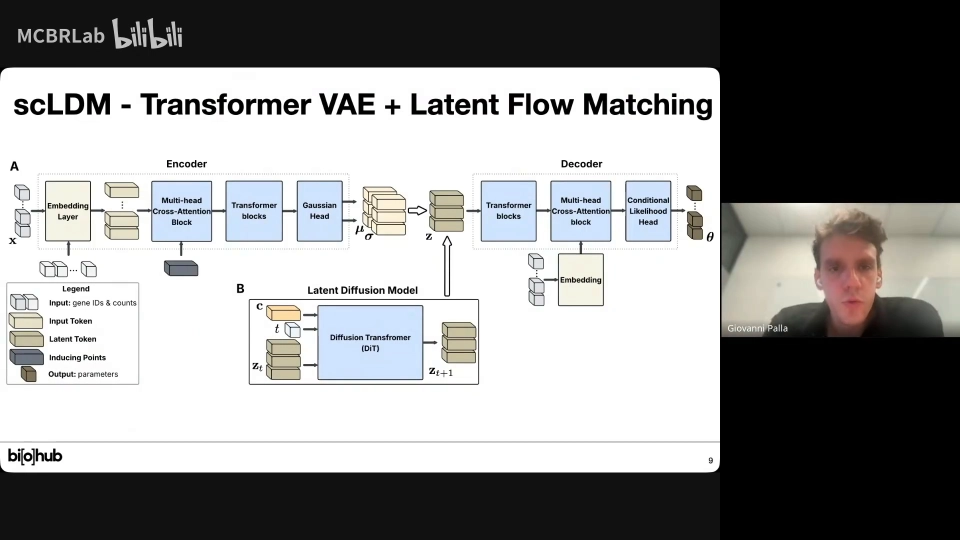

模型叫 **scLDM**（single-cell Latent Diffusion Model），训练分两个阶段，这一点和图像领域的潜在扩散模型完全同构：

1. **阶段一**：训练一个 Transformer 自编码器。编码器把「基因 ID + 计数」压成一组潜在 token，解码器再把它还原成所有基因的表达。这一步只关心重建。
2. **阶段二**：冻结自编码器，在潜在空间里训练流匹配（flow matching）模型，用的是扩散 Transformer（DiT）架构。这一步只关心「怎么从噪声走到数据」。

为什么要分两段？因为「重建得像」和「采样得像」是两个不同的目标，硬塞进一个损失函数里会互相拉扯。分开训练，你至少可以单独诊断是哪一段出了问题——这个判断在后面的批判部分会变得非常重要。

### 2.2 交叉注意力：把 30 万个基因压成 128 个潜在 token

[【跳转到 14:47】](https://www.bilibili.com/video/BV1vEksBvEE3/?t=887)

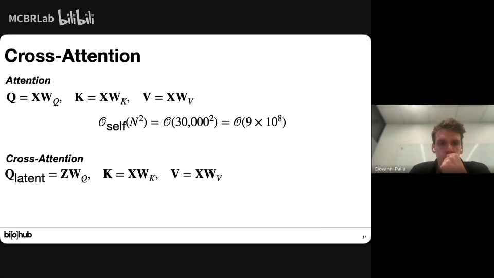

这是整个架构里最漂亮的一处设计。标准自注意力的查询、键、值都来自输入：

$$
Q = XW_Q,\quad K = XW_K,\quad V = XW_V
$$

复杂度是输入长度的平方。如果输入是 30000 个基因，代价就是

$$
\mathcal{O}_{\text{self}}(N^2) = \mathcal{O}(30000^2) = \mathcal{O}(9 \times 10^8)
$$

而交叉注意力只把**查询**换掉——查询不再是输入，而是一组可学习的「潜在查询」：

$$
Q_{\text{latent}} = ZW_Q,\quad K = XW_K,\quad V = XW_V
$$

键和值仍然来自输入（也就是 30000 个基因），但查询只有 128 个。于是注意力矩阵从 30000×30000 变成 128×30000，复杂度直接降了两个数量级（约 200 倍）。主讲人强调这不只是省算力，**它还提供了一个很好的归纳偏置**：基因空间高度冗余、存在大量相关性，这相当于强行加了一个降维瓶颈——用更短的上下文长度表达同一个细胞，但每个 token 的嵌入维度不变。

编码器的具体做法很直接：基因嵌入（可学习的、按基因索引的字典）+ 计数，用一个嵌入层融合，最直接的拼接方式效果最好（他们试过多种消融）；然后过线性层、多头交叉注意力（以 128 个潜在 token 为查询）、若干 Transformer 块，最后由高斯头输出潜在表示。

解码器则是镜像结构：Transformer 块 → 多头交叉注意力 → 条件似然头。关键细节是**复用编码器的基因嵌入**：把同一套基因嵌入当作解码器交叉注意力的查询，把潜在 token 映射回基因空间。主讲人打了个比方——这就像语言模型在输出层之前把嵌入投影回词表大小，输入输出共享同一套表示。

顺带得到两个性质：编码器对基因数量**不变**（任意数量基因、甚至打乱顺序，都能学到相同的编码表示），解码器对输入**等变**。这意味着输入和输出的基因数量可以不同——虽然这篇论文没有展示这类实验。

### 2.3 一个反直觉的细节：只编码表达基因，却要解码全部基因

编码器输入端只传「表达了的基因」，把零值基因用掩码标记替换掉。这样做有三点好处：训练更稳定、性能略好、更省算力（上下文长度从「总基因数」变成「每个细胞的表达基因数」）。

但这立刻引出一个尖锐的现场提问 [【跳转到 22:22】](https://www.bilibili.com/video/BV1vEksBvEE3/?t=1342)：这不是掩码语言模型吗？掩码语言模型只预测被掩码的部分，而你输出时要重建**所有**基因，那些已经作为输入给进去的基因，模型不用学任何东西就能复现，那它到底学到了什么？

主讲人的回答是：我们不是在做掩码语言建模。我们给模型的是「基因 ID + 计数」这些表达信息，然后在潜在空间里**隐式地**让它处理其余一切——我们不给任何额外信息，但我们认为模型会这样组织：这些是表达数据，其余全为零。他坦承自己当时也很犹豫，「不显式提供这些信息，这行不通吧」，但实验里它确实有效。他补充说，这更像一种正则化手段。

这个细节值得记住：**生成模型的有效性有时来自设计者也没完全想清楚的归纳偏置**，而不是来自某个精巧的损失项。
### 2.4 阶段二：潜在空间里的流匹配

[【跳转到 27:47】](https://www.bilibili.com/video/BV1vEksBvEE3/?t=1667)

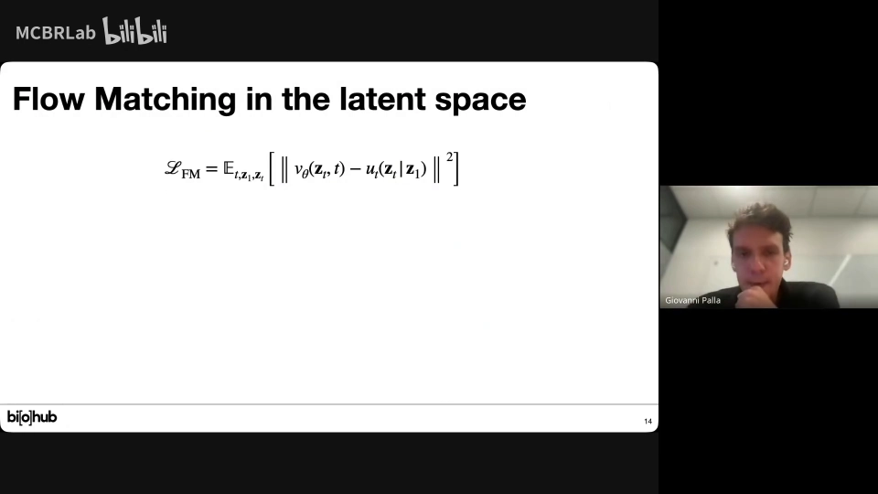

第二阶段用的是最标准的线性时间流匹配，没有任何花哨的改进。损失函数是

$$
\mathcal{L}_{\mathrm{FM}} = \mathbb{E}_{t,\,z_1,\,z_t}\left[ \left\| v_\theta(z_t, t) - u_t(z_t \mid z_1) \right\|^2 \right]
$$

翻译成人话：在潜在空间里，从噪声点 $z_0$ 到数据点 $z_1$ 连一条直线，中间任意时刻 $t$ 的位置是 $z_t$；这个位置上的「正确速度」是直线上从噪声指向数据的方向 $u_t = z_1 - z_0$；网络 $v_\theta$ 的任务就是看着当前位置 $z_t$ 和时间 $t$，把这个速度猜出来。训练好之后，从纯噪声出发、沿着网络预测的速度一步步走，就走到了一个「像真实细胞」的潜在点。

[【跳转到 28:37】](https://www.bilibili.com/video/BV1vEksBvEE3/?t=1717)

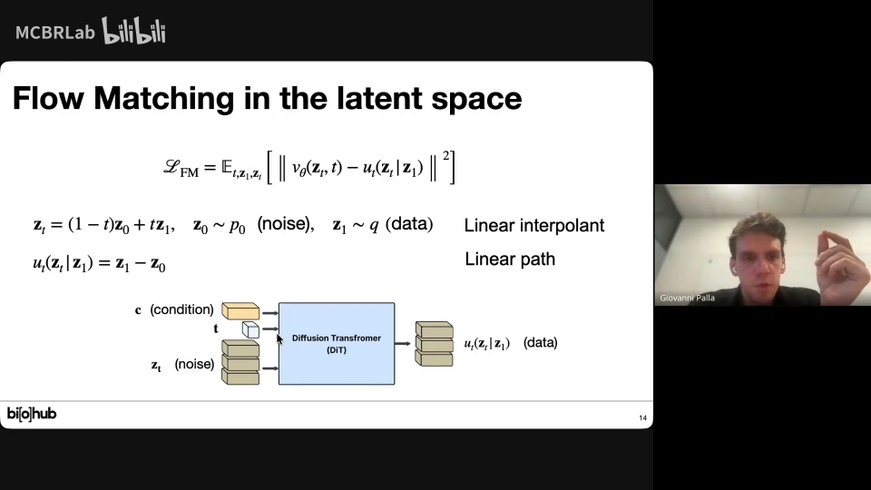

用公式写就是线性插值：

$$
z_t = (1-t)\,z_0 + t\,z_1,\qquad z_0 \sim p_0\ (\text{噪声}),\quad z_1 \sim q\ (\text{数据})
$$

负责预测速度场的网络是扩散 Transformer（DiT），它接收三个输入：噪声状态 $z_t$、时间步 $t$、以及条件 $c$。这里的 $z_t$ 不是单个向量，而是一组潜在 token——所以整个模型从头到尾都是 Transformer，没有 MLP 瓶颈。

### 2.5 似然：负二项分布 + 文库大小

[【跳转到 38:12】](https://www.bilibili.com/video/BV1vEksBvEE3/?t=2292)

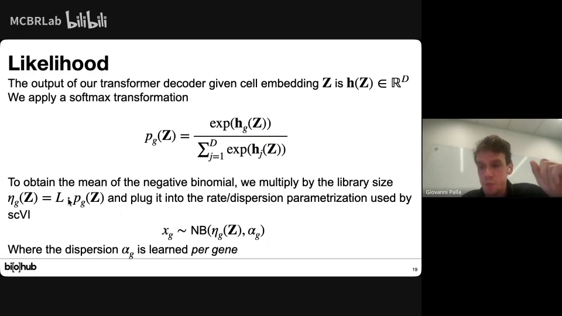

生成模型最后一步必须回答：潜在表示怎么变成一个**计数**？scLDM 用的是负二项（NB）分布，参数化方式与 scVI 完全一致——这是刻意的选择，因为这样就能和 scVI 直接对比，两者用的是同一套表示和同一套似然。

解码器在给定细胞嵌入 $Z$ 时输出 $h(Z) \in \mathbb{R}^D$，先做 softmax 得到每个基因的概率：

$$
p_g(Z) = \frac{\exp\!\big(h_g(Z)\big)}{\sum_{j=1}^{D} \exp\!\big(h_j(Z)\big)}
$$

再乘以文库大小 $L$ 得到负二项的均值：

$$
\eta_g(Z) = L \cdot p_g(Z)
$$

最后每个基因的计数服从

$$
x_g \sim \mathrm{NB}\big(\eta_g(Z),\ \alpha_g\big)
$$

其中离散参数 $\alpha_g$ 是**每个基因学一个**（这一点和 scVI 不同）。

这里有个容易被忽略但很关键的工程细节：**生成时必须从文库大小里采样**。做法是在单维直方图上拟合一个正态分布，得到每种条件下的有效文库大小，采样时从高斯里抽 $L$，而不是从直方图直接抽。为什么重要？因为文库大小决定了这个细胞「总共测到多少个分子」，它直接影响生成的表达谱有多稀疏。如果固定 $L$，你生成的细胞群体就会失去测序深度这一层自然变异。

训练成本方面：VAE 训 400–600 个 epoch，冻结后用流匹配训 100–200 个 epoch；大多数实验能在单张 H100 80GB 上跑完。模型参数量其实很小——至少在生成和编码部分；最新的结果还在用更小的模型。作为参照，他们对比的 scVI 和 CFGen 都只有约五十万参数。FLOPs 上更贵，因为输入输出都是几万个基因，内存复杂度更高。

## 三、条件生成：把「扰动」变成一个可以采样的条件

### 3.1 条件器：不同任务，条件不同

条件 $c$ 是什么，取决于你问什么问题：

- **合成退化实验**（把高深度细胞降采样成低深度）：条件是细胞类型或组织；
- **扰动实验**：条件是上下文的组合——细胞系（或细胞类型）+ 扰动（细胞因子或遗传扰动）。

这些条件都被表示成学习嵌入，注入到扩散 Transformer 里。采样时用**无分类器引导**（classifier-free guidance, CFG），并有一个引导权重控制「听条件的话」的程度。主讲人展示了一些关于这个权重的实验，但没有展开。

这一点值得初学者留意：**「条件生成」在扰动预测里的含义，就是「我要这个细胞系 × 这个扰动的细胞群体」**。模型不是去预测「扰动效应有多大」，而是直接采样出这个条件下的表达谱分布——分布里自然包含响应者、非响应者、以及可能的细胞状态迁移。这正是生成式路线相对于判别式路线的根本区别。

### 3.2 一个现场争论：去掉 KL 项之后，还是不是 VAE？

[【跳转到 59:17】](https://www.bilibili.com/video/BV1vEksBvEE3/?t=3557)

现场有位听众提了一个很到位的质疑：你最终选择不使用 KL 正则化，那从技术上讲，你们就从 VAE 变成了普通自编码器，失去了从潜在空间直接采样的能力。

主讲人的回答分两层：

- **第一层是澄清**：我们失去的是「从潜在空间采样」的能力，但在基因表达空间里没有——解码器仍然是概率性的（负二项似然还在），条件仍然在。
- **第二层是实验**：他们最初用的是文献里常见的配方——编码器里加一个权重很小的 KL 项；最终大部分实验保留了它，同时在编码器和解码器的输入输出加层归一化。所以仍然通过层归一化和编码器输出保留了某种约束。说实话结果差不多，KL 项在这批数据上没有带来显著提升，更多是简化训练过程。他们还提到，KL 项的值本身已经很小了，所以它在正则化上的帮助可能有限。

另一位作者补充了一段更有意思的小规模实验：在更小的架构和数据上，他试过纯 VAE（不加 KL 缩放），然后大量尝试不同的**先验**——高斯、高斯混合模型（GMM）、潜在扩散。结论是趋势和其他模态完全一致：

- 高斯先验效果差，确实不好；
- 换成 GMM 并增加组件数，效果显著提升，能很好地建模潜在空间；
- 潜在扩散模型得到相同甚至更好的分数。

所以他们与 Giovanni 合作后迅速转向潜在扩散，直接跳过了 GMM 和高斯先验。

### 3.3 一个必须调整的超参：潜在 token 的维度分配

训练流匹配时，他们发现**潜在 token 的嵌入维度必须调**，而且结论反直觉：用**更多潜在 token、但每个 token 的嵌入维度更小**，比反过来更好。原因不是构建能力的限制，而是这种结构对生成更友好——重建能力强的配置，未必是扩散模型好训练的配置。

这个观察在整场报告里反复出现，最后变成了最重要的那条结论：**重建与生成是一对权衡**。

## 四、怎么验证「造出来的细胞群体」是对的

这是本讲最该反复读的部分。生成模型的评测有个天然陷阱：**你优化什么，就会在那个指标上变好；而那个指标可能根本不是你要的东西**。所以必须分层看。

### 4.1 三层指标，各管一件事

主讲人把评测拆成三组，对应三个不同的问题：

| 层面 | 指标 | 回答的问题 |
| --- | --- | --- |
| 重建 | 似然、MSE、PCC（皮尔逊相关） | 潜在表示有没有丢信息 |
| 生成 | MMD、距离类指标（能量距离） | 采样出来的分布像不像真实分布 |
| 扰动 | 虚拟细胞挑战的三项指标 + 一项自选指标（与表达基因重叠、误差、判别分数） | 未见扰动条件下的预测准不准 |

扰动实验里具体用了四个指标：其中三个来自虚拟细胞挑战（Virtual Cell Challenge），另一个是他们筛选后觉得特别有趣的——与表达基因的重叠度、误差、以及判别分数（discriminative score）。判别分数问的是：**能不能训练一个分类器把生成数据和真实数据区分开**？分不开，说明生成得够真。

### 4.2 逐基因层面：均值对了，方差可能全错

[【跳转到 43:57】](https://www.bilibili.com/video/BV1vEksBvEE3/?t=2637)

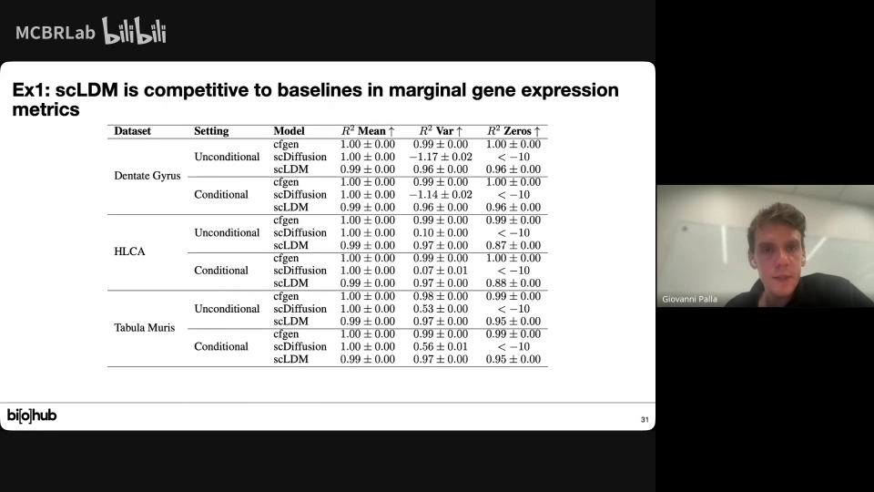

这张表是整场报告里最有教育意义的一张。它把「边际表达」拆成三个量：每个基因的均值、方差、以及零值比例（相当于稀疏性），分别算 R²。

看 scDiffusion 那一行：R² 均值是 1.00，看起来完美；但 R² 方差是 **−1.17**（无条件设置下），零值比例甚至小于 −10。负的 R² 意味着**比直接用均值去预测还差**。

这就是「只比均值会掩盖分布错误」的教科书级例子：一个模型可以把每个基因的平均表达学得一模一样，却把方差和稀疏性彻底搞错。而单细胞数据里，方差和稀疏性恰恰是细胞异质性所在——**你造出来的是一堆「平均细胞」，不是一个细胞群体**。

scLDM 在方差和零值上分别做到 0.96–0.97，和 CFGen 相当，主讲人特别强调「我们能高度复现基因的方差，这通常是做不到的」。不过在均值上，他们略逊于 CFGen 和扩散模型——但差异很小。

### 4.3 结构层面：UMAP 覆盖与小簇保留

[【跳转到 44:47】](https://www.bilibili.com/video/BV1vEksBvEE3/?t=2687)

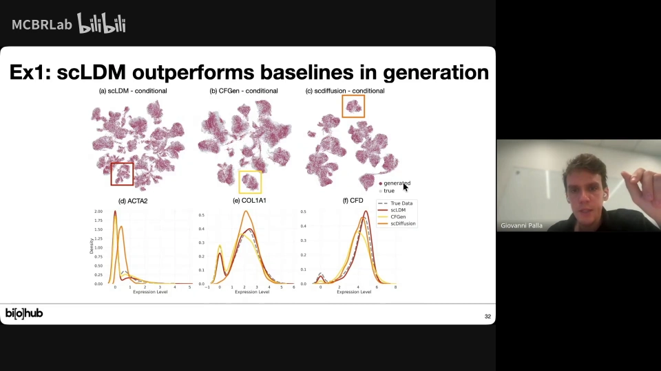

定性检查用的是人类细胞图谱（HCA）的肺部单细胞数据。把生成细胞（红色）和真实细胞（灰色）叠在同一张 UMAP 上：整体分布密度覆盖得更好，而且**能保留所有小的细胞簇**——这一点其他方法做不到，小簇往往被「抹平」进大簇里。

下方三条密度曲线是更细的检查：挑特定细胞亚群的标记基因（比如血管细胞的 ACTA2、COL1A1、CFD），把生成表达（彩色实线）和真实表达（灰色虚线）的边际密度叠在一起。可以看到模型大多数时候能恢复边缘密度，包括那些低表达但长尾分布的基因。CFGen 和他们的模型都能恢复，scDiffusion 有时稍差。

### 4.4 均值基线：最容易被忽略的对手

[【跳转到 52:42】](https://www.bilibili.com/video/BV1vEksBvEE3/?t=3162)

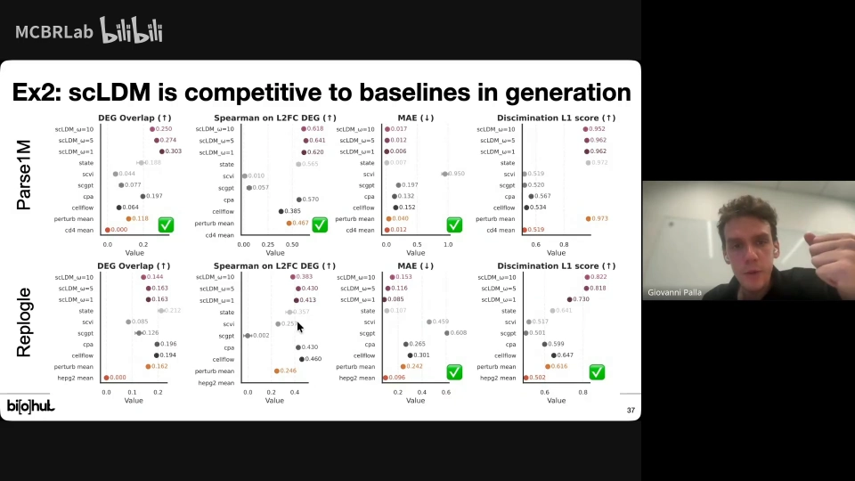

这张图里最下面两行是 **cd4 mean / hepg2 mean**：不做任何建模，直接输出该条件下所有细胞的平均表达谱。这是扰动预测领域最经典、也最容易被跳过的一个基线。

结果很有意思：

- 在 Parse 1M 上，scLDM 的 DEG 重叠度是 0.303，均值基线只有 0.118——生成模型明显赢；
- 但在 Replogle 上，scLDM 是 0.163，均值基线是 0.162——**几乎打平**。

主讲人对此的表述很克制：「大多数情况下我们超越了扰动均值」。这句话的分量在于，它承认了在这个数据集上，一个什么都不学的基线就已经很难打败。任何声称「我们的生成模型能预测扰动」的工作，都应该把这一行放进表里。

### 4.5 分布层面：W2、MMD²、FD

[【跳转到 51:52】](https://www.bilibili.com/video/BV1vEksBvEE3/?t=3112)

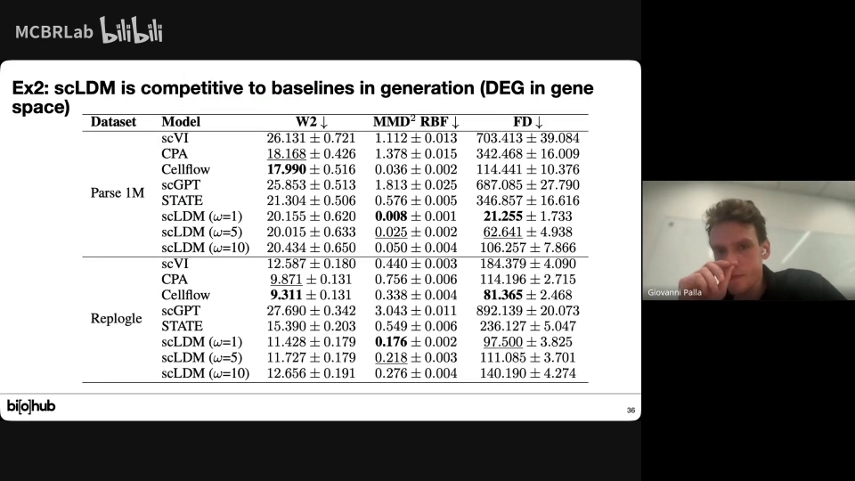

扰动实验的分布指标用了三个：**Wasserstein-2 距离**（把一堆细胞搬到另一堆细胞的最小代价）、**MMD²（RBF 核）**（两个分布在再生核希尔伯特空间里的距离，可以理解成「把两堆样本的所有成对相似度做比较」）、**Fréchet Distance**（比较两个分布的高斯拟合之间的差异）。

从表里能读出几个层次：

- **scVI 明显不行**（W2 26.1、MMD² 1.11、FD 703），因为它是重建/整合模型，不是为条件生成设计的；
- **CellFlow 在 W2 上最好**（Parse 1M 上 17.99），说明它在「整体搬移」这个角度最准；
- **scLDM 在 MMD² 上最好**（0.008），FD 也明显更低（21.3 vs CellFlow 的 114.4）；
- 引导权重 $\omega$ 有影响：$\omega = 1$ 时 MMD² 最好，$\omega = 5$ 时 W2 更好，$\omega = 10$ 全面变差。

这组数字本身就是个提醒：**不同分布指标会给出不同的赢家**。W2 和 MMD² 都在衡量「两个分布差多远」，但一个基于最优传输、一个基于核均值嵌入，对分布的敏感点不同。只报一个指标，很容易挑出对自己有利的结论。

## 五、扰动预测实验：留出真正没见过的扰动

### 5.1 数据与留出设计

[【跳转到 49:47】](https://www.bilibili.com/video/BV1vEksBvEE3/?t=2987)

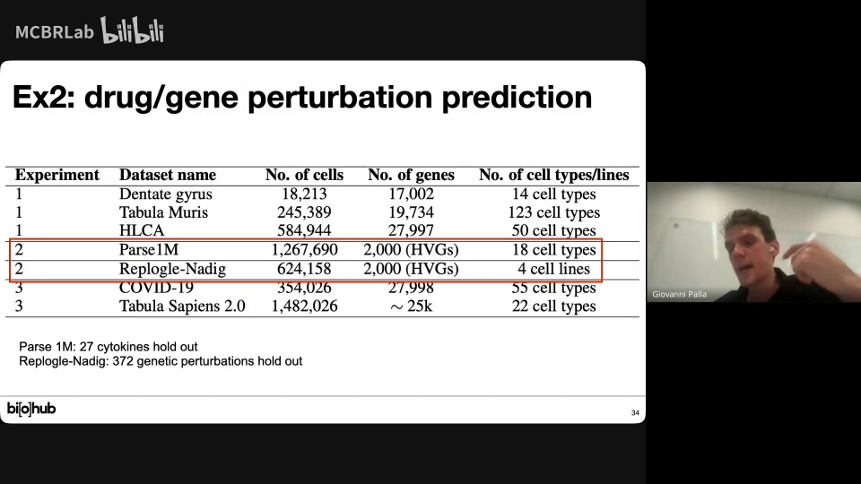

实验用了七个数据集，分三类用途：

| 用途 | 数据集 | 细胞数 | 基因数 | 细胞类型/细胞系 |
| --- | --- | --- | --- | --- |
| 观测数据生成 | Dentate gyrus | 18,213 | 17,002 | 14 种细胞类型 |
| 观测数据生成 | Tabula Muris | 245,389 | 19,734 | 123 种细胞类型 |
| 观测数据生成 | HLCA（人类肺细胞图谱） | 584,944 | 27,997 | 50 种细胞类型 |
| 扰动预测 | Parse 1M | 1,267,690 | 2,000（高变基因） | 18 种细胞类型 |
| 扰动预测 | Replogle-Nadig | 624,158 | 2,000（高变基因） | 4 个细胞系 |
| 分布外分类 | COVID-19 | 354,026 | 27,998 | 55 种细胞类型 |
| 分布外分类 | Tabula Sapiens 2.0 | 1,482,026 | 约 25k | 22 种细胞类型 |

留出（hold-out）的设计是关键：**Parse 1M 留出 27 个细胞因子，Replogle-Nadig 留出 372 个遗传扰动**。被留出的扰动在该细胞系里从未出现过，但同一细胞系里的其他扰动、或同一扰动在其他细胞系里的数据是见过的——这正好对应「组合泛化」这个真实场景。

对比的基线包括 scVI、CPA、CellFlow、scGPT，以及 STATE 的转换模型。主讲人特别说明：这些模型都是**从头训练**的，用相同的随机种子、相同的划分、相同的设置——这一点很重要，因为拿别人论文里的数字和你的数字比，往往是在比不同的数据划分。

### 5.2 结果：有竞争力，但没有压倒性优势

主讲人的总结非常诚实：在生成指标上，scLDM 与 CellFlow 相当，有时更好有时更差；用全部基因和用差异表达基因都是如此。在细胞层面的矩阵里，某些指标上优于所有基线，通常位居前列或接近榜首；之前 CellFlow 曾是顶尖之一，现在差距明显。

他的原话大意是：这主要是为了展示模型在扰动设置中具有竞争力——**而不是显著超越**。

现场还有人追问划分是否和 STATE 论文一致（对方保留了某些细胞类型、再保留其中的某些细胞因子，而这里保留了 27 个细胞因子，数量对不上）。主讲人的回应是：这是个好问题，我认为某些实验里他们确实用了相同的 27 个，但我得回去查原文，这是我们应该注意的要点。

### 5.3 下游分类：表示本身好不好用

[【跳转到 54:47】](https://www.bilibili.com/video/BV1vEksBvEE3/?t=3287)

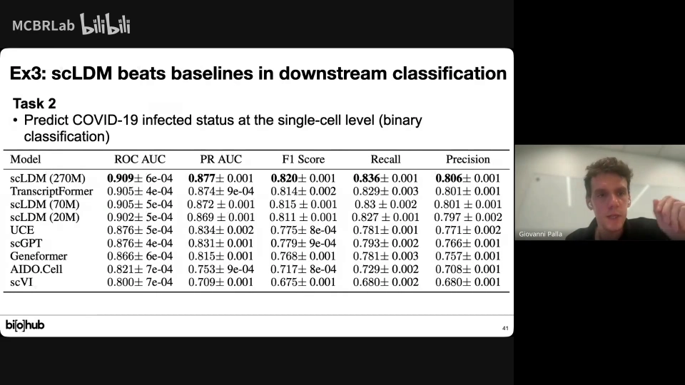

最后一组实验换了问法：不生成，而是看编码器的表示能不能用来做下游任务。做法是**线性探测**（linear probing）——冻结编码器，只在表示上训一个线性分类器，预测单细胞是否感染 COVID-19。

scLDM（270M 参数）拿到 ROC AUC 0.909、PR AUC 0.877、F1 0.820，与 TranscriptFormer 接近，优于 UCE、scGPT、Geneformer、AIDO.Cell 和 scVI（0.800）。较小的模型（70M、20M）也接近榜首，差距非常微小。

这个结果的意义是：一个为「生成」训练的编码器，其表示顺带也能当判别式特征用——但这并不证明它「理解」了扰动机制，只说明表示里保留了细胞状态信息。

## 六、批判性视角：我们可能在自我欺骗

如果这场报告只留下一个片段，应该是结尾这段关于「潜在扩散模型到底学到了什么」的讨论。它不是提问者的刁难，而是主讲人自己在实验中撞上的困惑。

### 6.1 重建与生成的权衡：你不可能两个都要

[【跳转到 61:47】](https://www.bilibili.com/video/BV1vEksBvEE3/?t=3707)

现场有人问：如果把它当成「世界模型」来训练强化学习、推理分化轨迹，会怎样？主讲人的回答绕回到了那个反复出现的主题：

> 如果我们更关注潜在空间、同时具备良好的重建能力——我们做过多次实验，成功获得了近乎理想的重建效果，但代价当然是生成能力下降，因为需要更大的潜在空间，在上面部署扩散模型更难。

这句话值得逐字读。它说的是：**重建和生成是同一个瓶颈的两端**。潜在空间越大，重建越准，但扩散模型越难在这个空间里学好（维度高、结构复杂）；潜在空间越小，扩散模型越好训练，但解码器丢的信息越多。

这也解释了他们为什么在潜在 token 的维度分配上选了反直觉的方案（更多 token、更小维度）：那是为了生成，不是为了重建。

### 6.2 潜在扩散几乎可以完美记住训练数据

[【跳转到 76:29】](https://www.bilibili.com/video/BV1vEksBvEE3/?t=4589)

这是整场最锋利的一段。讨论从一篇 NeurIPS 的最佳/亮点论文说起——那篇论文量化了一件事：**如果训练足够久、去噪器足够大，扩散模型可以几乎记住所有训练数据点**。

把这个结论搬到潜在扩散的流程里，会得到一个让人不安的推论：

1. 我们先固定 VAE（或其他编码器），于是**重建项就固定了，不再变化**；
2. 然后在这个固定的潜在空间上拟合扩散模型；
3. 由于潜在空间是压缩过的，扩散模型几乎可以完美地把每个潜在点学成一个狄拉克 δ 函数（或围绕潜在点的一个极窄高斯）；
4. 用足够大的去噪网络，你可以几乎完美地最小化 KL。

换句话说：**在潜在空间里，扩散模型可以做到「完全记忆」，而这是被允许的**——因为这一阶段的目标函数里没有「泛化」这一项。

### 6.3 那么泛化能力从哪来？可能来自解码器的误差

[【跳转到 76:54】](https://www.bilibili.com/video/BV1vEksBvEE3/?t=4614)

紧接着是那句最关键的话：

> 因为我们有压缩特性，所以在潜在空间中几乎完全记忆，因此解码器会有一些误差。这就是为什么我们看到泛化能力——**可能我们是在自我欺骗**：这些模型似乎都很优秀，但实际上泛化能力来自误差。

这句话的含义非常反直觉，也极其重要。通常我们认为「泛化」是模型学到了可迁移的规律；这里提出的可能是另一种解释：**模型在潜在空间里记住了训练样本，但因为潜在空间是压缩的、解码器不是完美逆变换，所以输出时被「平滑」了一下，看起来像是泛化。**

如果这个解释成立，那么：

- 生成模型在训练分布内的表现会非常好（因为它记住了）；
- 在真正的新扰动上，它给出的「合理」结果，可能只是解码器误差带来的模糊，而不是对机制的理解；
- 你用分布指标（MMD、W2）去评测，可能测到的正是这种「模糊得恰到好处」的效果。

主讲人坦承：**目前我们还不理解这一点**。目前唯一明确的是，扩散模型几乎可以完美拟合任何分布——甚至直接在单个潜在向量或 token 上。

最后一位提问者补了一个数学层面的注脚：网络是平滑函数，所以你当然可以拟合狄拉克 δ 函数，但你总会在周围留一点概率质量，正好稍微平滑一下，这就是为什么你总会有这种类似非确定性的行为。

### 6.4 从图像领域借来的经验，未必能迁移

[【跳转到 71:41】](https://www.bilibili.com/video/BV1vEksBvEE3/?t=4301)

关于「潜在空间该多正则」这个问题，主讲人引用了 Sander Dieleman 关于潜在扩散模型的博客，并给出自己的实验结果：用不用 KL 散度项，效果相当；用小维度表示、保留这个尺度项、或者用层归一化替代，实际差异不大。因为那个项的值本身已经很小，它在正则化上的帮助可能有限。

他还指出一个方法论上的警示：图像领域有大量工作在学习「更适合训练扩散模型」的表示（用自监督技术、或直接对齐表示），但**这些发现很大程度依赖图像的局部性**——像素有空间邻域结构，而我们的数据集不具备这种局部性，我们只有一组有序的基因。所以很难说那些结论有多少能迁移过来。

关于重建项与 KL 项的互动，他提到一篇老论文《Fixing a Broken ELBO》：从优化角度看这非常困难，因为只有一个目标函数，优化过程总会倾向于偏向其中一项。所以存在一个最佳平衡点（对于特定的潜在空间大小），此时整体优化效果更好——但这更像「深度学习魔法」：你做大量实验，然后得到一个直觉。

### 6.5 有限扰动集合：无法外推到真正的新扰动

[【跳转到 66:47】](https://www.bilibili.com/video/BV1vEksBvEE3/?t=4007)

现场有人追问：这些扰动预测能不能推广到没见过的扰动，比如任意已知的化学小分子？

主讲人的回答很直接：**我们用的是类别变量和离散变量，这相当于有限的扰动集合**。目前我们没有机会泛化到未观察到的扰动，比如任何已知的化学分子，我们没有这些数据。他还补了一句：「也值得提到，这可能很有趣，但行为可能不太明确——如果它能泛化的话。」

这句话把生成式扰动预测的现状说清楚了：**它目前是一个「插值」工具，不是「外推」工具**。你能预测的，是那些「同一细胞系里的新扰动」或「同一扰动在新细胞系里」的组合，而不是一个全新的化学空间。

另外，关于 CRISPR 技术类型：他们用的四个细胞系数据集技术相同（都是敲低类），没有试过敲除、也没有试过同时包含下调和上调（抑制 + 激活）的设置。主讲人认为后者的数据是存在的（Norman、Adamson 有相关资源），同时建模同一组基因的下调和上调会很有意思，但还没做。

### 6.6 可解释性：交叉注意力能聚类出谱系

[【跳转到 46:27】](https://www.bilibili.com/video/BV1vEksBvEE3/?t=2787)

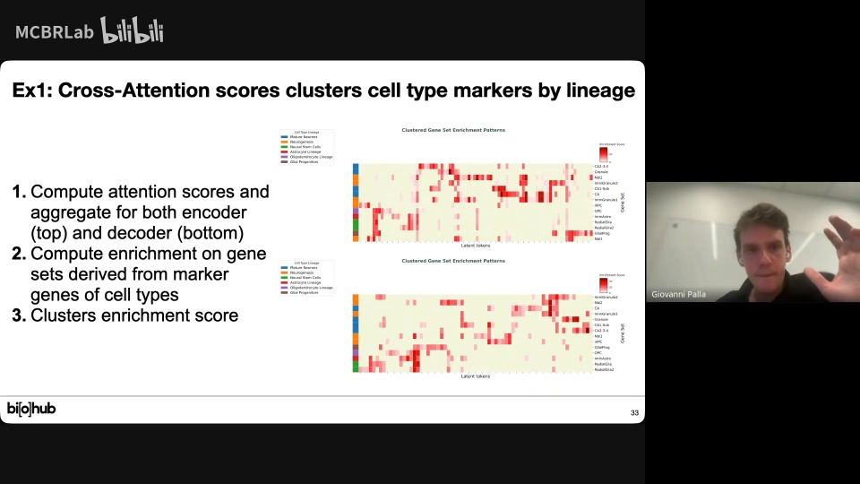

他们做了一个初步的可解释性尝试：计算编码器顶部和解码器底部的交叉注意力分数，按细胞类型标记基因算富集分数，然后对潜在 token 做聚类。

结果是：编码器和解码器的模式不同，但总体上细胞类型标记的富集能聚到一起——比如神经元相关的潜在 token（橙色和蓝色）又聚在了一起。主讲人的评价很克制：「这并不很有说服力，但至少可以展示这可能是一种解释手段。」下一步应该是改变潜在 token 的数量，看聚类是否更好，或者换成通路等其他类型的富集评分。

值得一提的是，有人问「既然你把细胞类型作为条件标签，模型是不是学到了更清晰的基因关系」。主讲人澄清：这个分析是在**输出编码器**上做的，而输出编码器没有受任何条件影响——所以这里没有对细胞类型做条件约束，是模型自己组织的。

## 七、下一步：多组学与多扰动

[【跳转到 68:40】](https://www.bilibili.com/video/BV1vEksBvEE3/?t=4120)

主讲人列出的未来方向有四个：

1. **把重建与生成的权衡搞清楚**。不是训练更鲁棒的模型，而是真正理解这个权衡——包括编码器的不同层、流匹配的不同采样技术。
2. **换似然函数**：用归一化基因 + 高斯似然，取代负二项，看看在标准化数据上是否更灵活。
3. **多扰动**而不是多模态。目前只做了单扰动条件下的生成，组合扰动还没学会。
4. **多组学**。他的论证很漂亮：不同组学在生物学上当然相互关联，但我们无法在同一个可观测空间里工作——那是在比较苹果和橙子。所以需要潜在空间，让不同模态的潜在空间相互作用，然后从扰动和基因表达层面去推断蛋白质层面。他还特别感兴趣的一个具体问题是：**如何扰动单一模态，然后推断另一模态**。

## 小结

- **生成 ≠ 预测均值**。生成式扰动预测的目标是「造出扰动后的细胞群体」，包括它的分布、异质性和细胞状态组成；判别式模型给不出这些。
- **主流做法是两阶段**：先用自编码器压到潜在空间（保证重建），再在潜在空间里跑扩散或流匹配（保证采样）。scLDM 的新意在于把两端的 MLP 换成 Transformer，并用交叉注意力把 30 万个基因压成 128 个潜在 token。
- **条件就是「细胞系 × 扰动」的嵌入**，用无分类器引导控制强度；条件生成让「这个扰动会不会产生新亚群」这类问题变得可以问。
- **评测必须分层**：重建（似然/MSE/PCC）、分布（MMD/W2/FD）、逐基因（均值/方差/零值比例）、结构（UMAP 覆盖与小簇）。只看均值会被「平均细胞」骗过去——scDiffusion 的 R² 均值是 1.00，方差 R² 却是 −1.17。
- **别忘记均值基线**。在 Replogle 上，直接输出平均表达的基线在 DEG 重叠度上和生成模型几乎打平（0.162 vs 0.163）。
- **不同分布指标会给出不同赢家**。CellFlow 在 W2 上最好，scLDM 在 MMD² 和 FD 上最好；只报一个指标等于自选结论。
- **最大的风险是「记忆 + 解码器误差」伪装成泛化**。潜在扩散在固定编码器的空间里可以几乎完美记住训练数据，你看到的泛化可能只是压缩-解码带来的平滑。
- **它目前是插值工具，不是外推工具**。有限扰动集合、单一 CRISPR 技术类型，还无法外推到全新的化学空间。

## 关键术语速查

| 术语 | 一句话解释 |
| --- | --- |
| 潜在扩散模型（LDM） | 不在原始高维数据上做扩散，而是先压到一个低维潜在空间，再在潜在空间里做扩散或流匹配 |
| 流匹配（flow matching） | 学一个「从噪声指向数据」的速度场，沿着它一步步走就能从噪声走到样本；比扩散的采样更直接 |
| 线性插值路径 | 把噪声点和数据点用直线连起来，中间时刻的位置就是两者的加权平均 |
| 交叉注意力 | 查询来自一组可学习 token，键和值来自输入；用它可以把任意长的输入压到固定长度的表示 |
| 潜在 token | 编码器输出的、数量固定的压缩表示单元（这里是 128 个），每个 token 有自己的嵌入向量 |
| 无分类器引导（CFG） | 采样时把「有条件」和「无条件」的预测做外推，用权重控制生成结果听条件话的程度 |
| 负二项似然 | 单细胞计数数据的标准分布假设，比泊松多一个离散参数，能刻画「方差大于均值」的过度分散 |
| 文库大小（library size） | 一个细胞里总共测到多少分子；生成时必须对它采样，否则会丢掉测序深度这一层变异 |
| MMD² | 最大均值差异的平方，衡量两个分布在再生核希尔伯特空间里的距离 |
| Wasserstein-2 距离 | 把一堆样本「搬」成另一堆样本的最小运输代价，对分布的整体位移敏感 |
| Fréchet Distance | 用高斯分布拟合两个分布后比较其均值与协方差，图像生成领域的常用指标 |
| 判别分数（discriminative score） | 训练一个分类器区分生成数据与真实数据，分不开说明生成得够真 |
| 线性探测（linear probing） | 冻结编码器，只在其表示上训一个线性分类器，用来检验表示本身的质量 |
| β-VAE | 在 VAE 的损失里给 KL 项加权重系数的变体，用来在重建与正则之间调平衡 |
| 分布外（OOD）评测 | 在训练时完全没见过的数据集上评测，检验泛化而非记忆 |
