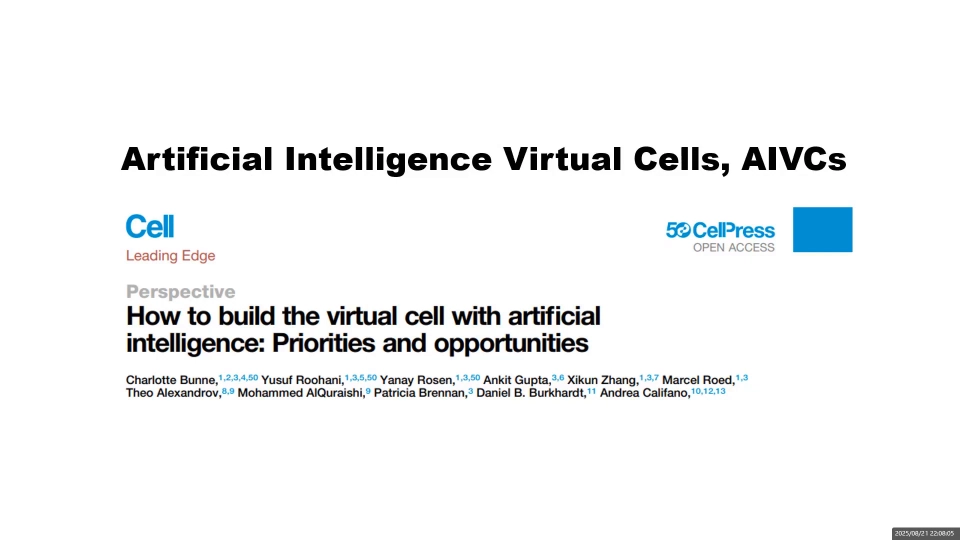
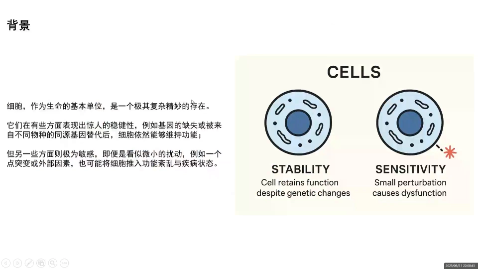
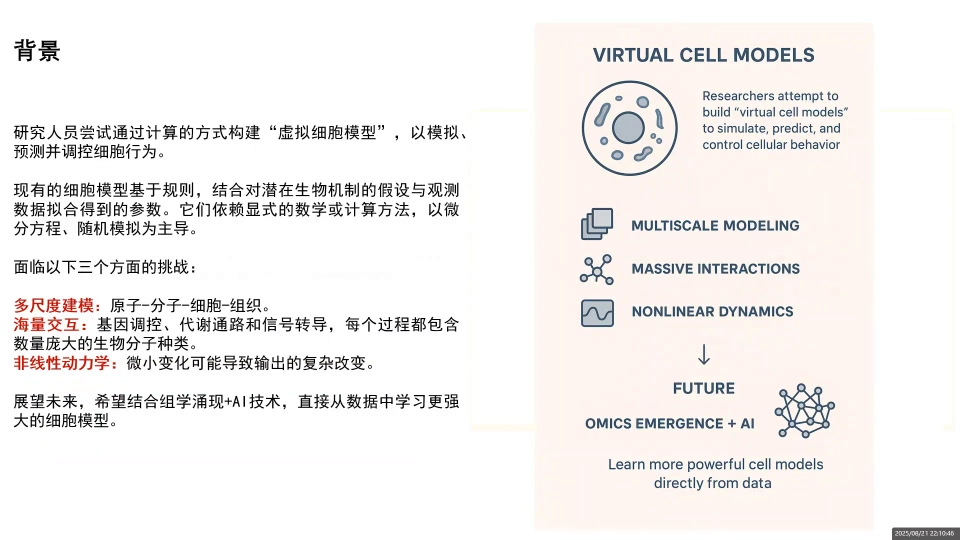
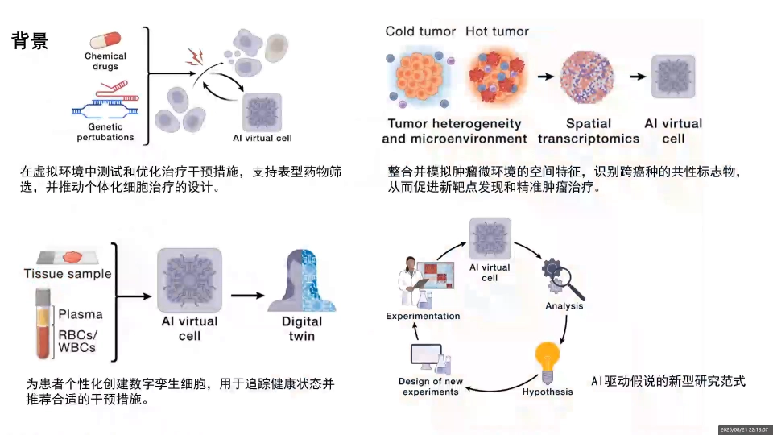
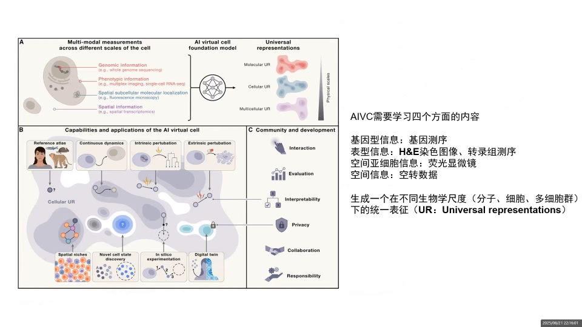
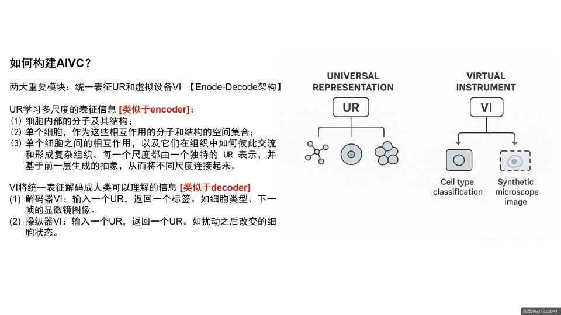
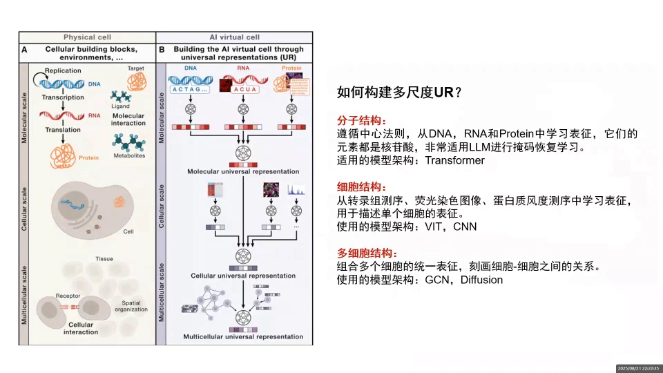
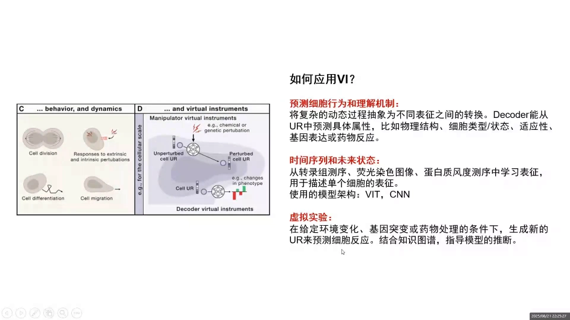
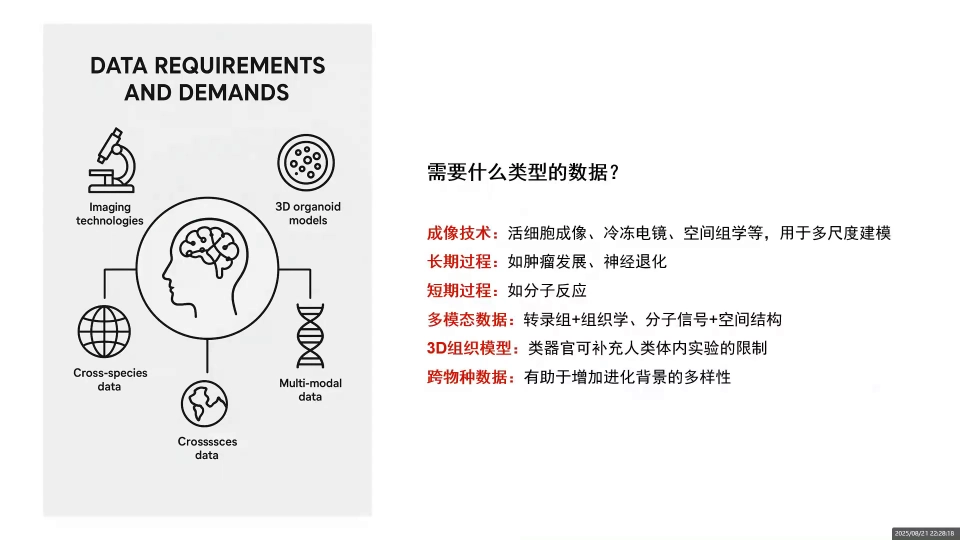

# 虚拟细胞如何造出扰动后的细胞：统一表征与虚拟设备

> 视频来源：[虚拟细胞综述：来自 Cell 的最新视角](https://www.bilibili.com/video/BV1mdYXzhERy/)（Bilibili · 陈世神）
> 导读（约 100 字）：这是一场围绕 Cell 观点文章《How to build the virtual cell with artificial intelligence》的读书分享，22 分钟讲清了虚拟细胞的蓝图：为什么要做、要学哪四类数据、怎么把它们压成一个统一表征（UR）、再用「虚拟设备」（VI）做解码与操纵。其中「把药物扰动加到对照细胞的表征上」这一步，正是生成式扰动预测的核心思路。
> 字幕说明：B 站 AI 字幕（ai-zh）把若干术语识别错了，本文按幻灯片订正（如「页码恢复」→ 掩码恢复、「蛋白质风度」→ 蛋白质丰度、「劳动数据」→ 扰动数据、「下午分析」→ 下游分析）。讲者本人的口语表达保留原意，未做发挥。

## 本讲要解决的核心问题（SCQA）

**背景**：细胞是生命的基本单位，而我们对它的调控机制已经有了一部分认识——中心法则、基因调控、信号转导、代谢通路。传统上，研究者用微分方程、随机模拟这类「显式数学模型」来模拟细胞：先假设机制，再拟合参数。

**冲突**：这条路在三个地方卡住了。细胞涉及从原子到组织的好几个尺度；细胞之间有海量的相互作用，其中大部分我们根本不知道；而且这是一个非线性动力学系统，微小的变化可能导致完全不同的结局——就像天气预报里那个「有台风和没台风」的分岔。参数估不准，模型给出的结论就没有意义。

**疑问**：既然机制写不出来，能不能换一条路——不写方程，直接从数据里学一个细胞模型？如果学出来了，它该怎么表示一个细胞？又该怎么用它去回答「这个细胞被扰动之后会变成什么样」？

**回答（中心思想）**：Cell 的观点文章给出的蓝图是「两个模块」：先用**统一表征（universal representation, UR）**把分子、细胞、细胞群三个尺度的信息压进同一套向量里；再用**虚拟设备（virtual instrument, VI）**在这些向量上做两件事——解码（读出细胞类型、预测下一帧图像）和**操纵（把扰动加到表征上，生成一个新的表征）**。第二步就是生成式扰动预测：不是在基因层面硬改数字，而是在表征层面做「加法」，再把结果解码回可观察的表型。

## 一、为什么「显式建模」这条路走不通

[【跳转到 00:25】](https://www.bilibili.com/video/BV1mdYXzhERy/?t=25)

整场分享都围绕这一篇文章展开。先看细胞这个对象本身有多矛盾。

[【跳转到 01:05】](https://www.bilibili.com/video/BV1mdYXzhERy/?t=65)

讲者用一对看似矛盾的属性开场：

- **稳健**：同源重组时一个基因被不同的同源基因替代、复制或转录翻译过程中出现基因缺失，细胞依然能维持原本的功能和状态。
- **敏感**：即使看起来非常微小的一次扰动——一个点突变、一个外部因素——也会引起功能紊乱或疾病状态。

这种敏感性在肿瘤微环境里尤其常见：癌症经常介于可控与不可控之间，一个很小的扰动就可能把它从可控推向不可控。**正因为「微小输入 → 巨大输出差异」，细胞才是一个典型的非线性动力学系统**，而这恰好是显式建模最怕的东西。

[【跳转到 03:06】](https://www.bilibili.com/video/BV1mdYXzhERy/?t=186)

幻灯片把困难归纳成三条，值得逐条记住，因为后面所有的设计都是冲着这三条去的：

1. **多尺度建模**：从原子到分子、到分子交互、到细胞间通讯、到组织形态，可能还有个体表型这一层。尺度这么多，用一套方程写下来几乎不可能。
2. **海量交互**：基因调控、代谢通路、信号转导，每一条通路都包含大量生物分子种类和它们之间的复杂交互——而这还只是**已知**的部分，未知的通路和未知的交互数不胜数。
3. **非线性动力学**：微小的变化可能导致复杂的改变。讲者打了个比方——这类似天气预报，一个非常小的扰动就可能决定台风生成还是消失。参数一旦估不准，结论就是「有台风和没台风」「患病和没患病」的区别。

所以讲者的判断是：**暂时用显式的数学方法去实现一个细胞模型是比较困难的**。出路是结合组学测序数据的涌现加上现有的 AI 技术，直接从数据里学一个更强大的细胞模型。

## 二、虚拟细胞能拿来干什么：四个层次的用处

[【跳转到 05:27】](https://www.bilibili.com/video/BV1mdYXzhERy/?t=327)

幻灯片列了四个用处，从最务实到最科幻：

1. **虚拟药物测试**：人为设定扰动（加某种药物、改某个基因），在虚拟环境里测试和优化治疗干预，支持表型药物筛选，推动个体化治疗设计。
2. **肿瘤微环境模拟**：既然肿瘤会因为很小的变化产生很大改变，一个可靠的虚拟细胞模型就可以模拟微环境的空间特征，进而发现新靶点、做精准肿瘤治疗。
3. **患者数字孪生**：抽取患者的组织样本和血液样本，在电脑上「克隆」出一个虚拟细胞，健康状况可以由电脑监控，并针对性推荐治疗措施。
4. **新的研究范式**：以往是「假设 → 做实验 → 验证 → 新假设」的闭环；有了虚拟细胞，可以由模型先做有效性分析、提炼出有意义的假设，人类再针对假设做实验。相当于在环路中间加了一个更可靠的研究伙伴。

这四条里，**第 1 条和第 4 条其实是同一件事的两种说法**：虚拟细胞的价值不在于替代实验，而在于**给实验排优先级**。这一点在后面讨论「生成的东西能不能信」时会变得关键。

## 三、要学什么：四类数据，压成一个统一表征

[【跳转到 08:22】](https://www.bilibili.com/video/BV1mdYXzhERy/?t=502)

这篇文章把「要学什么」总结成四类数据，正好对应四个测量层次：

| 层次 | 数据 | 说明 |
| --- | --- | --- |
| 基因型 | 全基因组测序、RNA 测序、蛋白质测序 | 样本或细胞的基本信息 |
| 表型 | H&E 染色图像、转录组测序 | 细胞功能由 RNA 表达决定，所以要测转录组，也要看形态 |
| 空间亚细胞定位 | 荧光显微镜 | 分子在细胞内部的位置 |
| 空间信息 | 空间转录组学 | 细胞之间的相对位置与远近关系 |

讲者特别提到，空间转录组是这里面「非常好用」的一类数据：它能把基因表达和细胞的相对位置一起标出来，告诉我们两个细胞之间有多远、空间关系如何。虽然目前二维数据居多，但用好了能获得非常多信息。

学完这四类信息之后，目标是得到一个**在不同尺度（分子、细胞、多细胞群）下都统一、都有意义的表征**——文章把它叫作 universal representation，简称 UR。讲者用了一个很好的类比：

> UR 就类似于大语言模型里 token 的 embedding。它可以是分子的 embedding、细胞的 embedding、也可以是多细胞群的 embedding。对应到语言模型里，就是单词的 token、句子的 token、整篇文章的 token——这些 token 在不同尺度下都是有意义的。

这个类比解释了为什么「统一」很重要：如果分子一个空间、细胞一个空间、组织又一个空间，你就没法把「药物作用于某个分子」和「这群细胞的状态变化」联系起来。**统一表征是所有跨尺度推理的前提。**

## 四、怎么用：两种虚拟设备，其中一种是「在表征上做加法」

[【跳转到 13:02】](https://www.bilibili.com/video/BV1mdYXzhERy/?t=782)

文章把系统拆成两个模块，讲者用编码器-解码器来类比：

- **UR ≈ 编码器**：从海量多尺度信息中学到一个统一的高维表征。三个层次分别是：细胞内部的分子及其结构；单个细胞（作为这些相互作用的分子和结构的空间集合）；单个细胞之间的相互作用，以及它们在组织中如何交流、形成复杂组织。每个尺度由一个独特的 UR 表示，并基于前一层生成的抽象，从而把不同尺度连接起来。
- **VI ≈ 解码器**：把统一表征解码成人类可以理解的信息。

而 VI 又分成两种，这个区分是整场分享最要紧的地方：

**（1）解码器 VI：输入一个 UR，返回一个标签或一张图。** 比如给一个细胞的 UR，应该能解码出它的细胞类型；给一片组织、一群细胞的 UR，应该能解码出显微镜图像那样的状态。一个是标签信息，一个是图像信息。

**（2）操纵器 VI：输入一个 UR，返回一个 UR。** 这就是生成式扰动预测的入口。

[【跳转到 13:52】](https://www.bilibili.com/video/BV1mdYXzhERy/?t=832)

讲者用药物测试把这一步讲得很具体，值得原样复述：

1. 拿到一个**对照组细胞**，提取它的 UR；
2. 把**药物的扰动信息**加进去，通过操纵器 VI 返回一个**新的 UR**；
3. 这个新 UR 就应该是「受到药物扰动之后」的细胞表征；
4. 再把这个新 UR 解码成人类能理解的范围——这个细胞究竟变好了还是变坏了、这个药物究竟有没有效果。

这就是所谓的**隐空间算术**：扰动不是在基因表达矩阵上逐格修改，而是在表征空间里做一次「加法」（或更一般的变换），然后用解码器把结果翻译回可观察的表型。它的好处是天然保持了表征的连续性——你可以在表征空间里插值、组合多个扰动、甚至沿着某个方向外推。

对比一下上一节那个「统一表征」的动机，你会发现这两件事是配套的：**只有表征足够统一、足够抽象，扰动才可能变成一个可以「加」上去的向量**。

## 五、多尺度 UR 怎么搭：三个尺度，三套架构

[【跳转到 14:55】](https://www.bilibili.com/video/BV1mdYXzhERy/?t=895)

左边是物理世界（中心法则、配受体配对、细胞间交互），右边是虚拟细胞视角下怎么搭表征。原则是**由细粒度到粗粒度**，每个尺度用不同的架构：

| 尺度 | 学什么 | 用什么架构 | 为什么 |
| --- | --- | --- | --- |
| 分子 | 从 DNA、RNA、蛋白质中学表征 | Transformer | 它们的元素都是核苷酸（A、G、C、T、U），适合用大语言模型做掩码恢复式训练 |
| 细胞 | 从转录组测序、荧光染色图像、蛋白质丰度测量中学表征 | ViT、CNN | 图像与测量数据是这类网络的主场 |
| 多细胞 | 组合多个细胞的统一表征，刻画细胞-细胞关系 | GCN、扩散模型 | 细胞之间的关系天然是图结构 |

讲者把整个流程复述了一遍，可以当成一张施工图：

1. 对每个样本，测 DNA、RNA、蛋白质测序，生成一个「样本共有」的 embedding；
2. 对每个细胞，根据转录组、单细胞测序、图像、丰度数据各学一个基础模型，再把四类数据融合（拼接、传播、线性回归都行），得到**细胞级 embedding**；
3. 有了每个细胞的 embedding，细胞之间的关系可以用相似度或距离度量，构建类似图神经网络的结构，学到**细胞群的总 embedding**；
4. 汇总不同的细胞群，上升到组织维度甚至表型维度。

讲者也很坦白：第 3 步「现在还没有实现，比较复杂，可能是未来的一个发展方向」。

## 六、VI 还能干什么：预测行为、预测未来、做虚拟实验

[【跳转到 17:47】](https://www.bilibili.com/video/BV1mdYXzhERy/?t=1067)

幻灯片把 VI 的用途列成三条：

1. **预测细胞行为和机制**：把复杂的动态过程抽象成不同表征之间的转换。解码器能从 UR 中预测具体属性——物理结构、细胞类型/状态、适应性、基因表达或药物反应。讲者对这句话评价很高，他的解读是：**不应该「一个细胞对应一个细胞类型」，而应该学习上下文关系来预测细胞类型**；同样，一群细胞对某个药物的反应，也应该从一个 UR 来判断，而不是一个 UR 只能干一件事。
2. **时间序列与未来状态**：从转录组、荧光染色、蛋白质丰度学到的单细胞表征，可以用来预测这个细胞的未来状态。
3. **虚拟实验**：在给定的环境变化（基因突变、药物处理）条件下，**生成新的 UR**，再预测细胞反应；这个反应甚至可以结合知识图谱（通路图谱、蛋白质图谱）来指导推断。

第 3 条和第 4 节的操纵器 VI 是同一件事的两种表述：**生成一个新的表征，然后看它解码出来是什么**。

## 七、数据要求：什么都要，但最要紧的是扰动数据

[【跳转到 20:38】](https://www.bilibili.com/video/BV1mdYXzhERy/?t=1238)

文章列出的数据清单相当长：

- **成像技术**：活细胞成像、冷冻电镜、空间组学等，用于多尺度建模；
- **长期过程**：肿瘤发展、神经退化；
- **短期过程**：比如分子反应在短期内怎么变化；
- **多模态数据**：转录组 + 组织学 + 分子信号 + 空间结构；
- **3D 组织模型**：类器官可以补充人体内实验的限制；
- **跨物种数据**：增加进化背景的多样性。

讲者对这份清单的评价是「有点泛泛而谈」——相当于什么数据都要。但他紧接着给了一个很有判断力的收敛：

> 最最重要的数据其实只有一种，就是扰动数据。药物反应是扰动数据的一种。我们要做虚拟细胞，最大的用处就是用它来推断细胞受到一个扰动之后下一个阶段会变成什么样子，因此**对照组数据和扰动数据这样的实验对照就变得非常重要**。

[【跳转到 21:28】](https://www.bilibili.com/video/BV1mdYXzhERy/?t=1288)

他还提到一个进展：越来越多标准化的扰动数据库已经被建成。今年七八月份又发表了一篇 **STATE**，专门针对扰动数据的虚拟细胞模型，一共用了一亿多个细胞训练，效果看起来非常好。

## 八、批判性视角：这份蓝图缺了「怎么验证」

这场分享本身是综述解读，讲者没有回避蓝图里的空缺，但有几处值得读者自己再往前推一步。

**第一，UR「还不够 universal」。** 讲者的原话是：很多单细胞大模型的 UR 目前已经能做到一些下游分析任务，但可能还是不够 universal、不够广泛、不够抽象，信息丰度可能也不够。这句话的分量在于——**如果表征本身不够抽象，那么「在表征上做加法」这个操作就没有意义**：你加的可能只是批次、测序深度、细胞类型这些无关方向，而不是扰动效应。

**第二，操纵器 VI 的产出只是「应该」有生物学意义。** 幻灯片上的措辞是「生成的新 UR 应该也是有生物学意义的」。这是一个要求，不是保证。生成模型完全可以产出一个在表征空间里「看起来合理」、但解码回基因表达后对应不到任何真实细胞状态的向量——这正是生成式扰动预测最难发现的一类错误：**它不会报错，只会给你一个似是而非的答案**。

**第三，整场分享没有出现任何量化评测指标。** 没有分布距离、没有差异基因一致性、没有细胞类型比例的复现度。这不是讲者的问题（综述解读本就不做实验），但它恰好暴露了当前领域的短板：**蓝图画得很清楚，验收标准还没写。** 一个虚拟细胞模型要算「建成」，至少得回答：生成的扰动后细胞群体，其分布、异质性、细胞状态组成是否与真实扰动数据一致？在没见过的扰动上还成立吗？

**第四，数据依赖是死结。** 既然最要紧的是扰动数据，那么虚拟细胞的能力上限就由扰动数据的覆盖度决定。讲者提到的 STATE 用一亿多个细胞训练，这在数量上很惊人，但**扰动空间的覆盖仍然是稀疏的**：化合物空间、基因组合空间、细胞类型空间，三者相乘之后，我们测过的组合只是极小一部分。这也解释了为什么这类模型目前更擅长「插值」而不是「外推」。

**第五，跨尺度连接还是纸面上的。** 分子 → 细胞 → 多细胞群三级表征，讲者自己说第 3 步「还没有实现」。而虚拟细胞最有价值的承诺（从分子扰动推断细胞群表型）恰恰依赖这一步。

## 小结

- **为什么需要虚拟细胞**：显式数学模型在三个地方卡住——多尺度、海量未知交互、非线性动力学。出路是从数据里直接学模型。
- **两个模块**：统一表征 UR（类似编码器，把分子/细胞/细胞群压进同一套向量）+ 虚拟设备 VI（类似解码器，把表征翻译成可理解的输出）。
- **两类 VI**：解码器 VI（UR → 标签/图像）和操纵器 VI（UR → UR）。后者就是生成式扰动预测：把扰动加到对照细胞的表征上，得到扰动后的表征。
- **隐空间算术的前提是表征统一**：只有表征足够抽象，扰动才可能变成一个可以「加」上去的向量；表征不够 universal，加进去的可能只是批次和测序深度。
- **三套架构对应三个尺度**：分子用 Transformer（核苷酸序列适合掩码恢复训练）、细胞用 ViT/CNN、多细胞用 GCN 与扩散模型。
- **数据清单很长，但核心只有一条**：对照 + 扰动的配对数据。虚拟细胞的最大用途就是推断「细胞被扰动之后会变成什么样」。
- **蓝图的缺口在验收**：整场分享没有任何量化评测指标；操纵器 VI 生成的新表征只是「应该」有生物学意义。生成式模型不会报错，只会给出似是而非的答案。

## 关键术语速查

| 术语 | 一句话解释 |
| --- | --- |
| AIVC | AI Virtual Cell，用人工智能构建的虚拟细胞模型 |
| 统一表征（UR） | Universal Representation，把分子、细胞、细胞群三个尺度的信息压进同一套向量，类似语言模型里的 token embedding |
| 虚拟设备（VI） | Virtual Instrument，在统一表征上做操作的模块，分解码器 VI 和操纵器 VI |
| 解码器 VI | 输入一个 UR，输出标签（如细胞类型）或图像（如显微镜图像） |
| 操纵器 VI | 输入一个 UR、输出一个 UR；把扰动信息加到对照表征上，得到扰动后的表征 |
| 隐空间算术 | 在表征空间里用向量加法/变换来表达扰动，而不是在原始表达矩阵上逐格修改 |
| 数字孪生 | 用患者样本构建的个性化虚拟细胞，用于追踪健康状态、推荐干预 |
| 显式建模 | 先假设机制、再拟合参数的建模方式，以微分方程和随机模拟为主 |
| 非线性动力学 | 微小输入导致巨大输出差异的系统特性，是显式建模最难处理的部分 |
| 掩码恢复训练 | 遮住序列的一部分让模型预测，语言模型和核酸序列模型的常用预训练目标 |
| GCN | 图卷积网络，用于学习细胞与细胞之间的关系 |
| STATE | 一个专门针对扰动数据的虚拟细胞模型，训练规模达一亿多个细胞 |