# Geneformer：把细胞读成一句话，再用虚拟敲除做扰动预测

> 视频来源：[【陈巍学基因】160：AIVC 虚拟细胞（1）——Geneformer](https://www.bilibili.com/video/BV19La86xEbQ/)（Bilibili · 陈巍学基因）｜时长约 44 分钟
> 导读：这是一支按论文顺序逐图讲解的深度解读片，把 Geneformer 的输入编码、预训练目标、八个下游验证任务（从批次整合到虚拟治疗）全部过了一遍，最后还给出了湿实验验证。本文按视频顺序复述；**第九章的批判性讨论是本文评述，不是视频原话**，已在章首标明。

## 本讲要解决的核心问题（SCQA）

**背景**：2022 年 ChatGPT 之后，GPT、BERT 这类大语言模型技术被跨界搬到各个领域。与此同时，自 2016 年 10x Genomics 提出高通量单细胞测序以来，公共平台上积累了海量单细胞转录组数据。把这两件事凑在一起，就出现了「细胞基础模型」：先在海量细胞上预训练一个通用模型，再用少量数据微调到具体任务。

**冲突**：把细胞当成一句话听起来很自然，但细胞和句子有个根本差别——句子有语法，细胞没有。一个只学过「把被遮住的基因名猜出来」的模型，凭什么能预测「敲掉某个基因之后，细胞会怎样变化」？

**疑问**：Geneformer 到底怎么把一张表达矩阵变成 token 序列？它在预训练里究竟学到了什么？它给出的虚拟敲除、虚拟治疗结果，能信到什么程度？

**回答（中心思想）**：Geneformer 用**「按表达量排序的基因序列」当句子**、用**「遮住 15% 的基因名让模型猜」**当训练目标，在 2740 万个人类细胞上预训练；它把扰动预测变成**「从序列里删掉一个基因、看其余基因的嵌入向量偏移多少」**的虚拟敲除。在视频展示的多个任务上，它的 AUC 落在 0.74~0.93 之间并优于传统基线，其中一部分结论还被 CRISPR 湿实验验证；但这些数字大多来自**基因分类任务**，且评测数据集与预训练语料同源，真正意义上的表达谱级扰动预测仍需严格划分与独立验证。

---

## 一、把细胞读成一句话：排序编码（rank value encoding）

### 1.1 这项工作的来路

视频先交代背景：2022 年 ChatGPT 横空出世，大语言模型背后的 GPT、BERT 等技术开始被广泛跨界运用；自 2016 年起 10x Genomics 提出高通量单细胞测序技术，随后各家相继跟进，公共平台上积累了海量公开单细胞数据。几家研究机构于是把 GPT、BERT 这类技术搬到这些数据上，做出了几个「细胞大数据模型」。[【跳转到 00:35】](https://www.bilibili.com/video/BV19La86xEbQ/?t=35)

Geneformer 来自 2023 年 5 月发表在 Nature 正刊上的论文《Transfer learning enables predictions in network biology》（迁移学习使网络生物学中的预测成为可能），到讲者录制时已被引用 1300 多次。[【跳转到 01:25】](https://www.bilibili.com/video/BV19La86xEbQ/?t=85)

### 1.2 预训练语料：3000 万细胞筛到 2740 万

论文作者在公共数据网上收集了 **3000 万个细胞**的人类单细胞转录组数据，然后**排除了突变负荷很高的细胞**——例如恶性肿瘤细胞、永生化细胞系——理由是这类变异细胞会发生大规模的网络重排，而且没有配套基因组数据帮助解读结果。剔除之后剩下 **2740 万个细胞**，用它们训练出的大模型就叫 Geneformer。[【跳转到 01:50】](https://www.bilibili.com/video/BV19La86xEbQ/?t=110)

这 2740 万个细胞覆盖约 **40 类组织**、多个发育阶段，其中包含大量人脑和人心脏组织——这两类组织平时在临床上很难取到，也为后面 Geneformer 能用于预测心脏疾病中的细胞变化打下了基础。[【跳转到 02:30】](https://www.bilibili.com/video/BV19La86xEbQ/?t=150)

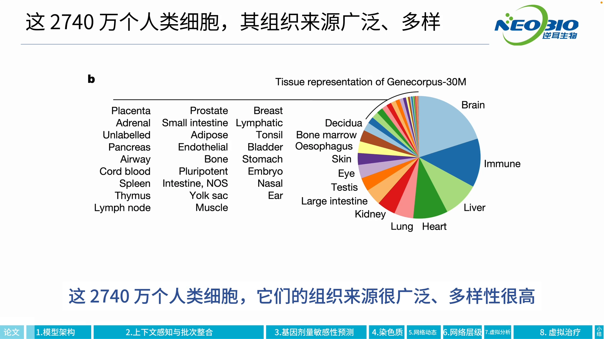

### 1.3 核心设计：把基因按表达量排队

这是整个方法最关键的一步。对每个细胞，先把所有检测到有表达的基因**按表达量由高到低排序**：图中 L 基因表达量最高，然后是 Z 基因，再是 A 基因，一直排到最后一个。这样每个细胞就得到一串按表达量排列的基因名，就像自然语言中许多词按顺序排成一句话。[【跳转到 03:00】](https://www.bilibili.com/video/BV19La86xEbQ/?t=180)

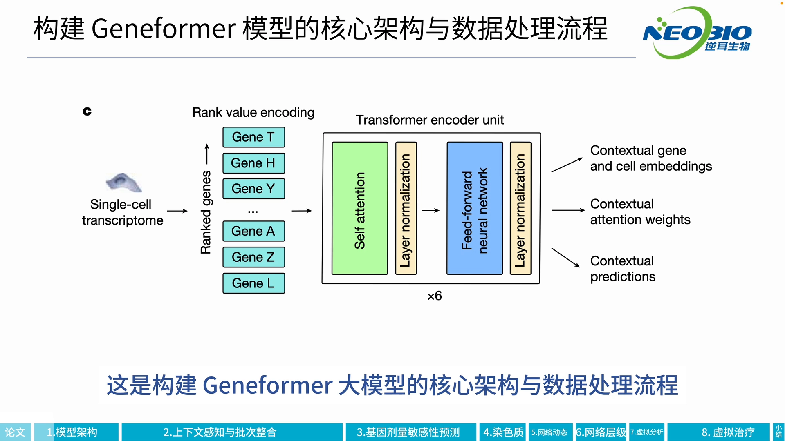

有三条工程细节值得记住：

- **每个细胞只取表达量最高的 2048 个基因**，排在 2048 之后的基因被丢掉。作者统计发现，93% 的细胞被检测到的表达基因数少于 2048 个，也就是说这 93% 的细胞可以被完全覆盖。[【跳转到 04:05】](https://www.bilibili.com/video/BV19La86xEbQ/?t=245)
- **基因词表共 25424 个**，包含编码蛋白的基因和编码 miRNA 的基因；每个基因被表示成一个 **256 维**的向量。[【跳转到 04:25】](https://www.bilibili.com/video/BV19La86xEbQ/?t=265)
- 模型主体是 6 层 Transformer 编码器，每层 4 个注意力头；每层做一次自注意力、一次层归一化、一次前馈网络、再一次层归一化，重复 6 次。最终输出三类信息：上下文相关的基因与细胞嵌入向量、上下文相关的注意力权重、上下文相关的预测结果。[【跳转到 04:40】](https://www.bilibili.com/video/BV19La86xEbQ/?t=280)

### 1.4 与 scGPT 那条路线的差别

上一节（5.3.5 的另一支视频）讲过 scGPT 的做法：把基因身份和表达值分箱共同编码。Geneformer 走的是另一条路——**只保留基因身份，把表达量压成「次序」**。

两种选择的代价正好相反：

| 设计 | 保留了什么 | 丢掉了什么 | 主要风险 |
| :--- | :--- | :--- | :--- |
| 基因身份 + 表达分箱（scGPT 类） | 定量档位 | 箱内的精细差异 | 分箱边界与箱数成为关键超参数 |
| 排序编码（Geneformer 类） | 相对次序 | 表达量的绝对值 | 低表达基因被 2048 截断，且无法区分「表达 3 和表达 30」的差别 |

排序编码还有一个隐含后果：**它把每个细胞的表达谱变成了一个「排名」，而排名的稳定性依赖于归一化方式**。同一批数据用不同的归一化方法，排出来的序列可能不同，模型看到的东西也就不同。

## 二、预训练目标：遮住 15% 的基因名，让模型猜

词表里每个基因都有 256 维的初始向量，这些参数是通过「**掩码完形填空**」算出来的。[【跳转到 05:12】](https://www.bilibili.com/video/BV19La86xEbQ/?t=312)

具体做法：假设一个细胞里有 1000 个检测到有表达的基因、顺序已经排好，就在这些基因中**随机挑 15%**，把它们的名字盖住不给模型看，让模型来猜这 15% 被盖住的位置分别原本是哪个基因。[【跳转到 05:24】](https://www.bilibili.com/video/BV19La86xEbQ/?t=324)

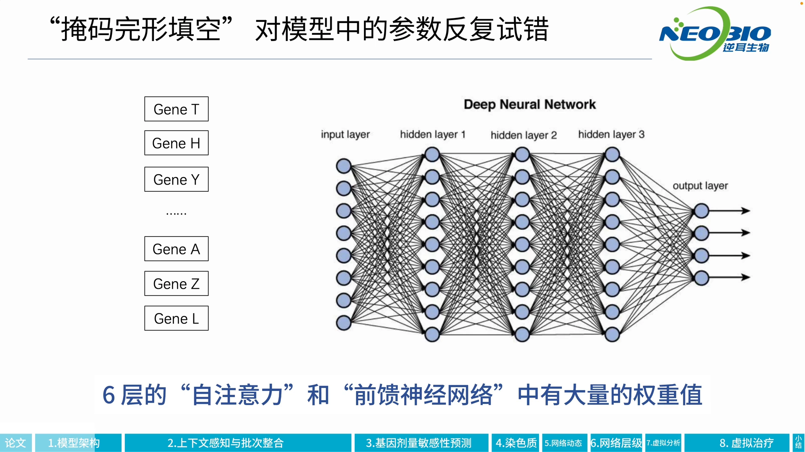

训练靠的是最基础的更新规则。图里每一条连线就是算 $y = wx + b$，其中 $w$ 是权重、$b$ 是偏置；每次猜测结果可能对也可能错，通过结果是否正确进行反馈，反复调整各条线上的权重与偏置，以及每个基因初始向量的各个维度值，不断提升猜测准确率。[【跳转到 05:51】](https://www.bilibili.com/video/BV19La86xEbQ/?t=351)

当模型能以很高正确率猜出被遮住的基因时，那些权重、偏置和基因向量维度值组成的大参数集里，就**包含了对细胞中基因表达量关系的知识**。[【跳转到 06:29】](https://www.bilibili.com/video/BV19La86xEbQ/?t=389)

用一句话概括这一步的实质：**模型学的是「哪些基因倾向于同时出现在序列的相邻位置」，也就是共变关系，而不是因果关系。** 这一点在后面讨论虚拟敲除的可信度时非常关键——虚拟敲除之所以能成立，靠的是「删掉一个基因后，序列的统计结构会朝哪个方向塌陷」，而不是模型真的理解了调控机制。

## 三、细胞向量：每个细胞一张 256 维的名片

训练好之后，作者开始实测能力。这里先引入一个贯穿全片的概念：**细胞向量**（cell-embedding vector，简称 cell embedding）。它把一个细胞中各个基因的上下文基因向量进一步综合，得到属于这个细胞的嵌入向量；在这篇文章的 Geneformer 里，细胞向量的维度就是 **256 维**。[【跳转到 08:16】](https://www.bilibili.com/video/BV19La86xEbQ/?t=496)

### 3.1 虚拟诱导 iPSC：调高四个基因，看细胞往哪走

第一个实验是在虚拟的成纤维细胞里，把能诱导多能干细胞的四个基因——**OCT4、SOX2、KLF4、MYC**（合称 OSKM）——的排序调到最高，等价于把它们的表达量调到最大，然后看虚拟细胞转录组怎么变。[【跳转到 06:51】](https://www.bilibili.com/video/BV19La86xEbQ/?t=411)

结果是：其余基因的嵌入向量显著向着诱导多能干细胞（iPSC）的状态偏移。把模拟诱导实验中被诱导细胞的细胞向量做成 UMAP，可以看到棕色点（有向多能干细胞方向转化的细胞）与紫色点（没有转化的细胞）表型明显分叉；而用随机基因做诱导的对照组，细胞向量没有明显偏移。[【跳转到 07:43】](https://www.bilibili.com/video/BV19La86xEbQ/?t=463)

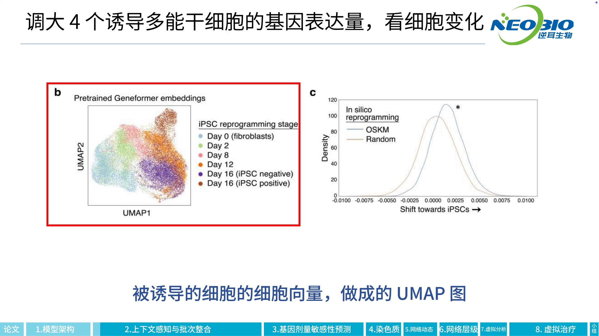

### 3.2 虚拟过表达 MYOD：模拟肌肉分化

第二个实验用了 **MYOD** 基因——它编码「肌分化因子 1」，是肌肉分化的「总开关」，能把成纤维细胞等多种细胞重编程成骨骼肌细胞。作者先把别人做的「多能干细胞分化出肌源性细胞」的湿实验数据放进 Geneformer 算细胞向量：深蓝色点是较早的 PAX3 阳性状态，浅蓝色点是进一步的 PAX3 阳性兼 MYOD 阳性状态，两者在 UMAP 中清楚分开——**说明细胞向量能区分有微小状态差别的细胞群**。[【跳转到 09:10】](https://www.bilibili.com/video/BV19La86xEbQ/?t=550)

然后在 S1 期 PAX3 阳性的肌源性细胞中人为提升 MYOD 的表达量，横轴是「细胞向量向 S2B（MYOD 激活的成肌细胞）状态偏移的程度」：蓝线（虚拟提升 MYOD）的细胞向量自动向骨骼肌分化状态移动，黄线（随机基因）没有移动，两组差异显著。[【跳转到 09:58】](https://www.bilibili.com/video/BV19La86xEbQ/?t=598)

讲者的结论是：在 Geneformer 里做虚拟实验，可以在相当程度上模拟真实湿实验的结果。[【跳转到 10:37】](https://www.bilibili.com/video/BV19La86xEbQ/?t=637)

### 3.3 一个漂亮的对照：NOTCH 与 GAPDH

这一组图是本文认为最能说明「模型确实学到了生物学结构」的证据。作者比较了**已知高度依赖上下文的 NOTCH 受体家族**与**管家基因 GAPDH**：NOTCH1/2/3 的基因嵌入向量在跨多种细胞类型时的变异程度显著高于 GAPDH。[【跳转到 10:46】](https://www.bilibili.com/video/BV19La86xEbQ/?t=646)

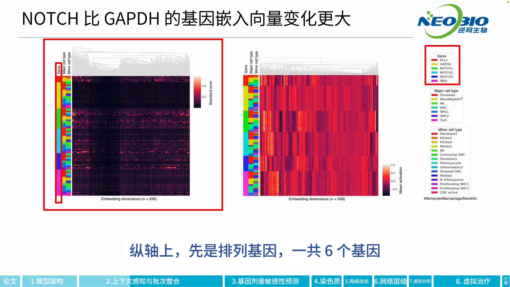

左图横轴是基因向量的 256 个维度，纵轴先是 6 个基因（第二个是 GAPDH，第三到第五是 NOTCH1/2/3），再按大细胞类型和细分细胞类型排列；颜色越白表示变化越大。可以看到 NOTCH 家族有更多淡红色点，而 GAPDH 一片黑——它的向量几乎不随细胞类型变化。右图展示平均激活水平，NOTCH 家族既有很白的区域也有很黑的区域（部分维度激活很高、部分很低），GAPDH 则深浅均一。[【跳转到 11:47】](https://www.bilibili.com/video/BV19La86xEbQ/?t=707)

**这条对照的价值在于：它证明模型不是把所有基因都编码成同一个样子。** 上下文依赖的基因拿到了「会随细胞类型变形」的向量，管家基因拿到了「稳定」的向量——这正是生物学家期望看到的行为。

## 四、批次整合：比 ComBat 和 Harmony 更好？

### 4.1 主动脉瘤数据：批次效应被压掉了，疾病分型还在

作者用公开的主动脉动脉瘤数据集测试细胞向量。原始数据的 UMAP 里，不同细胞群（成纤维细胞、内皮细胞等）大致分开但有混杂；更麻烦的是按病人着色时，不同病人的细胞倾向于聚成独立小团块——**说明数据差异主要来自「这是哪个病人的样本」，而不是「这是什么细胞」**。[【跳转到 12:30】](https://www.bilibili.com/video/BV19La86xEbQ/?t=750)

用 Geneformer 算出细胞向量再做 UMAP：按细胞类型着色时，各细胞类型组成清晰大团块；按病人着色时，不同病人的同一种细胞**完美融合**；而按主动脉瘤累及范围的临床分型着色时，几个分型又清楚地分成几大块。[【跳转到 13:18】](https://www.bilibili.com/video/BV19La86xEbQ/?t=798)

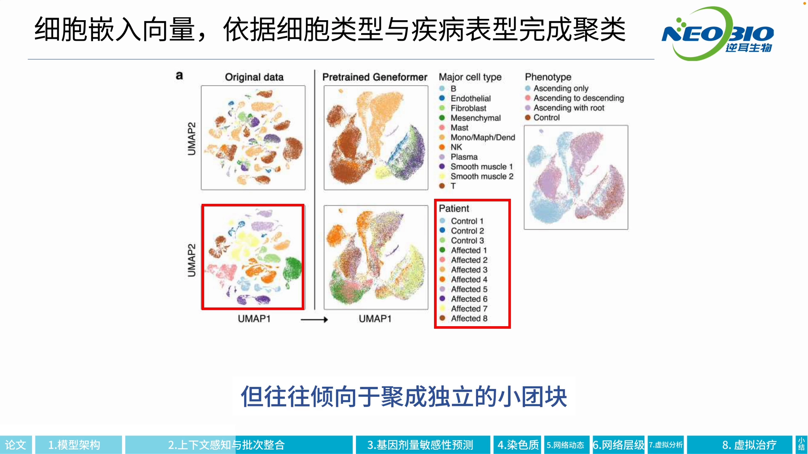

这个结果同时满足了两件事：**技术噪声被去掉，疾病相关的生物学变异被保留**。上一节视频里讲者警告过「过度矫正会把真实的疾病状态当噪音抹掉」，这里恰好是反例。

### 4.2 跨平台：Drop-seq 对 DroNc-seq

作者又用一套公开数据做更硬的测试：iPS 细胞向心肌细胞分化的样本，分别用**单细胞转录组测序（Drop-seq）**和**单细胞核转录组测序（DroNc-seq）**两个平台并行检测。两种方式测到的基因数量差异明显——单细胞核能测到的基因数明显少于单细胞测序。[【跳转到 14:17】](https://www.bilibili.com/video/BV19La86xEbQ/?t=857)

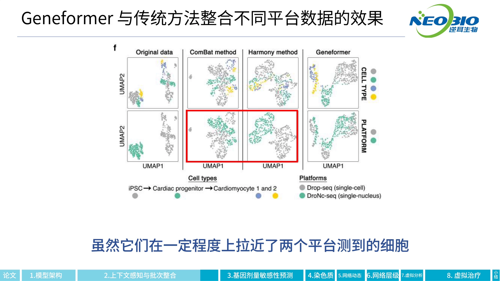

对比结果很直接：原始数据里两个平台完全分开、无法比较；用 **ComBat** 或 **Harmony** 虽然在一定程度上拉近了两个平台的细胞，但细胞类型的结构被破坏（黄色和蓝色点混杂、结构扭曲），平台之间的界限依然存在；用 **Geneformer** 时，上方按细胞类型着色的图里所有类型都完美聚类，下方按平台着色的图里两个平台融合在一起。[【跳转到 17:20】](https://www.bilibili.com/video/BV19La86xEbQ/?t=1040)

### 4.3 一个被讲者如实报告的负面结果

值得注意的是，视频里并没有把 Geneformer 说成万能。作者用单细胞测序数据微调后的模型去区分两种测序方式得到的细胞数据中「心肌细胞类型 1」和「类型 2」的数量比例，两个饼图的比例相差很大——**而这两种测序方法测的是同一组细胞，真实比例本应相同**。这说明两种测序方法引入的数据偏差，对模型区分细胞种类仍有影响。[【跳转到 16:33】](https://www.bilibili.com/video/BV19La86xEbQ/?t=993)

这条负面结果比正面结果更有信息量：**基础模型能压掉一部分批次效应，但压不干净**。任何用细胞比例做结论的分析，都要把这个偏差算进去。
## 五、细胞类型注释与基因剂量敏感性

### 5.1 注释任务：细胞类型越多，优势越明显

作者把 Geneformer 与 XGBoost、以及基于深度神经网络的模型做比较，指标是注释准确率与 Macro F1。随着每种器官里的细胞类型数量上升，Geneformer 的准确率一直维持在高位，而另外两种方法明显下降；在肺、大肠、胰三个器官的识别结果里，每种细胞的红色色块都很明显。[【跳转到 18:16】](https://www.bilibili.com/video/BV19La86xEbQ/?t=1096)

这个趋势本身符合直觉：**类别越多，越依赖一个「已经理解细胞状态」的表示**，而不是靠几个标记基因的阈值。

### 5.2 微调：换输出头 + 小幅调参

讲者在这里把「微调」讲得很具体。预训练时模型是盖住 15% 的基因、让模型猜被盖住的是什么基因，用的输出头是「猜基因的头」；现在要让模型做的是**对基因进行分类**，所以要把原来的输出头换成分类头；同时微调训练中允许对模型参数做小幅调整，以适配当前下游任务。[【跳转到 19:45】](https://www.bilibili.com/video/BV19La86xEbQ/?t=1185)

**这两条就是微调的全部含义：换头 + 轻调参数。** 记住这一点，再看后面「微调只需几百个细胞」的结论就不会觉得神奇——被改变的东西本来就不多。

### 5.3 剂量敏感性：AUC 0.91，且这次给了完整基线

第一个微调任务是区分**哪些基因对自身的基因拷贝剂量改变敏感、哪些不敏感**。作者用前人发表的基因集合（122 个剂量敏感的转录因子 + 368 个不敏感的转录因子，共 490 个），从 2740 万个细胞中随机抽 **10000 个**单细胞转录组做微调，然后让模型判断这 490 个转录因子。[【跳转到 20:43】](https://www.bilibili.com/video/BV19La86xEbQ/?t=1243)

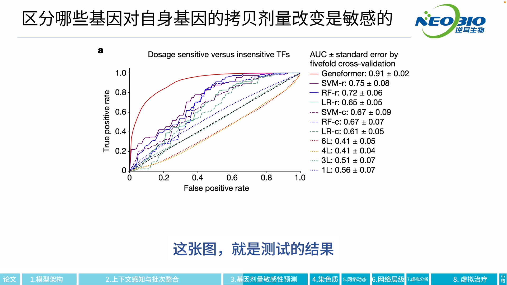

结果是红线代表的 Geneformer **AUC 达到 0.91**，显著优于 SVM-r（0.75）、RF-r（0.72）、LR-r（0.65）、SVM-c（0.67）、RF-c（0.67）、LR-c（0.61）等对照方法。[【跳转到 21:12】](https://www.bilibili.com/video/BV19La86xEbQ/?t=1272)

这张图值得单独说一句：**它把基线摆在了同一张图上**，而且列出了 6L/4L/3L/1L 这类「只用前若干层」的消融。这是本文认可的做法——不管结论如何，读者至少能自己判断差距有多大。

### 5.4 预训练规模与多样性的消融

作者又做了一个很关键的实验：微调用的数据和细胞量保持不变，只改变**预训练**用的细胞数量和样本多样性，看下游准确率怎么变。[【跳转到 21:22】](https://www.bilibili.com/video/BV19La86xEbQ/?t=1282)

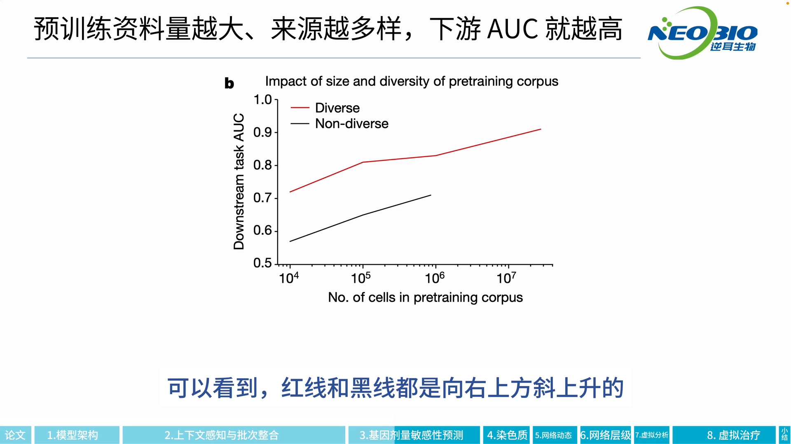

横轴是预训练细胞数（对数刻度），纵轴是剂量敏感性任务的 AUC。红线是「多样语料」（从 2740 万细胞里按比例随机抽），黑线是「单一性语料」（只从一个食管数据集里抽）。两条线都随规模上升，而**红线始终在黑线上方**。[【跳转到 22:03】](https://www.bilibili.com/video/BV19La86xEbQ/?t=1323)

讲者的结论是：采用规模更大、组织多样性更高的资料库做预训练，会持续提升下游任务的预测能力。这个结论本身成立，但要注意横轴是对数刻度——**从 $10^4$ 到 $10^7$ 细胞数涨了 1000 倍，AUC 从约 0.72 涨到约 0.91**。收益是真实的，但它是「对数级投入换线性级回报」的形状，第九章会回到这一点。

### 5.5 零样本外推：直接预测一套新发表的疾病基因

作者进一步问：已经微调好的模型，不再做任何额外训练，能不能预测一套新近发表的疾病基因集合？这个新数据集来自 Collins 等人对 **753,994 名个体**拷贝数变异数据的分析，筛出的基因缺失与神经发育疾病相关，并已划分为「高置信度组」（PIP ≥ 0.85）和「中等置信度组」（PIP ≥ 0.15），其中 PIP 是后验包含概率（Posterior Inclusion Probability）。[【跳转到 22:30】](https://www.bilibili.com/video/BV19La86xEbQ/?t=1350)

用微调后的 Geneformer，针对**胎儿脑细胞**这一特定细胞上下文预测：高置信度致病基因的剂量敏感性预测与原文结论符合度达 **96%**，中等置信基因吻合度达 **84%**；而且中等置信基因在胎儿脑细胞中被判定为剂量敏感的比例，比其他发育阶段和成年神经元的比例更高——这与「这类基因主要介导神经发育表型」的生物学背景一致。[【跳转到 23:04】](https://www.bilibili.com/video/BV19La86xEbQ/?t=1384)

## 六、虚拟敲除：把扰动预测变成「删掉一个词」

### 6.1 方法：从序列里移除一个基因，看其余基因的向量怎么动

这是本片与「扰动响应预测」最直接相关的一节。虚拟敲除的实现方式是：**把目标基因从一个细胞的基因排序队列中移除**，然后量化这个操作对序列中其余基因的嵌入向量造成的扰动大小。[【跳转到 23:44】](https://www.bilibili.com/video/BV19La86xEbQ/?t=1424)

度量用的是**余弦相似度**：模拟敲除致病基因后心肌细胞的嵌入向量，与正常心肌细胞嵌入向量的相似度。越接近 1.0 越相似，越往左说明相似度越低、破坏性越大。[【跳转到 24:05】](https://www.bilibili.com/video/BV19La86xEbQ/?t=1445)

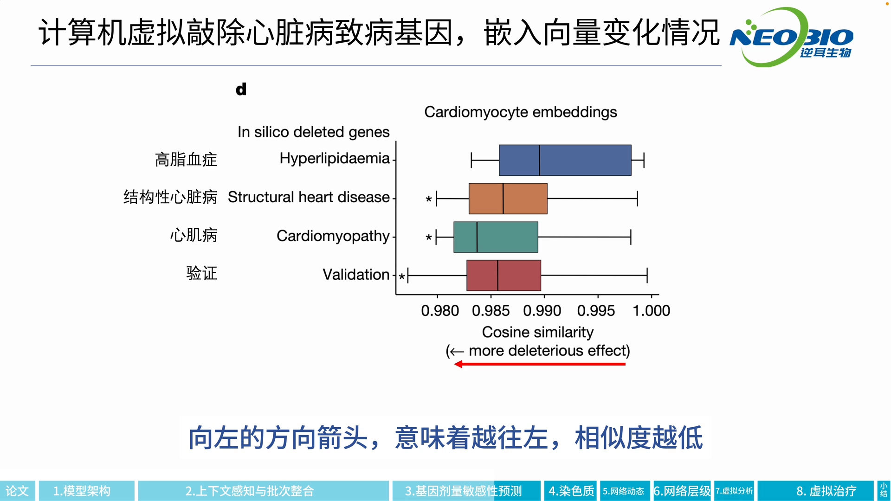

作者直接用**未经任何微调**的预训练 Geneformer 在胎儿心肌细胞上做虚拟敲除：对已知心肌病、结构性心脏病致病基因做虚拟敲除，产生的扰动效应显著强于对照组——高脂血症相关基因。这个对照设计得很讲究：高脂血症基因**同样在心肌细胞表达、同样与心脏疾病相关**，但它的疾病表型主要不发生在心肌细胞。[【跳转到 24:28】](https://www.bilibili.com/video/BV19La86xEbQ/?t=1468)

换成「心脏核磁共振性状相关基因」做同样的实验，4 组基因被敲除后心肌细胞状态剧烈变化，而高脂血症对照组影响较小。讲者的解读是：**Geneformer 不仅识别致病基因，还能区分致病机制发生的场所**——它知道哪些基因是直接管心肌收缩的。[【跳转到 25:15】](https://www.bilibili.com/video/BV19La86xEbQ/?t=1515)

### 6.2 从预测到湿实验：TEAD4

把模型判定为「破坏性最大」的基因拿去和真实疾病数据库对照，在 OMIM 和 ClinVar 中确实显著富集于心肌病和心肌形态异常等表型。排名前 25 的基因里既有生物学界熟知的调控心脏发育的转录因子（如 FOXM1），也有以前关注不多的候选基因——**比如 TEAD4**。[【跳转到 25:43】](https://www.bilibili.com/video/BV19La86xEbQ/?t=1543)

为了验证 TEAD4 是否真的重要，研究人员做了湿实验：用 CRISPR 在 iPS 细胞中敲除 TEAD4，再把细胞分化成心肌微组织，结果**这些人造心肌组织的收缩力显著下降**。这直接证明了 TEAD4 对维持心脏正常机械功能是必不可少的，也证明 Geneformer 能发现潜在的致病基因。[【跳转到 26:20】](https://www.bilibili.com/video/BV19La86xEbQ/?t=1580)

**这是整支视频里最有分量的一段**：一个纯粹从转录组序列里算出来的排序，最后被 CRISPR 加收缩力测量验证了。它说明虚拟敲除不只是「向量偏移」这种数学游戏。

## 七、从染色质到网络层级：注意力里到底有什么

### 7.1 染色质状态：只用转录组推断二价结构域

在胚胎干细胞（ESC）中，一些决定发育去向的重要基因，其启动子上可能同时结合 H3K4me3 和 H3K27me3 两种组蛋白修饰，这种状态叫「**二价染色质**」（bivalent）；两种都不结合叫「没有甲基化组蛋白」（non-methylated）；只结合 H3K4me3 叫「单 H3K4me3」。[【跳转到 26:53】](https://www.bilibili.com/video/BV19La86xEbQ/?t=1613)

作者用 15000 个胚胎干细胞的转录组数据微调 Geneformer，这些细胞同一批还做了 ChIP-seq，每个启动子的二价状态是标好的；带标签的基因集合只选用前人报道的 56 个保守区域内部的基因。[【跳转到 27:29】](https://www.bilibili.com/video/BV19La86xEbQ/?t=1649)

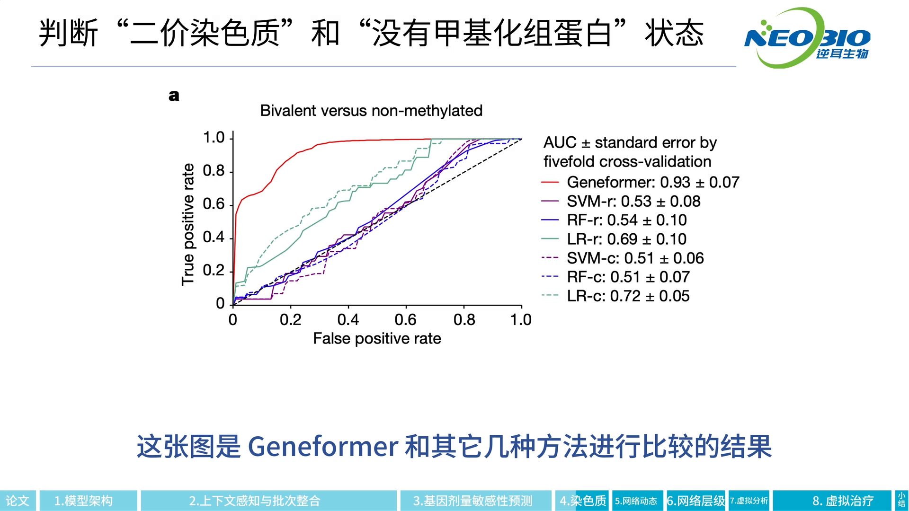

判别「二价 vs 无甲基化」的 AUC 达到 **0.93**，显著优于其它方法；再把预测泛化到微调训练集没覆盖的基因组其余区域，与后来一篇论文的 ChIP-seq 湿实验数据对比，AUC 仍有 **0.78**。[【跳转到 28:06】](https://www.bilibili.com/video/BV19La86xEbQ/?t=1686)

也就是说，**仅靠转录组数据、只用 15000 个细胞和 56 个有注释位点做微调，就能得到接近全基因组二价结构域谱分析的结果**。这一节的说服力在于它有一个「外部湿实验」作为泛化检验。

### 7.2 转录因子的调控范围：远距离还是近距离

转录因子的调控作用范围分「远距离」和「近距离」。作者只用 iPSC 向心肌细胞分化过程中约 34000 个细胞的转录组作为输入，**完全不输入 ChIP-seq 数据、也不输入基因组距离信息**，用前人分好的远/近距离类别做监督，AUC 达到 **0.74**。[【跳转到 29:03】](https://www.bilibili.com/video/BV19La86xEbQ/?t=1743)

讲者的解读是：Geneformer 预训练学到了基因之间的相互作用网络，所以只用转录数据加少量标签，就能推断这类**间接的、高阶的**调控性质。

### 7.3 网络层级：核心调控因子 vs 外围效应因子

药物靶向核心调控元件的治疗效果，通常比靶向外围效应因子更好，但要解析网络层级需要大量扰动测序数据加相同基因背景的对照。作者只用心脏细胞图谱中约 30000 个**正常**内皮细胞的转录组微调 Geneformer，**完全不使用任何基因扰动实验数据**，任务是区分 NOTCH1 依赖网络中的核心调控因子与外围效应因子，AUC 达到 **0.81**。[【跳转到 30:16】](https://www.bilibili.com/video/BV19La86xEbQ/?t=1816)

更值得注意的是微调样本量的实验：把微调样本从 3 万个压到 **5000 个**内皮细胞，性能几乎不变；换成与任务生物学相关性更高的数据（健康主动脉 vs 扩张主动脉，仅 **884 个**内皮细胞），性能甚至优于基线模型用 3 万个细胞训练的结果。[【跳转到 31:21】](https://www.bilibili.com/video/BV19La86xEbQ/?t=1881)

讲者的结论是：**微调所需的最低样本量，取决于具体应用场景，以及该批数据与任务目标之间的生物学相关程度。** 这句话对做实验的人特别有用——与其堆样本量，不如把数据选得离任务更近。

### 7.4 注意力头：20% 的头在看转录因子

作者检查了预训练 Geneformer 的注意力权重。每个基因的注意力权重反映两件事：它关注其它哪些基因、以及哪些基因关注它。[【跳转到 32:26】](https://www.bilibili.com/video/BV19La86xEbQ/?t=1946)

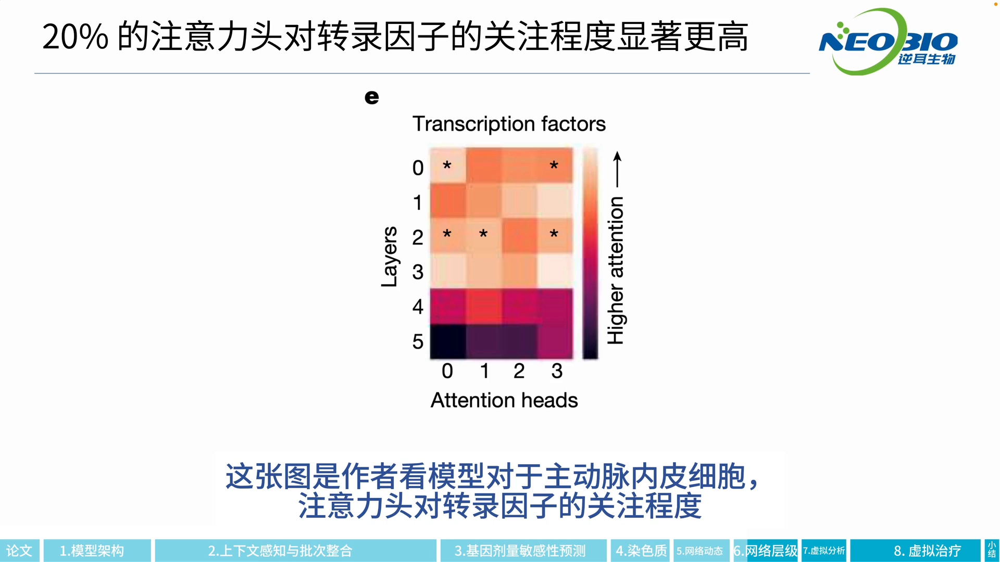

在主动脉内皮细胞里，6 层 × 4 头共 24 个注意力头中，前 4 层对转录因子的注意力高于平均水平；第 0 层和第 2 层一共有 5 个格子带星号，代表转录因子显著获得更多注意力——**约 20% 的注意力头对转录因子的关注显著高于其他基因**。[【跳转到 33:28】](https://www.bilibili.com/video/BV19La86xEbQ/?t=2008)

进一步看，特定注意力头对 NOTCH1 依赖网络的**核心调控节点**关注程度显著高于外围基因；横轴 valence（「价」，即网络连接数量）越靠右、越靠近网络中心，注意力越高。[【跳转到 33:44】](https://www.bilibili.com/video/BV19La86xEbQ/?t=2024)

还有一个层级分工的现象：**最早期层的注意力头在关注哪些基因上最多样**（模型通过联合探查输入空间的不同部分来定位细胞状态）；中间层的关注范围最宽泛；最后层则由「网络中心性驱动」的注意力头主导，聚焦每个细胞状态里排名最高的基因。[【跳转到 34:43】](https://www.bilibili.com/video/BV19La86xEbQ/?t=2083)

### 7.5 虚拟敲除 GATA4：直接靶基因受影响更大

已知 GATA4 缺失会引起先天性心脏病。作者做虚拟敲除 GATA4，看哪些基因受影响最大：随着「作为 GATA4 靶基因的确信度」提高，敲除引起的基因向量变化越大；而且**用 ChIP-seq 湿实验确认的直接靶基因，受影响程度显著大于间接靶基因**。在胎儿心肌细胞中对另一个先天性心脏病基因 TBX5 做同样实验，结论相同。[【跳转到 35:33】](https://www.bilibili.com/video/BV19La86xEbQ/?t=2133)

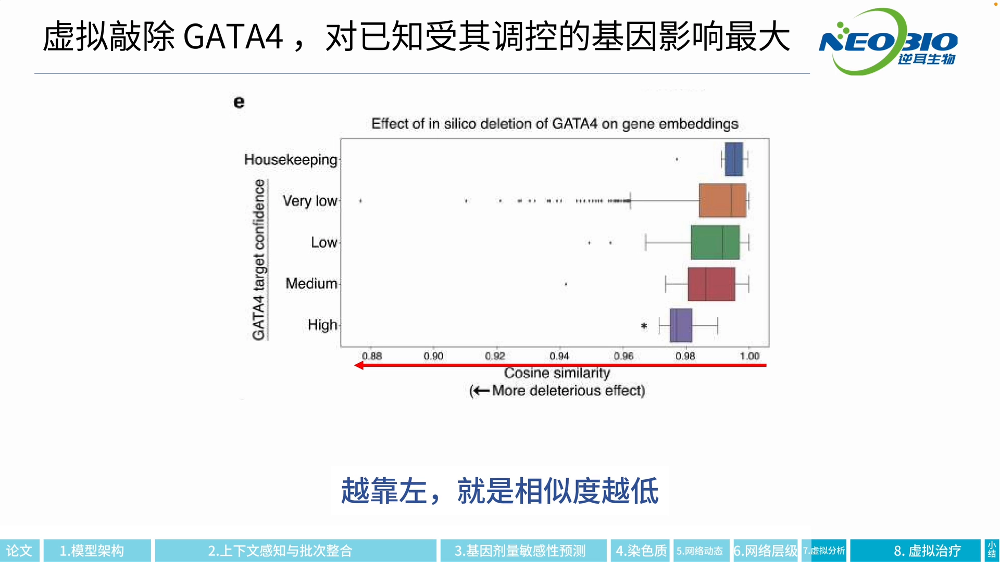

GATA4 与 TBX5 是心脏发育中一对协同工作的转录因子搭档，任一个突变都会诱发先天性心脏病。作者于是测试虚拟敲除能不能模拟协同效应：单独敲除任一个，对共同结合靶基因的有害效应显著大于对看家基因的效应；**同时敲除两个，对共同靶基因的影响大于单独敲除效应之和**——这证明虚拟敲除可以模拟两个基因的协同效应。[【跳转到 37:13】](https://www.bilibili.com/video/BV19La86xEbQ/?t=2233)

## 八、虚拟治疗：从疾病建模到候选靶点与湿实验

### 8.1 疾病建模与三分类

作者先微调 Geneformer 区分三类心肌细胞：非心衰心脏（n = 9）、肥厚型心肌病心脏（n = 11）、扩张型心肌病心脏（n = 9），再在微调训练之外的样本上测试，总体分类准确率达到 **90%**。[【跳转到 38:36】](https://www.bilibili.com/video/BV19La86xEbQ/?t=2316)

然后确定这样一批基因：在非心衰心脏的心肌细胞中对它们做虚拟敲除或激活，会使细胞向量显著向肥厚型或扩张型心肌病状态偏移。把 93589 个细胞的 256 维嵌入画成热图并聚类，三类表型的细胞聚成三个区域，各自有高激活的维度。[【跳转到 39:24】](https://www.bilibili.com/video/BV19La86xEbQ/?t=2364)

结果：肥厚型心肌病方向识别出 **447 个基因**（富集于肌联蛋白结合、肌节组装等通路），扩张型心肌病方向识别出 **478 个基因**（富集于肌肉收缩和线粒体功能通路）。[【跳转到 39:54】](https://www.bilibili.com/video/BV19La86xEbQ/?t=2394)

### 8.2 等高线图：哪些基因「扰动少量就能把细胞推回正常」

接下来是虚拟治疗分析：在来自患者的心肌细胞上做虚拟扰动，看抑制或激活特定通路能不能把细胞向量拉回正常状态。结果画成一张等高线图：X 轴向右表示「向非心衰状态偏移」（治疗潜力），Y 轴向下表示「远离扩张型心肌病状态」，等高线的密度表示落在该区域的基因数量。[【跳转到 40:40】](https://www.bilibili.com/video/BV19La86xEbQ/?t=2440)

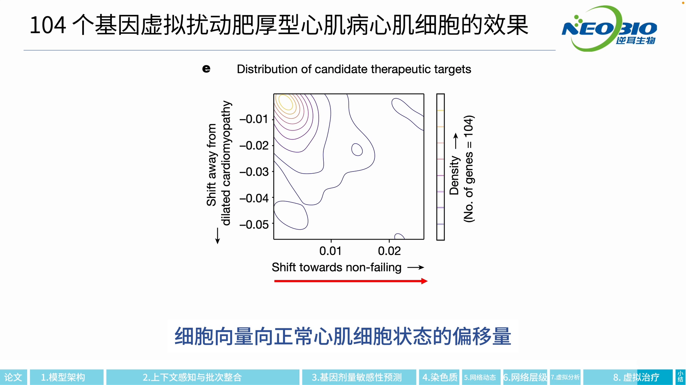

读图的关键在于：橙黄色高密度区集中在左上，蓝色低密度区偏向**右下**；右下角意味着「只要扰动少量基因，就能让细胞向非心衰方向偏移」，所以右下角的基因是最好的候选靶基因。已知可作为治疗心肌肥厚靶点的 **SRPK3** 恰好落在右下角。[【跳转到 41:43】](https://www.bilibili.com/video/BV19La86xEbQ/?t=2503)

对「虚拟敲除后能让细胞向非心衰状态移动、同时远离扩张型心肌病状态」的基因做通路富集，这些基因集中在 4 个通路里，其中 **ADCY5** 在小鼠模型中破坏后会引起心肌病，也有论文讨论它可以作为成药靶点。[【跳转到 42:08】](https://www.bilibili.com/video/BV19La86xEbQ/?t=2528)

### 8.3 湿实验验证：GSN 与 PLN

TTN 基因编码肌联蛋白，TTN 的截短突变是扩张型心肌病最主要的遗传原因，约 20% 的扩张型心肌病患者带有该突变。用携带 A 带截短突变的（TTN+/−）杂合型 iPS 细胞做成的心肌微组织，收缩应力比正常对照组低。[【跳转到 42:33】](https://www.bilibili.com/video/BV19La86xEbQ/?t=2553)

Geneformer 预测的两个靶点是 **GSN 和 PLN**。在 TTN 突变的杂合细胞中用 CRISPR 分别敲除这两个基因，做成的两个微组织**收缩应力都显著提升**。[【跳转到 43:02】](https://www.bilibili.com/video/BV19La86xEbQ/?t=2582)

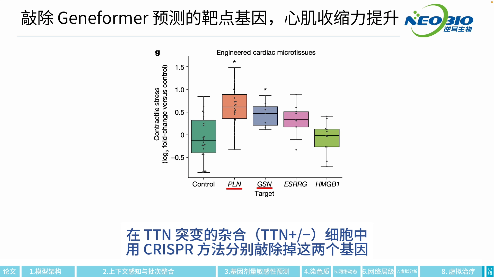

这个实验为 Geneformer 用作发现候选治疗靶点的实用性提供了实验支持。**注意它的分量：从虚拟敲除到 CRISPR 到收缩力测量，是一条完整的闭环。**

### 8.4 讲者的收尾

讲者最后总结两点：第一，Geneformer 把大语言模型技术应用于海量单细胞转录组数据，可以做转录因子剂量敏感性分析、靶基因预测、治疗靶点基因预测、基因扰动预测、模拟治疗等工作；第二，本文讲的论文发表于 2023 年，到 2026 年 9 月 Geneformer 已有新版本 **Geneformer-V2-316M**，纳入多达 **1.04 亿个细胞**，参数量达到 **3.16 亿**，模型参数与代码都是公开的。[【跳转到 43:34】](https://www.bilibili.com/video/BV19La86xEbQ/?t=2614)

## 九、批判性视角：这些 AUC 说明了什么，没说明什么

> **本章是本文评述，不是视频原话。** 视频是一支「讲论文」的解读片，立场是介绍；下面这些质疑来自这一领域近两年的公开讨论，用来给上面的数字配一副「验收眼镜」。

### 9.1 好消息：这篇论文的基线做得比多数同类工作扎实

先把公道话说在前面。本文提到的三个 ROC 图（剂量敏感性 AUC 0.91、二价染色质 AUC 0.93、NOTCH1 网络层级 AUC 0.81）都把**基线方法画在同一张图上**，包括 SVM、随机森林、逻辑回归的两种输入形式（rank 与 count），以及「只用前 1/3/4/6 层」的消融。这在单细胞基础模型文献里并不是标配。

但要注意**任务类型**：这些 AUC 衡量的都是「**给一个基因打标签**」——这个转录因子是否剂量敏感、这个启动子是否二价、这个基因是核心还是外围。它们**不是**「预测扰动后的完整表达谱」。后者才是 5.3.1 那一节讨论的扰动响应预测，也是基础模型最容易被质疑的地方。

区别在于：分类任务的标签通常来自一个相对干净的数据库，而表达谱预测要和成千上万个基因的连续变化比相似度——**后者对「大部分基因不变」这个平凡解极其宽容**。上一节视频里讲者提到的「correlation 0.90 其实是大量不变基因贡献的」，说的就是这件事。

### 9.2 预训练数据泄漏：Geneformer 身上最需要警惕的一点

Geneformer 的预训练语料叫 **Genecorpus-30M**，来源是**公共数据平台上的人类单细胞转录组**，覆盖约 40 类组织。而它用来评测的数据集是：

- 公开的**主动脉动脉瘤**数据集（批次整合实验）；
- 公开的 **iPS → 心肌细胞分化**数据（Drop-seq / DroNc-seq 跨平台实验）；
- **心脏细胞图谱**里的正常内皮细胞（网络层级实验）；
- 公开的 **iPSC → 心肌细胞分化** 34000 个细胞（转录因子调控范围实验）；
- 公开的**胎儿心肌细胞 / 胎儿脑细胞**上下文（虚拟敲除与剂量敏感性外推）。

这些数据集**全部是公共数据**，也**全部落在 Genecorpus-30M 的采集范围内**（人类、多组织、多发育阶段）。论文并没有（也很难）证明这些数据集被排除在预训练语料之外。

这意味着什么？意味着模型在「零样本」预测某个基因的剂量敏感性时，**可能已经在预训练阶段见过这个基因在同类细胞里的共现模式**。这不是作弊，但会让「零样本」这个词变得名不副实——它更接近「少样本」或「已见分布内的推断」。

可操作的检查有三条：

1. **要求语料级去重**：把评测数据集从预训练语料里显式剔除后重跑；
2. **按未见扰动划分**：测试集的扰动基因、细胞类型、组织三者至少有一个在预训练中完全没出现；
3. **外部验证**：用自己实验室新做的 Perturb-seq 做最终检验——**这也是这篇论文做得最好的地方**（TEAD4、GSN、PLN 三个湿实验），因为湿实验不可能被预训练语料污染。

### 9.3 排序编码的四个具体代价

rank value encoding 是这个方法最优雅的地方，也是它最受限的地方：

- **丢掉绝对表达量**：一个基因表达 3 和表达 30，只要排名相同，对模型就是同一个符号。剂量效应（表达量翻倍会怎样）在原理上无法被表示——而剂量恰恰是药物扰动的核心变量。
- **2048 截断**：每个细胞只保留表达最高的 2048 个基因。论文说 93% 的细胞可以被完全覆盖，反过来说**约 7% 的细胞有基因被截掉**；而在这些细胞里，被截掉的往往是低表达基因——扰动响应里最敏感的那一批。
- **词表固定为 25424 个人类基因**：跨物种（小鼠）、跨平台（某些平台测不到 miRNA）时词表对不上，只能丢弃或重训。
- **排序对归一化敏感**：排序结果依赖上游的归一化与文库大小处理，同一批数据换一种归一化，序列可能就变了。这意味着**预处理流程必须严格按模型规定来**，不能自由发挥。

### 9.4 规模不等于能力：那张消融图其实说明了两件事

第 5.4 节那张「预训练规模 vs 下游 AUC」的图，讲者读出的结论是「规模越大越好」。这个读法没错，但图上还有第二个信息：**横轴是对数刻度**。从 $10^4$ 到 $10^7$，细胞数增加 1000 倍，AUC 从约 0.72 升到约 0.91——**约 0.19 的绝对提升，换 1000 倍的数据与算力**。

这不是否定规模的价值，而是提醒成本核算：如果你的任务只需要 AUC 0.72 的水平，用 1 万个细胞预训练的小模型可能就够了；而如果你的数据只有几百个细胞、又和组织特异性高度相关（视频里 884 个内皮细胞的例子），**把数据选对**比把模型变大更划算。

### 9.5 可解释性：注意力头是线索，不是机制

第 7.4 节的注意力分析很漂亮：20% 的头关注转录因子、越靠近网络中心注意力越高、浅层多样深层聚焦。但要注意这类分析的固有局限：

- 注意力权重是**相关性**，不是因果贡献。一个头「关注」某个基因，不等于这个基因决定了输出；
- 24 个头里只有 5 个显著，说明**大部分注意力头的行为没有被解释**；
- 这些结论是在特定细胞类型（主动脉内皮细胞）上得出的，换个组织未必成立。

真正有机制说服力的还是湿实验：TEAD4 敲除后收缩力下降、GSN/PLN 敲除后收缩力提升——**这两条才是「模型说对了」的硬证据**。

### 9.6 工程代价与复现门槛

- 预训练 2740 万个细胞的 6 层 Transformer，需要多卡 GPU 长时间训练；Geneformer-V2 的 1.04 亿细胞、3.16 亿参数只会更贵；
- 推理也不便宜：每个细胞都要构造一条 2048 长度的序列，百万级细胞的全量编码需要可观的显存与时间；
- 好的一面是**权重与代码都公开**，这比很多闭源模型强得多；但复现仍要求预处理脚本、基因词表版本、归一化参数三者完全对齐。

### 9.7 一份可执行的检查清单

| 检查项 | 具体动作 |
| :--- | :--- |
| 任务类型 | 分清「基因分类」与「表达谱预测」；前者 AUC 高不代表后者可用 |
| 基线 | 至少跑均值基线、线性基线、以及「只用前几层」的消融 |
| 泄漏 | 核对评测集是否在 Genecorpus 之类的公共语料内；能剔除就剔除后重跑 |
| 划分 | 按未见扰动基因 / 未见细胞类型 / 未见组织划分，而不是随机切细胞 |
| 指标 | 除整体相关性外，报告差异基因子集上的相关性、关键基因方向一致率 |
| 用法 | 优先冻结表征 + 简单头；微调时优先选与任务生物学相关性高的数据（884 细胞的例子） |
| 验证 | 至少一条独立湿实验或完全未参与预训练的外部数据集 |

## 小结

- Geneformer 的核心设计是**排序编码**：把每个细胞变成一串「按表达量从高到低排列的基因名」，就像一句话；每细胞取 top 2048 个基因，词表 25424 个人类基因，每个基因 256 维。
- 预训练目标是**掩码完形填空**：随机遮住 15% 的基因名让模型猜，靠 $y = wx + b$ 式的反复试错把权重调出来。模型学到的是基因共变关系，不是因果机制。
- 训练语料是 3000 万细胞筛到 **2740 万**个正常人类细胞，覆盖约 40 类组织；剔除高突变负荷细胞（肿瘤、永生化系）是为了避免网络重排干扰。
- **细胞向量**是每个细胞的 256 维名片。它能把 iPSC 重编程、肌肉分化这些过程在向量空间里表现出来；NOTCH 家族跨细胞类型变异大、GAPDH 几乎不变，说明模型确实编码了上下文依赖性。
- 下游用法是**换输出头 + 小幅调参**。八个验证任务给出的 AUC 落在 0.74~0.93，且在图上都有基线对照；预训练规模与多样性的消融显示「越大越多样越好」，但收益是对数级的。
- **虚拟敲除**把扰动预测变成「从序列里删掉一个基因、看其余基因向量偏移多少」，用余弦相似度度量破坏性。它在胎儿心肌细胞里区分出了「作用于心肌的致病基因」和「同样表达但机制不在心肌的对照基因」，并给出了 TEAD4、GSN、PLN 三个湿实验验证。
- 批判性结论：这些 AUC 主要衡量**基因分类**而非表达谱预测；评测数据集与预训练语料同源，存在数据泄漏风险；排序编码丢掉了绝对表达量、截断了低表达基因、词表锁死人类；注意力分析是线索不是机制。**用之前先问基线、先查语料重叠、先想清楚任务类型。**

## 关键术语速查

| 术语 | 一句话解释 |
| :--- | :--- |
| AIVC | AI Virtual Cell，AI 虚拟细胞：在计算机里模拟细胞对扰动的反应 |
| rank value encoding | 排序编码：把细胞里检测到的基因按表达量从高到低排成序列，只保留次序 |
| token | 模型输入的最小单位；Geneformer 里一个 token 就是一个基因 |
| 基因词表 | 模型认识的基因全集；本文的 Geneformer 是 25424 个人类基因 |
| 掩码完形填空 | 随机遮住 15% 的基因名，让模型猜被遮住的是什么，用误差更新权重 |
| 自监督 | 标签来自数据本身（被遮住的那部分），不需要人工标注 |
| 细胞嵌入向量 | cell embedding，把一个细胞里各基因的上下文向量综合成的 256 维向量 |
| 微调 | fine-tuning：换掉输出头 + 对参数做小幅调整，让通用模型适配具体任务 |
| 虚拟敲除 | in silico deletion：把目标基因从序列里删掉，看其余基因向量偏移多少 |
| 余弦相似度 | 两个向量方向的一致程度；越接近 1 越相似，越低表示破坏性越大 |
| 剂量敏感性 | 基因拷贝数变化（CNV）时，该基因自身表达是否随之改变的性质 |
| 二价染色质 | bivalent：启动子上同时带 H3K4me3 与 H3K27me3，发育基因常见的「待命」状态 |
| valence | 「价」，指基因在调控网络里的连接数量，越大越靠近网络中心 |
| 注意力头 | attention head，Transformer 里独立学习关注模式的小单元；本文每层 4 个、共 6 层 |
| 批次效应 | 因样本来源、平台、操作批次不同引入的技术差异，会掩盖真实的生物学差异 |
| 数据泄漏 | 评测信息在训练阶段已被模型见过，导致指标虚高 |
