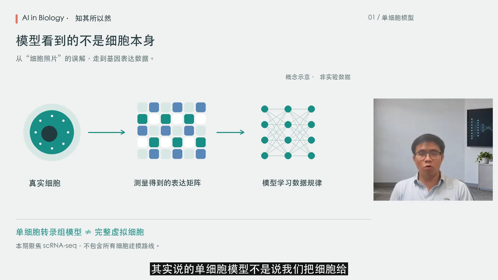
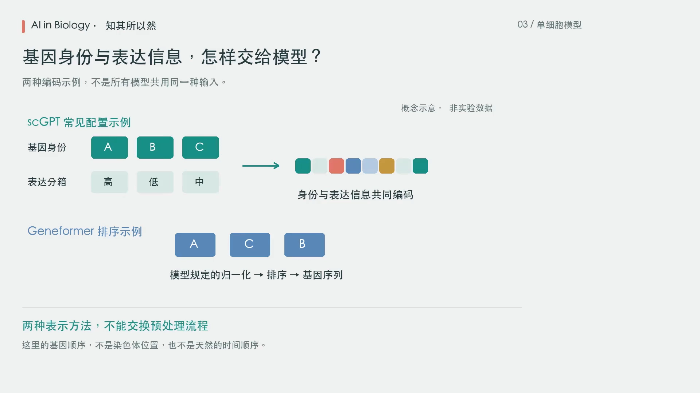
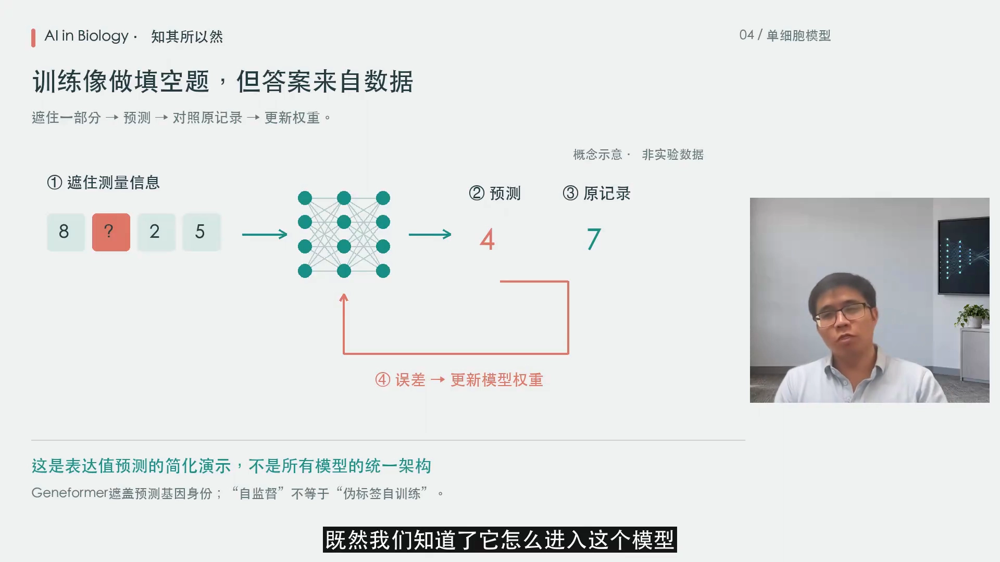
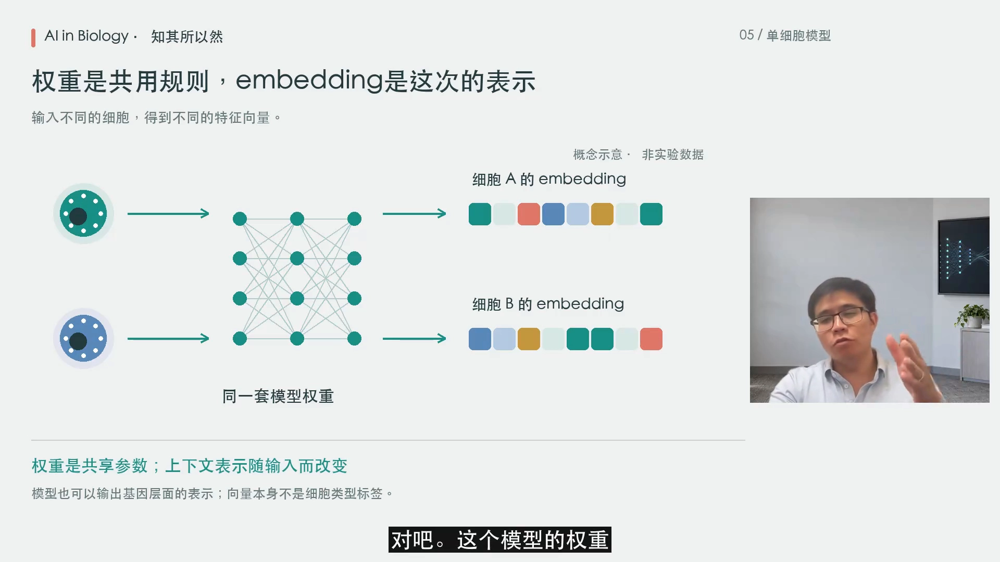
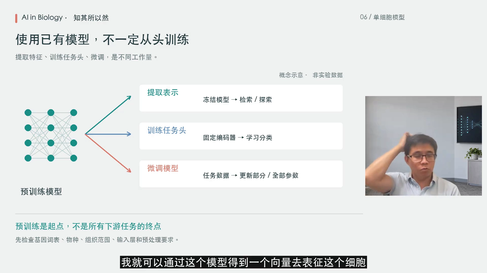
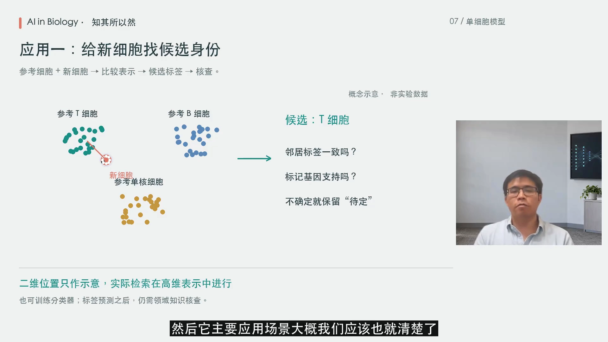
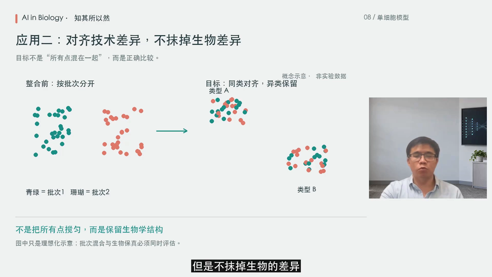
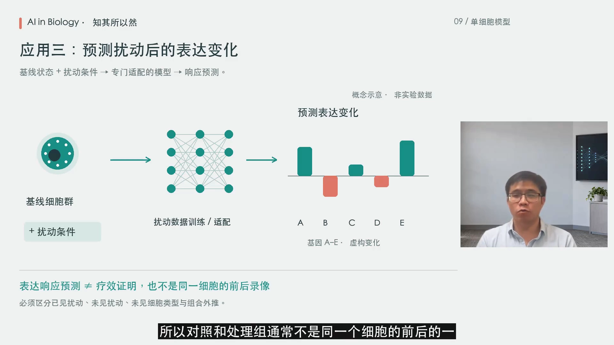

# 单细胞基础模型怎么训练、怎么用：从基因 token 到扰动预测的三条用法

> 视频来源：[AI in Biology｜知其所以然 EP04：单细胞模型怎么训练、怎么用？从表达矩阵到扰动预测](https://www.bilibili.com/video/BV1iyn96eELb/)（Bilibili · bioinforbricker）｜时长约 13 分钟
> 导读：一支 13 分钟的概念梳理视频，把「单细胞基础模型」拆成四件事：输入怎么编码、预训练在学什么、下游有哪三种用法、扰动预测容易在哪里被数字骗。本文按视频顺序复述这条主线；**第九章的批判性讨论是本文评述，不是视频原话**，已在章首标明。

## 本讲要解决的核心问题（SCQA）

**背景**：单细胞测序技术不断成熟，公共数据从几十万个细胞涨到上百万、上千万个细胞。数据一多，「单细胞大模型」「细胞基础模型」的说法就流行起来：先在海量细胞上预训练一个通用模型，再迁移到细胞注释、数据整合、扰动预测等下游任务。

**冲突**：这些模型的名字很响，但真正落到操作层面，很多初学者说不清三件事——模型到底「看到」了什么？所谓预训练究竟在优化什么目标？拿到一个现成模型之后，我该怎么用它，又该在什么地方怀疑它？

**疑问**：一个在几百万个细胞上训练出来的模型，输入既不是细胞的照片、也不是一段文本，那它到底吃进去的是什么？它的能力边界在哪里？

**回答（中心思想）**：单细胞基础模型的全部工程，几乎都压在**「如何把一张表达矩阵变成 token 序列」**这一个选择上；预训练只是让模型学会「遮住一部分、用其余部分把它补回来」的自监督填空；下游用法分**冻结表征、训练任务头、微调**三档，工作量与风险依次上升；而在扰动预测这个最受关注的场景里，**一个 0.9 的相关系数可能主要由大量「本来就没变」的基因贡献**，必须回到真正变化的基因上去看。

---

## 一、模型看到的不是细胞本身，而是一张表达矩阵

视频开篇先做了一次概念澄清，这一步很关键，因为「单细胞模型」这个说法容易被误解成「把细胞整个模拟出来」。

讲者的定义是：这里说的单细胞模型，**不是把细胞本身模拟出来**，而是把单细胞测序测到的数据表征成一组表达矩阵——现在通常说的单细胞数据主要是单细胞转录组，矩阵里记录的就是每一个细胞里不同基因的表达情况。[【跳转到 00:25】](https://www.bilibili.com/video/BV1iyn96eELb/?t=25)

这张矩阵的形状是：**每一列是一个基因，每一行是一个细胞**，每个格子是某个细胞里某个基因的表达量。[【跳转到 00:55】](https://www.bilibili.com/video/BV1iyn96eELb/?t=55)

规模感很重要。视频里为了方便画图只画了几个基因几行细胞，但真实数据里，整个基因组可能有上万个基因的表达，细胞数目有的甚至到了几百万个。[【跳转到 01:20】](https://www.bilibili.com/video/BV1iyn96eELb/?t=80)

所以后面所有关于「大模型」的讨论，本质都是在讨论：**怎么把一个上万维、极度稀疏、噪声很大的矩阵，压成模型能处理的一串符号**。这也解释了为什么视频反复强调一句限定语——单细胞转录组模型不等于完整的虚拟细胞，本期只聚焦 scRNA-seq 这一条路线。

## 二、token 设计：整个领域最要紧的一个选择

自然语言模型吃的是 token 序列：一句话被切成若干 token，按顺序排好喂进去。单细胞数据没有天然的「词」，所以必须先人为定义 token。视频举了两个代表做法，这也是本小节的技术核心。

### 2.1 scGPT 路线：基因身份与表达分箱共同编码

第一种做法（讲者以 scGPT 的常见配置为例）：**把基因的身份（基因 ID）当作一个 token，再把它的表达量分箱**——把表达量等分成几份，比如高表达、中表达、低表达——然后把「身份」和「表达档位」这两类信息共同编码到一个向量里，作为模型的输入。[【跳转到 01:40】](https://www.bilibili.com/video/BV1iyn96eELb/?t=100)

这个设计的好处是直观：模型既知道「这是哪个基因」，也知道「它表达得高还是低」。代价是**定量信息被离散化了**：一个基因表达量是 3.1 还是 3.9，只要落在同一个箱里，对模型来说就是同一个符号。分箱的边界怎么切、切几个箱，因此成了一个会影响结果的超参数。

### 2.2 Geneformer 路线：归一化、排序、只留基因序列

第二种做法（讲者以 Geneformer 为例）：**只用基因，但把基因排序**。具体是先按模型规定的方式对表达量做归一化，再根据表达多少把基因从高到低排成一个序列，这个序列就是「一句话」。[【跳转到 02:05】](https://www.bilibili.com/video/BV1iyn96eELb/?t=125)

这个设计更激进：序列里只保留基因身份，**表达量的绝对值被彻底丢掉了**，只剩下「谁比谁高」这个相对次序。换来的是序列长度可以被截断（只保留排在前面的若干基因），计算量可控。

### 2.3 两种表示不能交换预处理流程

视频在幻灯片上专门写了一行提醒：**两种表示方法不能交换预处理流程**——这里的基因顺序既不是染色体位置，也不是什么天然的时间顺序，而是模型自己规定的归一化与排序规则算出来的。[【跳转到 02:30】](https://www.bilibili.com/video/BV1iyn96eELb/?t=150)

这句话是实操层面的硬约束：你不能拿 Geneformer 的排序规则去喂 scGPT，也不能把 scGPT 的分箱编码塞进 Geneformer。**每个基础模型都自带一套预处理契约**，用错模型就等于把输入翻译成了另一种语言。

## 三、预训练目标：遮住一部分，让数据自己当答案

知道了输入怎么构造，下一步是模型怎么训练、参数怎么来。

讲者先强调：这**不是一个有标签的任务**。模型只是在大量数据里学习一些规律，得到一个通用模型，为后面比如分类或者预测打基础——这就是自监督训练。[【跳转到 02:50】](https://www.bilibili.com/video/BV1iyn96eELb/?t=170)

具体机制就是「做完形填空」：答案本身就在数据里面，我们只是把数据的一部分遮住，让模型去预测被遮住的内容，然后和真实记录比对，得到误差，误差反向传播去调整模型权重。[【跳转到 03:15】](https://www.bilibili.com/video/BV1iyn96eELb/?t=195)

视频给了一个极简数字例子：某个基因的表达值被盖住，模型预测是 4，而数据里本来记录的是 7，误差就是 3；经过调整，预测值可能变成 6、再逼近 7，误差越来越小，最终形成这样一个训练框架。[【跳转到 03:40】](https://www.bilibili.com/video/BV1iyn96eELb/?t=220)

**关键差别在于「遮住的是什么」**：scGPT 遮的是表达量，也就是某个基因的表达值；Geneformer 遮的是基因的身份，因为它是把整个基因排成序列，遮掉某个位置上的基因，让模型预测这个位置原本应该是哪个基因。[【跳转到 04:30】](https://www.bilibili.com/video/BV1iyn96eELb/?t=270)

讲者在这里点了一句容易被忽略的话：自监督训练之所以成立，是因为「这个被遮住的部分和周边其他数据的关系我们是知道的、可以学出来的」。换句话说，**模型学到的不是因果，而是共变**——哪些基因倾向于一起高、一起低。这一点在后面讨论扰动预测时会变成核心问题。

## 四、权重是共用规则，embedding 是这一次的表示

训练完成后，模型输出的是两样不同的东西，视频特意做了区分：

- **权重**：一套共享参数，对所有细胞都一样；
- **embedding**：把某一个具体细胞喂进去，经过这套权重算出来的一组向量，是这个细胞这一次的表示。

讲者把 embedding 比作这个细胞的一张「名片」，也就是它的特征向量；具体原理他在别的视频里专门讲过，这里只强调用法。[【跳转到 05:20】](https://www.bilibili.com/video/BV1iyn96eELb/?t=320)

幻灯片上还有一行小字值得记住：**向量本身不是细胞类型标签**。embedding 只是坐标，标签要靠后面的比对或分类器给出。
## 五、三种用法：冻结表征、训练任务头、微调

拿到一个预训练模型之后，下游怎么接？视频把做法归成三档，工作量依次上升。[【跳转到 05:45】](https://www.bilibili.com/video/BV1iyn96eELb/?t=345)

| 用法 | 做法 | 需要多少标签 | 主要风险 |
| :--- | :--- | :--- | :--- |
| 提取表示（冻结） | 模型权重完全不动，取 embedding 直接做检索或聚类 | 几乎不需要 | 模型没见过的组织或平台，表征可能整体偏移 |
| 训练任务头 | 固定编码器，只在 embedding 上训一个分类器 | 少量、但要可靠 | 标签质量决定上限 |
| 微调 | 用任务数据更新部分或全部参数 | 需要成规模的任务数据 | 小数据微调容易过拟合，也容易忘掉预训练学到的东西 |

**第一档，直接提取表征**：模型的权重我完全不动，进来一个细胞就通过模型得到一个向量，然后拿这个向量去和已知的细胞类型比对，判断它可能属于哪一类。[【跳转到 06:10】](https://www.bilibili.com/video/BV1iyn96eELb/?t=370)

**第二档，训练任务头**：大部分权重不变，但用少量比较可靠的标签——比如我明确知道这部分细胞是什么类型、对某种药物有响应——把这些少量细胞当作训练数据，训一个分类器。[【跳转到 06:35】](https://www.bilibili.com/video/BV1iyn96eELb/?t=395)

讲者在这里解释了大模型为什么能这么用：大模型是在大量数据里训练，学到了一些基本规律、学到了一些基因表达之间的关系，所以它的表征可以拿去做进一步的下游训练。[【跳转到 07:00】](https://www.bilibili.com/video/BV1iyn96eELb/?t=420)

**第三档，微调**：既有任务数据、也有标签，就通过训练去更新部分参数，比如外围几个 layer 的参数——这就是 transfer learning（迁移学习）的思路。[【跳转到 07:25】](https://www.bilibili.com/video/BV1iyn96eELb/?t=445)

讲者补充了自己的经验：他有几篇文章就是用了迁移学习的方法，把大规模训练得到的模型参数，用自己实验得到的、数据量可能比较小但标签很精准的数据做一次权重调整，专门用来预测当下那个特定任务。[【跳转到 07:58】](https://www.bilibili.com/video/BV1iyn96eELb/?t=478)

幻灯片下方那句提醒同样重要：**预训练是起点，不是所有下游任务的终点**——用之前先检查基因词表、物种、组织范围、输入层和预处理要求。换句话说，模型卡（model card）里那些看起来枯燥的字段，决定了它能不能用在你的数据上。

## 六、应用一：给新细胞找候选身份

有了模型，主要应用场景就清楚了。第一个是**细胞类型注释**。

做法是：已经有一群标签比较可信的参考细胞，现在来了一个新样本，把两边的数据按**相同的输入规则**送进同一个模型，各得到一组向量表征，然后在高维空间里找最相似的参考细胞，就知道这个新样本属于哪些细胞、属于哪个类别。[【跳转到 08:33】](https://www.bilibili.com/video/BV1iyn96eELb/?t=513)

视频特意提示：幻灯片上的二维散点只是示意，**真实的检索是在高维表示里进行的**。[【跳转到 08:58】](https://www.bilibili.com/video/BV1iyn96eELb/?t=538)

更值得抄下来的是幻灯片右下角那三条核查动作：候选标签给出之后，还要问「邻居标签一致吗」「标记基因支持吗」「不确定就保留待定」。**模型给的是候选，不是结论**。

## 七、应用二：对齐技术差异，但不抹掉生物差异

第二个应用是**数据整合**：把不同批次、不同技术平台的数据放在同一个坐标系里比较。

讲者解释得很直白：比如同时来了两个批次的单细胞数据，存在批次效应，技术平台可能也不一样，我们想找到具有相同生物学特征的那些细胞、把它们混在一起；这可以通过合适的整合方法，经过模型计算得到同一维度上的细胞表征，让分类更容易，同时减轻技术差异的影响。[【跳转到 09:23】](https://www.bilibili.com/video/BV1iyn96eELb/?t=563)

但讲者紧接着给了一个很重的警告：**并不是随便提取一个 embedding，批次效应就自动没了**。反而有一个比较危险的方向，是**过度矫正**——如果把真实的疾病状态或者激活状态也当成噪音抹掉了，图会变得很好看（两组刚好对上），但真正的生物学差异也被一起去掉了。[【跳转到 09:48】](https://www.bilibili.com/video/BV1iyn96eELb/?t=588)

所以整合要同时检查两个目标：**同类别的细胞能否跨批次对齐**，以及**真正不同的细胞类型是否仍然保持区分**。[【跳转到 10:13】](https://www.bilibili.com/video/BV1iyn96eELb/?t=613)

讲者还补了一句方法论层面的判断：AI 在学习过程中可能会忽略真正具有生物学意义的信号，而这恰恰是目前人类分析更擅长的地方。[【跳转到 10:38】](https://www.bilibili.com/video/BV1iyn96eELb/?t=638) 这句话对本章（扰动响应建模与预测）尤其成立——**扰动本身产生的往往就是「状态差异」，而整合类模型天生倾向于把它当噪音压掉**。

## 八、应用三：预测扰动后的表达变化，以及那个 0.9 的相关性陷阱

第三个应用就是现在比较火爆的**虚拟细胞**：用 Perturb-seq 这类数据，敲除或者敲降一个基因之后，看它下游基因的表达有什么变化；建立细胞模型之后，就可以去预测敲降某个基因、或者用相应药物处理它之后下游基因的变化。[【跳转到 11:03】](https://www.bilibili.com/video/BV1iyn96eELb/?t=663)

视频在这里给出了两条非常实用的验证原则。

**第一条：对照和处理不是同一个细胞的前后镜像。** 很多单细胞测序会破坏细胞，所以对照组和处理组是**两组不同细胞**之间的比较，而不是同一个细胞处理前后的录像。[【跳转到 11:28】](https://www.bilibili.com/video/BV1iyn96eELb/?t=688) 这意味着预测目标从一开始就带着细胞间的个体差异噪声，任何「精确复原」的说法都要打折扣。

**第二条：验证时要区分模型见过什么。** 幻灯片上写得很清楚——必须区分**已见扰动、未见扰动、未见细胞类型、未见组合**这几种外推情形。[【跳转到 11:53】](https://www.bilibili.com/video/BV1iyn96eELb/?t=713) 同一个模型，在「见过这个扰动」和「没见过这个扰动」两种划分下，性能可以差出一个量级。

**第三条，也是最锋利的一条：看真正变化的基因，而不是整体相关性。** 讲者说，他看到很多预测扰动下游变化的方法，报告的 correlation 有 0.90、甚至 0.98，**实际上是因为大量没有变化的基因导致的**——在 Perturb-seq 里，绝大多数基因在扰动后并不变化，把它们全部算进相关系数，分母被稀释，分数自然虚高。[【跳转到 12:23】](https://www.bilibili.com/video/BV1iyn96eELb/?t=743)

用公式说更清楚。设扰动后基因 $g$ 的真实变化为 $\Delta_g = \bar{x}^{\text{pert}}_g - \bar{x}^{\text{ctrl}}_g$，模型预测为 $\hat{\Delta}_g$。若报告的是全体基因上的 Pearson 相关：

$$
r = \frac{\sum_g (\Delta_g - \bar{\Delta})(\hat{\Delta}_g - \bar{\hat{\Delta}})}{\sqrt{\sum_g (\Delta_g - \bar{\Delta})^2}\sqrt{\sum_g (\hat{\Delta}_g - \bar{\hat{\Delta}})^2}}
$$

当绝大多数基因满足 $\Delta_g \approx 0$ 时，这些点会挤在原点附近，把 $r$ 拉高；只要模型对「大部分基因不变」这件事判断正确，就能拿到一个漂亮的分数。真正有信息量的是**在差异基因子集上**（例如按 $\lvert \Delta_g \rvert$ 排序取前 50~100 个）再算一次相关性，或者直接看关键通路基因的方向是否对上。

讲者最后把单细胞模型定位为「基础模型的一类」，单独拉出来讲是因为它在单细胞测序的很多项目里都用得上。[【跳转到 12:48】](https://www.bilibili.com/video/BV1iyn96eELb/?t=768)

## 九、批判性视角：基础模型在扰动预测上真的赢了吗

> **本章是本文评述，不是视频原话。** 视频本身是一支概念梳理片，讲的是「怎么做」；下面这些质疑来自这一领域近两年的公开讨论，放在这里是为了给读者一副「验收眼镜」——用基础模型之前，先知道它可能在哪里出错。

### 9.1 基线问题：先问「我的基线是什么」

在扰动预测任务上，最朴素的三条基线是：

- **均值基线**：预测所有基因的变化为零（等价于「扰动没有效果」）；
- **加性基线**：把单基因扰动的效应线性相加，用来预测组合扰动；
- **线性模型**：在「基线表达 → 扰动后表达」上拟合一个线性映射。

多个独立评测在**严格的数据划分**下发现，深度学习模型（包括基础模型）与这些简单基线相比往往只是持平，某些划分下甚至更差。原因不难理解：Perturb-seq 数据的信噪比很低，同一扰动的重复之间差异很大，模型容量再大也压不住噪声；而线性基线恰好把「大部分基因不变」这个先验写死在里面，正好对上评价指标的口味——这又回到了上一章那个 0.9 相关性的陷阱。

所以实践中的第一条纪律是：**报告任何基础模型结果时，必须同时报告均值基线与线性基线的数字**。没有基线对比的「SOTA」不构成证据。

### 9.2 预训练数据泄漏：这个领域最严重的方法学问题

单细胞基础模型的预训练语料动辄是「数千万个公开细胞」，来源就是 GEO、CELLxGENE、Perturb-seq 公共数据集。而评测扰动预测时用的测试集，**往往也是这些公共数据集的一部分**。

只要出现下面任一情形，评测就已经失真：

- 预训练语料里**包含**了评测所用的那个 Perturb-seq 数据集（哪怕没有标签，模型也已经见过这些细胞的表达分布）；
- 微调集与测试集来自**同一个实验批次**，只是随机切分；
- 基因词表是在**全量数据**上构建的，测试集的基因在预训练阶段就参与过共现统计。

这类泄漏极难自查，因为多数模型的预训练语料清单只给到「数据集编号」粒度，而评测论文又常常只写「按扰动基因划分」。可操作的检查有三条：**（1）** 把评测数据集从预训练语料里显式剔除后重跑；**（2）** 按「未见扰动基因」而不是「未见细胞」划分测试集；**（3）** 用**完全未参与预训练的外部数据集**（例如自己实验室新做的 Perturb-seq）做最终验证。

### 9.3 规模不等于能力

「在 5000 万个细胞上训练」听起来比「在 500 万个细胞上训练」强十倍，但单细胞数据的瓶颈不在样本量，而在**噪声结构与批次结构**：不同平台、不同组织、不同建库批次之间的技术差异，往往比生物学差异还大。继续加数据，如果加进来的都是同一批平台的数据，模型学到的可能只是「这个平台的噪声长什么样」。

一个具体的观察是：Geneformer 这类模型在预训练时会把每个细胞的基因序列**截断**（只保留表达排序靠前的若干个基因），这意味着大量低表达基因在预训练阶段根本没有被看见——而这批基因恰恰常常是扰动响应里最敏感的那部分。

### 9.4 可解释性差：模型说不出机制

扰动预测的下游用途通常是「挑靶点」「猜通路」。但基础模型给出的是一个向量或一组数值，**它不会告诉你为什么基因 A 敲掉之后基因 B 会上升**。注意力权重看起来像解释，实际上同一层不同注意力头给出的关注模式往往互相矛盾，需要额外工作才能读出一致结构。

对比之下，线性模型的系数虽然粗糙，却可以直接读成「这个扰动对这个基因的作用方向与强度」，而且能被实验验证。在需要机制解释的场景里，「可解释的弱模型」有时比「不可解释的强模型」更有用。

### 9.5 工程代价：很多实验室用不起

预训练一个亿级参数的单细胞基础模型，需要多卡 GPU 长时间训练；即便只是推理，把上百万细胞逐个送进 Transformer 也需要可观的显存与时间。相比之下，一个线性基线在笔记本上几分钟就能跑完。

这不只是钱的问题，还影响**可复现性**：模型权重、预处理脚本、基因词表版本三者只要有一个对不上，结果就无法复现。用之前先确认：**权重是否公开、预处理代码是否公开、词表版本是否固定**。

### 9.6 一份可执行的检查清单

| 检查项 | 具体动作 |
| :--- | :--- |
| 基线 | 均值、加性、线性三条基线都跑一遍，与基础模型同表报告 |
| 数据划分 | 按未见扰动基因划分；明确区分已见扰动、未见扰动、未见细胞类型、未见组合 |
| 泄漏 | 核对预训练语料清单与评测集是否重叠；能剔除就剔除后重跑 |
| 指标 | 除全体基因相关性外，报告差异基因子集上的相关性、关键基因方向一致率 |
| 用法 | 优先把基础模型当**特征提取器**（冻结表征 + 简单头），端到端微调只在数据量足够时尝试 |
| 代价 | 记录训练/推理成本与随机种子，保证他人可复现 |

一句话总结这一章：**基础模型不是不能用，而是必须带着基线和数据划分说明一起用。**

## 小结

- 单细胞模型看到的不是细胞，而是「细胞 × 基因」的表达矩阵；所谓建模，本质是把这张上万维的稀疏矩阵编码成模型能处理的符号序列。
- token 设计是整个领域最要紧的选择：scGPT 用「基因身份 + 表达分箱」，保留定量但受分箱边界影响；Geneformer 用「归一化 → 排序 → 基因序列」，序列短但丢掉绝对表达量。两种表示的预处理流程**不能互换**。
- 预训练是自监督填空：遮住一部分、让模型用其余部分补回来。scGPT 遮表达值，Geneformer 遮基因身份。模型学到的是共变关系，不是因果。
- 下游有三档用法：冻结表征、训练任务头、微调，工作量与所需标签量依次上升；预训练只是起点，用之前要核对基因词表、物种与预处理契约。
- 三个典型应用：细胞类型注释（模型给候选，人做核查）、数据整合（同类对齐、异类保留，警惕过度矫正抹掉生物学差异）、扰动预测（对照与处理是两组细胞，验证必须区分已见/未见扰动）。
- 扰动预测最容易骗人的地方是相关性：大量不变基因会把整体相关系数抬到 0.9 以上，必须回到真正变化的基因与关键基因上看。
- 批判性结论：在严格划分下，基础模型相对线性基线常常只是持平；预训练数据泄漏是该领域最严重的方法学问题；规模不等于能力，可解释性与工程代价也都是真实成本。

## 关键术语速查

| 术语 | 一句话解释 |
| :--- | :--- |
| 表达矩阵 | 行是细胞、列是基因的数值表，每个格子是该细胞该基因的表达量 |
| token | 模型输入的最小单位；单细胞里可以是「一个基因」，也可以是「一个基因 + 一个表达档位」 |
| 表达分箱 | 把连续的表达量切成若干区间（高/中/低），每区间对应一个离散符号 |
| 排序编码 | 按归一化后的表达量把基因从高到低排成序列，只保留次序、丢掉绝对值 |
| 掩码重建 | 遮住输入的一部分让模型预测，用预测值与真实值的误差更新权重 |
| 自监督 | 标签来自数据本身（被遮住的那部分），不需要人工标注 |
| embedding | 某个细胞经过模型权重算出的一组向量，代表这个细胞在当前模型下的特征 |
| 冻结表征 | 不改模型权重，直接把 embedding 当特征用 |
| 任务头 | 接在冻结编码器后面的小分类/回归层，只用少量标签训练 |
| 微调 | 用任务数据更新模型的部分或全部参数 |
| 过度矫正 | 整合时把真实的生物学状态差异当成批次噪音抹掉，图变好看但结论变错 |
| Perturb-seq | 把 CRISPR 扰动与单细胞转录组读数结合，一次读出大量扰动的表达响应 |
| 数据泄漏 | 评测信息（数据、分布或基因统计）在训练阶段已被模型见过，导致指标虚高 |
