# 扰动预测的评测为什么会被指标骗：从 AUSPC、E-distance 到均值基线

> 视频来源：[PertEval-scFM：用于扰动效应预测的单细胞基础模型基准测试](https://www.bilibili.com/video/BV1e3AKe6E6H/)（Bilibili · MCBRLab）｜时长约 56 分钟
> 导读：这是一场「基准测试」报告，讲者 Aaron Wenteler 用一套自建的评测工具箱（PertEval-scFM）把 5 个单细胞基础模型和 2 个朴素基线放在同一把尺子上量，结论是基础模型的零样本嵌入**没有系统性赢过「均值基线」**。本文按视频顺序覆盖方法、四类指标、结果与问答，重点在「指标怎么定义、怎么用、怎么被误用」——这正是本节的主题。

## 本讲要解决的核心问题（SCQA）

**背景**：单细胞基础模型（single-cell foundation model，下称 scFM）用海量 scRNA-seq 数据做自监督预训练，产出的细胞嵌入在细胞注释、数据整合上确实好用。于是很多论文顺势宣称：这些嵌入也能用来**预测扰动效应**——给定「敲掉基因 X」，预测转录组会怎么变。

**冲突**：这类宣称几乎都建立在一个数字上——某个相关系数、某个 MSE。可讲者把同一批模型放到统一的评测框架里，加上两个最朴素的基线（「永远预测平均值」和「不嵌入、直接用原始表达训练一个 MLP」），结论立刻反转：**零样本嵌入在多个指标上都不比均值基线好**，有些还更差，而它们消耗的算力高得多 [【跳转到 37:08】](https://www.bilibili.com/video/BV1e3AKe6E6H/?t=2228)。也就是说，过去那些「相关性很高」的数字，很可能只是指标选得巧。

**疑问**：那么到底该用哪些指标？为什么「相关性高」不等于「预测对」？一个扰动预测的评测要怎么写，别人才没法糊弄？

**回答（中心思想）**：**指标分三层，评测要配三个锚**。三层指标是逐基因（MSE、相关、DE 方向、top-k 重合）、分布（e-distance、MMD、Wasserstein）、任务（排序、未见扰动、跨背景、组合）；三个锚是**均值基线**（证明模型真的学到了东西）、**原始表达基线**（证明嵌入真的带来了东西）、**难度可调的划分**（证明结论不是靠泄漏得来的）。只报一个相关系数，等于什么都没报。

## 一、先定义「扰动效应」：要预测的到底是什么

### 1.1 对照与扰动之差，才是标签

讲者先花五分钟把任务讲清楚。一个扰动实验的标准流程是：取一组**对照细胞**测转录组；再取一组**同类型但不是同一批**的细胞，施加扰动（这里是 CRISPR 敲除/激活某个基因），再测一次转录组；两者相减，得到的就是**扰动效应**（perturbation effect）[【跳转到 02:57】](https://www.bilibili.com/video/BV1e3AKe6E6H/?t=177)。

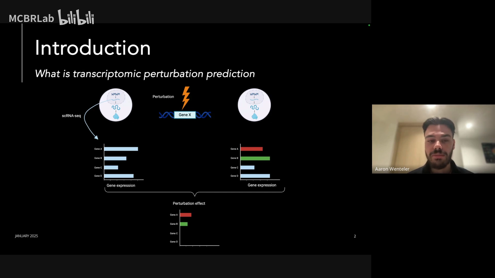

形式化地，对基因 $g$：

$$
\Delta_g = \bar{x}^{\text{pert}}_g - \bar{x}^{\text{ctrl}}_g
$$

这个 $\Delta_g$ 就是预测任务的标签。**注意它不是表达值本身，而是表达值之差**——这一点决定了后面所有指标的形态：你评的是「预测的 Δ」和「真实的 Δ」有多接近，而不是「预测的表达谱」和「真实的表达谱」有多接近。

### 1.2 为什么值得预测：从机制到靶点

讲者给了三层动机。第一层是**机制**：转录组层面的扰动效应能告诉你基因之间如何相互作用、如何构成更大的基因调控网络，而这些网络往往是许多疾病的基础。第二层是**治疗**：基因或其对应的蛋白常常就是药物靶点，如果能预测「靶向这个基因会把细胞状态推多远」，就能在湿实验之前筛靶点。第三层是**个体化**：更进一步，这类预测甚至能区分个体之间、群体之间的差异，把药物发现推向个性化医疗的范式 [【跳转到 04:37】](https://www.bilibili.com/video/BV1e3AKe6E6H/?t=277)。

### 1.3 一句话记住任务形态

把这三层动机压成一句话：**扰动预测是「输入一个干预，输出一个分布位移」**。位移是分布层面的东西，而大多数论文用的指标是逐基因层面的东西——这个错配，就是本节所有陷阱的源头。

## 二、被测对象是什么：scFM 的三条隐含假设

### 2.1 预训练 → 嵌入 → 探针

scFM 的通用配方是：把细胞×基因矩阵喂给一个 Transformer 骨干，用**掩码语言建模**（masked language modeling，MLM）目标预训练——遮住一部分表达值，让模型从上下文重构它们；训练好后，取中间层表示作为**细胞嵌入**（cell embedding），再拿去做下游任务 [【跳转到 07:07】](https://www.bilibili.com/video/BV1e3AKe6E6H/?t=427)。

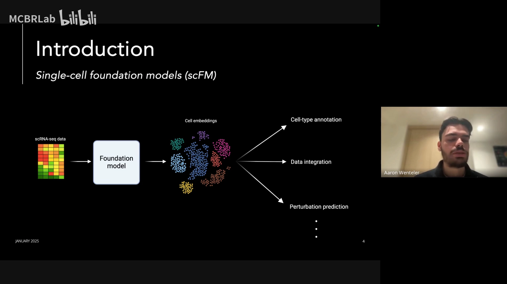

讲者特别说明了他评测的姿势：**不去微调模型，只做零样本嵌入 + 线性探针**。理由和大语言模型一样——预训练阶段为了检查嵌入质量，通常会在零样本嵌入上直接挂一个线性探针甚至非线性探针，看嵌入本身携带多少信息 [【跳转到 12:27】](https://www.bilibili.com/video/BV1e3AKe6E6H/?t=747)。这里探针是一层 MLP，任务是回归扰动后的表达。

### 2.2 三条假设，决定了指标能测出什么

讲者列了三条他认为必须先摆到桌面上的假设 [【跳转到 08:12】](https://www.bilibili.com/video/BV1e3AKe6E6H/?t=492)：

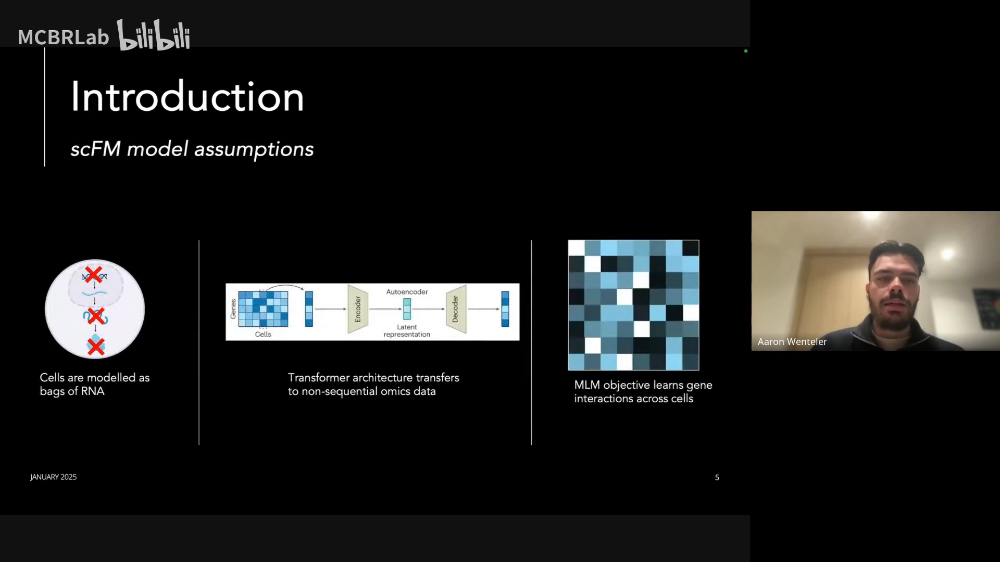

1. **细胞是一袋 RNA**（cells are modelled as bags of RNA）。这是对真实生物学的极度简化——即使你在转录组层面理解了机制，也未必讲完了整个故事。
2. **把 Transformer 搬到非序列数据上**。语言里词序有严格语义，正是顺序让句子成为句子；而基因表达矩阵没有这种顺序结构。作为对比，蛋白质里氨基酸的顺序对最终三维构象是决定性的——那里顺序真的重要，这里不一定。
3. **MLM 目标能学到基因互作**。有人认为只要给模型看足够多的例子，一个基因的调控如何影响另一个基因，就会在嵌入空间里被表示出来。

为什么要先讲假设？因为**指标只能测到你假设成立的那部分**。如果「细胞是一袋 RNA」这个简化丢掉了扰动响应的关键结构，那么再精细的逐基因相关也测不出丢失的东西——你只会得到一个漂亮的数字，然后误以为模型学到了机制。

## 三、逐基因指标：MSE 与相关，以及它们为什么会被稀释

### 3.1 MSE：越低越好，但被大效应基因主导

视频里主用的逐基因指标是**均方误差**（mean squared error，MSE）：

$$
\mathrm{MSE} = \frac{1}{\lvert G \rvert}\sum_{g \in G}\left(\hat{\Delta}_g - \Delta_g\right)^2
$$

其中 $G$ 是被评价的基因集合，$\hat{\Delta}_g$ 是预测的扰动效应，$\Delta_g$ 是真实值。MSE 越低越好，它对**绝对误差**敏感，因此天然被两类基因主导：表达量高的基因（数值大）和效应大的基因（$\Delta$ 大）。这也意味着 MSE 的绝对值本身没有跨数据集的可比性——换个归一化方式、换个基因子集，数字就变了。

### 3.2 相关：在整个基因集上算，会被「没变化的基因」稀释

Pearson / Spearman 相关是论文里最常报的数字，也是最容易误导的。原因很朴素：**一个扰动通常只改变几百个基因，而矩阵里有一两万个基因**。如果把所有基因都放进相关系数的计算，绝大多数基因的真实 $\Delta \approx 0$、预测 $\Delta \approx 0$，它们对相关系数的贡献是「两个零一起动」——这会让相关系数看起来很高，但完全不能说明模型抓到了真正的响应。

$$
r = \frac{\sum_{g}\left(\hat{\Delta}_g - \bar{\hat{\Delta}}\right)\left(\Delta_g - \bar{\Delta}\right)}{\sqrt{\sum_{g}\left(\hat{\Delta}_g - \bar{\hat{\Delta}}\right)^2}\sqrt{\sum_{g}\left(\Delta_g - \bar{\Delta}\right)^2}}
$$

所以业界的常见做法是**只在差异基因上算**。但「差异基因」怎么定义、取多少个，必须写清楚——这就引出下一个问题。

### 3.3 top-N 的 N 必须写死：视频里的两种基因子集

PertEval-scFM 明确设了两种实验设置 [【跳转到 24:59】](https://www.bilibili.com/video/BV1e3AKe6E6H/?t=1499)：

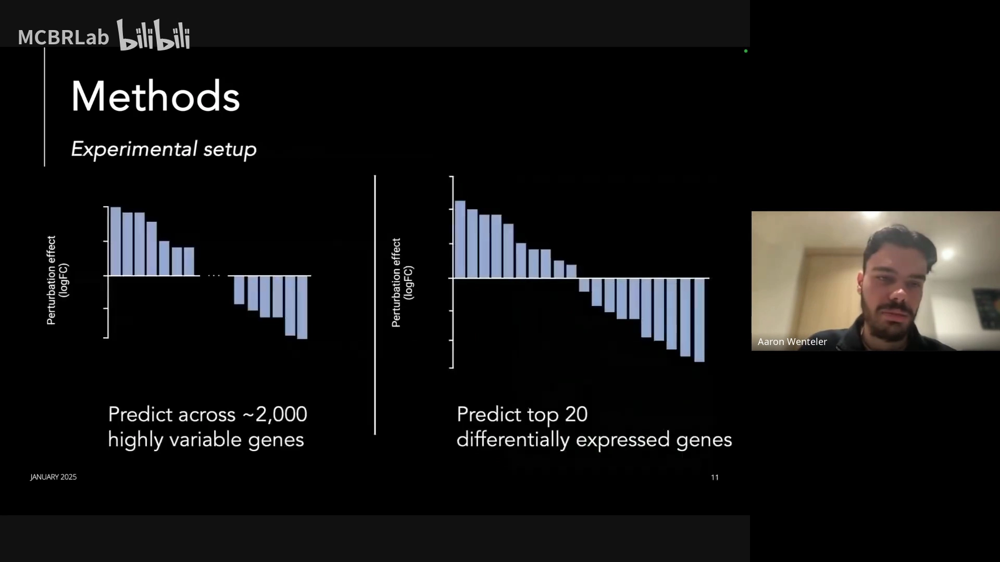

- **设置 A：约 2000 个高变基因（HVG）**。这是单细胞分析的标准预处理——先过滤掉不表达或不变异的基因，取 top-2000 HVG。讲者的评论很尖锐：对扰动预测来说，这个选择**本身就已经高估了「真正有趣、真正可测」的部分** [【跳转到 25:24】](https://www.bilibili.com/video/BV1e3AKe6E6H/?t=1524)。
- **设置 B：每个扰动的前 20 个差异表达基因（top-20 DEG）**。这些才是该扰动里最有趣的部分。

两个设置给出的结论**不一样**，这是本节最重要的实证之一（详见第八章）。所以「我们的模型在扰动预测上相关性 0.9」这句话，如果不写清是哪个基因子集、N 是多少，它就是一句不可核查的话。

### 3.4 还有两个逐基因指标，视频里没展开但同样常用

为了让指标清单完整，这里补两个同族指标（视频未使用，属于概念补充）：

- **DE 方向一致性**：预测上调的基因，真实是否也上调。只看符号，不看幅度。它的好处是对幅度误差不敏感——「方向对了、幅度错了」也算部分成功；坏处是它对「全部预测成 0」这种偷懒模型不惩罚（符号为 0 时怎么算都模糊），所以必须和幅度类指标一起报。
- **top-k 重合度**：预测的 top-k 差异基因集合与真实的 top-k 有多少交集（常用 Jaccard 或 recall@k）。它直接回答「我按你的预测去挑靶点，能挑中几个真的」，比相关系数更接近下游用法，但同样对 k 敏感。

## 四、分布层面的指标：e-distance 与它同族的距离

### 4.1 为什么逐基因指标不够

扰动改变的是**整个细胞群体的状态分布**，不只是几个基因的均值。一个模型可能把每个基因的均值都预测得不错，却完全没有预测出「细胞群体被推向了另一个状态」这件事。逐基因相关抓不到这种整体位移，所以需要分布距离。

### 4.2 e-distance：把「扰动有多强」变成一个数

视频里用的分布指标是 **e-distance**（energy distance，能量距离）。它的直觉是：两个分布之间的距离，等于「两组样本两两距离」减去「各自内部两两距离」：

$$
E(P,Q) = \frac{2}{nm}\sum_{i=1}^{n}\sum_{j=1}^{m}\lVert p_i - q_j\rVert \;-\; \frac{1}{n^2}\sum_{i=1}^{n}\sum_{j=1}^{n}\lVert p_i - p_j\rVert \;-\; \frac{1}{m^2}\sum_{j=1}^{m}\sum_{j'=1}^{m}\lVert q_j - q_{j'}\rVert
$$

其中 $P=\{p_i\}$ 是对照细胞、$Q=\{q_j\}$ 是扰动细胞。第一项是「跨组平均距离」，后两项是「组内平均距离」——如果两组混在一起，跨组距离就等于组内距离，$E$ 归零。所以 $E$ 越大，说明扰动把细胞推得越远。

讲者的用法有两步：先**量化扰动强度**（这个扰动把细胞推离对照状态多远），再通过多次检验判断这种位移在统计上是否显著 [【跳转到 23:39】](https://www.bilibili.com/video/BV1e3AKe6E6H/?t=1419)。注意这一步很关键：**e-distance 在视频里不是「预测准确度」指标，而是「难度分层」指标**——它把扰动按强度排开，然后你去看模型在强扰动上表现如何。

### 4.3 同类指标的取舍

同一族里还有两个常见替代（视频未使用，属概念补充）：

- **MMD（最大均值差异）**：在核空间里比较两个分布的均值嵌入，$\mathrm{MMD}^2 = \lVert \mu_P - \mu_Q \rVert_{\mathcal{H}}^2$。它对核函数与带宽敏感，好处是计算快、可用核技巧。
- **Wasserstein 距离**：最优传输视角下的距离，会考虑分布的几何结构（把一堆质量搬到另一堆的最小代价）。它比 e-distance 更能反映「形状」差异，但计算更贵。

三者的共同陷阱是**对细胞数敏感**：细胞越多，样本分布越接近真实分布，估计出的距离越小（且方差越小）。所以跨模型比较 e-distance / MMD / Wasserstein 时，**必须下采样到相同细胞数**，否则你测的是「谁的数据多」，不是「谁预测得准」。
## 五、难度可调的划分与 AUSPC：把「鲁棒性」变成一个数字

### 5.1 随机划分细胞，等于把答案发给模型

在讲指标之前，讲者先讲**划分**，因为划分错了，指标再好也没意义。他说这部分用了稍微非传统的方法，借助了 Spectra 这个工具（Ektefaie 等，*Nature Machine Intelligence* 2024）[【跳转到 19:04】](https://www.bilibili.com/video/BV1e3AKe6E6H/?t=1144)。

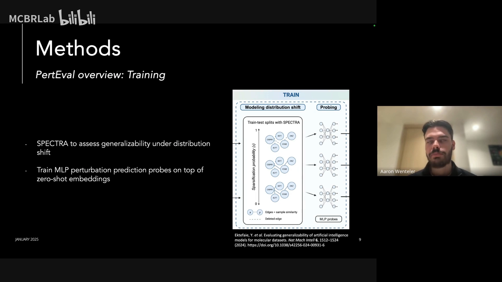

做法是：先算**扰动之间的相似性**，把扰动映射到一张图上，图上相邻的节点相似；然后按一个参数**删除节点之间的边**，把图打散成若干子图；最后从一部分子图采训练集、从另一部分子图采测试集。这样，训练集和测试集之间的相似性就被这个「删边比例」直接控制住了 [【跳转到 19:29】](https://www.bilibili.com/video/BV1e3AKe6E6H/?t=1169)。

这个参数叫**稀疏化概率**（sparsification probability，记作 $\gamma$）。$\gamma$ 越高，图越稀疏、子图之间越不相似，训练集与测试集的差异就越大，评估也就越难 [【跳转到 20:19】](https://www.bilibili.com/video/BV1e3AKe6E6H/?t=1219)。

对比一下常见的做法就明白它解决了什么问题：**如果你随机划分细胞**，同一个扰动的细胞会同时出现在训练集和测试集里——模型不需要「预测」，它只要「记住这个扰动的平均响应」就能拿高分。这就是本节要反复强调的**数据划分不严**陷阱。讲者的评价是，Spectra 这种把难度参数化的划分方式「非常优雅」，因为你能**直接量化你所用数据的难度**，而不是靠一句「我们按 8:2 随机划分」蒙混过去。

### 5.2 AUSPC：一条曲线下的面积，比一个点更稳

有了可调的难度，就有了新的指标形态。讲者与 Spectra 作者共同开发了 **AUSPC**（Area Under the Spectra Performance Curve，Spectra 性能曲线下面积）[【跳转到 21:59】](https://www.bilibili.com/video/BV1e3AKe6E6H/?t=1319)。

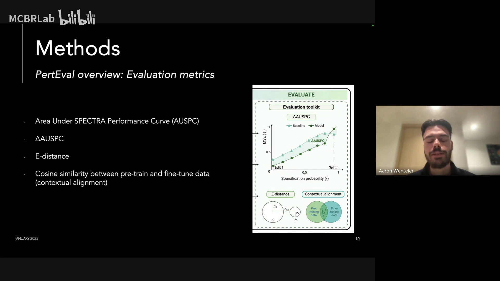

思路是：在 $\gamma$ 从 0 到 1 的每个取值上训练一次、评一次 MSE，得到一条「MSE 随难度上升」的曲线；然后取曲线下的面积：

$$
\mathrm{AUSPC} = \int_{0}^{1} \mathrm{MSE}(\gamma)\, d\gamma
$$

面积越小，说明模型在**整个难度区间**上都稳。这比单点报告强得多：单点报告只告诉你「在某个划分下 MSE 是多少」，而 AUSPC 告诉你「难度上升时你退化得有多快」。讲者还进一步定义了两个量：

- **ΔAUSPC**：模型 AUSPC 与基线 AUSPC 之差，正值表示比基线好。这样报数字时不用再让读者自己去心算。
- **曲线之间的面积**：直接比较「模型退化曲线」与「基线退化曲线」围出的区域，作为模型对**分布漂移**鲁棒性的指示 [【跳转到 22:49】](https://www.bilibili.com/video/BV1e3AKe6E6H/?t=1369)。

### 5.3 这个指标自身的边界

讲者很诚实地补了一句：$\gamma$ 不能一直往上调。随着 $\gamma$ 增加，相似性图里的子图数量增加，到某个点你就**没法再从子图里采样**了，因为剩下的子图彼此太不同、样本量太小。在 0 到 1 的范围内，他们的经验是 **0.7 之后样本量已经太少**，无法做有意义的预测 [【跳转到 30:48】](https://www.bilibili.com/video/BV1e3AKe6E6H/?t=1848)。

这是一条值得抄下来的实践规则：**难度旋钮有上限，超过上限的数字不是「更难」，而是「没数据」**。

### 5.4 第四个指标：预训练数据与微调数据的余弦相似度

视频里还有一项容易被忽略的指标——**预训练数据集与微调数据集之间的余弦相似度**，讲者称之为「语境对齐」（contextual alignment）。动机来自 scFM 领域的一个观察：预训练数据与下游数据的相似性，能预示微调阶段能获得多大改进 [【跳转到 24:04】](https://www.bilibili.com/video/BV1e3AKe6E6H/?t=1444)。

严格说这不是「预测准确度」指标，而是**解释性指标**：它帮你判断「这个模型在这个任务上失败，是因为它没学到东西，还是因为这个任务的数据根本不在它的预训练分布里」。做跨数据集评测时，这个数字比 MSE 更能解释原因（跨数据集验证本身属于 5.4.4 的范围，这里只点到）。

## 六、任务层面的指标：最接近「有没有用」

### 6.1 未见扰动：one-hot 编码的死穴

逐基因和分布指标都在回答「预测得准不准」，但下游真正关心的是「能不能用在没做过的扰动上」。这直接决定了**你怎么把扰动喂给模型**。

讲者说他试过 one-hot 编码：为每个基因建一个查找表，把训练集里的扰动标识告诉模型。问题是——**one-hot 没法扩展到未见过的扰动**，因为查找表里根本没有那个基因 [【跳转到 16:34】](https://www.bilibili.com/video/BV1e3AKe6E6H/?t=994)。

他的替代方案是**用相关性向量表示扰动**：对给定的扰动，取被扰动基因与所有其他基因表达的相关性作为特征（自相关恒为 1）。这大致表示了该基因与其他基因的**一阶相互作用强度**，于是即使模型从未见过某个基因的扰动，它也已经对「基因之间如何关联」有了感觉 [【跳转到 17:24】](https://www.bilibili.com/video/BV1e3AKe6E6H/?t=1044)。问答环节有人追问「为什么用 Pearson 相关而不是 one-hot」，他的回答就是这一条：one-hot 只告诉模型身份，相关性告诉模型关系 [【跳转到 43:03】](https://www.bilibili.com/video/BV1e3AKe6E6H/?t=2583)。

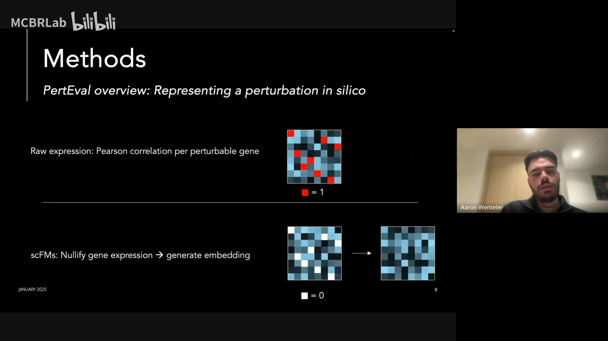

对 scFM，做法不同：把目标基因的表达**置零**（讲者叫 nullify，即「无效化」），再从这个「敲除版本」的细胞生成嵌入。这里有个容易踩的坑——不同 scFM 的基因表示方式不一样：**非参数化**的模型（如 Geneformer）按表达值给基因排名、分配基因 token，所以「无效化」意味着把该基因移到排序列表的**末尾**；而**参数化**的模型（如 scGPT）直接用数值表达计数，把那个值设为 0 即可 [【跳转到 18:39】](https://www.bilibili.com/video/BV1e3AKe6E6H/?t=1119)。

**这一段为什么属于「指标」话题？** 因为「怎么表示扰动」和「怎么评扰动」是同一个问题的两面：如果你的扰动表示方式只对训练集里的扰动有效，那么你在测试集上测到的任何指标都在测「记忆能力」，而不是「预测能力」。

### 6.2 排序类指标：更接近下游用法

视频没有直接使用排序指标，但从它的结论可以推出来。下游真正要做的决策通常是「给我一个候选扰动列表，按有效性排序」——这时你关心的是 **AUROC**（把真阳性排在假阳性前面的能力）、**AUPRC**（正例稀少时更合适）、**NDCG@k**（前 k 名的排序质量）。这类指标和逐基因指标的差别在于：它对「幅度预测错」相对宽容，对「排序错」极其敏感。

实践建议：如果论文的卖点是「帮实验学家选靶点」，就必须报排序指标；只报 MSE 和相关系数，等于回避了真正的使用场景。

### 6.3 跨背景与组合扰动：指标要跟着设定变

视频结尾讲者提到未来方向时，把「覆盖人类表型谱的数据、多模态、临床相关细胞类型」列为数据侧的改进重点；问答里也讨论了「细胞类型 → 细胞状态」的转变 [【跳转到 51:09】](https://www.bilibili.com/video/BV1e3AKe6E6H/?t=3069)。这对应两类任务级设定：

- **跨背景泛化**：在 A 细胞系训练、B 细胞系测试。此时「按扰动划分」还不够，必须**按细胞背景划分**，否则同一细胞背景会泄漏。（详见 5.4.3）
- **组合扰动**：预测 A+B 的联合效应，评价的是「加性基线之上的残差」——你必须先报一个「$\Delta_{A+B} \approx \Delta_A + \Delta_B$」的加性基线，才能说模型学到了协同或拮抗。

## 七、五个评测陷阱：指标选错，进展就是假的

这一章是本节的核心。视频里的每一条都能在 PertEval-scFM 的结果里找到对应的证据。

### 7.1 陷阱一：指标与训练目标同源

如果模型在 MMD 上训练，你又在 MMD 上评测，那你测的是「优化器有没有收敛」，不是「预测对不对」。同理，用 MLM 目标预训练的 scFM，如果评测任务恰好也是「重构被遮住的表达」，那高分是必然的。

视频里的对应证据在问答环节：有人问「MLM 目标和扰动是否自洽」——你把整个基因关掉，模型重构那个基因表达的能力应该受影响，所以重构结果本该是确定的；讲者承认目前的预训练目标与扰动任务并不对齐，并提出一个「低垂的果实」：为不同类型的扰动（激活/上调/下调）设不同的 token，因为**当前这些模型根本没有扰动方向性的概念** [【跳转到 48:16】](https://www.bilibili.com/video/BV1e3AKe6E6H/?t=2896)。

**自检问题**：你的评测指标，是否出现在你的损失函数里？如果是，请换一个不同族的指标复核。

### 7.2 陷阱二：数据划分不严

这是最致命、也最常见的一条。随机划分**细胞**（而不是按扰动、按样本、按供体划分）会导致训练集和测试集共享同一个扰动——模型只要记住「这个扰动的平均响应」就能拿高分。

PertEval-scFM 的做法（第五章）就是这条陷阱的解药：按扰动相似性建图、按 $\gamma$ 删边、从不同子图采样。讲者还强调，通常人们会用别的方式参数化划分——比如**按时间划分**，或者用某种有生物学意义的方式 [【跳转到 20:44】](https://www.bilibili.com/video/BV1e3AKe6E6H/?t=1244)。关键是：**划分方式必须写进论文，并且能被别人复现**。

### 7.3 陷阱三：只报均值不报方差

不同随机种子之间的差异，可能比模型之间的差异还大。视频里的结果表把这一点做对了——每个格子都是「均值 ± 标准差」：

| 模型 | MSE @ γ=0.0 | MSE @ γ=0.7 | AUSPC | ΔAUSPC（×10⁻²） |
| :--- | ---: | ---: | ---: | ---: |
| Mean baseline（均值基线） | 0.398 ± 0.043 | 0.604 ± 0.144 | 0.345 ± 0.011 | — |
| UCE | 0.355 ± 0.037 | 0.624 ± 0.162 | 0.334 ± 0.012 | +1.078 |
| scBERT | 0.381 ± 0.038 | 0.608 ± 0.149 | 0.336 ± 0.011 | +0.878 |
| MLP gene expression（原始表达基线） | 0.379 ± 0.038 | 0.622 ± 0.172 | 0.342 ± 0.013 | +0.312 |
| scGPT | 0.402 ± 0.035 | 0.828 ± 0.249 | 0.347 ± 0.015 | −0.168 |
| scFoundation | 0.406 ± 0.041 | 0.638 ± 0.166 | 0.350 ± 0.011 | −0.486 |
| Geneformer | 0.405 ± 0.044 | 0.902 ± 0.220 | 0.351 ± 0.014 | −0.564 |

（数据来自视频第 13 张结果表，评价范围是每个扰动的 top-20 差异基因；AUSPC 越低越好，ΔAUSPC 为相对均值基线的改进，正值表示更好。）

看标准差这一列就知道为什么必须报：γ=0.7 时 Geneformer 的 MSE 是 0.902 ± 0.220，标准差是均值的四分之一。**在这种噪声水平下，模型之间 0.01 的差距毫无意义**。讲者自己的措辞也很克制——在 2000 HVG 的设置里他说「这里的差异不是很显著」[【跳转到 27:00】](https://www.bilibili.com/video/BV1e3AKe6E6H/?t=1620)。

### 7.4 陷阱四：跨论文数字不可比

同一句「我们的 MSE 是 0.35」，在不同论文里可能意味着完全不同的东西：

- **数据版本不同**：同一个 Perturb-seq 数据集，有没有重新做 QC、用哪版基因注释，数字就变了；
- **划分方式不同**：随机划分细胞 vs 按扰动划分，难度差一个量级；
- **指标定义不同**：MSE 是在 HVG 上算还是在 top-20 DEG 上算？是在 Δ 上算还是在表达值上算？
- **符号与方向不同**：ΔAUSPC 的正号到底是「更好」还是「更差」？视频里 AUSPC 是「越低越好」，所以 ΔAUSPC 被定义成「基线减模型」，正号才是更好。**换一篇论文，同一个符号可能意思相反。**

这就是为什么本节的结论是：**报告一个指标矩阵，而不是一个数字**。

### 7.5 陷阱五：基线缺失

没有基线，你无法判断模型是否真的有价值。PertEval-scFM 设了两个基线，各有各的作用 [【跳转到 13:54】](https://www.bilibili.com/video/BV1e3AKe6E6H/?t=834)：

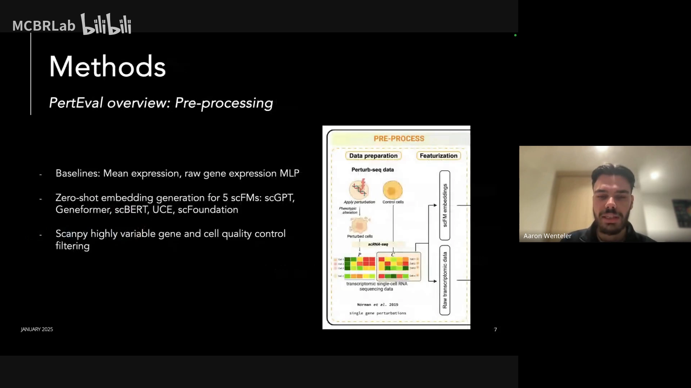

- **均值基线（mean expression）**：对给定细胞，直接预测所有基因的平均表达，也就是「什么都不预测」。讲者的原话很值得记住——如果你的指标显示「预测几乎没有变化」，而它已经是个很强的基线，那么**这本身就是关于这个任务的重要信息** [【跳转到 14:44】](https://www.bilibili.com/video/BV1e3AKe6E6H/?t=884)。
- **原始表达基线（raw gene expression MLP）**：不做嵌入，直接用原始表达值训练一个 MLP。它衡量的不是「模型好不好」，而是「**嵌入到底带来了什么**」——两者之差就是 scFM 在嵌入空间里注入的语义性，如果有的话 [【跳转到 15:34】](https://www.bilibili.com/video/BV1e3AKe6E6H/?t=934)。

只报模型、不报这两个基线，等于没有对照组。而「均值基线」之所以必须报，是因为**扰动数据本身极度稀疏**：大多数基因没变化，所以「预测 0」在 MSE 上天然占优。这一点在第八章的结果里被反复验证。

## 八、结果怎么读：五个基础模型 vs 两个基线

### 8.1 在 2000 个高变基因上：预测被「同质化」了

第一组结果是设置 A（约 2000 HVG）。一眼看过去，热图里出现了大量的**同质化**：不同模型、不同稀疏化概率下的 MSE 都挤在 0.059–0.086 这个窄区间里 [【跳转到 26:10】](https://www.bilibili.com/video/BV1e3AKe6E6H/?t=1570)。

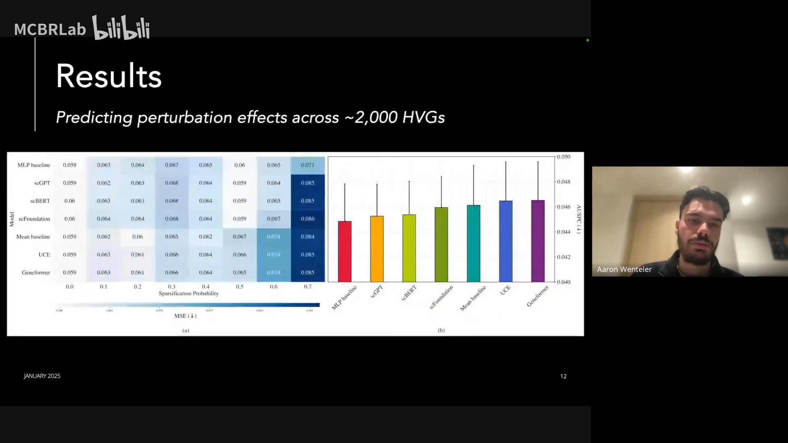

讲者的解读是：这暗示**这些基因对这个特定任务来说并不都那么有信息量**。随着划分变难，性能有显著的下降趋势，在基础模型上尤其明显；而在 HVG 这个视角下，**MLP 基线受损反而较少**，反映在 AUSPC 上就是 MLP 基线表现最好 [【跳转到 27:00】](https://www.bilibili.com/video/BV1e3AKe6E6H/?t=1620)。

注意这里的对比有多刺眼：一个只用原始表达训练的 MLP，在「高变基因」这个最宽的评价范围里，比五个预训练过的基础模型都稳。

### 8.2 在 top-20 差异基因上：均值基线已经很强

第二组结果是设置 B（top-20 DEG）。只在这个范围里评价，模型之间的差异才变得可见 [【跳转到 27:44】](https://www.bilibili.com/video/BV1e3AKe6E6H/?t=1664)。

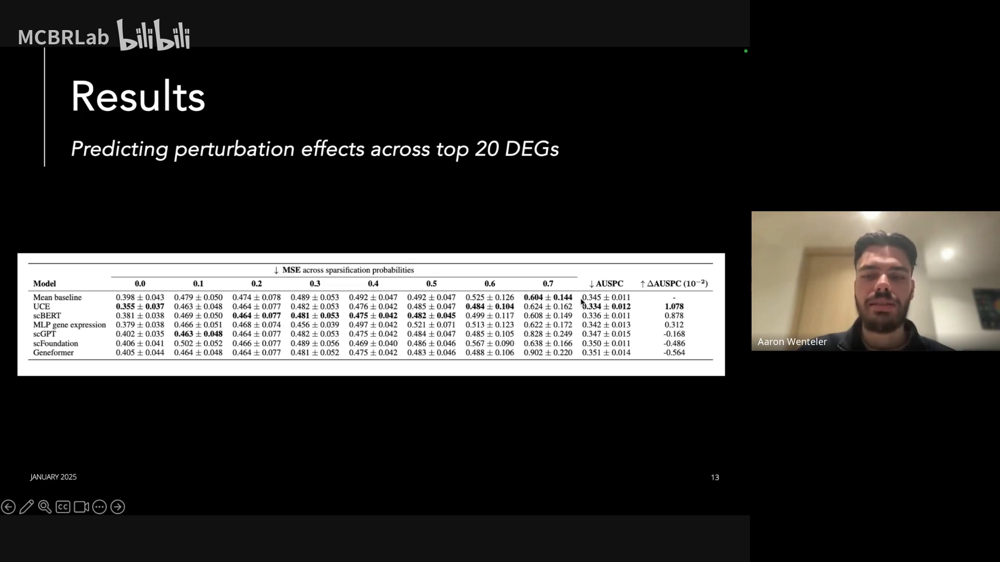

讲者的两个观察值得原样记下来：

1. **均值基线已经相当出色**——即使这里有更多有趣的信号，仍然存在大量的「平均信号」[【跳转到 28:09】](https://www.bilibili.com/video/BV1e3AKe6E6H/?t=1689)；
2. **基础模型只在「实际改变的基因」上评价时**，其中一部分才比均值基线好一点，但**考虑到投入的算力**，这个提升「总的来说并不令人印象深刻」[【跳转到 28:34】](https://www.bilibili.com/video/BV1e3AKe6E6H/?t=1714)。

从第七章那张表看具体数字：UCE（ΔAUSPC +1.078×10⁻²）和 scBERT（+0.878×10⁻²）确实优于均值基线，原始表达 MLP 略优（+0.312×10⁻²），而 scGPT（−0.168×10⁻²）、scFoundation（−0.486×10⁻²）、Geneformer（−0.564×10⁻²）**都比「什么都不预测」更差**。

这就是「基线缺失」陷阱的实证：如果论文只报自己模型的 MSE，不报均值基线，读者根本看不出这个模型其实在拖后腿。

### 8.3 按扰动强度分层：强扰动才是灾难现场

讲者接着回到 e-distance，把扰动按强度排开。他的假设是：单基因扰动大多不在基因调控网络的中心，不会引发强效应；而**只有强信号才是模型能学到的** [【跳转到 29:33】](https://www.bilibili.com/video/BV1e3AKe6E6H/?t=1773)。

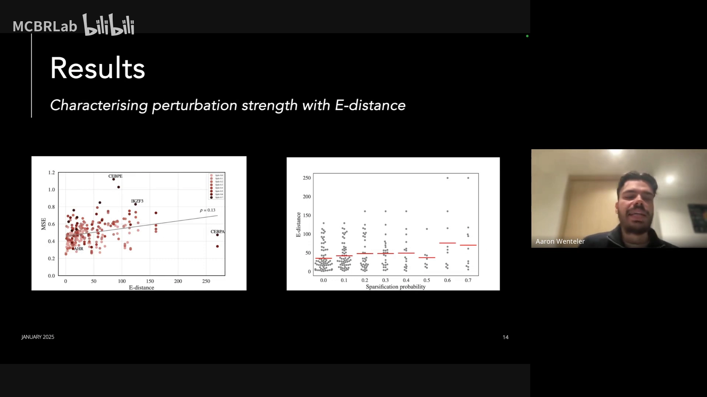

结果证实了他的担心：**大多数扰动都聚集在低 e-distance 区域**，也就是说训练数据里主要是「很普通的、平均的扰动」。这有两个后果：

- 模型在训练时看到的主要是弱效应样本，因此学不到强扰动的规律；
- 真正有趣的、强效应的扰动，恰好落在数据稀疏的区域，预测最差。

左图里相关系数只有 **ρ = 0.13**——扰动强度和预测误差几乎不相关。这个数字本身就是一条方法论警告：**「MSE 低」不代表「难的任务做对了」，可能只是「难的任务没被评到」**。图上标注的 CEBPE、IKZF3、CEBPA、AHR 就是几个被单独拎出来看的例子。

### 8.4 三种失败模式：模型都在均值附近猜

讲者挑了三个扰动做案例分析，结论是三种完全不同的分布形态，指向同一个失败机制 [【跳转到 31:24】](https://www.bilibili.com/video/BV1e3AKe6E6H/?t=1884)。

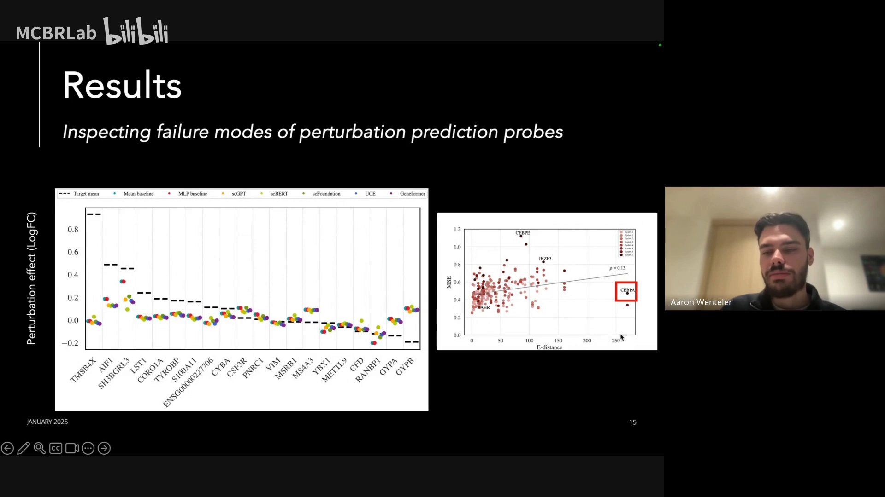

这张图是全场最有说服力的一张。横轴是基因，纵轴是扰动效应（logFC），黑色虚线是真实值：前两个基因的真实效应接近 0.5 和 0.9。所有模型的彩色点却都挤在 0 附近——**它们不是在预测，而是在回归均值**。

三种模式分别是：

1. **效应集中在少数基因、然后迅速衰减到平均**：这类扰动反而预测得不错，因为「大量基因没变化」被均值基线处理得很好；
2. **效应广泛分布**：模型仍然在均值附近猜，因为它不知道方向和幅度；
3. **效应均匀下降**：同样是均值附近的一大片点。

讲者的总结是：模型能捕捉到「这里有一些基因受到显著影响」（表现为预测的方差变大），但**它不知道方向，也不知道变化的程度** [【跳转到 34:19】](https://www.bilibili.com/video/BV1e3AKe6E6H/?t=2059)。

这也解释了一个常见的误读：如果只看「预测值的方差」或「相关性」，你会觉得模型「抓住了信号」；但一旦落到逐基因的方向和幅度上，它什么都没抓住。

## 九、讲者的结论与改进方向

### 9.1 工具箱比结论更重要

讲者把贡献总结成一套**模块化评测框架**，而不是「某某模型不行」这个结论 [【跳转到 35:28】](https://www.bilibili.com/video/BV1e3AKe6E6H/?t=2128)：

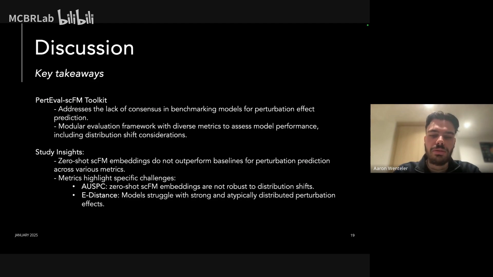

- **评估指标**：AUSPC、ΔAUSPC、e-distance、语境对齐（余弦相似度）；
- **训练/测试划分**：Spectra 的难度可调划分；
- **分布漂移的模拟**：用 $\gamma$ 扫描出整条退化曲线；
- **鲁棒性评估与解释方法**：看模型在哪里出错。

他强调这套工具**不只适用于基础模型**，同样适用于任何定制的扰动预测模型 [【跳转到 35:53】](https://www.bilibili.com/video/BV1e3AKe6E6H/?t=2153)。这一点很重要：本节讲的不是「基础模型不行」，而是「评测方法要标准化」。

他还专门点了一句方法论上的批评：**人们常常只用一个简单的相关性指标，就断言自己的扰动预测方法好或不好，这非常普遍、非常有偏见，实际上有点误导** [【跳转到 36:43】](https://www.bilibili.com/video/BV1e3AKe6E6H/?t=2203)。

### 9.2 数据侧的改进：从「细胞类型」到「表型景观」

讲者认为瓶颈在数据，不在算力。他的建议是 [【跳转到 39:52】](https://www.bilibili.com/video/BV1e3AKe6E6H/?t=2392)：

- **覆盖人类表型谱的数据**：现在常把细胞当成「细胞类型 A / 细胞类型 B」这种离散实体，但真实系统更像一个**连续光谱**，你只是拍到了它的一个快照——细胞可能正在改变身份，或经历其他过程；
- **多模态**：不只 RNA 一种模态；
- **临床相关的细胞类型**：让预测真的能落到疾病上。

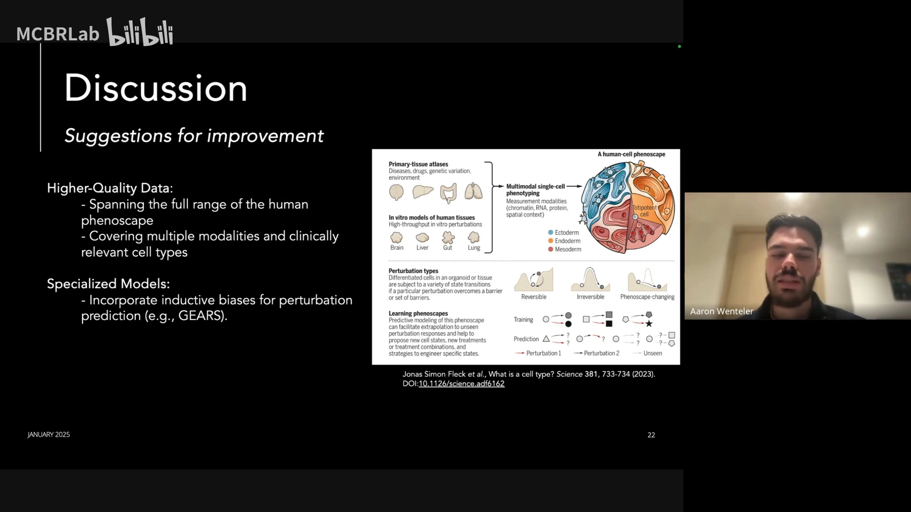

他引用了 Jonas Simon Fleck 等发表在 *Science*（2023）上的「What is a cell type?」一文，用**表型景观**（phenoscape）的框架来思考这件事：扰动可以是可逆的、不可逆的，或者改变细胞在景观中的位置 [【跳转到 50:44】](https://www.bilibili.com/video/BV1e3AKe6E6H/?t=3044)。这个视角对指标的启示是：如果扰动可以改变细胞身份，那么「在同一个细胞类型内比较 Δ」这个前提本身就可能不成立。

### 9.3 模型侧的改进：图方法已经赢了基础模型

讲者提到他们做了一些与 **GEARS** 的对比测试。GEARS 是一种图方法，它对「如何表示扰动」引入了**归纳偏置**（inductive bias），在他们的评估中**已经显示出优于任何基础模型的基线** [【跳转到 41:07】](https://www.bilibili.com/video/BV1e3AKe6E6H/?t=2467)。

这句话的分量在于：一个专门为扰动预测设计的小模型，赢过了用海量数据预训练的大模型。它再次说明**「预训练规模」不是这个任务的解**，而「对任务结构的正确假设」才是。

### 9.4 问答里的三个补充

**其一，为什么用 Pearson 相关表示扰动？** 见 6.1——为了给模型一阶基因互作的信息，从而能泛化到未见扰动。

**其二，MLM 目标与扰动任务并不自洽。** 见 7.1——置零一个基因后，重构本该是确定的，但模型并没有利用这个结构；改进方向是给扰动类型（激活/上调/下调）设不同的 token。

**其三，噪声上限问题。** 有听众问：输出噪声是否大到「你看到的模型差异只是噪声」？讲者的回答是，他们做了两件事降噪：按扰动把细胞分组（这本身就是一种降噪策略），以及在输入侧做 **pseudobulk**（伪聚集）——因为细胞间变异性太高会挑战预测任务，经验上最好的做法就是把单细胞数据聚合起来 [【跳转到 53:35】](https://www.bilibili.com/video/BV1e3AKe6E6H/?t=3215)。他还顺带否定了「基础模型的嵌入能抗噪」这个说法：至少按目前构建的方式，并非如此 [【跳转到 54:25】](https://www.bilibili.com/video/BV1e3AKe6E6H/?t=3265)。

**其四，top-20 DEG 里包含被敲除的基因本身吗？** 不包含，它被排除了；这些只是被扰动基因的**下游影响** [【跳转到 46:01】](https://www.bilibili.com/video/BV1e3AKe6E6H/?t=2761)。这个细节很重要——如果目标基因本身在评价集里，一个「把它预测成 0」的模型就能白拿分。

### 9.5 未来方向：并入 TDC

讲者说他们正在与 TDC（Therapeutics Data Commons）团队合作，把 PertEval 的框架并入后者更全面的评测体系——那里有大量不同的预测任务、标准化数据集和评估指标 [【跳转到 38:23】](https://www.bilibili.com/video/BV1e3AKe6E6H/?t=2303)。

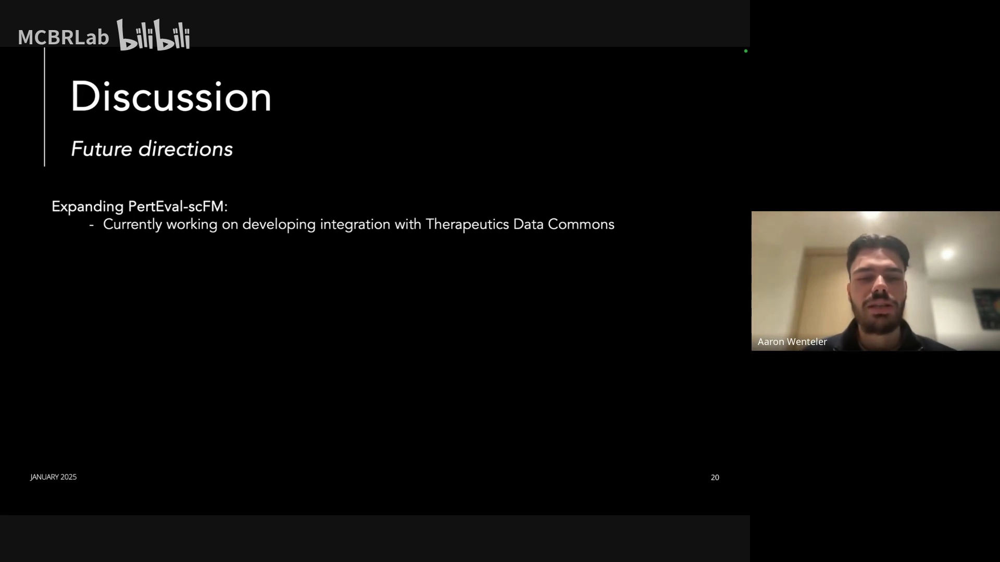

这件事本身说明了领域的现状：**扰动预测的评测还没有共识**，各家报各家的数字，所以需要把指标和数据集标准化到同一个平台上。

## 小结

- **扰动预测的标签是 Δ，不是表达值**。指标必须对准「预测的 Δ 与真实的 Δ」，否则你评的是别的东西。
- **逐基因指标会被稀释**。在整个基因集上算相关，会被大量「没变化」的基因抬高；只在 top-N 差异基因上算，N 必须写死。视频里 2000 HVG 与 top-20 DEG 给出的结论完全不同。
- **分布指标回答的是另一个问题**。e-distance（以及同族的 MMD、Wasserstein）衡量的是「细胞群体被推多远」，它在本视频里的主要用途是**按扰动强度分层**，而不是算准确度；跨模型比较时必须下采样到相同细胞数。
- **AUSPC 把「鲁棒性」变成一个数字**。用稀疏化概率 $\gamma$ 扫描出难度递增的曲线，取曲线下面积；比单点报告稳定得多。但 $\gamma$ 有上限（视频里 0.7 之后样本量不足）。
- **五个陷阱要逐条自检**：指标与训练目标同源、数据划分不严、只报均值不报方差、跨论文数字不可比、基线缺失。
- **基线不是可选项**。均值基线告诉你「这个任务有多容易被蒙对」，原始表达基线告诉你「嵌入到底带来了什么」。PertEval-scFM 的结论就是靠这两个基线才站得住：零样本 scFM 嵌入在多个指标上都没赢过它们。
- **失败模式是「回归均值」**。模型能感觉到「这里有信号」（方差变大），但不知道方向和幅度；ρ = 0.13 说明扰动强度与误差几乎无关，强扰动才是真正的灾难现场。

## 关键术语速查

| 术语 | 一句话解释 |
| :--- | :--- |
| 扰动效应（perturbation effect） | 扰动组与对照组的表达差 $\Delta_g$，是扰动预测任务的标签 |
| scFM（单细胞基础模型） | 在大规模 scRNA-seq 上自监督预训练、产出细胞嵌入的模型，如 scGPT、Geneformer、scBERT、UCE、scFoundation |
| 零样本嵌入（zero-shot embedding） | 不针对下游任务微调，直接取预训练模型的细胞表示 |
| 探针（probe） | 挂在冻结嵌入上的小模型（这里是一层 MLP），用来测嵌入本身携带多少信息 |
| MSE | 均方误差，对绝对误差敏感，被高表达与大效应基因主导 |
| top-20 DEG | 某扰动的前 20 个差异表达基因，评价范围最小也最贴近真实信号 |
| HVG | 高变基因，单细胞预处理里筛出的变异最大的基因（这里取约 2000 个） |
| e-distance | 能量距离，用「跨组平均距离减组内平均距离」衡量两个细胞分布的距离 |
| MMD | 最大均值差异，核空间里的分布距离，对核与带宽敏感 |
| Wasserstein 距离 | 最优传输距离，考虑分布几何结构，计算更贵 |
| 稀疏化概率 $\gamma$ | Spectra 划分的难度旋钮，越大则训练/测试集越不相似、评估越难 |
| AUSPC | Spectra 性能曲线下面积，把「MSE 随难度上升」的整条曲线压成一个数 |
| ΔAUSPC | 模型 AUSPC 相对基线的改进，正值表示优于基线 |
| 语境对齐（contextual alignment） | 预训练数据与微调数据的余弦相似度，用来解释「为什么这个任务上失败」 |
| nullify（无效化） | 把目标基因的表达置零（参数化模型）或移到排序末尾（非参数化模型），模拟 in silico 敲除 |
| pseudobulk | 把同一扰动的多个细胞聚合为伪样本，降低细胞间变异带来的噪声 |
| GEARS | 一种带图归纳偏置的扰动预测模型，在视频的评估里优于所有基础模型基线 |
