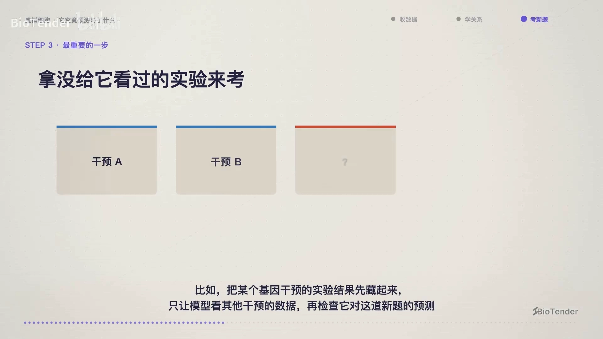
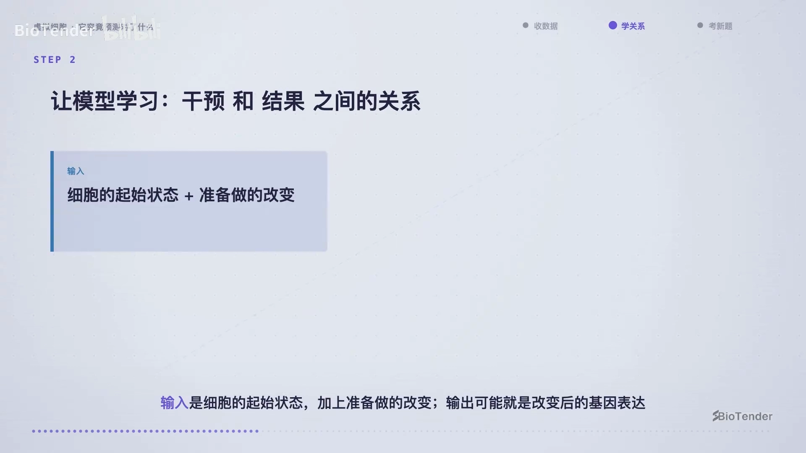
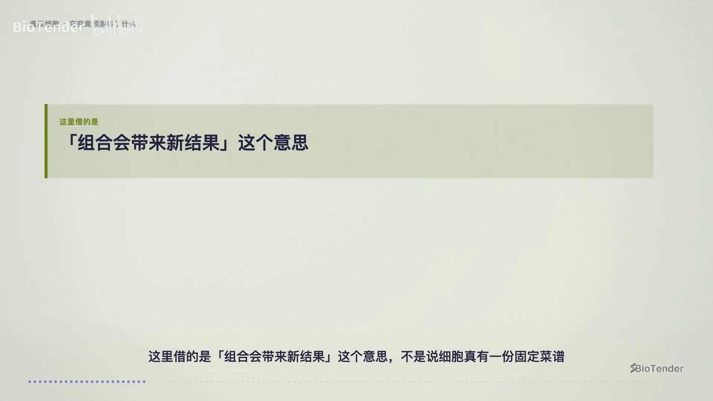
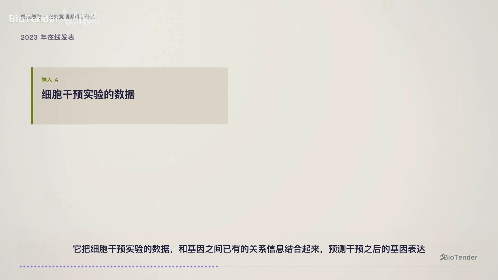
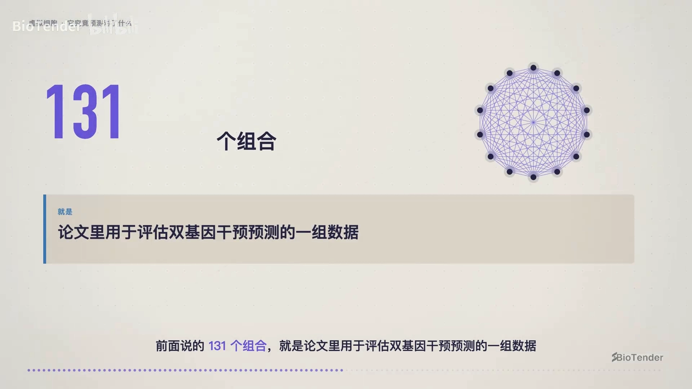
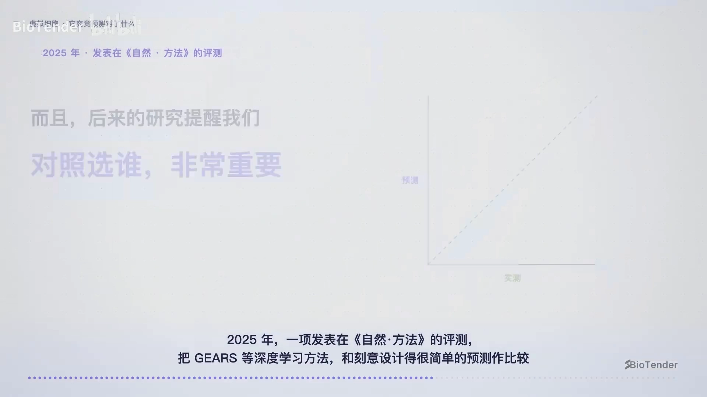

# 虚拟细胞靠谱吗：先问考题是不是真的没见过

> 视频来源：[虚拟细胞到底靠谱吗？AI×生物前沿解读](https://www.bilibili.com/video/BV18qJv6YEwZ/)（Bilibili · BioTender · Max 的虚拟博客）｜时长约 9 分钟
> 简要导读：这是一支面向初学者的科普解读，讲的是"虚拟细胞"这类模型到底在预测什么、怎么被检验、为什么还不能替代实验。本文按本小节的角度重排了它的逻辑：**把"未知"分层、把"预测已知"和"预测未知"分开、把基线摆到台面上**。模型架构细节与指标公式不在本文范围（分别见 5.3.x 与 5.4.1）。

## 本讲要解决的核心问题（SCQA）

**背景**：研究者想让电脑先替实验探路——给细胞加个药、或者改一个基因，先预测它会怎么反应，再决定真实实验怎么做。这类工作现在被统称为"虚拟细胞"。

**冲突**：但这里有个反常之处。模型报告"预测得很准"时，我们并不知道它准在**哪道题**上。如果那道题它在训练时见过，做对了不能说明它会预测；如果它连"把两个单扰动效应直接相加"这种简单规则都赢不了，模型再复杂也不能证明它学会了细胞。

**疑问**：那到底该怎么判断一个扰动预测模型靠不靠谱？

**回答（中心思想）**：**看三件事，而不是看指标——预测的究竟是什么、考题是不是真的没见过、跟简单办法比赢没赢。** 这三问对应本小节的三层内容：任务定义、划分策略、基线比较。

---

## 一、先分清任务：预测的是表达变化，不是"数字生命"

初学者最容易误解的一点，是把"虚拟细胞"想成屏幕上那个会转圈的细胞。视频里说得很直接：**动画只负责把东西画出来，虚拟细胞要接受检验——我改变一个条件，你预测的反应跟实验里发生的事情对不对得上** [【跳转到 00:40】](https://www.bilibili.com/video/BV18qJv6YEwZ/?t=40)。

它的定义其实很朴素：用计算机模型模拟细胞的某些功能和相互作用。这件事不是有了大模型才开始，以前就有研究者把已知的生物学规则写成模型；今天的 AI 路线则希望从大量数据里学习规律，两条路也可以结合 [【跳转到 01:05】](https://www.bilibili.com/video/BV18qJv6YEwZ/?t=65)。

具体到"预测基因表达"这条路线，流程可以拆成三步 [【跳转到 01:50】](https://www.bilibili.com/video/BV18qJv6YEwZ/?t=110)：

1. **收数据**：没有处理的细胞是什么状态，干预某个基因以后又是什么状态。常用测量是单细胞 RNA 测序，可以读出单个细胞里不同 RNA 的多少。视频把它比作一张"工作日志"——记录了细胞里哪些任务正在被安排、安排得多不多，但**别把日志当成整个细胞** [【跳转到 02:04】](https://www.bilibili.com/video/BV18qJv6YEwZ/?t=124)。
2. **学关系**：输入是细胞的起始状态加上准备做的改变，输出可能是改变后的基因表达。
3. **考新题**：拿没给它看过的实验来考。

注意第二步的措辞：**"输出可能是改变后的基因表达"**。这句"可能"很重要——不同模型负责的任务不一样，并没有一个所有虚拟细胞通用的万能按钮 [【跳转到 02:39】](https://www.bilibili.com/video/BV18qJv6YEwZ/?t=159)。所以"某模型能预测扰动"这句话，必须补上"预测的是什么"才成立。

## 二、为什么大家盯着"组合扰动"：这是最现实也最难的一类未知

为什么非要用电脑先探路？因为**想问的问题太多，实验能覆盖的范围有限**；尤其当你不止改变一个基因，而是把不同改变搭配起来，可能的组合会迅速增加 [【跳转到 01:05】](https://www.bilibili.com/video/BV18qJv6YEwZ/?t=65)。

视频用了一个做饭的类比：像试菜，单独加盐、单独加醋都试过了，一起加，味道却不一定是两次结果简单拼起来——**组合会带来新结果** [【跳转到 01:25】](https://www.bilibili.com/video/BV18qJv6YEwZ/?t=85)。它强调这不是说细胞真有一份固定菜谱，只是借"组合会产生新结果"这个意思 [【跳转到 01:33】](https://www.bilibili.com/video/BV18qJv6YEwZ/?t=93)。

这就把"未知"分成了三层，而这三层的难度完全不同：

| 未知的类型 | 通俗说法 | 训练集里没有什么 |
| --- | --- | --- |
| 未知扰动对象 | 这个基因没敲过 | 该扰动的数据 |
| 未知细胞背景 | 这个药没在这个细胞里试过 | 该细胞类型下的扰动数据 |
| 未知组合 | 两个都单独敲过，一起敲没试过 | 该组合的数据 |

组合这一类之所以最现实，是因为**它一定会发生**：哪怕只研究几十个基因，两两组合的数量也已经超出任何实验的承受范围。而它之所以最难，是因为组合效应可能互相加强、也可能互相抵消，不能靠单扰动简单拼出来 [【跳转到 03:44】](https://www.bilibili.com/video/BV18qJv6YEwZ/?t=224)。

视频举的真实例子是 GEARS（2023 年在线发表）：它把细胞干预实验的数据，和基因之间已有的关系信息结合起来，预测干预之后的基因表达 [【跳转到 03:39】](https://www.bilibili.com/video/BV18qJv6YEwZ/?t=219)。评估用的正是 **131 个双基因干预组合** [【跳转到 04:09】](https://www.bilibili.com/video/BV18qJv6YEwZ/?t=249)。

## 三、"考题真的没见过吗"：划分策略就是结论的边界

这是整支视频最关键的一段，也是本小节的核心命题。视频把"考新题"讲成了一个考试类比：

> 有点像考试：**背过的原题做对了，不能证明你真会；题目换了还能不能答对，才更接近我们想要的能力。** [【跳转到 03:04】](https://www.bilibili.com/video/BV18qJv6YEwZ/?t=184)

紧接着补了一句更关键的话：**考题还得说清楚，是在同一种细胞里换个基因，还是连细胞类型也换了——后者需要额外验证，不能因为前者做得不错就自动算过关** [【跳转到 03:29】](https://www.bilibili.com/video/BV18qJv6YEwZ/?t=209)。

这句话翻译成方法学语言，就是三种划分方式：

- **按细胞划分**（同一实验的细胞随机分训练 / 测试）：只证明"能复现同一实验"，**不能**证明"能预测新扰动"。它连批次都共享，难度最低。
- **按扰动划分（leave-one-perturbation-out）**：测试扰动完全不出现在训练集，这是"预测新扰动"的标准做法。
- **按细胞背景划分**：换了细胞类型或细胞系，原来的预测能力是否成立要重新证明（这一类属于 5.4.3 的范围，本文只点出它是另一道题）。

GEARS 的评测还做了一件值得学的事：**把组合题按难度分层**。有的题，两个基因单独被干预的结果都学过；有的题，连其中一个甚至两个基因单独被干预的结果都没在训练时见过 [【跳转到 04:14】](https://www.bilibili.com/video/BV18qJv6YEwZ/?t=254)。

这个分层直接决定了"预测"这个词的含义：**第一层是组合外推，第二层是扰动外推叠加组合外推。** 两类题混在一起报一个平均分，读者无法判断模型到底强在哪一层。

## 四、"没见过"凭什么猜：只能靠相似性先验

如果测试扰动在训练集里完全没有，模型凭什么猜？视频的回答很干脆：**靠基因之间的关系**——比如哪些基因经常有相似的表达变化、哪些参与相关的生物过程；模型试着借这些联系，把已有实验的信息用到没做过的组合上 [【跳转到 04:39】](https://www.bilibili.com/video/BV18qJv6YEwZ/?t=279)。

它用了一个很好懂的类比：像做饭时某种食材你没用过，但知道它跟另一种食材有相似的性质，就有了尝试的依据——**当然，像不等于完全一样** [【跳转到 04:44】](https://www.bilibili.com/video/BV18qJv6YEwZ/?t=284)。

这句话正好解释了本小节反复强调的那条判断：**预测未知扰动，本质是"用已知的相似性做外推"。** 如果模型没有利用任何相似性先验（基因网络、通路、靶点、结构），它就不可能比"找最相似的已知扰动"这种最近邻基线更好——因为没有信息可供外推。

## 五、基线的残酷性：加性规则赢过复杂模型

原论文在它设定的测试里报告了相对**所选对照方法**的改进，这说明这条预测路线有可以检验的进展 [【跳转到 04:54】](https://www.bilibili.com/video/BV18qJv6YEwZ/?t=294)。注意"所选对照方法"这个限定——它决定了这个改进有多硬。

接下来的转折是整支视频最有价值的部分：**2025 年一项发表在 Nature Methods 的评测，把 GEARS 等深度学习方法和刻意设计的很简单的预测做比较**；在其中的双基因表达预测任务里，**把单独干预带来的变化按特定方式相加，反而比这些复杂模型预测得更准** [【跳转到 05:22】](https://www.bilibili.com/video/BV18qJv6YEwZ/?t=322)。

视频对这件事的解读非常克制，也很正确：

- **不是说细胞真的只是加法**——恰恰相反，加法基线赢了说明组合效应里"可加的部分"占了很大比重；
- 而是说：**如果复杂模型连这条简单规则都没赢，就不能只凭模型复杂宣称它学会了细胞** [【跳转到 05:47】](https://www.bilibili.com/video/BV18qJv6YEwZ/?t=347)；
- 同时也不能把这项评测扩大成"所有虚拟细胞都没用"——它检验的是特定数据、任务和模型，不是给整个方向判死刑。

这段正好对应本小节"基线的残酷性"那张清单。任何声称"能预测未知扰动"的模型，至少要和这四条比：

1. **零变化基线**：预测"扰动后表达不变"；
2. **均值基线**：预测训练集里该扰动的平均表达，或所有扰动的平均效应；
3. **加性基线**：组合扰动时把两个单扰动效应直接相加（就是本节赢过 GEARS 的那条）；
4. **最近邻基线**：用最相似（同通路 / 同靶点 / 同 MOA）的已知扰动效应代替。

只报"比随机好"没有信息量；只报"比某个特定对照好"，要先看那个对照是谁。

## 六、还有三道坎：观察数据、解释、换环境

视频后半段列了三道坎，每一条都指向"预测"这件事的边界 [【跳转到 06:12】](https://www.bilibili.com/video/BV18qJv6YEwZ/?t=372)：

1. **看过很多细胞，不等于见过很多有效干预。** 你看过一个人很多张生活照，也不一定知道他换一份工作会有什么反应。观察数据提供的信息，和真正改变条件后得到的信息并不完全相同。前面那项评测也发现，使用其他干预数据来帮助学习，能改善它在测试里的预测表现 [【跳转到 06:37】](https://www.bilibili.com/video/BV18qJv6YEwZ/?t=397)。
2. **预测对了，不等于解释清楚了。** 你能猜到一家店周末会排队，不代表你已经弄清每位顾客为什么来。模型给出的结果可以帮助提出机制假说，但"为什么会这样"仍需要进一步检验 [【跳转到 06:57】](https://www.bilibili.com/video/BV18qJv6YEwZ/?t=417)。
3. **不同环境里的细胞不能默认是同一道题。** 换一种细胞、换一种状态，原来的预测能力是否还成立，要重新证明。

## 七、拿到一条"虚拟细胞突破"的新闻，先问四句

视频最后给了一张检查表，几乎可以直接当成本小节的结论 [【跳转到 07:16】](https://www.bilibili.com/video/BV18qJv6YEwZ/?t=436)：

> 预测的究竟是什么？考题真的没见过吗？跟简单办法比，赢了吗？有没有真实实验支持？

前两问对应**任务定义与划分策略**，第三问对应**基线**，第四问对应**验证**（属 5.4.4 与 5.4.5 的范围）。视频的收束也很清楚：这个方向最值得期待的不是一个无所不知的数字生命，而是一个更会帮人安排实验的工具——**电脑提出预测，人去检验结果，回来再修正模型** [【跳转到 07:29】](https://www.bilibili.com/video/BV18qJv6YEwZ/?t=449)。

## 小结

- "虚拟细胞"的核心输出是**干预后的基因表达**，不是把细胞从出生到分裂的全部过程模拟一遍，更不是直接给病人开药 [【跳转到 05:02】](https://www.bilibili.com/video/BV18qJv6YEwZ/?t=302)。
- "未知"至少分三类：未知扰动对象、未知细胞背景、未知组合。组合最现实也最难，因为组合数量随扰动数迅速膨胀。
- **背过的原题做对了，不能证明你真会**：判断一篇论文是否真的在预测，先问测试集的扰动在训练集里出现过没有。
- 考题的难度还要分层：单扰动都学过 vs 单扰动都没见过，是两道不同的题，不能混着报平均分。
- "没见过"能猜，只能靠相似性先验（基因关系、通路、靶点）；没有先验，模型赢不过最近邻。
- 基线是硬门槛：2025 年 Nature Methods 的评测里，把单扰动效应按特定方式相加的简单规则，在双基因预测任务上比 GEARS 等深度模型更准。
- 这条结论的边界同样重要：它检验的是特定数据、任务和模型，不等于"整个方向没用"。

## 关键术语速查

| 术语 | 一句话解释 |
| --- | --- |
| 虚拟细胞（AIVC） | 用计算模型模拟细胞功能与相互作用，并对"改变条件后的反应"做出可检验的预测 |
| 扰动（perturbation） | 对细胞施加的外部改变，如基因敲除、药物处理、细胞因子刺激 |
| 组合扰动（combinatorial perturbation） | 同时施加两个或多个扰动；效应可能叠加、加强或抵消 |
| 加性基线（additive baseline） | 把单扰动效应直接相加来预测组合效应，简单但极难打败 |
| 均值基线（mean baseline） | 直接输出训练集里该扰动（或所有扰动）的平均表达 |
| 最近邻基线 | 用最相似（同通路 / 同靶点 / 同 MOA）的已知扰动效应代替预测 |
| leave-one-perturbation-out | 按扰动划分训练 / 测试，测试扰动完全不出现在训练集 |
| in-distribution / out-of-distribution | 测试样本是否来自训练分布；"考题没见过"就是 OOD 的通俗说法 |
| MOA（mechanism of action） | 作用机制；同 MOA 的扰动效应往往相似，因此最近邻基线很强 |
| GEARS | 2023 年提出的基因扰动响应预测方法，把干预数据与基因关系信息结合 |
