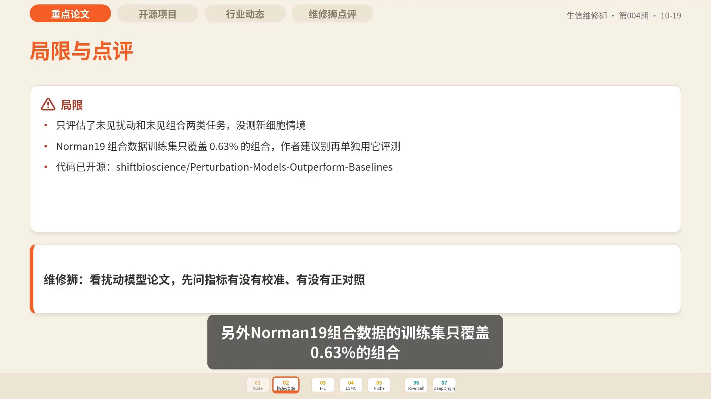
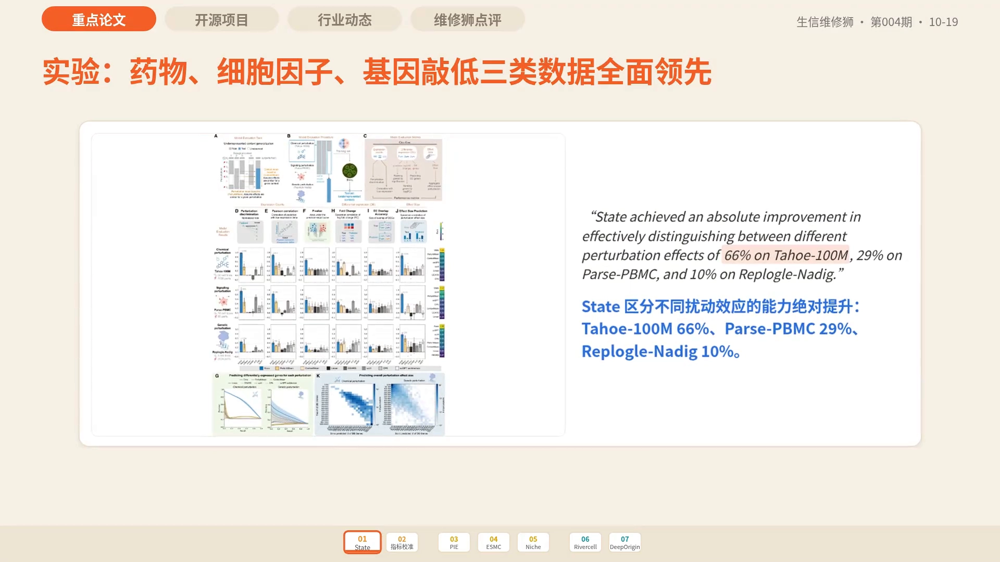
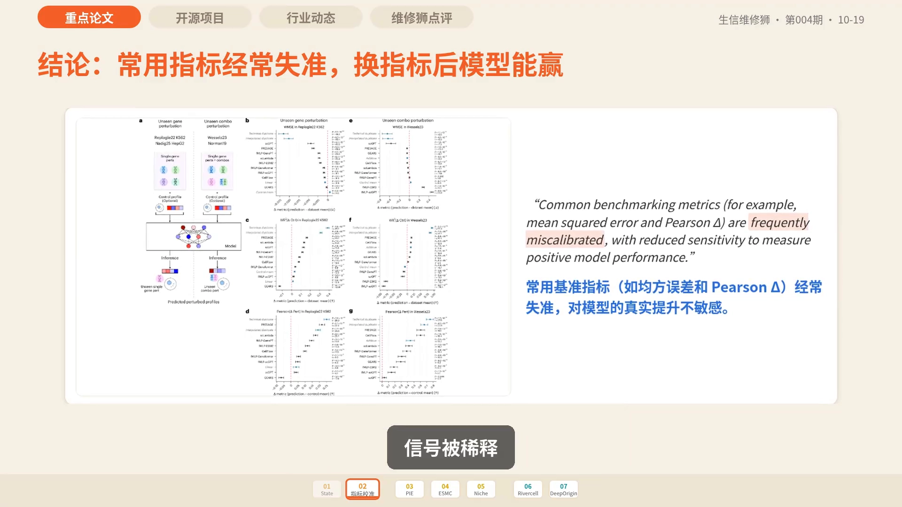
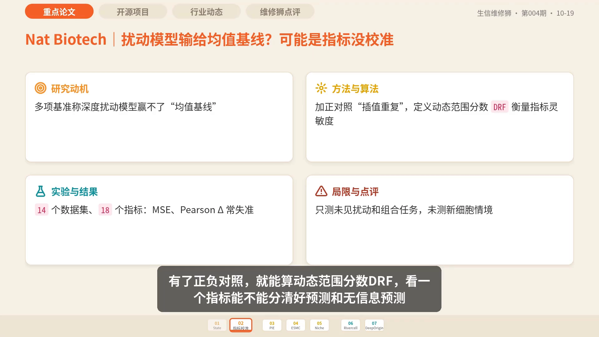
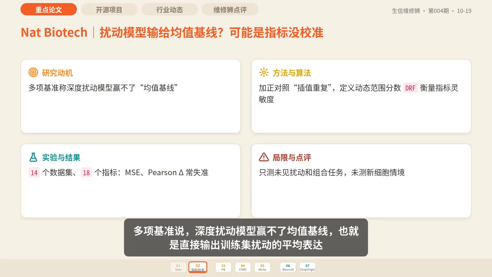
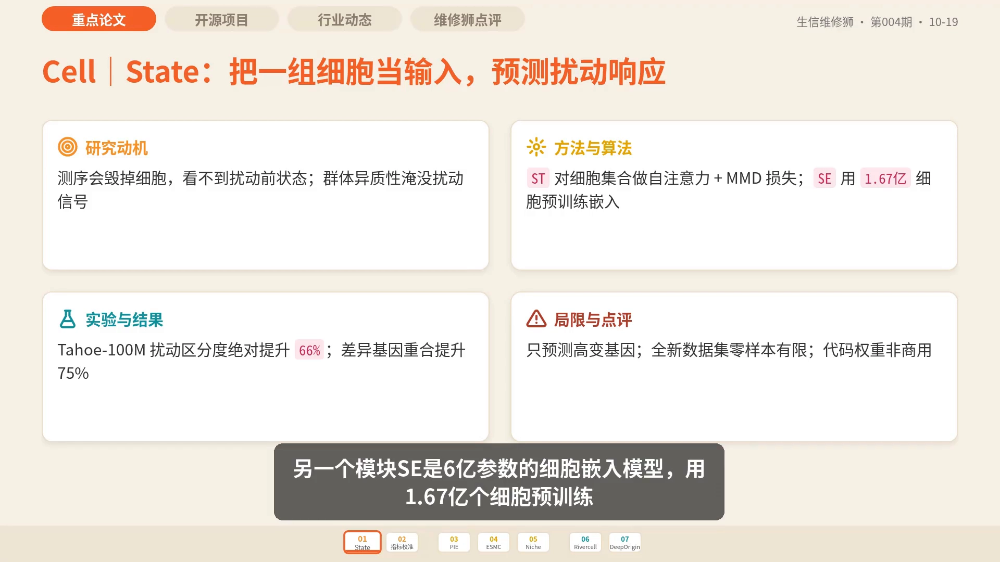

# 跑不赢均值基线的扰动预测：为什么评测比模型更关键

> 视频来源：[生信×AI日报｜单细胞扰动预测终于跑赢均值基线【10-19】](https://www.bilibili.com/video/BV1EVnj6cEB9/)（Bilibili · 生信维修狮 · 第 004 期）｜时长约 6 分钟
> 简要导读：这是把两篇论文（Cell 上的 State、Nature Biotechnology 上的扰动基准）放在一起讲的日报式点评。本文只取与本小节相关的部分——**"未知"到底指什么、均值基线为什么这么难打、划分策略怎么决定结论的适用范围**；模型架构与指标公式只在必要处点名，不展开（分别见 5.3.x 与 5.4.1）。

## 本讲要解决的核心问题（SCQA）

**背景**：单细胞扰动预测这几年的论文都在报"我的模型预测扰动响应比前人准"。读者看到的通常是某个指标上涨了几个百分点。

**冲突**：可这个领域一直被一个尴尬的问题追着问——**深度模型连"取平均"这种基线都赢不了**。如果连"直接输出训练集里所有扰动的平均表达"都打不过，那么"预测扰动响应"这件事到底被做到了什么程度？

**疑问**：这些模型到底在预测什么？它预测的"未知扰动"，是真的没见过，还是只是同一批数据的另一批细胞？

**回答（中心思想）**：**"预测扰动响应"这个任务必须先拆成难度不同的几层——未知的扰动对象、未知的细胞背景、未知的组合，三者的难度差一个量级。在没问清"测试集的扰动在训练集里出现过没有"之前，任何指标数字都不构成"能预测新扰动"的证据；而支撑"未知可预测"的，只能是扰动的先验知识或跨扰动的相似结构。**

---

## 一、先把"未知"拆成三类，否则数字没有意义

"我们的模型能预测未知扰动"这句话，在单细胞扰动领域至少有三种完全不同的含义。不指明是哪一种，报出来的数字彼此不可比。

| 未知的类型 | 训练集里没有什么 | 难度 | 本讲中的对应 |
| --- | --- | --- | --- |
| 未知扰动对象 | 没有这个基因 / 这个药物，但细胞类型见过 | 中 | "unseen gene perturbation" |
| 未知细胞背景 | 这个扰动做过，但没在这个细胞类型 / 细胞系里做过 | 中高 | "unseen context" |
| 未知组合 | 单扰动都见过，组合没见过 | 最高（组合爆炸） | "unseen combo perturbation" |

Arc 研究所的 PIE 在项目说明里把这三类并列写了出来：能泛化到没见过的**细胞情境（context）、扰动（perturbation），以及两者的组合** [【跳转到 03:35】](https://www.bilibili.com/video/BV1EVnj6cEB9/?t=215)。这句话之所以值得单独拎出来，是因为它把"未知"这个含糊的词拆成了可分别检验的三件事。

反过来看那篇 Nature Biotechnology 的基准，它的局限写得非常诚实：**只评估了"未见扰动"和"未见组合"两类任务，没测新细胞情境** [【跳转到 02:57】](https://www.bilibili.com/video/BV1EVnj6cEB9/?t=177)。也就是说，它给出的"模型赢过基线"的结论，只在"同一批细胞背景里换扰动"这个范围内成立——这正好是本小节要强调的那句话：**结论的适用范围由任务定义决定，不由指标大小决定。**

> 关于"未知细胞背景"这一类（跨细胞类型、跨细胞系的泛化从哪来），属于 5.4.3 的内容，本文只在分类里点到，不展开迁移与域适应。

## 二、"预测已知扰动"为什么接近于记忆

要理解均值基线为什么难打，得先看清一个事实：**很多论文的测试集里，扰动 ID 是训练集里出现过的。**

同一篇 Nature Biotechnology 基准里讲得很直白：所谓**均值基线（mean baseline）**，就是直接输出训练集里该扰动的平均表达 [【跳转到 01:54】](https://www.bilibili.com/video/BV1EVnj6cEB9/?t=114)。这句话的信息量在反面：

- 如果测试集里的扰动在训练集里**出现过**，那么"训练集里这个扰动的平均表达"就是一个**合法可查的表**。模型要做的不是预测，而是**记住 + 去噪**——把一批新细胞的噪声抹掉，回到那个已知的均值。
- 更隐蔽的版本是**同一实验的细胞被随机分到训练集和测试集**：这时连批次、测序深度、细胞周期分布都共享，"预测"退化成"复现同一分布的另一批样本"。
- 所以判断一篇论文到底在做什么，**第一件事不是看指标，而是看测试集的扰动 ID 在训练集里出现过没有**。这一条比任何相关性系数都重要。

State 那篇 Cell 里有一个细节恰好说明了"真未知"长什么样：模型**从没见过 C32 黑色素瘤细胞**，用曲美替尼（trametinib）处理时，它预测的差异基因和倍数变化仍明显比基线更贴近实测 [【跳转到 01:01】](https://www.bilibili.com/video/BV1EVnj6cEB9/?t=61)。这里的"没见过"是**细胞背景**层面的没见过，而不是"这个药没做过"——两者不能混着说。

## 三、四条基线：为什么"比随机好"没有信息量

这一节是整支视频最值得记住的部分。任何声称"能预测未知扰动"的模型，都应该和下面四条基线同台比较：

1. **零变化基线**：预测"扰动后表达不变"。在效应本身很弱的数据集上，它经常排在前列。
2. **均值基线**：预测"训练集里该扰动的平均表达"（或所有扰动的平均效应）。在效应方向一致的数据上极强，也是本讲反复出现的那条线 [【跳转到 01:49】](https://www.bilibili.com/video/BV1EVnj6cEB9/?t=109)。
3. **加性基线**：组合扰动时，把两个单扰动的效应直接相加。它对应"细胞只是加法"的朴素假设，却在双基因预测任务上非常难打（详见本小节另一篇《虚拟细胞靠谱吗：先问考题是不是真的没见过》）。
4. **最近邻基线**：用最相似的已知扰动（同通路、同靶点、同 MOA）的效应去代替。它之所以强，是因为同一通路的扰动效应本来就相似。

基准论文的核心结论正是围绕这些基线展开的：14 个数据集、18 个指标里，**MSE 和 Pearson Δ 经常失准**，对模型的真实提升不敏感 [【跳转到 02:19】](https://www.bilibili.com/video/BV1EVnj6cEB9/?t=139)；换成加权 MSE、加权 R² 等校准过的指标后，scGPT 和 GEARS 大多能赢过"无信息基线"；在组合扰动任务上，18 个指标里有 15 个赢过加性基线 [【跳转到 02:36】](https://www.bilibili.com/video/BV1EVnj6cEB9/?t=156)。

这里有一个容易被忽略的因果链：**"深度模型赢不了均值基线"的新闻，和"指标没校准"的新闻，说的可能是同一件事。** 指标失灵时，一个真正学到了东西的模型看起来和"输出均值"没差别；指标校准后，差距才显出来。所以读这类论文的顺序应该是：

> 先问指标能不能区分"好预测"和"无信息预测"，再问模型赢没赢基线，最后才看赢了几个百分点。

要判断一个指标有没有这个能力，需要**正对照 + 负对照**：负对照是"无信息预测"，正对照则把重复同一扰动的细胞一分为二、用一半去预测另一半，再按差异基因显著性和均值基线加权混合；有了正负对照就能算动态范围分数 DRF，看一个指标能不能分清"好预测"和"无信息预测" [【跳转到 01:54】](https://www.bilibili.com/video/BV1EVnj6cEB9/?t=114)。

指标怎么算、公式细节见 5.4.1，这里只保留判断顺序。

## 四、划分策略决定了结论能推广到哪

同一批数据，换一种划分方式，结论可以从"能预测新扰动"缩水成"能复现同一实验"。本讲里出现了三种划分，值得对照着看：

- **按细胞划分**（同一实验的细胞随机分训练/测试）：只能回答"能不能复现同一实验"，**不能**回答"能不能预测新扰动"。它共享批次与实验条件，难度最低。
- **按扰动划分（leave-one-perturbation-out）**：测试集的扰动完全不出现在训练集。这是"预测新扰动"的标准做法，也是基准论文里 "unseen gene perturbation" 那一栏的含义 [【跳转到 02:19】](https://www.bilibili.com/video/BV1EVnj6cEB9/?t=139)。
- **按细胞系 + 扰动的交叉划分**：PIE 的复现流程里，Replogle 的四个细胞系轮流留一个做测试，分别测"未见细胞系""未见扰动"和"两者都没见过" [【跳转到 03:35】](https://www.bilibili.com/video/BV1EVnj6cEB9/?t=215)。这一栏最接近真实使用场景，也最难。

组合扰动还要多一层麻烦：**训练集覆盖的组合比例可能低到离谱**。Norman 2019 组合数据的训练集只覆盖了 0.63% 的组合，作者因此建议**不要再单独拿它来评测** [【跳转到 02:57】](https://www.bilibili.com/video/BV1EVnj6cEB9/?t=177)。0.63% 这个数字的含义是：所谓"预测组合"，绝大多数测试组合在训练集里连影子都没有——这既是难度，也是这类基准最容易被误读的地方。

## 五、"未知"凭什么可预测：只能靠先验

如果测试扰动在训练集里完全没有，模型凭什么猜？本讲给出的答案很一致：**靠扰动本身的先验知识，或靠跨扰动的相似结构。**

- **靠公共知识库**：PIE 把细胞系的 Cellosaurus 记录、基因的 NCBI 与 GO 注释、DepMap 依赖谱、药物的 PubChem 条目变成输入，再基于 PERCEIVER 直接预测差异基因；差异基因分类的 AUPRC 是最强对手的 1.2 到 3.2 倍 [【跳转到 03:10】](https://www.bilibili.com/video/BV1EVnj6cEB9/?t=190)。它补的正是 State"不能预测新扰动"的短板 [【跳转到 03:35】](https://www.bilibili.com/video/BV1EVnj6cEB9/?t=215)。
- **靠大规模预训练嵌入**：State 的 SE 模块是 6 亿参数的细胞嵌入模型，用 1.67 亿个细胞预训练，专门抹掉跨数据集的技术差异 [【跳转到 00:27】](https://www.bilibili.com/video/BV1EVnj6cEB9/?t=27) [【跳转到 00:52】](https://www.bilibili.com/video/BV1EVnj6cEB9/?t=52)。

这两条路对应同一个判断：**预测未知扰动，本质是"用已知的相似性做外推"。** 如果模型没有利用任何相似性先验（通路、靶点、结构、基因网络位置），它就不可能比最近邻基线更好——因为没有信息可供外推。

顺带说清 State 为什么要把一组细胞当输入：测序会毁掉细胞，看不到同一个细胞扰动之前的样子；而群体内的抑制性差异常常比扰动信号还大 [【跳转到 00:22】](https://www.bilibili.com/video/BV1EVnj6cEB9/?t=22)。它不做一对一细胞配对，而是把同条件的一组细胞当输入，用自注意力建模细胞间差异，再用最大均值差异损失对齐预测分布与真实分布 [【跳转到 00:27】](https://www.bilibili.com/video/BV1EVnj6cEB9/?t=27)。这一步的意义在于：**"预测"的粒度是分布，不是单个细胞**，这也决定了它的指标必须是分布层面的。

它的代价也写在局限里：只预测高变基因，在全新数据集上零样本能力有限 [【跳转到 01:26】](https://www.bilibili.com/video/BV1EVnj6cEB9/?t=86)。

## 六、这张"成绩单"该怎么读

主播在结尾给了三点判断，正好可以当作读扰动预测论文的检查表 [【跳转到 05:26】](https://www.bilibili.com/video/BV1EVnj6cEB9/?t=326)：

1. **虚拟细胞模型开始稳定赢过均值基线**：State 靠细胞集合和大规模嵌入，PIE 靠公共知识库。
2. **评测比模型更关键**：先用正负对照检验指标，再比输赢。
3. **最值得跟进的组合是 State + PIE**：开源、有公开权重，可以直接给自己的扰动数据搭基线。

把这三条翻译成本小节的语言，就是一句话：**先确认"未知"是哪一类，再确认基线是什么，最后才看指标。**

## 小结

- "未知扰动"必须拆成三类：未知扰动对象、未知细胞背景、未知组合。三者难度不可比，混着报一个数字没有意义。
- 判断一篇论文是否真的在做预测，第一问是**测试集的扰动 ID 在训练集里出现过没有**；随机按细胞划分只能证明"能复现同一实验"。
- 均值基线之所以难打，是因为它等价于"记住训练集里该扰动的平均表达"——当测试扰动见过时，模型和基线在做同一件事。
- 四条基线（零变化、均值、加性、最近邻）是任何"预测未知扰动"结论的最低门槛；只报"比随机好"没有信息量。
- 指标会失灵：MSE 与 Pearson Δ 在信号被稀释的数据上对真实提升不敏感，校准后的指标才让模型显出优势（公式见 5.4.1）。
- 划分策略决定结论的适用范围：leave-one-perturbation-out 才是"预测新扰动"的标准做法，组合任务还要交代训练集覆盖了多少组合（Norman 2019 只有 0.63%）。
- 未知之所以可预测，只能靠先验：公共知识库（Cellosaurus / NCBI / GO / DepMap / PubChem）或跨扰动的相似结构；没有相似性先验，模型不可能赢过最近邻。

## 关键术语速查

| 术语 | 一句话解释 |
| --- | --- |
| in-distribution / out-of-distribution | 测试样本是否来自训练分布；扰动预测里最关键的分界线 |
| unseen perturbation | 训练集里没有的扰动对象（基因或药物），但细胞背景见过 |
| unseen context | 扰动见过，但没在这个细胞类型 / 细胞系里做过 |
| unseen combination | 单扰动都见过，但组合没做过；组合空间随扰动数指数增长 |
| mean baseline（均值基线） | 直接输出训练集里该扰动的平均表达，是"记忆 + 去噪"的极端形式 |
| additive baseline（加性基线） | 组合扰动时把两个单扰动效应直接相加，朴素但极难打败 |
| nearest-neighbor baseline | 用最相似（同通路 / 同靶点 / 同 MOA）的已知扰动效应代替预测 |
| leave-one-perturbation-out | 按扰动划分训练 / 测试，测试扰动完全不出现在训练集 |
| MOA（mechanism of action） | 作用机制；同 MOA 的药物效应往往相似，因此最近邻基线很强 |
| DRF（动态范围分数） | 用一个指标能否区分"好预测"与"无信息预测"来衡量该指标本身是否可用 |
| 正对照 / 负对照 | 负对照 = 无信息预测；正对照 = 把重复同一扰动的细胞一分为二、用一半预测另一半 |
