# 同一个药，换个细胞系还灵吗：药物细胞反应预测的跨细胞系泛化

> 视频来源：[基于人工智能的药物细胞反应预测](https://www.bilibili.com/video/BV1V64y1V7GT/)（Bilibili · 启氪医学生信线上沙龙，主讲：何松，军事科学院军事医学研究院）
> 导读：这是一场约 44 分钟的技术报告，讲者把自己课题组在「药物—细胞系反应预测」上的几项工作串成一条线：多组学整合的 IC50 回归、把「药物×细胞系」当成图节点的关联建模、以及可解释的药物联用预测。本文按「跨细胞系泛化」这条主线重排它的内容——**重点不在模型结构，而在于它怎样用盲测回答"换一批细胞系还准不准"这个问题，以及哪些信号在换背景后还站得住**。字幕为 B 站 AI 自动生成，术语（IC50、PRISM、CCLE、RDKit 等）已按上下文订正。

## 本讲要解决的核心问题（SCQA）

**背景**：药物敏感性预测是药物发现里绕不开的一环。常规做法是拿药物特征和细胞系特征拼起来，训练一个模型去回归 IC50（半数抑制浓度，数值越小说明细胞越敏感），或者分类"敏感／抗性"。

**冲突**：这类模型在训练集上指标漂亮，可一旦换一批**没见过的肿瘤细胞系**，性能就掉下来；换一个**全新的药**，更是几乎全线失效。讲者把它直接列为现有方法四大通病之一：「在面对新的肿瘤细胞或者是新的药物，一个全新的药物进来的话，它的预测性能往往是很低很低的」[【跳转到 10:41】](https://www.bilibili.com/video/BV1V64y1V7GT/?t=641)。

**疑问**：既然同一个药在不同细胞系里的效果本来就不一样，那模型要"跨细胞系泛化"，到底该迁移什么？又该怎么证明自己真的迁移过去了？

**回答（中心思想）**：**药物的效应不是药物自己的属性，而是"药物 × 细胞背景"的联合属性**。想让模型跨背景工作，必须把细胞背景显式编码进模型（拷贝数变异、miRNA 表达等细胞系多组学特征），并且用**留出整批细胞系的盲测**来验收——而不是在同一批细胞系内部做交叉验证。讲者给出的答案是：把细胞系的多组学特征编码进去之后，新细胞系盲测能显著提升；但新药盲测依然很差，说明"跨背景"和"跨扰动"是两道不同的坎。

## 一、为什么"药物—细胞系"必须当成一个整体来建模

讲者开场先讲肿瘤为什么难治，给出三个层次的异质性[【跳转到 04:02】](https://www.bilibili.com/video/BV1V64y1V7GT/?t=242)：

1. **同一类型的肿瘤有不同的分子亚型**——同样是乳腺癌，驱动基因和通路可能完全不同；
2. **同一块组织里有不同类型的细胞**——肿瘤细胞、免疫细胞、成纤维细胞混在一起；
3. **同一个病人在不同阶段对药物的反应不同**——耐药是动态产生的。

这三条正好解释了本小节的核心命题：**同一个扰动放在不同细胞背景里，下游影响面不一样**。分子亚型决定通路连通性，组织来源决定细胞类型构成，疾病阶段决定细胞状态与增殖速率——三者都会改写"敲掉/抑制某个分子"之后细胞的实际反应。

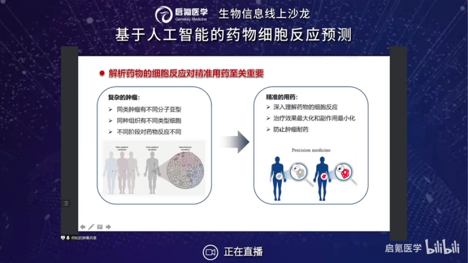

在计算侧，药物敏感性预测有两条现实路径[【跳转到 06:11】](https://www.bilibili.com/video/BV1V64y1V7GT/?t=371)：一条靠临床经验推荐用药，周期长、风险大；一条靠实验筛选，而筛选面对的是**药物 × 细胞系的组合搜索空间**。计算预测的价值就落在缩小这个搜索空间上[【跳转到 07:18】](https://www.bilibili.com/video/BV1V64y1V7GT/?t=438)——注意这里的关键词是"组合"：要预测的从来不是"这个药强不强"，而是"这个药在**这个细胞**里强不强"。

支撑这类工作的数据基础有三块[【跳转到 08:39】](https://www.bilibili.com/video/BV1V64y1V7GT/?t=519)：药物反应数据库（如 CCLE、GDSC）、药物联用数据库，以及肿瘤细胞的多组学与药物靶标数据。**细胞系的多组学特征正是"细胞背景"在计算上的化身**，后面所有跨背景的努力都建立在它之上。

## 二、现有单药敏感性模型在换背景时为什么会失灵

讲者把单药敏感性预测的标准流程拆成五步[【跳转到 09:21】](https://www.bilibili.com/video/BV1V64y1V7GT/?t=561)：整理数据 → 拿到药物特征、细胞特征和反应标签 → 预处理 → 用表征学习把药物与细胞的表征整合起来 → 送进模型预测敏感性／抗性 → 最后做实验验证。

流程本身没有问题，问题出在四个地方[【跳转到 10:18】](https://www.bilibili.com/video/BV1V64y1V7GT/?t=618)：

| 问题 | 讲者的原话要点 | 与"跨细胞系泛化"的关系 |
| :--- | :--- | :--- |
| 药物特征单一 | 大多只用药物结构，缺少药物与细胞之间的交互特征 | 模型只学了"药长什么样"，没学"细胞接不接得住" |
| 泛化能力不够 | 面对新细胞系或全新药物，性能往往很低 | 这正是本小节要处理的核心缺口 |
| 缺乏可解释性 | 只知道输入输出关系，不知道为什么 | 无法判断预测依据是通路还是背景噪声 |
| 实体关联补充不足 | 对药物与细胞系两个实体之间的关联建模不够 | 关联对才是"扰动×背景"的最小单位 |

第一条尤其值得强调：**如果模型只编码药物、不编码细胞背景，那它在数学上就注定无法表达"同一个药在不同细胞里效果不同"这件事**。这不是训练不够，而是表达能力被输入卡死了。

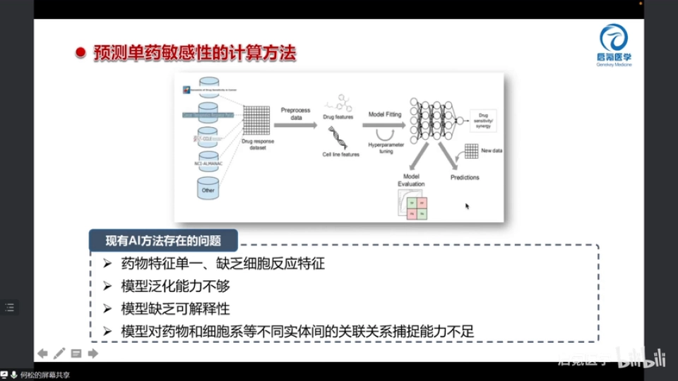

药物联用方向的问题清单更长，讲者归纳了八点[【跳转到 12:26】](https://www.bilibili.com/video/BV1V64y1V7GT/?t=746)，其中两条与"跨背景"直接相关：

- **标签数据不一致**：同一个药物组合，在 A 数据库里被标为协同，在 B 数据库里被标为拮抗[【跳转到 12:30】](https://www.bilibili.com/video/BV1V64y1V7GT/?t=750)。这背后往往就是细胞系不同——**"协同"本身也是背景相关的标签**，不是药物对的固有属性。
- **样本量有限**：目前样本量可能只有几百到上千，远不能和计算机视觉的百万级相比，直接套用其他领域的模型自然缺乏泛化能力[【跳转到 12:50】](https://www.bilibili.com/video/BV1V64y1V7GT/?t=770)。

还有一条是评估协议层面的：绝大部分工作只在已有数据集上做交叉验证，缺乏湿实验回验[【跳转到 14:41】](https://www.bilibili.com/video/BV1V64y1V7GT/?t=881)。这句话在跨背景语境下要再推一步——**如果交叉验证时同一批细胞系既在训练集又在测试集，那么"泛化"根本没有被测量**。
## 三、把细胞背景编码进模型：NERD 的多组学整合

讲者第一个工作是 **NeRD**（幻灯片写作 NeRD，讲者读作 NERD），2022 年发表在 *BMC Medicine* 上，核心思路很朴素：**把"药物—细胞系反应"建模成一个回归问题，直接预测 IC50**[【跳转到 15:54】](https://www.bilibili.com/video/BV1V64y1V7GT/?t=954)。

模型的输入分成两半[【跳转到 16:22】](https://www.bilibili.com/video/BV1V64y1V7GT/?t=982)：

- **药物侧**：分子图（原子与化学键构成的图结构）+ 分子指纹（一个 1×881 维的 0/1 向量，描述分子里有哪些子结构）；
- **细胞系侧**：**拷贝数变异**（CNV，23116 维，反映细胞基因组里哪些片段被扩增或丢失）+ **miRNA 表达**（734 维）[【跳转到 16:34】](https://www.bilibili.com/video/BV1V64y1V7GT/?t=994)。

这里就出现了本小节最关键的一层含义：为什么细胞系特征要用**拷贝数变异**，而不是只用表达量？因为它描述的正是**遗传背景**——癌细胞系里被扩增的癌基因、被缺失的抑癌基因，会直接改变通路的"冗余度"。一个基因被药物抑制后细胞会不会死，取决于它旁边有没有旁路可以顶上来；而旁路存不存在，写在拷贝数里。miRNA 则补上转录后调控这一层，两者合起来才是这个细胞系的"调控底盘"。**这就是"同一个药换个细胞系就不灵"的分子机制在特征层面的投影。**

四种特征形式差异太大，讲者给每一类设计了专门的提取器[【跳转到 17:25】](https://www.bilibili.com/video/BV1V64y1V7GT/?t=1045)：

1. 分子图 → **GCN**（图卷积网络，直接在图上做邻域聚合）；
2. 分子指纹 → **CNN**（把 1×881 的向量当作一维信号做卷积）；
3. miRNA 表达 → 同样用 **CNN**；
4. 拷贝数变异 → 先用**自编码器（AE）**压到低维，取隐变量当特征（两万多维直接送进网络会过参数化）。

四路特征拼接后，再经过一个神经网络输出 IC50 预测值[【跳转到 18:09】](https://www.bilibili.com/video/BV1V64y1V7GT/?t=1089)。

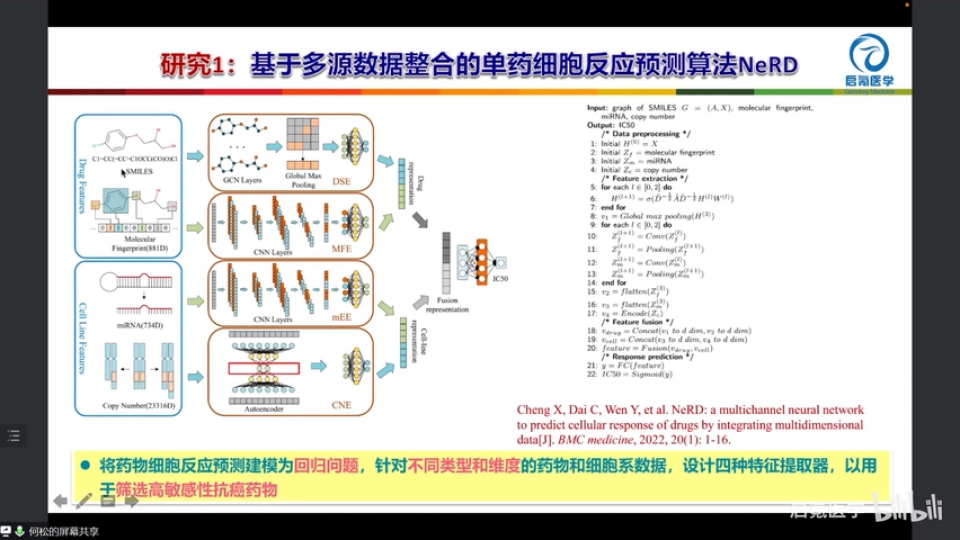

数据来源交代得很清楚[【跳转到 18:16】](https://www.bilibili.com/video/BV1V64y1V7GT/?t=1096)：反应标签来自 Broad 研究所的 **PRISM** 数据集（既是一套数据，也是一种实验方法），最终收集了 **249784 个药物—细胞系关联对**，覆盖 **1448 个药物**与 **480 个癌细胞系**；药物特征从 PubChem 取，用 RDKit 提取分子图（SMILES）与 881 维分子指纹；细胞系特征来自 **CCLE**（癌细胞系百科全书），取 734 维 miRNA 与 23116 维拷贝数变异。中间还做了离群值剔除，以及把药物、细胞系和标签三者对齐的清理工作[【跳转到 19:12】](https://www.bilibili.com/video/BV1V64y1V7GT/?t=1152)。

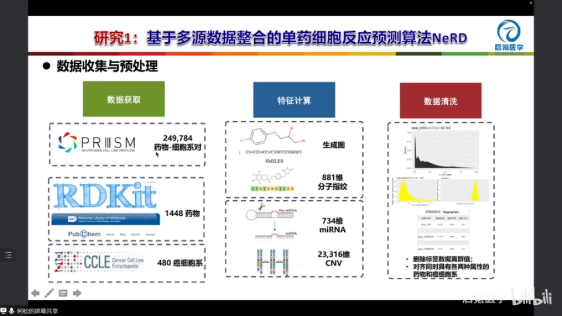

与机器学习方法、典型深度学习方法以及其他 SOTA 模型相比，NERD 在四个指标上大部分更优[【跳转到 19:53】](https://www.bilibili.com/video/BV1V64y1V7GT/?t=1193)。但**同一数据集内的指标比较，恰恰是最不能说明跨背景能力的那种比较**——讲者自己也很清楚这一点，所以紧接着就切到了盲测。

## 四、盲测才是跨细胞系泛化的真正考卷

这是整场报告里最值得反复看的一段。讲者把泛化拆成**两个方向**，分别做盲测[【跳转到 20:02】](https://www.bilibili.com/video/BV1V64y1V7GT/?t=1202)：

> 「泛化能力我们讲了两个，一个是面对新的肿瘤细胞系，它的泛化能力不够好；第二个是在面对新的药物来的时候，性能也不是很好。」

**方向一：细胞系盲测（leave-cell-line-out）**。测试用的细胞系完全不出现在训练集里，模型必须靠细胞系的多组学特征去"推断"这个背景下的反应。结果是**显著提高**——把背景编码进去确实有用[【跳转到 20:37】](https://www.bilibili.com/video/BV1V64y1V7GT/?t=1237)。

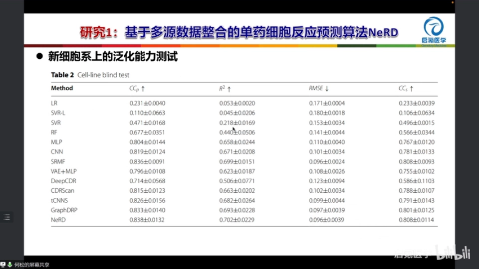

**方向二：新药盲测**。测试药物是全新的、没参加过训练的分子。结果讲者说得很直白：「这个就不太好了，这个就是大家好像都不太好」[【跳转到 20:52】](https://www.bilibili.com/video/BV1V64y1V7GT/?t=1252)。即便 NERD 比其他方法好一点点，**R² 都特别小，所以意义也不是很大**[【跳转到 21:10】](https://www.bilibili.com/video/BV1V64y1V7GT/?t=1270)。

这一对照极有信息量，值得单独拎出来：

- **跨细胞系**（新背景 + 已知扰动类型）→ 可以迁移。因为细胞背景有拷贝数、miRNA 这些**可观测的坐标**，模型能在这套坐标里定位新细胞系。
- **跨药物**（新扰动 + 已知背景）→ 几乎不能迁移。因为新药的结构与已有药物的关系太稀疏，模型没有可外推的锚点。

换句话说：**"换背景"比"换扰动"在数据上更容易被支撑，因为背景是连续可测的，而扰动是离散且组合爆炸的**。这也解释了为什么本小节要专门讨论跨细胞系——它是泛化问题里相对"有抓手"的那一半。

## 五、消融与表征：多组学整合为什么真的有效

为了证明"四个维度的数据都用上"不是堆料，讲者做了两组消融[【跳转到 21:20】](https://www.bilibili.com/video/BV1V64y1V7GT/?t=1280)：

- **数据维度消融**：药物两维 + 细胞系两维，共四个维度。四者合在一起的性能，优于任意两维或三维的组合[【跳转到 21:35】](https://www.bilibili.com/video/BV1V64y1V7GT/?t=1295)。
- **模块消融**：四个特征提取模块逐一去掉，性能都下降，说明每个模块都有必要[【跳转到 21:51】](https://www.bilibili.com/video/BV1V64y1V7GT/?t=1311)。

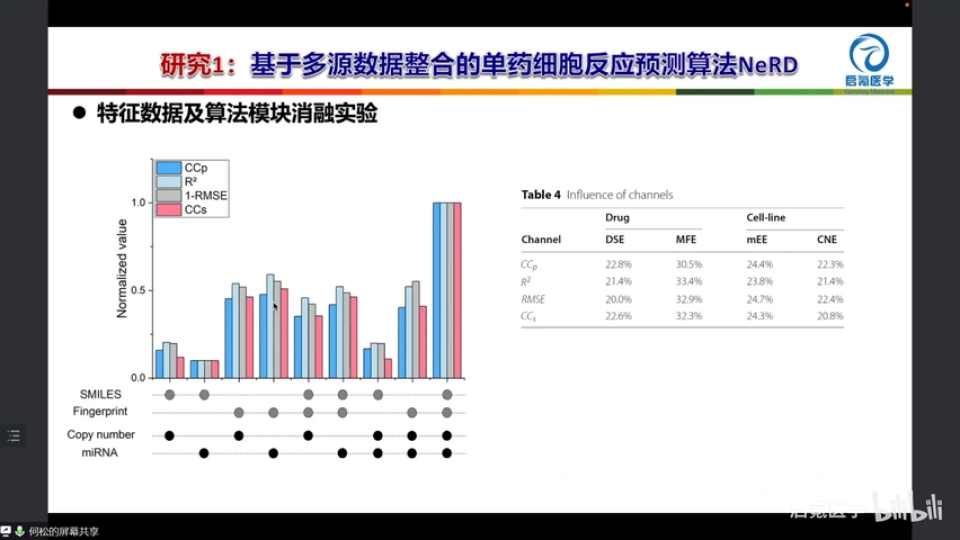

更有说服力的是**表征可视化**[【跳转到 22:20】](https://www.bilibili.com/video/BV1V64y1V7GT/?t=1340)。讲者把三种状态下的表征做二维投影，颜色深浅代表"药物—细胞系对"的反应分数：

1. **原始表征**：点云很乱，敏感与抗性分不开[【跳转到 22:51】](https://www.bilibili.com/video/BV1V64y1V7GT/?t=1371)；
2. **特征提取之后**：大致能分开了[【跳转到 23:01】](https://www.bilibili.com/video/BV1V64y1V7GT/?t=1381)；
3. **进一步融合之后**：清晰分成两块，敏感与抗性分得很开[【跳转到 23:07】](https://www.bilibili.com/video/BV1V64y1V7GT/?t=1387)。

这张图的意义在于：**"敏感／抗性"这个标签在隐空间里是有几何结构的**，而结构是特征提取与融合造出来的。

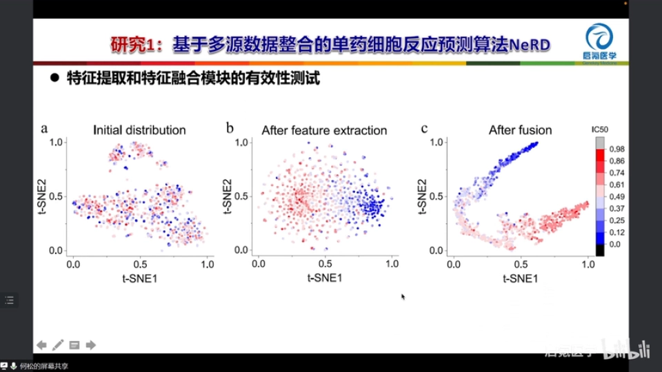跨背景迁移的可行性，本质上依赖的就是这种结构能不能在新背景里继续保持——如果新细胞系的表征落进了错误的一侧，预测必然错。

讲者还测了**数据规模鲁棒性**[【跳转到 23:19】](https://www.bilibili.com/video/BV1V64y1V7GT/?t=1399)：把训练数据缩到很小，NERD 依然能达到其他方法在完整数据上的效果，说明它对数据量不那么敏感。最后对新预测出的抗癌药物做了文献验证，都能找到文献支持[【跳转到 23:48】](https://www.bilibili.com/video/BV1V64y1V7GT/?t=1428)。

## 六、把"药物×细胞系"当成图上的一个节点：GADRP

第二个工作叫 **GADRP**，动机是：前面 NERD 只是把药物特征和细胞系特征**拼接**起来，但生物实体之间其实还有**关联信息**没被利用[【跳转到 24:05】](https://www.bilibili.com/video/BV1V64y1V7GT/?t=1445)。

它的建模方式很值得注意——**图上的节点不是药物，也不是细胞系，而是"药物—细胞系关联对"**[【跳转到 24:53】](https://www.bilibili.com/video/BV1V64y1V7GT/?t=1493)。边是两个关联对之间的相似性。构建过程分三步[【跳转到 25:15】](https://www.bilibili.com/video/BV1V64y1V7GT/?t=1515)：

1. 基于药物特征构建**药物相似性网络**，基于细胞系特征构建**细胞系相似性网络**；
2. 把两个网络整合成"药物—细胞系对"的相似性网络，再用 K 近邻稀疏化[【跳转到 25:31】](https://www.bilibili.com/video/BV1V64y1V7GT/?t=1531)；
3. 节点初始特征**不用随机初始化**，而是用自编码器从药物与细胞系的其他维度信息里学出先验，作为图的初始特征[【跳转到 25:44】](https://www.bilibili.com/video/BV1V64y1V7GT/?t=1544)；
4. 最后用 **GCN** 在图上传播，输出 IC50 预测[【跳转到 26:22】](https://www.bilibili.com/video/BV1V64y1V7GT/?t=1582)。

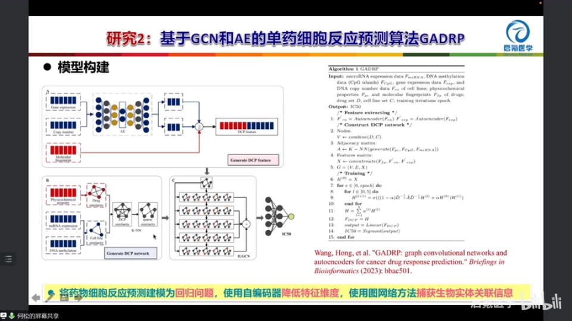

**为什么"节点是关联对"这件事对跨细胞系泛化重要？** 因为一旦把节点定义成"对"，模型学到的就不是"药物 A 有多强"，而是"药物 A 在**这种背景**下有多强"——泛化时新细胞系进来，它作为"对"的一半参与构图，可以直接借邻居的信息。这相当于把"扰动 × 背景"这个联合单位显式写进了模型结构。

数据与 NERD 相近，但细胞系特征扩展到**四个维度**，药物仍是两个方面[【跳转到 26:43】](https://www.bilibili.com/video/BV1V64y1V7GT/?t=1603)。比较对象只保留 SOTA 的图方法（传统 RF 一类性能太差，直接不比了）[【跳转到 27:01】](https://www.bilibili.com/video/BV1V64y1V7GT/?t=1621)，结果除 R² 略低外其余指标都更优[【跳转到 27:17】](https://www.bilibili.com/video/BV1V64y1V7GT/?t=1637)。

接下来这段是**跨细胞类型视角的直接证据**。讲者注意到训练数据把 CCLE 里所有癌细胞系都拿了进来，于是按**组织来源**分组看性能[【跳转到 27:39】](https://www.bilibili.com/video/BV1V64y1V7GT/?t=1659)：先看各组织的样本量差异，再在五个数据量较大的典型组织上比较性能，发现"都还不错，在不同的组织上都比其他方法好"[【跳转到 28:03】](https://www.bilibili.com/video/BV1V64y1V7GT/?t=1683)。

这里要提醒一句方法论上的事：**按组织分组的性能差异，混着样本量差异和技术批次差异**

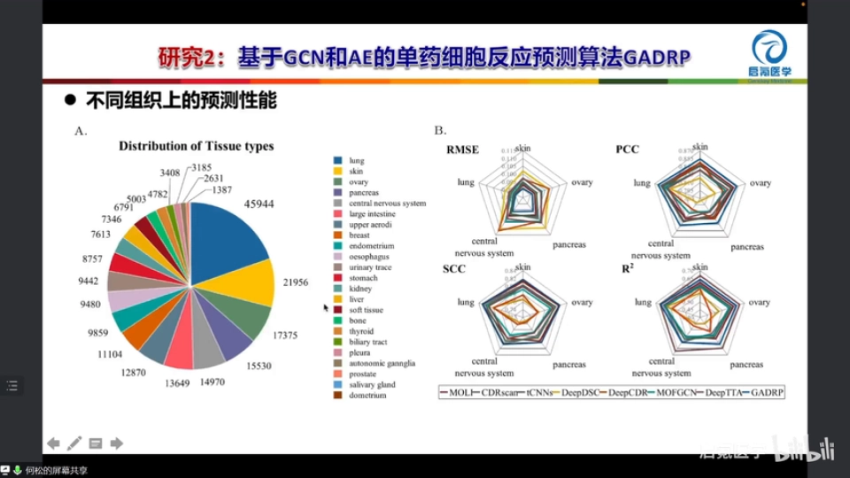

这里要提醒一句方法论上的事：**按组织分组的性能差异，混着样本量差异和技术批次差异**（不同组织的数据往往来自不同实验批次）。所以"每个组织都不错"是好消息，但它不等于"跨组织泛化已被证明"——真正的证明仍然要靠留出整个组织的盲测。这一点与本系列 5.1.3 讲的批次整合问题同源：**跨细胞系的差异里，永远混着一层技术噪声**。

此外，讲者对新预测的抗癌药物做了文献验证，并考察了新预测药物与癌症组织、与信号通路之间的关系[【跳转到 28:19】](https://www.bilibili.com/video/BV1V64y1V7GT/?t=1699)。

## 七、从"实体之间"到"实体内部"：多视图注意力

第三个工作把视角再往里推一层。前面 GADRP 建模的是**药物与细胞系两个实体之间**的关联，但每个实体**内部**的特征项之间也有结构：药物的不同基团之间有关联，细胞系的不同特征之间也有关联[【跳转到 28:40】](https://www.bilibili.com/video/BV1V64y1V7GT/?t=1720)。

做法是用**多视图注意力的图深度学习**（讲者称 MATDRP）：用多头注意力机制分别提取药物和细胞系各自特征内部的关系，再做整合与预测[【跳转到 29:36】](https://www.bilibili.com/video/BV1V64y1V7GT/?t=1776)。这个工作当时还在投稿中，但已经做了**细胞增殖实验**验证——预测出的抗癌药物在癌细胞系上确实十分敏感[【跳转到 29:49】](https://www.bilibili.com/video/BV1V64y1V7GT/?t=1789)。

从跨背景的角度看，这一步的价值是：**注意力权重给出了一种"哪些内部特征在该背景下起作用"的读出方式**。

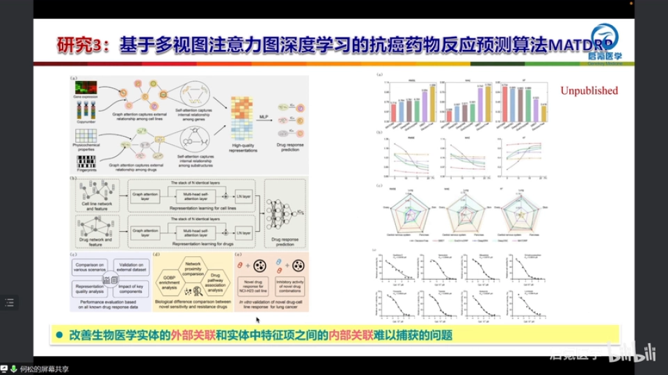如果同一个药物在两个细胞系里激活的是不同的特征视图，那正是"效应被背景改写"的可观测证据。

## 八、药物联用：可解释性优先，先验知识兜底

报告后半段转向药物联用。讲者给这一部分定的关键词是**可解释**：不仅要预测性能高，还要能解释[【跳转到 30:08】](https://www.bilibili.com/video/BV1V64y1V7GT/?t=1808)。

**（1）混合深度森林做协同分类（ForSyn，*Cell Reports Methods*）。** 把"两药是否协同"建模成二分类问题，框架仍是深度森林，但把里面每个森林按目的改造[【跳转到 30:52】](https://www.bilibili.com/video/BV1V64y1V7GT/?t=1852)：针对样本不均衡设计了 RFCUS 数据单元，针对高维问题设计了基于极限树森林的单元，同时把原始向量作为增强向量拼进去[【跳转到 31:24】](https://www.bilibili.com/video/BV1V64y1V7GT/?t=1884)。

特征用了四个维度[【跳转到 32:09】](https://www.bilibili.com/video/BV1V64y1V7GT/?t=1929)

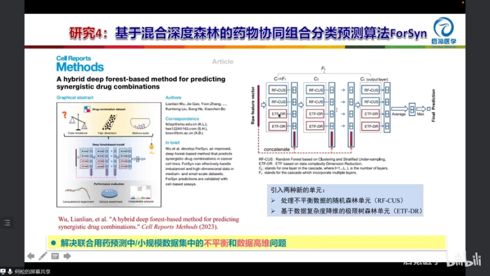

特征用了四个维度[【跳转到 32:09】](https://www.bilibili.com/video/BV1V64y1V7GT/?t=1929)：药物刺激细胞后的**基因表达谱**、药物**分子指纹**、药物**理化性质**，以及细胞系自己的**基因表达谱**。四者组合成八个数据集，在八个数据集上做 average rank 比较，方法在 F1、AUC 等指标上优于原始深度森林与其他方法[【跳转到 32:56】](https://www.bilibili.com/video/BV1V64y1V7GT/?t=1976)。

**（2）湿实验回验。** 在 HT29 细胞系上，把预测最协同的四对药物拿去做实验，确实协同；预测最不协同的五对也去验证，确实一点协同作用都没有[【跳转到 34:07】](https://www.bilibili.com/video/BV1V64y1V7GT/?t=2047)。这一步很重要：**跨背景的预测最终要靠"换一个细胞系再做一遍"来检验**，HT29 只是其中一个背景。

**（3）特征重要性给出的"什么在起作用"。** 讲者为每一维特征定义了重要性分数，得到两个结论[【跳转到 34:33】](https://www.bilibili.com/video/BV1V64y1V7GT/?t=2073)：

- 按类别看：**药物刺激细胞后的基因表达谱贡献度接近 50%**，其次是分子指纹，贡献最少的是理化性质[【跳转到 34:59】](https://www.bilibili.com/video/BV1V64y1V7GT/?t=2099)；
- 按单个基因看：在约两万个基因里，只有一部分真正对协同预测有效，重要性分数画出一条阈值线，线以上的才有贡献[【跳转到 35:42】](https://www.bilibili.com/video/BV1V64y1V7GT/?t=2142)。

这个排序本身就是一条跨背景的线索：**贡献最大的不是药物自身的理化性质，而是"药物作用于细胞之后引起的表达变化"**

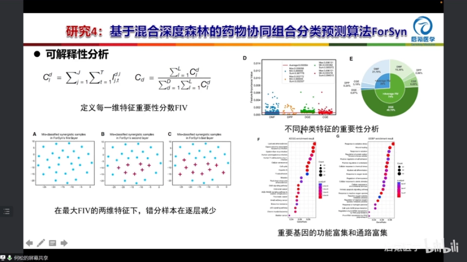

这个排序本身就是一条跨背景的线索：**贡献最大的不是药物自身的理化性质，而是"药物作用于细胞之后引起的表达变化"**——也就是响应，而不是扰动本身。**响应是背景相关的量**，所以模型真正依赖的恰恰是那个会随细胞系改变的东西。

**（4）逐层纠错与通路富集。** 深度森林逐层预测，讲者展示了每层错分样本如何被后续层纠正回来，层数增加、错分样本越来越少[【跳转到 35:58】](https://www.bilibili.com/video/BV1V64y1V7GT/?t=2158)。对重要基因做了功能富集与通路富集[【跳转到 36:43】](https://www.bilibili.com/video/BV1V64y1V7GT/?t=2203)——**这一步把"基因层面的数值"抬升到了"通路层面的方向"**，而通路层面的信号通常比单个基因的数值更守恒，这正是跨背景迁移更可靠的落点。

**（5）从分类到回归。** 协同不协同还有程度大小，讲者又做了协同分数的回归预测，同样基于混合深度森林改造：增强特征、增强级联架构处理样本不均衡、逐层调整特征空间与样本空间、加权平均模块[【跳转到 37:13】](https://www.bilibili.com/video/BV1V64y1V7GT/?t=2233)。

**（6）多任务：协同 + 副作用一起预测（DEML，*Molecules*）。** 两个药一起用，除了协同或拮抗，还可能产生副作用。讲者用多任务学习框架同时预测协同分类、协同分数和副作用[【跳转到 38:24】](https://www.bilibili.com/video/BV1V64y1V7GT/?t=2304)，目的是在筛选组合时既要有强协同、又要副作用轻微[【跳转到 39:00】](https://www.bilibili.com/video/BV1V64y1V7GT/?t=2340)。

**（7）从后验解释到先验解释。**

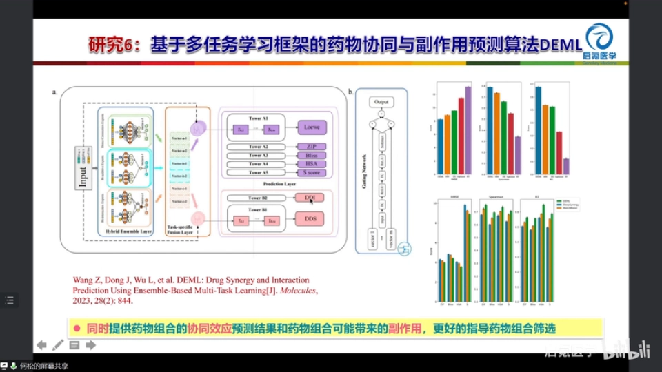

**（7）从后验解释到先验解释。** 前面那些解释都是"模型预测完之后，回头算哪些特征重要"的后验解释[【跳转到 39:33】](https://www.bilibili.com/video/BV1V64y1V7GT/?t=2373)。讲者更想做的是**先验解释**：让神经网络自己在给出预测的同时给出道理[【跳转到 40:01】](https://www.bilibili.com/video/BV1V64y1V7GT/?t=2401)。做法是把**具有层次结构的生物医药知识**嵌入网络，相当于用知识图谱参与训练，再用图上的注意力机制解释药物结构上的哪些部分在起作用[【跳转到 40:44】](https://www.bilibili.com/video/BV1V64y1V7GT/?t=2444)，并做了相应的细胞实验[【跳转到 41:21】](https://www.bilibili.com/video/BV1V64y1V7GT/?t=2481)。

**（8）合成致死作为迁移的桥。** 最后一个工作（幻灯片标题写作 KNNS，讲者读作 KNSL）：先预测两个基因在肿瘤细胞上的**合成致死**关系，再让两个药物分别去打这两个基因，从而做联用预测[【跳转到 41:40】](https://www.bilibili.com/video/BV1V64y1V7GT/?t=2500)。经过计算、细胞和动物三层验证，发现 **MDM2 与 CDK9 抑制剂的组合**在体外实验中表现优秀[【跳转到 42:08】](https://www.bilibili.com/video/BV1V64y1V7GT/?t=2528)。

这条路线在方法论上最接近"迁移先验知识"

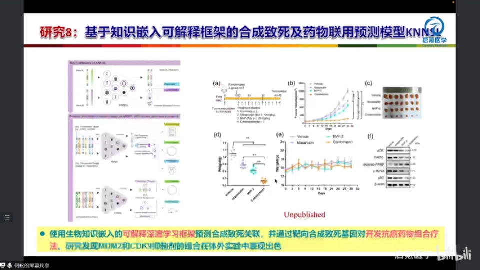

这条路线在方法论上最接近"迁移先验知识"：**不迁移具体基因的表达数值，而是迁移"哪两个模块同时坏掉细胞就活不了"这种机制层面的约束**。合成致死关系一旦成立，它在不同细胞系之间的稳定性通常高于某个基因的表达量——这正是模块级迁移比基因级迁移更稳的原因。

## 九、把这场报告放回"跨细胞系泛化"的框架

讲者最后做了收束：这些工作只是人工智能加速药物发现的一小块，同一套思路还通向靶标发现、药物设计与优化、属性与毒性预测、联用与重定位[【跳转到 42:55】](https://www.bilibili.com/video/BV1V64y1V7GT/?t=2575)。但对本小节而言，更有价值的是把它的经验整理成几条可复用的判断。

**第一，三种"迁移什么"的思路，这场报告各出现了一次。**

| 迁移什么 | 报告里的对应做法 | 隐含假设 | 风险 |
| :--- | :--- | :--- | :--- |
| 迁移表达表示 | 把细胞系的拷贝数、miRNA 编码进同一隐空间（NERD、GADRP） | 不同细胞系的表征可比较，隐空间结构在新背景下保持 | 新细胞系的表征可能落错位置 |
| 迁移扰动表示 | 药物侧固定为分子图与指纹，与细胞系特征解耦后组合 | 药物向量与背景解耦，"扰动效应"可加 | 药物间交互与背景交互被忽略 |
| 迁移先验知识 | 通路富集、知识图谱嵌入、合成致死关系（KNSL） | 模块层面的响应守恒 | 模块划分本身依赖背景 |

**第二，划分策略决定了结论的含义。** 报告里"细胞系盲测"就是留出整批细胞系（leave-cell-line-out），"新药盲测"是留出扰动；而"按组织分组看性能"不是盲测，只是分层描述。**报告跨细胞系泛化时，必须说明测试细胞系是否在训练集中出现过**——否则同样的数字可以有两种完全不同的解释。

**第三，可迁移性有物理前提，得先筛再建模。**

- **靶点必须在该背景里存在且被依赖**：如果某个细胞系根本不依赖这条通路，任何模型都预测不出效应——这不是模型不行，是生物学上就没有效应可预测；
- **强扰动的效应更容易迁移**：下游影响面大，不容易被背景差异掩盖；弱扰动容易被背景噪声吞掉；
- **通路层面的方向比基因层面的数值更守恒**：所以讲者的可解释分析最后都落到通路富集上。

**第四，跨背景与跨扰动叠加时，难度是乘性的。** 报告里两个盲测的对比已经说明了这一点：单独跨背景还能靠"背景可测"撑住，单独跨扰动就已经很勉强（R² 特别小），两者叠加则是另一回事。这条边界是生物学给的，不是模型规模能填平的——**跨细胞系泛化的上限，取决于这两个细胞系共享多少下游通路**。

## 小结

- **药物效应是"药物 × 细胞背景"的联合属性**，不是药物自己的固有属性。只用药物结构做特征的模型，在表达能力上就被卡死了，换背景必然失灵。
- **细胞背景在计算上的化身是细胞系的多组学特征**：拷贝数变异刻画遗传背景（决定通路冗余度），miRNA 表达刻画调控状态。NERD 把这四维特征编码进模型后，新细胞系盲测显著提升。
- **盲测要分方向做**：留出细胞系（leave-cell-line-out）与留出新药是两道不同的坎。报告里前者能迁移、后者几乎不能，因为背景连续可测、扰动离散且组合爆炸。
- **把"药物—细胞系对"当作图节点**（GADRP）是把"扰动 × 背景"这个联合单位写进模型结构的做法；节点初始特征用先验而非随机初始化，是为了让新背景也能找到邻居。
- **按组织分组的性能差异不等于跨组织泛化**，它混着样本量差异与技术批次差异，真正的证明仍要靠留出整个组织。
- **贡献最大的特征不是药物理化性质，而是药物作用后引起的表达变化**——模型真正依赖的是响应，而响应恰恰是背景相关的量。
- **模块级信号比基因级数值更可迁移**：通路富集、知识图谱嵌入、合成致死关系，都是在把"具体数值"换成"机制约束"。
- **先做可迁移性筛查再谈模型**：靶点不表达、通路不依赖的背景，物理上就没有效应可迁移。

## 关键术语速查

| 术语 | 一句话解释 |
| :--- | :--- |
| IC50 | 半数抑制浓度，使细胞活性下降一半所需的药物浓度，越小越敏感 |
| cellular context（细胞背景） | 同一个扰动所处的细胞环境，包括遗传背景、通路连通性、细胞状态与增殖速率 |
| context-dependent effect | 扰动效应随细胞背景改变的现象，是本小节的核心命题 |
| leave-cell-line-out | 留出整批细胞系的划分方式，测试细胞系完全不出现在训练集中 |
| 拷贝数变异（CNV） | 基因组片段的扩增或缺失，改变基因剂量与通路冗余度 |
| PRISM | Broad 研究所的药物敏感性筛选数据集与实验方法 |
| CCLE | 癌细胞系百科全书，提供细胞系的拷贝数、miRNA、表达等多组学特征 |
| 分子指纹 | 用固定长度的 0/1 向量描述分子包含哪些子结构 |
| GCN | 图卷积网络，在图的邻域上聚合信息 |
| 自编码器（AE） | 先压缩再重建的神经网络，中间隐变量可当低维特征用 |
| domain adaptation（域适应） | 让在一个数据分布上训练的模型适应另一个分布的方法族 |
| additive decomposition（加性分解） | 把观测到的表达拆成"背景 + 扰动 + 交互"几项之和的思路 |
| 合成致死 | 两个基因单独失活细胞仍存活、同时失活则死亡的关系 |
| 后验解释／先验解释 | 前者是预测完再回头算特征重要性，后者是模型自己给出依据 |
