# 机器学习与数据泄露：从「偷看考题」到外部验证

> 视频来源：[生信入门 第34讲：机器学习与数据泄露｜零基础公开课](https://www.bilibili.com/video/BV11BWx61EmZ/)（Bilibili · 生信基本功）
> 导读：这是一支约 14 分钟的零基础公开课，用「学生做练习题 / 模拟考 / 期末考试」这条类比贯穿全片：先讲清训练集、验证集、测试集的分工，再讲 AUC 为什么只看排序不看阈值，然后用**四组可以亲手复现的模拟实验**演示数据泄漏的四种样子，最后落到外部验证——换一个时间、地点、人群再测一次。本文按「划分 → 指标 → 泄漏 → 外部验证」重排，并把讲者的实验数字原样保留，方便对照复现。字幕为 B 站 AI 自动生成，术语（AUC、交叉验证、批次校正、伪重复等）已按上下文订正。

## 本讲要解决的核心问题（SCQA）

**背景**：这几年越来越多的论文用机器学习从基因表达里预测疾病分型或者预后。这类「预测模型」的做法很统一：从已知答案的数据里学出一套规则，再用这套规则去猜新数据的答案[【跳转到 00:50】](https://www.bilibili.com/video/BV11BWx61EmZ/?t=50)。

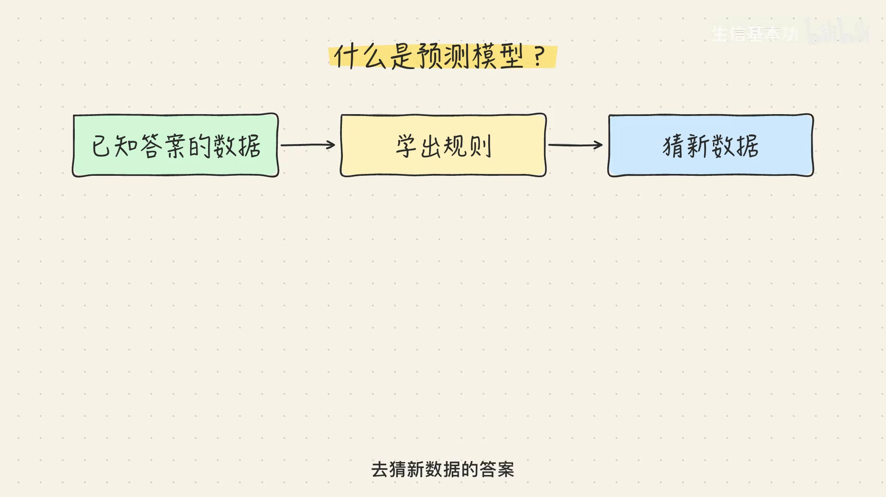

**冲突**：判断一个模型好不好，必须用**它没见过的数据**。可现实中大量分析是「同一批数据既用来挑特征、又用来评价效果」——结果一定被高估。讲者打了个比方：学生提前看到了考题，考出 100 分也说明不了什么。这种「偷看考题」在机器学习里有名字，叫**数据泄漏**。

**疑问**：泄漏到底有几种样子？怎么在自己手上那点数据里把它认出来？认出来之后，又该怎么证明一个模型是真的学到了生物学信号？

**回答（中心思想）**：**凡是从数据里学的步骤——挑特征、调参数、标准化、批次校正——都只能在训练集里做**；并且**先分组、再学**，同一个个体、同一个来源的样本必须分在同一边。做到这两条只是「没有偷看考题」；要证明模型真的能用，还得做**外部验证**：换一个独立的时间、地点、人群再测一次，而且**排序（AUC）和阈值（准确率）两样都要检查**。

## 一、三份数据各管一件事：练习题、模拟考、期末考

标准做法是把数据分成三份[【跳转到 01:40】](https://www.bilibili.com/video/BV11BWx61EmZ/?t=100)：

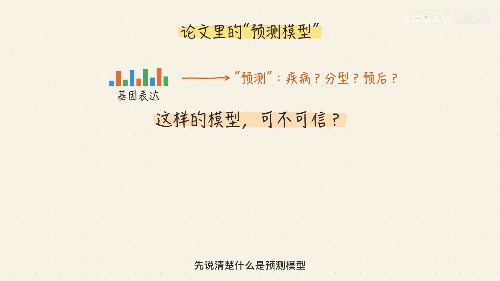

| 子集 | 类比 | 用途 |
| --- | --- | --- |
| 训练集 | 练习题 | 学规则（拟合模型参数） |
| 验证集 | 模拟考 | 做选择（定阈值、选超参数、挑模型） |
| 测试集 | 期末考试 | 只在最后用一次，全程一眼都不能看 |

讲者用一个和医学无关的真实例子把流程走了一遍：**南极企鹅数据**。只用身体测量去猜一只企鹅是公是母，一共 333 只，雌雄各一半左右；随机分成训练 200 只、验证 67 只、测试 66 只[【跳转到 02:05】](https://www.bilibili.com/video/BV11BWx61EmZ/?t=125)。

模型给每只企鹅打一个分，分数越高越可能是公的。可「分数多高才算公」这条线——**阈值**——不能凭空定，也**不能在测试集上挑**：

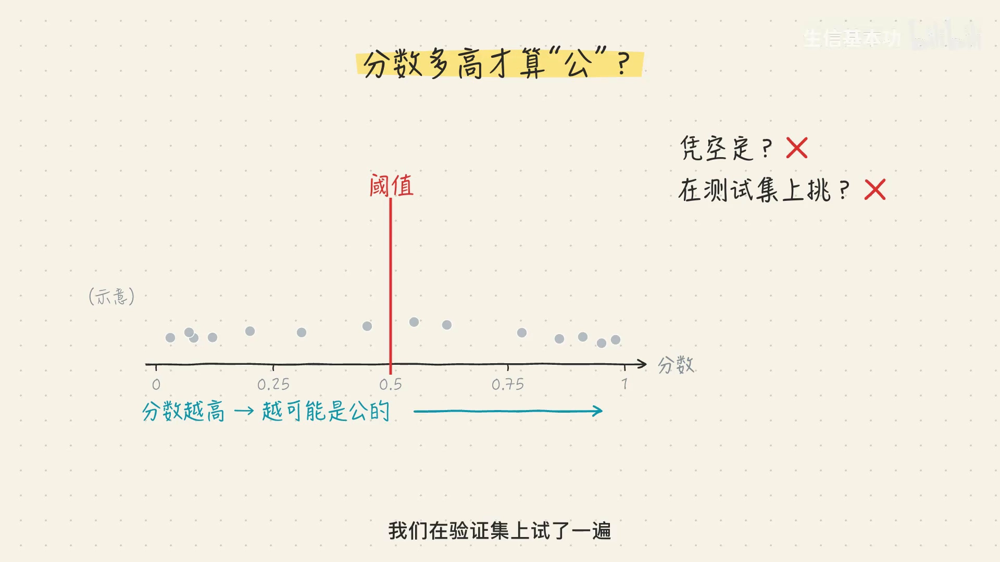

在验证集上试的结果是：阈值从 0.11 到 0.43，准确率都是最高的 91%，于是取中间值 0.26。最后才拿出测试集：66 只企鹅猜对 60 只，准确率 **90.9%**（38 只公的认对 36 只，28 只母的认对 24 只）。**这个数才能代表模型在新数据上的表现**[【跳转到 02:55】](https://www.bilibili.com/video/BV11BWx61EmZ/?t=175)。

样本少的时候，分成三份太浪费，常用的办法是**交叉验证**：把数据分成五份，轮流拿一份当考题、其余四份当练习，最后把五次的成绩平均。要记住——**交叉验证的每一轮同样不能偷看那一份考题**[【跳转到 03:20】](https://www.bilibili.com/video/BV11BWx61EmZ/?t=200)。这句话是后面所有泄漏实验的伏笔。

## 二、AUC：只看排序、不看阈值的指标

准确率只是评价模型的一个数，还有一个更常见的指标叫 **AUC**（曲线下面积）。要理解它，先认识两个比例[【跳转到 03:45】](https://www.bilibili.com/video/BV11BWx61EmZ/?t=225)：

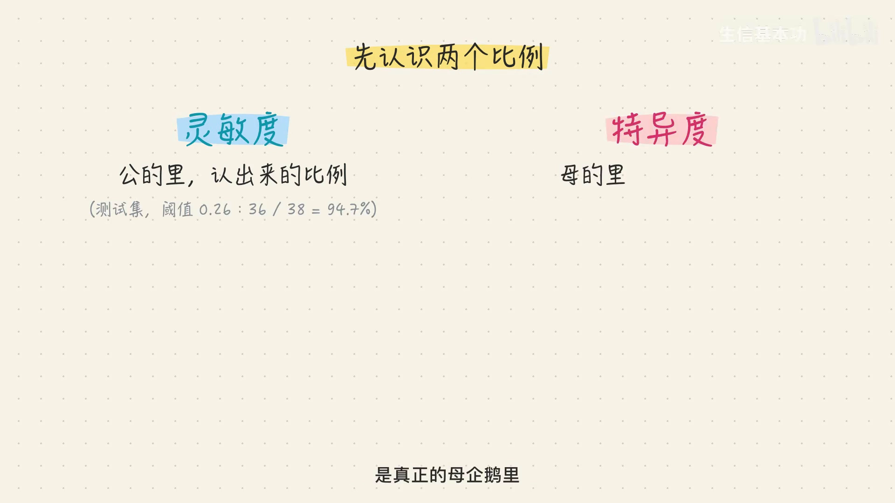

- **灵敏度**（sensitivity）：真正的公企鹅里，被认出来的比例；
- **特异度**（specificity）：真正的母企鹅里，被认对的比例。

两者此消彼长：阈值调低，更多企鹅被判成公的，灵敏度上升，可母的也会被误判，特异度下降。把阈值从高到低划一遍，每个阈值都得到一对比例，画成一条曲线——横轴是母企鹅被误判成公的比例，纵轴是公企鹅被认出来的比例[【跳转到 04:10】](https://www.bilibili.com/video/BV11BWx61EmZ/?t=250)。曲线越靠近左上角模型越好；如果模型只是乱猜，曲线就是一条对角线。

这套分析方法源自第二次世界大战：雷达工程师要从杂乱的信号里分辨敌机，50 年代被写成完整的理论。**曲线下面的面积就叫 AUC**，取值范围 0.5 到 1：0.5 等于乱猜，1 是完美[【跳转到 04:35】](https://www.bilibili.com/video/BV11BWx61EmZ/?t=275)。

企鹅模型在测试集上的 AUC 是 **0.977**。这个数字还有一个很直观的解释（1982 年有研究者指出）：**随便挑一只公企鹅、一只母企鹅，模型给公的打分更高的概率，正好就是 AUC**。验证一下：38 只公的 × 28 只母的 = 1064 对，其中公的分数更高的有 1040 对，$1040 \div 1064 \approx 0.977$[【跳转到 05:00】](https://www.bilibili.com/video/BV11BWx61EmZ/?t=300)。

这里埋了一个后面会兑现的伏笔：**AUC 只看排序，不看阈值**。所以 AUC 很高，不代表在某个具体阈值下准确率就一定高。

## 三、泄漏的第一种样子：先用全部数据挑特征

一个 AUC 0.95 的模型听起来很厉害，可它会不会是偷看了考题？讲者做了一个**故意不含任何信息**的实验[【跳转到 06:15】](https://www.bilibili.com/video/BV11BWx61EmZ/?t=375)：

- 40 个样本随机分成两组；
- 每个样本 1 万个**完全随机**的数；
- 标签和数据之间没有任何关系。

任何诚实的模型都应该只能猜对一半左右。然后对比两种流程：

| 流程 | 做法 | 交叉验证 AUC（重复 50 次平均） |
| --- | --- | --- |
| 错误流程 | 先用全部 40 个样本挑出两组间差别最大的 20 个特征，再拿这 20 个特征做交叉验证 | **0.999** |
| 正确流程 | 在交叉验证的**每一轮里**，只用该轮的训练样本重新挑特征 | **0.46** |

从 0.999 掉到 0.46，这才是真实的答案[【跳转到 06:30】](https://www.bilibili.com/video/BV11BWx61EmZ/?t=390)。为什么会这样？**1 万个随机的数里总有一些碰巧和标签对得上**；用全部样本挑特征，等于考题里的样本也参与了挑选，答案早就被偷看过了。

换成真实数据，结论一样。讲者用第 2 讲那份肾小球芯片数据（GSE96804，67 个芯片）做对照[【跳转到 06:55】](https://www.bilibili.com/video/BV11BWx61EmZ/?t=415)：

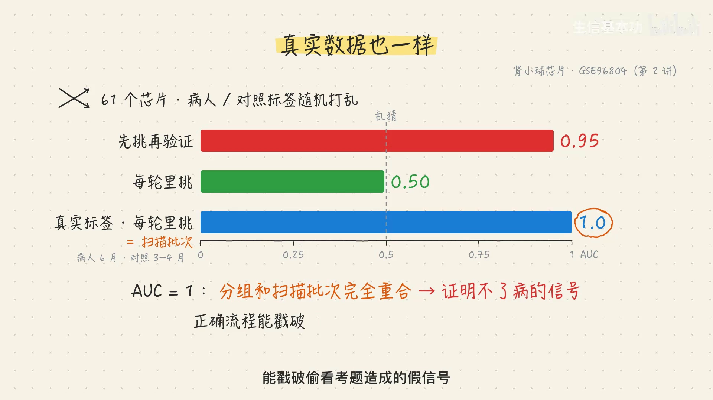

- 把病人/对照标签**随机打乱**，先挑基因再交叉验证：AUC 平均 **0.95**；
- 每一轮里只用训练折挑基因：AUC 掉到 **0.50**（和乱猜一样）；
- 换回**真实标签**、正确流程：AUC 是 **1.0**。

第三个数字看着漂亮，但讲者立刻泼了冷水：**这份数据的病人和对照是分两批扫描的**（病人 6 月，对照 3–4 月），光凭扫描批次就能把它们分开，所以这个 1.0 **证明不了病的信号**。

这段对比给出了两条独立的教训：

1. **正确流程能戳破「偷看考题」造成的假信号**（0.95 → 0.50）；
2. **但正确流程管不了设计上的混杂**（真实标签下 1.0 依然可能只是批次）。

网上很多套路文章正是这样：在公共数据库里挑出几个基因，再在同一批病人里算预测效果，从头到尾只用一个数据集，结果看起来很漂亮，**换一批人就不灵了**[【跳转到 07:39】](https://www.bilibili.com/video/BV11BWx61EmZ/?t=459)。

这个问题 2002 年就有统计学家专门指出过：当时一些基因芯片的预测研究报告了「错误率接近零」，原因正是挑基因这一步没有放进交叉验证里面[【跳转到 07:56】](https://www.bilibili.com/video/BV11BWx61EmZ/?t=476)。

> **小结**：凡是从数据里学的步骤——挑特征、调参数——都只能在训练集里做，否则连随机数都能造出完美的模型。

## 四、泄漏的第二种样子：同一个个体，两边都有

第二种泄漏更隐蔽：同一个个体同时出现在训练集和测试集里。它的常见形态有三种[【跳转到 08:21】](https://www.bilibili.com/video/BV11BWx61EmZ/?t=501)：

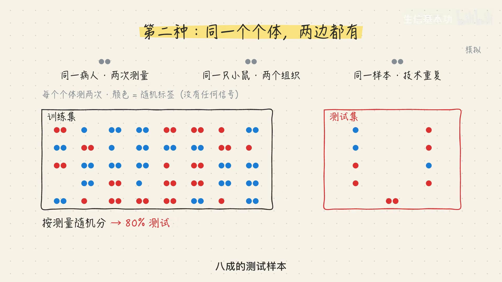

- 同一个病人的两次测量；
- 同一只小鼠的两个组织；
- 同一份样本的技术重复。

讲者的模拟：40 个个体，每个测两次，标签同样是随机的。如果**按测量随机分**，八成的测试样本的「双胞胎」就在训练集里，准确率 **91%**；改成**按个体分**（同一个体的两次测量必须在同一边），准确率回到 **51%**——和乱猜一样[【跳转到 08:46】](https://www.bilibili.com/video/BV11BWx61EmZ/?t=526)。

结论一句话：**模型并没有学会区分病人和对照，它只是认出了这个人**。

这条对单细胞数据尤其致命。一个 Perturb-seq 实验里，同一个供体的细胞可能有几千个；如果按**细胞**随机划分，训练集和测试集里全是同一个供体的细胞，模型只要记住「这个供体的表达谱长什么样」就能拿到很高的分数。所以划分单位必须是**供体/样本**，不是细胞——这也是本系列反复强调「1000 个细胞不等于 1000 个样本」（伪重复）的原因。

## 五、泄漏的第三种样子：预处理用了全部数据

第三种是标准化、批次校正这类预处理用了全部数据。讲者很诚实地给了一个「影响有时很小」的例子：在企鹅数据里，先用全部数据缩放再分组，结果几乎没有变化[【跳转到 09:11】](https://www.bilibili.com/video/BV11BWx61EmZ/?t=551)。

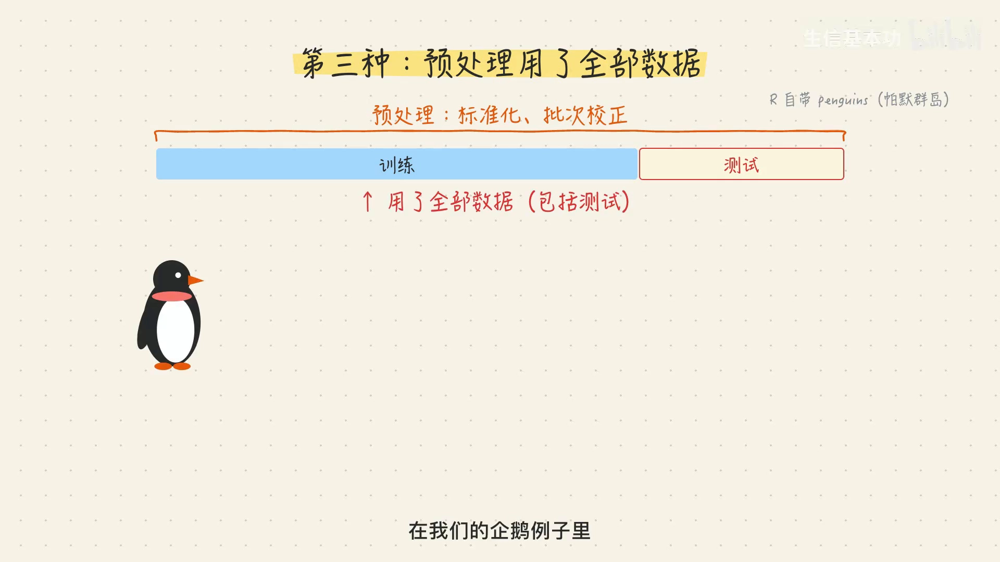

但**这一种的影响取决于预处理本身学了多少东西**：

- 如果只是减一个均值、除一个标准差，泄漏的量级有限；
- 如果预处理**用到了标签**，或者**从成千上万个特征里学东西**（批次校正、挑特征），泄漏就会变得非常严重。

在单细胞里，这一条几乎天天被踩：`scanpy` 的 `sc.pp.highly_variable_genes`、`sc.pp.normalize_total`、Harmony 整合，默认都是对**整个 AnnData** 做的。如果先整合再划分，测试集的表达值已经参与过校正参数的估计，测试分数就不再干净。正确做法是把这些步骤放进 `Pipeline`（sklearn）或写成函数，**只在训练折上 `fit`，再 `transform` 测试折**。

## 六、泄漏的第四种样子：同一段区域跨两边

基因组研究里还有更隐蔽的情况[【跳转到 09:36】](https://www.bilibili.com/video/BV11BWx61EmZ/?t=576)：

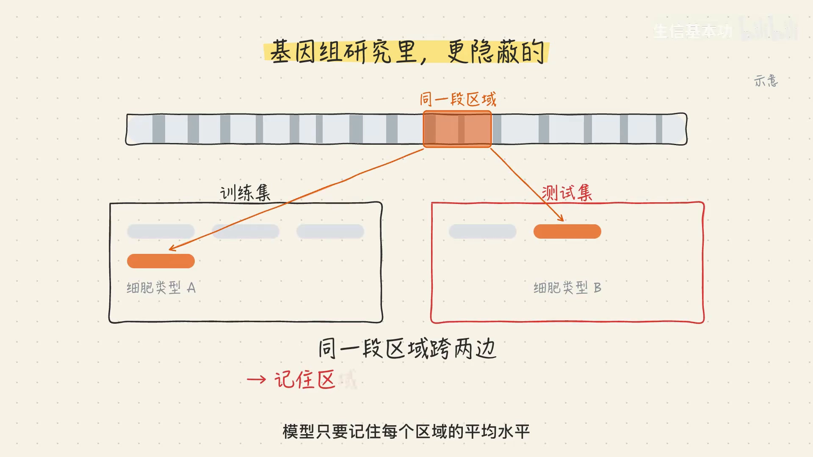

同一段基因组区域（比如同一个基因、同一个调控元件、同一个 peak）同时出现在训练集和测试集里，模型只要**记住每个区域的平均水平**，就能显得很准。这在单细胞扰动预测里对应的是**特征层面的泄漏**：如果扰动标签是从「扰动后的表达签名」里算出来的，再把这个签名当作输入特征，那就是把答案抄进了题目。

讲者由此给出**一条总规矩**[【跳转到 10:01】](https://www.bilibili.com/video/BV11BWx61EmZ/?t=601)：

> **先分组，再做任何从数据里学东西的事。同一个个体、同一个来源的样本必须分在同一边。**

他还补了一句更狠的：如果病人都在一个批次、对照都在另一个批次，模型学到的可能只是批次而不是病，在这样的数据上准确率可以接近百分之百，**却毫无用处**。

## 七、外部验证：没有泄漏也不代表能换数据

到这里，讲者把话题从「防泄漏」推到「证明泛化」[【跳转到 10:26】](https://www.bilibili.com/video/BV11BWx61EmZ/?t=626)：

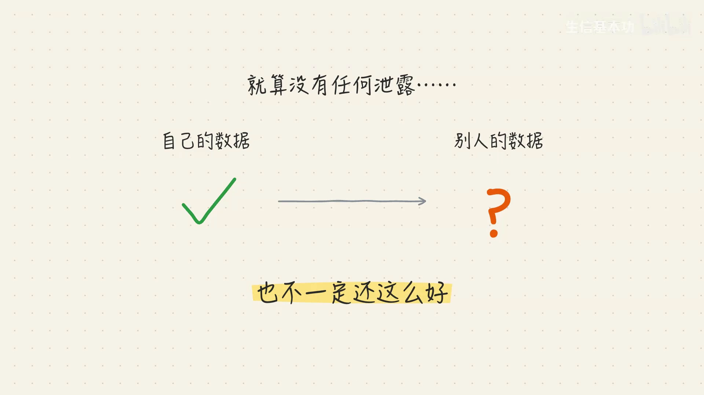

**外部验证 = 拿一份完全独立的数据，不同的时间、不同的地点、不同的人群，再测一次。**

企鹅数据提供了两个很好的例子：

**（1）不同时间**：数据是 2007~2009 年采集的，用前两年的企鹅训练，去猜 2009 年的 AUC。

**（2）不同地点**：用两个岛上的阿德利企鹅训练（91 只），去猜第三个岛（Dream，55 只）的企鹅[【跳转到 10:49】](https://www.bilibili.com/video/BV11BWx61EmZ/?t=649)：

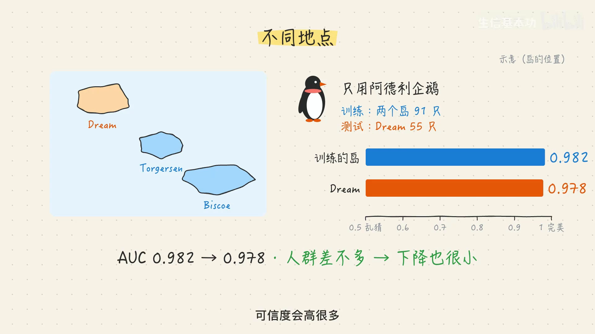

AUC 从 **0.982** 降到 **0.978**，人群差不多，下降也很小。这是「外部验证通过」的样子。讲者顺带提了一句数据下载那一讲已经给糖尿病肾病准备的两份数据：一份芯片数据用来发现、一份测序数据用来验证，**平台不同、病人不同**，如果结论在两份里都站得住，可信度会高很多。

**（3）不同人群**：换一个差别更大的人群——把只用阿德利企鹅训练的模型拿去猜巴布亚企鹅[【跳转到 11:14】](https://www.bilibili.com/video/BV11BWx61EmZ/?t=674)：

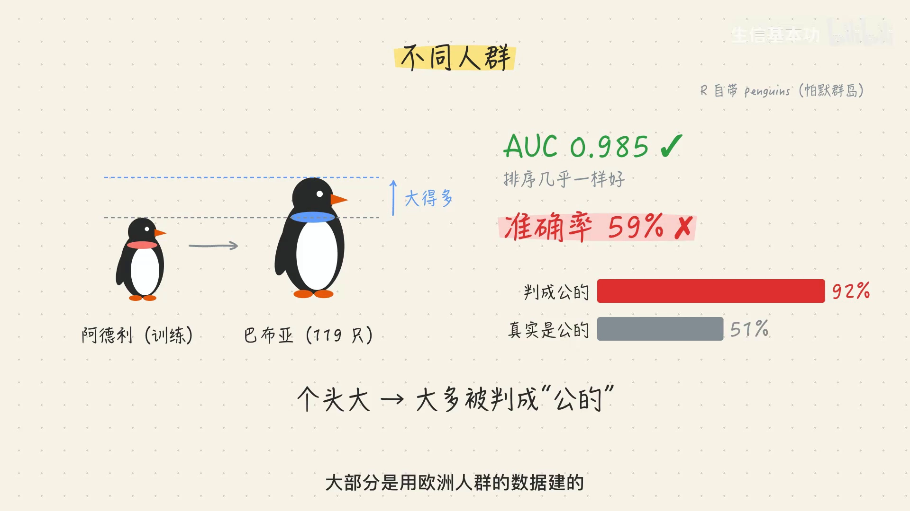

结果非常有意思：**AUC 还是 0.985，排序几乎一样好；可准确率只剩下 59%**。原因是巴布亚企鹅整体个头大得多，模型把 **92%** 都判成了公的，而真实只有 51%。

这正是前面那个伏笔的兑现：**AUC 只看排序不看阈值**。排序在新人群里还成立，可**阈值已经不合适了**。所以外部验证要**排序和阈值两样都检查**——只报 AUC 会漏掉这类「排序对、判定错」的失效。

讲者还类比了**多基因风险评分**（polygenic risk score）：大部分是用欧洲人群的数据建的，放到其他人群里预测能力常常明显下降，机制完全一样。

## 八、把外部验证变成习惯：三个问题与报告规范

讲者最后把方法收束成一套可执行的动作[【跳转到 11:39】](https://www.bilibili.com/video/BV11BWx61EmZ/?t=699)：

1. **分清有监督与无监督**：有标签、预测谁会得病，是有监督学习；没有标签、在病人里自己找亚型，是降维与聚类那一讲的无监督学习。**找到的亚型一样要在新数据里重复出来**。
2. **热门方法同样要过关**：现在的基础模型、多组学预测模型同样要过外部验证这一关，还要额外问两个问题——**它对不同人群是否公平？能不能说清它为什么这样判断？**
3. **看报告规范**：2015 年发布的预测模型报告规范（TRIPOD）列出了一份 **22 项**必须写清楚的内容清单，包括数据怎么分、怎么验证；2024 年又发布了针对机器学习的新版本[【跳转到 12:04】](https://www.bilibili.com/video/BV11BWx61EmZ/?t=724)。

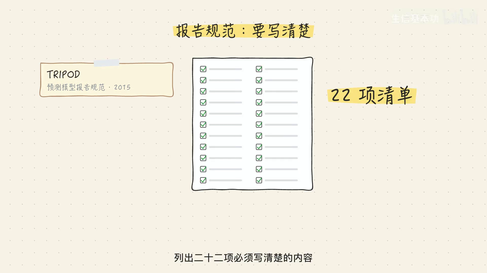

于是读论文时，看到一个预测模型先问**三个问题**[【跳转到 12:29】](https://www.bilibili.com/video/BV11BWx61EmZ/?t=749)：

1. **测试集是不是一直没被碰过？**
2. **有没有任何一步用了全部数据？**（挑特征、标准化、批次校正、选超参数）
3. **有没有在独立的数据上验证过？**

这三个问题，恰好对应本小节要讲的「泄漏来源清单」与「跨数据集验证」：前两问查泄漏，第三问查泛化。

## 九、整讲串起来

讲者用一分钟把全片收束[【跳转到 12:54】](https://www.bilibili.com/video/BV11BWx61EmZ/?t=774)：

- 预测模型从已知答案的数据里学规则，要用没见过的数据来评价；
- 训练集学规则，验证集做选择，测试集只在最后用一次（样本少时用交叉验证，每一轮同样守规矩）；
- AUC 是「随机一对里排对序的概率」，**但不看阈值**；
- 数据泄漏就是偷看考题，具体有：先挑特征再验证、同一个体跨两边、预处理用了全部数据、同一区域跨两边；
- 最后一定要在**独立的数据**上做外部验证，**排序和阈值都要看**。

**小作业**（讲者留的两道题）[【跳转到 13:44】](https://www.bilibili.com/video/BV11BWx61EmZ/?t=824)：

1. 只用体重一个指标去猜企鹅性别，测试集的 AUC 是多少？为什么比用全部指标低这么多？
2. 如果把阈值直接在测试集上挑，测试准确率会变成多少？这算不算泄漏？

下一讲讲**伪重复**：1000 个细胞是不是就等于 1000 个样本——这正是第四、五节在单细胞场景下的延伸。

## 小结

- **三份数据各管一件事**：训练集学规则、验证集做选择、测试集只在最后用一次；交叉验证的每一轮同样不能偷看那一份考题。
- **AUC 只看排序、不看阈值**：0.5 是乱猜，1 是完美，它的直观含义是「随机一对里排对序的概率」。
- **泄漏的第一种样子**：先用全部数据挑特征 → 随机数也能造出 AUC 0.999；改成每轮训练折内挑，掉到 0.46。
- **泄漏的第二种样子**：同一个体跨两边 → 按测量随机分 91%，按个体分 51%，模型只是「认出了这个人」。
- **泄漏的第三种样子**：预处理（标准化、批次校正）用了全部数据；影响大小取决于它学了多少东西，但用错位置就会很严重。
- **泄漏的第四种样子**：同一段基因组区域跨两边，模型记住区域平均水平就能显得很准。
- **一条总规矩**：先分组，再做任何从数据里学东西的事；同一个体、同一来源的样本必须分在同一边。
- **外部验证是最后一道关**：换时间、换地点、换人群再测；排序（AUC）和阈值（准确率）两样都要检查——AUC 0.985 配准确率 59% 就是活教材。
- **三个问题**快速判断一个模型可不可信：测试集碰过吗？有哪一步用了全部数据？在独立数据上验证过吗？

## 关键术语速查

| 术语 | 一句话解释 |
| --- | --- |
| 数据泄漏（数据泄露） | 训练时提前「看到考题」，让一个其实没用的模型看起来非常准 |
| 训练集 / 验证集 / 测试集 | 分别对应练习题 / 模拟考 / 期末考试；测试集全程只能用一次 |
| 交叉验证 | 把数据分成 k 份轮流当考题，最后平均成绩；每一轮同样不能偷看那一份考题 |
| 阈值（threshold） | 把连续分数切成「是/否」的那条线；只能在验证集上定，不能在测试集上挑 |
| 灵敏度 / 特异度 | 真阳性里被认出来的比例 / 真阴性里被认对的比例 |
| AUC | ROC 曲线下面积，等于「随机一对里排对序的概率」；只看排序，不看阈值 |
| 外部验证 | 用完全独立的数据（不同时间、地点、人群）再测一次，检验模型能否迁移 |
| 批次效应 / 批次校正 | 由于扫描时间、试剂批次、平台不同造成的系统性差异；校正若用了全部数据会造成泄漏 |
| 伪重复（pseudo-replication） | 把同一个体的多个细胞当成多个独立样本，人为放大样本量 |
| TRIPOD | 预测模型报告规范，2015 年发布 22 项清单，2024 年推出机器学习版本 |