# 生物信息学 AI 的数据泄漏陷阱：从「划分单位」到跨数据集验证

> 视频来源：[奥尔加·卡利尼娜《生物信息学中的人工智能：避开数据泄漏陷阱》](https://www.bilibili.com/video/BV1Vdxa6jEMx/)（Bilibili · FOSDEM 2026 中英双语，讲者：Olga Kalinina，萨尔大学药物生物信息学教授、亥姆霍兹药学研究所）
> 导读：这是一场约 15 分钟的会议演讲（FOSDEM 2026），讲者把「数据泄漏」从一句口号拆成了可操作的工程问题：泄漏到底从哪几个方向进来、怎样用**数据划分**把它挡住、以及为什么「更好的模型在论文基准上反而分数更低」。本文按「泄漏来源 → 划分设计 → 跨数据集验证」重排其内容，并把讲者反复强调的两个概念——**样本相似性**与**推理时可得性**——落到单细胞扰动预测的场景里。幻灯片为英文原版，术语已按上下文订正。

## 本讲要解决的核心问题（SCQA）

**背景**：2010 年代中期以来，生物医学领域里带「机器学习／人工智能」标签的论文数量一路飙升，而且势头丝毫不减。讲者开场展示的那张统计图（医学影像领域）显示，论文数量与「标题里声称使用 AI」的比例在 2015 年前后同时拐头向上[【跳转到 02:00】](https://www.bilibili.com/video/BV1Vdxa6jEMx/?t=120)。

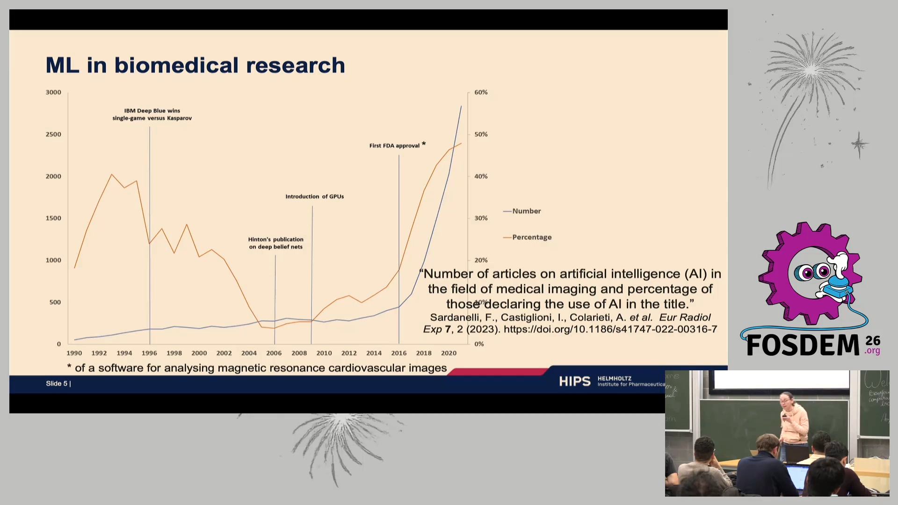

**冲突**：模型是黑箱。经典的「哈士奇 vs 狼」分类器看起来准确率很高，但可视化它的注意力区域会发现——它盯的是**雪**，不是狗：狗的照片大多拍在普通背景，狼的照片大多拍在雪地里，于是模型被训练成了一个完美的「积雪探测器」[【跳转到 02:36】](https://www.bilibili.com/video/BV1Vdxa6jEMx/?t=156)。

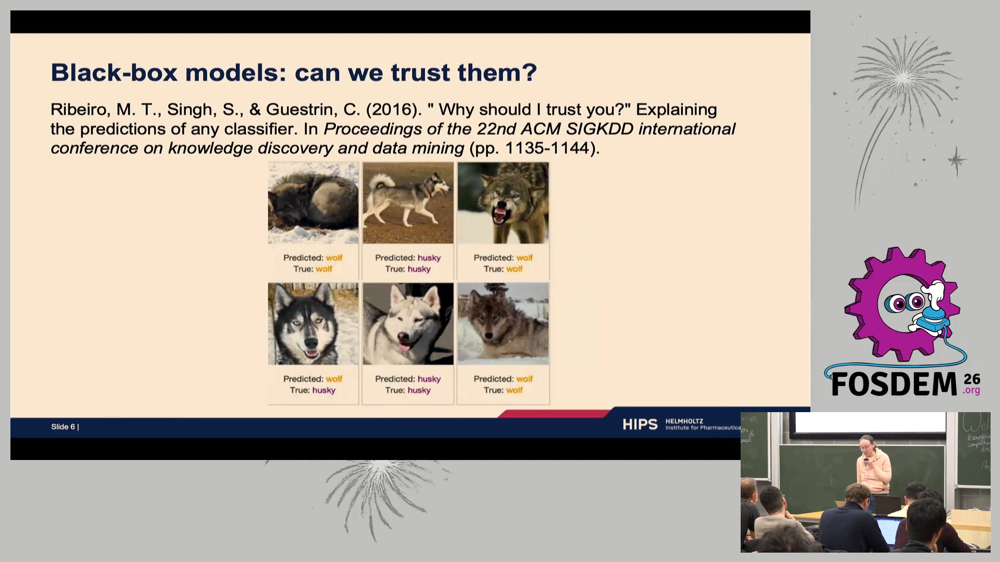

这件事很好笑，可一旦进入生物医学领域就笑不出来：新冠疫情期间涌现的大量 CT 影像诊断模型，学到的其实是**影像上的文字标记**——因为所有新冠阳性影像来自同一家医院，健康肺部影像来自另一家医院，两家医院标注影像的方式不同。模型学到的是「哪家医院」，不是「有没有病」[【跳转到 03:34】](https://www.bilibili.com/video/BV1Vdxa6jEMx/?t=214)。

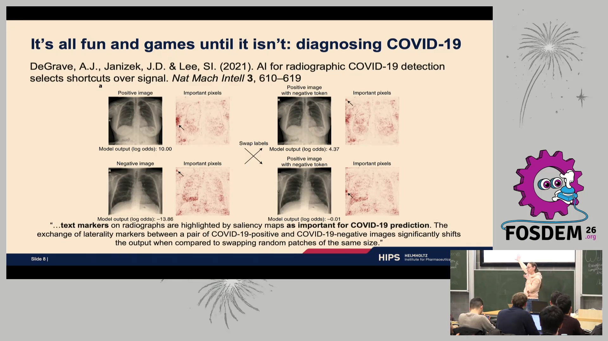

**疑问**：既然模型会去抓任何能降低训练损失的线索，那我们怎么知道它抓的是真正想预测的生物学信号，而不是某个只在训练数据里成立的「捷径」？更进一步：**换一个独立数据集，这个模型还成立吗？**

**回答（中心思想）**：**数据泄漏的本质是「训练时用了推理时拿不到的信息」**，而它最隐蔽、也最普遍的一种形式是**样本相似性泄漏**——训练集和测试集里有彼此高度相似的样本，模型只要「记住」就能拿高分。因此，验证的关键不是换一个更花哨的模型，而是**换一种划分方式**：按相似性把数据分簇、整簇放进同一边，让测试集真正「没见过」。这一步必须在训练**之前**做，因为它是数据分析问题，不是模型问题。

## 一、先定义清楚：泄漏有两个方向，一个比一个隐蔽

讲者给出的定义很干脆：**信息泄漏 = 在模型训练过程中使用了推理时无法获得的信息**，后果是性能被高估[【跳转到 05:27】](https://www.bilibili.com/video/BV1Vdxa6jEMx/?t=327)。

把训练数据看成一张表（行是样本，列是特征），泄漏就可以按方向分成两类[【跳转到 05:52】](https://www.bilibili.com/video/BV1Vdxa6jEMx/?t=352)：

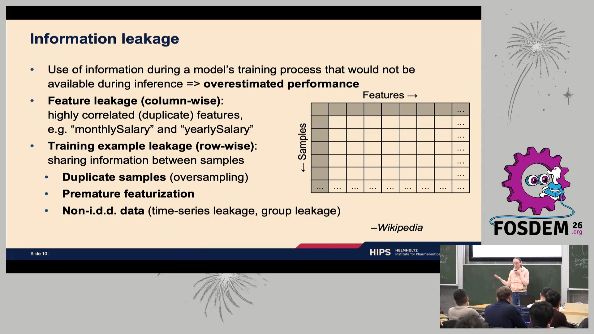

1. **特征泄漏（按列）**：某个特征与要预测的标签高度相关，甚至就是标签的另一种写法。讲者举的例子是「要预测员工的年薪，表里却有一列直接记录了月薪」——模型当然学得很好，但它学到的不是我们想让它学的东西。在单细胞里，这类泄漏的典型形态是**扰动标签泄漏**：把「扰动后算出来的表达签名」当作输入特征去预测扰动，等于把答案抄进了题目。
2. **样本泄漏（按行）**：样本之间共享信息，导致测试样本的信息提前进入训练。它至少有三种子形态：
   - **重复样本**：数据清洗不彻底，同一条记录同时落进训练集和测试集；
   - **过早特征化（premature featurization）**：在划分之前就做了依赖全体样本的特征构造；
   - **非独立同分布数据**：时间序列泄漏、分组泄漏——同一个体、同一批次、同一实验单元的样本被拆到两边。

讲者特别指出，第一类（重复样本）理论上相对容易解决，只要认真去重；**真正难的是后两类**，因为它们不会在数据表上留下肉眼可见的痕迹[【跳转到 06:42】](https://www.bilibili.com/video/BV1Vdxa6jEMx/?t=402)。

## 二、为什么泄漏防不住：推理时的数据不在你手里

要理解泄漏为什么顽固，得先看模型的生命周期。讲者把整个过程画成两个框[【跳转到 05:02】](https://www.bilibili.com/video/BV1Vdxa6jEMx/?t=302)：

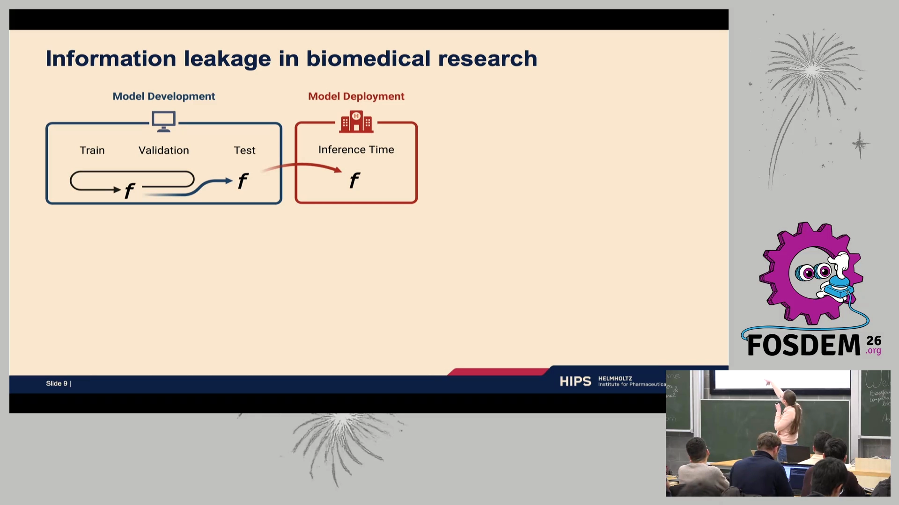

- **蓝色框（模型开发）**：训练集、验证集、测试集，全在开发者手里，可以随便切、随便调；
- **红色框（模型部署）**：推理时的真实数据，开发者**没有多少控制力**，甚至根本不知道它长什么样。

这就是问题的根源：你只能拿手里的数据去模拟「未来的数据」，而模拟得准不准，取决于你怎么切。如果切法让训练集和测试集共享了某种技术因素（同一供体、同一批次、同一测序通道、同一预处理流程），那么测试集分数衡量的是「模型能不能记住这个技术因素」，而不是「模型能不能泛化」。

讲者由此提出一个很实用的判据：**任何一步「从数据里学东西」的操作，都必须能回答「推理时这一步还做得了吗」**。做不了，就是泄漏。

## 三、七个问题：把泄漏检查变成一张清单

既然无法控制推理端，就只能在训练前多留一道心。讲者所在团队在 *Nature Methods*（2024）上发表了一篇论文，提出**七个问题**，每个严谨的研究者在训练模型前都该问自己一遍[【跳转到 07:07】](https://www.bilibili.com/video/BV1Vdxa6jEMx/?t=427)：

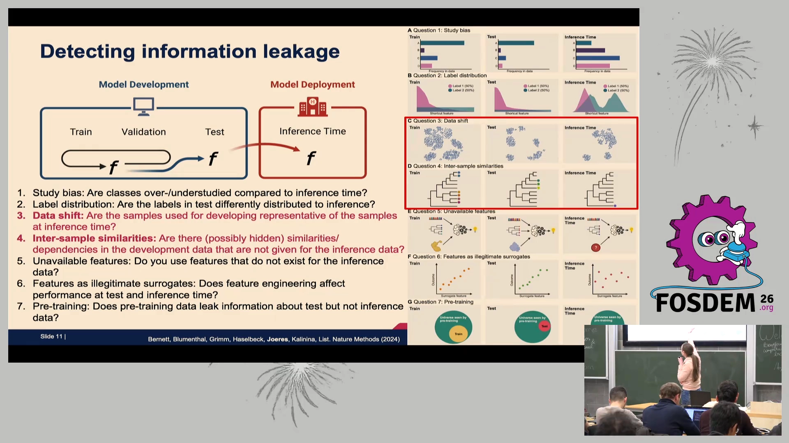

| 编号 | 问题 | 一句话解释 |
| --- | --- | --- |
| 1 | 研究偏倚（study bias） | 训练集里各类别的样本量与推理时相比是否失衡？ |
| 2 | 标签分布（label distribution） | 测试集的标签比例是否与推理时一致？ |
| 3 | 数据漂移（data shift） | 用于开发的样本能否代表推理时的样本？ |
| 4 | 样本间相似性（inter-sample similarities） | 开发数据里是否存在推理数据不具备的（可能是隐藏的）相似性/依赖？ |
| 5 | 不可得特征（unavailable features） | 是否用了推理时根本不存在的特征？ |
| 6 | 特征作为不当代理（illegitimate surrogates） | 特征工程是否让测试与推理时的表现脱钩？ |
| 7 | 预训练（pre-training） | 预训练数据是否泄漏了测试集的信息，而推理时没有？ |

这七条里，讲者今天只展开**第 3 与第 4 条**，因为它们共同指向同一个技术核心：**样本相似性**。而第 7 条「预训练」正是当前单细胞基础模型领域最严重的泄漏源——一个在公共图谱上预训练的基础模型，如果评测集本身就在那份公共图谱里，那么「零样本预测」的成绩就毫无意义。这一点在本系列 5.3.5 与 5.4.1 已分别从模型与指标角度谈过，此处只需记住：**它属于「训练时用了推理时拿不到的信息」的一种，而且是最难自查的一种**。

## 四、数据划分：把「难度」当成一个可调的旋钮

讲者把数据划分写成了一个数学问题[【跳转到 07:57】](https://www.bilibili.com/video/BV1Vdxa6jEMx/?t=477)：

给定数据集 $D$（$n = \lvert D \rvert$）与各子集的比例 $S = \{s_1, \dots, s_k\}$，求 $D$ 的一个划分 $P$，使得 $\lvert p_i \rvert = s_i \cdot n$。数学上，这就是找一个映射：

$$
\pi: D \to [k]
$$

问题在于，**满足这个约束的映射有无穷多个**，而它们给出的「难度」天差地别：

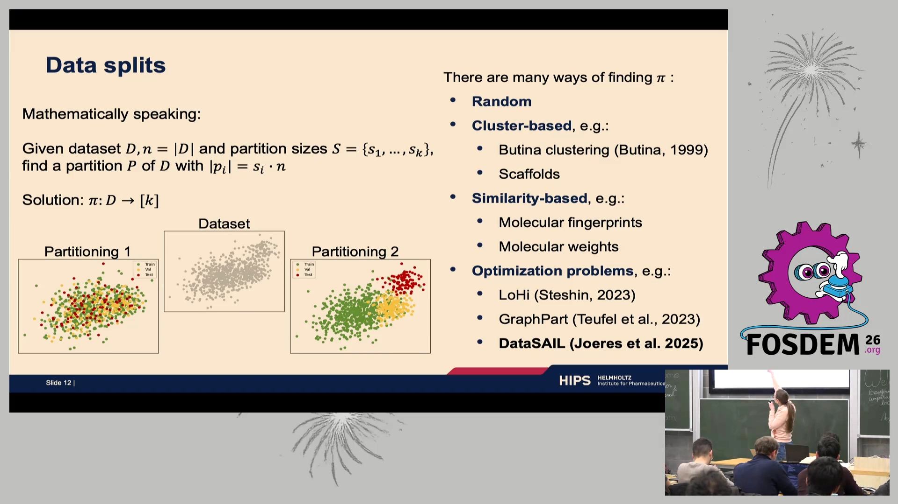

- **随机划分**：每个点独立抛硬币决定去哪个子集。训练点和测试点在数据空间里犬牙交错——这正是「泄漏」的温床。
- **基于聚类的划分**：先把相似的点聚成簇（如 Butina 聚类、骨架划分 scaffolds），整簇分配。
- **基于相似性的划分**：按分子指纹、分子量等相似性度量分组。
- **优化问题**：把划分本身写成一个带约束的优化问题来求解（如 LoHi、GraphPart、以及讲者团队的 DataSAIL）。

讲者的核心主张是：**划分不只是「切数据」，它是你给模型设定的难度等级**。随机划分相当于把考题和练习题混在一起发，模型只要背下来就能得高分；按相似性划分则强迫模型去应对「没见过的化学空间/样本空间」。

这条主张可以直接搬到单细胞扰动预测上：**按细胞随机划分**相当于让同一个供体、同一个 10x 通道的细胞同时出现在训练和测试里；**按供体划分**（leave-one-donor-out）、**按数据集划分**（leave-one-dataset-out）才是真正的考题。划分单位选错，后面所有指标都失去意义。

## 五、一维与二维：相似性在哪个维度上泄漏

生物数据集往往不是一张普通的表。讲者区分了两种情形[【跳转到 09:12】](https://www.bilibili.com/video/BV1Vdxa6jEMx/?t=552)：

- **一维数据**：只有一份实体列表，比如一批蛋白质，要对它们做某种预测。此时只需在实体之间找相似性，把相似的簇整体放进同一边。
- **二维数据**：行与列都有实体，比如「药物 × 靶标」的相互作用矩阵，两个维度上都存在相似性。

二维数据的划分难度陡增，因为它有多种「从易到难」的切法[【跳转到 10:02】](https://www.bilibili.com/video/BV1Vdxa6jEMx/?t=602)：

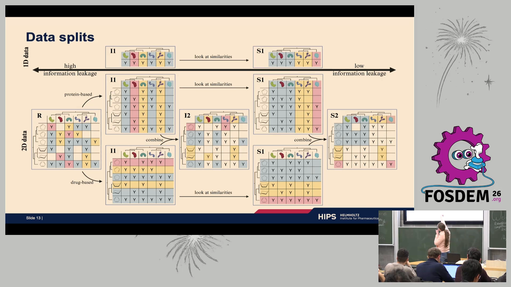

1. **随机切分矩阵**（最容易，泄漏最多）：同一种药的多个靶标可能一半在训练、一半在测试；
2. **按行或按列切分**：某些药物在训练时完全不被模型见到，测试时就能观察模型对**未见过的药物**或**未见过的靶标**的表现；
3. **按相似性聚簇切分**（最难）：把相似的药物和靶标放进同一个子集。代价是**会损失一些数据**——有些数据点横跨多个簇，无法干净地分配，只能丢掉[【跳转到 10:27】](https://www.bilibili.com/video/BV1Vdxa6jEMx/?t=627)。

这个「难度谱系」和单细胞扰动预测的划分设计是同构的：按细胞随机分（最易）→ 按扰动分（leave-one-perturbation-out）→ 按细胞系/供体分 → 按数据集分（最难）。**你报告的分数，只有配上划分方式才有意义。**

## 六、把划分做成工具：DataSAIL 与它的实验证据

讲者团队的解决方案叫 **DataSAIL**：一个在训练前运行的数据划分工具。它的定位很明确——**不是让模型死记数据，而是让模型对没见过的数据泛化得更好**[【跳转到 10:43】](https://www.bilibili.com/video/BV1Vdxa6jEMx/?t=643)。

输入一个常规的分子数据集，它会自动生成一系列不同难度的划分，并给出一个**基于数据点之间相似性的泄漏度量**；划分本身被写成一个优化问题，用**整数线性规划**求解[【跳转到 11:17】](https://www.bilibili.com/video/BV1Vdxa6jEMx/?t=677)。

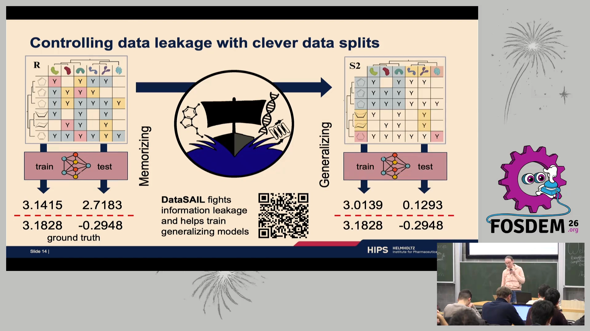

在「药物—靶标相互作用」（DTI）预测任务上，团队用几种标准机器学习模型（随机森林、SVM、XGBoost、多层感知机）跑了不同划分[【跳转到 11:42】](https://www.bilibili.com/video/BV1Vdxa6jEMx/?t=702)：

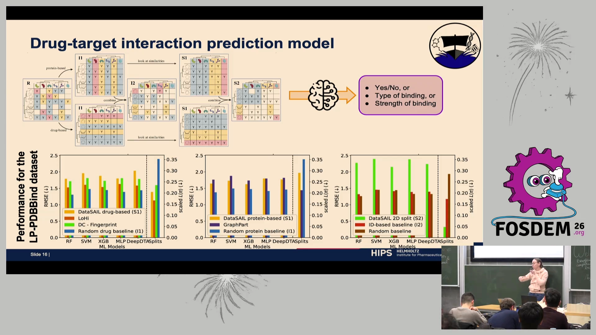

结论很直接：**划分之间的泄漏越少，模型的表现就越差**；与论文发表时已有的其他划分工具（LoHi、GraphPart、DC-Fingerprint 等）相比，DataSAIL 给出的划分让模型面临更大的挑战。

这也解释了为什么「难度旋钮」必须显式化：如果不同论文用不同难度的划分，那么它们报告的 RMSE/AUC **根本不可比**。一个在随机划分上刷到 0.9 的模型，换到按相似性划分上可能只剩 0.6——而后者才更接近真实部署时的表现。

## 七、一个反直觉的结论：好模型在基准上可能更差

演讲的最后一条结论值得单独拎出来[【跳转到 12:12】](https://www.bilibili.com/video/BV1Vdxa6jEMx/?t=732)：

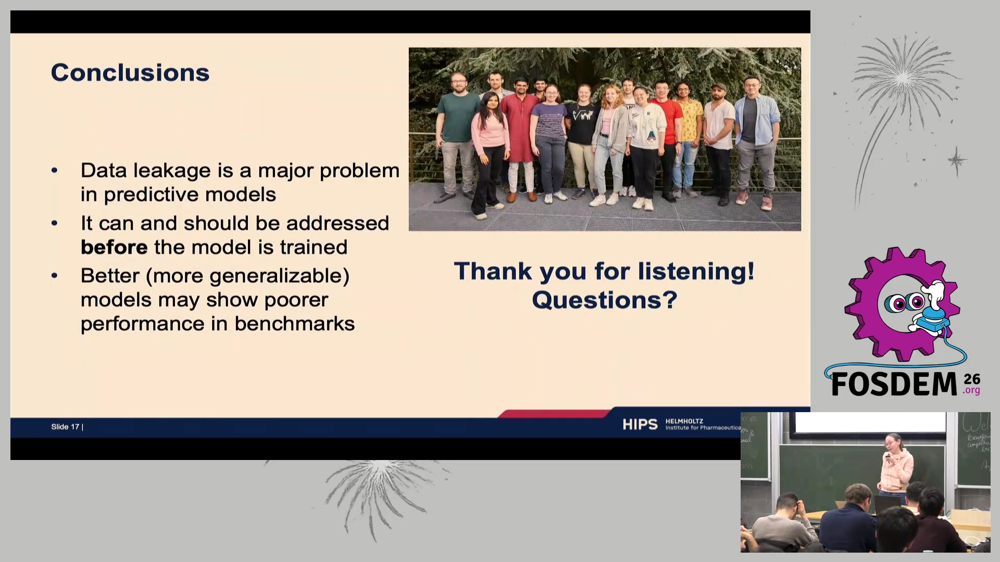

1. **数据泄漏是预测模型的主要问题**，而且它应该在**开始训练之前**、在检查数据集的时候就处理掉——这是数据分析问题，不是模型问题。
2. **更好的模型（对未见数据泛化得更好的模型）往往在论文报告的基准评测上表现更差**。原因很简单：努力做泛化的人会主动选择更难的划分，分数自然更低；而多数论文仍在随机划分上评测，于是「刷分」比「泛化」更划算。
3. 当然，**独立的基准评测会揭示真相**——只要评测方使用更难的划分，真正泛化好的模型就会浮上来。

这条结论对单细胞扰动预测是直接的警告：看到一篇论文报告「扰动响应预测相关性 0.9」，第一个该问的不是「模型结构是什么」，而是「**它是怎么划分的**」。

## 八、跨数据集验证：把「相似性」从数据内部挪到数据之间

演讲的问答环节补充了一个关键点：信息泄漏本身很难可视化，但**它可以被度量**。团队提出的公式衡量的是**数据集内部以及数据集之间**各数据点的相似性，而这个度量正是工具所求解的优化目标函数[【跳转到 13:39】](https://www.bilibili.com/video/BV1Vdxa6jEMx/?t=819)。

「数据集之间」这四个字很重要。它意味着同一套思路可以直接用来回答本小节的核心问题：**换一个独立数据集，模型还成立吗？**

- 如果训练集与测试集来自**同一个数据集**，那么无论怎么划分，两者都共享同一批供体、同一批批次、同一套预处理流程。按相似性划分只能切断「样本层面的相似」，切不断「数据集层面的共享」。
- 只有**跨数据集测试**（在 A 数据集训练、B 数据集测试）才能把这些共享因素一次性切断。此时的性能下降幅度，才是真实的泛化代价。

讲者还提到一个工程现实：这个工具的计算瓶颈不在时间（通常几小时算完），而在**内存**；因此下一步要开发专门的求解器[【跳转到 14:35】](https://www.bilibili.com/video/BV1Vdxa6jEMx/?t=875)。这一点对单细胞场景尤其贴切——几十万细胞的相似性矩阵本身就是个内存怪兽。

## 小结

- **数据泄漏 = 训练时用了推理时拿不到的信息**，后果是性能被高估；它沿两个方向发生：特征（列）与样本（行）。
- 生物医学里的经典案例（狼/哈士奇、新冠 CT）说明：模型会抓任何能降低损失的捷径，包括**医院标记**这种与生物学完全无关的东西。
- 团队提出的**七个检查问题**（研究偏倚、标签分布、数据漂移、样本间相似性、不可得特征、特征代理、预训练）可以直接当作论文审稿清单；其中「预训练语料重叠」是当前单细胞基础模型最严重的泄漏源。
- **数据划分是可调的难度旋钮**：随机划分 → 按行/列划分 → 按相似性聚簇划分，泄漏依次减少、难度依次上升。
- 划分单位决定指标含义：在单细胞里，按细胞随机分几乎必然高分；按供体、按数据集划分才是真考题。
- **更好的模型在基准上可能更差**，因为诚实的人选了更难的划分；跨论文比较分数前，先比较划分。
- 泄漏可以在**训练之前**处理，而且**可以被度量**——度量的对象既包括数据集内部，也包括数据集之间。

## 关键术语速查

| 术语 | 一句话解释 |
| --- | --- |
| 数据泄漏（data leakage） | 训练时使用了推理时无法获得的信息，导致性能被高估 |
| 特征泄漏 | 某一列特征本身就是标签的另一种写法（如用月薪预测年薪） |
| 样本泄漏 | 样本之间共享信息（重复样本、过早特征化、分组/时序泄漏） |
| 过早特征化（premature featurization） | 在划分之前就做了依赖全体样本的特征构造，把测试集信息带进训练 |
| 分组泄漏（group leakage） | 同一个体/同一批次的样本被拆到训练与测试两边 |
| 样本相似性泄漏 | 训练与测试中存在高度相似的样本，模型「记住」即可得分 |
| 研究偏倚（study bias） | 训练集里各类别样本量与推理时的分布不一致 |
| 数据漂移（data shift） | 开发用的样本不能代表推理时的样本 |
| 数据划分（data split） | 把数据集切成训练/验证/测试的映射 $\pi: D \to [k]$，其选择决定了评测难度 |
| DataSAIL | 讲者团队提出的训练前数据划分工具，用整数线性规划按相似性生成不同难度的划分 |
| 跨数据集验证 | 在 A 数据集训练、B 数据集测试，切断数据集层面的共享因素，衡量真实泛化能力 |