# 虚拟敲除只是筛选：一篇牙本质再生研究怎样把预测接成实验闭环

> 视频来源：[双虚拟生信干湿结合新套路！上海九院团队用公共单细胞数据做虚拟敲除，锁定 STAT3→WNT2B 轴](https://www.bilibili.com/video/BV1rhnJ6LE2C/)（B 站 · 医学SCI文献解读）｜时长约 22 分钟
> 简要导读：本讲逐层拆解一篇 2026 年发表在 *Cell Proliferation* 的论文（单细胞虚拟扰动筛选 + 条件敲除小鼠）。本文按"预测怎么落到实验台上"重排它的顺序：先看计算预测给出了什么，再逐级看验证的证据强度，最后看作者自己承认的局限。字幕为 B 站 AI 字幕，工具名与基因名已按幻灯片订正。

## 本讲要解决的核心问题（SCQA）

**背景**：现在做单细胞研究，跑完轨迹分析、调控网络、虚拟敲除，图能出、代码能跑，已经不算难事。CellOracle、scTenifoldKnk 这类"虚拟敲除"工具，只要有一份公共单细胞数据，就能给出"敲掉某个基因后细胞会往哪走"的预测。

**冲突**：但预测本身不是证据。审稿人一句"你的虚拟敲除有没有实验验证"，就足以让一篇纯计算的稿子卡在审稿阶段。更麻烦的是，从"预测出一个候选基因"到"证明它真的在起作用"，中间隔着一整套湿实验：敲低、药理抑制、正交扰动、体内模型、直接结合证据——每一步都对应不同的证据强度，也对应不同的成本。

**疑问**：一份计算预测，究竟要接上哪些实验，才算把"值得做"变成"确实如此"？这些实验该怎么排序？做到哪一步可以停？预测的边界又在哪里？

**回答（中心思想）**：**虚拟扰动是高效的筛选工具，不是最终的判决。** 它的价值在于把候选范围从两万个基因缩到一两个，然后由一条"证据强度递增"的验证链条接手：表达与蛋白层面证明它存在且活跃 → 功能层面证明去掉它会出事 → 体内条件敲除证明这件事在真实组织里也成立 → 正交扰动（药理抑制/激活）排除单一手段的假象 → 直接结合与回补实验证明因果链条的每一环。这篇论文正是这条链条的完整样板，而作者在讨论里主动写下的三条局限，恰好划出了"预测能走多远"的边界。

## 一、先看清整条链路：六层流水线，而不是一张漂亮的预测图

这篇论文的题目是 *Single-Cell Virtual Perturbation Screening Identifies STAT3 as a Key Regulator of Dentinogenesis*，2026 年 8 月发表在 *Cell Proliferation*（影响因子 7.6），文章类型标注得很直白：GEO 公共数据 + 单细胞 + 虚拟敲除 + 虚拟扰动 + 湿实验验证 [【跳转到 00:06】](https://www.bilibili.com/video/BV1rhnJ6LE2C/?t=6)。

它解决的是一个具体的临床问题：牙本质发育不良——牙本质薄、牙根短、萌出延迟、修复差。而它给出的研究范式，可以概括成四步 [【跳转到 00:21】](https://www.bilibili.com/video/BV1rhnJ6LE2C/?t=21)：

1. 用轨迹分析确定发育方向（谁往谁分化）；
2. 用两种**独立**方法交叉筛选关键调控因子；
3. 用虚拟扰动做初步的功能预测；
4. 用实验验证，形成闭环。

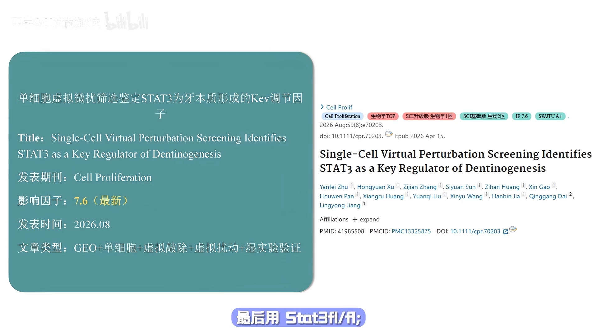

把这条链路摊开，就是一张六层的流水线图：第一层是实验设计与数据来源（GEO 数据集 GSE146123、人牙髓细胞 hDPCs、Stat3fl/fl × Osx-Cre 小鼠），第二层是单细胞图谱构建，第三层是关键转录因子筛选与预测，第四层是体外功能验证，第五层是体内验证与机制解析，第六层是回补验证与最终结论 [【跳转到 02:48】](https://www.bilibili.com/video/BV1rhnJ6LE2C/?t=168)。

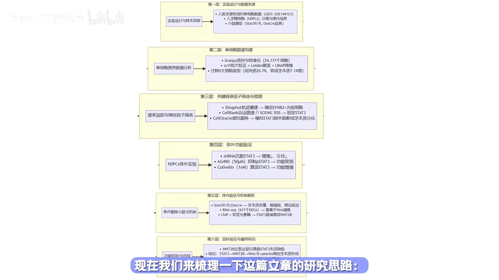

这张图值得多看一会儿，因为它把"计算"和"实验"放在了同一张时间轴上：**计算只占第三层，实验占了四到六层**。换句话说，一篇能站住的干湿结合文章，计算部分的工作量占比远小于一半——这与很多人对"AI 预测"的直觉相反。

如果想把整篇文章的逻辑一次看完，讲者还给了一张思维导图：左半边是干实验（图谱构建、谱系追踪、计算模拟敲除），右半边是湿实验（体外功能、体内功能、下游机制），两边在"STAT3"这个节点上对接 [【跳转到 03:44】](https://www.bilibili.com/video/BV1rhnJ6LE2C/?t=224)。

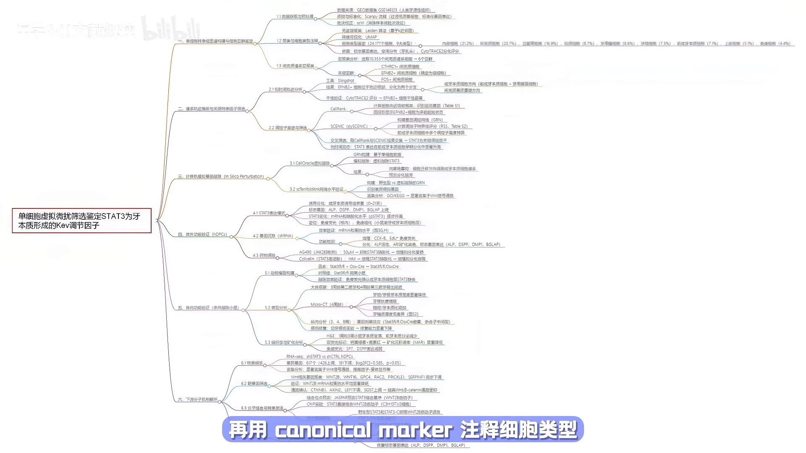

## 二、预测从哪来：先把"谁在分化、谁在指挥"算清楚

### 2.1 先做细胞户口普查，再锁定祖细胞

研究用的是公开的 GEO 数据集 GSE146123（人类牙源性组织）。处理流程是标准的单细胞四件套：Scanpy 做质控与标准化、scVI 做批次校正、Leiden 聚类、UMAP 降维，再用经典 marker 注释细胞类型 [【跳转到 08:26】](https://www.bilibili.com/video/BV1rhnJ6LE2C/?t=506)。

最终 24,177 个高质量细胞被分成 9 大类：内皮细胞、间充质细胞、周细胞、胶质细胞、前成牙本质层细胞、牙髓细胞、前成牙本质细胞、上皮细胞等。其中间充质细胞占 20.7%，前成牙本质细胞占 7.1% [【跳转到 09:03】](https://www.bilibili.com/video/BV1rhnJ6LE2C/?t=543)。

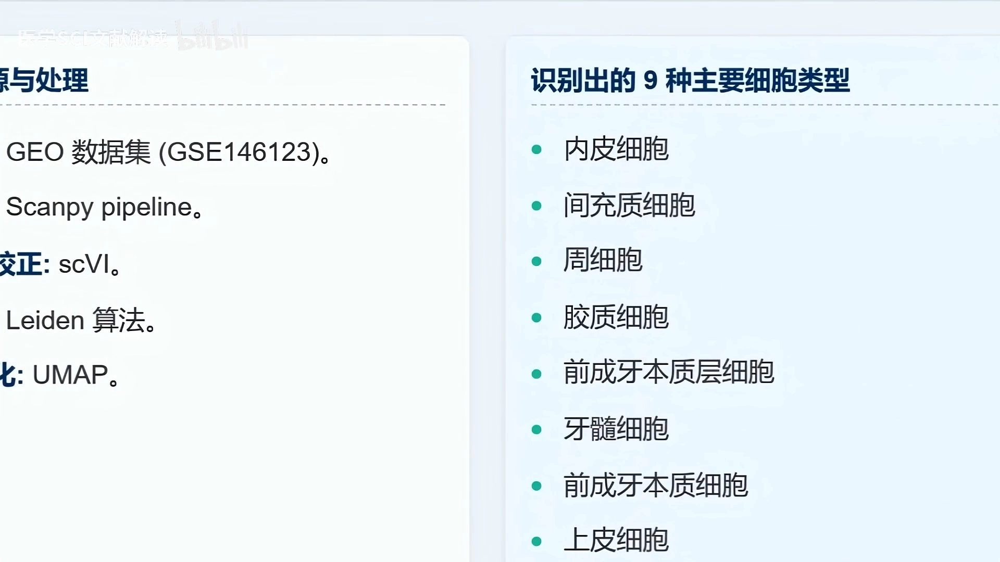

接着把 10,353 个间充质细胞单独拎出来做亚聚类，分成 6 个亚群，其中一个 **EFNB2 阳性**亚群引起了注意。Slingshot 拟时序把 EFNB2+ 细胞放在了发育轨迹的根部——它像一个分岔路口，一条路走向前成牙本质细胞（成牙本质方向），另一条走向其他间充质亚群（基质重塑方向）。CytoTRACE2 的干性评分进一步确认：EFNB2+ 细胞的干性评分最高，因此它是牙源性微环境里的主要祖细胞 [【跳转到 09:18】](https://www.bilibili.com/video/BV1rhnJ6LE2C/?t=558)。

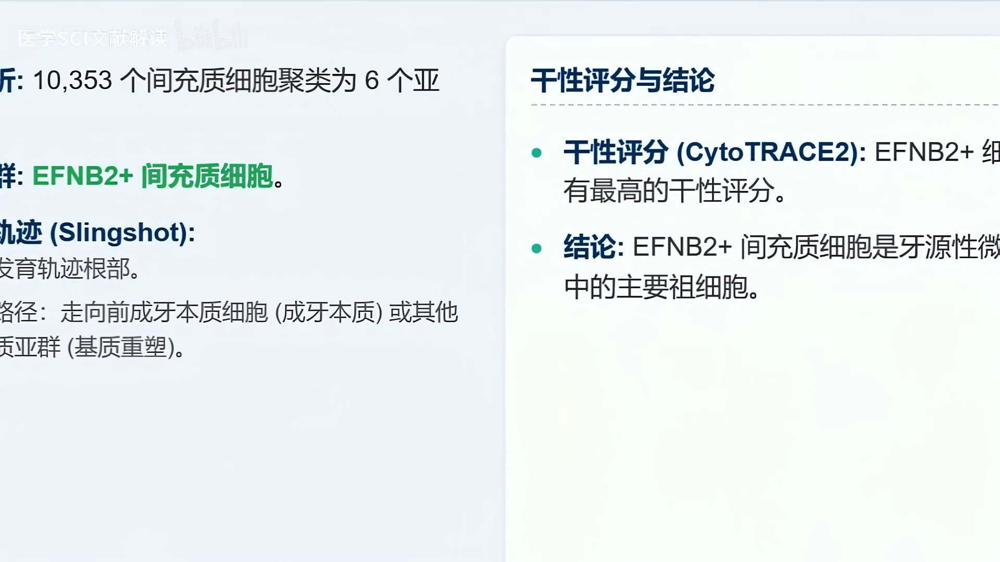

这一步的意义常被低估：**后面所有的预测，都建立在"起点细胞选对了"这个前提上**。如果祖细胞群定位错了，虚拟敲除算得再漂亮，也只是在一个错误的坐标系里做优化。

### 2.2 两种独立方法取交集：这是"排序"，也是"降风险"

找到祖细胞之后，问题变成"谁在指挥它们变成成牙本质细胞"。作者用了两个互补的分析：

- **CellRank**：识别 EFNB2+ 为起始状态，预测细胞可能到达的终末命运（前成牙本质细胞），并给出一份候选驱动基因名单；
- **SCENIC**：构建基因调控网络，计算每个转录因子调控模块的特异性评分（RSS），看哪些 TF 模块在前成牙本质细胞里特别活跃。

把两份名单取交集，"就像大海捞针一样"，最后捞到一个名字：**STAT3**。而且 STAT3 的表达量随着细胞沿伪时间轴前进而显著升高，尤其在早期分化阶段涨得最快——这符合一个"命运决定因子"的特征 [【跳转到 10:24】](https://www.bilibili.com/video/BV1rhnJ6LE2C/?t=624)。

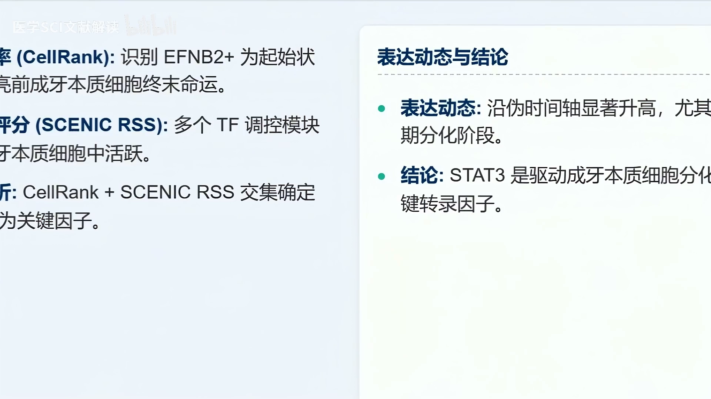

这里藏着一个非常实用的实验设计原则：**预测结果不是"排第一就做"，而是"多路证据都指向它才做"**。实验预算只够验证一两个候选，所以真正的成本不在计算，而在选错候选——用两种原理不同的方法取交集，本质上是在提高"命中率"（hit rate）：让被送去验证的那一两个候选，尽可能落在真阳性上。

## 三、虚拟敲除给出的是"值得做的假设"，不是结论

拿到 STAT3 之后，作者用两个工具做了虚拟敲除：

- **CellOracle**：基于单细胞推断的基因调控网络（GRN），模拟敲除 STAT3 后网络动力学的重塑。结果是细胞状态迁移方向明显偏移，原本流向成牙本质细胞的轨迹被搅乱——说明 STAT3 对引导间充质前体细胞走向成牙本质命运至关重要；
- **scTenifoldKnk**：作为补充验证，用另一种网络扰动算法做同样的敲除，结果显示多个发育相关基因表达显著变化，功能富集落在细胞分化和 WNT 信号通路上 [【跳转到 11:26】](https://www.bilibili.com/video/BV1rhnJ6LE2C/?t=686)。

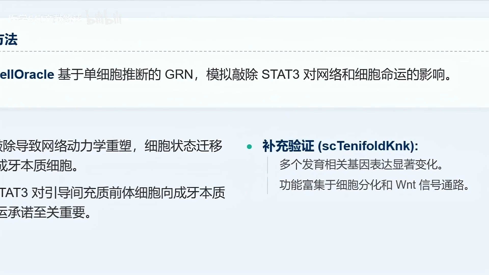

注意这里又一次用了"双工具交叉"：不是换一个参数重跑，而是换一套建模假设再算一遍。如果两种方法都指向 WNT 通路，那么"WNT 通路可能是下游"这个假设的可信度就高了一档——但它**仍然只是假设**。

讲者在开场就把话说得很重：虚拟敲除只是筛选，不能当实验证据；你必须用敲低、过表达、药理抑制或激活里至少一种功能实验去接；如果能做到 ChIP 或双荧光素酶，直接调控的证据就有了；再上一个条件敲除小鼠，体内表型就稳了 [【跳转到 01:35】](https://www.bilibili.com/video/BV1rhnJ6LE2C/?t=95)。这句话其实就是本节的核心命题：**计算预测的终点不是排行榜分数，而是"下一步做什么实验"**。
## 四、验证的第一级：先证明它真的存在、而且在工作

虚拟实验做得再漂亮，终究是纸上谈兵。验证的第一步不是"敲掉它"，而是"确认它在"——这是证据链里最便宜、也最容易被跳过的一环。

作者在体外培养的人牙髓细胞（hDPCs）里模拟成牙本质细胞的分化过程，结果发现：随着分化推进，STAT3 的 mRNA 和蛋白水平逐步升高，磷酸化的 STAT3（p-STAT3）也越来越多，说明它处于激活状态；免疫荧光显示它定位在诱导的成牙本质细胞中；在小鼠牙齿切片上也能看到 STAT3 广泛表达于成牙本质细胞谱系 [【跳转到 12:22】](https://www.bilibili.com/video/BV1rhnJ6LE2C/?t=742)。

这一级的读出是**表达与蛋白**：qPCR/RNA 水平、Western blot 的蛋白水平、免疫荧光/免疫组化的定位。它的证据强度不高——"表达升高"只能说明相关性——但它是后面所有实验的前提：如果一个基因在目标细胞里根本不表达，那再往下做敲低实验就没有意义。

## 五、第二级：功能层面，去掉它会出事

确认存在之后，才轮到"功能丧失"实验。作者用 shRNA 敲低 STAT3，得到三条互相印证的读数 [【跳转到 12:48】](https://www.bilibili.com/video/BV1rhnJ6LE2C/?t=768)：

- **增殖受损**：CCK-8 和 EdU 显示增殖受抑；
- **分化受损**：ALP 活性下降、矿化能力下降（茜素红染色 ARS）；
- **标志物下调**：ALP、DSPP、DMP1、BGLAP 等成牙本质细胞标志基因表达降低。

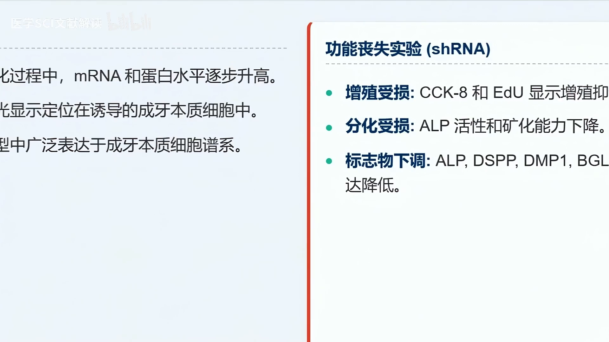

讲者打了个比方：这就像一个乐队少了主唱——STAT3 一走，不仅整体活力下降，连演奏的曲子（分化）都跑掉了。

这里有一个值得记住的设计要点：**功能验证不要只用一个读出**。增殖、分化、标志物三者分属不同的生物学过程，如果只有一项变化，很可能是脱靶或非特异毒性；三项同向变化，才更像"这个基因真的在这条路上"。

## 六、第三级：体内条件敲除，把"培养皿里的结论"搬到真实组织

体外实验虽然重要，但培养皿里的环境和体内复杂得多的微环境不一样。所以作者做了条件敲除小鼠：用 Cre-loxP 系统，在表达 Osx 的成牙本质前体细胞里特异性敲除 STAT3（Stat3fl/fl; Osx-Cre）[【跳转到 13:31】](https://www.bilibili.com/video/BV1rhnJ6LE2C/?t=811)。

表型非常"对题"：

- 牙齿萌出延迟，磨牙长得慢；
- micro-CT 显示牙本质宽度减小、根部缩短、牙髓腔与牙本质的比率增加——这正是牙本质发育不全的典型影像；
- **牙釉质厚度没有明显变化**，缺陷主要发生在牙本质；
- 敲除剂量与表型严重程度相关：纯合子重于杂合子；
- 门牙损伤后的再生速度明显减慢；
- 组织学上，前牙本质分泌减少、矿化速率降低，标志物 SP7、DSPP 表达减弱 [【跳转到 14:00】](https://www.bilibili.com/video/BV1rhnJ6LE2C/?t=840)。

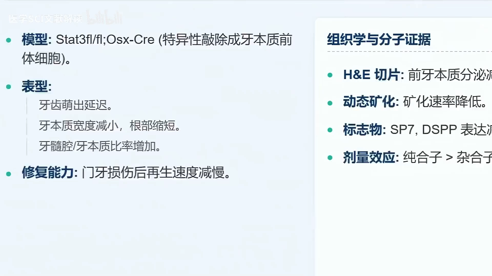

这段里有两个容易被忽略但极关键的对照设计：

1. **牙釉质作为"阴性对照"**：如果 STAT3 敲除把整颗牙都搞坏了，那说明这是全局毒性，而不是成牙本质细胞特异的功能；牙釉质正常、只有牙本质出问题，才支持"特异性"这个说法。
2. **剂量效应**：纯合子比杂合子重，说明表型随基因剂量单调变化，而不是"有或无"的开关——这是遗传学里最经典的特异性证据之一。

## 七、第四级：正交验证——换一种扰动方式，看结论是否复现

如果 STAT3 真的在驱动这条分化路线，那么**用完全不同的手段调节它，应该得到一致的结论**。作者用了两种药理工具，方向相反 [【跳转到 14:50】](https://www.bilibili.com/video/BV1rhnJ6LE2C/?t=890)：

- **AG490**（50 μM，JAK 抑制剂）：阻止 STAT3 磷酸化 → p-STAT3 下降 → 增殖受抑（CCK-8、EdU）、分化受损（ALP、ARS）；
- **Colivelin**（1 nM，能诱导 STAT3 磷酸化的神经保护肽）：p-STAT3 升高 → 促进增殖、促进分化。

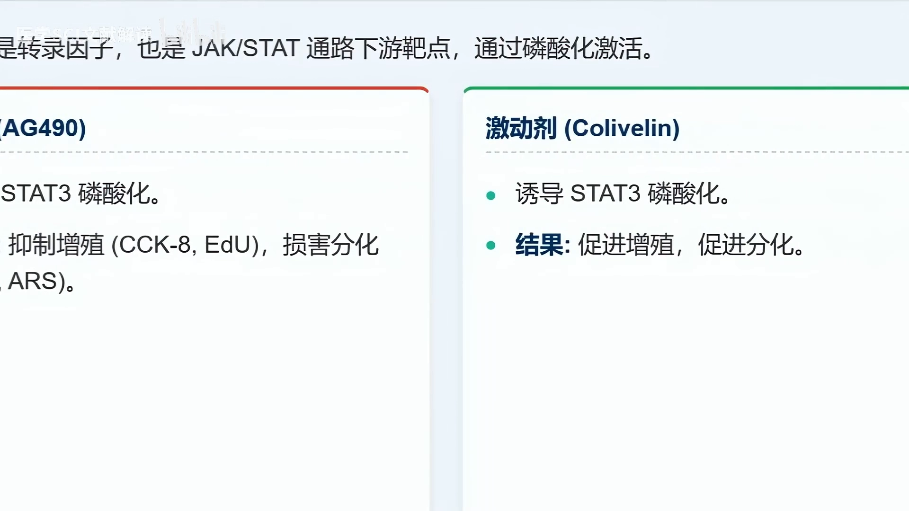

这就是**正交验证**（orthogonal validation）的典型用法：shRNA 敲低是"减少蛋白量"，AG490 是"阻断上游激酶的磷酸化"，Colivelin 是"促进磷酸化"——三种手段作用于同一分子的不同环节。如果只有 shRNA 一种手段，审稿人完全可以说"你的表型来自脱靶效应"；三种手段同向一致，脱靶的可能性就被压得很低，因果性大大增强。

顺带一提，这一级还提供了一个额外的信息：**这个靶点是"可药"的**。抑制它会让分化变差、激活它会让分化变好，意味着调节 STAT3 活性可能成为干预牙本质形成的思路——这正是从"机制"走向"转化"的那一步。

## 八、第五级：机制链条，从"相关"走到"直接调控"

到这一步，"STAT3 重要"已经成立，但"STAT3 通过谁起作用"还不清楚。作者用三步把下游链条补齐。

### 8.1 转录组找下游：617 个差异基因，富集到 WNT 通路

RNA-seq 比较 STAT3 敲低组与对照组，得到 617 个差异表达基因（436 个上调、181 个下调，阈值 $|\log_2 \mathrm{FC}| > 0.585$、$p < 0.05$）。下调基因显著富集于 WNT 信号通路：WNT2B、WNT16、GPC4 等配体/受体同步下调，PRICKLE1、SFRP1 等调节因子也下调；经典 WNT 通路的关键成员 CTNNB1、AXIN2、LEF1 下调，而 WNT 抑制因子 SOST 上调——整体呈现"经典 WNT 通路受抑"的图景 [【跳转到 15:57】](https://www.bilibili.com/video/BV1rhnJ6LE2C/?t=957)。

其中 WNT2B 被单独拎出来，因为此前已有报道把它与矿化和干细胞分化联系起来。验证结果：STAT3 敲低后，WNT2B 的 mRNA 和蛋白水平都显著降低。

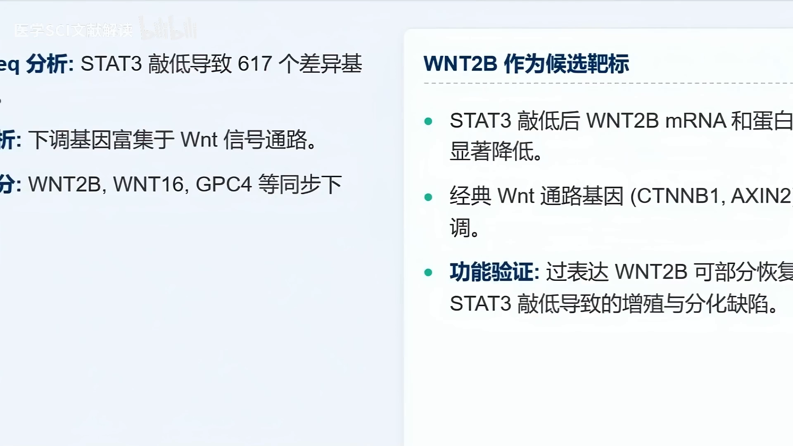

### 8.2 回补实验：把下游补回去，看缺陷能不能救回来

接下来是一个很漂亮的"必要性 + 充分性"组合：在 STAT3 敲低或 AG490 处理的细胞里，人为过表达 WNT2B。结果 WNT2B 过表达能在一定程度上恢复 STAT3 缺失导致的增殖与分化缺陷 [【跳转到 16:58】](https://www.bilibili.com/video/BV1rhnJ6LE2C/?t=1018)。

这一步在逻辑上非常重要：它把"STAT3 敲低后 WNT2B 下降了"（相关）升级为"WNT2B 下降是 STAT3 缺失造成表型的原因之一"（因果的一环）。注意作者说的是"部分恢复"——这反而更可信：一个下游因子通常只能解释上游表型的一部分。

### 8.3 直接结合：ChIP + 双荧光素酶，把"直接调控"钉死

最后一步是证明 STAT3 直接调控 WNT2B，而不是通过中间人。作者用了经典的"预测 → 结合 → 激活 → 位点依赖"四连击：

1. **JASPAR 数据库预测**：WNT2B 启动子区域存在 STAT3 结合位点；
2. **ChIP**：在 C3H10T1/2 细胞里把 STAT3 与 WNT2B 启动子拉在一起，证明物理结合；
3. **双荧光素酶报告基因**：野生型 STAT3 与持续激活型（constitutively active）STAT3 都能增强启动子活性，显性负性（dominant-negative）STAT3 则没有激活能力；
4. **位点删除**：在 HEK293T 细胞里把预测的结合位点删掉，STAT3 的激活作用随之消失 [【跳转到 17:21】](https://www.bilibili.com/video/BV1rhnJ6LE2C/?t=1041)。

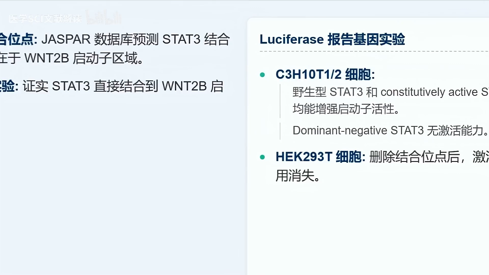

讲者的比喻很到位：这就像把钥匙孔堵住了，钥匙再厉害也打不开门。**第 4 步是最容易被省略、也最能说明问题的一步**——没有它，"结合"可能是非特异的，"激活"可能来自载体本身；有了它，调控关系才落到具体的碱基序列上。

## 九、验证设计要回答的几个具体问题

把上面五级串起来看，其实就是一份"验证设计清单"。这篇论文在每个问题上都给了具体答案，值得直接抄：

| 设计问题 | 这篇论文的做法 | 为什么这么做 |
| --- | --- | --- |
| 验证几个候选 | 从 24,177 个细胞的图谱出发，两轮筛选后只验证 STAT3 一个 | 实验预算有限，靠"双方法交集"提高命中率 |
| 用什么读出 | 表达（qPCR/RNA-seq）→ 蛋白（Western、免疫荧光）→ 功能（CCK-8、EdU、ALP、ARS）→ 影像（micro-CT） | 读出越靠近"细胞实际行为"，证据越强 |
| 重复与统计 | GraphPad Prism；先 Shapiro-Wilk 检验正态性，两组 t 检验、多组 one-way ANOVA，$p < 0.05$；至少三次独立重复；动物定量 $n=5$ 或 $n=3$ | 统计方法要跟数据分布匹配，重复数要写清是生物学重复 |
| 对照怎么设 | shRNA 的对照、溶剂对照、杂合子/纯合子剂量梯度、牙釉质作为"不该变"的阴性对照 | 阴性对照同样在验证模型——"预测无效应的地方确实没变" |
| 体内还是体外 | 体外 hDPCs 做机制，体内条件敲除小鼠做表型 | 体外可控、便宜；体内才代表真实微环境 |
| 失败与局限 | 讨论部分主动写出虚拟扰动的三条局限 | 只报成功会高估方法能力 |

其中"统计"这一条讲者专门强调过 [【跳转到 02:05】](https://www.bilibili.com/video/BV1rhnJ6LE2C/?t=125)：不要乱套检验，先看分布再选方法；技术重复不能替代生物学重复。这些细节看似琐碎，但它们决定了"验证成功"这个结论到底站不站得住。

## 十、现实落差：预测能走多远，作者自己划了线

最有价值的一段在讨论部分。作者没有把虚拟扰动吹成"可以替代实验"，而是明确写了三条局限 [【跳转到 19:10】](https://www.bilibili.com/video/BV1rhnJ6LE2C/?t=1150)：

1. **基于静态数据推断的 GRN，可能不完全反映真实动态**：单细胞测序给的是某一时刻的表达快照，而分化是随时间演化的过程，网络是在"快照"上反推出来的；
2. **假设线性扰动传播，可能低估非线性反应与反馈补偿**：真实生物系统里有大量反馈回路和代偿机制，敲掉一个节点后网络会"绕路"；
3. **"完全敲除"的模拟与生理上的"部分功能丧失"不完全一样**：虚拟敲除相当于把基因从网络里彻底删掉，而 siRNA/shRNA 敲低、药物抑制通常只是部分抑制。

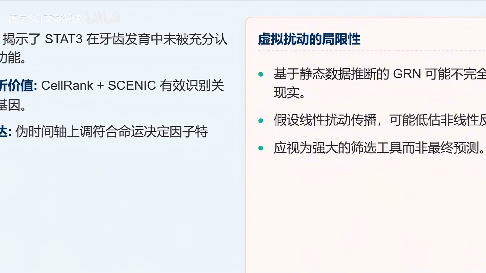

所以作者的结论是：**虚拟扰动更像一个高效的筛选工具，而不是最终的判决**；正因如此，体内条件性敲除小鼠的结果才显得尤为重要，它提供了 STAT3 在真实牙齿发育环境中的确凿证据。

这段话也解释了为什么整篇文章把最重的实验放在最后：**计算负责"缩小搜索空间"，实验负责"下判决"**。两者不是替代关系，而是流水线的上下游。

论文自己还留了一个明确的下一步：构建 WNT2B 条件性过表达的小鼠模型，看看直接提高 WNT2B 能不能挽救 STAT3 缺陷小鼠的牙本质发育问题 [【跳转到 20:49】](https://www.bilibili.com/video/BV1rhnJ6LE2C/?t=1249)。这是一个典型的"闭环继续转"的动作——体外回补已经成功，但体外成功不等于体内有效，所以还要在体内再验一次。这也正是干湿结合研究里最容易被低估的成本：**每往体内推进一步，代价都会成倍上升**。

## 小结

- **预测的产物是"假设 + 排序"，不是结论**。虚拟敲除把两万多个基因缩到一两个候选，它的产出是"下一步该做哪个实验"，而不是"这个基因一定重要"。
- **提高命中率靠交叉，而不是靠调参**。CellRank 与 SCENIC 取交集、CellOracle 与 scTenifoldKnk 双工具互证，本质是用不同原理的方法降低"选错候选"的概率。
- **验证是一条证据强度递增的链**：表达/蛋白（它在不在）→ 功能（去掉会不会出事）→ 体内条件敲除（真实组织里成不成立）→ 正交药理扰动（换手段能否复现）→ 直接结合与回补（因果链条的每一环）。
- **对照和阴性结果同样在验证模型**。牙釉质不变、杂合子轻于纯合子，这些"没变"和"变少了"的信息，和"变差了"一样重要。
- **正交验证是排除单一手段假象的最有效办法**。shRNA、JAK 抑制剂、STAT3 激活肽三种手段同向一致，才把"脱靶"这个替代解释压下去。
- **预测的价值在于缩小搜索空间，而不是替代实验**。作者主动写下的三条局限（静态网络、线性假设、完全敲除）划出了这条边界；而"体外回补成功还要再做体内验证"则说明，越靠近真实生理，验证成本越高、也越不可省。

## 关键术语速查

| 术语 | 一句话解释 |
| --- | --- |
| 虚拟敲除（in silico perturbation） | 在计算出的基因调控网络里"删掉"某个基因，看细胞状态或表达谱怎么变，用来预测扰动效应，不产生实验证据 |
| CellOracle | 基于单细胞数据推断 GRN，再模拟转录因子敲除对细胞状态转移方向影响的工具 |
| scTenifoldKnk | 另一种虚拟敲除工具，用张量分解比较"野生型网络"与"敲除后网络"，输出差异调控基因 |
| CellRank | 把轨迹推断与马尔可夫链结合，估计细胞到达各终末状态的概率（命运映射） |
| SCENIC / RSS | 从单细胞数据重建转录因子调控模块；RSS（调控子特异性评分）衡量某模块在特定细胞类型中的活跃程度 |
| CytoTRACE2 | 用表达特征估计细胞干性/分化潜能的打分方法 |
| Slingshot | 在降维空间上拟合曲线，推断细胞沿分化路径的先后顺序（拟时序） |
| 条件敲除（conditional KO） | 用 Cre-loxP 系统只在特定细胞类型或时间点敲除基因，避免全身敲除的致死或混杂效应 |
| shRNA 敲低 | 用短发夹 RNA 降解目标 mRNA，降低蛋白量但不完全消除，属于"部分功能丧失" |
| 正交验证（orthogonal validation） | 用原理不同的手段（如遗传学敲低 + 药理学抑制）验证同一结论，排除单一方法的假象 |
| ChIP | 染色质免疫沉淀，用抗体把"蛋白 + 它结合的 DNA"一起拉下来，证明物理结合 |
| 双荧光素酶报告实验 | 把候选启动子接到荧光素酶基因后面，看转录因子能否激活它；删掉结合位点后激活消失，即为"位点依赖"证据 |
| 回补/救援实验（rescue） | 在上游基因缺失的背景下补回下游基因，若表型部分恢复，说明下游确实在上游的通路上 |
| 命中率（hit rate） | 被送去验证的候选里，最终被实验证实的比例，是衡量预测实用性的核心指标 |
