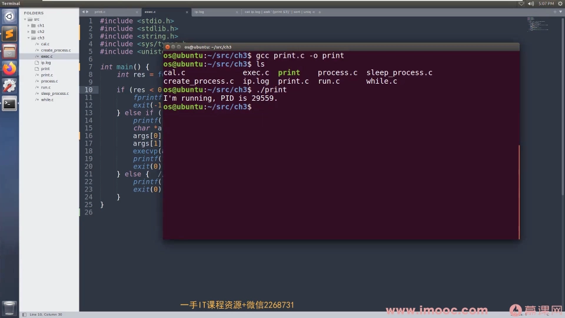
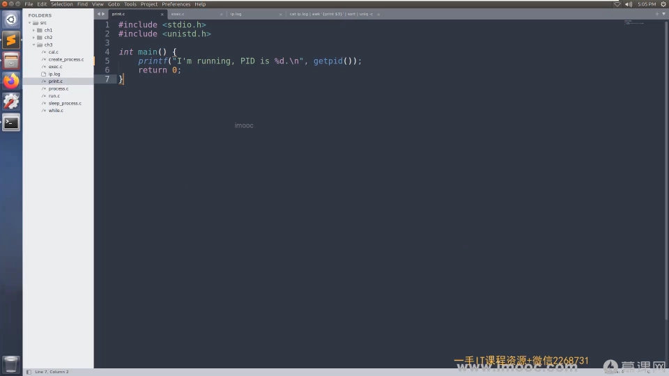
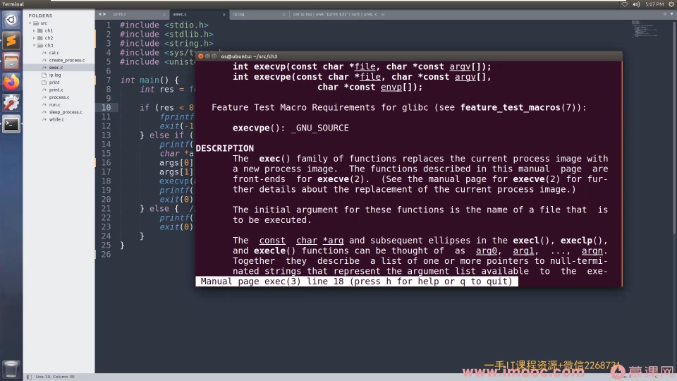
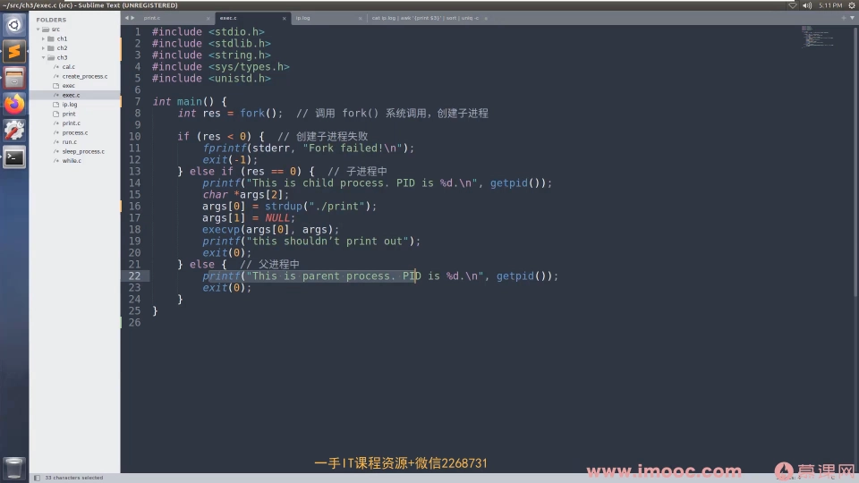
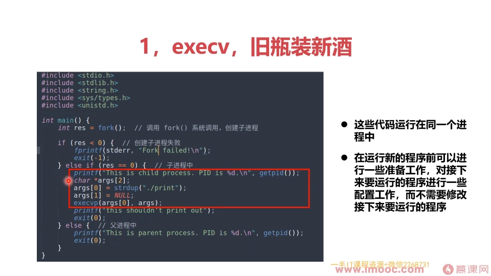
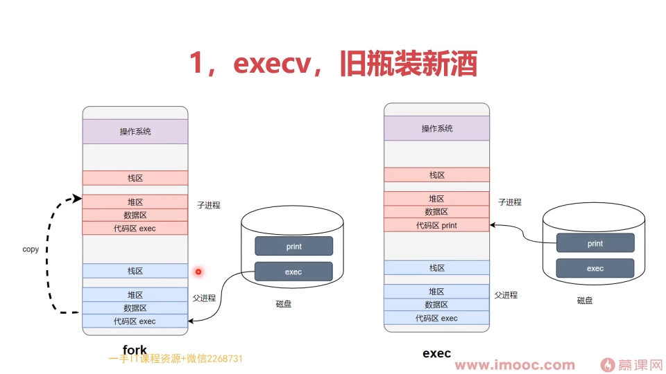
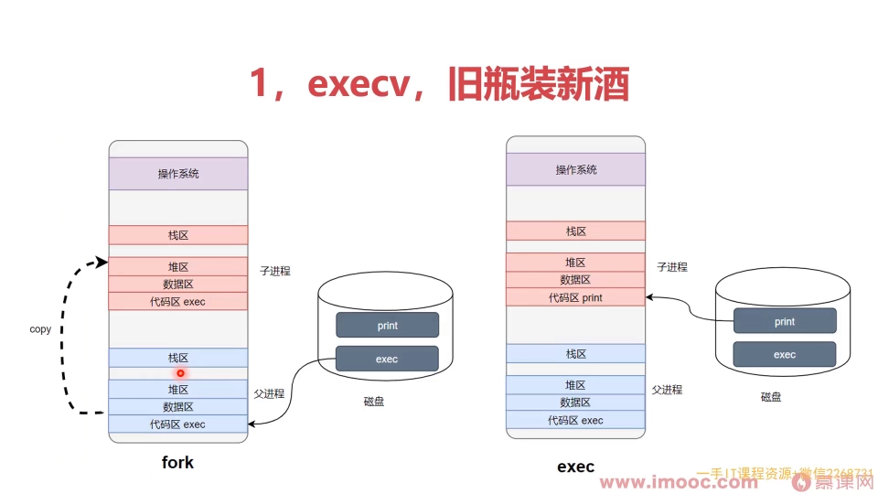
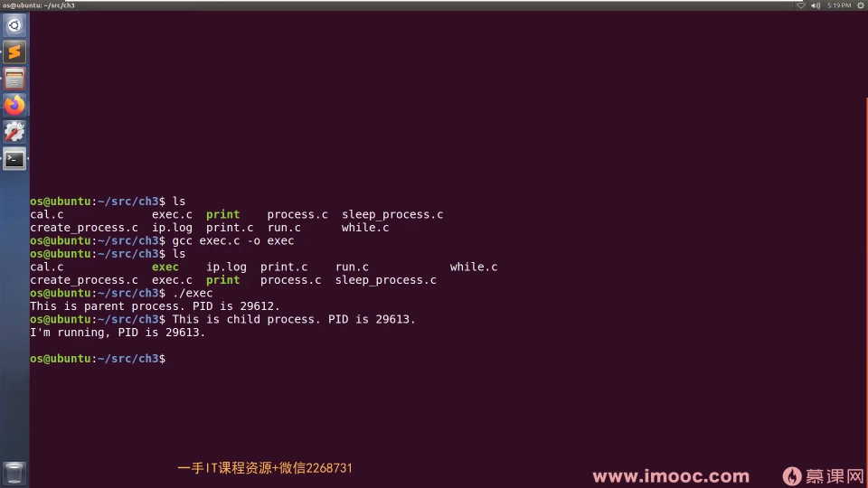
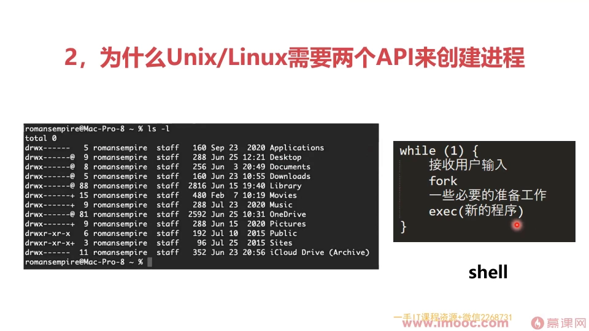

# 为什么 Linux 要把"创建进程"拆成 fork 和 exec 两个 API（上）

> 视频来源：[4-18 为什么linux中需要fork与exec两个api（上）](https://www.bilibili.com/video/BV1mjmiBPE6c/)（Bilibili，UP 主「bili_bzk」）
>
> 本篇基于视频 AI 字幕与画面整理。上一讲讲了 fork：Linux 世界里创建进程的 API，子进程是父进程的克隆体。这一讲回答两个问题——怎么让子进程运行一个全新的程序（exec），以及为什么 Unix/Linux 要把创建进程拆成 fork + exec 两条。

## 本讲要解决的核心问题（SCQA）

**背景**：上一讲中，fork 调用完之后，程序里会创建出一个新的子进程——它是父进程的克隆体：内容完全一样，只不过 fork 在父进程和子进程中的返回值不一样（父进程拿到子进程 PID，子进程拿到 0），我们靠返回值区分接下来父子进程各自走什么逻辑。[【跳转到 00:25】](https://www.bilibili.com/video/BV1mjmiBPE6c/?t=25)

**冲突**：克隆体再像，也只能跑父进程那一套代码。可真实需求常常是：**让新进程去运行一个全新的程序**——比如 shell 要去运行 ls、要运行你自己写的 print。这怎么实现？[【跳转到 00:50】](https://www.bilibili.com/video/BV1mjmiBPE6c/?t=50)

**疑问**：答案是可以的，靠 exec 这样的 API 实现。那为什么 Unix/Linux 不像 Windows 那样用一条 API 直接"创建一个跑着新程序的进程"，而要拆成 fork + exec 两步呢？[【跳转到 13:04】](https://www.bilibili.com/video/BV1mjmiBPE6c/?t=784)

**回答（中心思想）**：**exec 是"旧瓶装新酒"——保留子进程的外壳，把进程地址空间（进程镜像）整体替换成新程序；fork 与 exec 的组合把"复制"与"定制"解耦，在两步之间留出一段可以做配置的自由空间。这套两段式，正是 Linux 借鉴自 UNIX 世界的设计哲学之一。**[【跳转到 01:15】](https://www.bilibili.com/video/BV1mjmiBPE6c/?t=75)

---

## 一、exec：旧瓶装新酒

用 `man` 命令查一下 exec：exec 其实是**一族函数**，有好多变形、好多使用方法。我们以 execve 为实例：手册告诉我们它的目的是——**替换掉当前进程的镜像**：用一个新的程序，去替换进程地址空间里的内容。[【跳转到 03:22】](https://www.bilibili.com/video/BV1mjmiBPE6c/?t=202)

所谓"镜像"（image），就是我们进程地址空间里的内容。所以 exec 被形容为"旧瓶装新酒"：**旧瓶**就是当前 process 的 image（进程的壳），**新酒**就是一个新的程序——用一个新的可执行程序去替换了一下。[【跳转到 03:43】](https://www.bilibili.com/video/BV1mjmiBPE6c/?t=223)

## 二、实战：fork + exec 运行一个全新的程序

准备两个程序。第一个是 print.c，作用只有一句话：打印"我现在正在运行"和自己的进程 ID（PID）。gcc 编译输出就叫 print，运行一下：程序跑起来、打出 PID、运行结束——这就是一个单个程序的运行。[【跳转到 02:07】](https://www.bilibili.com/video/BV1mjmiBPE6c/?t=127)

第二个是 exec.c，骨架和上一讲的 fork 示例差不多：先是调了一个 fork，然后判断返回值，失败了就退出；如果是在父进程当中，就打印一句"我们在父进程当中运行"+PID；否则——返回值是 0——接下来的程序就在子进程里跑。[【跳转到 04:08】](https://www.bilibili.com/video/BV1mjmiBPE6c/?t=248)

子进程里新添加的几句话是本讲的重点：它创建了一个**参数数组**，第一个值赋了一个字符串 `"./print"`——这就是刚才编译出来的 print 这个可执行程序的路径；然后把这个参数传给了刚才讲的 exec（execve）。[【跳转到 04:58】](https://www.bilibili.com/video/BV1mjmiBPE6c/?t=298)

编译运行 exec 程序，一条一条看输出：[【跳转到 07:00】](https://www.bilibili.com/video/BV1mjmiBPE6c/?t=420)

1. 第一句：这是父进程，它的 process id 是多少——没问题；
2. 接着子进程也要运行：**这是 child process，id 是 29613**——记住这个数；
3. 再一句："我在运行，我的 PID 是谁？"——**也是 29613**。

关键就在最后这句"我在运行"：它是从 **print 程序**里打印出来的！同一个 PID（29613）说明——print 程序和子进程里那句话**运行在了同一个进程当中**：exec 没有另开新进程，而是让刚才 fork 出来的子进程（旧壳）跑起了全新的程序（新酒）。[【跳转到 07:50】](https://www.bilibili.com/video/BV1mjmiBPE6c/?t=470)

这就是 fork + exec 的最终效果：**fork 创建了一个新的进程，exec 让这个新进程跑起了一个我们自己写的全新的程序。**[【跳转到 08:15】](https://www.bilibili.com/video/BV1mjmiBPE6c/?t=495)

## 三、fork 与 exec 之间：一段可以写配置的"黄金地带"

把 exec.c 中间那段代码（运行结果里框出来的部分）再端详一下：这些代码是和 print 这个程序**跑在同一个进程里的**——壳是同一个，但（原来的）内容已经被替换掉了。因为 fork 出来之后子进程和父进程的内容是一样的，exec 又做了一个**完全的替换**——所以中间这段代码，是"换内容之前"的自由时间。[【跳转到 08:45】](https://www.bilibili.com/video/BV1mjmiBPE6c/?t=525)

在这里可以加很多代码：对接下来要执行的程序做**准备工作、配置工作**——比如给它加参数（本例的参数是空的，但完全可以给它配参数）。也就是说，fork + exec 让我们可以**灵活地在程序 run 起来之前做很多配置，而完全不需要去修改 print 本身的代码**。[【跳转到 09:10】](https://www.bilibili.com/video/BV1mjmiBPE6c/?t=550)

顺带对比一下：如果 fork 之后**不**调 exec，那就是起了多个子进程去执行同一份代码（都来自父进程），用法有点类似于现在的多线程——做并行任务。[【跳转到 12:39】](https://www.bilibili.com/video/BV1mjmiBPE6c/?t=759)

## 四、图解两段式：fork 复制，exec 替换

把整个过程走一遍：[【跳转到 10:28】](https://www.bilibili.com/video/BV1mjmiBPE6c/?t=628)

1. 磁盘上现在有**两个**可执行程序：print 和 exec。我们首先运行的是 exec——它先调一个 fork，和上一节完全一样。[【跳转到 10:53】](https://www.bilibili.com/video/BV1mjmiBPE6c/?t=653)
2. **fork**：走到这句话时，请求操作系统创建一个新的子进程，把内容从父进程里 copy 过去。此刻父子进程的代码和数据都来自 exec 这个可执行程序，完全一样。[【跳转到 11:07】](https://www.bilibili.com/video/BV1mjmiBPE6c/?t=667)

3. **execve**：接着往下走，调了 execve 这样的函数——它当然只是封装，里面做了一个系统调用；调用前先做参数配置。系统调用真正执行的效果是：把（子进程）里面的**数据区和代码区**，用新的 print 可执行程序**替换掉**——相当于把原来的内容抹去，用新内容装进来。[【跳转到 11:44】](https://www.bilibili.com/video/BV1mjmiBPE6c/?t=704)

替换之后，一个新的程序就跑起来了：它的指令和数据都来自新的可执行程序。一句话总结：**在一个旧盒子里装了一个新的内容——fork + exec 最终创建了一个新的子进程，而子进程的内容来自新的可执行程序。**[【跳转到 12:09】](https://www.bilibili.com/video/BV1mjmiBPE6c/?t=729)

## 五、为什么拆成两条？从命令行的历史说起

对比一下：Windows 里一条 API 就可以搞定"创建一个跑新程序的进程"，而 Unix 这里分成两条（fork + exec）。为什么要分两条呢？这其实要从历史角度来讲。[【跳转到 13:04】](https://www.bilibili.com/video/BV1mjmiBPE6c/?t=784)

最早期的计算机系统里，没有我们现在看到的这些漂亮的图形界面——不能指指点点、用鼠标拖拽。它只有一个东西：**终端（Terminal）**。开机之后来到这么一个终端，什么都没有，只有一个命令提示符，告诉你"可以输入一个命令"；输入 ls 就能看到当前目录下罗列的文件。这就是最开始计算机的环境：没有图形界面，只允许键盘输入，也没有鼠标。[【跳转到 14:09】](https://www.bilibili.com/video/BV1mjmiBPE6c/?t=849)

注意：ls、ps、top 这些我们运行的虽然叫"命令"，但**背后都是一个程序**（可执行程序，还会有一些脚本）。那谁执行这些命令呢？有一个叫做 **shell** 的程序在背后帮我们执行。shell 本身也是一个程序，它大体就是这样一个循环：[【跳转到 14:55】](https://www.bilibili.com/video/BV1mjmiBPE6c/?t=895)

1. 接收用户输入的命令（比如 ls）；
2. fork 一下，创建出一个新的子进程，做一些必要的配置工作；
3. 子进程 exec 执行 ls——这样子进程就运行起来了，去执行了 ls 这个命令。

因为我们只有一个命令行，自然希望这个命令行**越好用越好、能完成的工作越多越好**——fork + exec 的两段式组合，正是命令行灵活性的根基。[【跳转到 15:48】](https://www.bilibili.com/video/BV1mjmiBPE6c/?t=948)

那命令行到底能完成多复杂的操作？下节课用一个实例展示：给一份 web 服务器日志（每个用户的 IP、日期、访问的页面），任务是统计某个时间段内各 IP 的访问次数——这正是 shell 组合一串小程序的经典舞台。本讲（上）就到这里。[【跳转到 16:49】](https://www.bilibili.com/video/BV1mjmiBPE6c/?t=1009)

## 小结

- exec = 旧瓶装新酒：不换壳（PID 不变），只把进程地址空间整体替换成新程序的镜像；它是**一族函数**，本例以 execve 为实例。
- 运行结果里"子进程 PID == print 打印的 PID（29613）"，证明新程序跑在旧壳里——**exec 不创建新进程**。
- fork 与 exec 之间是一段"黄金地带"：可以为即将运行的程序做配置（比如准备参数），而**不需要修改目标程序本身**。
- fork 不接 exec → 多个子进程跑同一份代码（类似多线程并行）；fork + exec → 让新进程跑全新程序。两段式把"复制"与"定制"解耦。
- 历史视角：命令行时代，shell 用"读输入 → fork → 配置 → exec"的循环运行每一条命令（ls/ps/top 都是程序），fork + exec 是命令行组合自由的设计根基。

## 关键术语速查

| 术语 | 一句话解释 |
| --- | --- |
| fork | 创建子进程的 API；子进程是父进程的克隆体，父子靠返回值区分（父得子 PID、子得 0） |
| exec / execve | 一族"替换进程镜像"的函数；execve 是其中的系统调用，用新程序整体替换地址空间内容 |
| 进程镜像（image） | 进程地址空间里的内容，即正在运行程序的代码与数据 |
| argv | 传给新程序的参数数组；本例 argv[0] 为 "./print"（程序路径） |
| shell | 在背后执行命令的程序；以"读输入 → fork → 配置 → exec"的循环运行每条命令 |
| 终端（Terminal） | 早期唯一的交互界面：只有命令提示符与键盘输入，没有图形界面和鼠标 |
| 克隆体 | fork 出的子进程——内容与父进程完全相同的形象说法 |
