# 进程生命周期：fork、exec、exit、wait、kill

> 视频来源：[54-进程生命周期 fork - exec - exit - wait - kill](https://www.bilibili.com/video/BV1zG411i7fs/)（Bilibili，UP 主「知春路遇上八里桥」，xv6 操作系统系列）
>
> 本篇基于视频 AI 字幕与画面整理。视频以 xv6 源码 + GDB 调试的方式，把一个进程从创建（fork）、换程序（exec）、退出（exit）、回收（wait）到被杀（kill）的完整生命周期完整走了一遍。

## 本讲要解决的核心问题（SCQA）

**背景**：我们每天都在 shell 里敲命令运行程序，看起来"运行一个程序"就是敲一下回车。在 xv6 系列的前几讲里，系统的第一个进程 init（PID 1）已经启动，并拉起了 shell（sh）。[【跳转到 04:55】](https://www.bilibili.com/video/BV1zG411i7fs/?t=295)

**冲突**：可是"shell 背后到底怎么运行一条命令"并不显然：后续进程从哪来？新进程凭什么能去跑另一个程序？进程退出后内核怎么回收它的资源？如果子进程先退出、父进程还没处理，为什么会出现"僵尸"？而 kill 一条命令，内核又是怎么"杀死"一个进程的？[【跳转到 03:14】](https://www.bilibili.com/video/BV1zG411i7fs/?t=194)

**疑问**：一个进程从出生到消亡，内核到底依次做了哪几件事？[【跳转到 00:25】](https://www.bilibili.com/video/BV1zG411i7fs/?t=25)

**回答（中心思想）**：**xv6 用几个系统调用串起进程的完整生命周期——fork 复制父进程造出新进程，exec 替换地址空间让新进程跑别的程序，exit 把自己标记成 ZOMBIE 并释放用户态资源，wait 由父进程完成最后的"收尸"；kill 并不直接杀进程，只置 killed 标志，真正的死亡仍由 exit 完成。**整个系统里所有进程都由 init 派生并管理，像"一生二、二生三"。[【跳转到 25:44】](https://www.bilibili.com/video/BV1zG411i7fs/?t=1544)

---

## 一、先看现象：shell 怎么运行一条命令

先复习 shell 的实现。sh.c 的 main 函数里，你输入的命令会被放进 buffer，然后 shell 第一次 fork 出一个子进程，子进程调用 run_cmd 启动命令；如果它是一条普通命令，就调用 exec 系统调用替换进程的地址空间——这样子进程就"变成"了那条命令；而父进程（shell）则在旁边调用 wait 等待子进程执行结束。[【跳转到 01:15】](https://www.bilibili.com/video/BV1zG411i7fs/?t=75)

这个流程可以用一段普通的 C 代码在 Linux 上模拟出来，比 xv6 的版本更简单、更清晰：[【跳转到 02:02】](https://www.bilibili.com/video/BV1zG411i7fs/?t=122)

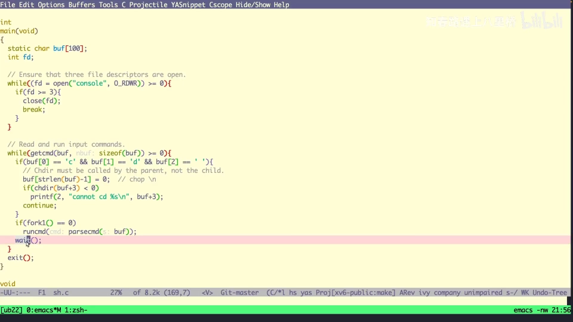

- `fork()` 之后：`if (pid == 0)` 的分支就是子进程（前面是 fork 失败时的错误处理）。
- 子进程用 `exec`——这是 Linux 的系统调用——传入要运行的程序（例子中是 ls）和它的参数，子进程就能运行 ls 命令；[【跳转到 02:27】](https://www.bilibili.com/video/BV1zG411i7fs/?t=147)
- 父进程在后面 `wait` 等待。

编译运行，程序的输出和 `ls -l` 命令的输出一模一样——这正是操作系统运行命令的本质过程。[【跳转到 02:45】](https://www.bilibili.com/video/BV1zG411i7fs/?t=165)

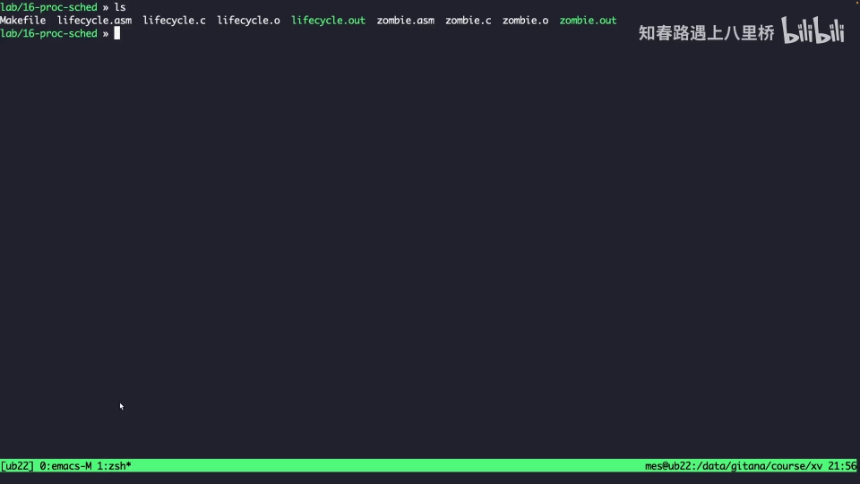

## 二、一个特例：僵尸进程（zombie）

进入源码之前，先认识一个特殊状态。这段示例程序：子进程睡眠 10 秒后退出，父进程睡眠 30 秒再退出；子进程退出时打印"子进程退出"，父进程等待结束后打印"父进程退出"。[【跳转到 03:14】](https://www.bilibili.com/video/BV1zG411i7fs/?t=194)

在另一个窗口用 ps 过滤（grep）zombie 观察这两个进程：最初两行的状态都是 S；当子进程退出之后再打印一次，子进程那一行的状态变成了 **Z**——S 是睡眠、R 是正在执行，而 **Z 就是 zombie，僵尸进程的状态**。[【跳转到 04:09】](https://www.bilibili.com/video/BV1zG411i7fs/?t=249)

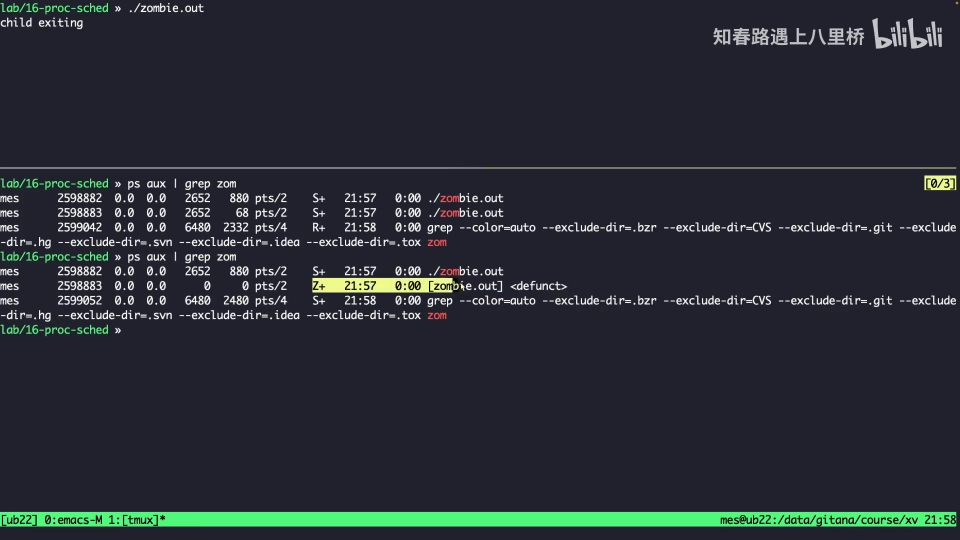

**僵尸进程什么时候出现？子进程退出了，但父进程还没有退出（还没有回收它），这时子进程的状态就是僵尸。**它具体是怎么出现的？往下看 exit 和 wait 的源码就明白了。[【跳转到 04:50】](https://www.bilibili.com/video/BV1zG411i7fs/?t=290)

## 三、追一个进程的一生：先认 init，再打断点

在 xv6 里，init 启动后系统的第一个进程就能通过全局变量 initproc 获取到——它就是 PID 等于 1 的进程，是所有进程的父节点；从名字也能看出来它是 init 进程。PID 2 则是 shell（sh）。[【跳转到 04:55】](https://www.bilibili.com/video/BV1zG411i7fs/?t=295)

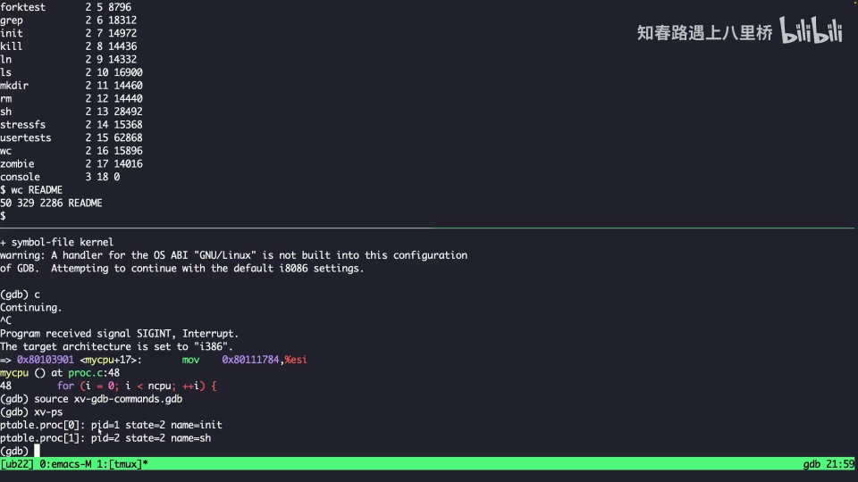

那后续进程（比如你敲的 ls）是怎么执行的呢？就是 sh.c 里我们刚刚分析的那个过程，和上面用 C 语言在 Linux 上模拟的 lifecycle 一样。追它很简单：syscall.c 里有一张系统调用表，只要在 **fork、exec、exit** 这三个函数上打上断点，就能追溯一个进程从启动到结束的完整状态变化（"不经过 exec 替换"的情况先不考虑）。[【跳转到 06:35】](https://www.bilibili.com/video/BV1zG411i7fs/?t=395)

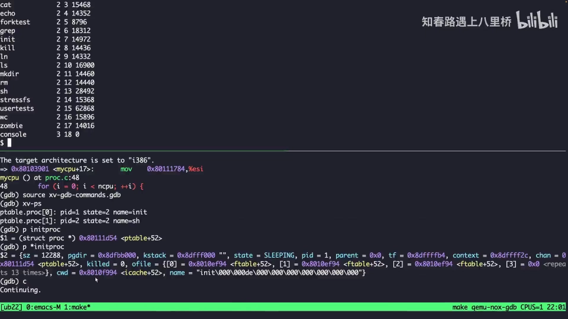

continue 之后输入 `ls` 按下回车——fork 断点立刻触发。[【跳转到 07:22】](https://www.bilibili.com/video/BV1zG411i7fs/?t=442)

## 四、fork：复制出一个"我"

进入 fork 的第一部分是 allocproc()：分配一个 `struct proc` 结构体。此刻结构体里大部分字段还没填，只有 PID 已经分配好（这一步受锁保护，之前讲过），基本就是先分配、再填充。[【跳转到 07:39】](https://www.bilibili.com/video/BV1zG411i7fs/?t=459)

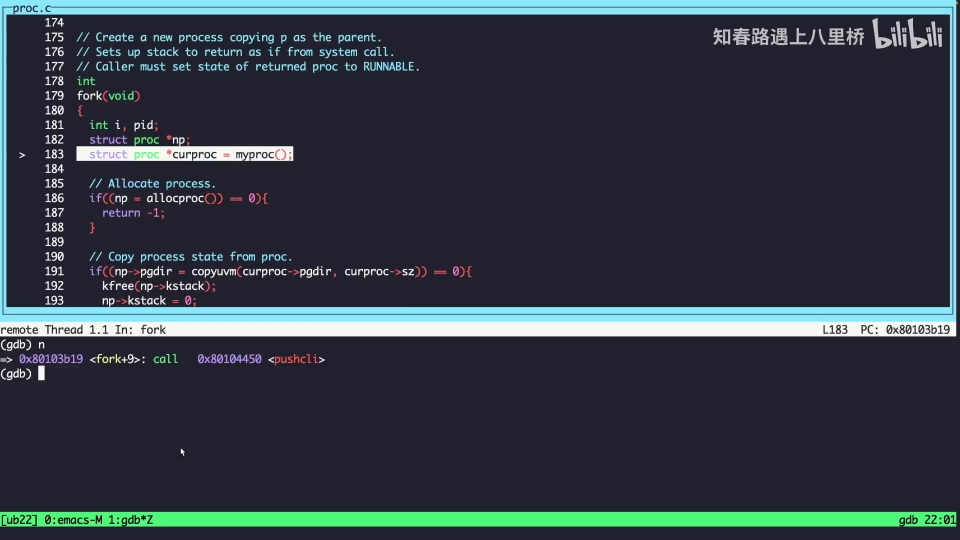

值得注意的是，新进程此时处于 **EMBRYO（胚胎）** 状态——刚开始创建、填充完的状态。[【跳转到 08:04】](https://www.bilibili.com/video/BV1zG411i7fs/?t=484)

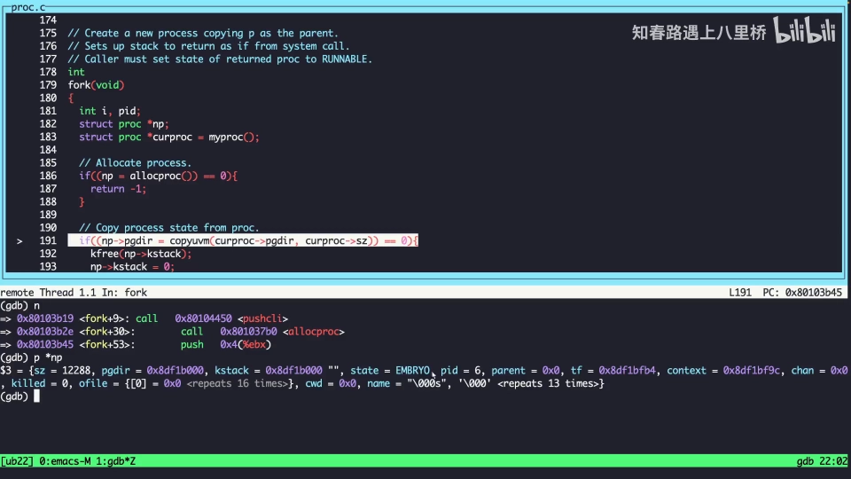

接着 fork 复制父进程的地址空间：copyuvm 把父进程地址空间的内容全部拷贝到新进程，创建一个全新的进程空间——先复制（用户）页表，再搬运内存，配合 mappages 设置页表项，就是这样一个流程。[【跳转到 08:29】](https://www.bilibili.com/video/BV1zG411i7fs/?t=509)

然后是"认亲"与返回值这两个核心操作：[【跳转到 09:19】](https://www.bilibili.com/video/BV1zG411i7fs/?t=559)

- **`np->parent = 当前进程`**：因为新进程 np 是当前进程 fork 出来的，它的父进程就是当前进程；同时把新进程的 trap frame 设置好。
- **把新 trap frame 的 EAX 设置成 0**。

为什么要设 EAX？这就是 fork 系统调用的语义，Linux 和 xv6 是一样的：fork 在父进程中返回子进程的 PID，在子进程中返回 0。而子进程这个"0"正是靠这条语句实现的——EAX 在 x86 的调用约定中就是函数返回值寄存器，内核从内核态切换回用户态时，会把这里设置的 EAX 作为函数返回值放回去，于是子进程看到的 fork 返回值就是 0。随后 fork 还会拷贝可打开的文件、继承当前目录、设置新进程的 PID（它要作为返回值返回给 fork 调用者），最后把新进程状态置为 **RUNNABLE**——新进程已经创建好、可以调度执行了——再 release 进程表锁。[【跳转到 10:03】](https://www.bilibili.com/video/BV1zG411i7fs/?t=603)

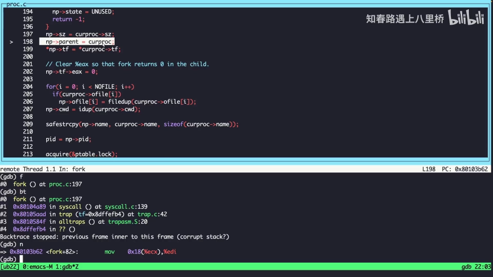

把 fork 总结成一句话：**申请一个 struct proc → 复制父进程的内容（trap frame、内核表空间）→ 复制地址空间 → 认父（p->parent）→ EAX 置 0（子进程返回 0）→ 置 RUNNABLE**。[【跳转到 10:53】](https://www.bilibili.com/video/BV1zG411i7fs/?t=653)

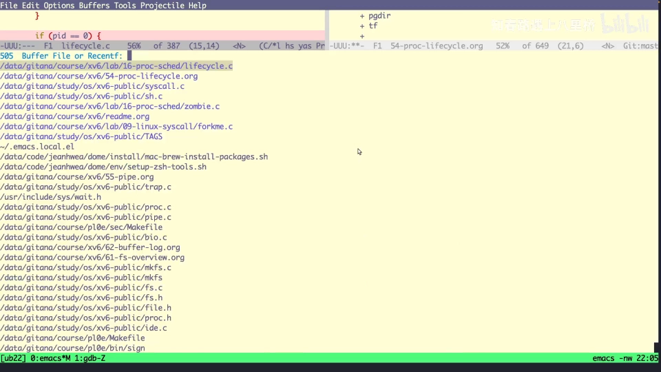

## 五、exec：把地址空间换掉

继续 continue，trap 返回后调度到时间片，就会走到第二个系统调用 exec。执行前看进程表：PID 等于 6 的进程名字还是 sh——因为它的地址空间还没被替换。exec 会读 ELF 文件、设置用户态的调用栈、拷贝调试信息、设置页目录与返回值，最后通过 switchuvm 完成切换（细节参考 exec 的专题讲解）。[【跳转到 12:00】](https://www.bilibili.com/video/BV1zG411i7fs/?t=720)

再看进程表：PID 6 的名字已经从 sh 变成了 ls，状态是一个 RUNNING（可运行）的状态——这个子进程在 fork 时已被置为可运行，现在 exec 替换了它的地址空间，后续它就可以运行了。[【跳转到 12:50】](https://www.bilibili.com/video/BV1zG411i7fs/?t=770)

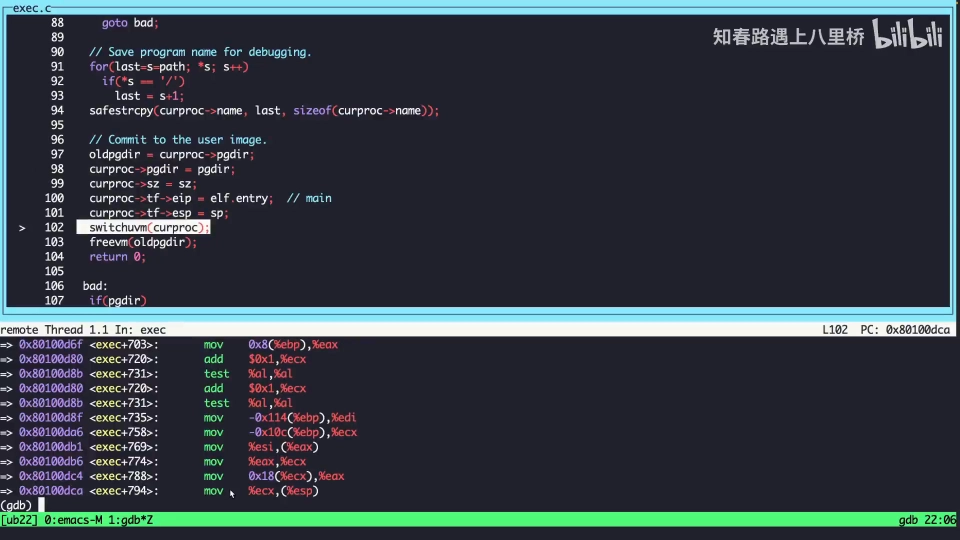

## 六、exit：进程的谢幕

ls 一直执行到输出完毕，最后会调用 exit 退出进程。用户态的代码怎么调度执行不用管——可能是读一些值、通过系统调用做输出——关键是最后调用了 exit。在 exit 断点上 continue 下来：[【跳转到 14:26】](https://www.bilibili.com/video/BV1zG411i7fs/?t=866)

exit 按顺序做了这些事：[【跳转到 14:51】](https://www.bilibili.com/video/BV1zG411i7fs/?t=891)

1. 获取当前进程的 proc 结构（p）；
2. **检测当前进程是不是 init 进程——如果要退出的是 init，直接 panic，因为 init 进程不能退出**；
3. 关闭这个进程所有打开的文件（文件系统部分后面讲，这里快点过）；
4. 请求内核进程表锁，然后 wakeup 它的父进程。

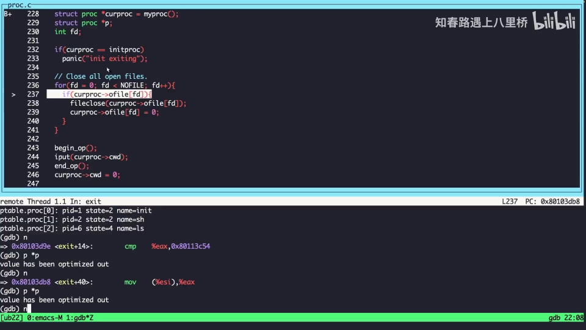

这里有个关键细节：**wakeup1 和 wakeup 的区别**。wakeup 是拿了 ptable 锁的，而 wakeup1 不拿锁。为什么 exit 里用 wakeup1？因为在调用它的时候，前面已经拿到锁了，这里再拿锁的话就会出现死锁——这是 exit 实现的一个核心点。[【跳转到 15:23】](https://www.bilibili.com/video/BV1zG411i7fs/?t=923)

接下来 exit 遍历进程表，处理自己的子进程：如果有子进程（比如 A、B、C、D），就把它们的父进程设成 init——"托孤"给 init 进程；而且如果某个子进程状态已经是 ZOMBIE，要立马唤醒 init——唤醒有什么用？后面的代码里会知道，待会会重新走到这里。[【跳转到 16:50】](https://www.bilibili.com/video/BV1zG411i7fs/?t=1010)

（当前演示的 ls 没有子进程，这部分直接跳过。）然后 exit 把**自己**的状态设置成 **ZOMBIE**（这个状态有什么用，下节 wait 揭晓），接着调用 sched 让位给调度器——后面的代码不会再执行了，sched 相当于把当前的时间片交给 CPU 调度器。[【跳转到 17:20】](https://www.bilibili.com/video/BV1zG411i7fs/?t=1040)

next 一步之后——就在那一瞬间，你是不是看到 shell 的 `$` 提示符又打印出来了？子进程谢幕，shell 醒来继续干活。**这其实就是一个进程完整的一生。**[【跳转到 17:57】](https://www.bilibili.com/video/BV1zG411i7fs/?t=1077)

## 七、wait：父进程的"收尸"

刚才这些都是子进程做的操作，那父进程是怎么做的？父进程是 wait——sh（shell）一直在 wait。把之前的断点全关掉、在 wait 上重新打断点，再用 ls 触发一次，这次会停在 wait 里。[【跳转到 19:02】](https://www.bilibili.com/video/BV1zG411i7fs/?t=1142)

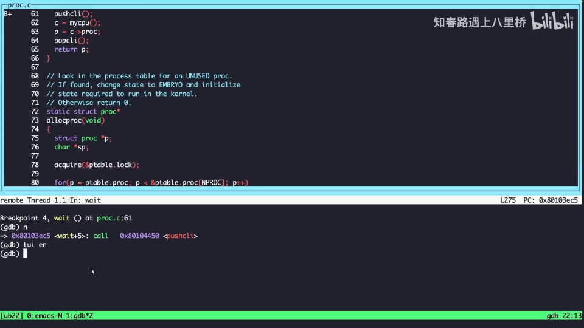

wait 这个系统调用的实现是一个 `for(;;)` 死循环；循环之前第一件事是获取进程表锁——也就是说它后面肯定会做进程表操作。然后它遍历所有进程：**如果某个进程的父进程不等于当前进程，就 continue——意思是 wait 只找当前进程自己的子进程**。[【跳转到 19:15】](https://www.bilibili.com/video/BV1zG411i7fs/?t=1155)

因为 wait 的语义就是"等我的子进程"。一旦找到子进程，就看它的状态是不是 ZOMBIE。ZOMBIE 是什么？exit 里已经埋下伏笔：子进程退出时回收了自己用户态的一些资源，但**内核态的资源还没有回收**——这最后一步必须由父进程来给它"收尸"。所以 ZOMBIE 状态有两个含义：**标记这个子进程已经退出了；同时告知父进程可以进行资源回收了**。开头那个 10 秒/30 秒的例子正好对上：子进程退出后、父进程退出前，子进程就是一个 zombie 状态。[【跳转到 20:30】](https://www.bilibili.com/video/BV1zG411i7fs/?t=1230)

wait 发现 ZOMBIE 子进程之后的回收动作：把子进程的 pid 设置出来（返回给父进程），free 一些值、free 虚拟地址空间，把进程结构的初始值设回去、进程状态搞成 **UNUSED**，最后 release 进程表锁。[【跳转到 21:20】](https://www.bilibili.com/video/BV1zG411i7fs/?t=1280)

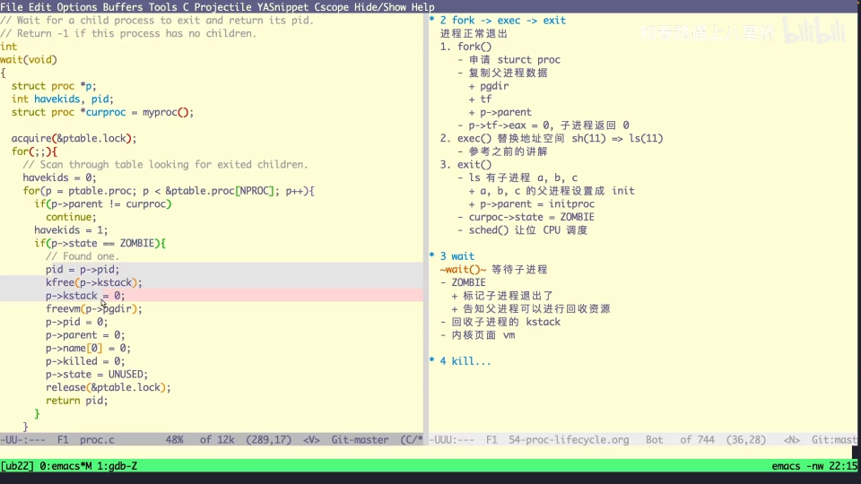

回收完成之后，wait 这一轮成功，父进程又直接 sleep 下去（按上一讲讲的，最后调 scheduler 把 CPU 让给调度器）。至此：**wait = 父进程等待子进程，并回收它留下的内核资源**。进程的正常生命周期，到这里就闭环了。[【跳转到 21:47】](https://www.bilibili.com/video/BV1zG411i7fs/?t=1307)

## 八、kill：不是"杀"，而是"贴标签"

除了正常退出，还有非正常死亡：kill。演示里 kill 掉 GDB 进程，它立刻就挂了。kill 命令最后会掉到 kill 这个系统调用，实现还比较简单，直接看代码就能理解：[【跳转到 23:05】](https://www.bilibili.com/video/BV1zG411i7fs/?t=1385)

- 它先也是获取进程表锁（要做进程表读写），然后按传入的 PID 在进程表里找目标进程——我们 kill 的时候要给一个 PID，比如先拿到 GDB 的 PID；[【跳转到 24:00】](https://www.bilibili.com/video/BV1zG411i7fs/?t=1440)

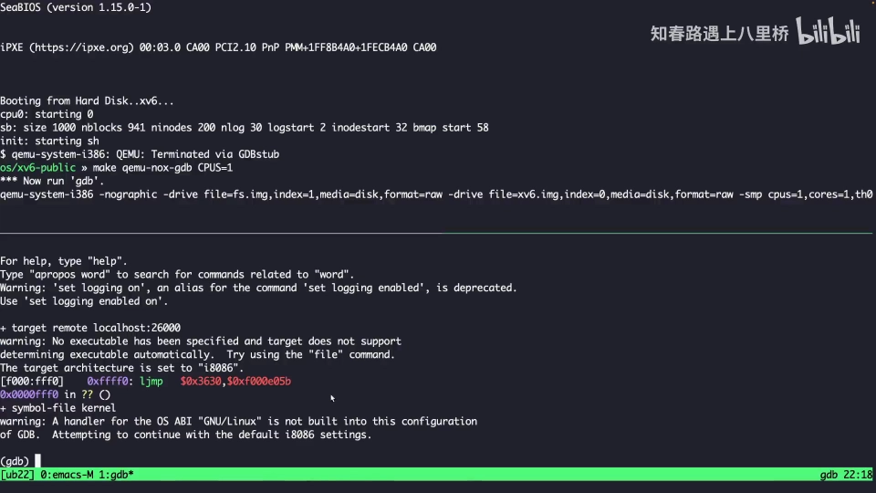
- **直接把这个进程的 killed 标志设置成 1；如果它的状态是 SLEEPING，就立马把它设置成 RUNNABLE**。[【跳转到 24:29】](https://www.bilibili.com/video/BV1zG411i7fs/?t=1469)

注意：kill 此刻并没有真正"杀掉"进程，只是设置了一个标志。那进程什么时候死？这就又回到中断：当时钟中断到来，先做 tick 增加、wakeup 睡眠的进程；switch 返回之后有一段检验——当前进程的 killed 标志被置位（我们刚刚在 kill 里设置过）、且当前是从用户态陷入内核的——就直接调用 exit。也就是说，被 kill 的进程会在内核里"主动"走 exit 流程：子进程托孤给 init、自己置 ZOMBIE、让出 CPU，再由父进程的 wait 回收资源——与正常死亡殊途同归。[【跳转到 24:54】](https://www.bilibili.com/video/BV1zG411i7fs/?t=1494)

## 九、小结：一生二，二生三

你会发现这个设计非常巧妙：**第一个进程启动过后，后续的进程都是通过第一个进程（init）进行管理的**——正常退出走 exit/wait，父进程先退出则把子进程托孤给 init，kill 杀死进程最终也汇入 exit/wait 这条链。这有点像"一生二、二生三"那种派生关系。[【跳转到 25:44】](https://www.bilibili.com/video/BV1zG411i7fs/?t=1544)

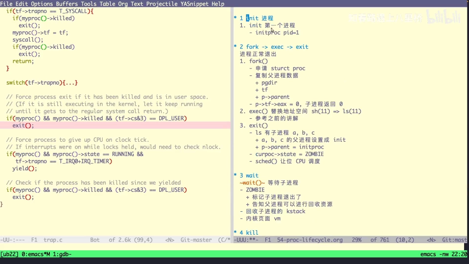

进程调度相关的还有其他场景，比如管道——时间有限，留到下个视频分析。[【跳转到 26:40】](https://www.bilibili.com/video/BV1zG411i7fs/?t=1600)

## 小结

- shell 运行一条命令 = fork 出子进程 + 子进程 exec 换程序 + 父进程 wait 等待；几十行 C 代码就能完整模拟。
- 僵尸进程（Z）= 子进程已退出、父进程尚未回收的中间状态；它是正常生命周期的一环，由 wait 收尾。
- fork 的核心：allocproc 分配 proc（EMBRYO）→ copyuvm 复制地址空间 → 认父（p->parent）→ **EAX 置 0 实现"子进程返回 0"** → 置 RUNNABLE。
- exec 的核心：读 ELF、重建用户栈与页表，**整体替换地址空间**——进程表里 PID 不变、名字从 sh 变成 ls。
- exit 的核心：init 不可退出（panic）→ 关闭打开文件 → 子进程托孤给 init（ZOMBIE 的孙子则唤醒 init）→ 自己置 **ZOMBIE** → sched 让出 CPU；wakeup1 不拿 ptable 锁是为了避免死锁。
- wait 的核心：死循环里只找**自己的** ZOMBIE 子进程 → 带回 pid、free proc 与页表、置 **UNUSED**，完成最后的"收尸"。
- kill 不直接杀进程：置 killed 标志（SLEEPING 者置为 RUNNABLE），trap 检查到后调用 exit，真正死亡仍走 exit/wait 链条。
- 所有进程都由 init 派生与管理——"一生二，二生三"。

## 关键术语速查

| 术语 | 一句话解释 |
| --- | --- |
| fork | 复制当前进程创建子进程的系统调用；父进程得到子进程 PID，子进程得到 0 |
| exec | 用新程序替换当前进程地址空间的系统调用（读 ELF、重建栈与页表） |
| exit | 进程退出：init 检查、关文件、子进程托孤、自己置 ZOMBIE、让出 CPU |
| wait | 父进程等待并回收 ZOMBIE 子进程的内核资源，把其 pid 返回给父进程 |
| kill | 置目标进程 killed 标志（SLEEPING 者唤醒为 RUNNABLE）；真正退出仍由 exit 完成 |
| ZOMBIE | 子进程已退出、用户态资源已回收但内核资源尚未回收的状态；通知父进程来收尸 |
| EMBRYO | 进程结构刚分配、尚未就绪的"胚胎"状态 |
| RUNNABLE | 可运行（等待被调度）状态 |
| trap frame | 进程陷入/返回内核时保存的寄存器现场；其 EAX 承载系统调用返回值 |
| ptable | xv6 的全局进程表，配套一把进程表锁 |
| wakeup1 / wakeup | 唤醒睡眠进程的函数；前者不拿 ptable 锁（已在临界区内时用），后者拿锁 |
| channel（通道） | sleep/wakeup 使用的等待通道，睡眠与唤醒按通道配对 |
