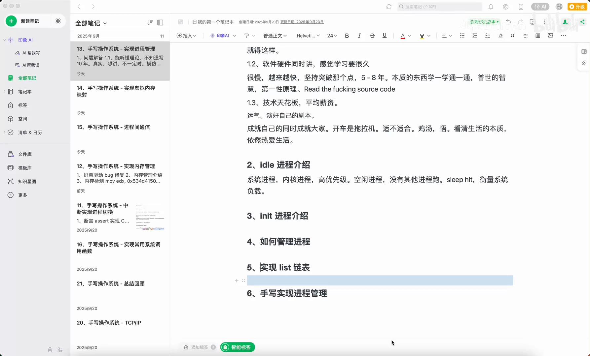

# 82.init 进程介绍：0 号与 1 号进程，所有进程的祖先

> 视频来源：[82.init 进程介绍](https://www.bilibili.com/video/BV1ZMnxzvEu1/)（Bilibili，UP 主「红橙Darren」，手写操作系统系列）
>
> 本篇基于视频 AI 字幕与画面整理。视频是手写操作系统课程里对两个特殊进程的补讲：0 号 idle 进程和 1 号 init 进程，以及 init 作为"所有进程的祖先"承担的三件事——孵化服务进程、接管孤儿进程、防止僵尸进程蔓延。

## 本讲要解决的核心问题（SCQA）

**背景**：学进程、写操作系统，绕不开"进程从哪来"这个问题。课堂上已经讲过 fork 等基础概念，但系统里最开头的两个进程——0 号和 1 号——还没交代。[【跳转到 00:00】](https://www.bilibili.com/video/BV1ZMnxzvEu1/?t=0)

**冲突**：这两个进程编号特殊、身份特殊：一个"基本不干活"，一个却是"所有进程的祖先"。它们到底是谁？为什么所有进程都和它们有关系？父进程先退出时，子进程又归谁管？[【跳转到 02:05】](https://www.bilibili.com/video/BV1ZMnxzvEu1/?t=125)

**疑问**：0 号和 1 号进程分别是什么？init 凭什么成为"总祖先"？[【跳转到 00:00】](https://www.bilibili.com/video/BV1ZMnxzvEu1/?t=0)

**回答（中心思想）**：**0 号进程是 idle（空闲）进程，CPU 没事干的时候才轮到它跑；1 号进程是 init，它是所有进程的祖先，负责"孵化"（fork）各种服务进程，并且在父进程先退出的情况下接管孤儿进程，防止系统里出现无法管理的僵尸进程。**[【跳转到 02:30】](https://www.bilibili.com/video/BV1ZMnxzvEu1/?t=150)

---

## 一、0 号与 1 号：idle 与 init

如果我们给系统里的进程编号，有一个进程一般被编为 **0 号进程**，而 init 进程就是我们常说的 **1 号进程**——所以它是**所有进程的祖先**。[【跳转到 00:00】](https://www.bilibili.com/video/BV1ZMnxzvEu1/?t=0)

0 号进程是一个**空闲进程**：系统空闲的时候它来跑。你基本上看不到它干活——它只在其他进程都不跑的时候出来，做一些停机之类的收尾工作。而 init 进程则完全相反：它是所有进程的主线，是整个进程树的根。[【跳转到 01:15】](https://www.bilibili.com/video/BV1ZMnxzvEu1/?t=75)

## 二、init 的职责：孵化（fork）出各种服务进程

init 作为所有进程的祖先，会去**孵化**其他进程。所谓"孵化"，其实就是后面要实现的 `fork`——只是在这里先用一个形象的说法。[【跳转到 00:50】](https://www.bilibili.com/video/BV1ZMnxzvEu1/?t=50)

init 孵化出来的，是系统运行必需的**服务进程**，比如：

- 网络服务；
- 图形（图像界面）服务；
- 在安卓里，就是那些 system service 系统服务，以及桌面启动器（launcher）这样的应用进程。[【跳转到 00:25】](https://www.bilibili.com/video/BV1ZMnxzvEu1/?t=25)

也就是说，整个系统的进程格局是：先是 0 号 idle 进程，然后 init 作为总祖先，由它 fork 出一棵服务进程树。[【跳转到 00:50】](https://www.bilibili.com/video/BV1ZMnxzvEu1/?t=50)

## 三、init 接管孤儿进程，防止僵尸进程蔓延

这里先提前讲一个后面才会展开的概念：**进程回收**。比如 main 进程执行完之后，我们要把它回收掉。问题在于：**如果父进程在子进程结束之前就退出了，那么子进程退出时就会变成"孤儿进程"**。[【跳转到 02:05】](https://www.bilibili.com/video/BV1ZMnxzvEu1/?t=125)

谁来管这些孤儿？答案是 init：**init 进程会接管这些孤儿进程，让它们不会变成无人管理的僵尸进程**，防止系统中出现无法收拾的僵尸进程堆积。[【跳转到 02:30】](https://www.bilibili.com/video/BV1ZMnxzvEu1/?t=150)

现在不理解也没关系，这一机制在后面的课程里还会专门展开；这里只需要记住：0 号和 1 号进程都有用，而且 init 的"收养"职责正是进程树能长期保持健康的原因之一。[【跳转到 02:55】](https://www.bilibili.com/video/BV1ZMnxzvEu1/?t=175)

## 四、这两个进程是演进出来的

最后补一个视角：在写操作系统的时候，**早期版本可能并没有这两个进程**；随着操作系统不断演进，慢慢才意识到"还是要有这两个进程"——一个管空闲，一个管全局。于是 idle 和 init 就成了现代操作系统里雷打不动的 0 号与 1 号。[【跳转到 03:20】](https://www.bilibili.com/video/BV1ZMnxzvEu1/?t=200)

---

## 小结

- **0 号进程 = idle**：空闲时才运行的占位进程，负责"系统没事干"的时刻。
- **1 号进程 = init**：所有进程的祖先，用 fork"孵化"出网络、图形等一众服务进程。
- **孤儿与僵尸的兜底者**：父进程先退出时，init 接管孤儿进程，防止僵尸进程无法回收。
- 0 号与 1 号并非从一开始就存在，而是操作系统演进过程中沉淀下来的两个基石进程。
