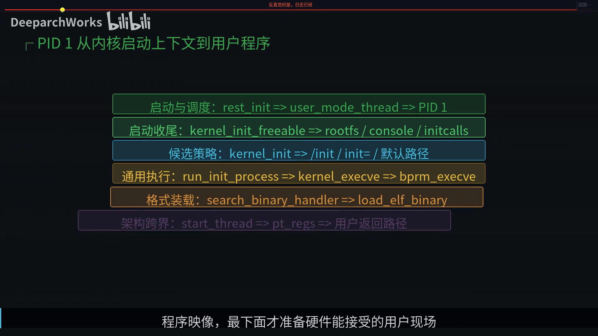
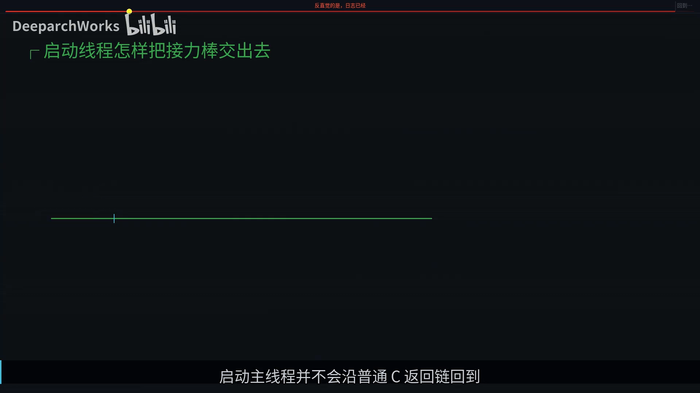
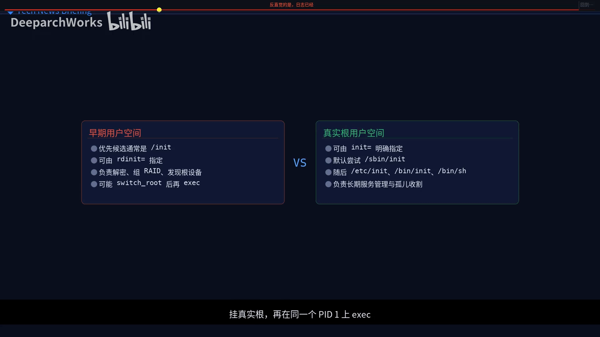
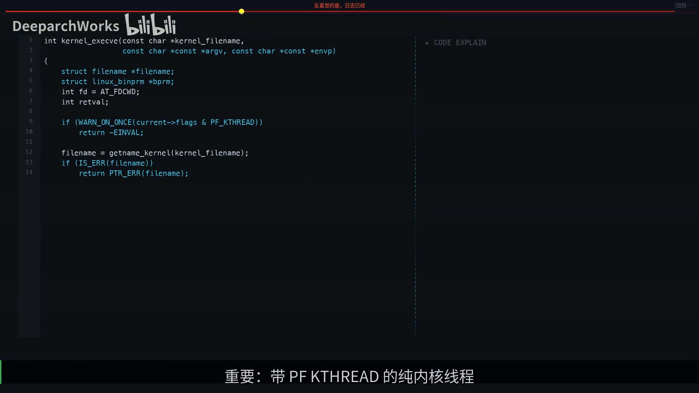
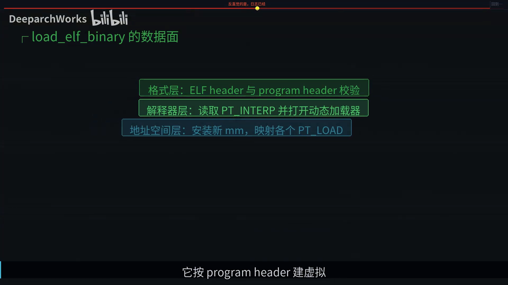
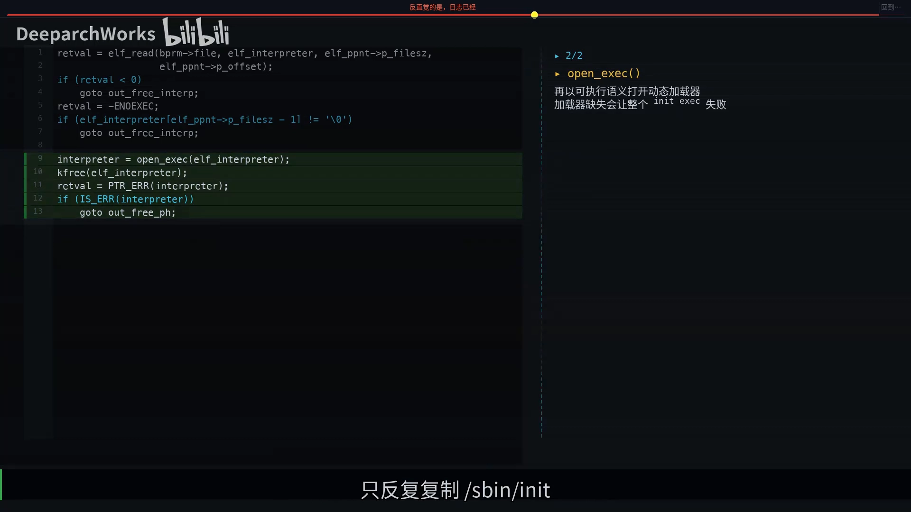
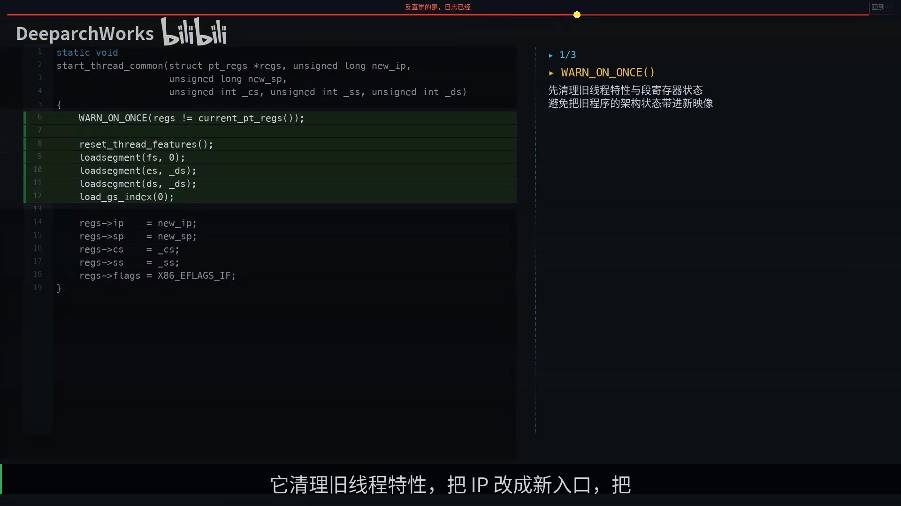
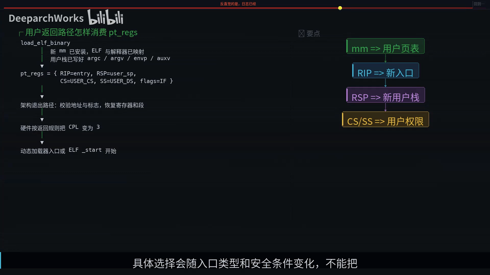
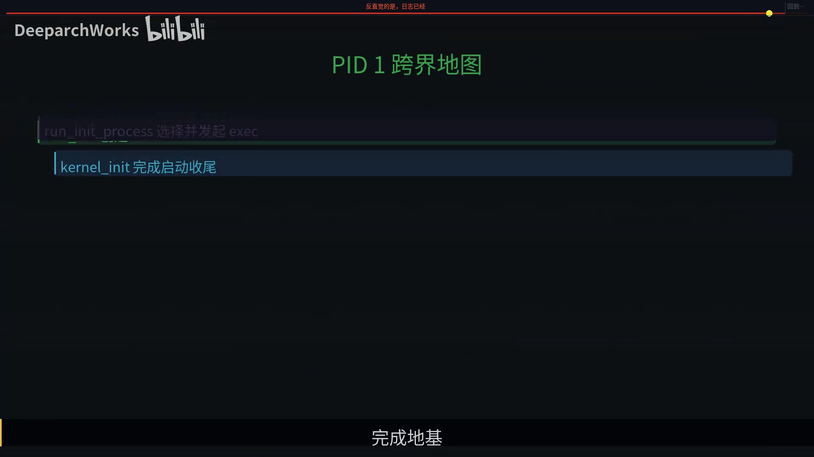

# PID 1 init 进程怎么从内核态跳到用户态：run_init_process 揭秘

> 视频来源：[PID 1 init 进程怎么从内核态跳到用户态 run_init_process 揭秘](https://www.bilibili.com/video/BV1Akhv6nETQ/)（Bilibili，UP 主「DeeparchWorks」）
>
> 本篇基于视频 AI 字幕与画面整理。视频沿 Linux v6.6 固定源码，把 PID 1 从内核态走到用户态的全过程拆成"身份—内容—权限"三段接力：`user_mode_thread` 创建任务、`kernel_execve`/ELF 装载原地换装、架构返回路径把 CPU 降到用户态，并解释了为什么 `run_init_process` 只是"发令枪"。

## 本讲要解决的核心问题（SCQA）

**背景**：内核启动的日志已经打印了"Run /sbin/init as init process"——看起来 init 已经跑起来了。[【跳转到 00:00】](https://www.bilibili.com/video/BV1Akhv6nETQ/?t=0)

**冲突**：答案很反直觉：**日志打印时 CPU 仍在内核态**；就连 `start_thread` 执行完，CPU 也还没进入 ring 3（用户态特权级）。真正的跨界动作不在 `run_init_process` 里，甚至不在普通 C 调用栈里。很多解释把三件事压成一句"内核创建 init 并跳到用户态"，混成一团，你就会在错误的函数里寻找那条不存在的特权切换语句。[【跳转到 00:00】](https://www.bilibili.com/video/BV1Akhv6nETQ/?t=0)

**疑问**：沿着 Linux v6.6 的固定源码看，PID 1 到底在哪一步、由谁"跨过"内核态/用户态这条隐形边界？[【跳转到 00:00】](https://www.bilibili.com/video/BV1Akhv6nETQ/?t=0)

**回答（中心思想）**：**跨界不是一行 C 代码，而是三段接力：身份（`user_mode_thread` 创建 PID 1）、内容（`kernel_execve` 与 ELF 装载在同一个 task 里替换执行世界）、权限（架构返回路径恢复用户寄存器，CPU 才真正降到 ring 3）。`run_init_process` 只是候选策略与通用 exec 的交接点，是发令枪，不是跨界开关。**[【跳转到 01:30】](https://www.bilibili.com/video/BV1Akhv6nETQ/?t=90)

---

## 一、全片坐标系：三次变化

把刚启动的内核想成一座闭馆施工的博物馆：总指挥先建立**第一位馆长**的工作档案，却不会立刻收走施工证——他要先通电、接控制台、准备展厅，再按清单搬入馆长的办公资料；只有入口栈和权限凭证都齐了，闸门才允许馆长进入公共区。[【跳转到 00:50】](https://www.bilibili.com/video/BV1Akhv6nETQ/?t=50)

内核像一条六层接力赛：最上面只负责产生**可调度的身份**；中间两层准备系统环境并选择文件；exec 层负责把文件变成新程序映像；最下面才准备硬件能接受的用户现场。每层只知道自己的输入和边界，某层失败时不能越级去怪另一层。[【跳转到 01:15】](https://www.bilibili.com/video/BV1Akhv6nETQ/?t=75)

于是全片坐标系就是**三次变化**：

1. **第一次**：调度器看见 PID 1，但它仍跑 `kernel_init`（一个内核 C 函数）；
2. **第二次**：exec 在**同一个 task** 里替换 mm（地址空间）、映射、栈和入口；
3. **第三次**：返回路径恢复用户寄存器，CPU 才真正降到 ring 3。

**身份连续、内容换轨、权限最后落地。**[【跳转到 01:30】](https://www.bilibili.com/video/BV1Akhv6nETQ/?t=90)

## 二、PID 1 怎么出现：user_mode_thread 与 rest_init

`user_mode_thread` 这个名字最容易让人误判：它表达的是**这个 task 将来允许过渡到用户态**，不是"创建完成便已经运行用户指令"。证据很直接：它收到的入口参数就是 `kernel_init`——一个内核 C 函数。[【跳转到 01:55】](https://www.bilibili.com/video/BV1Akhv6nETQ/?t=115)

看固定提交里的源码：新 task 的入口明确写着 `kernel_init`；紧接着内核把它暂时钉在启动 CPU 上（因为完整的 SMP 调度约束还没准备好），然后才创建 PID 2 的 `kthreadd`。也就是说，**PID 1 先获得身份和执行机会，在等待其他启动基础设施补齐**。[【跳转到 02:20】](https://www.bilibili.com/video/BV1Akhv6nETQ/?t=140)

启动主线程并不会沿普通 C 返回链回到 boot loader：它创建 PID 1 和 kthreadd、让它们各自至少被调度一次、让系统跑起来，然后**自己进入 idle**。此后 PID 0 负责空闲循环，PID 1 作为独立 task 执行 `kernel_init`，**父进程（PPID）显示为 0**——这不等于用户态里做了一次普通 fork。[【跳转到 02:45】](https://www.bilibili.com/video/BV1Akhv6nETQ/?t=165)

## 三、为什么不能先创建 PID 1：地基还不完整

因为用户程序赖以生存的地基还不完整：`kernel_init_freeable` 要等 kthreadd 完成、跑 initcall，把 CPU、文件系统和控制台准备好，还要完成同步与异步初始化。[【跳转到 02:45】](https://www.bilibili.com/video/BV1Akhv6nETQ/?t=165)

如果这时就降到用户态，init 可能连自己的可执行文件、动态加载器和错误输出都找不到。`kernel_init_freeable` 返回后，内核完成剩余的同步异步任务，接着**释放 initmem**（把启动专用的内存区域释放、只读化）——这说明启动代码本来就是**一次性脚手架**：用户态 init 将接管长期生命周期，内核没必要永久保留整座施工现场。[【跳转到 03:10】](https://www.bilibili.com/video/BV1Akhv6nETQ/?t=190)

## 四、第一个用户程序不一定是 /sbin/init

机器用 initramfs 启动时，PID 1 可能**先 exec initramfs 里的 /init**，由它解密磁盘、组 RAID、挂真实根，再在**同一个 PID 上** exec systemd；没有早期 init 或它不适用时，内核才走 `init=` 参数与默认候选名单的路径。注意：**路径选择是政策，不是跨界机制**——这就是标题主角 `run_init_process` 薄得惊人的原因。[【跳转到 03:35】](https://www.bilibili.com/video/BV1Akhv6nETQ/?t=215)

## 五、run_init_process：薄得惊人的发令枪

它只做三件事：设置 `argv[0]`、打印路径参数、调用 `kernel_execve`。没有写页表，没有写代码段选择子，也没有执行 iret。[【跳转到 04:00】](https://www.bilibili.com/video/BV1Akhv6nETQ/?t=240)

所以 `run_init_process` 只是发令枪。把它当作用户态已经启动，是启动排查里最危险的误读。一句话盯死边界：**`run_init_process` 是 INIT 候选策略与通用 exec 的交接点，不是 ring 0 到 ring 3 的开关。**下一棒要完成的事情更重：把同一个 PID 里的旧执行材料拆掉，换成一个完整用户程序。[【跳转到 04:25】](https://www.bilibili.com/video/BV1Akhv6nETQ/?t=265)

## 六、exec：同一个人原地换装

exec 更像**同一个人原地换装**，不是再生一个孩子：PID 这张身份证不变，但地址空间、程序段、用户栈、入口和许多信号状态都会被替换。换装前还能因"尺码不合"退回候选表；**旧衣物一旦拆掉，就越过了提交点**，后面失败也不能假装恢复成原来的 `kernel_init`。[【跳转到 04:25】](https://www.bilibili.com/video/BV1Akhv6nETQ/?t=265)

## 七、kernel_execve 的守卫与施工单

`kernel_execve` 的第一处防卫特别重要：带 **PF_KTHREAD** 标志的纯内核线程会直接返回 -EINVAL（无效参数）。PID 1 能走进来，正因为 `user_mode_thread` 没把它做成普通内核线程——它是**专门的过渡 task**：先借内核入口完成准备，再允许自己获得用户 mm 和用户返回现场。[【跳转到 04:50】](https://www.bilibili.com/video/BV1Akhv6nETQ/?t=290)

随后 `getname_kernel` 接收**内核地址空间**的文件名，把它送入 VFS 管理的 execve 世界。这也修正了一句常见但不严谨的话——"kernel_init 是内核线程"：从当前执行位置看它确实在内核里跑，但从源码标志看 PID 1 不能是 PF_KTHREAD，否则 exec 当场拒绝。[【跳转到 05:15】](https://www.bilibili.com/video/BV1Akhv6nETQ/?t=315)

`linux_binprm` 是本次 exec 的"施工单"：暂存文件、参数个数、参数页、凭据、解释器信息和提交状态；内核先数好 argv 与 envp。[【跳转到 05:40】](https://www.bilibili.com/video/BV1Akhv6nETQ/?t=340)

## 八、VFS：打开文件不等于"看见文件"

从这里开始，PID 1 和普通 exec **大量复用同一套基础设施**：参数、文件、安全、格式、映像、入口。复用的好处是 init 不需要一条危险的启动旁路；代价是故障可能横跨 VFS、LSM（安全模块）、脚本、解释器、ELF 和架构层，因此必须保留错误码和分层证据。[【跳转到 06:05】](https://www.bilibili.com/video/BV1Akhv6nETQ/?t=365)

`do_open_execute` 不是普通 open：它要确认路径能解析、文件可执行、挂载没有 noexec、安全策略允许。**仅仅用 ls 看见 /sbin/init，远远不能证明这一步通过。**[【跳转到 06:30】](https://www.bilibili.com/video/BV1Akhv6nETQ/?t=390)

## 九、search_binary_handler：可执行文件鉴定大厅

文件打开后要交给格式处理器。把 `search_binary_handler` 想成**可执行文件鉴定大厅**：同一份文件依次送到不同窗口——ELF 看 magic（魔数）和机器类型，脚本看 `#!` 后面的解释器，其他 handler 看自己的签名。**谁认出它，谁领走并装载**。于是 init 可以是 ELF，也可以是带解释器的脚本。[【跳转到 06:55】](https://www.bilibili.com/video/BV1Akhv6nETQ/?t=415)

## 十、ELF loader：先拒绝，再虚拟映射

ELF handler 上来不是映射，而是一排**拒绝条件**：magic、文件类型、机器架构、格式变体和 MAC 能力——任何一项不合格都返回 -ENOEXEC。这个阶段的失败**仍可能让 kernel_init 尝试下一个默认候选**，所以看见文件存在，不能跳过格式检查。[【跳转到 07:20】](https://www.bilibili.com/video/BV1Akhv6nETQ/?t=440)

ELF loader 的工作不是把整个文件复制进一块连续物理内存，而是**按 program header 做虚拟映射**，区分代码、数据和 BSS；动态程序还要装入 PT_INTERP 指定的加载器。最后构造**用户初始栈**：里面除了参数、环境，还有 auxv（辅助向量），供加载器取得入口、段表和随机数据。[【跳转到 07:45】](https://www.bilibili.com/video/BV1Akhv6nETQ/?t=465)

## 十一、point of NO return：提交点

这是整条链最有工程味的一行：**point of NO return 之前**，映像大体完整，错误可以返回，让候选策略试下一项；**它之后**，mm、线程关系、信号和文件状态会陆续被改造，再失败只能杀死当前 task，**不能把半拆的 kernel_init 拼回去**。[【跳转到 07:45】](https://www.bilibili.com/video/BV1Akhv6nETQ/?t=465)

为什么候选回退有时有效、有时却直接崩？答案就在提交点：**前面失败，现场还在**，继续 exec `/etc/init` 或 `/bin/sh` 有意义；**后面失败**，身份还叫 PID 1，但执行世界已经拆了，此时无损回滚是幻觉，只能进入明确的致命恢复路径。[【跳转到 08:10】](https://www.bilibili.com/video/BV1Akhv6nETQ/?t=490)

最经典的坑：`/sbin/init` 明明存在、权限也对、ELF 检查通过，却仍报错——原因可能不是它自己，而是 **PT_INTERP 指向的动态加载器不在镜像里**：ELF loader 读出绝对路径再调用 open_exec，解释器缺失，整个 init 都不能执行。只反复复制 `/sbin/init` 永远修不好；真正的修复是补齐匹配的加载器与共享库，或采用验证过的静态救援入口。[【跳转到 08:35】](https://www.bilibili.com/video/BV1Akhv6nETQ/?t=515)

## 十二、CPU 进入用户态后，第一条指令通常不是 main

内核只按 **ABI** 摆好 argc、argv、envp 和 auxiliary vector（auxv）：静态程序先到 `_start`；动态程序先到加载器入口，完成重定位后再交给程序启动代码。**内核依赖的是 ABI，不依赖 glibc 或 systemd 的内部函数。**[【跳转到 09:00】](https://www.bilibili.com/video/BV1Akhv6nETQ/?t=540)

## 十三、start_thread：填好返回凭证，但仍在 ring 0

通用 ELF 逻辑走到尾部，取得 current 的 pt_regs，把 ELF entry 和 bprm 里的用户栈指针交给 `start_thread`。这里体现了清晰分层：**ELF 知道程序入口和栈，架构代码知道寄存器、代码段和返回规则，二者不越界、理解对方的政策。**[【跳转到 09:25】](https://www.bilibili.com/video/BV1Akhv6nETQ/?t=565)

`start_thread` 清理旧线程特性、把 IP 改成新入口、把 SP 改成用户栈、再写入用户 CS/SS 和 flags。可是请注意：**这些赋值执行时 CPU 仍在 ring 0**——它只是填好一张返回凭证，并没有立刻穿过边界。所以寻找"哪一行 C 把 ring 0 改成 ring 3"注定扑空：x86 的当前特权级不是一个可随意赋值的普通变量，段选择子、页表权限、目标地址和特定的控制流返回必须**共同成立**。[【跳转到 09:50】](https://www.bilibili.com/video/BV1Akhv6nETQ/?t=590)

## 十四、最后一毫米：架构返回路径

真正变化发生在 `start_thread` 之后——最后一毫米是**架构退出路径**：校验用户地址和标志，恢复 pt_regs 中的新 IP、SP 与用户段，再用合适的汇编返回序列（如 iret 一族）**让硬件完成 CPL（当前特权级）变化**。具体选择会随入口类型和安全条件变化，不能把普通系统调用的 sysret 路径生搬到 PID 1 上。[【跳转到 10:15】](https://www.bilibili.com/video/BV1Akhv6nETQ/?t=615)

把全链串起来：**PID 1 先以 kernel_init 运行 → 环境就绪后挑候选 → run_init_process 发起 exec → VFS 和安全层打开文件 → ELF 建新 mm、替换旧栈 → start_thread 填用户现场 → 架构返回才让 CPU 进入 CPL 3。**整条路上 PID 始终是 1，但它承载的执行世界已彻底改变。[【跳转到 10:40】](https://www.bilibili.com/video/BV1Akhv6nETQ/?t=640)

## 十五、排障：先分证据强弱，再分失败世界

**第一原则是区分证据强弱**："Run /sbin/init as init process" 这条日志只证明 `run_init_process` 打印了日志，**连 kernel_execve 成功都不能保证**。更强的证据是：ps 里 PID 1 的 exe 指向目标 init、init 输出自身日志、持续存活并创建服务树。**不要用发令枪的声音证明选手已经冲线。**[【跳转到 11:05】](https://www.bilibili.com/video/BV1Akhv6nETQ/?t=665)

同一句"系统没起来"可能落在四个世界，先确认到达层次，再检查该层拥有的状态：[【跳转到 11:30】](https://www.bilibili.com/video/BV1Akhv6nETQ/?t=690)

1. **连 run 日志都没有** → 查更早的启动阶段；
2. **打印 Couldn't execute** → 查路径、权限、格式和解释器；
3. **PID 1 进入后立刻死** → 查用户入口与 ABI；
4. **PID 1 活着却没服务** → 已是用户态问题，查依赖图。

候选参数也分两个阶段：`rdinit=` 在早期 ramdisk 阶段换候选，`init=` 在真实根阶段换候选。验证边界要清楚：**rdinit 的 shell 启动成功，不能证明磁盘根里的 systemd 正常**；initramfs 的 shell 也不能验证前面的解密脚本没有问题。反向也能验证边界：纯内核线程会被 PF_KTHREAD 守卫挡住——exec 成功，反过来证明 PID 1 不是内核线程。[【跳转到 12:20】](https://www.bilibili.com/video/BV1Akhv6nETQ/?t=740)

换到 arm64，候选与通用 exec 仍在，最后一跳却是另一套异常返回模型，可迁移的只有思路，寄存器名不能照搬。[【跳转到 12:45】](https://www.bilibili.com/video/BV1Akhv6nETQ/?t=765)

## 十六、三十年的接力，不是一个魔法

这条链不是某个人一次写成的魔法，而是在 30 多年兼容性压力中持续演进：Linus Torvalds 创建了 Linux 并长期守着主线的整体架构；Al Viro 长期深耕 VFS 路径解析和 execve 核心代码——init 从一个字符串变成"受管理的可执行文件"，背后牵涉挂载、权限、命名空间和生命周期；Ingo Molnar 长期参与调度器和 x86 底层执行路径——PID 1 的身份先由调度世界承载，最后又要靠架构世界安全返回用户态。**两端之间夹着 VFS 与 ELF，任何一层都不能单独宣称完成了全部跨界**——这正是内核工程需要跨子系统审查的原因。[【跳转到 13:10】](https://www.bilibili.com/video/BV1Akhv6nETQ/?t=790)

这套设计经验也可以迁移：把"身份、状态替换、权限切换"分开，适用于任务系统；把 point of NO return 显式化，适用于数据库迁移和发布；用稳定 ABI 隔开层次，适用于插件与协议；回退只覆盖可恢复阶段，适用于所有有提交语义的系统。[【跳转到 14:09】](https://www.bilibili.com/video/BV1Akhv6nETQ/?t=849)

---

## 小结

- **日志打印 ≠ 已进用户态**："Run /sbin/init as init process" 出现时 CPU 仍在内核态；`start_thread` 写完也只是"凭证齐了"。
- **三段接力**：`user_mode_thread` 给身份（入口是内核函数 kernel_init）；`kernel_execve`/ELF 装载换内容（同一 PID 原地换装，point of NO return 前可回退、后不可逆）；架构返回路径换权限（CPL 真正降到 ring 3）。
- **run_init_process 只是发令枪**：设 argv[0]、打印、调 `kernel_execve`，三件事而已。
- **地基先行**：`kernel_init_freeable` 跑完 initcall、准备好 CPU/文件系统/控制台并释放 initmem 后，用户态 init 才有机会活下来。
- **排障分层**：证据由弱到强（打印日志 → exe 指向 → 自身日志 → 服务树）；失败按"到达层次"归因；`rdinit=`/`init=` 分别对应 ramdisk 与真实根两个候选阶段。
