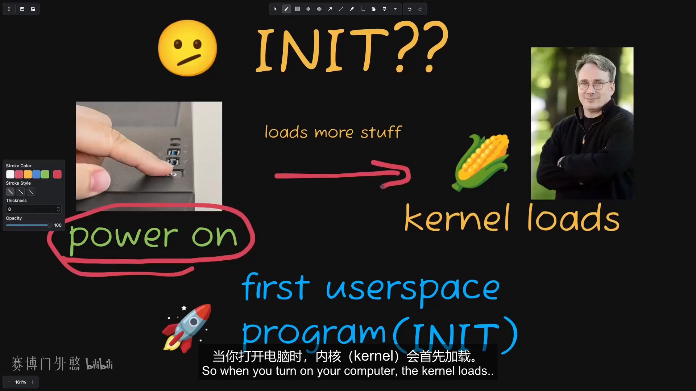
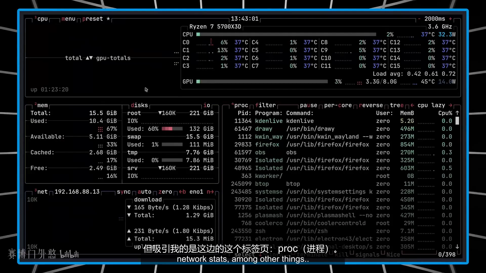
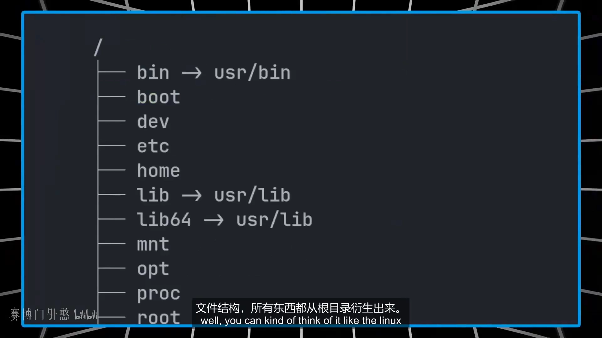
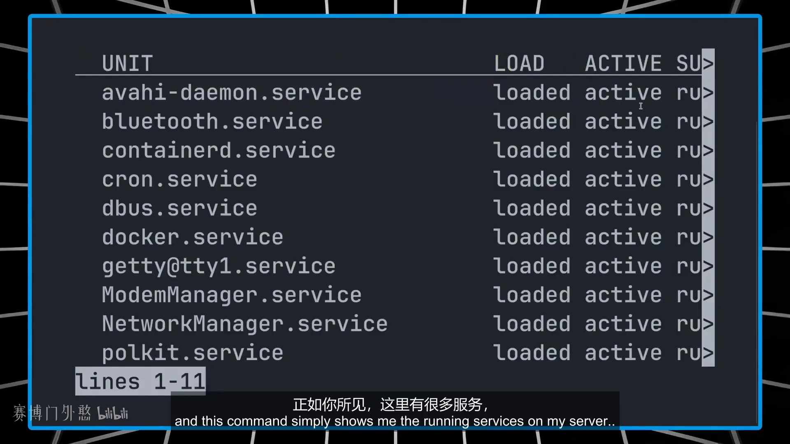
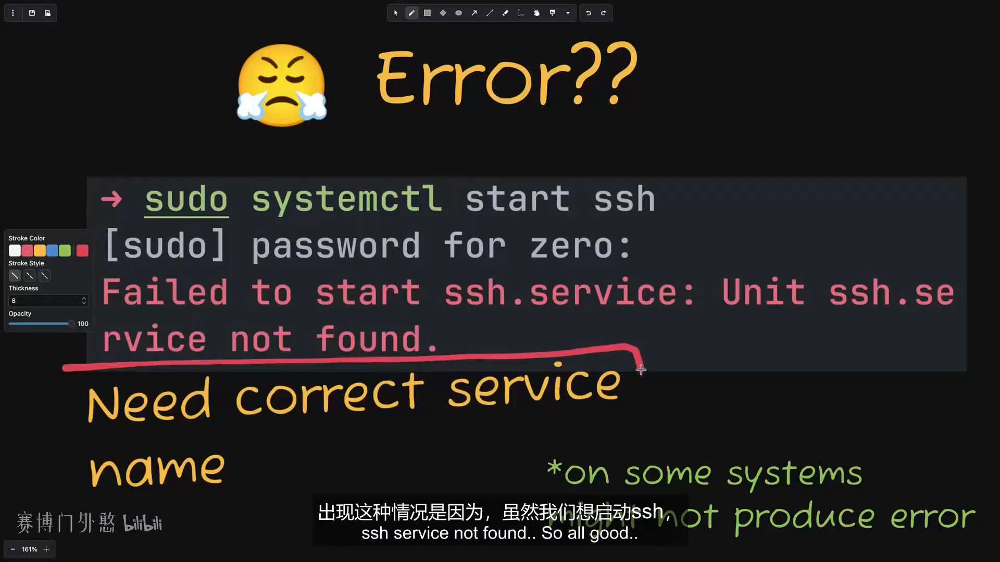
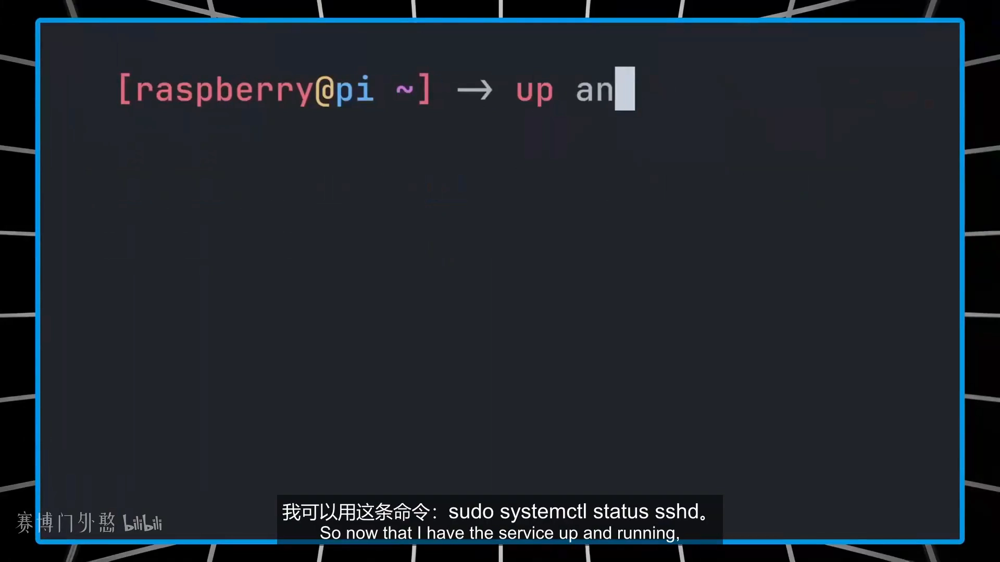
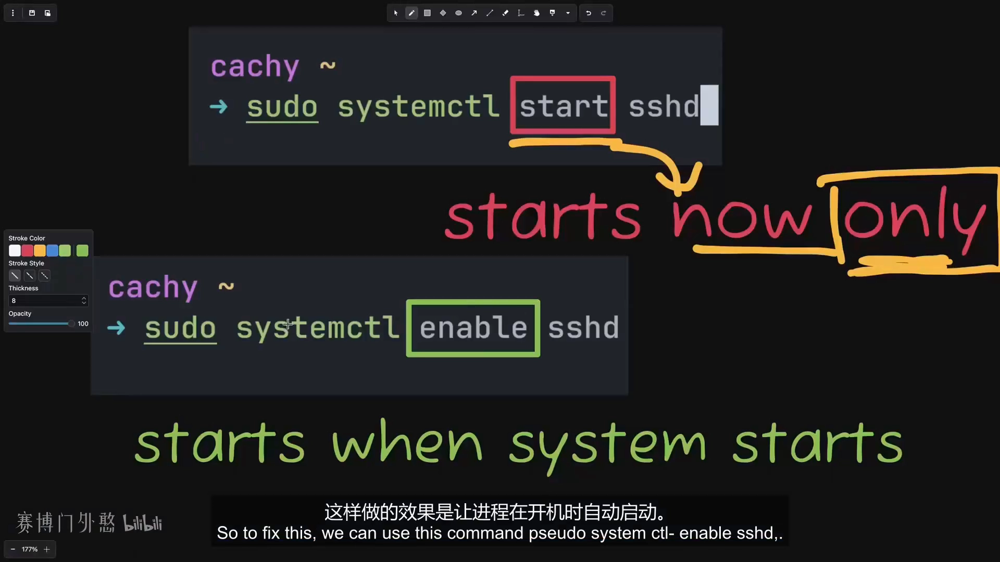
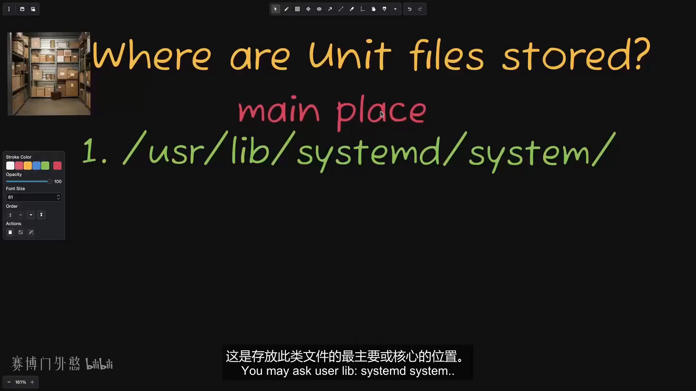
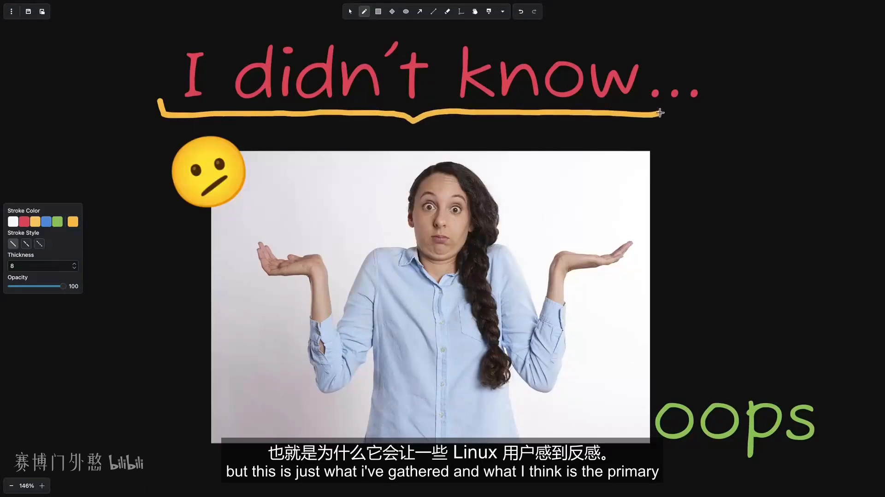

# 超通俗 SystemD 科普：INIT、Systemctl 与 Unit 文件

> 视频来源：[Linux必备！超通俗SystemD科普 | INIT / Systemctl / Unit 文件](https://www.bilibili.com/video/BV13Kah6pEE8/)（Bilibili，UP 主「赛博门外憨」）
>
> 本篇基于视频 AI 字幕与画面整理。视频面向零基础新手，从"init 系统到底是什么"讲到 systemd 的日常管理：systemctl 启停服务、active 与 enabled 的区别、unit（单元）与单元文件，最后聊了为什么一部分 Linux 用户对 systemd 恨之入骨。

## 本讲要解决的核心问题（SCQA）

**背景**：你决定从 Windows 换到 Linux，很快就会听说一个叫"初始化系统（init system）"的东西——具体来说就是 systemd。[【跳转到 00:00】](https://www.bilibili.com/video/BV13Kah6pEE8/?t=0)

**冲突**：这名字本身完全看不出它是干嘛的；而且它还是 Linux 社区里争议最大的软件之一，有些用户对它恨之入骨，甚至有专门吐槽它的网站。[【跳转到 00:15】](https://www.bilibili.com/video/BV13Kah6pEE8/?t=15)

**疑问**：systemd 到底是什么？它怎么工作？为什么有人这么讨厌它？[【跳转到 00:20】](https://www.bilibili.com/video/BV13Kah6pEE8/?t=20)

**回答（中心思想）**：**systemd 是一种"初始化系统"——它是内核启动的第一个用户空间进程，拿到进程号 PID 1，像 Linux 系统的"总管家"一样，负责把系统其余部分全部拉起来，并管理所有服务与后台进程（启动、停止、重载、监控、开机自启）。主流发行版（CentOS、Fedora、Ubuntu）都用它；而围绕它的争议，主要来自它日益庞大、被认为违背了 UNIX 哲学。**[【跳转到 01:30】](https://www.bilibili.com/video/BV13Kah6pEE8/?t=90)

---

## 一、init 系统：Linux 的总管家

简单来说，systemd 是一种被称为**初始化系统**的东西，它就像 Linux 系统的**总管家**——但不是讨人厌的那种经理型管家。它的主要功能是**管理系统的服务和后台进程**（通常叫 daemon，守护进程）。daemon 听起来吓人，但它们不是地狱来的恶魔，只是在后台默默运行、没有图形界面的服务程序。[【跳转到 00:25】](https://www.bilibili.com/video/BV13Kah6pEE8/?t=25)

管理服务包括：**启动、停止、重新加载和监控**它们，还包括在电脑**开机时自动启动**这些服务。这些服务可以是 SSH，也可以是 nginx 这样的网页服务器；systemd 要确保它们持续运行、维护得当。[【跳转到 00:42】](https://www.bilibili.com/video/BV13Kah6pEE8/?t=42)

## 二、init = initialization：PID 1 的由来

"init 系统"这个名字不是随便起的，它指的就是 **initialization（初始化）**。开机时的顺序是：内核（kernel）最先加载——也就是 Linus Torvalds 创造的那个内核——然后由内核启动**第一个用户空间进程**，也就是第一个在内核之外运行的程序。这个进程就被称为 **init**，理所当然地被赋予了**进程 ID 1**，因为它是第一个进程。[【跳转到 01:30】](https://www.bilibili.com/video/BV13Kah6pEE8/?t=90)

而这个进程负责**把系统其余的部分全部拉起来**——这就是 init（如今通常是 systemd）至关重要的原因：它处于整个系统启动和后续管理的核心位置。[【跳转到 01:49】](https://www.bilibili.com/video/BV13Kah6pEE8/?t=109)

## 三、进程树视角：所有进程都从它派生

视频用了一个叫 **btop** 的小工具演示：它的 PROC（进程）标签页可以设置成**树状模式**列出进程。往上滚动，就会看到树根旁边写着 **systemd**——它正是加载的第一个进程；树状结构下，**其他所有进程都是从这一个进程派生出来的**。[【跳转到 02:11】](https://www.bilibili.com/video/BV13Kah6pEE8/?t=131)

你可以把它想象成 Linux 的文件结构：**所有东西都从根目录 `/` 衍生出来**，进程也一样，全都从 PID 1 衍生。还有个实锤验证：查看 `/sbin/init` 这个文件，它实际**指向 systemd**。[【跳转到 02:45】](https://www.bilibili.com/video/BV13Kah6pEE8/?t=165)

大多数现代发行版都用 systemd 作为默认 init：**CentOS、Fedora、Ubuntu** 等主流发行版全是。但也有其他 init 系统，比如 **OpenRC** 和 **runit**——一些非主流发行版会默认使用它们，例如 Void Linux 用的就是 runit。既然 systemd 是默认，为什么还会有别的？这个坑先挖着，文末的争议部分会回答。[【跳转到 03:09】](https://www.bilibili.com/video/BV13Kah6pEE8/?t=189)

## 四、systemctl：管理服务的主要命令

在树莓派服务器上，`systemctl` 可以列出正在运行的服务，其中就有 **docker、NetworkManager、tailscale 和 SSH**——不熟悉也没关系，只要知道它们都由 systemd 在管理就行。[【跳转到 03:59】](https://www.bilibili.com/video/BV13Kah6pEE8/?t=239)

管理服务的动作就是 `sudo systemctl start|stop|restart|disable <服务名>`。视频现场演示了一个经典坑：想启动 SSH 服务，执行 `sudo systemctl start ssh`，结果报错"**启动 SSH 服务单元失败：找不到 ssh 服务**"。原因是没有输入正确的服务名——真正的名字是 **sshd**，末尾的 **d 代表 daemon（守护进程）**。同理 tailscale 的服务名是 `tailscaled`。[【跳转到 04:47】](https://www.bilibili.com/video/BV13Kah6pEE8/?t=287)

启动成功后，用 `systemctl status sshd` 可以查看状态：显示它当前**激活且正在运行（active/running）**、运行了多久，还会给出**进程 ID** 等信息。[【跳转到 05:43】](https://www.bilibili.com/video/BV13Kah6pEE8/?t=343)

### active 与 enabled 是两回事

status 输出里有一行黄色字"**disabled（禁用）**"出现了两次——明明服务是激活状态，为什么还说它 disabled？因为对 systemd 来说：

- **active**：它**现在**正在运行；
- **enabled**：它会在**开机时自动运行**。[【跳转到 06:39】](https://www.bilibili.com/video/BV13Kah6pEE8/?t=399)

`systemctl start sshd` 只会启动服务一次，重启电脑后又得手动开。要开机自启，用 `sudo systemctl enable sshd`；反过来 `sudo systemctl disable sshd` 就取消自启。[【跳转到 07:19】](https://www.bilibili.com/video/BV13Kah6pEE8/?t=439)

### reload 与 restart

还有两个容易混淆的命令：`systemctl reload sshd` 用在服务**可以在不重启的情况下重新加载配置文件**时；如果不确定该用哪个，直接 `systemctl restart sshd` 总不会错（restart 会自动为服务选择合适的处理方式）。[【跳转到 07:44】](https://www.bilibili.com/video/BV13Kah6pEE8/?t=464)

## 五、单元（unit）与单元文件（unit file）

到目前为止我们只谈了"后台服务"，但 systemd 管理的其实是一种叫**单元（unit）**的东西。单元是 systemd 可以交互和管理的各种不同类型的对象，**服务只是其中一种单元类型**。常见的单元类型还有：**socket（套接字）、timer（定时器）、mount（挂载）、target（目标）**。[【跳转到 08:55】](https://www.bilibili.com/video/BV13Kah6pEE8/?t=535)

每个单元都有一个**单元文件**来描述它——就是一个遵循特定格式的**纯文本文件**，只包含该单元的信息。用 `systemctl cat sshd` 就能看它的样子。文件用三段式组织：[【跳转到 10:08】](https://www.bilibili.com/video/BV13Kah6pEE8/?t=608)

- **[Unit] 段**：与类型无关的通用信息（无论套接字、定时器还是服务都适用），比如对单元功能的简要描述；
- **[Service] 段**：类型特定信息——处理服务就用 [Service]，换成 socket 单元就是 [Socket]；
- **[Install] 段**：告诉 systemd 在**启用该单元时**应该链接到哪些依赖目标。[【跳转到 10:33】](https://www.bilibili.com/video/BV13Kah6pEE8/?t=633)

那这些文件存在哪？三个位置分工明确：`/usr/lib/systemd/system` 是存放此类文件**最主要、最核心**的位置；`/run/systemd/system` 存放**运行时创建的临时单元文件**；`/etc/systemd/system` 则是**管理员放置自定义单元文件**和特定配置的地方。[【跳转到 11:20】](https://www.bilibili.com/video/BV13Kah6pEE8/?t=680)

如果这一节只能记住一句话：**单元是 systemd 管理的对象，而单元文件描述了 systemd 该如何管理它**。[【跳转到 11:48】](https://www.bilibili.com/video/BV13Kah6pEE8/?t=708)

## 六、为什么有人恨之入骨：UNIX 哲学之争

systemd 的争议是真实存在的：有专门吐槽它的网站（比如字面意义的"I hate systemd"），还有从更专业角度分析"为什么人们不喜欢 systemd"的网站；suckless.org 甚至把它描述成像病毒一样在 Linux 世界里传播的威胁，主张软件应该走极简、简单、实用的路线。[【跳转到 12:26】](https://www.bilibili.com/video/BV13Kah6pEE8/?t=746)

最主要的不满可以总结成一句：**systemd 不符合 UNIX 哲学**。UNIX 哲学是：编写只做一件事并把它做好的程序；编写能够协同工作的程序；编写处理文本流的程序，因为文本流是通用接口。[【跳转到 13:14】](https://www.bilibili.com/video/BV13Kah6pEE8/?t=794)

systemd 违背它的方式是"长胖"：起初它只是一个初始化系统，后来接管了越来越多功能——管理依赖关系（决定谁先启动谁后启动）、提供系统级日志、网络管理（配置网络甚至 DNS 解析）、用定时器像 cron 一样调度任务、用 mount 单元处理挂载……诸如此类没完没了。于是它被批评"臃肿不堪"，也才有了 runit、OpenRC 等试图修正这个问题的替代方案。[【跳转到 13:36】](https://www.bilibili.com/video/BV13Kah6pEE8/?t=816)

此外还有别的理由：有人觉得 systemd 的作者不太能听进批评，也有人认为 systemd 是"安全噩梦"。视频作者的态度是：这些说法都有一定依据，但他只想要一个好用的系统，而 systemd 恰好能做到——再说，**它要是真那么烂，也不可能成为大多数发行版的默认选择**。[【跳转到 14:36】](https://www.bilibili.com/video/BV13Kah6pEE8/?t=876)

---

## 小结

- **init 系统 = 初始化系统**：内核启动的第一个用户空间进程，PID 1，负责拉起系统其余部分；现代发行版里它通常是 systemd。
- **进程树**：所有进程都从 PID 1 派生，就像文件系统里一切都从 `/` 衍生；`/sbin/init` 实际指向 systemd。
- **systemctl**：`start/stop/status` 管运行，`enable/disable` 管开机自启（active ≠ enabled），`reload` 重载配置、`restart` 完整重启；服务名常带 `d` 后缀（sshd、tailscaled）。
- **unit 与 unit file**：systemd 管理的是单元（service、socket、timer、mount、target……），单元文件是描述"如何管理"的纯文本，存放在 `/usr/lib/systemd/system`、`/run/systemd/system`、`/etc/systemd/system` 三处。
- **争议**：核心批评是"违背 UNIX 哲学、臃肿"，替代品有 OpenRC、runit；但好用与否，见仁见智。
