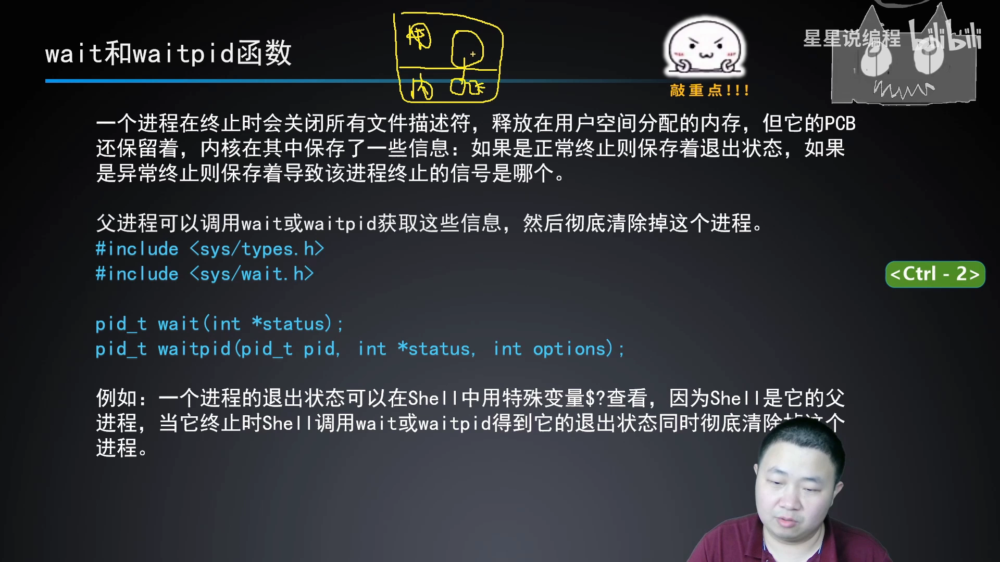
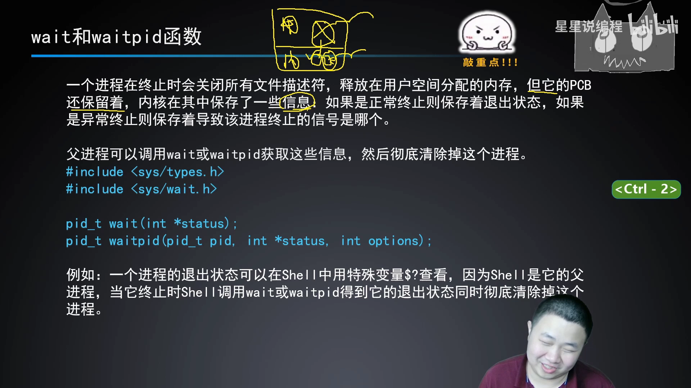
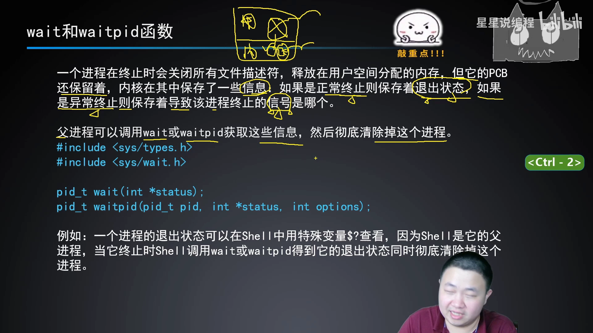
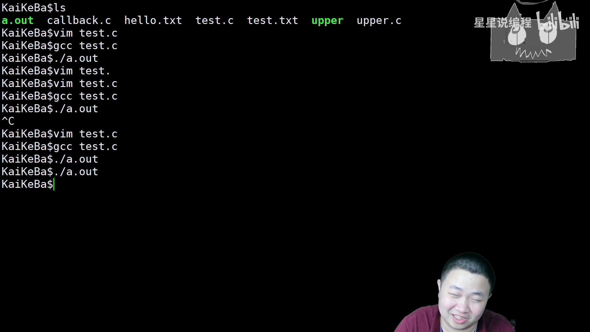
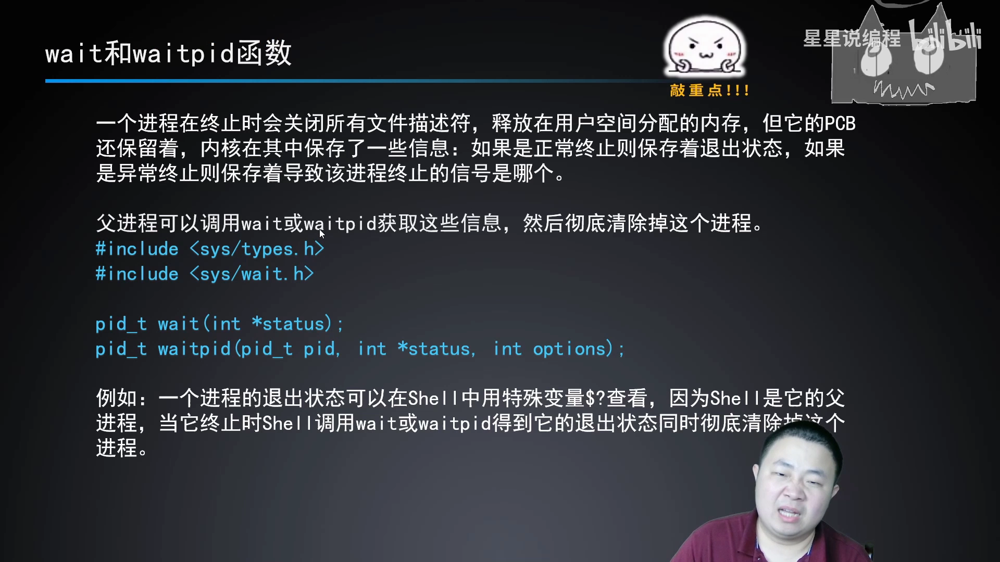
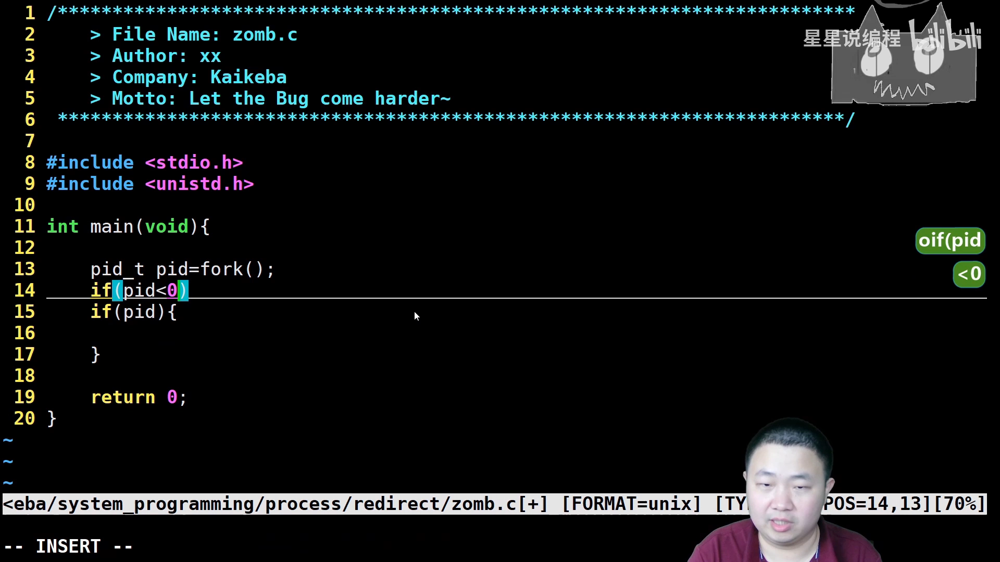
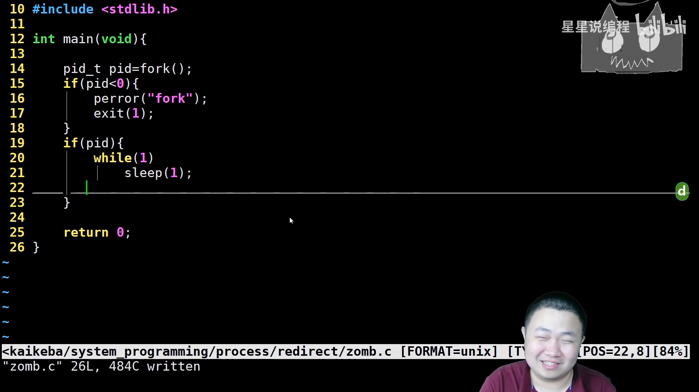
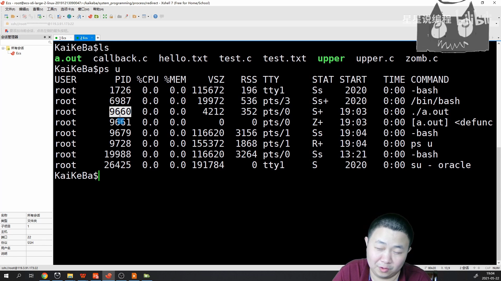
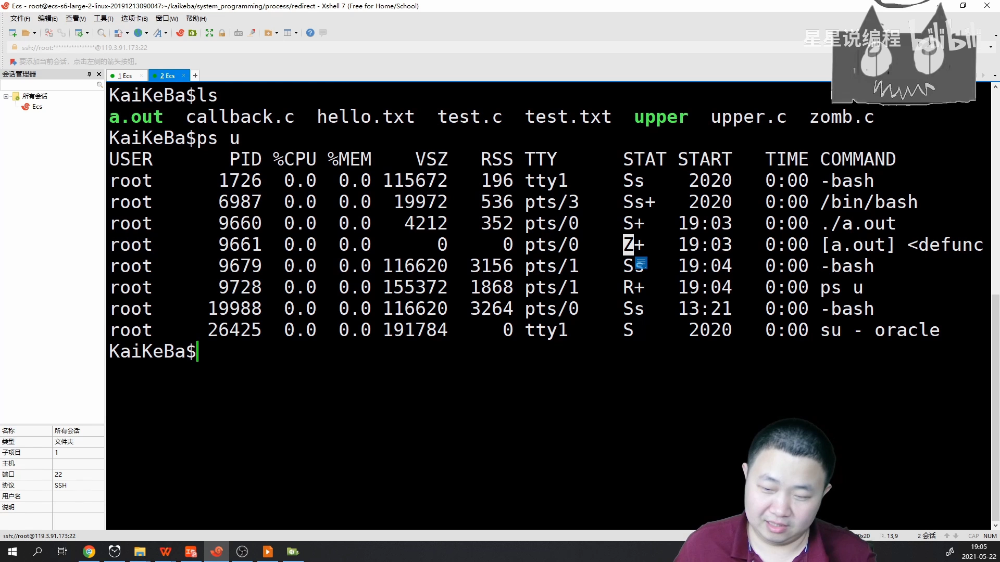

# wait/waitpid 与进程回收：shell 是怎么给程序「收尸」的？

> 视频来源：[7.wait,waitpid概念+孤儿僵尸](https://www.bilibili.com/video/BV13M411g7v2/)（Bilibili，UP 主「星星说编程」）
>
> 本篇基于视频 AI 字幕与画面整理。视频承接「进程终止」的话题：进程死后 PCB（视频里戏称「尸体」）还留在内核，上面记录着退出状态或终止信号；谁去读取、谁去清理？答案是 wait/waitpid——视频用 shell 的 `$?` 和一段「僵尸制造」代码讲清了这件事。

## 本讲要解决的核心问题（SCQA）

**背景**：程序总有终止的一天：要么正常终止（寿终正寝，比如 main 里 return），要么异常终止（被信号「他杀」）。[【跳转到 00:10】](https://www.bilibili.com/video/BV13M411g7v2/?t=10)

**冲突**：进程终止时，用户空间的内存、打开的文件描述符都释放了，但内核里的**进程控制块（PCB）还留着**——上面记录着你「怎么死的」。没人来读取并清理，这份残留就一直占着位置。[【跳转到 00:35】](https://www.bilibili.com/video/BV13M411g7v2/?t=35)

**疑问**：这份「死亡档案」谁来检验？残留的空壳谁来彻底清除？[【跳转到 02:10】](https://www.bilibili.com/video/BV13M411g7v2/?t=130)

**回答（中心思想）**：**父进程调用 wait 或 waitpid：读取子进程 PCB 上残留的退出状态（正常终止）或终止信号（异常终止），然后彻底清除这个进程——先验尸，再火化。shell 之所以能用 `$?` 告诉你上一个命令的退出码，正是因为它在程序终止时替你调用了 wait/waitpid。**[【跳转到 03:30】](https://www.bilibili.com/video/BV13M411g7v2/?t=210)

---

## 一、进程终止时，内核里发生了什么

程序运行起来分两块：上面是**用户空间**，下面是**内核空间**（里面有进程控制块、文件描述符表等信息）。终止的瞬间依次发生：[【跳转到 00:00】](https://www.bilibili.com/video/BV13M411g7v2/?t=0)

1. **关闭所有已打开的文件描述符**——包括标准输出，这一点很重要；
2. **释放用户空间分配的内存**；
3. **PCB 保留**——文件描述符表等也扔掉了，最后只剩进程控制块。视频把它比作「尸体」：上面记录着你的 id 等信息，还有关键的死亡记录。[【跳转到 00:35】](https://www.bilibili.com/video/BV13M411g7v2/?t=60)



尸体上记的是什么？「真相永远只有一个」：

- **正常终止（寿终正寝）**：保存**退出状态**；[【跳转到 02:15】](https://www.bilibili.com/video/BV13M411g7v2/?t=135)
- **异常终止（他杀）**：保存**导致该进程终止的信号**——「犯罪证据」会留下来：你为什么不是寿终正寝，而是异常终止、非自然死亡？[【跳转到 02:40】](https://www.bilibili.com/video/BV13M411g7v2/?t=160) [【跳转到 03:05】](https://www.bilibili.com/video/BV13M411g7v2/?t=185)



## 二、wait/waitpid：先验尸，再火化

父进程可以调用 **wait** 或 **waitpid** 这两个系统调用，去获取这些信息，然后**彻底清除掉这个进程**——检验尸体、读取尸体上的状态，最后把尸体「火化」，之后彻底释放、什么都没了。wait 的作用就是：检查尸体的状况，然后再火化。[【跳转到 03:30】](https://www.bilibili.com/video/BV13M411g7v2/?t=210) [【跳转到 03:55】](https://www.bilibili.com/video/BV13M411g7v2/?t=235)



### 2.1 你天天在用：shell 的 $?

一个进程的退出状态，可以在 shell 中用特殊变量 **`$?`** 查看——它显示上一个程序退出时的状态。为什么 shell 能拿到？因为 **shell 是你的程序的父进程**：程序终止时，shell 会调用 wait/waitpid 得到退出状态，同时彻底清除掉尸体。[【跳转到 04:20】](https://www.bilibili.com/video/BV13M411g7v2/?t=260) [【跳转到 04:45】](https://www.bilibili.com/video/BV13M411g7v2/?t=285)

视频现场验证：写一个 test.c，`return 5`，`gcc test.c` 编译出 a.out，bash 调度它运行——bash 一直在等 a.out「寿终正寝」，等它「狗带」之后验尸、把死亡状态记录在案，最后 `echo $?` 输出 **5**——因为 test.c 里把 5 返回了。（中间还有一段真实事故：老师想演示「睡 5 秒再退出」，把代码写成了死循环，a.out 变成永远睡不醒的「睡美人」——改回 sleep 五秒后一切正常。）[【跳转到 05:30】](https://www.bilibili.com/video/BV13M411g7v2/?t=330) [【跳转到 07:10】](https://www.bilibili.com/video/BV13M411g7v2/?t=430)



由此还反推出 **shell 的一个关键职责**：shell 必须等它的孩子「寿终正寝」再继续——我们自己写 shell 时，非常关键的一点就是等子进程都终止并回收后再退出。这是又一次「摸索出 shell 做的奇怪事情」。[【跳转到 07:35】](https://www.bilibili.com/video/BV13M411g7v2/?t=455) [【跳转到 07:44】](https://www.bilibili.com/video/BV13M411g7v2/?t=464)

### 2.2 函数长什么样

看系统里的函数声明（先引入两个头文件）：wait 的参数比较特别——`int *status`：先定义好一个 int 型变量，把它的**地址**交给 wait；wait 拿到「尸体」后，把读取到的信息写进 status 并返回。就这么点事。[【跳转到 08:14】](https://www.bilibili.com/video/BV13M411g7v2/?t=494)



**waitpid** 更进一步：可以**指定 pid**，等待某个特定的子进程退出；它还有别的参数选项（options），同样把死亡信息记录在 status 里。[【跳转到 08:39】](https://www.bilibili.com/video/BV13M411g7v2/?t=519) [【跳转到 09:04】](https://www.bilibili.com/video/BV13M411g7v2/?t=544)

最后是一个好习惯：**无论寿终正寝还是非自然死亡，在只剩最后一口气之前，记得别忘了 return**——留下一句「死亡信息」，别人通过它才能知道你是咋回事，这才显得专业。[【跳转到 09:26】](https://www.bilibili.com/video/BV13M411g7v2/?t=566) [【跳转到 09:31】](https://www.bilibili.com/video/BV13M411g7v2/?t=571)

---

## 三、动手造一个僵尸进程

知道了「尸体」和「收尸」的机制，就可以故意造一个没人收尸的现场。[【跳转到 09:37】](https://www.bilibili.com/video/BV13M411g7v2/?t=577)

僵尸的条件：**子进程先死 + 父进程不收尸**。zom.c 的配方——父进程永远睡大觉（while(1) + sleep(1)），子进程直接退出：[【跳转到 11:10】](https://www.bilibili.com/video/BV13M411g7v2/?t=670)

```c
pid_t pid = fork();          // 需要 unistd.h
if (pid < 0) {               // fork 出错
    perror("fork");
    exit(1);                 // 需要 stdlib.h
} else if (pid > 0) {        // 父进程：老父亲永久睡去
    while (1) {
        sleep(1);
    }
}
// 子进程：什么都不写，走到结尾正常退出（也可显式 exit(3)）
```

子进程死了，尸体晾在那里；父亲在睡大觉，没人管这个尸体、不收尸——这俩人就这样「尬住」了。[【跳转到 12:44】](https://www.bilibili.com/video/BV13M411g7v2/?t=764) [【跳转到 13:09】](https://www.bilibili.com/video/BV13M411g7v2/?t=789)





运行后程序「卡」在前台（父进程永远不退出），另开一个终端 ps aux 查看：父进程 ./a.out（pid 9660）状态是 **S**（睡眠，还在睡大觉）；它 fork 出来的子进程状态是 **Z**——zombie：儿子已经变成僵尸、冻僵的尸体，而父亲还在睡。[【跳转到 14:35】](https://www.bilibili.com/video/BV13M411g7v2/?t=875) [【跳转到 15:00】](https://www.bilibili.com/video/BV13M411g7v2/?t=900)





视频最后留了一个问题：**如果把这位「睡大觉的父亲」终止掉（Ctrl+C 杀掉前台进程），会发生什么事？** 结合上一支视频的结论可以预告答案：父进程死后，这个僵尸会被 1 号进程 init 托管并回收——这也是生产环境里僵尸进程的应急处理思路；而治本，是让父进程真正调用起 wait/waitpid。[【跳转到 15:50】](https://www.bilibili.com/video/BV13M411g7v2/?t=950)

---

## 小结

- 进程终止：关闭所有文件描述符、释放用户空间内存；PCB 保留，上面记录退出状态（正常终止）或终止信号（异常终止）。
- wait/waitpid：父进程「验尸 + 火化」——读取子进程的死亡信息并彻底清除进程。
- `$?` 之所以能显示退出码，是因为 shell 作为父进程替你 wait 了这个程序；写 shell 也必须等子进程终止并回收。
- wait(int *status) 用地址传出状态；waitpid 还能指定 pid、支持 options。
- 造僵尸 = 子进程先死 + 父进程死循环不收尸；ps aux 里状态 Z 即僵尸。
- 好习惯：进程退出前记得 return，留下退出状态。

## 关键术语速查

| 术语 | 一句话解释 |
| --- | --- |
| PCB | 进程控制块；进程死后唯一残留的内核数据，视频戏称「尸体」 |
| 退出状态 | 正常终止时保存在 PCB 上的返回值，如 return 5 → $? 为 5 |
| 终止信号 | 异常终止时保存在 PCB 上的信号编号，即「死因」 |
| wait | 系统调用：等任意一个子进程终止，读出状态并回收 |
| waitpid | 系统调用：可指定等待某个 pid，支持 options 选项 |
| $? | shell 特殊变量：上一个前台命令的退出状态 |
| Z / zombie | ps aux 中僵尸进程的状态标记 |
