# 进程退出、孤儿进程、僵尸进程：退出之后，谁来收拾残局？

> 视频来源：[2.7 进程退出、孤儿进程、僵尸进程](https://www.bilibili.com/video/BV1vZNdzUEz4/)（Bilibili，UP 主「颯偑」）
>
> 本篇基于视频 AI 字幕与画面整理。视频是 Linux 系统编程的进程控制一讲：先讲进程退出时 exit 与 _exit 的区别，再用两段现场演示分别揭开「孤儿进程」（父进程先死，内核托孤给 init）与「僵尸进程」（父进程不收尸，PCB 残留）的来历、查看方法与危害。

## 本讲要解决的核心问题（SCQA）

**背景**：前面我们已经会了进程的创建——fork 负责复制出一个子进程，exec 函数族负责在子进程里替换成新程序。进程能「生」了，接下来自然要问：进程怎么「死」？[【跳转到 00:05】](https://www.bilibili.com/video/BV1vZNdzUEz4/?t=5)

**冲突**：退出并不是「让程序停下来」这么简单。子进程退出后，它在内核里还留着一份重要资料（PCB）；而且父子进程的死亡顺序会带来完全不同的后果——父进程先死是一种结局，子进程先死、父进程又不管不问是另一种结局。[【跳转到 03:25】](https://www.bilibili.com/video/BV1vZNdzUEz4/?t=205)

**疑问**：进程退出有哪些方式？退出状态传给谁？父进程先死，孩子怎么办？子进程先死、父进程不回收，又会怎样？[【跳转到 03:30】](https://www.bilibili.com/video/BV1vZNdzUEz4/?t=210)

**回答（中心思想）**：**进程退出靠 exit（标准 C 库，退出前会刷新 IO 缓冲、调用退出处理函数）或 _exit（系统调用，直接终止）；退出状态通过参数传给父进程。子进程死后，用户区数据自己释放，内核区的 PCB 必须由父进程回收。父进程先死，内核会把孤儿进程托付给 1 号进程 init 收养、由它负责回收——所以孤儿进程无害；父进程活着却不回收，子进程就变成僵尸进程：kill -9 都杀不掉，还一直占用有限的进程号，危害很大，根治要靠父进程调用 wait/waitpid「收尸」。**[【跳转到 03:30】](https://www.bilibili.com/video/BV1vZNdzUEz4/?t=210)

---

## 一、进程退出：exit 与 _exit 差在「身后事」

### 1.1 两个退出函数：一个标准库，一个系统调用

进程退出相关的两个函数：**exit** 和 **_exit**。exit 声明在标准 C 库的 `stdlib.h` 里；_exit 是 Linux 系统函数，声明在 `unistd.h` 里。[【跳转到 03:40】](https://www.bilibili.com/video/BV1vZNdzUEz4/?t=220)

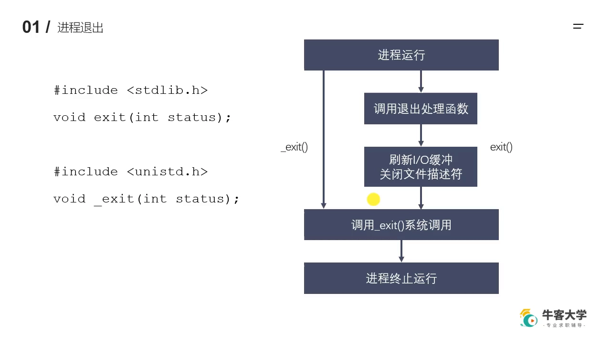

它们都有一个 `int status` 参数——**退出状态**。执行任何一个都能结束进程，而这个状态会传递出去，传给谁？父进程。子进程退出后，父进程就能拿到这个退出状态，用来判断子进程到底是因为什么原因退出的。[【跳转到 04:05】](https://www.bilibili.com/video/BV1vZNdzUEz4/?t=245)

这里还埋了一个本讲的伏笔：子进程结束后，它能释放自己**用户区**的数据，但**内核区**的部分数据（主要是 PCB）自己释放不了，需要父进程来释放——父进程有义务回收子进程的资源。[【跳转到 04:55】](https://www.bilibili.com/video/BV1vZNdzUEz4/?t=295)

### 1.2 exit 比 _exit 多做了几件事

两个函数功能相同，细小却关键的差别是：exit 是标准 C 库函数，在底层调用 _exit 之前，**多做几件事**——调用退出处理函数、**刷新 IO 缓冲**、关闭文件描述符等。[【跳转到 05:45】](https://www.bilibili.com/video/BV1vZNdzUEz4/?t=345)

### 1.3 动手验证：一个 \n 引发的「灵异事件」

视频在 lesson20 里写了一个最小复现程序（第一次还把状态误写成了未定义的 `N` 导致编译报错，改回 0 才过）：[【跳转到 06:37】](https://www.bilibili.com/video/BV1vZNdzUEz4/?t=397)

```c
#include <stdio.h>
#include <stdlib.h>
#include <unistd.h>

int main() {
    printf("hello\n");   // 带 \n：打印后刷新缓冲区
    printf("world");     // 不带 \n：先躺进缓冲区
    exit(0);             // 换成 _exit(0) 再试一次
    return 0;            // 永远执行不到
}
```

先用 `gcc exit.c -o exit` 编译、运行：**hello world 都打印出来了**——hello 后的 `\n` 把缓冲刷了出去；world 虽然没有换行（终端提示符紧贴在它后面），但也显示了出来。[【跳转到 10:08】](https://www.bilibili.com/video/BV1vZNdzUEz4/?t=608)

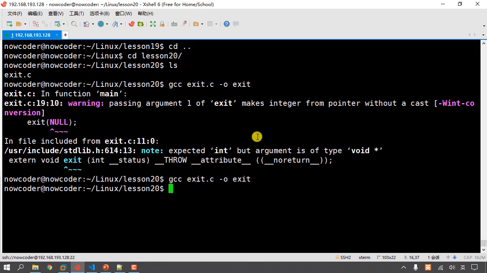

把 exit 注释掉、换成 `_exit(0)`，重新编译运行：**屏幕上只剩 hello，world 不见了**。[【跳转到 10:37】](https://www.bilibili.com/video/BV1vZNdzUEz4/?t=637)

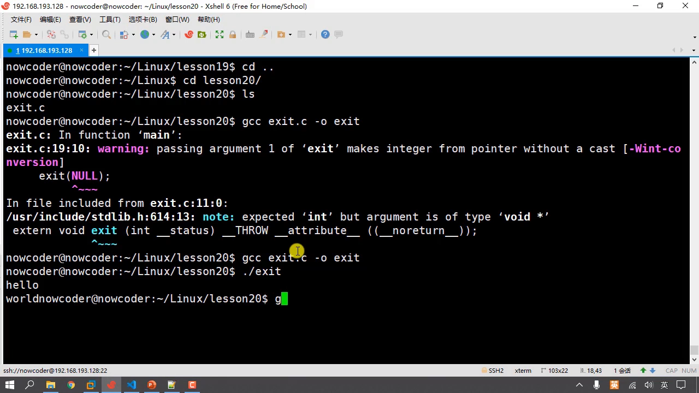

原因：printf 是标准 C 库的 IO 函数，**带缓冲区**，遇到 `\n` 会自动刷新；而 `world` 没有 `\n`，数据先躺进了缓冲区。随后调用的系统调用 `_exit` 不认识缓冲区、不会刷新——程序一结束，缓冲区（在内存里）的数据就没了。[【跳转到 10:49】](https://www.bilibili.com/video/BV1vZNdzUEz4/?t=649) 而 exit 会在调用 _exit 之前刷新 IO 缓冲，所以 world 被刷到了控制台。[【跳转到 11:58】](https://www.bilibili.com/video/BV1vZNdzUEz4/?t=718)

顺带理清一个等价关系：**main 里的 return 0 本质上就是 exit(0)**——main 函数是被系统调用的，return 时把返回值当作退出状态交给 exit；return 1 就相当于 exit(1)。而一旦执行了 exit，后面的 return 0 永远执行不到。[【跳转到 08:46】](https://www.bilibili.com/video/BV1vZNdzUEz4/?t=526) [【跳转到 09:36】](https://www.bilibili.com/video/BV1vZNdzUEz4/?t=576)

什么时候用？程序（比如子进程）判断出现错误需要强制终止，或业务场景需要退出进程时调用 exit；系统调用 _exit 我们很少直接用——标准 C 库的 exit 底层就是调它完成的。[【跳转到 12:28】](https://www.bilibili.com/video/BV1vZNdzUEz4/?t=748) [【跳转到 13:18】](https://www.bilibili.com/video/BV1vZNdzUEz4/?t=798)

---

## 二、孤儿进程：父进程先走一步

### 2.1 定义与「托孤」机制

**孤儿进程：父进程运行结束，但子进程还在运行**——这样的子进程就是孤儿进程。爹死了，它就「孤儿」了。[【跳转到 13:39】](https://www.bilibili.com/video/BV1vZNdzUEz4/?t=819)

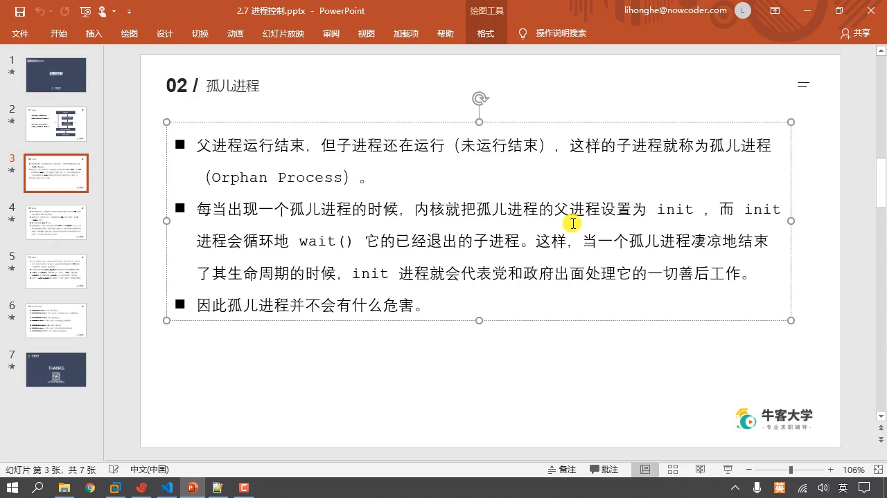

问题来了：子进程死后本该由父进程回收 PCB，可父进程已经死了，没人回收。所以每当出现孤儿进程，**内核会把它的父进程设置为 init（1 号进程）**——Linux 内核启动的第一个（初始化）进程。init 内部会循环调用 wait（等待并回收退出子进程的函数，下一讲展开），于是孤儿进程凄凉地结束生命周期时，init 会「代表党和政府出面」处理一切善后——相当于给它找了个干爹。[【跳转到 14:04】](https://www.bilibili.com/video/BV1vZNdzUEz4/?t=844) [【跳转到 15:44】](https://www.bilibili.com/video/BV1vZNdzUEz4/?t=944)

结论：**孤儿进程没有任何危害**——它最终都会被 init 收养并回收。[【跳转到 16:09】](https://www.bilibili.com/video/BV1vZNdzUEz4/?t=969)

### 2.2 现场演示：让父进程先死

视频基于之前的 fork.c 改出 orphan.c：父子进程各自打印自己的 PID/PPID，然后把 sleep(1) 挪到子进程**打印之前**——这是关键：睡这一秒的时候，父进程早就运行完退出了。[【跳转到 19:30】](https://www.bilibili.com/video/BV1vZNdzUEz4/?t=1170)

先验证基线：orphan 的父进程自己的 PPID 是 2512，用 ps aux 一查，2512 是 pts/1——正是当前这个终端进程。[【跳转到 19:01】](https://www.bilibili.com/video/BV1vZNdzUEz4/?t=1141)

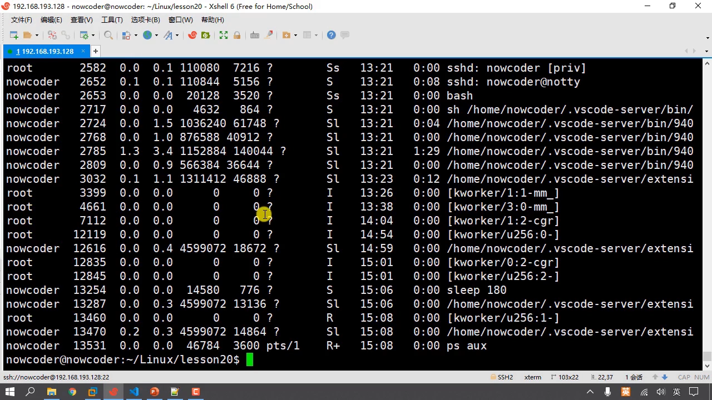

重新编译运行后，子进程那一行输出的 **PPID 变成了 1**——孤儿进程被 1 号进程收养，实锤。[【跳转到 21:38】](https://www.bilibili.com/video/BV1vZNdzUEz4/?t=1298)

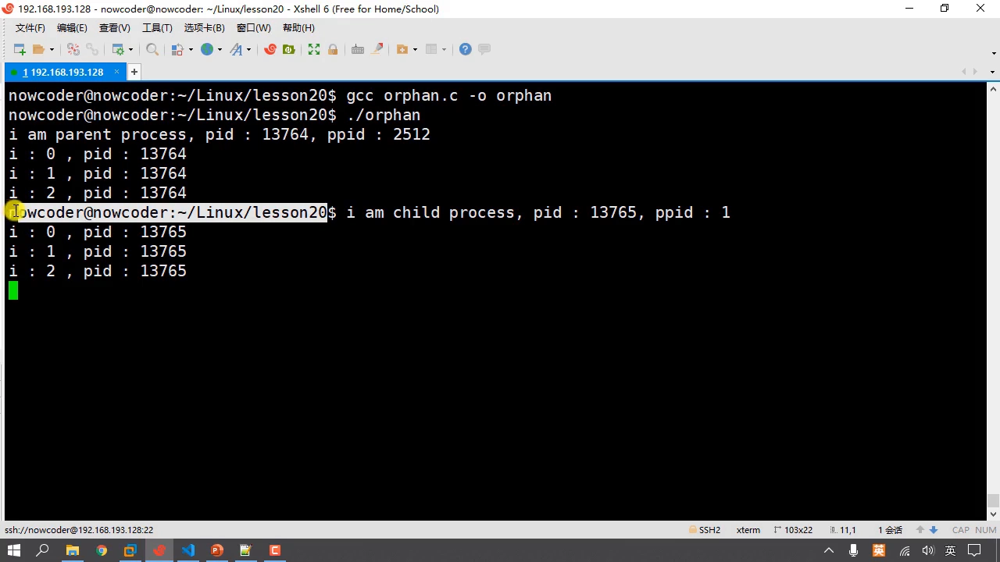

### 2.3 终端里的「小插曲」：前后台切换与 fd 共享

演示中出现了一个奇怪现象：父进程死后终端提示符提前弹出，看起来程序「还在运行」。视频解释：在终端里运行程序时，终端（2512）是它的父进程；程序运行时切到**后台**，终端发现它退出后就把**前台**切回来——但它没想到这个程序还有个子进程没死，子进程照样往终端输出，于是出现了「提示符后面还在打印」的效果。[【跳转到 23:48】](https://www.bilibili.com/video/BV1vZNdzUEz4/?t=1428) [【跳转到 24:57】](https://www.bilibili.com/video/BV1vZNdzUEz4/?t=1497)

而子进程的输出也出现在同一个终端，是因为 fork 之后父子的内核区某些数据是**共享**的——比如文件描述符表：表中 0、1、2 三个 fd 分别是标准输入、标准输出、标准错误，父子共享，自然对应同一个终端。[【跳转到 25:19】](https://www.bilibili.com/video/BV1vZNdzUEz4/?t=1519) [【跳转到 25:44】](https://www.bilibili.com/video/BV1vZNdzUEz4/?t=1544)

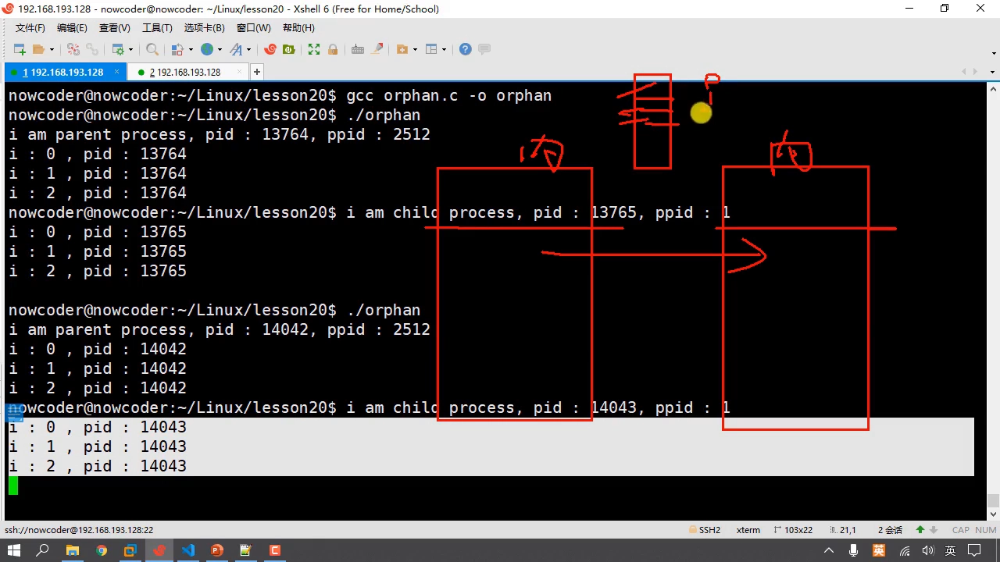

本节要点：孤儿进程是什么、它会被 1 号进程领养并由 1 号进程回收资源、它没有危害——掌握这三点就 OK 了，终端前后台的细节不必过度纠结。[【跳转到 26:15】](https://www.bilibili.com/video/BV1vZNdzUEz4/?t=1575)

---

## 三、僵尸进程：死了，但没人收尸

### 3.1 定义：PCB 残留

每个进程结束之后，都会释放自己地址空间中**用户区**的数据；**内核区**的 PCB 自己释放不了，需要父进程释放。如果进程终止时父进程尚未回收，子进程残留的资源（主要指 PCB 中的数据）就存放在内核中——这就是僵尸进程，英文叫 **zombie**。[【跳转到 27:40】](https://www.bilibili.com/video/BV1vZNdzUEz4/?t=1660)

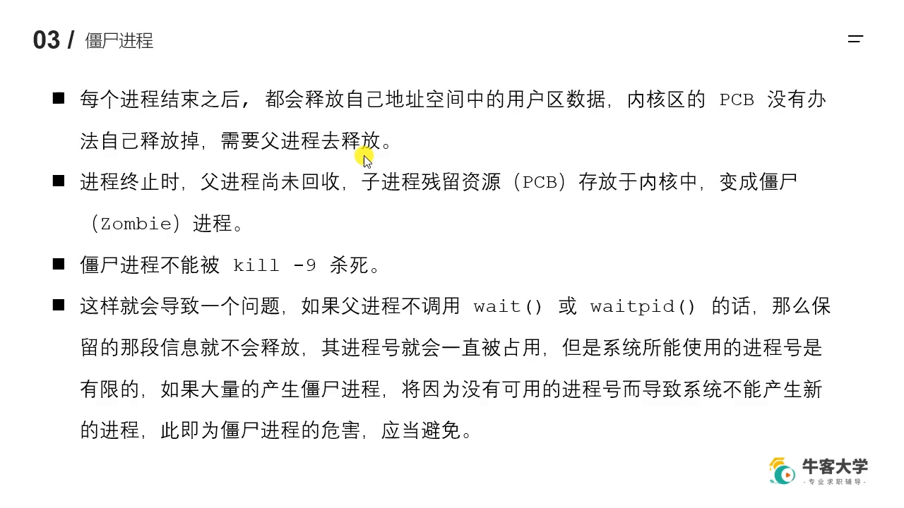

### 3.2 危害：占着进程号不走

僵尸进程**不能被 kill -9 杀死**——因为它已经不是一个正常的进程，没有实体可杀。[【跳转到 28:05】](https://www.bilibili.com/video/BV1vZNdzUEz4/?t=1685)

残留的信息描述了子进程：进程 id、父进程 id 等等。不释放，这个进程号就一直被占用；而系统能使用的进程号是有限的。如果父进程创建了很多子进程都不回收，就会产生大量僵尸进程，占满进程号，导致内核无法为新进程分配进程号、系统不能产生新进程——这就是僵尸进程的危害。[【跳转到 28:55】](https://www.bilibili.com/video/BV1vZNdzUEz4/?t=1735) [【跳转到 29:20】](https://www.bilibili.com/video/BV1vZNdzUEz4/?t=1760)

### 3.3 现场演示：亲手造一个僵尸

zombie.c 的配方：让**父进程一直循环打印**（它活着、不调用 wait/waitpid），子进程打印一句话就退出。[【跳转到 30:35】](https://www.bilibili.com/video/BV1vZNdzUEz4/?t=1835)

gcc 编译运行，换一个终端 ps aux 一查：父进程 14859 在循环打印；它的子进程 14860 状态是 **Z**，命令名后面还挂着 **defunct**（「已消亡的」）——Z 就是 zombie，僵尸进程坐实了。[【跳转到 32:25】](https://www.bilibili.com/video/BV1vZNdzUEz4/?t=1945)

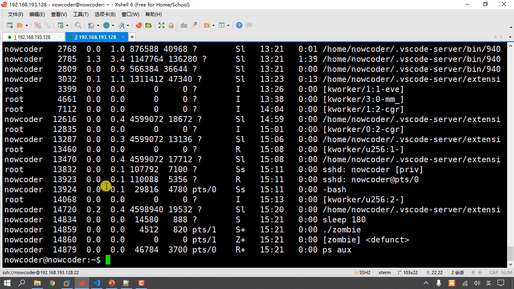

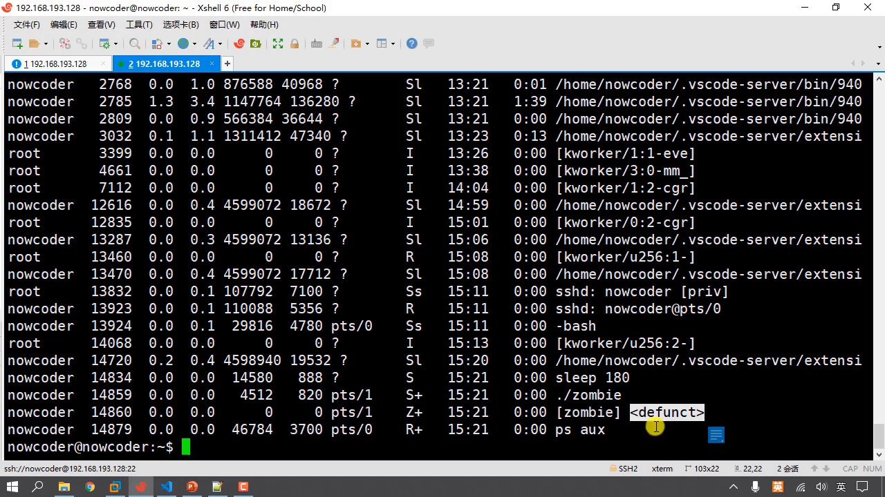

### 3.4 怎么处理？先应急，再治本

视频先演示了应急方案：对僵尸进程执行 `kill -9 14860`，再 ps aux 一看——**还在**。僵尸进程不是正常进程，kill -9 没有办法把它销毁。[【跳转到 35:19】](https://www.bilibili.com/video/BV1vZNdzUEz4/?t=2119)

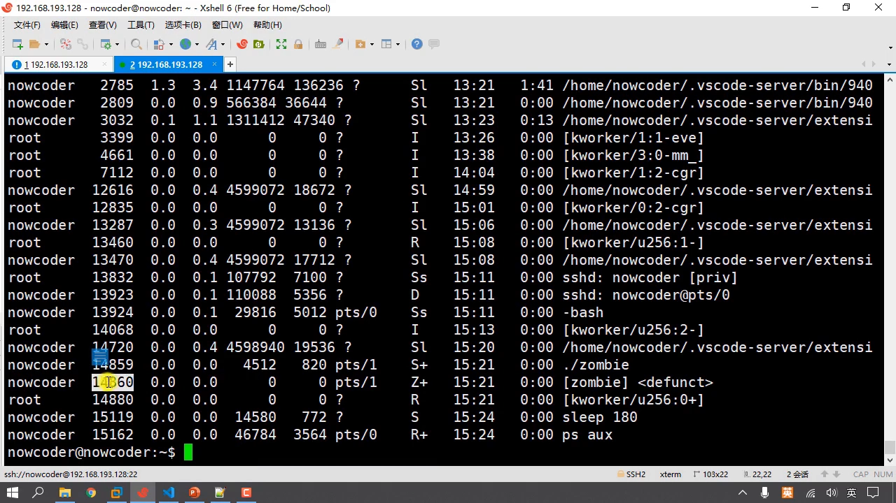

那就**把不负责任的父进程终止掉**（Ctrl+C——其实 Ctrl+C 也是给进程发一个终止信号，信号后面会学）：父进程一死，僵尸进程立刻消失——它被 1 号进程托管回收了，和孤儿进程是同一套机制。[【跳转到 35:49】](https://www.bilibili.com/video/BV1vZNdzUEz4/?t=2149) [【跳转到 36:11】](https://www.bilibili.com/video/BV1vZNdzUEz4/?t=2171)

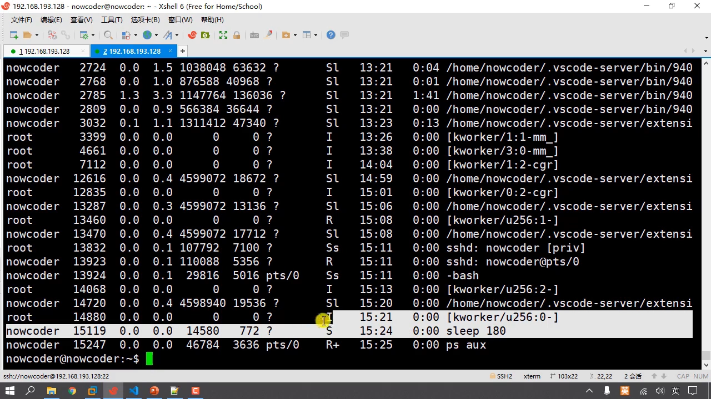

但真实企业环境里程序早就在跑，不可能 Ctrl+C 一杀了之。治本方法是在**父进程当中通过 wait 函数、waitpid 函数对子进程的数据（内核区数据）进行释放**——这正是下一讲的主题。[【跳转到 36:40】](https://www.bilibili.com/video/BV1vZNdzUEz4/?t=2200)

---

## 小结

- 进程退出：exit（标准 C 库，退出前刷新 IO 缓冲、调用退出处理函数、关闭文件描述符）与 _exit（系统调用，直接终止）；main 里 return N 等价于 exit(N)。
- 退出状态通过 status 参数传给父进程；子进程能自己释放用户区数据，内核区 PCB 必须由父进程回收。
- 孤儿进程：父进程先死，内核把它托孤给 init（PID 1），由 init 循环 wait 回收——**无害**。
- 僵尸进程：子进程先死而父进程不回收，PCB 残留、进程号被占；kill -9 杀不掉；大量僵尸会耗尽进程号，导致系统无法创建新进程。
- 应急：杀掉不负责任的父进程，僵尸被 init 收养后消失；治本：父进程调用 wait/waitpid。

## 关键术语速查

| 术语 | 一句话解释 |
| --- | --- |
| exit / _exit | 退出进程的两个函数：前者标准 C 库（会刷新 IO 缓冲、调用退出处理函数），后者系统调用、直接终止 |
| 退出状态 | exit(status) / return N 传出的 int 值，父进程回收时可读取，用于判断退出原因 |
| PCB | 进程控制块，内核中记录进程信息的结构；进程死后用户区可自释放，PCB 需父进程回收 |
| 孤儿进程 | 父进程先结束、子进程还在运行；被内核托孤给 init（PID 1），无危害 |
| init | 1 号进程，Linux 内核启动的第一个进程，循环 wait 回收退出的子进程 |
| 僵尸进程 | 子进程已终止但父进程未回收，残留 PCB 的状态（Z / defunct）；kill -9 无效 |
| defunct | ps 中僵尸进程的标记词，意为「已消亡的」 |
| wait / waitpid | 父进程回收子进程资源的两个系统调用（下一讲展开） |
