# 操作系统（九）：Linux 系统调用是如何实现的 —— 从 int 0x80 到 syscall 指令

> 视频来源：[操作系统（九）：Linux 系统调用是如何实现的（B站）](https://www.bilibili.com/video/BV1TX4y1p7pc)，时长 18:52。本文基于视频演说图文稿整理，关键知识点附时间戳跳转链接。

## 本讲要解决的核心问题（SCQA）

**背景**：应用程序不能直接碰硬件，需要内核提供服务——`printf` 底层要调 `write`，读写文件要 `open`/`read`。

**冲突**：系统提供的系统调用有几百个，0x80 中断的服务程序怎么知道你调的是哪一个？参数和返回值又怎么穿过用户态/内核态这条边界？

**疑问**：一次 `write` 调用，究竟怎么一步步走进内核里的 `sys_write`，再把结果带回来？

**回答（中心思想）**：一条清晰的接力路线——**用户态三步**（参数装进 6 个通用寄存器、调用号装进 EAX、`int 0x80` 陷入）+ **内核态四步**（把用户态寄存器存进 `pt_regs`、按调用号查系统调用表、执行 `sys_xxx`、`iret` 恢复现场返回）；64 位则把中断换成 **`syscall`/`sysret` 指令**，入口地址放在 **MSR** 寄存器里。

## 一、入口：write 里的 enter_kernel 与 int 0x80

视频以 **32 位操作系统**为例讲解系统调用过程：从用户态进内核态靠的是 **0x80 中断**。那程序怎么"陷入"进去呢？[【跳转到 00:00】](https://www.bilibili.com/video/BV1TX4y1p7pc/?t=0)

当 `main` 函数调用 `write`、即将进入内核态执行时，`write` 函数（库函数封装）里会执行一条指令，视频里称之为 **enter_kernel**（进入内核）——它相当于执行 **`int 0x80`**。`int` 是 interrupt 的缩写，就是"产生一个中断"的指令；这个中断的中断号是 **0x80**，对应十进制 **128**。[【跳转到 00:40】](https://www.bilibili.com/video/BV1TX4y1p7pc/?t=40)

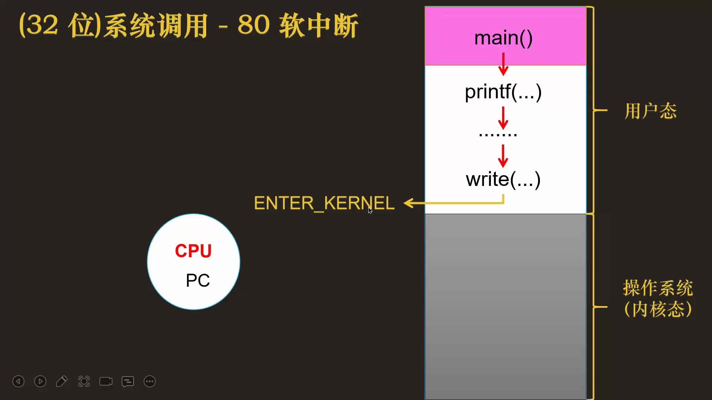

## 二、中断向量表：0x80 号中断的落点

产生了 0x80 中断，CPU 就知道了：它放下手头的工作，去查**中断向量表**，找到 128 号中断对应的中断服务程序内存地址——示例里是 `0x003498`。于是程序计数器（PC）跳到这个地址，开始执行**系统调用的中断服务程序**。[【跳转到 01:22】](https://www.bilibili.com/video/BV1TX4y1p7pc/?t=82)

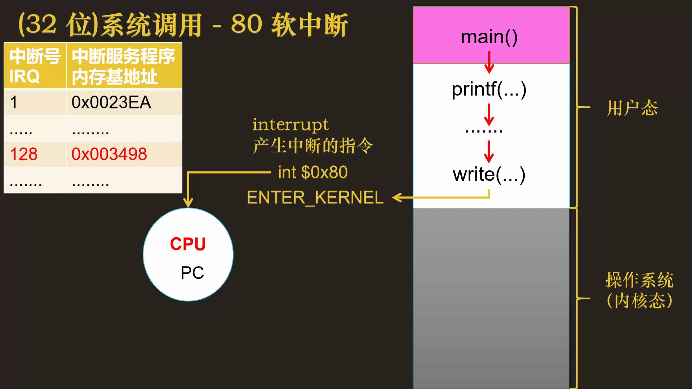

这个系统调用中断服务程序，在 Linux 源码里的名字叫 **entry_INT80_32**（32 位）。

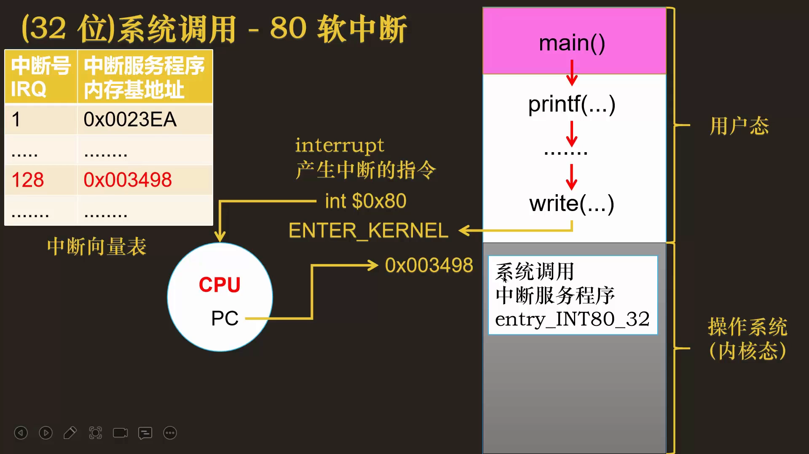

## 三、系统调用号与系统调用表

操作系统给应用程序提供的接口方法非常多：`open`、`fork`、`write`、`read`……刚才 `printf` 调用的就是 `write`。[【跳转到 01:47】](https://www.bilibili.com/video/BV1TX4y1p7pc/?t=107)

问题来了：中断服务程序怎么知道你调用的是哪一个系统调用？你用户态里的 `write`，怎么对应到内核态里的 `write` 实现？[【跳转到 02:37】](https://www.bilibili.com/video/BV1TX4y1p7pc/?t=157)

操作系统的办法是给**每个系统调用方法打上一个序号标识**，这就是**系统调用号**——每个系统调用都有唯一的编号。所有编号和实现组成一张**系统调用表**，在操作系统初始化启动时就维护好。表里有两栏：[【跳转到 03:02】](https://www.bilibili.com/video/BV1TX4y1p7pc/?t=182)

1. **系统调用号**；
2. 该系统调用在操作系统中的**实现函数**——一般以 `sys_` 开头，比如 `sys_open`、`sys_write`。

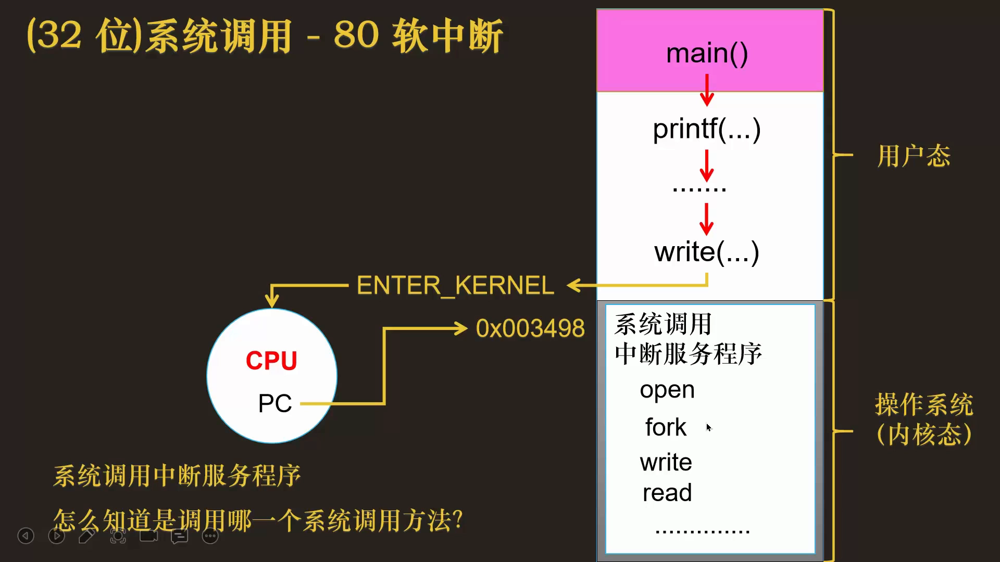

视频以"1 号对应 open，实现函数是 sys_open"举例：应用程序只要告诉我你是几号系统调用，我就知道该执行哪个实现函数。[【跳转到 03:52】](https://www.bilibili.com/video/BV1TX4y1p7pc/?t=232)

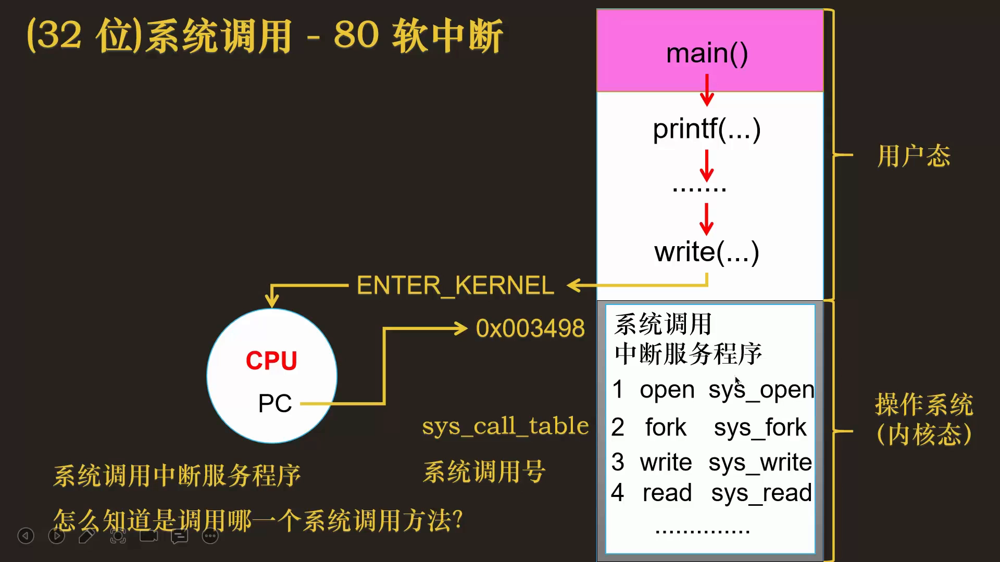

> **编号更正**：讲者口述的示例编号（如"1 号是 open""write 为 3 号"）是教学示意。按真实 Linux 系统调用表核对：**x86-32** 中 1=exit、2=fork、3=read、4=write、5=open；**x86-64** 中 read=0、write=1、open=2。编号会随内核版本与体系结构变化，机制本身不受影响。

## 四、调用号怎么传：glibc 映射与 EAX

系统调用号怎么从用户态传给内核态？答案：**通过 CPU 的寄存器**。[【跳转到 04:37】](https://www.bilibili.com/video/BV1TX4y1p7pc/?t=277)

用户态运行到即将进入内核态时，先根据系统调用的**方法名**拿到对应的调用号——"方法名 → 调用号"的映射关系由 **glibc** 这个 C 库里的文件维护。进入内核之前，就把调用号放进名为 **EAX** 的寄存器。比如视频示例中 `write` 对应 3 号，EAX 里就存着 3；等通过中断进入内核态、PC 指向内核指令时，内核从 EAX 里读出调用号，就知道你调的是 `write`，直接执行 `sys_write` 即可。[【跳转到 05:07】](https://www.bilibili.com/video/BV1TX4y1p7pc/?t=307)

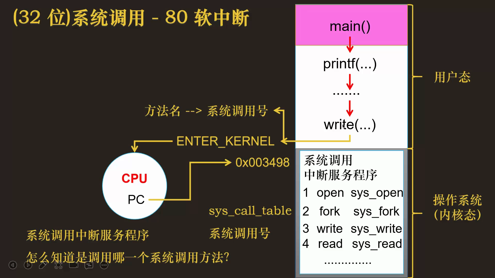

## 五、参数怎么传：六个寄存器，用户态共三步

函数都有参数，参数怎么传给内核态？同样**通过寄存器**：最多 **6 个**，分别放进 **EBX、ECX、EDX、ESI、EDI、EBP** 六个寄存器。[【跳转到 06:47】](https://www.bilibili.com/video/BV1TX4y1p7pc/?t=407)

于是，**用户态在发起系统调用前要做三件事**：[【跳转到 07:12】](https://www.bilibili.com/video/BV1TX4y1p7pc/?t=432)

1. 把**参数**保存到一组通用寄存器（EBX~EBP 六个）；
2. 根据**方法名**查出**系统调用号**，存进 **EAX**；
3. 通过**中断**（int 0x80）进入内核。

## 六、内核态四步：pt_regs、查表、执行、iret

进入内核态后做四件事：[【跳转到 07:37】](https://www.bilibili.com/video/BV1TX4y1p7pc/?t=457)

**第 1 步：保存用户态寄存器到 pt_regs。** 把用户态所有寄存器的值存进内核里一个叫 **pt_regs** 的数据结构——包括参数、`esp`（用户态函数调用栈的栈顶）、`eip`（程序计数器）、CPU 标志寄存器等。为什么保存？一是**传递参数**，二是系统调用结束后要靠这些值**回到用户态原来的位置**。[【跳转到 08:02】](https://www.bilibili.com/video/BV1TX4y1p7pc/?t=482)

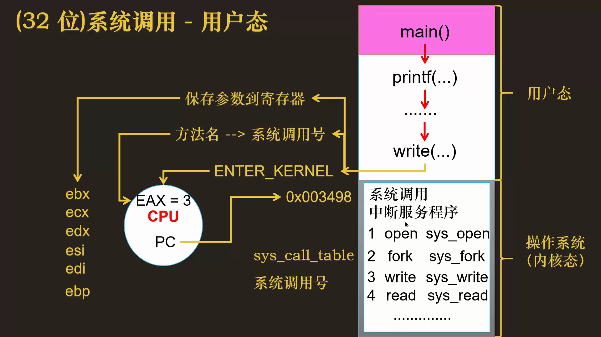

**第 2 步：按调用号查系统调用表。** 注意调用号（EAX 的值）也保存在 pt_regs 的 `ax` 位置上；从 EAX 读出 3，在系统调用表里找到实现函数 `sys_write`。[【跳转到 08:52】](https://www.bilibili.com/video/BV1TX4y1p7pc/?t=532)

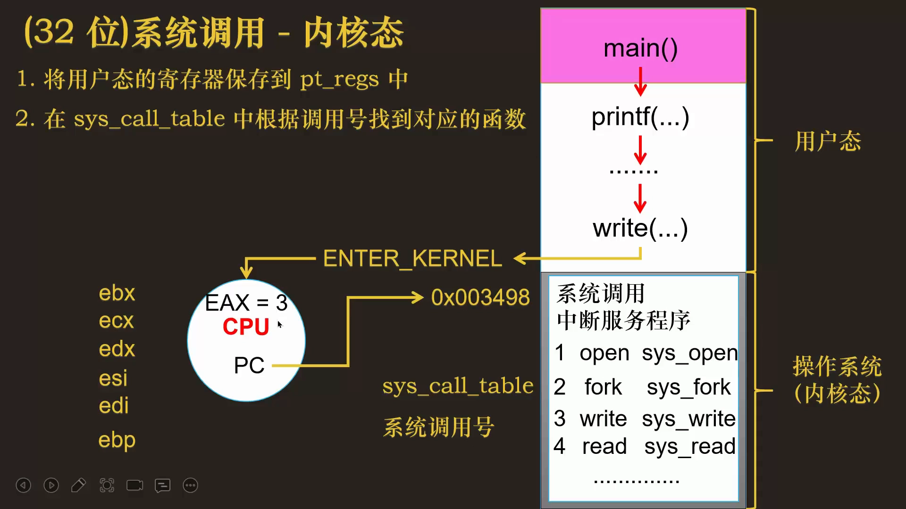

**第 3 步：执行 sys_write。** 执行需要的参数直接从 **pt_regs** 里取（EBX~EBP 就是第一步存进来的）。

**第 4 步：返回。** 执行完的返回值写进 **pt_regs 的 ax** 位置；然后执行 **`iret`** 指令，按 pt_regs 里保存的寄存器值**恢复用户态现场**，重新回到用户态执行。

## 七、一张图总览 32 位系统调用全流程

把上面的过程连起来：应用程序调用 `printf` → 它需要内核执行 `write`。[【跳转到 09:56】](https://www.bilibili.com/video/BV1TX4y1p7pc/?t=596)

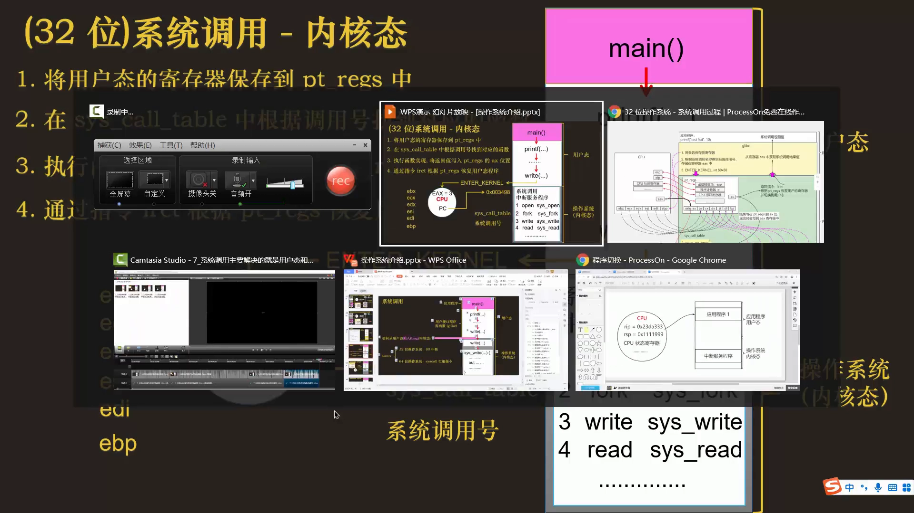

**用户态（glibc）三步**：

1. 参数 → EBX、ECX、EDX、ESI、EDI、EBP（最多 6 个）；
2. 方法名 →（glibc 映射）→ 调用号 → EAX；
3. 执行 int 0x80 陷入内核。

**内核态四步**：

1. 用户态寄存器（参数、esp、eip、eflags……）→ 保存进 **pt_regs**；
2. 从 EAX（pt_regs 的 ax）取调用号 → 查系统调用表 → 找到 `sys_write`；
3. 执行 `sys_write`（参数从 pt_regs 取）→ 返回值写入 pt_regs 的 `ax`；
4. **`iret`** 依据 pt_regs 恢复用户态寄存器，EIP 指向用户态下一条指令，切换回用户态。[【跳转到 13:37】](https://www.bilibili.com/video/BV1TX4y1p7pc/?t=817)

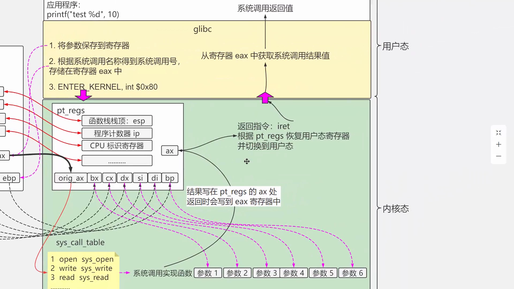

回到用户态后，程序从 EAX 里拿到系统调用的返回值——内核把 pt_regs 里的值恢复到 CPU 时，结果的值就写进了 EAX。整个流程总结成一句话：**用户态三步，内核态四步**。[【跳转到 14:47】](https://www.bilibili.com/video/BV1TX4y1p7pc/?t=887)

## 八、64 位的三个不同

64 位系统的系统调用过程和 32 位**一模一样**，只有三个细节不同：[【跳转到 14:59】](https://www.bilibili.com/video/BV1TX4y1p7pc/?t=899)

1. **寄存器名字不同**：32 位以 E 开头（esp、eip），64 位以 R 开头（RSP、RIP）；保存参数的寄存器也换成 **RDI、RSI、RDX、R10、R8、R9**，pt_regs 里对应的变量名随之变化；[【跳转到 15:24】](https://www.bilibili.com/video/BV1TX4y1p7pc/?t=924)
2. **进入内核态的方式不同**：不再走 0x80 中断，而是直接执行机器指令 **`syscall`** 进入内核——和中断没有任何关系；
3. **回到用户态的指令不同**：从内核态退出用的是 **`sysret`**。

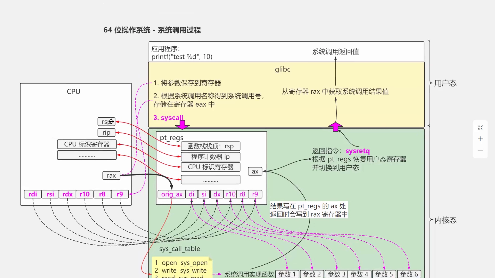

## 九、syscall 指令的底层机制：MSR

`syscall` 这条指令是怎么从用户态进入内核态的？靠 CPU 里的一类**特殊模块寄存器**——**MSR（Model Specific Registers）**。它是为完成某些特殊控制功能而存在的寄存器，系统调用正属于这类特殊功能。[【跳转到 16:44】](https://www.bilibili.com/video/BV1TX4y1p7pc/?t=1004)

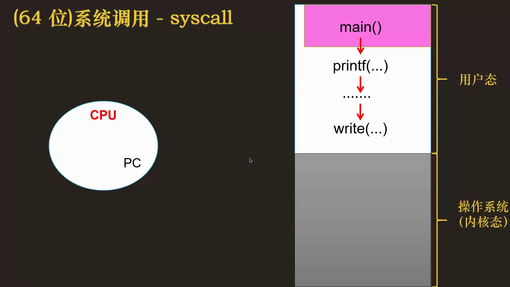

**操作系统启动初始化时**，往 MSR 里写入一个内存地址——它就是**系统调用服务程序的入口地址**。[【跳转到 17:34】](https://www.bilibili.com/video/BV1TX4y1p7pc/?t=1054)

之后当程序执行 `syscall` 指令时，CPU 解析这条指令，会从 MSR 里把系统调用服务程序的内存基地址读出来，**直接赋值给 PC**——这样就跳到系统调用服务程序的第一条指令开始执行了。在 64 位 Linux 里，这个服务程序的名字叫 **entry_SYSCALL_64**。[【跳转到 17:59】](https://www.bilibili.com/video/BV1TX4y1p7pc/?t=1079)

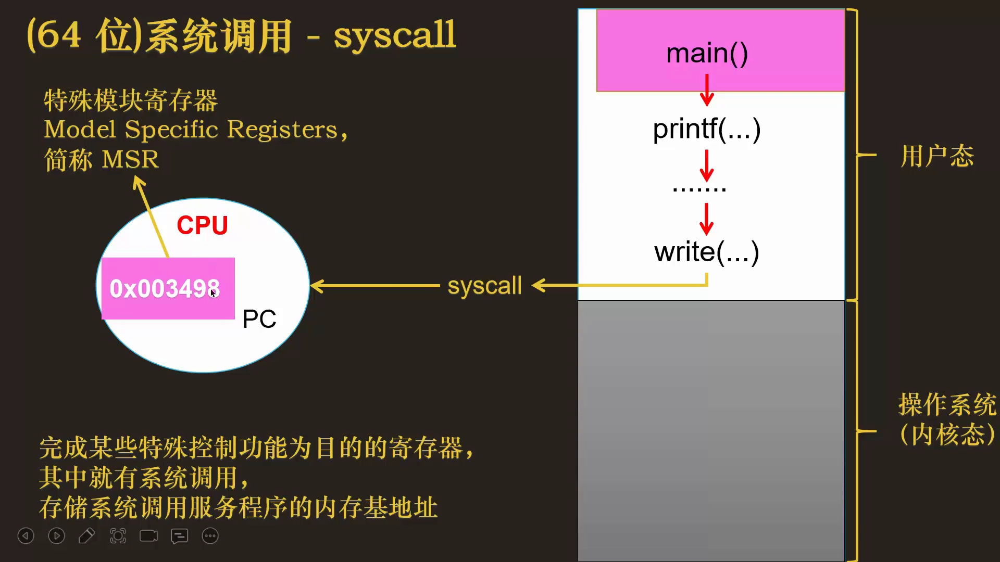

## 小结

- 32 位系统调用的入口是 **int 0x80**（128 号中断）：查**中断向量表**跳到 `entry_INT80_32`；
- 内核用**系统调用号**区分几百个系统调用，"调用号 → `sys_xxx` 实现函数"组成**系统调用表**，初始化时建好；
- **用户态三步**：参数进 6 个寄存器（EBX/ECX/EDX/ESI/EDI/EBP）、调用号进 EAX（映射由 glibc 维护）、int 0x80 陷入；
- **内核态四步**：存 `pt_regs` → 按号查表 → 执行 `sys_xxx` → 返回值写入 pt_regs 的 ax，`iret` 恢复现场回到用户态，结果经 EAX 带回；
- 64 位流程不变，三点不同：寄存器 E→R（参数用 RDI/RSI/RDX/R10/R8/R9）、进入内核改用 **`syscall`** 指令、返回改用 **`sysret`**；
- `syscall` 的落点由 **MSR** 决定：内核初始化时把 `entry_SYSCALL_64` 的地址写进 MSR，CPU 执行 syscall 时读出地址直接赋给 PC。

## 关键术语速查

| 术语 | 一句话解释 |
| --- | --- |
| int 0x80 | 32 位 Linux 陷入内核的软中断指令，中断号 0x80 = 128 |
| 中断向量表 | 中断号 → 服务程序入口地址的表，落点由操作系统事先填好 |
| entry_INT80_32 | Linux 源码中 0x80 中断服务程序的名字（32 位） |
| 系统调用号 | 每个系统调用的唯一编号，是查表的钥匙 |
| 系统调用表 | 调用号 → `sys_` 开头实现函数 的映射表，内核初始化时建立 |
| glibc | C 标准库，维护"方法名 → 系统调用号"的映射 |
| EAX | 32 位下传递系统调用号的寄存器 |
| EBX~EBP | 32 位下传递参数的六个寄存器（最多 6 个参数） |
| pt_regs | 内核保存用户态寄存器现场（参数、esp、eip、eflags 等）的数据结构 |
| iret | 32 位从内核返回用户态的指令，按 pt_regs 恢复现场 |
| syscall / sysret | 64 位进入/退出内核态的专用机器指令，与中断无关 |
| MSR（Model Specific Registers） | 特殊模块寄存器，内核初始化时写入系统调用入口地址 |
| entry_SYSCALL_64 | 64 位系统调用服务程序的入口（地址存于 MSR） |
