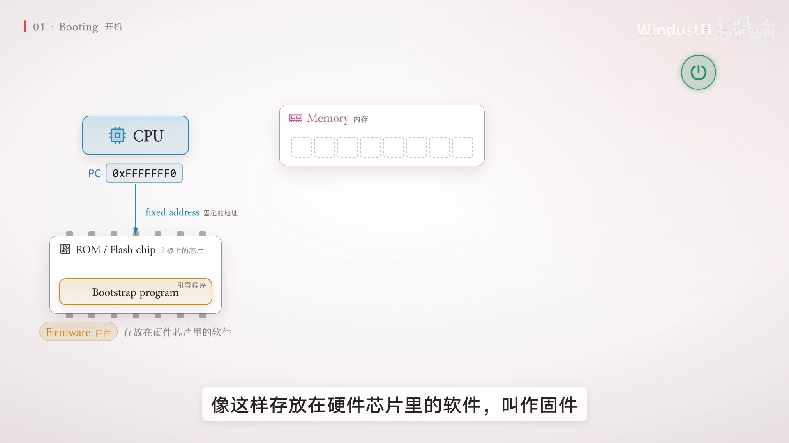
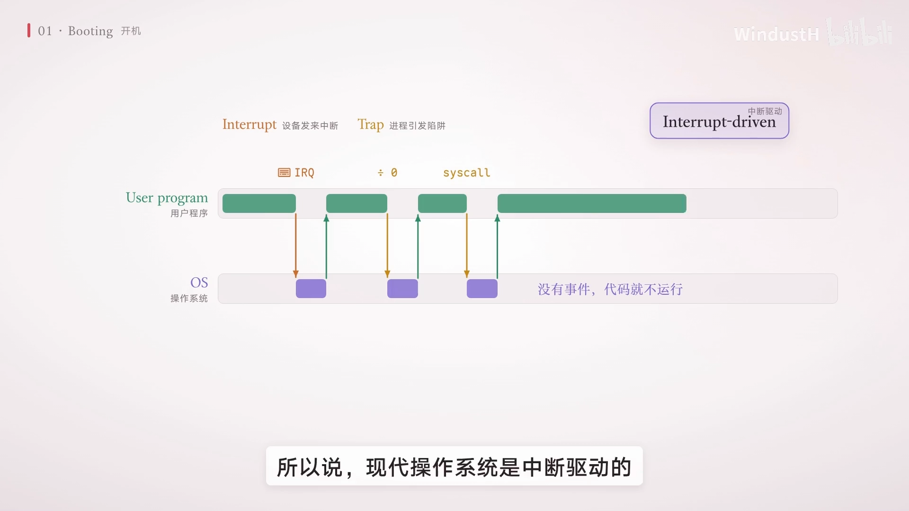
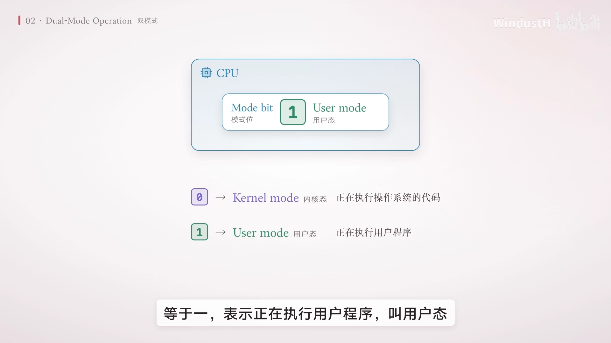
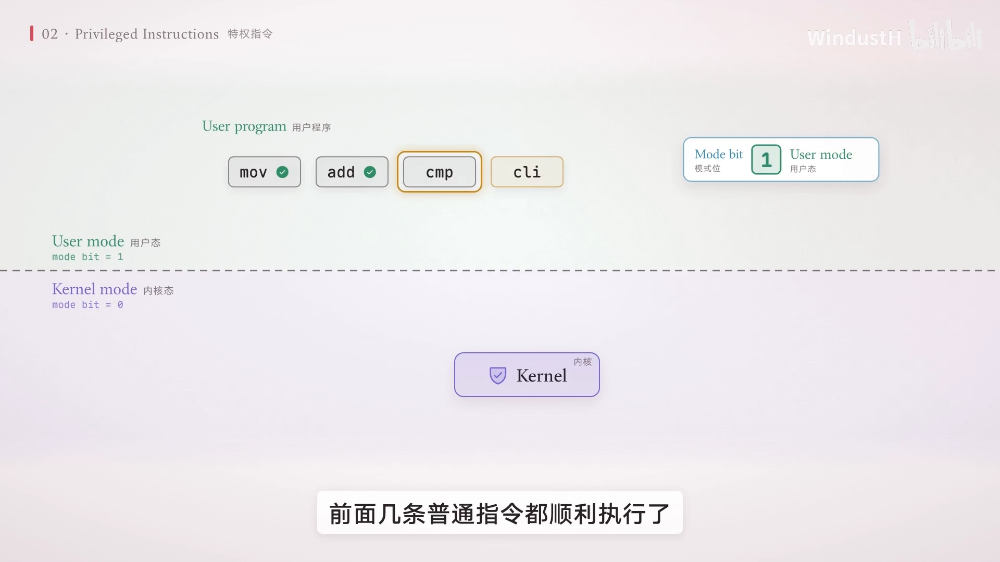
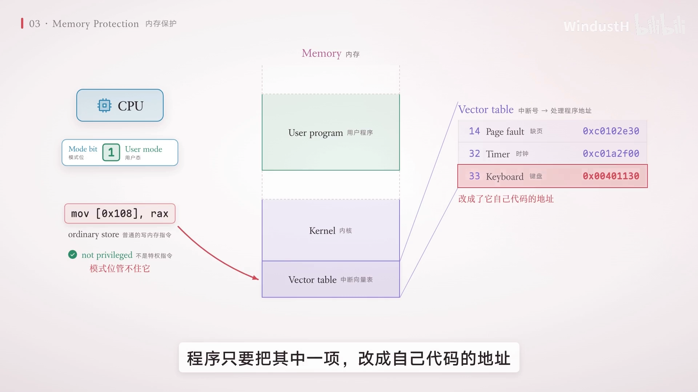
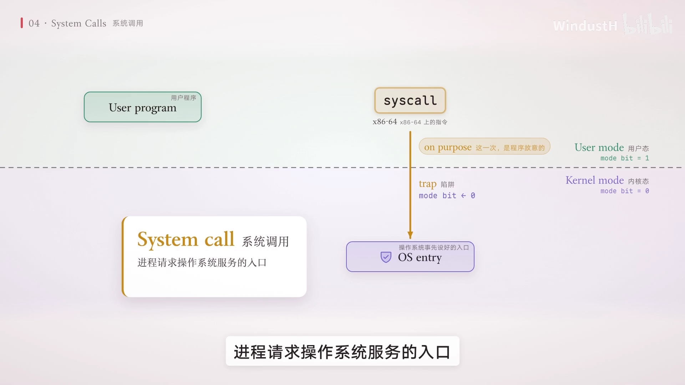
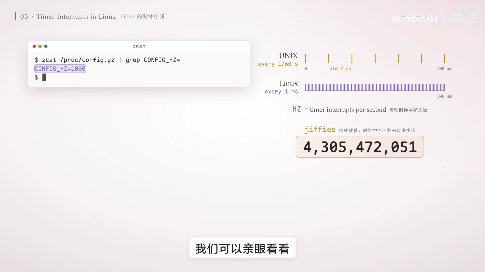
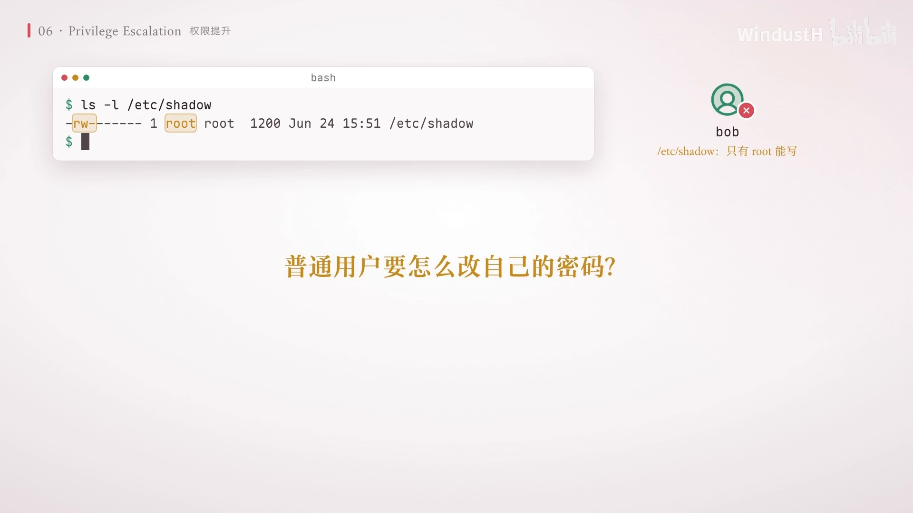

# 操作系统 Ep.03：用户态和内核态 —— CPU 如何替操作系统看住程序

> 视频来源：[『操作系统 Ep.03』用户态和内核态（B站）](https://www.bilibili.com/video/BV1ELJv6UErV/)，时长 14:57。本文基于视频演说图文稿整理，关键知识点附时间戳跳转链接。

## 本讲要解决的核心问题（SCQA）

**背景**：操作系统和所有用户程序共用同一颗 CPU，一个核一次只能执行一条指令。

**冲突**：一个 `while(1)` 死循环不发起系统调用、不出错、也没有中断到来，操作系统凭什么把 CPU 抢回来？更糟的是，闹事的程序还能执行关中断、停机、直写硬盘这类指令——在早年的 MS-DOS 上，中招之后只能重启机器。

**疑问**：操作系统到底靠什么机制管住用户程序，同时还能安全地为它提供服务？

**回答（中心思想）**：靠 CPU 硬件的三道防线——**双模式**（模式位 + 特权指令）、**内存保护**、**定时器时钟中断**；再开一扇受控的大门——**系统调用**，让用户程序只能通过它请求内核服务。

## 一、从一个死循环说起

先看一个 C 程序：`while(1)`，它不做 I/O，只是默默循环。[【跳转到 00:00】](https://www.bilibili.com/video/BV1ELJv6UErV/?t=0)

- 把它放到**早年的 MS-DOS** 上运行，它占住 CPU 不放，你可能就不得不重启电脑；
- 放到**今天的 Linux** 上，一按 Ctrl-C 它立刻终止。就算多开几份把每个核都占满，鼠标照样能动、音乐照样在放。

要知道一个 CPU 核一次只能执行一条指令，当死循环占着这个核时，操作系统是怎么夺回控制权的？这个问题贯穿全片，答案要等到第七节的"时钟中断"才揭晓。

## 二、没有限制的 CPU：程序能让操作系统彻底失能

### 2.1 开机：操作系统是怎么拿到控制权的

按下电源键时内存里什么都没有，CPU 一通电就从一个**固定地址**开始取指令，主板保证这个地址对应主板上一块 ROM/闪存芯片，里面存着**引导程序**——这种烧在硬件芯片里的软件叫**固件**。[【跳转到 00:55】](https://www.bilibili.com/video/BV1ELJv6UErV/?t=55)

引导程序先把整台机器初始化一遍（CPU 寄存器、设备控制器、内存），然后从硬盘找到操作系统内核读进内存，跳到内核第一条指令。今天的电脑上，固件一般先加载引导加载程序（如 **GRUB**），再由它加载内核。内核接手后先自我初始化，再启动第一个进程——现在常见的 Linux 发行版是 **systemd**，进程号 1，它再拉起管网络、日志、登录的一批守护进程。

### 2.2 中断驱动的操作系统

开机完成后，操作系统就**等待各种事件**：设备发来的**中断**，或正在运行的进程引发的 **trap**（比如除以零，或请求操作系统服务）。所以说现代操作系统是**中断驱动**的：没有事件，它的代码就一直不运行。[【跳转到 01:20】](https://www.bilibili.com/video/BV1ELJv6UErV/?t=80)

### 2.3 两个事件之间，CPU 完全握在用户程序手里

想象一个**没有任何限制**的 CPU：操作系统能执行的指令，用户程序也都能执行。这时来了一个有 bug 或存心捣乱的程序，它可以：[【跳转到 01:45】](https://www.bilibili.com/video/BV1ELJv6UErV/?t=105)

1. 执行**关中断**指令——从此设备中断一概不理，操作系统再也等不到事件，彻底失去控制；
2. 执行**停机**指令——让 CPU 直接停下来；
3. 绕过操作系统**直接给硬盘控制器下命令**——把别人的文件甚至操作系统自己全覆盖掉。

有同学会问：能不能让操作系统把每条指令都检查一遍再放行？**做不到**：用户程序运行时，操作系统的代码根本没在 CPU 上执行；改成软件逐条模拟，又会慢得没法用。所以这个检查只能交给**硬件**——每条指令都检查，而且几乎不花额外时间。

## 三、双模式：CPU 里的一根"模式位"

硬件的办法很简单：在 CPU 里加一个比特，叫**模式位（mode bit）**。[【跳转到 02:35】](https://www.bilibili.com/video/BV1ELJv6UErV/?t=155)

- 模式位 = 0：CPU 正在执行**操作系统**的代码，叫**内核态**；
- 模式位 = 1：CPU 正在执行**用户程序**，叫**用户态**。

这种设计叫**双模式**。再把可能惹祸的指令标记为**特权指令**：关中断、停机、访问 I/O 设备、设置定时器，还有切换到内核态的指令——硬件规定特权指令**只在内核态**才能执行。

### 实验：在用户态执行关中断会怎样

重放刚才那一幕：程序在用户态运行，前面几条普通指令都顺利执行了，轮到关中断，CPU 看一眼模式位是 1，于是**不执行这条指令，而是产生一个 trap**，模式位清零，CPU 跳进操作系统。操作系统发现进程企图越权，就把它终止并报错。[【跳转到 03:25】](https://www.bilibili.com/video/BV1ELJv6UErV/?t=205)

在 Linux 的 C 程序里嵌入一条关中断汇编指令 `CLI`，编译运行的结果是 **segmentation fault**——Linux 把这种越权报告成了段错误；后面的 **core dumped** 表示操作系统把这个进程的内存转储到了文件里，方便事后调试。

## 四、进入内核态只有一条路：中断与 trap

仔细看模式位的变化：从用户态进入内核态**只有一条路**——发生中断或 trap。硬件在跳进操作系统的**同时**自动把模式位清零；跳到哪里，是操作系统**事先填在中断向量表里**的，用户程序说了不算。反过来，操作系统把 CPU 交还给用户程序之前，总会先把模式位设回 1。[【跳转到 04:15】](https://www.bilibili.com/video/BV1ELJv6UErV/?t=255)

还记得开机那一幕吗？CPU 一通电就处在内核态，所以引导程序和内核从一开始就拥有全部权限，直到内核启动 systemd，CPU 才**第一次**降到用户态。

两种模式只是最低要求。x86 的 CPU 用两个比特记录当前特权级，一共四级，叫**保护环**：环 0 是内核态，环 3 是用户态，中间两环很少用到；支持虚拟化的 CPU 往往还为虚拟机管理器准备了专门的模式。

## 五、光靠模式位还不够：内存保护

特权指令挡住了关中断和停机，但**改写中断向量表**只需要一条普通的写内存指令——它不是特权指令，模式位管不住。程序只要把向量表某一项改成自己代码的地址，下次中断到来时 CPU 跳进的就是它的代码，而且是在内核态执行。[【跳转到 04:40】](https://www.bilibili.com/video/BV1ELJv6UErV/?t=280)

所以还必须控制用户程序**能访问哪些内存**。最简单的做法是在 CPU 里加两个寄存器：**基址寄存器**记着程序可访问的最低地址，**界限寄存器**记着这段范围有多大。用户态下 CPU 每访问一次内存，硬件都把地址和这两个寄存器比一比：在范围内正常访问，越界就产生 trap 交给操作系统。[【跳转到 05:05】](https://www.bilibili.com/video/BV1ELJv6UErV/?t=305)

设置这两个寄存器的指令当然也是特权指令，而操作系统在内核态运行时不受限制。于是中断向量表、内核自己的代码和数据、设备控制器的寄存器（很多设备的寄存器会映射到一段内存地址上）都在用户程序的范围之外——程序没法绕过操作系统直接给设备下命令。

### "段错误"名字的由来

再试一次：程序往一个属于内核的地址里写 0，结果还是 segmentation fault。这个名字就来自内存保护：**segment 就是段**，指硬件给程序划出的一段内存，访问越出了这一段，就叫**段错误**。[【跳转到 05:55】](https://www.bilibili.com/video/BV1ELJv6UErV/?t=355)

今天的 CPU 已不再靠一对寄存器划范围，而是用列表给**每一页内存**分别标上权限——具体留到讲内存管理时再说。

## 六、系统调用：唯一合法的大门

麻烦来了：用户程序既不能碰硬盘也不能碰屏幕，它怎么读文件、怎么把字显示到屏幕上？最直接的想法是让程序先切到内核态、办完事再切回来——可"切换到内核态的指令"本身就是特权指令，要是谁都能随便切，模式位就形同虚设了。[【跳转到 06:20】](https://www.bilibili.com/video/BV1ELJv6UErV/?t=380)

办法是一条特殊指令：在 x86-64 上它就叫 **syscall**。它做的事和刚才越权引发的 trap 一样——模式位清零、跳到操作系统**事先设好的入口**；唯一的区别是，这一次是**程序故意的**。这就是**系统调用**：进程请求操作系统服务的入口，也可以说是**一次主动的 trap**。

### 真实例子：往终端写三个字节

程序先把**系统调用号**放进寄存器 RAX（1 号代表 write），再把三个参数放进另外三个寄存器（写到哪里、数据在哪、写多少字节），然后执行 `syscall`——trap 发生、模式位清零、CPU 跳进内核的系统调用处理程序；内核从调用号判断要写数据，检查参数合法性，完成真正的 I/O；最后一条返回指令把模式位设回 1，程序从 `syscall` 的下一条指令接着跑。[【跳转到 07:10】](https://www.bilibili.com/video/BV1ELJv6UErV/?t=430)

### 内核为什么一定要检查参数

想一想：`read` 的参数里有一个缓冲区地址，如果程序故意传进来一个**内核自己的地址**呢？内核运行在内核态，内存保护管不住它，照单全收就会把文件内容写进内核内存——等于替这个程序改写了内核。所以内核会先确认这块缓冲区真的属于这个进程，不属于就直接返回错误：Linux 上 `read` 返回 -1，错误是 **bad address**。[【跳转到 08:00】](https://www.bilibili.com/video/BV1ELJv6UErV/?t=480)

### 小结：进入内核态的三种情况

[【跳转到 08:25】](https://www.bilibili.com/video/BV1ELJv6UErV/?t=505)

1. **设备中断**：随时可能到来，与正在执行哪条指令无关；
2. **异常**：程序出错引发，如除以 0、越权；
3. **系统调用**：程序主动发起。

后两种都由正在执行的指令引起，统称 **trap**。无论哪种，CPU 在内核态执行的**都是操作系统事先指定的代码**。

## 七、时钟中断：操作系统夺回 CPU 的底线

现在用户程序既不能关中断也碰不了硬件，有事只能走系统调用。可回到开场那行 `while(1)`：它不发起系统调用、不出错、没有 trap；如果恰好也没有设备中断，操作系统就**永远拿不回 CPU**。怎么办？[【跳转到 09:15】](https://www.bilibili.com/video/BV1ELJv6UErV/?t=555)

答案是**时钟中断**，它来自一个硬件**定时器**。操作系统把 CPU 交给用户程序之前，先把定时器设好（比如 10ms 后触发），然后才切到用户态。定时器内部是固定频率的时钟加一个计数器，计数器清零就发出中断——中断一来，硬件自动切回内核态，**不管用户程序在干什么，操作系统都能按时拿回控制权**。之后它可以终止这个"超时"进程，也可以让它继续跑，或者先让别的进程跑一会儿——最后这种做法就是**分时系统**的基础。自然，修改定时器的指令也是特权指令。

频率有多高？最初的 UNIX 每 1/60 秒一次；今天的 Linux 由内核参数 **HZ** 决定——这台机器上 HZ=1000，即**每毫秒一次**。内核还用一个变量 **jiffies** 统计时钟中断一共来了多少次。[【跳转到 10:05】](https://www.bilibili.com/video/BV1ELJv6UErV/?t=605)

### 亲眼看一次

把那个死循环固定在 3 号核上跑两秒，前后各查一次 jiffies：这个核的时钟中断两秒里多了 **2000 多次**——死循环每跑一毫秒就被打断一次。操作系统每次拿回 CPU，都可以决定要不要换别的进程来跑，所以鼠标和音乐都不受影响；你按 Ctrl-C，操作系统收到按键就给进程发一个**信号**把它终止。[【跳转到 10:30】](https://www.bilibili.com/video/BV1ELJv6UErV/?t=630)

而早年的 MS-DOS 跑在 Intel 8086 这类处理器上，**硬件根本不分内核态和用户态**，程序随手就能关中断、改向量表，MS-DOS 也不会用时钟中断抢 CPU——所以只能重启。

## 八、一道小题：哪些指令该设为特权指令

八条指令哪些该设特权？答案是**六条要、两条不要**。[【跳转到 11:20】](https://www.bilibili.com/video/BV1ELJv6UErV/?t=680)

- 要：设置定时器、关中断、切换到内核态、访问 I/O 设备、清除内存（会抹掉别的进程和内核的数据）、改设备状态表（那是内核管理设备的数据）；
- 不要：**读时钟**（只看一眼时间，不影响别人）、**trap 指令**（如 syscall——它虽会进入内核态，但进去后执行的是操作系统指定的代码；注意它和"切换到内核态的指令"不同：后者切完之后接着执行的还是程序自己的代码，区别就在这里）。

## 九、多用户与权限：UID、GID 与 SUID

硬件分得清内核和用户程序了，可同一台电脑上往往还有好几个用户：Alice 的进程能不能读 Bob 的文件？所以操作系统对用户程序还要做**权限管理**。[【跳转到 12:10】](https://www.bilibili.com/video/BV1ELJv6UErV/?t=730)

- 登录时系统核对身份，确定**用户 id**（一人一个），从此你启动的每个进程、创建的每个文件都带着它（Windows 里叫安全 id）；
- 按"一群人"管理则用**组 id**，一个用户可属于多个组。Linux 上用 `id` 命令查看自己的用户 id 和组 id；用 `ls -l` 看文件的主人和所属组，以及**三组权限**——主人、组员、其他人各自的读/写/执行。

Bob 的进程要打开这份计划书：内核检查文件的主人和权限——Bob 不是主人，但 Bob 在 Dave 组里，组员可读，**放行**；换成组外的 Carol，内核直接**拒绝**。这个检查就发生在**打开文件的那次系统调用**里。[【跳转到 13:00】](https://www.bilibili.com/video/BV1ELJv6UErV/?t=780)

### 改密码的悖论与 SUID

有些事普通用户必须能做却又没权限，比如改自己的密码——密码存在一个只有 root 才能写的文件里。UNIX 的办法是给 `passwd` 程序加上 **SUID** 标记（`ls -l` 里显示成 `s`）：不管谁运行它，进程都以文件主人（root）的身份运行，这叫**权限提升**。准确地说，变的是进程的**有效用户 id**——它仍记得真正运行它的是你，所以只允许你改自己的密码，直到进程主动放弃特权或运行结束。[【跳转到 13:25】](https://www.bilibili.com/video/BV1ELJv6UErV/?t=805)

代价也很明显：SUID 程序里只要有一个漏洞，攻击者就可能借它拿到 root 权限——所以这类程序越少越好、越小越好。

### 澄清一个误会：root ≠ 内核态

root 再厉害也只是**用户身份**，root 的进程照样运行在**用户态**，想碰硬件照样得走系统调用。用 `sudo` 运行那个关中断的程序，结果还是 segmentation fault。[【跳转到 13:50】](https://www.bilibili.com/video/BV1ELJv6UErV/?t=830)

## 小结

- 双模式：CPU 用**一根模式位**区分内核态（0）与用户态（1），**特权指令**只在内核态可执行，越权即 trap——软件逐条检查做不到，硬件检查几乎零开销；
- 进入内核态只有一条路：**中断或 trap**，落点由操作系统预先填好的**中断向量表**决定；x86 还有四级**保护环**；
- 光有模式位不够，还需**内存保护**（基址/界限寄存器 → 今天的页级权限）挡住"改向量表、写内核内存"这类攻击，"段错误"因此得名；
- **系统调用**是用户程序请求内核服务的唯一合法入口，本质是**主动的 trap**，内核还必须检查参数（如缓冲区是否属于本进程）；
- **时钟中断**保证死循环也抢得回 CPU（HZ=1000 即每毫秒一次，jiffies 计数），它是分时系统的基础；MS-DOS 无这些硬件机制，死机只能重启；
- 多用户靠 **UID/GID** 与文件权限管理，权限检查发生在**系统调用**里；SUID 让普通用户临时以文件主人身份执行（如 `passwd`），也带来了提权攻击面；
- root 是身份不是模式：root 进程照样运行在用户态。

## 关键术语速查

| 术语 | 一句话解释 |
| --- | --- |
| 模式位（mode bit） | CPU 里的一个比特：0=内核态，1=用户态，是双模式的核心 |
| 内核态 / 用户态 | CPU 执行权限不同的两种状态，不是两颗 CPU |
| 特权指令 | 仅内核态可执行的指令（关中断、停机、I/O、设定时器等） |
| trap | 由正在执行的指令引起的进入内核态（异常、系统调用），与设备中断相对 |
| 中断向量表 | 中断号 → 处理程序入口地址的表，由操作系统事先填写 |
| 保护环 | x86 的四级特权级（ring0 内核态，ring3 用户态） |
| 基址/界限寄存器 | 划定用户程序可访问内存范围的一对寄存器，越界触发 trap |
| 段错误（segmentation fault） | 访问越出被划定的内存段，由硬件保护产生 |
| 系统调用 | 进程请求内核服务的唯一合法入口，一次"主动的 trap" |
| 时钟中断 | 硬件定时器发出的中断，保证操作系统按时夺回 CPU |
| jiffies | 内核统计时钟中断次数的变量 |
| HZ | 内核时钟中断频率参数（示例机器为 1000，即每毫秒一次） |
| SUID | 可执行文件上的标记：运行时进程以文件主人（有效用户 id）身份执行 |
