# 理解 Linux 的 inode：从 inode 号到磁盘数据块的完整寻路

> 视频来源：[linux的inode相关知识](https://www.bilibili.com/video/BV1rK41167nD/)（Bilibili，UP 主「Cyrainy_」）

## 本讲要解决的核心问题（SCQA）

**背景**：Linux 中"一切皆文件"，我们每天都在用 `ls`、`stat`、`cat` 操作文件；而在磁盘这一层，它只是一个一个编号的数据块。

**冲突**：磁盘并不认识"文件名"——文件名只活在目录项里；真正记录文件元数据、指向数据块的，是另一个结构：inode。更反直觉的是，文件被"删除"之后，它的数据居然还原封不动地躺在磁盘上。

**疑问**：给定一个文件（或它的 inode 号），系统如何一步一步算出它的数据在磁盘上的精确字节位置？

**回答（中心思想）**：ext 文件系统用「inode + 多级索引」来组织文件：inode 号 → 块组 → inode 表 → 数据块。这条寻路链条的每一步都可以用公式实际算出来——本讲就把整条路完整走一遍。

## 一、文件在磁盘上怎么摆：三种分配方式，ext 选择了索引分配

### 1.1 连续、链式、索引

文件数据要放到磁盘的数据块上，"放在哪些块里"就是文件分配问题，常见三种方式：

- **连续分配**：文件占用一段连续的块；
- **链式分配**：块与块之间用指针串联；
- **索引分配**：把文件所有数据块的位置集中记录在一张索引表里。 [【跳转到 00:06】](https://www.bilibili.com/video/BV1rK41167nD/?t=6)

Linux 的 ext 文件系统用的就是**索引分配**：由文件上的 inode 号找到对应的 inode。inode 中存放着文件的详细信息，比如模式、所有者、大小、时间戳、链接数等；最后由 inode 的索引表指向对应文件的数据块——数据块中存放的才是详细的文件内容。 [【跳转到 00:31】](https://www.bilibili.com/video/BV1rK41167nD/?t=31)

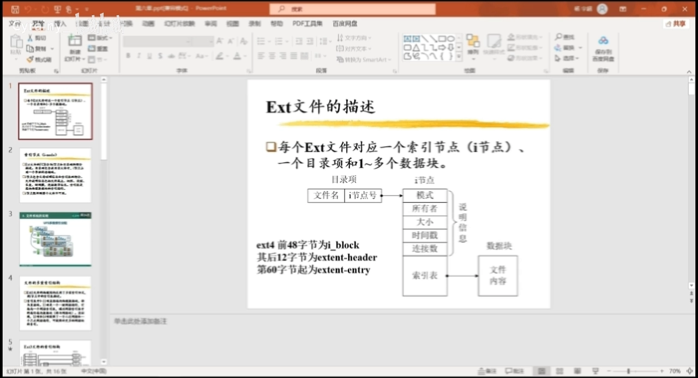

### 1.2 多级索引：固定大小的 inode 指向更多的块

inode 大小固定，能直接放的指针有限。操作系统课程中经典的 UFS **多级索引分配**是这么解决的：inode 中同时存放直接指向文件数据块的指针，和指向"间接索引块"的指针——间接块里再存放更多数据块指针。这样在 inode 大小一定的情况下，可以间接指向更多的数据块，从而支持存放更大的文件。 [【跳转到 01:21】](https://www.bilibili.com/video/BV1rK41167nD/?t=81)

ext 文件系统运用的正是这种多重索引方式：inode 的索引表中既有直接指向物理数据块的指针，也有一级间接指针、二级间接指针和三级间接指针，逐级扩展可以索引更多的间接块。这就是 ext 文件的索引结构。 [【跳转到 01:46】](https://www.bilibili.com/video/BV1rK41167nD/?t=106)

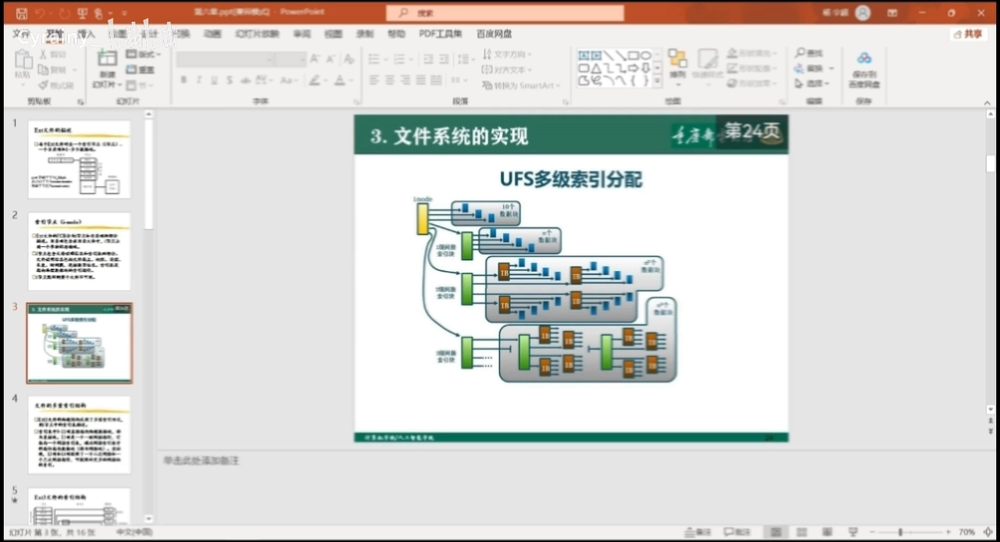

### 1.3 文件控制块 = 目录项 + inode：inode 坏了，文件就找不到了

ext 文件的**文件控制块（FCB）**分为两部分：inode 和目录项。目录项包含在目录文件中，负责"文件名 → inode 号"的映射；而 inode 单独存放。 [【跳转到 00:56】](https://www.bilibili.com/video/BV1rK41167nD/?t=56)

由此有一个关键结论：**如果 inode 被破坏，整个文件将不可用**——因为我们失去了指向这个文件的指针，文件就找不到了。

## 二、块组：ext 文件系统的空间骨架

### 2.1 硬盘分成两大区域，再切成大小相同的块组

操作系统把硬盘分为两个区域：一个是**数据区**，存放文件的数据；另一个是 **inode 区**，存放 inode 所包含的信息。在 Linux 中可以通过 `df -i` 命令查看每一个磁盘分区的 inode 总数和已使用的数量。 [【跳转到 02:11】](https://www.bilibili.com/video/BV1rK41167nD/?t=131)

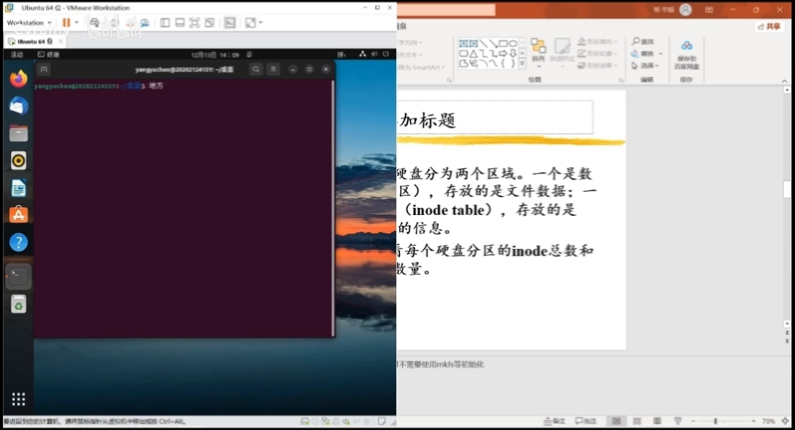

再看 ext 文件系统的整体布局：整个磁盘分成一个**引导区**和多个**块组**；每一个块组大小相同，都由组描述符表、块位图、inode 位图、inode 表和数据块区组成，一些特定的块组中还有超级块、引导块。 [【跳转到 03:21】](https://www.bilibili.com/video/BV1rK41167nD/?t=201)

磁盘分区的头部一般占用一个扇区，用来存放引导程序、负责启动操作系统——**引导块不是文件系统的组成部分**。在每个块组中，inode 表和数据块用来存放文件数据，其余的都是块组的管理信息。 [【跳转到 03:46】](https://www.bilibili.com/video/BV1rK41167nD/?t=226)

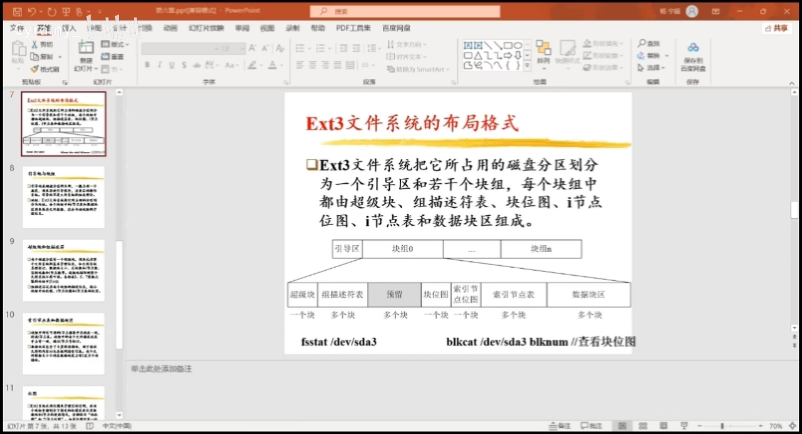

### 2.2 超级块与组描述符：块组的管理信息

超级块用来记录整个文件系统的基本管理信息：数据块的大小、总块数、inode 数、空闲块数、inode 的大小等。**如果超级块损坏，整个文件系统将不可用**；因此 ext 会在一些块组里存放备用的超级块。 [【跳转到 04:11】](https://www.bilibili.com/video/BV1rK41167nD/?t=251)

组描述符记录每个块组的描述信息：块组中的块位图、inode 位图以及 inode 表的位置。 [【跳转到 04:36】](https://www.bilibili.com/video/BV1rK41167nD/?t=276)

### 2.3 从超级块信息读出关键常数，并验证自洽

用命令查看超级块信息，可以得到这台机器 ext 文件系统的几个关键常数： [【跳转到 05:01】](https://www.bilibili.com/video/BV1rK41167nD/?t=301)

- **inode 大小 = 256 B**
- **块（block）大小 = 4096 B**
- **每个块组的 inode 数 = 8192**
- **每个块组的 inode 块数 = 512 块**

这些数字可以互相验证。每个块组共 32768 个块，其中 512 个 inode 块——inode 块里存放的就是 inode，所以一个块组有 8192 个 inode。分别用"块大小 × inode 块数"与"inode 大小 × inode 个数"计算：4096 × 512 与 256 × 8192 相等，说明每个块组就是含这么多个 inode。再用块大小除以 inode 大小：4096 ÷ 256 = 16，即每个块里可以存放 16 个 inode。 [【跳转到 06:10】](https://www.bilibili.com/video/BV1rK41167nD/?t=370)

一个块组把所有可用的 inode 全部集中存放在一起，形成 **inode 表**：8192 × 256 字节的 inode，除以每块 4096 字节，正好需要 512 个块才能存放所有的 inode。 [【跳转到 06:54】](https://www.bilibili.com/video/BV1rK41167nD/?t=414)

## 三、实战：从 inode 号 918796 算出文件数据的字节位置

接下来是本视频最核心、也最难的部分：**如何从 inode 的编号找到 inode，再找到对应的文件数据块**。整个计算在 Linux 系统里一边操作一边讲。 [【跳转到 07:52】](https://www.bilibili.com/video/BV1rK41167nD/?t=472)

### 3.1 第一步：stat 拿到 inode 号

通过 `stat 文件名` 查看对应文件的 inode 号，可以得到这个文件的 inode 序号是 **918796**。 [【跳转到 08:02】](https://www.bilibili.com/video/BV1rK41167nD/?t=482)

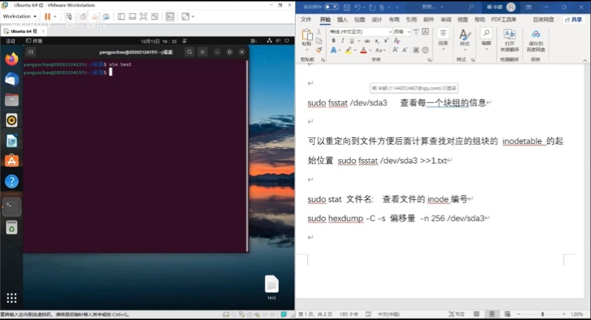

### 3.2 第二步：除以每组 inode 数，定位块组 112

从之前的学习我们知道，一个块组中有 8192 个 inode。用 918796 ÷ 8192，得到的**商**就是这个 inode 所在的块组编号——算出来是 **112**，即这个 inode 位于 112 号块组。 [【跳转到 08:49】](https://www.bilibili.com/video/BV1rK41167nD/?t=529)

### 3.3 第三步：取模得到组内序号 1292

再用 918796 对 8192 取余（mod），得到 **1292**——它是这个 inode 在 112 号块组中的第几个 inode。 [【跳转到 09:26】](https://www.bilibili.com/video/BV1rK41167nD/?t=566)

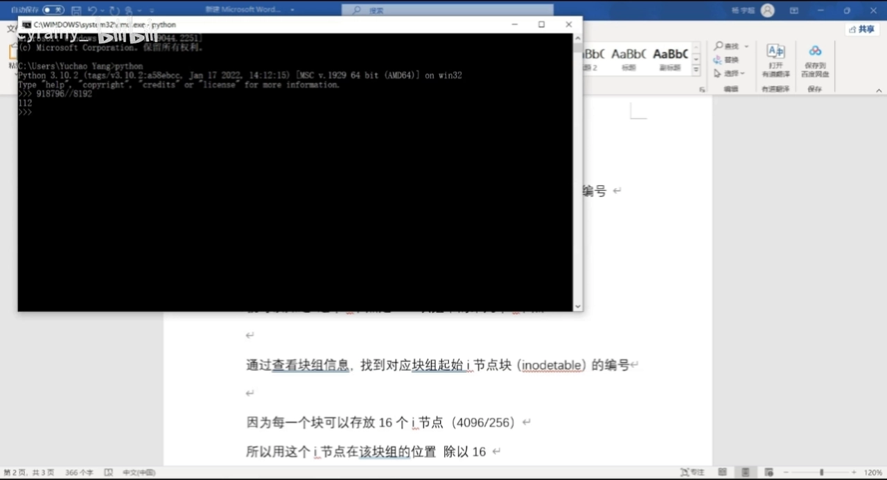

### 3.4 第四步：查块组信息，得到 inode 表起始块号 3670048

接着要通过块组信息，找到 112 号块组中 inode 表的起始位置。用查看块组信息的命令（fsstat）并把输出重定向到文件中查找，可以得到 112 块组的 inode table 起始位置是 **3670048**——也就是说 inode 表从第 3670048 号块开始。 [【跳转到 10:02】](https://www.bilibili.com/video/BV1rK41167nD/?t=602)

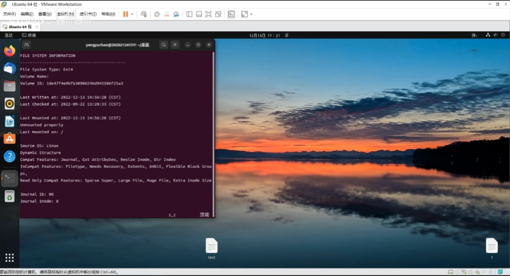

### 3.5 第五步：除以 16、取模 16，得到块距 80 与块内序号 12

一个块放 16 个 inode。把组内序号 1292 除以 16，商是 **80**——这个 inode 所在的块距离 inode 表起始位置有 80 个块，也就是在 inode 表的第 81 个块内。 [【跳转到 12:08】](https://www.bilibili.com/video/BV1rK41167nD/?t=728)

再把 1292 对 16 取余，得到 **12**——它是所在块内的第 12 个 inode，前面还有 11 个 inode。 [【跳转到 12:45】](https://www.bilibili.com/video/BV1rK41167nD/?t=765)

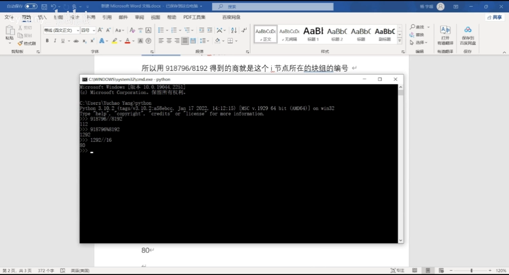

### 3.6 合成最终字节地址

现在把所有参数合成为 inode 在磁盘分区中的起始位置：

- 先算块的部分：112 组的 inode 表起始位置 3670048，加上距离 inode 表首的块数 80，再乘以块大小 4096（每块 4096 字节）；
- 再加块内偏移：这个 inode 是块内第 12 个，前面有 11 个 inode，每个 256 字节，即 11 × 256（这里用的 12 正是上一步取余的结果，12 − 1 = 11）。

最终地址 = (3670048 + 80) × 4096 + 11 × 256。 [【跳转到 13:12】](https://www.bilibili.com/video/BV1rK41167nD/?t=792)

### 3.7 读出 inode 内容：文件大小与数据块地址（小端读法）

在 Linux 中输入相应的命令（把地址换成刚才计算的结果），即可查看对应 inode 的内容。其中有两个关键字段值得注意： [【跳转到 14:55】](https://www.bilibili.com/video/BV1rK41167nD/?t=895)

- **第 5~8 个字节**记录的是文件的大小；
- **从第 60 个字节开始的 4 个字节**记录的是文件数据块的位置。

因为文件存储采用**小端模式**——数据的高字节存放在地址较高的单元——所以这 4 个字节应该从右往左读，而每个字节内部又从左往右读，最后读出数据块的编号是 **002d0060h**。 [【跳转到 15:32】](https://www.bilibili.com/video/BV1rK41167nD/?t=932)

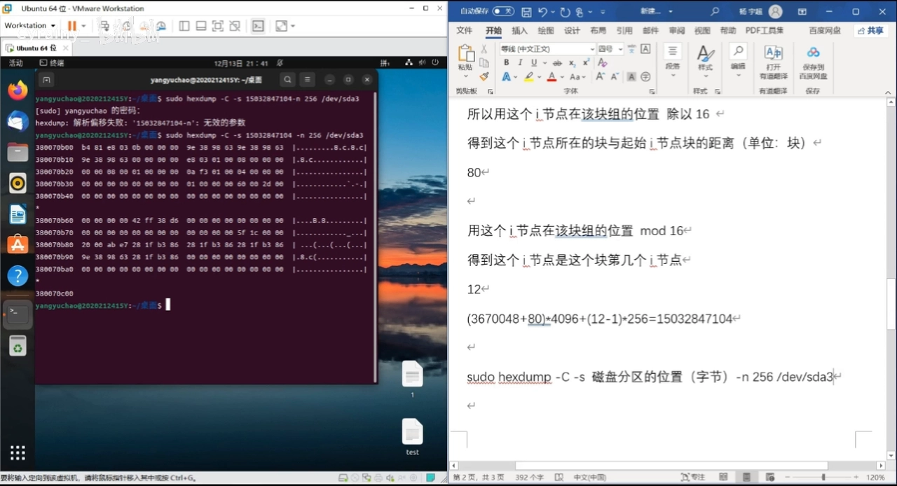

最后在计算机中把这个十六进制数转换为十进制（0x002d0060 = 2949216，就是数据块的块序号），再乘以块大小 4096，得到数据块的起始字节位置 **12079988736**。把查看命令中的地址换成这个数，就能看到对应磁盘位置的内容——正是我们写入文件的 **hello world**。 [【跳转到 16:28】](https://www.bilibili.com/video/BV1rK41167nD/?t=988)

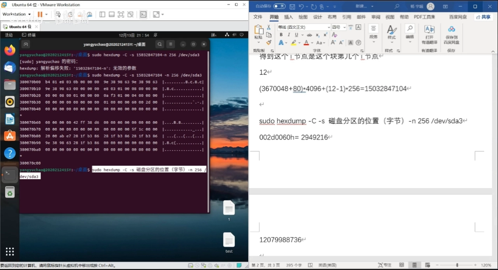

## 四、删除文件的真相：只删 inode，不删数据

最后做一个反直觉的实验：把刚才创建的文件删除，目录下它确实消失了；但再运行上面查看磁盘位置的命令，对应位置的编码内容**仍然是 hello world**。 [【跳转到 17:53】](https://www.bilibili.com/video/BV1rK41167nD/?t=1073)

结论：**删除文件只是删除了对应文件的 inode，并没有删除文件真正的数据内容**。这也再次印证了 1.3 节的结论——inode 是文件的"命脉"：inode 没了，纵然数据块完好，文件也找不到了。

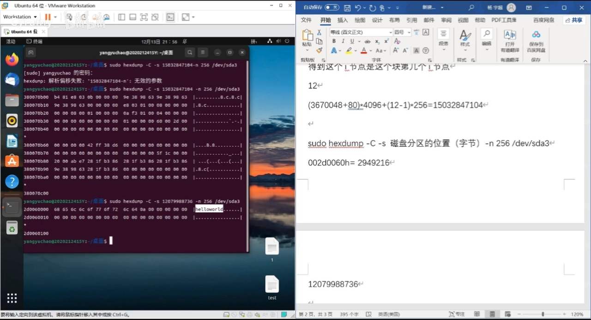

## 小结

- ext 文件系统用**索引分配**组织文件；inode = 文件元数据 + 多级索引表（直接指针 + 一、二、三级间接指针）。
- ext 布局 = 引导区 + 大小相同的**块组**；块组 = 组描述符表、块位图、inode 位图、inode 表、数据块；超级块记录全局管理信息，损坏则全盘不可用，所以有备用超级块。
- 本机关键常数：inode 256 B、块 4096 B、每组 8192 个 inode、inode 表 512 块、每块 16 个 inode。
- 寻路四步：inode 号 ÷ 8192 → 块组号；mod 8192 → 组内序号；组内序号 ÷ 16 → 距 inode 表首的块数；mod 16 → 块内序号。最终位置 = (inode 表起始块 + 块距) × 4096 + (块内序号 − 1) × 256。
- inode 内容：第 5~8 字节 = 文件大小；第 60 字节起 4 字节 = 数据块地址，按小端读法还原。
- 删除文件只是删除 inode，数据块内容不会被抹除。

## 关键术语速查

| 术语 | 一句话解释 |
| --- | --- |
| inode | 索引节点：存放文件元数据（模式、所有者、大小、时间戳、链接数等）与指向数据块的索引表，每个文件/目录一个 |
| 数据块（block） | 磁盘上存放文件内容的基本单位，本机 ext 中为 4096 字节 |
| 块组（block group） | ext 把分区划成大小相同的块组，每组自带管理信息与数据区 |
| 超级块 | 记录整个文件系统的全局信息（块大小、总块数、inode 数等），损坏则文件系统不可用 |
| 组描述符 | 记录每个块组中块位图、inode 位图、inode 表的位置 |
| 目录项 | 目录文件中的条目，负责"文件名 → inode 号"的映射；文件控制块 = 目录项 + inode |
| 多级索引 | 直接指针 + 一、二、三级间接指针，让固定大小的 inode 能索引更大的文件 |
| 小端模式 | 数据的高字节存放在地址较高的单元；跨字节读取数值时需按字节序还原 |
| df -i / stat / fsstat | 分别用于：查看分区 inode 使用情况、查看文件 inode 号、查看块组详细信息 |
