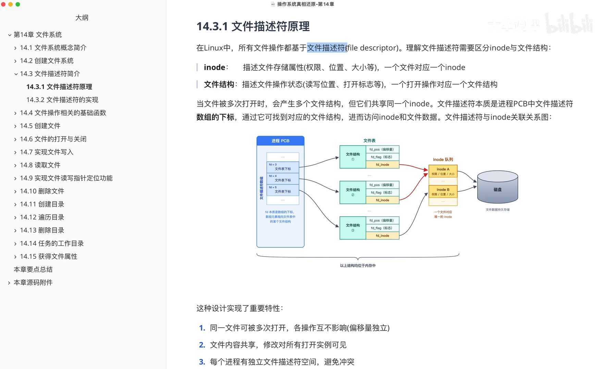
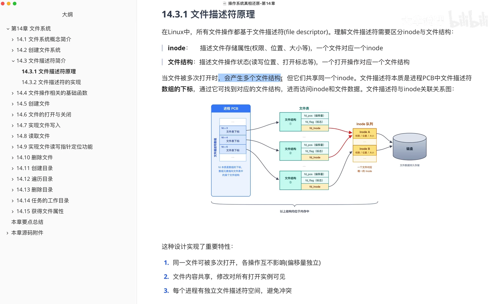
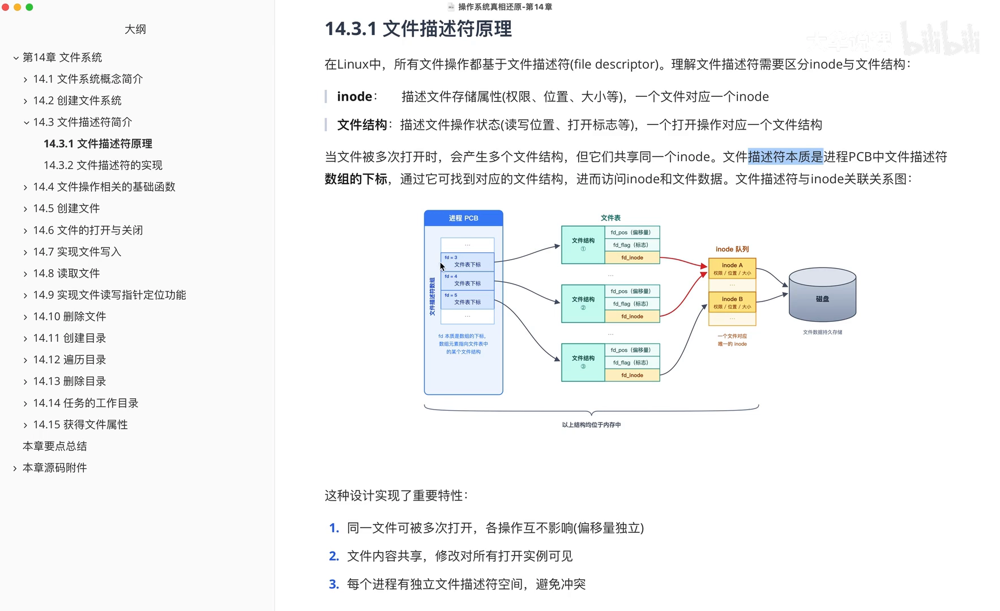
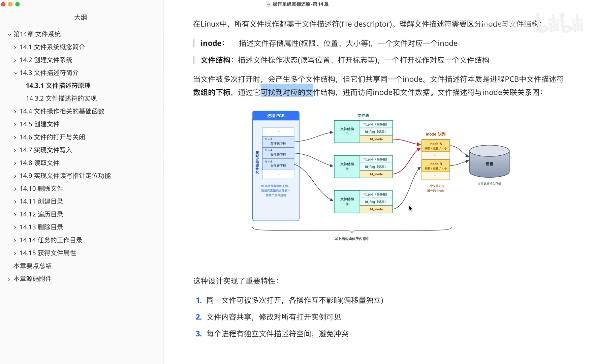
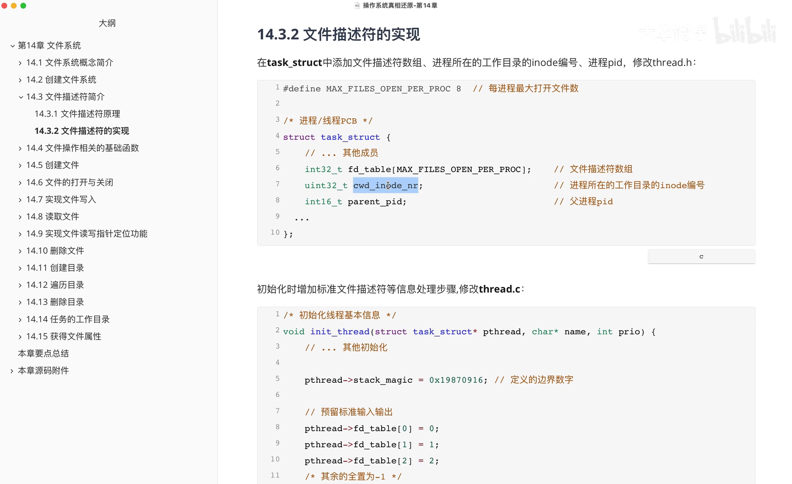
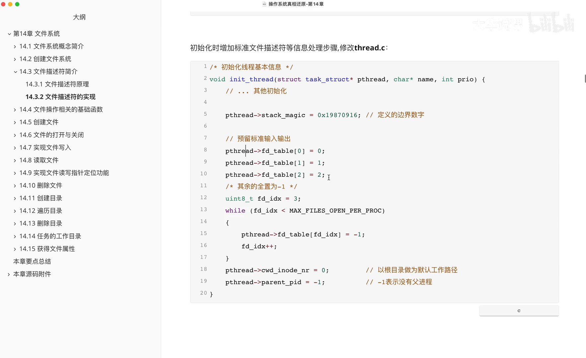

# 文件描述符的本质：PCB 中文件描述符数组的一个下标

> 视频来源：[70-操作系统真相还原第14-3(文件描述符简介)](https://www.bilibili.com/video/BV1KiNQ6MEST/)（Bilibili，UP 主「大华说课」）

## 本讲要解决的核心问题（SCQA）

**背景**：在 Linux 中所有文件操作都基于文件描述符（file descriptor）。如果你用编程的方式打开过文件，对它应该不陌生——`open()` 返回的那个整数就是它，文件操作的核心就是文件描述符。 [【跳转到 00:00】](https://www.bilibili.com/video/BV1KiNQ6MEST/?t=0)

**冲突**：但这个整数凭什么能代表一个文件？它和磁盘上的 inode、内存里的文件结构是什么关系？为什么它一般从 3 开始计数？ [【跳转到 00:25】](https://www.bilibili.com/video/BV1KiNQ6MEST/?t=25)

**疑问**：文件描述符的本质到底是什么？

**回答（中心思想）**：文件描述符的本质是 **PCB（进程控制块）中文件描述符数组的一个下标**。顺着数组元素找到对应的文件结构，再通过文件结构里的 inode 定位磁盘上的文件——有了文件描述符，才能顺藤摸瓜找到文件里的数据。 [【跳转到 03:20】](https://www.bilibili.com/video/BV1KiNQ6MEST/?t=200)

## 一、先分清三个对象：inode、文件结构、文件描述符

### 1.1 inode 在磁盘上：描述文件"存成了什么样"

理解文件描述符，先要区分两个容易混淆的东西：**inode** 和**文件结构**——它们不是同一个东西。 [【跳转到 00:50】](https://www.bilibili.com/video/BV1KiNQ6MEST/?t=50)

inode 在磁盘上就存在，用于描述文件存储的属性：权限、位置（主要是位置）、大小等。一个文件或一个目录，都对应一个 inode。 [【跳转到 01:15】](https://www.bilibili.com/video/BV1KiNQ6MEST/?t=75)

### 1.2 文件结构在内存里：描述"这一次打开"的状态

文件结构则只存在于内存中，磁盘上没有。它用来描述文件操作的状态：你读写到了哪里（偏移量）、打开时的标志是什么。 [【跳转到 01:15】](https://www.bilibili.com/video/BV1KiNQ6MEST/?t=75)

一般来说，对文件做一次打开操作，就会在内存中创建一个文件结构对象；文件被多次打开，就会产生多个文件结构——比如对同一个 inode 打开两次，就会创建两个文件结构对象；只打开一次，就只有一个文件结构。这就是它们的区别。 [【跳转到 01:40】](https://www.bilibili.com/video/BV1KiNQ6MEST/?t=100)

### 1.3 文件描述符 = PCB 中文件描述符数组的下标

那么文件描述符的本质是什么？**它是一个数组的下标**。 [【跳转到 02:05】](https://www.bilibili.com/video/BV1KiNQ6MEST/?t=125)

PCB 中有一个数组，专门用来存放指向文件表中文件结构的指针——每打开一次文件就产生一个对象，数组元素就负责保存它们；数组的下标（偏移）就是文件描述符。通过文件描述符，可以在 PCB 中找到文件表对应的条目。 [【跳转到 02:30】](https://www.bilibili.com/video/BV1KiNQ6MEST/?t=150)

于是就有了一条完整的查找链：**文件描述符 → PCB 数组 → 文件表中的文件结构 → 文件结构里的 inode → 磁盘上的文件**。顺着这条链一层一层找下去，最终就能定位磁盘文件中的数据。 [【跳转到 02:55】](https://www.bilibili.com/video/BV1KiNQ6MEST/?t=175)

也正因为 0、1、2 这三个下标默认被标准输入、标准输出、标准错误输出占用，**文件描述符一般从 3 开始**分配给用户程序打开的文件。 [【跳转到 02:55】](https://www.bilibili.com/video/BV1KiNQ6MEST/?t=175)

## 二、这条查找链带来的三个重要特征

这种设计有几个比较重要的特征： [【跳转到 03:20】](https://www.bilibili.com/video/BV1KiNQ6MEST/?t=200)

1. **同一个文件可以被多次打开，各次操作互不影响**：每打开一次就创建一个文件结构，两个文件结构里记录的状态互不干扰——你对这个文件的读写不会影响另一个文件结构里记录的内容； [【跳转到 03:45】](https://www.bilibili.com/video/BV1KiNQ6MEST/?t=225)
2. **文件内容是共享的，修改对所有打开者可见**：通过任何一个文件结构对文件做修改，本质改的都是磁盘上的同一份文件，通过另一个文件结构也能看到修改后的内容； [【跳转到 04:10】](https://www.bilibili.com/video/BV1KiNQ6MEST/?t=250)
3. **每个进程的文件描述符空间是独立的**：每个进程的 PCB 中都有自己的描述符数组，数组之间相互独立——一个进程占用 3、4、5，另一个进程也可以有自己的 3、4、5，不会冲突。 [【跳转到 04:35】](https://www.bilibili.com/video/BV1KiNQ6MEST/?t=275)

## 三、在自研内核里实现文件描述符

### 3.1 task_struct 新增字段（thread.h）

要支持文件描述符，首先给进程结构体 task_struct 添加：**文件描述符数组**（0、1、2 一般已被占用，用户程序打开的文件从 3 开始分配）、**进程工作目录对应的 inode 编号**，以及**父进程的 PID**。这些都是对原有数据结构的增加，并且需要在进程初始化阶段被正确设置。 [【跳转到 04:35】](https://www.bilibili.com/video/BV1KiNQ6MEST/?t=275)

### 3.2 初始化（thread.c）：0/1/2 绑定标准流，其余置 -1

接下来修改线程实现文件，在进程初始化的阶段对新增数据做正确设置。初始化做了这几件事： [【跳转到 05:25】](https://www.bilibili.com/video/BV1KiNQ6MEST/?t=325)

- 把数组的 **0、1、2** 三个元素分别设置为标准输入、标准输出、标准错误输出，先把这三个文件描述符占住； [【跳转到 06:03】](https://www.bilibili.com/video/BV1KiNQ6MEST/?t=363)
- 把数组**其余元素都设置为 -1**，相当于没有占用； [【跳转到 06:08】](https://www.bilibili.com/video/BV1KiNQ6MEST/?t=368)
- 进程的**工作目录统一设置为根目录**，作为默认工作路径；**父进程 PID 设置为 1**。 [【跳转到 06:13】](https://www.bilibili.com/video/BV1KiNQ6MEST/?t=373)

到这里再看文件描述符的本质，就非常清晰了：**它就是我们看到的这个数组当中的索引（下标）**——这是它最本质的特征。 [【跳转到 06:38】](https://www.bilibili.com/video/BV1KiNQ6MEST/?t=398)

## 小结

- 文件描述符的本质是 **PCB 中文件描述符数组的下标**；inode 在磁盘上描述文件属性，文件结构在内存中描述打开状态，二者不是一回事。
- 查找链：文件描述符 → 文件结构 → inode → 磁盘文件；描述符一般从 3 开始（0、1、2 被标准输入/输出/错误占用）。
- 三个特征：同一文件多次打开互不影响；内容共享、修改对所有打开者可见；各进程的描述符空间相互独立。
- 实现：task_struct 添加文件描述符数组、工作目录 inode 编号、父进程 PID；初始化时 0/1/2 绑定标准流、其余置 -1、工作目录设为根目录、父进程 PID 设为 1。

## 关键术语速查

| 术语 | 一句话解释 |
| --- | --- |
| 文件描述符（fd） | PCB 中文件描述符数组的下标，进程级的文件资源标识 |
| inode | 磁盘上描述文件存储属性（权限、位置、大小）的数据结构，一个文件/目录对应一个 |
| 文件结构（file） | 内存中描述一次打开操作状态（读写偏移、打开标志）的对象，打开一次创建一个 |
| PCB | 进程控制块，内含文件描述符数组等进程级信息 |
| 标准输入/输出/错误 | 默认占用文件描述符 0、1、2，用户打开的文件一般从 3 开始 |
