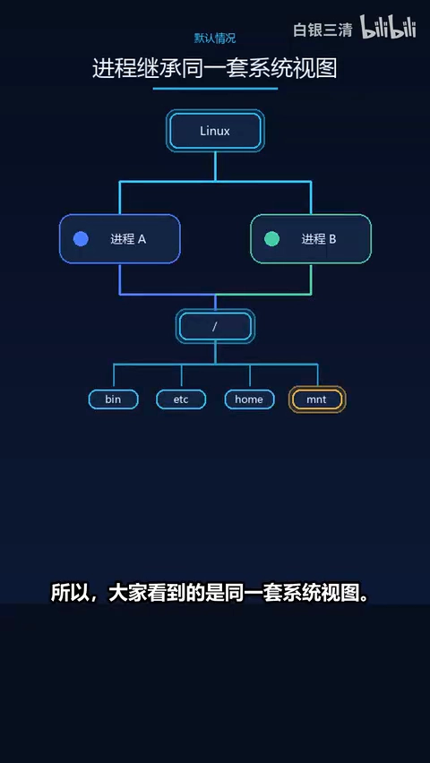
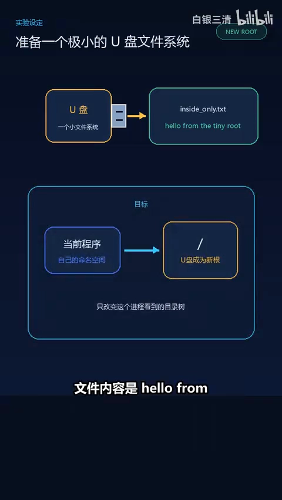
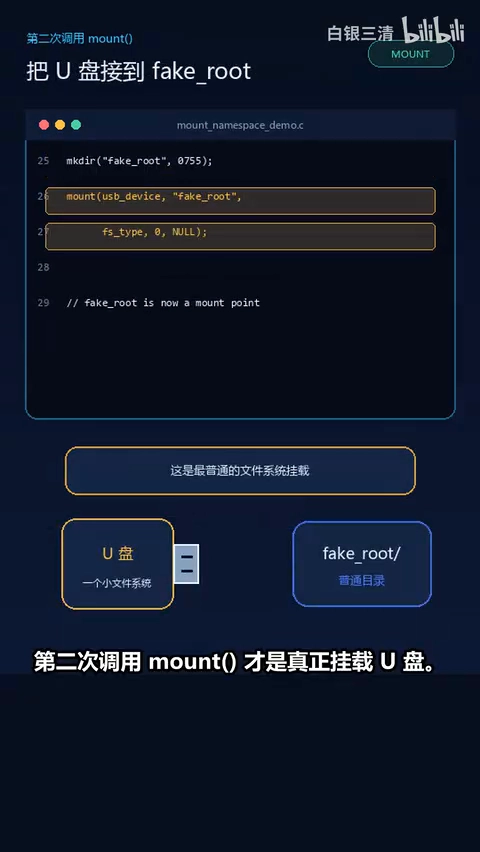
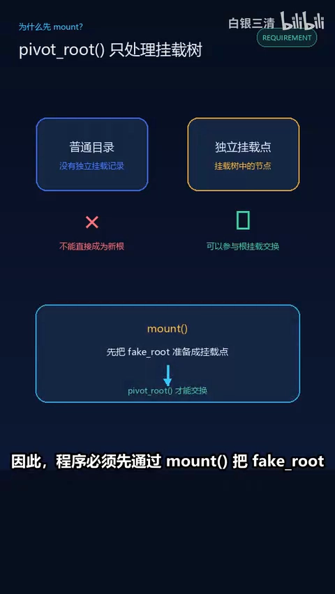
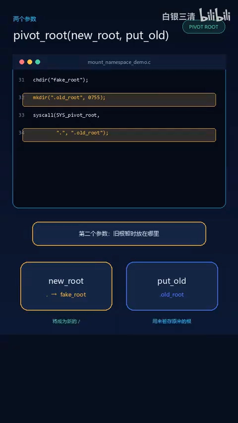
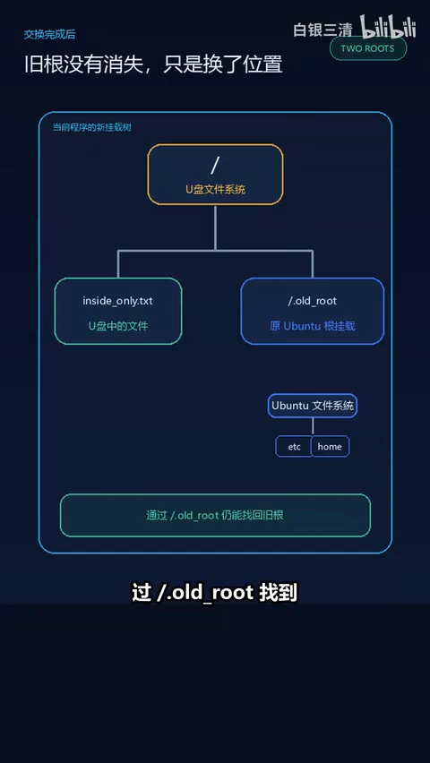

# Linux 命名空间：mount namespace 如何切换根目录

> 视频来源：[Linux 命名空间：mount namespace 如何切换根目录](https://www.bilibili.com/video/BV13NhV6KECn/)（Bilibili，UP 主「白银三清」）
>
> 本篇基于视频 AI 字幕与画面整理。视频用一个完整的 C 程序实验演示：mount namespace、mount、pivot_root、umount 如何配合，让一个进程看到一套完全不同的根目录——这正是容器隔离文件系统的雏形。示例中的目录名（fakeroot、old_root 等）以视频演示为准。

## 本讲要解决的核心问题（SCQA）

**背景**：Linux 通过 VFS 把不同的文件系统组织成一棵从 / 开始的统一目录树：把一块设备挂载到 /mnt/disk 后，程序访问这个路径，实际上就进入了那块设备上的文件系统。正常情况下，进程会继承原来的命名空间，所以大家看到的是同一套系统视图。[【跳转到 00:00】](https://www.bilibili.com/video/BV13NhV6KECn/?t=0)

**冲突**：如果想让某个进程"看到"另一套文件系统——例如容器希望用自己的根文件系统——直接修改系统里的挂载关系，就会影响外面的所有进程。[【跳转到 01:09】](https://www.bilibili.com/video/BV13NhV6KECn/?t=69)

**疑问**：能不能只让一个进程拥有独立的挂载视图，甚至把它的根目录整个换成另一个文件系统，而不动系统里的其他进程？[【跳转到 01:34】](https://www.bilibili.com/video/BV13NhV6KECn/?t=94)

**回答（中心思想）**：**可以。mount namespace 会为进程提供一套独立的挂载表：用 unshare(CLONE_NEWNS) 进入新命名空间，用 mount 先把传播设为 private、再把新文件系统挂到某个挂载点，用 pivot_root(new_root, put_old) 交换根目录，最后 umount 卸掉旧根。全程只改变当前进程看到的目录结构，终端和其他进程不受影响。**[【跳转到 06:28】](https://www.bilibili.com/video/BV13NhV6KECn/?t=388)

---

## 一、铺垫：挂载点把文件系统连成一棵目录树

Linux 通过 VFS 把不同的文件系统组织成一棵从 / 开始的统一目录树，这棵目录树不一定全部来自同一块磁盘：Linux 可以把一个文件系统挂载到某个目录上，让这个目录成为它的入口。例如把一块设备挂载到 /mnt/disk 以后，程序继续访问这个路径，实际上就进入了这块设备上的文件系统。[【跳转到 00:00】](https://www.bilibili.com/video/BV13NhV6KECn/?t=0)

所以平时看到的 Linux 文件目录，可以简单理解成：VFS 通过一个个挂载点，把不同的文件系统连接成了一颗完整的目录树。[【跳转到 00:30】](https://www.bilibili.com/video/BV13NhV6KECn/?t=30)

## 二、命名空间：给进程一套独立的视图

正常情况下，一个进程会继承原来的命名空间，所以大家看到的是同一套系统视图。Namespace，也就是命名空间，可以让某个进程拥有一套独立的视图——它并没有真的复制一套 Linux，只是让这个进程看到的系统资源和其他进程有所不同。[【跳转到 00:39】](https://www.bilibili.com/video/BV13NhV6KECn/?t=39)

Linux 有很多种 namespace：比如 PID namespace 可以让进程看到不同的进程编号，network namespace 可以提供不同的网络环境。这次使用的是 **mount namespace**。[【跳转到 00:44】](https://www.bilibili.com/video/BV13NhV6KECn/?t=44)

mount namespace 会为进程提供一套独立的**挂载表**。创建它以后，进程一开始看到的目录树和外面相同，但可以在里面修改挂载关系，而不影响外面的进程。这样一来，同一个路径在不同的 mount namespace 中就可能进入不同的文件系统——看起来就像这个进程拥有了自己的一套 Linux 文件系统视图。[【跳转到 01:09】](https://www.bilibili.com/video/BV13NhV6KECn/?t=69)

## 三、实验准备：先确认"大家看到的是同一套"

程序是保存在磁盘上的代码文件，运行一个程序时它就成为正在运行的进程；Linux 的命名空间是针对进程起作用的，每个进程都处在某个命名空间中，并按照它提供的视图访问系统资源。[【跳转到 02:04】](https://www.bilibili.com/video/BV13NhV6KECn/?t=124)

实验先在终端执行 ls /，看到 Ubuntu 原来的根目录（bin、etc、home、/usr、/var 等）。然后写一个最简 C 程序：只做一件事——通过 system() 函数执行 ls /，打印当前进程看到的根目录。编译运行后，程序看到的内容和终端完全一样：因为程序和终端处在同一个 mount namespace 中，看到的是同一套挂载关系和同一个 Ubuntu 根目录。[【跳转到 01:39】](https://www.bilibili.com/video/BV13NhV6KECn/?t=99)

为了让实验更直观，假设插入了一块 U 盘：里面只有一个文件 inside-only.txt，内容是 hello from the tiny root。目标：**只在当前程序中**挂载这块 U 盘，再把 U 盘里的文件系统切换成这个进程看到的新根目录。[【跳转到 02:19】](https://www.bilibili.com/video/BV13NhV6KECn/?t=139)

## 四、四步把根目录换成 U 盘

### 4.1 unshare(CLONE_NEWNS)：进入新的 mount namespace

修改代码，让程序运行后产生的进程进入一个新的 mount namespace：首先调用 unshare(CLONE_NEWNS)。unshare 的作用是让当前进程脱离原来共享的 mount namespace，并为它创建一个新的。进入新命名空间的只有当前进程，外面的终端和其他进程仍然留在原来的命名空间中。[【跳转到 02:44】](https://www.bilibili.com/video/BV13NhV6KECn/?t=164)

注意：新命名空间刚创建时会**复制原来的挂载视图**，所以这时候新旧两个命名空间看到的目录结构仍然一样。接下来要修改新命名空间里的挂载关系，这要使用 mount 系统调用——它是 Linux 用来建立或调整挂载关系的接口。[【跳转到 03:09】](https://www.bilibili.com/video/BV13NhV6KECn/?t=189)

### 4.2 两次 mount：先 private，再把 U 盘挂到挂载点

第一次调用 mount 并不是挂载新的文件系统，而是通过 private 设置，让后面的挂载和卸载只在当前进程所在的命名空间里生效——之后这个程序无论怎样调整目录的挂载关系，都只会改变它自己看到的目录结构，不会影响外面的终端和其他进程。[【跳转到 03:34】](https://www.bilibili.com/video/BV13NhV6KECn/?t=214)

第二次调用 mount 才是真正挂载 U 盘：把 U 盘上的文件系统挂载到示例中的 fakeroot 目录。它原本只是一个普通文件夹，挂载完成以后，不仅成了进入 U 盘文件系统的入口，也成了一个独立的挂载点。这一步很重要：**pivot_root 只能交换挂载树中的根挂载，不能直接把一个普通文件夹变成新的根目录**，因此程序必须先通过 mount 把它准备成挂载点。[【跳转到 03:59】](https://www.bilibili.com/video/BV13NhV6KECn/?t=239)

### 4.3 pivot_root(new_root, put_old)：交换根目录

接下来调用 pivot_root(new_root, put_old)，它需要传入两个路径参数：第一个参数 new_root 表示哪个挂载点要成为新的根目录（这里传入 fakeroot，即刚才挂载 U 盘的位置）；第二个参数 put_old 表示切换以后原来的根目录暂时放在哪里——这个位置必须位于新根目录里面。所以程序先在 fakeroot 中创建 old_root 目录，再把它作为第二个参数。[【跳转到 04:24】](https://www.bilibili.com/video/BV13NhV6KECn/?t=264)

调用完成后，fakeroot 成为当前进程看到的新根目录，原来的 Ubuntu 根挂载则移动到新根下面的 old_root。旧根并没有被删除，因此这时程序既可以通过新的根目录访问 U 盘，也仍然可以通过 old_root 找到原来的 Ubuntu 文件系统。[【跳转到 04:49】](https://www.bilibili.com/video/BV13NhV6KECn/?t=289)

确认新根已经切换成功后，程序再调用 umount，把 old_root 对应的旧根挂载从当前命名空间中卸载。到这一步，旧根的入口才从当前进程看到的目录树中消失——它并没有被删除，外面的终端仍然通过原来的 mount namespace 正常使用 Ubuntu 根目录。[【跳转到 05:14】](https://www.bilibili.com/video/BV13NhV6KECn/?t=314)

### 4.4 新根里没有 ls：改用 opendir/readdir

新的根目录里没有 bin、ls，所以程序不能继续通过 system() 调用 ls，这里改用 opendir 打开根目录，再用 readdir 逐项读取目录内容，最后通过 printf 把读取到的文件名打印出来。[【跳转到 05:39】](https://www.bilibili.com/video/BV13NhV6KECn/?t=339)

## 五、运行结果：进程的根变了，系统没有变

重新编译并使用 sudo 运行。刚启动、还没有创建新的 mount namespace 时，看到的仍然是完整的 Ubuntu 根目录。进入新的 mount namespace 后，程序把 U 盘挂载到 fakeroot，再把它切换为自己的根目录——切换完成以后，这个进程看到的根目录就不再是 Ubuntu 原来的根目录，而是 U 盘里的文件系统，因此屏幕上只剩下一个 inside-only.txt，程序读取它得到 hello from the tiny root。[【跳转到 05:51】](https://www.bilibili.com/video/BV13NhV6KECn/?t=351)

程序退出以后，回到原来的终端再次执行 ls /：Ubuntu 原来的 bin、etc、home、usr 等目录仍然存在，没有受到刚才挂载的影响。我们并没有把 Ubuntu 安装到 U 盘里，也没有复制一套 Linux——mount namespace 只是让不同的进程拥有不同的挂载视图：实验程序把 U 盘看成自己的根目录，而外面的终端仍然把 Ubuntu 原来的文件系统看成根目录。不过这个新视图现在只存在于当前程序中。[【跳转到 06:28】](https://www.bilibili.com/video/BV13NhV6KECn/?t=388)

下一集会继续使用 fork 创建子进程，再让子进程在新的挂载视图中执行另一个程序——那就是"在容器里跑进程"的雏形。[【跳转到 06:53】](https://www.bilibili.com/video/BV13NhV6KECn/?t=413)

## 小结

- Linux 的目录树由 VFS 用一个个**挂载点**拼成，不同文件系统借此接入同一棵从 / 开始的树。
- **命名空间**不复制系统，只改变进程"看到"的资源视图；mount namespace 改的是**挂载表**。
- 用 unshare(CLONE_NEWNS) 进入新 mount namespace；新命名空间初始会**复制**原来的挂载视图。
- 先用 mount 设 private 传播（改动只在命名空间内生效），再把新文件系统挂成**挂载点**——pivot_root 只能交换根挂载，不能拿普通目录当新根。
- pivot_root(new_root, put_old) 交换根目录，put_old 必须在新根之内；收尾用 umount 卸掉旧根。
- 实验结果：进程的根目录变成 U 盘，外部终端毫无变化——隔离是"视图级"的，不是复制。

## 关键术语速查

| 术语 | 一句话解释 |
| --- | --- |
| VFS | 虚拟文件系统，把不同文件系统组织成从 / 开始的统一目录树 |
| 挂载点 | 一个目录，作为某个文件系统的访问入口 |
| namespace | 命名空间，让进程拥有独立的资源视图，并不复制系统本身 |
| mount namespace | 提供独立挂载表的命名空间；同一路径在不同命名空间可进入不同文件系统 |
| unshare(CLONE_NEWNS) | 让当前进程脱离共享的 mount namespace，并为它创建一个新的 |
| mount | 建立或调整挂载关系的系统调用；本例先设 private 传播，再挂载 U 盘 |
| pivot_root(new_root, put_old) | 交换根目录：new_root 成为新根，旧根移到 put_old（必须在新根内） |
| umount | 卸载挂载；本例用于卸掉 old_root 中的旧根挂载 |
