# Linux 挂载详解：把设备接入文件系统的目录树

> 视频来源：[Linux操作系统----Linux的挂载详解mount](https://www.bilibili.com/video/BV1RZ4y1n7iQ/)（Bilibili，UP 主「编程干货」，Linux 系统管理课程）
>
> 本篇基于视频 AI 字幕与画面整理（开头十几秒为课程推广信息，与知识点无关，已略去）。视频在 CentOS 7 虚拟机里完整演示：设备文件与挂载概念、手动挂载光驱与 ISO 镜像、重启失效问题、/etc/fstab 自动挂载，以及把挂载结果发布到 httpd 并改造为本地 yum 源的完整链条。

## 本讲要解决的核心问题（SCQA）

**背景**：Linux 的核心思想是"一切皆文件"——插入的光驱、硬盘都会被解析成 /dev 目录下的设备文件，系统已经"看到"了它们。[【跳转到 00:15】](https://www.bilibili.com/video/BV1RZ4y1n7iQ/?t=15)

**冲突**：但设备文件并不能直接当目录用：/dev/sr0 是块设备，没法 cd 进去，cat 出来的内容也看不懂；新接入的 U 盘、机械硬盘、DVD 驱动器或 ISO 镜像文件，不经过一道"挂载"手续就无法使用。[【跳转到 05:41】](https://www.bilibili.com/video/BV1RZ4y1n7iQ/?t=341)

**疑问**：挂载到底做了什么？怎么把光驱、ISO 镜像正确地挂进来？重启之后挂载还在吗？[【跳转到 01:41】](https://www.bilibili.com/video/BV1RZ4y1n7iQ/?t=101)

**回答（中心思想）**：**挂载 = 把一个设备（挂载源）接到一个已存在的目录（挂载点）上，此后访问这个目录就是访问这个设备。用 mount 命令手动挂载（-t 指定文件系统类型、-o 指定挂载方式）；要重启后仍生效，就把配置写进 /etc/fstab；挂载出来的内容还能发布成 httpd 站点、改造成本地 yum 源。**[【跳转到 01:41】](https://www.bilibili.com/video/BV1RZ4y1n7iQ/?t=101)

---

## 一、一切皆文件：/dev 里的设备文件

Linux 将所有设备都看作文件，把整个计算机的资源整合成一棵大的文件目录树。插入一个光驱，它也会被解析成一个设备文件，可以到对应的设备目录里找到它。[【跳转到 00:15】](https://www.bilibili.com/video/BV1RZ4y1n7iQ/?t=15)

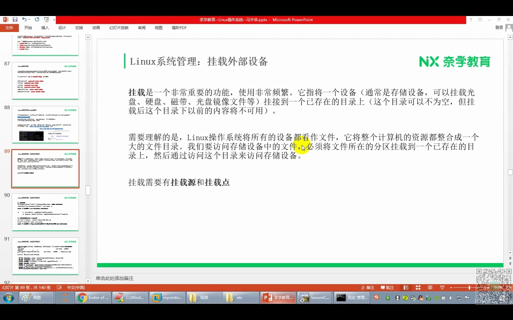

打开 /dev 能看到大量设备文件：c 开头的是字符设备，d 是目录，还有 b——块设备。比如 sda、sda1、sda2 就是第一块 SCSI 接口硬盘及其第一、第二分区。先记住：**这些是设备文件**。[【跳转到 00:39】](https://www.bilibili.com/video/BV1RZ4y1n7iQ/?t=39)

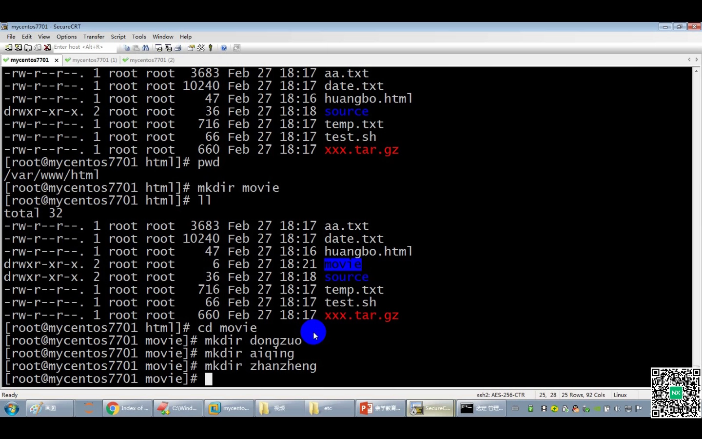

问题在于：系统接入新设备（U 盘、机械硬盘、DVD 驱动器、ISO 镜像文件等）后，必须把这些设备**挂载到文件系统中的某个目录里**，我们才能使用它们。所以挂载是非常重要的功能，使用非常频繁。[【跳转到 01:16】](https://www.bilibili.com/video/BV1RZ4y1n7iQ/?t=76)

## 二、挂载是什么：挂载源 + 挂载点

挂载的定义：**将一个设备（挂载源）挂载到一个已存在的目录（挂载点）上——访问这个目录，就是访问这个设备**。可以挂载的通常是存储设备：硬盘、U 盘、光盘、磁带、光盘镜像文件等等，方式有很多种形态。[【跳转到 01:41】](https://www.bilibili.com/video/BV1RZ4y1n7iQ/?t=101)

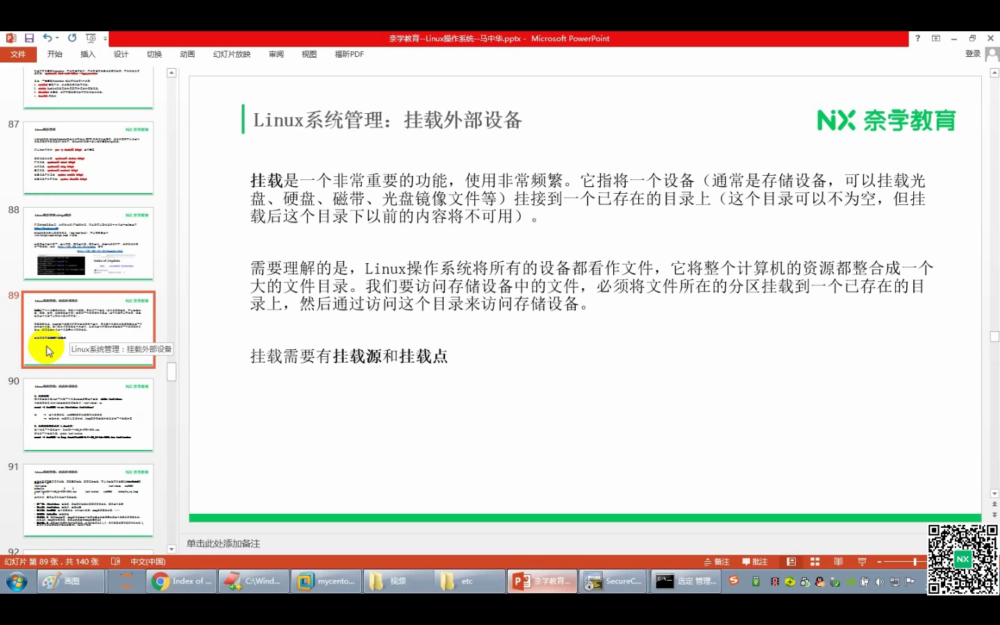

两个细节要注意：

- 挂载点目录**可以不为空**，但挂载后，这个目录下以前的内容就不可访问了；
- 实际操作的最佳实践是**新建一个目录**，专门作为挂载点。[【跳转到 02:06】](https://www.bilibili.com/video/BV1RZ4y1n7iQ/?t=126)

挂载的英文叫 mount。要用访问设备中的文件，必须把文件所在的分区（那块硬盘）挂到一个已存在的目录上，再访问这个目录。用 mount 命令挂载时一定要记住：**指定挂载源、指定挂载点**——把什么设备挂到什么目录里。[【跳转到 02:56】](https://www.bilibili.com/video/BV1RZ4y1n7iQ/?t=176)

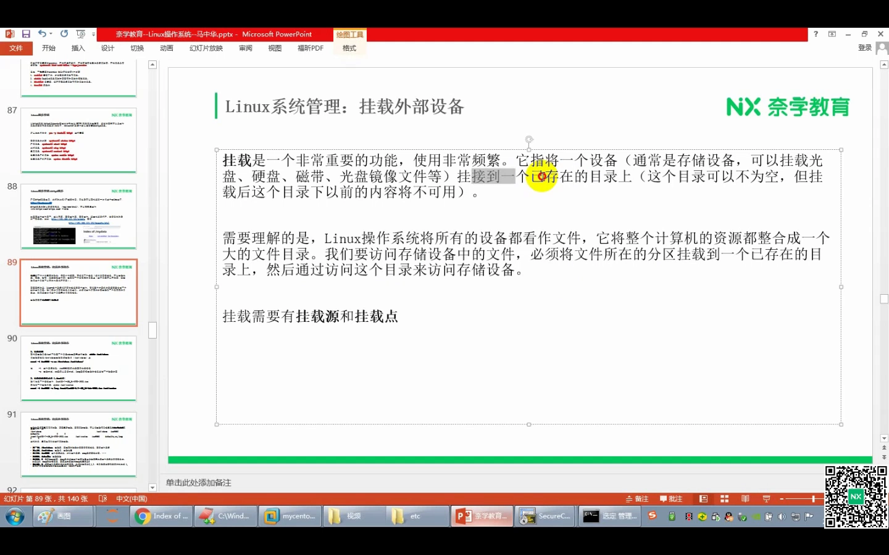

## 三、实操一：挂载光驱

### 3.1 挂载点选在哪：/mnt 与 /media

最常用的挂载目录是 /mnt 和 /media 这两个，它们主要就是做挂载用的。[【跳转到 03:45】](https://www.bilibili.com/video/BV1RZ4y1n7iQ/?t=225)

### 3.2 找到光驱的设备文件

这台虚拟机在 VMware 里外接了设备：一块分配了 50G 的硬盘，还有一个 CD/DVD 光驱——就是安装 CentOS 7 时指定的系统镜像。光驱接进来后，必然会在 /dev 设备文件夹里留下对应内容，默认名称是 **cdrom**。[【跳转到 04:29】](https://www.bilibili.com/video/BV1RZ4y1n7iQ/?t=269)

cdrom 其实是个软链接，指向 **sr0**；而 sr0 是 b 开头的**块设备文件**——本质上就是光驱。块设备不能直接访问：cd 不进去，cat 出来的内容也看不懂、打不开。所以要把它挂载到某个目录里，才能读出里面的内容。[【跳转到 05:16】](https://www.bilibili.com/video/BV1RZ4y1n7iQ/?t=316)

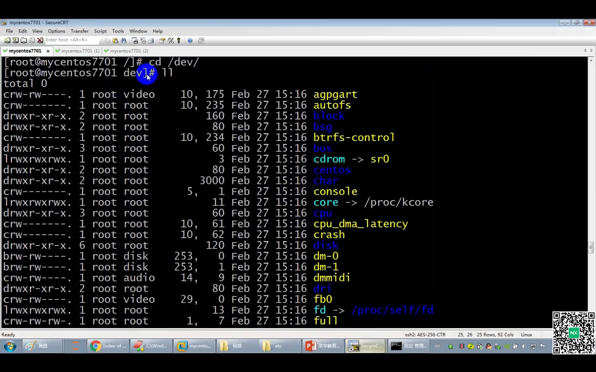

### 3.3 mount -t iso9660 -o ro：把光驱挂进 /mnt/cdrom

先在 /mnt 里新建挂载点：mkdir cdrom（刚创建时里面没有内容）。[【跳转到 06:06】](https://www.bilibili.com/video/BV1RZ4y1n7iQ/?t=366)

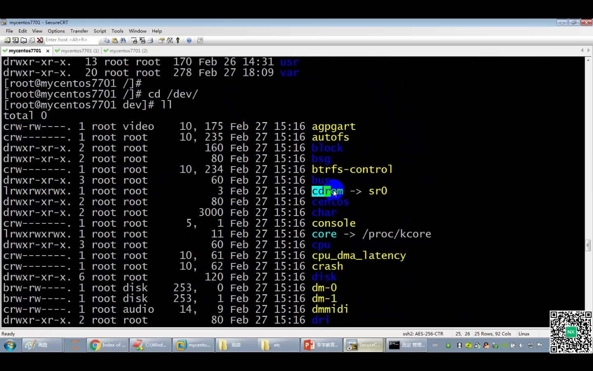

mount 有两个常用参数：

- **-t**：指定文件系统类型。光盘或光盘镜像（ISO）的类型是 **iso9660**；
- **-o**：指定挂载方式。光驱一般不能写，用 **ro（read only）**只读方式——就像拿一张光盘插进 CD 设备，只能读不能改（个别能改，但一般来说都是 read only）。[【跳转到 06:31】](https://www.bilibili.com/video/BV1RZ4y1n7iQ/?t=391)

完整命令（挂载源 /dev/cdrom，挂载点 /mnt/cdrom）：

```bash
mount -t iso9660 -o ro /dev/cdrom /mnt/cdrom
```

挂载完成后 cd 进 /mnt/cdrom，里面就有内容了——内容正是安装 CentOS 7 时引入的那个 ISO 镜像文件里的东西。这就是所谓的挂载：CD/DVD 驱动器里接进来的 ISO 文件，你就能看得懂了。[【跳转到 07:23】](https://www.bilibili.com/video/BV1RZ4y1n7iQ/?t=443)

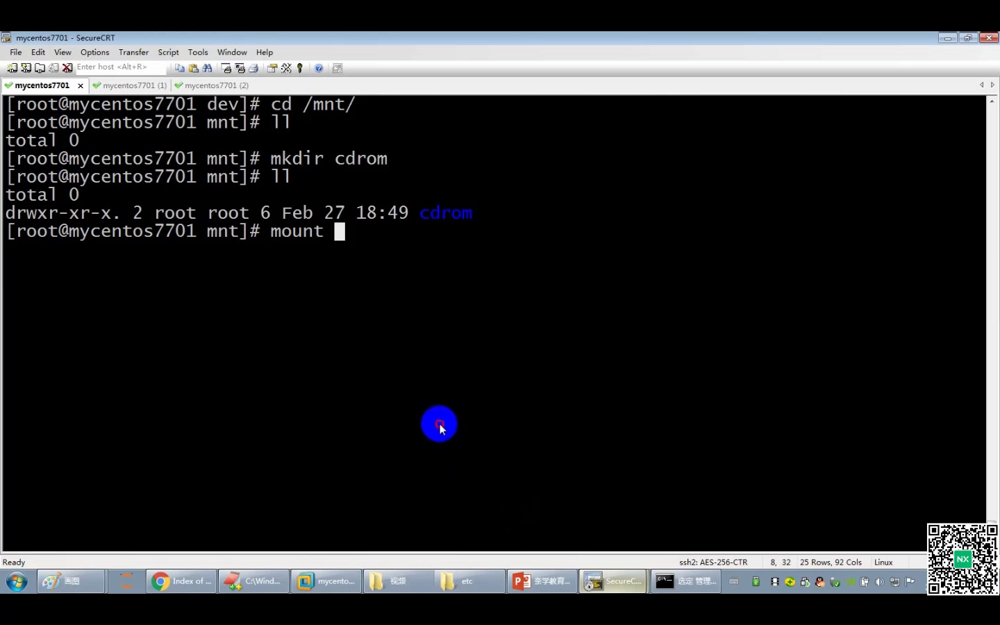

### 3.4 实操二：挂载 ISO 镜像文件

第二种情形：把 ISO 镜像**文件**（比如已经上传到系统 root 目录里的 CentOS 7 镜像）挂进来。直接看不懂它，但做法完全一样：用同样的 mount 方式把它挂载到某个目录，就能看懂里面的内容了。视频没有重复演示，可以自己试一试。[【跳转到 08:16】](https://www.bilibili.com/video/BV1RZ4y1n7iQ/?t=496)

## 四、手动挂载的局限：重启就没了

刚才这种 mount 手动挂载有一个缺点：**重启系统后，这一次的挂载就失效了**——只在下一次重启之前有效。[【跳转到 09:06】](https://www.bilibili.com/video/BV1RZ4y1n7iQ/?t=546)

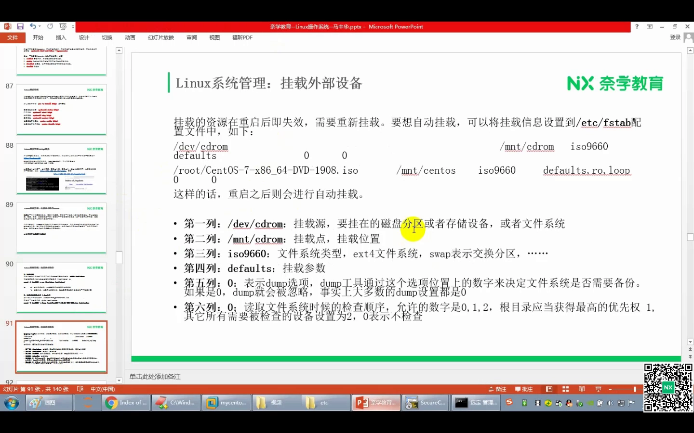

视频做了验证：重启前 cd /mnt/cdrom 还有内容；reboot 重启、重新连接后再进去——一无所有了。所以我们想实现**自动挂载**：不管重不重启，挂载时时刻刻都有效。做法是把配置写进一个文件，系统重启时会自动扫描里面的配置并自动挂载。[【跳转到 10:54】](https://www.bilibili.com/video/BV1RZ4y1n7iQ/?t=654)

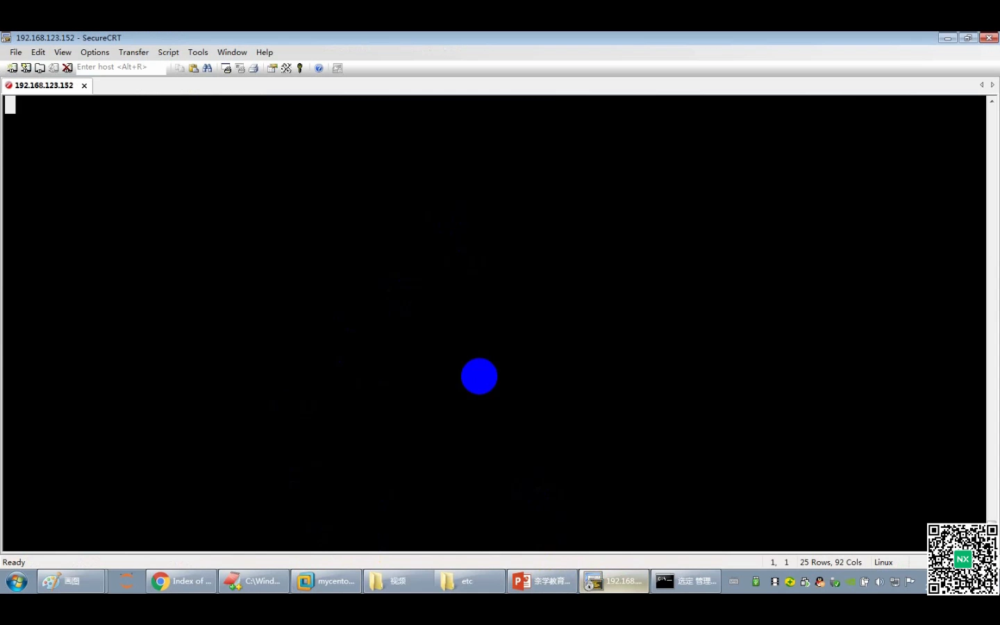

## 五、自动挂载：/etc/fstab 六列

配置文件是 **/etc/fstab**，里面已经有系统默认的挂载条目。新增一条自动挂载要写**六列**：

1. 第一列：**挂载源**（如 /dev/cdrom）；
2. 第二列：**挂载点**（如 /mnt/cdrom）；
3. 第三列：**文件系统类型**（如 iso9660）；
4. 第四列：**挂载参数**（用 defaults 默认即可）；
5. 第五列：dump 备份设置，一般写 0；
6. 第六列：开机检查设置，写 0 表示**不需要检查**——一般来说这个文件没有损坏，不需要检查。[【跳转到 11:34】](https://www.bilibili.com/video/BV1RZ4y1n7iQ/?t=694)

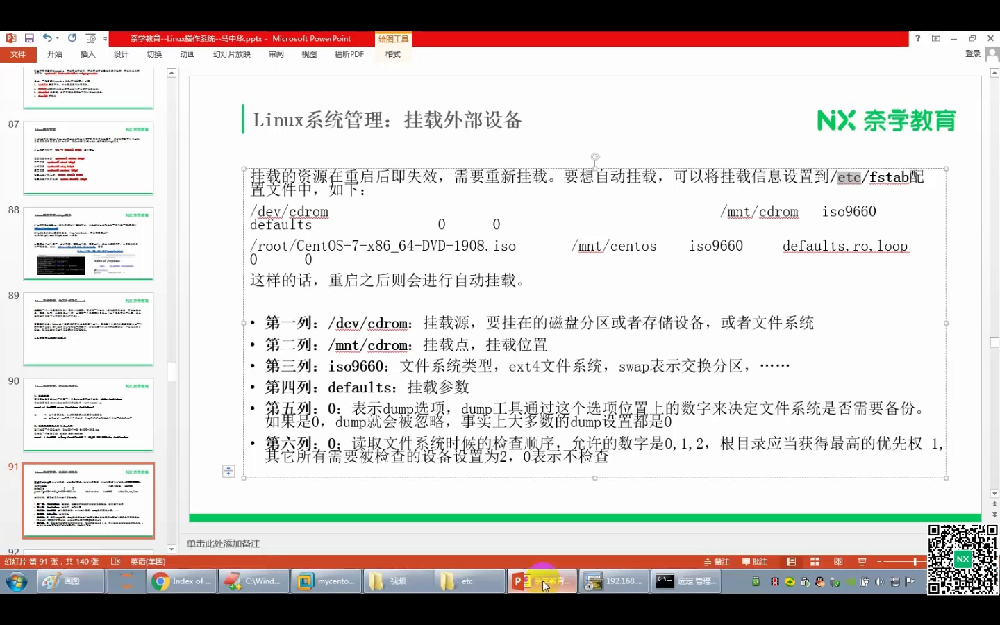

视频写入的条目如下（列间用 tab 隔开）：

```
/dev/cdrom    /mnt/cdrom    iso9660    defaults    0    0
```

[【跳转到 12:11】](https://www.bilibili.com/video/BV1RZ4y1n7iQ/?t=731)

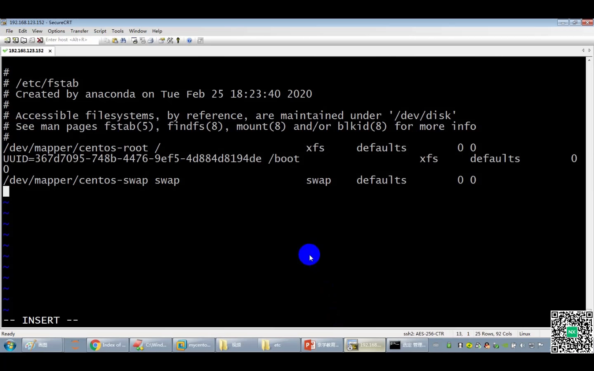

保存退出后立刻看目录还是没内容——因为 fstab 是**开机时**扫描的。重启之后再看 /mnt/cdrom：内容回来了，自动挂载生效。[【跳转到 13:21】](https://www.bilibili.com/video/BV1RZ4y1n7iQ/?t=801)

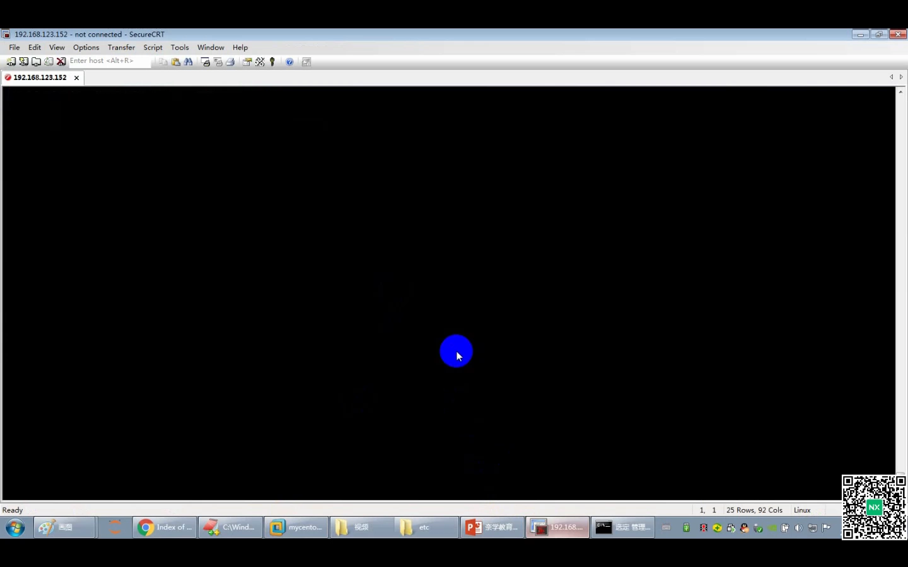

## 六、进阶玩法：把挂载内容发布成站点，给 yum 当本地源

这一段是层层递进的综合应用：把 CentOS 7 镜像里的内容发布到 httpd（网页/文件服务器）服务中，最终目的是让 **yum 在没有外部网络时也能安装软件**。[【跳转到 13:47】](https://www.bilibili.com/video/BV1RZ4y1n7iQ/?t=827)

### 6.1 开 httpd、关防火墙

- systemctl status httpd：服务是 running 的，运行中；[【跳转到 14:26】](https://www.bilibili.com/video/BV1RZ4y1n7iQ/?t=866)
- 浏览器访问却一直转圈——多半是防火墙开着：systemctl status firewalld 确认在运行，systemctl stop firewalld 关掉后再刷新，页面就出来了。[【跳转到 14:49】](https://www.bilibili.com/video/BV1RZ4y1n7iQ/?t=889)

### 6.2 软链接：把挂载目录接到站点根

Apache httpd 的默认资源路径是 /var/www/html。在里面 mkdir centos7，然后把挂载好的 /mnt/cdrom 软链接进去：

```bash
cd /var/www/html && mkdir centos7
ln -s /mnt/cdrom /var/www/html/centos7/cdrom
```

之后在浏览器访问 `http://<IP>/centos7/cdrom/`，就能看到 ISO 镜像里的内容；点开 **Packages**，里面有几千个 .rpm 软件包（进度条很细就是包多的意思）。[【跳转到 16:19】](https://www.bilibili.com/video/BV1RZ4y1n7iQ/?t=979)

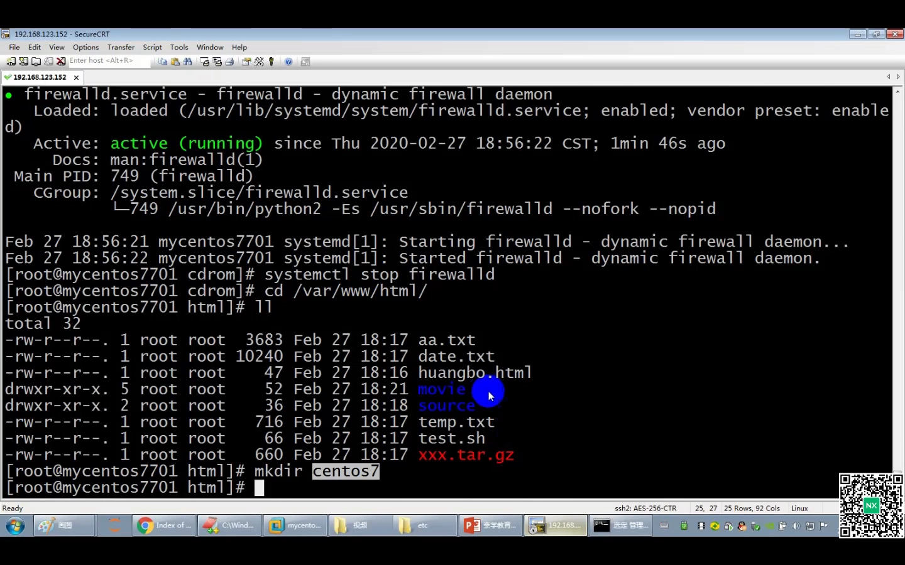

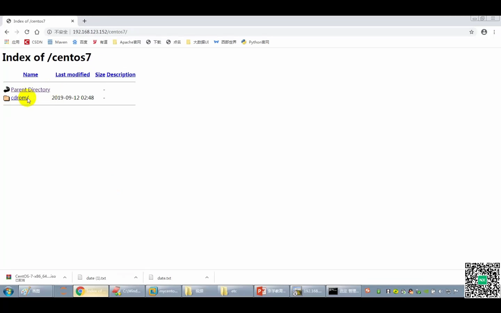

### 6.3 为什么要这么做：本地 yum 源的原理

yum 在线安装默认从 CentOS 官网下载 rpm 软件包；**没有外部网络时 yum 在线安装就受阻**。而 ISO 镜像的 Packages 文件夹里本来就有几千个 rpm 包——安装软件不一定非得从网上下载，可以从镜像里拿。[【跳转到 18:44】](https://www.bilibili.com/video/BV1RZ4y1n7iQ/?t=1124)

思路就是：把 ISO 挂载到一个目录 → 把这个目录发布到 httpd 服务 → 修改 yum 配置，让它到自己的 httpd 服务里找 rpm 包——一样能完成"在线安装"。[【跳转到 19:50】](https://www.bilibili.com/video/BV1RZ4y1n7iQ/?t=1190)

用 du 看看 Packages 有多大：du -sh ./ 统计出 **3.8G**——好几千个软件包，挂载这条链路就完整跑通了。[【跳转到 21:53】](https://www.bilibili.com/video/BV1RZ4y1n7iQ/?t=1313)

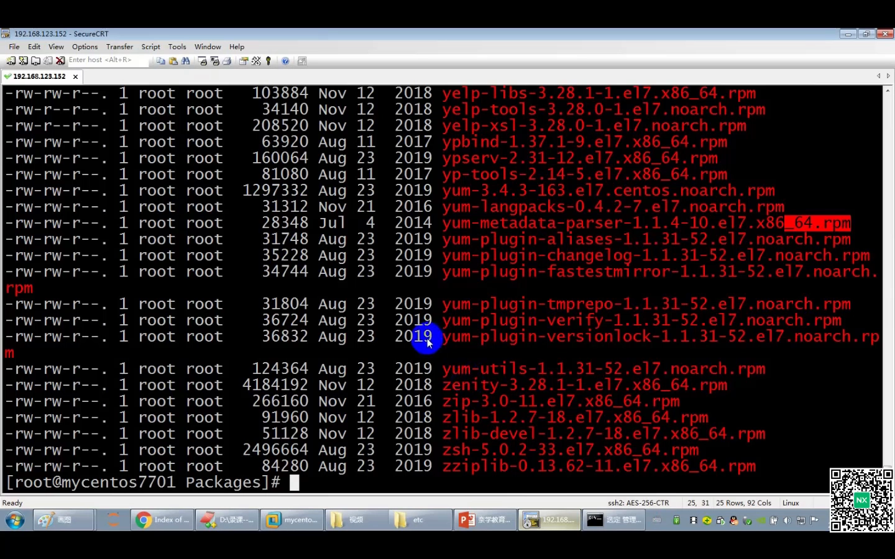

## 七、延伸：挂载真实硬盘还要分区和格式化

工作中如果做专业运维，还会遇到从外部挂载一块**真实磁盘**：挂进来之前可能还要针对磁盘做**分区、创建文件系统（格式化）**等操作——挂载不同的设备，前置操作不同。一般来说挂载硬盘由专业运维完成；大数据开发或初学者通常不需要自己做，但了解一下是好事。[【跳转到 22:12】](https://www.bilibili.com/video/BV1RZ4y1n7iQ/?t=1332)

## 小结

- 一切皆文件：设备在 /dev 里表现为设备文件（c 字符设备、b 块设备），但块设备不能像目录一样直接访问。
- 挂载 = 把设备（挂载源）接到一个已存在目录（挂载点）上；访问目录即访问设备；最佳实践是新建空目录做挂载点。
- mount 命令：-t 指定文件系统类型（ISO 用 iso9660），-o 指定方式（光驱用 ro 只读）。
- 手动挂载重启即失效；/etc/fstab 六列（挂载源、挂载点、类型、参数、dump、pass）实现开机自动挂载。
- 挂载结果可以软链接进 /var/www/html 发布为 httpd 站点，并配置成本地 yum 源——离线环境也能"在线安装"。
- 挂载真实磁盘还需先分区、创建文件系统，属于专业运维范畴。

## 关键术语速查

| 术语 | 一句话解释 |
| --- | --- |
| 设备文件 | 设备在 /dev 下的抽象文件；c 开头为字符设备，b 开头为块设备 |
| 块设备 | 按块读写的设备（如 sr0、sda），不能像目录一样直接进入访问 |
| 挂载 | 把设备（挂载源）接到已存在目录（挂载点）上，访问目录即访问设备 |
| mount | 挂载命令；-t 指定文件系统类型，-o 指定挂载方式 |
| iso9660 | 光盘 / ISO 镜像的文件系统类型 |
| ro | read only，只读挂载方式 |
| /etc/fstab | 开机自动挂载的配置文件，每条六列 |
| yum / rpm | CentOS 的包管理器 / 软件包格式；镜像 Packages 目录内含数千个 rpm |
