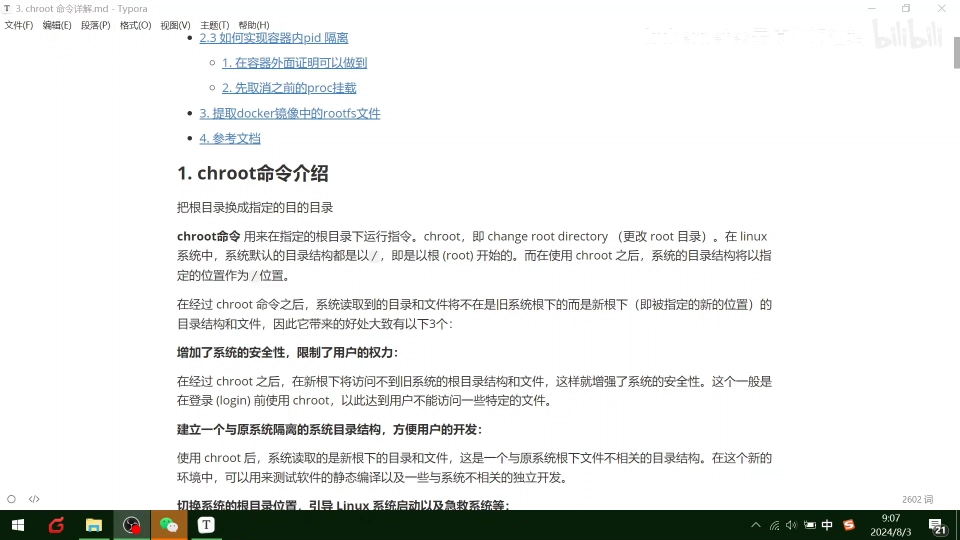
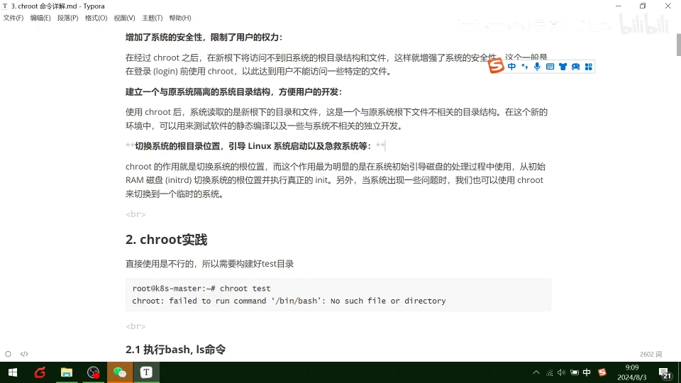
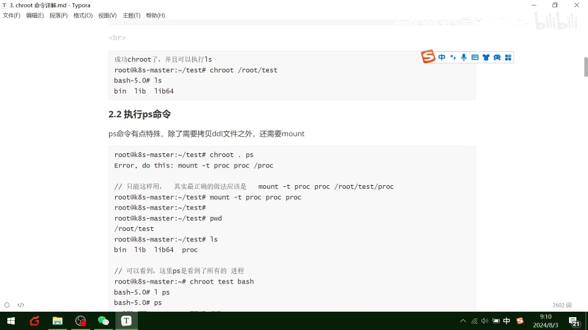
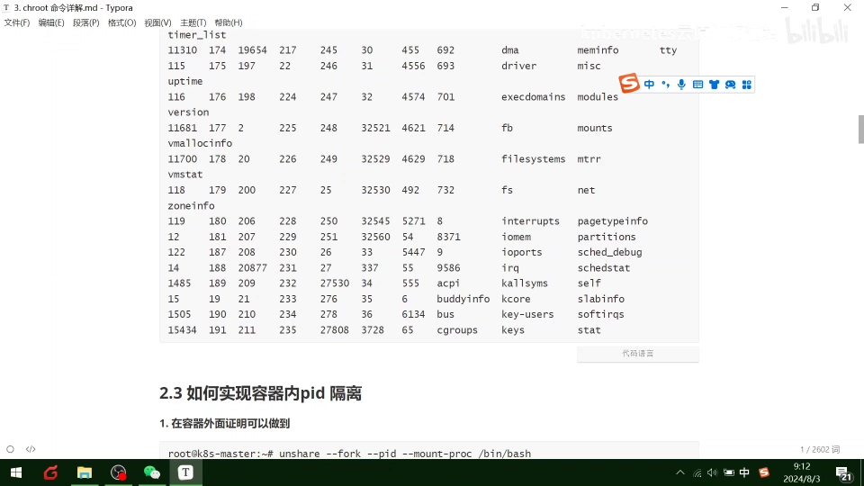
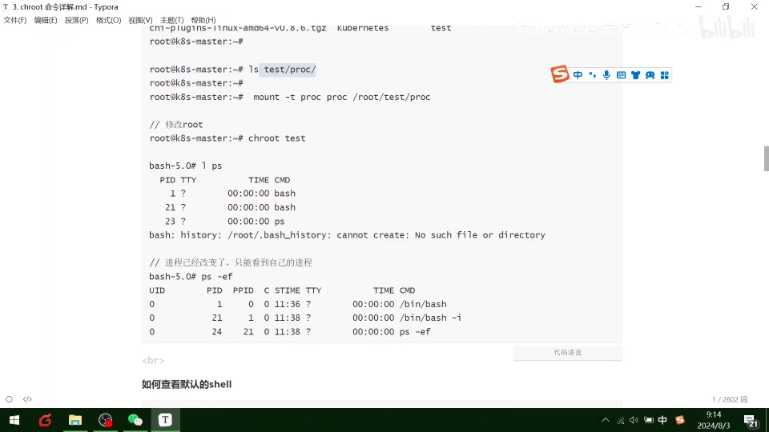
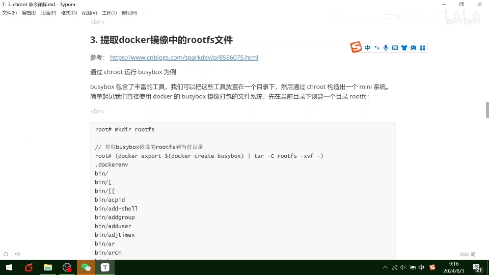
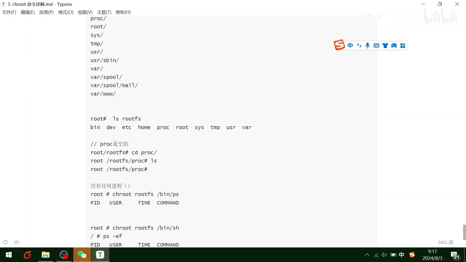

# 004-chroot命令：一条命令如何"偷梁换柱"换掉根目录

> 视频来源：[K8S云原生加油站《004-chroot命令》](https://www.bilibili.com/video/BV1PFijevEcE/)（约 12 分钟）。本文基于视频内容整理，关键知识点附时间戳，可点击跳转到对应画面。

## 本讲要解决的核心问题（SCQA）

**背景**：Linux 里一切文件都从根目录 `/` 出发，进程看到的"世界"就是这棵目录树。容器之所以能把应用"打包带走、到处运行"，本质上就是给进程换了一棵目录树。

**冲突**：如果想亲手体验这件事——让某个程序只看到指定目录、访问不到系统其它文件，甚至在一个"崭新的迷你系统"里启动服务——装虚拟机太重，直接在主机上倒腾又太危险。

**疑问**：有没有轻量的办法，一条命令就把进程眼中的"根"换掉？

**回答（中心思想）**：有，`chroot`（change root）。换根之后配齐三样东西——程序本体及其动态依赖库、`/proc` 挂载、必要时再用 `unshare` 隔离 PID——就能手工搭出一个与宿主隔离的"迷你操作系统"。这也是快速理解容器底层"文件系统隔离 + 进程隔离"的最短路径。

## 一、chroot 是什么：change root

### 1.1 一句话定义

`chroot` 即 change root directory：**把指定目录变成进程眼中的新根目录**。在 Linux 中系统的根目录就是 `/`；执行 chroot 之后，系统读取到的目录和文件将不再是旧系统根目录下的内容，而是一个新根指定下的目录。

换个角度看更直白：新根之外的世界对被 chroot 的进程不存在了——连 `cd ..` 都回不出去。

### 1.2 它带来什么好处

视频里总结了三大好处（[【跳转到 00:50】](https://www.bilibili.com/video/BV1PFijevEcE/?t=50)）：



1. **安全性**：限制用户权限。chroot 之后在新根里访问不到旧系统的目录和文件，一般用在 login 登录之前，让用户碰不到特定文件。
2. **隔离的开发环境**：建立一个与原系统隔离的目录结构，方便用户开发。
3. **切换系统根目录**：引导系统启动、急救系统。

### 1.3 系统启动与急救：最经典的使用场景

chroot 最明显的作用就是"切换系统的根位置"（[【跳转到 01:40】](https://www.bilibili.com/video/BV1PFijevEcE/?t=100)）：系统初始化时，先在内存里的初始 ram 环境中启动，再切换出磁盘上真正的根目录去执行真正的 init；当系统出问题时，也可以用 chroot 切换到一个临时系统里去修复——这正是救援盘修复系统背后的事情。

## 二、实战一：手工搭一个最小 chroot 环境

chroot 有一条硬性前提：**新根目录里必须有能运行的程序**。视频里先构建了一个 `test` 目录，里面放好 `bin/`（含 `bash`、`ls`）等结构，然后尝试 chroot（[【跳转到 02:05】](https://www.bilibili.com/video/BV1PFijevEcE/?t=125)）。

### 2.1 只有可执行文件还不够：动态依赖库

直接 chroot 进去并不能把 `ls` 跑起来——因为 `ls` 依赖若干**动态依赖库**（程序运行时才加载的 .so 库）。需要先用 `ldd` 查看 `ls` 的动态依赖库，再把这些库拷进 `test/lib/`：



把依赖库补齐之后，chroot 进去 `bash`、`ls` 就都能执行了，效果和主机 `/bin` 下的指令一致——此时根目录已经换掉了。

### 2.2 挂载 /proc：让 ps 活过来

接下来执行 `ps` 又报错了：提示**需要挂载 /proc**（[【跳转到 03:45】](https://www.bilibili.com/video/BV1PFijevEcE/?t=225)）。`/proc` 是内核暴露进程信息的接口，`ps` 靠它工作。挂载方法：

```bash
mount -t proc proc /root/test/proc
```

挂上之后再 `chroot test /bin/bash`，执行 `ps -ef` 就能看到（宿主机的）所有进程了。`cd` 进 `/proc` 还能看到 `cgroups` 等与资源隔离相关的文件——这正是前面几讲 namespace、cgroup 知识的落点。



## 三、实战二：chroot + unshare，做出 PID 隔离

上一个实验里 `ps -ef` 看到的是**宿主机的全部进程**——因为 PID 命名空间还没隔离。视频里用 `unshare` 指令，配合 fork、PID、mount proc 相关参数，复用了前面讲过的 cgroup 与 namespace 知识（[【跳转到 05:25】](https://www.bilibili.com/video/BV1PFijevEcE/?t=325)）：



步骤要点：

1. 先把之前挂在 test 下的 proc 卸载掉（umount）；
2. 用 unshare 隔离出新的 PID 命名空间，并在其中 fork 出一个新的 bash 进程；
3. 在新命名空间里重新执行 mount，把 proc 挂回去；
4. 再执行 `ps -ef`：只能看到自己这一个进程，它就是自己的 PID 1。



和未隔离时对比：那里是 root 的一堆进程，这里只有一个 UID 为 0 的自己——**进程隔离达成**。到这一步，"文件系统隔离（chroot）+ 进程隔离（namespace）"两块积木都齐了，这已经是一个手工小容器。

## 四、实战三：用 Docker 导出 busybox 的 rootfs，得到"崭新的迷你系统"

每次手工拷贝二进制和依赖库太麻烦。视频第三步直接提取 Docker 官方 busybox 镜像里的 rootfs 文件（[【跳转到 07:55】](https://www.bilibili.com/video/BV1PFijevEcE/?t=500)）：busybox 里打包了丰富的常用工具（查 IP、`ping` 等各种指令），放在一个目录下，通过 chroot 就能构造出一个迷你小系统。



### 4.1 两条命令导出 rootfs

```bash
mkdir rootfs
docker create busybox
docker export <容器ID> | tar -C rootfs -xf -
```

`docker create` 创建一个 busybox 容器（不启动），`docker export` 把它的文件系统整体导出，管道交给 `tar` 解到 `rootfs` 目录。这样 busybox 里的丰富工具（`arp`、`ping`、`brctl`，甚至 `chroot` 自己）、`/etc` 下的 hostname 与 DNS 解析配置、`/proc` 目录等就全都到位了。

### 4.2 验证：这是一个"崭新"的系统

`ls rootfs` 能看到与 Linux 操作系统一样的目录结构，只是迷你、轻量。进 `rootfs/proc` 看是空的——再 `chroot rootfs /bin/ps`，**没有任何进程**：



对比第二节：那里 ps 能看到宿主全部进程，这里什么都没有——因为这是一个崭新的迷你操作系统。在这样的系统里就可以启动任何服务、派生新的进程，达到资源隔离的目的。

## 小结

- `chroot` = change root：把指定目录变成进程的新根，进程从此看不到新根之外的世界。
- 光换根跑不起来程序：要补齐**可执行文件 + 动态依赖库（ldd 查看并拷贝）**；要让 `ps` 这类工具工作，还得**挂载 /proc**。
- `chroot` 管"看到什么文件"，`unshare` 管"属于哪个进程世界"；两者叠加就是一个手工小容器。
- 不想手工拷文件？`docker create + docker export` 直接拿到完整 rootfs（busybox），chroot 进去就是一个崭新迷你系统，可在其中启动服务、实现资源隔离。
- chroot 的三大用途：安全限制、隔离开发环境、系统引导与急救；它也是 Docker 等容器技术在底层依赖的能力之一。

## 关键术语速查

| 术语 | 一句话解释 |
| --- | --- |
| chroot | change root：把指定目录变成进程眼中的根目录，进程无法访问新根之外的文件 |
| rootfs | 根文件系统：一棵包含操作系统运行所需可执行文件、库和配置的目录树 |
| 动态依赖库 | 程序运行时才加载的 .so 库；用 ldd 查看，缺失则程序无法启动 |
| /proc | 内核暴露进程与系统信息的伪文件系统，ps 等工具依赖它 |
| unshare | 让进程脱离（部分）命名空间、进入新隔离世界的命令，如新的 PID 命名空间 |
| namespace | 命名空间：Linux 内核的隔离机制，让进程拥有独立的 PID、挂载点等视图 |
| busybox | 把常用 Unix 工具打包进一个极小镜像的项目，常用来做最小 rootfs |
