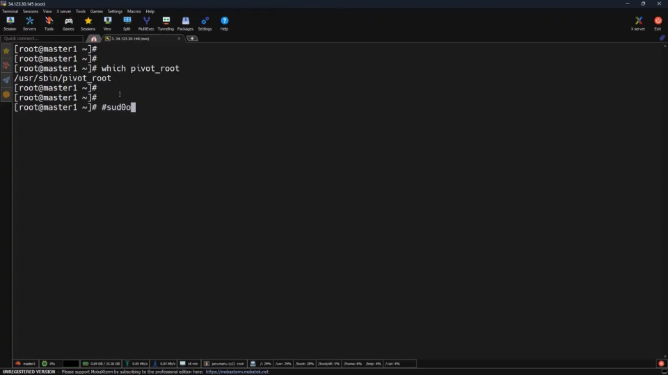
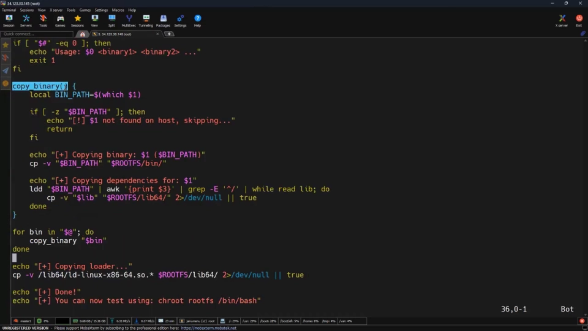
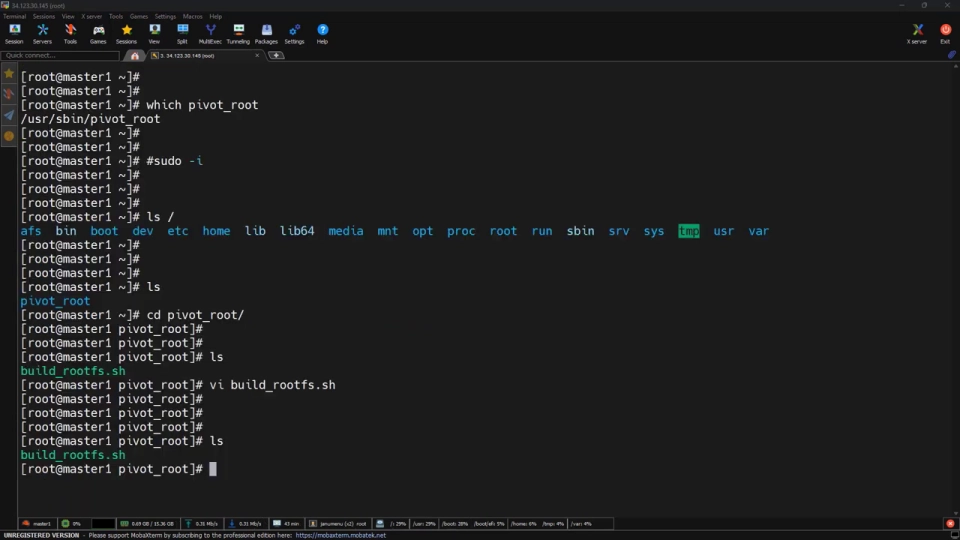
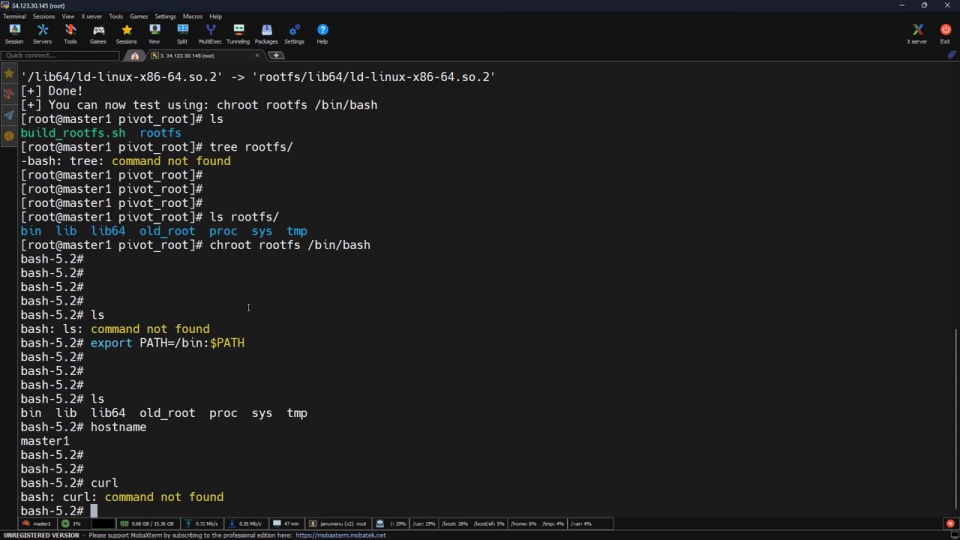
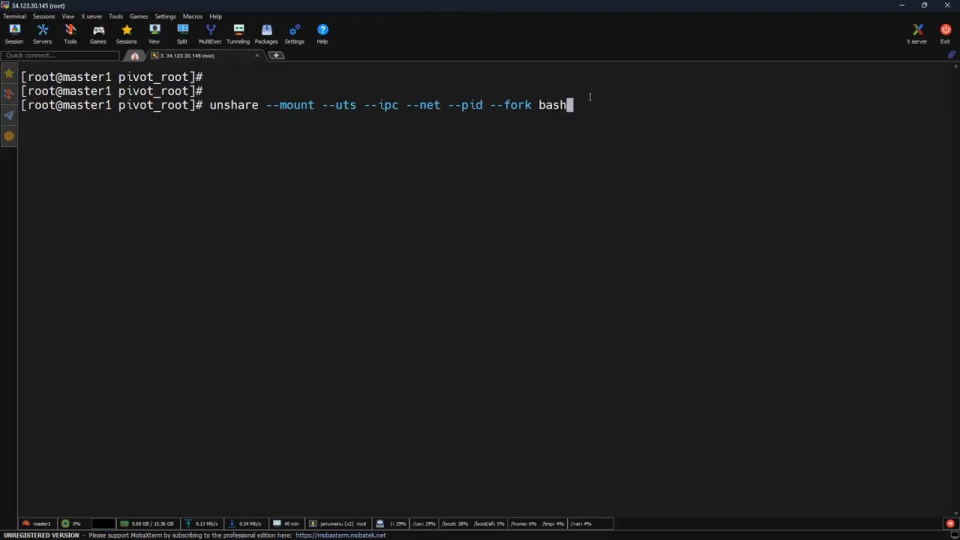
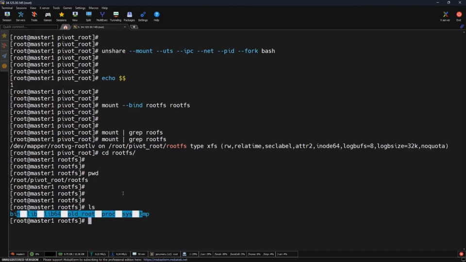
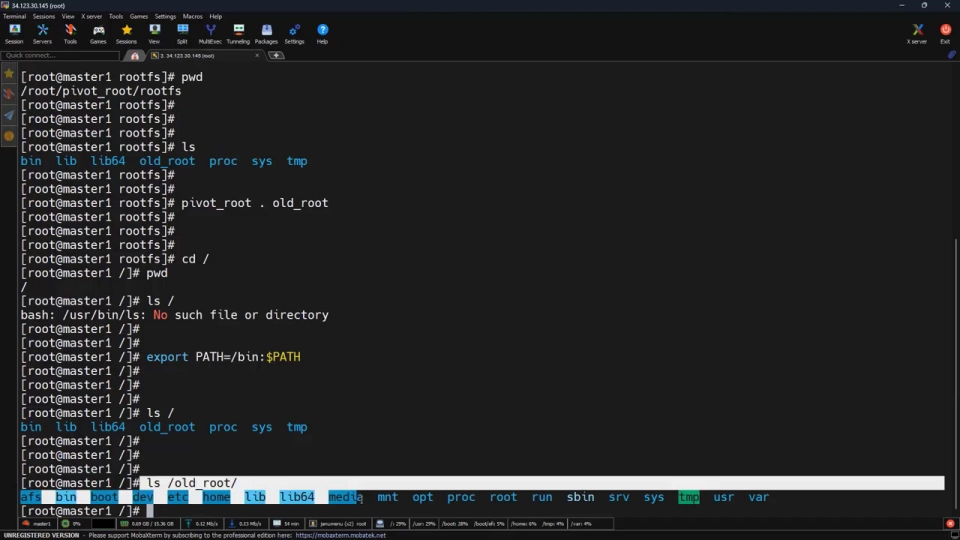

# pivot_root 实战：不用 Docker，亲手完成容器真正的"换根"

> 视频来源：[Techi Nik《Docker Root Switch Explained: The Linux Kernel Secret Behind Container Security》](https://www.youtube.com/watch?v=qjZ5YR1Qi0Y)（约 11.5 分钟，英文）。本文基于视频内容整理，关键知识点附时间戳，可点击跳转。

## 本讲要解决的核心问题（SCQA）

**背景**：容器用 overlayFS 高效地分层叠加文件系统（上一集内容），镜像因此又小又能复用。

**冲突**：但"叠加"不等于"替换"。真实容器启动时，不是在宿主文件系统上再垫一层，而是把进程的根文件系统**整个换掉**；而 chroot 只是让进程"换个视角看目录"，并没有完成这一步。

**疑问**：纯 Linux 环境（没有 Docker、没有 Kubernetes）下，真正的根切换到底怎么做？

**回答（中心思想）**：用 `pivot_root`。先把新根 `mount --bind` 成挂载点，再一条命令 `pivot_root . old_root` 把旧根整体挪走——这才是容器启动时真实发生的"根切换"（root switch），也是容器运行时（container runtime）在底层替我们自动化的核心动作之一。

## 一、为什么 chroot 还不够

### 1.1 叠加 ≠ 替换

上一集看到的 overlayFS 解决的是"文件系统怎么高效地叠起来"；但真实容器不只往上加文件系统，而是**把根文件系统完全替换**——这件事由 pivot_root 完成。本集就用纯 Linux 把它做一遍（[【跳转到 00:00】](https://www.youtube.com/watch?v=qjZ5YR1Qi0Y&t=0)）。


### 1.2 pivot_root 是特权操作

先用 `which pivot_root` 确认命令存在。要注意：pivot_root 是**特权操作**——我们是在字面意义上替换根文件系统，非 root 用户（不用 sudo）无法执行；普通用户先 `sudo -i` 切到 root shell（[【跳转到 00:28】](https://www.youtube.com/watch?v=qjZ5YR1Qi0Y&t=28)）。

动手前先看一眼当前系统：`ls /`，bin、boot、dev、etc 一应俱全——这是"真实系统"，每个进程都从这里出发（[【跳转到 00:53】](https://www.youtube.com/watch?v=qjZ5YR1Qi0Y&t=53)）。



## 二、用脚本自动备好 rootfs

上一集（指该系列的 chroot 一集）是手工拷贝二进制和库；真实场景不会每次都手工做。视频准备了一个 `build_rootfs.sh` 脚本，自动创建 rootfs 结构并打包二进制与依赖（[【跳转到 01:18】](https://www.youtube.com/watch?v=qjZ5YR1Qi0Y&t=78)）。

### 2.1 脚本逐段拆解

- `#!/bin/bash`（shebang）+ `set -e`：任何一条命令失败就立即停止，防止生成"半成品/坏掉"的 rootfs；
- `ROOTFS` 变量：路径只写一遍；
- `mkdir` 一组目录：搭出一个迷你 Linux 文件系统结构，**和容器镜像的布局一致**；
- 参数检查：没传任何命令就打印 usage 并以退出码 1 结束；
- `copy_binary` 函数（核心）：
  - 用 `which` 在宿主机上定位命令（和开头确认 pivot_root 是同一招）；
  - 命令不存在就安全跳过；
  - 把二进制拷进 rootfs（简单起见都放 `/bin`）；
  - 用 `ldd` 列出它需要的全部共享库，过滤出有效路径后逐个拷进 rootfs——**这正是容器镜像打包依赖的方式**（[【跳转到 02:43】](https://www.youtube.com/watch?v=qjZ5YR1Qi0Y&t=163)）；
- 最后拷贝**动态 loader**（dynamic loader）：非常关键的一步，没有它什么都执行不了。



### 2.2 运行脚本，生成 rootfs

```bash
./build_rootfs.sh bash ls ps hostname mount umount
```

脚本把这几个命令连同各自的依赖全部拷好，最后打印 done 和 chroot 测试提示。`ls rootfs` 能看到完整的目录结构——传入想要的命令，脚本自动构建一切，**和 docker build 收集二进制与依赖到文件系统非常相似**（[【跳转到 04:49】](https://www.youtube.com/watch?v=qjZ5YR1Qi0Y&t=289)）。



## 三、先 chroot 验证，再 unshare 隔离

### 3.1 PATH 的坑

先在"只有换根、没有隔离"的层面验证：`chroot rootfs /bin/bash` 进去后 `ls` 不工作——因为 PATH 没设。`export PATH=/bin:$PATH` 之后 `ls`、`hostname` 都正常；`curl` 则失败，因为打包时没包含它——没放进 rootfs 的程序就是不存在（[【跳转到 05:14】](https://www.youtube.com/watch?v=qjZ5YR1Qi0Y&t=314)）。

### 3.2 echo $$ = 1：进入新进程世界

接下来做容器式的隔离：`unshare` 加上为 mount、UTS、IPC、net、pid 创建独立命名空间的 flags。进去之后 `echo $$` 打印当前 shell 的 PID——是 **1**。这意味着已经不在宿主环境里，而是进入了新的"进程世界"，和容器一样（[【跳转到 06:04】](https://www.youtube.com/watch?v=qjZ5YR1Qi0Y&t=364)）。



## 四、pivot_root 三步走

### 4.1 第一步：mount --bind，把 rootfs 变成挂载点

这是与"只用 chroot"最关键的区别（[【跳转到 06:29】](https://www.youtube.com/watch?v=qjZ5YR1Qi0Y&t=389)）：

```bash
mount --bind rootfs rootfs
```

`mount --bind` 让一个目录成为挂载点，而 **pivot_root 只对挂载点生效**——所以必须先为 rootfs 创建挂载点。用 `mount | grep rootfs` 可以验证挂载点已建立。



### 4.2 第二步：cd 进去

**cd 进 rootfs 目录**。这一步看起来不起眼，但跳过它 pivot_root 一定会失败。用 `pwd` 确认当前位置：我们在新文件系统里，但它还不是根（[【跳转到 07:19】](https://www.youtube.com/watch?v=qjZ5YR1Qi0Y&t=439)）。

### 4.3 第三步：pivot_root . old_root

主步骤来了——**这就是容器改变"现实"的方式**（[【跳转到 07:44】](https://www.youtube.com/watch?v=qjZ5YR1Qi0Y&t=464)）：

```bash
pivot_root . old_root
```

- `.`（当前目录）将成为新的根；
- `old_root` 是旧系统要被移去的目录（脚本早已建好这个文件夹）。

注意语义：**我们不是把整个系统藏起来，只是替换了根**。



## 五、切换之后：验证、旧根与 /proc

### 5.1 为什么 pwd 能用而 ls 不行

`cd /` 后 `pwd` 显示 `/`；`ls /` 依然要 `export PATH=/bin:$PATH`——因为 `pwd`、`export` 是 shell **内建命令**，而 `ls` 是**外部程序**：内建命令不需要文件系统里有对应文件，外部二进制必须存在于文件系统中。容器里同理：内建命令总能用，外部程序必须在 rootfs 里（[【跳转到 08:59】](https://www.youtube.com/watch?v=qjZ5YR1Qi0Y&t=539)）。

此刻 `ls /` 打印的是脚本生成的定制 rootfs——**已经不是宿主机了。我们没有隐藏它，只是替换了它。**

### 5.2 old_root：宿主没消失，只是移开了

`ls /old_root` 可以看到旧系统还在、依然可访问——宿主不是消失了，而是被挪走了（[【跳转到 09:24】](https://www.youtube.com/watch?v=qjZ5YR1Qi0Y&t=564)）。到这里就可以把旧根分离（detach）。在 Docker、Podman 这样的真实容器里，old root 会被**完全卸载**，进程根本访问不到宿主——这就是容器实现完整文件系统隔离的方式。**我们没有删除宿主机，只是改变了这个进程能看到什么。**

### 5.3 挂 /proc，看 PID 1

最后挂上 /proc，让系统表现得像真实环境（[【跳转到 09:49】](https://www.youtube.com/watch?v=qjZ5YR1Qi0Y&t=589)）：

```bash
mount -t proc proc /proc
```

`/proc` 是内核接口，进程可见性依赖它。挂好后 `ps` 只显示两个进程，而 **PID 1 是 bash**——这个 shell 正在扮演 init 进程的角色。在容器里，你的应用就是 PID 1，这就是为什么信号处理（signal handling）和进程管理如此重要（[【跳转到 10:14】](https://www.youtube.com/watch?v=qjZ5YR1Qi0Y&t=614)）。



再看文件系统：只剩 bin、lib、lib64、old、proc——这就是我们隔离出的根文件系统。现在有一个进程运行在自己的命名空间、自己的文件系统里，**这已经是一个容器**。没有 Docker，没有 Kubernetes，只有 Linux 原语（Linux primitives）——而这正是容器运行时替我们自动化的东西（[【跳转到 10:35】](https://www.youtube.com/watch?v=qjZ5YR1Qi0Y&t=635)）。

## 六、结论：这就是容器启动的样子

> "This is how containers actually start — not chroot, not abstraction, **a real root switch**."
>
> 容器就是这样启动的：不是 chroot，不是抽象，而是真正的根切换。

视频最后留下一个悬念：隔离只是一半，还缺一块关键拼图——**控制（control）**：谁来决定这个容器能用多少 CPU、多少内存？答案在下一集：cgroups 与 cgroups v2（[【跳转到 11:01】](https://www.youtube.com/watch?v=qjZ5YR1Qi0Y&t=661)）。

## 小结

- overlayFS 负责"高效叠加"，pivot_root 负责"整体替换"：真实容器启动时执行的是真正的根切换。
- pivot_root 的硬性前提：新根必须是**挂载点**（mount --bind），且当前目录要 cd 进新根，缺一不可。
- `pivot_root . old_root`：当前目录升为新根，旧根整体移入 old_root；真实容器会随后完全卸载 old root，实现彻底的文件系统隔离。
- 换根后"命令消失"多为 PATH 问题；根本规律是：shell 内建命令永远可用，外部二进制必须在 rootfs 里。
- 挂上 /proc 之后 ps 才有内容；PID 1 是这个世界的 init——容器里你的应用就是 PID 1，信号处理因此格外重要。
- 隔离（namespace + pivot_root）之外还有"控制"（cgroups），二者合起来才是完整的容器资源模型。

## 关键术语速查

| 术语 | 一句话解释 |
| --- | --- |
| pivot_root | 把整个根文件系统切换到新挂载点、旧根移入指定目录的系统调用级操作 |
| mount --bind | 把目录挂到另一个位置使其成为挂载点；pivot_root 的前置条件 |
| old_root | pivot_root 的第二个参数：旧根被移入的目录，随后可被卸载以彻底隔离 |
| rootfs | 根文件系统目录树；本集用脚本按容器镜像布局生成 |
| ldd | 列出二进制依赖的共享库；打包 rootfs 时据此收集依赖 |
| dynamic loader | 动态链接器（如 ld-linux），没有它任何动态链接程序都无法执行 |
| unshare | 让进程进入全新命名空间的命令；配合 mount/UTS/IPC/net/pid flags 营造容器环境 |
| /proc | 内核暴露进程信息的伪文件系统；ps 依赖它，容器内需单独挂载 |
| PID 1 | 命名空间里的初始进程（init），负责回收僵尸进程、转发信号；容器里就是你的应用 |
