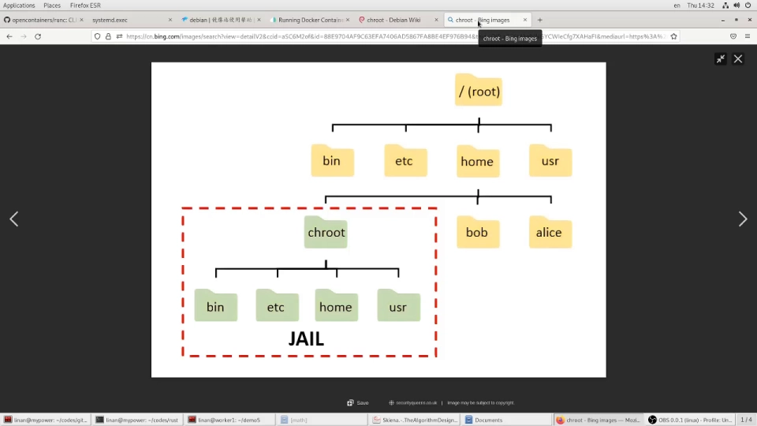
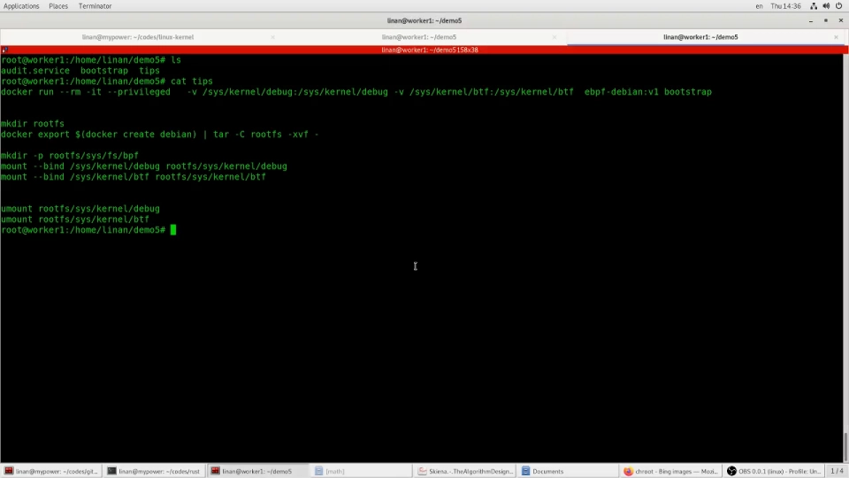
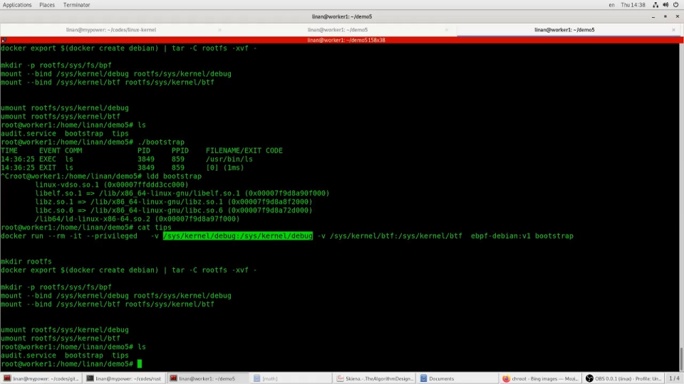
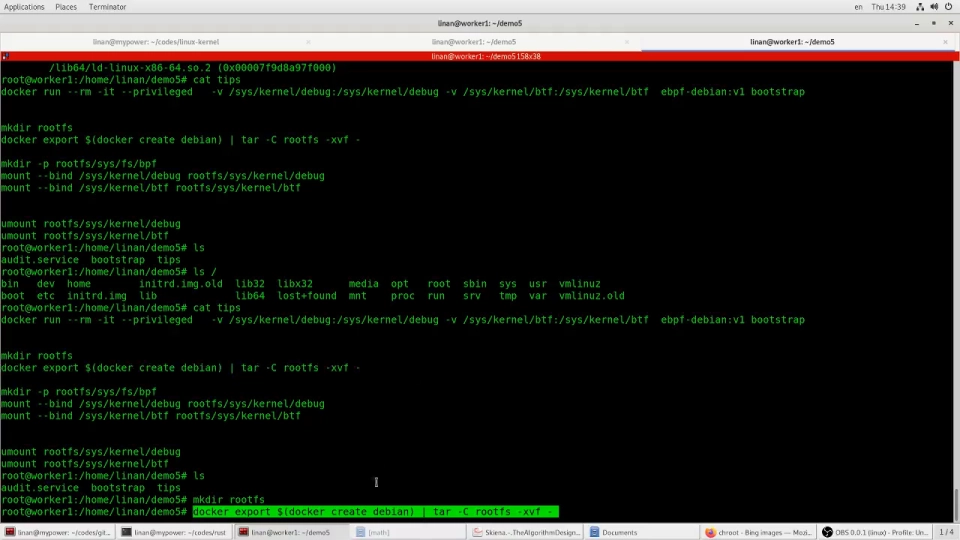
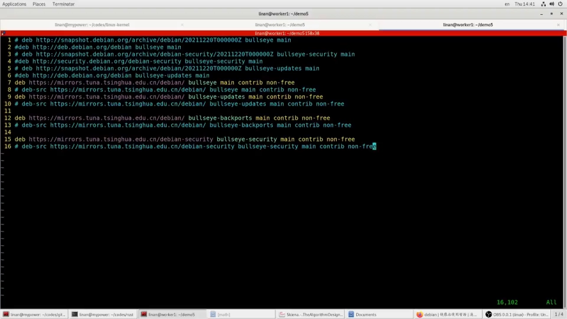
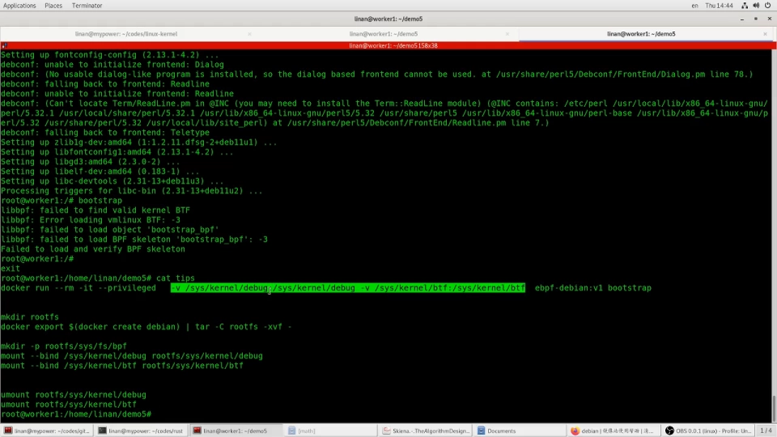
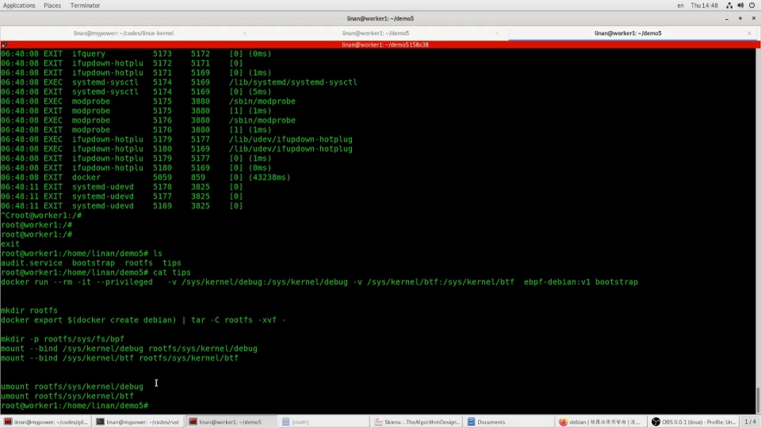
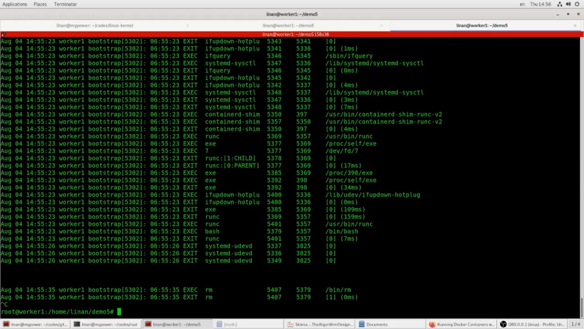

# chroot 实战：从"只要有 Docker 才能跑"到"我的应用哪里都能跑"

> 视频来源：[lddlinan《Linux奇门遁甲术之chroot——从"只要有 docker 我的应用就可以到处跑"到"我的应用可以到处跑"》](https://www.bilibili.com/video/BV1dB4y147CH/)（约 26 分钟）。本文基于视频内容整理，关键知识点附时间戳，可点击跳转。

## 本讲要解决的核心问题（SCQA）

**背景**：容器镜像"一次构建、到处运行"，靠的是镜像里自带的完整 rootfs（根文件系统）。

**冲突**：很多工具因此"绑架"了 Docker——运维、部署工具要求客户机必须装 Docker 才能跑；可有些客户环境恰恰不让装 Docker，甚至连一台有 Docker 的机器都没有。

**疑问**：不装 Docker、不动主机环境，能不能让应用照样"到处跑"？

**回答（中心思想）**：可以。把应用连同依赖装进一个 rootfs，用 `chroot` 显式换根执行——Docker 在底层就是这么做的。把这层"隐性能力"搬到前台，就摆脱了对 Docker 本身的依赖；再配合 systemd 的 `RootDirectory=` 参数，连服务托管也能一并接管。

## 一、chroot 与容器：被藏起来的地基

### 1.1 改变进程看到的根文件系统

`chroot` 是一个古老好用的 Linux 工具：**改变当前运行的程序所看到的根文件系统**。它正是 Docker、rkt、Podman 这些容器管理系统所依赖的底层容器技术之一——容器镜像能在本地跑、也能到别的地方跑，依赖的就是这个功能（[【跳转到 00:05】](https://www.bilibili.com/video/BV1dB4y147CH/?t=5)）。

这个功能在内核很早（视频里提到 2.x 时代）就出现了，直到现在所有 Linux 系统都自带 `chroot` 命令。平时用 Docker 时其实就是在间接用它——只是我们看不到它里面做了什么。

### 1.2 它的拿手好戏：管理依赖

chroot 本来的优势就是帮你管理依赖（dependency），和容器帮你管理依赖关系是同一件事（[【跳转到 00:55】](https://www.bilibili.com/video/BV1dB4y147CH/?t=55)）。

## 二、痛点：依赖管理与 bootstrap 困境

### 2.1 老问题：版本冲突

没有容器的年代，在机器上装工具软件就要考虑依赖。不同发行版有 apt、yum 等各自的包管理工具，大部分情况没问题，但做大升级时可能遇到版本冲突：软件 A 要求某个库是 A 版本，软件 B 却要求 B 版本，两个就不能共存。

### 2.2 Docker 的答案，与新的问题

Docker 很好地解决了这个问题：不在主机上装乱七八糟的东西，主机上只留 Docker。比如要查集群状态需要一个 kubectl 客户端，它有很长的依赖链；封装之后，`kubectl` 命令其实是一个别名，背后就是 `docker run --rm -it <镜像> <命令>` 这样执行（[【跳转到 02:10】](https://www.bilibili.com/video/BV1dB4y147CH/?t=130)）。对主机几乎没有要求——只要有 Docker 就行。

但反过来，**这也成了对 Docker 的依赖**。

### 2.3 bootstrap 困境：客户机连 Docker 都没有

做运维工具要去客户环境部署、收集机器信息。有的客户允许你带上自己的机器跑 Docker、跑部署脚本；有的客户不让你带机器，只能把安装包发给他们自己装——而这时机器上往往没有 Docker。这就形成一个"单机依赖逻辑"：**机器上没有 Docker，但我的工具希望有 Docker**（[【跳转到 03:25】](https://www.bilibili.com/video/BV1dB4y147CH/?t=205)）。

### 2.4 demo 工具：eBPF audit 程序 bootstrap

视频里用一个开源工具 `bootstrap` 做演示：它是从 eBPF 的 C 代码编译出来的，作用是把系统上所有 `exec` 的命令打印出来（[【跳转到 04:08】](https://www.bilibili.com/video/BV1dB4y147CH/?t=248)）。这样的工具可以做 **audit（审计）**：记录所有执行过的命令，比靠 shell history 钩子记录用户输入好得多——容器环境下用户登进容器执行了什么命令你未必知道，而 eBPF 是把跟踪代码挂到 kernel 里，从内核层把命令记下来。

这个工具有依赖关系：libc、libelf（一个处理 ELF 文件的库）等。作为工具开发者，希望它在任何机器上都能跑，就得解决"别人机器上可能没有这些库"的问题。

## 三、实战：把 audit 工具装进 rootfs

### 3.1 最快的 rootfs 来源：docker export

解决思路一：把工具打成容器镜像。可行，但这个工具要 hook 内核，需要较高权限，还要把一些内核入口 mount 进容器。如果客户机器上**连 Docker 都没有**呢？——这时候就轮到 `chroot` 出场（[【跳转到 06:13】](https://www.bilibili.com/video/BV1dB4y147CH/?t=373)）。

chroot 需要一个 rootfs：一个与你现有根目录结构相似的目录树。网上介绍的构建方法往往非常复杂，视频里给了一个更简单的办法：**用 Docker 把镜像导出成 rootfs**（[【跳转到 06:38】](https://www.bilibili.com/video/BV1dB4y147CH/?t=398)）：

原理：Docker 镜像里存的就是 rootfs（外加各层的信息），把内容全部导出来，就是一个现成的 rootfs。视频用 Debian latest 镜像导出。

### 3.2 chroot 进去的第一课：命令缺失、换源与 DNS

chroot 进入这个 rootfs（需要 root 权限）之后，`pwd` 显示的当前目录就成了"根目录"——已经离开原来的环境，能执行哪些命令完全取决于这个 rootfs 里有什么：`ip` 命令就没有，退出来在主机上它就有（[【跳转到 07:28】](https://www.bilibili.com/video/BV1dB4y147CH/?t=448)）。

把 `bootstrap` 拷进 rootfs 的 `/usr/bin` 后执行，报缺库——需要装 libelf 包。于是：

- **换源**：rootfs 里是 Debian，用 apt 装，但官方源慢。编辑 rootfs 里的 `/etc/apt/sources.list`，注释官方源、加上清华镜像源；遇到证书（certificate）问题，就把 https 换成 http（[【跳转到 09:08】](https://www.bilibili.com/video/BV1dB4y147CH/?t=548)）。
- **修 DNS**：`apt update` 报域名解析不了。DNS 要读 `/etc/resolv.conf`，而这个文件跟 rootfs 走——chroot 之后用的就是 rootfs 里那个（默认是空的），它不知道 nameserver 是哪个。把主机上的 `resolv.conf` 拷进 rootfs 的 `/etc/` 就恢复了（[【跳转到 09:43】](https://www.bilibili.com/video/BV1dB4y147CH/?t=583)）。

### 3.3 安装依赖：隔离的价值

装上 libelf-dev（40 多 MB，连带装了很多依赖）。这正体现了容器/chroot 的好处：**这些依赖只装在 rootfs 里，不影响主机上的版本和应用，互不干扰，非常好管理**（[【跳转到 11:23】](https://www.bilibili.com/video/BV1dB4y147CH/?t=683)）。

### 3.4 让工具看见内核：mount --bind

再执行 `bootstrap` 又提示需要 mount——它要与 kernel 通讯、读取内核 debug 信息，所以要把主机上的两个目录 bind 进 rootfs（[【跳转到 11:48】](https://www.bilibili.com/video/BV1dB4y147CH/?t=708)）：

- `debugfs`：程序从那里读内核调试信息；
- `btf`（BPF 类型信息）：工具启动时查内核信息需要的入口。

做法就是创建对应目录后 `mount --bind`，把主机的目录"放进"rootfs（[【跳转到 12:13】](https://www.bilibili.com/video/BV1dB4y147CH/?t=733)）。视频里还演示了一轮真实的试错：先 mkdir 目录、后补 mount，最后工具成功跑起来了——`ls`、`dr` 等命令都被检测并记录下来。

### 3.5 audit 生效：连 docker exec 里的命令也逃不掉

更有意思的是：在 `docker run` / `docker exec` 里执行的命令，同样被记录下来（前面一大串是 docker run 本身用到的 exec 命令）。这样即使应用藏在容器里执行命令，审计日志也看得见——出了安全问题，就能根据日志判断是否有可疑应用在执行命令（[【跳转到 15:23】](https://www.bilibili.com/video/BV1dB4y147CH/?t=923)）。

## 四、交付：不要 Docker 的"绿色部署"

环境做好之后，怎么把这个工具交付到别的机器？很简单（[【跳转到 16:13】](https://www.bilibili.com/video/BV1dB4y147CH/?t=973)）：

1. 把 rootfs 打个包；
2. 附一个小脚本，在执行前先完成那两个 bind mount 命令。

之后这个应用就可以在**任何 Linux 机器**上执行，而且机器上不需要有 Docker——因为依赖的只是 `chroot`，而它基本上所有 Linux 版本都有。这就点题了：**通过显式运行 chroot，解决掉了对 Docker 本身的依赖**。对做运维工具、系统部署的人来说，这是很典型的场景：工具本身并不需要 Docker，就不该让 Docker 成为它的依赖。

## 五、进阶：让 systemd 直接管理 rootfs 里的服务

### 5.1 老做法：systemd 套 Docker

容器刚出来那几年，常见的做法是：应用用 systemd 管理生命周期（restart 之类），但 systemd 单元里的启动命令不是跑主机上的程序，而是 `docker run` 一个镜像——systemd 外面又套了一层 Docker。CoreOS 那类容器化系统甚至把主机上的工具大部分都用容器封装，主机很干净；但仔细想想，真的有必要吗？

### 5.2 RootDirectory= 与 BindPaths=

其实 systemd 原生支持这种玩法：它有一个 root directory 参数（`RootDirectory=`），让 systemd 在执行服务时**直接把根切到指定的 rootfs**，等价于替你做了 chroot——连 Docker 都不需要了（[【跳转到 20:23】](https://www.bilibili.com/video/BV1dB4y147CH/?t=1223)）。

视频里把 audit 工具部署成一个 systemd service（[【跳转到 21:10】](https://www.bilibili.com/video/BV1dB4y147CH/?t=1270)）：

三个关键参数：

- `ExecStart=`：要执行的命令（相对 RootDirectory 里的路径而言）；
- `RootDirectory=`：指定的 rootfs 位置；
- `BindPaths=`：需要 bind 进来的主机目录（相当于 `docker run -v` 的角色），把 debugfs、btf 挂进去。

把单元文件放到 `/etc/systemd/system/`，`daemon-reload` 后 `start`，`journalctl -f` 就能看到它持续记录的命令日志——连 `docker run` 执行的东西也被记下来了（[【跳转到 22:50】](https://www.bilibili.com/video/BV1dB4y147CH/?t=1370)）。整个部署过程，主机上没有装任何东西：只靠 rootfs 管好依赖，不用 Docker 就解决了 dependency。

## 六、两点经验

### 6.1 chroot 附赠的隔离与安全

chroot 不但解决了依赖关系，还附赠一层**隔离**：rootfs 与外面主机的文件系统是分开的，应用就算瞎写、瞎删文件，也影响不到外面的系统。单从安全角度看，显式 chroot 甚至更好一点——Docker 也继承了这种特性，因为它是更底层的通用能力（[【跳转到 24:55】](https://www.bilibili.com/video/BV1dB4y147CH/?t=1495)）。

### 6.2 容器化 ≠ 上 K8s

视频反复强调的第二个经验：**容器化不代表要上 K8s**（[【跳转到 25:20】](https://www.bilibili.com/video/BV1dB4y147CH/?t=1520)）。很多人觉得容器化好，出发点其实是它解决了依赖问题；而 K8s 的核心是一个自动化运维平台——应用能不能承受"被随意调度到某个节点、健康检查失败就被杀掉重启"这类管理逻辑，是另一个话题。盲目把"容器化"理解成"必须上 K8s"，容易产生别的问题。

## 小结

- chroot 是 Docker/rkt/Podman 依赖的底层技术：改变进程看到的根文件系统；用 Docker 就是在间接用它。
- 依赖管理与版本冲突是容器化的原始动机；但"工具依赖 Docker"本身也会成为新的依赖。
- 客户机连 Docker 都没有时：用 `docker export` 快速得到一个 rootfs，把工具装进去，`chroot` 进去补齐依赖（换源、resolv.conf、libelf），再用 `mount --bind` 放行它需要的内核接口（debugfs、btf）。
- 交付只需 rootfs 打包 + 先执行几条 mount 命令的脚本——任何 Linux 机器可跑，不需要 Docker。
- systemd 的 `RootDirectory=` / `BindPaths=` 可以直接托管 rootfs 里的服务，替代"systemd 套 Docker"的老做法。
- chroot 还附赠隔离与安全；容器化的价值在依赖管理，容器化 ≠ 上 K8s。

## 关键术语速查

| 术语 | 一句话解释 |
| --- | --- |
| chroot | 把指定目录变成进程的新根，进程无法访问新根之外的文件 |
| rootfs | 根文件系统目录树；docker export 导出的就是它 |
| resolv.conf | DNS 配置文件，chroot 后生效的是 rootfs 里那一份 |
| mount --bind | 把一个已存在的目录挂到另一个位置，让 rootfs"看见"主机的特定目录 |
| debugfs / btf | 内核调试文件系统 / BPF 类型信息，eBPF 工具运行所需的内核接口 |
| eBPF | 在内核中安全挂载跟踪代码的技术，可从内核层审计所有 exec 命令 |
| systemd RootDirectory= | systemd 服务参数：以指定目录为根执行服务，等价于替你做了 chroot |
| BindPaths= | systemd 服务参数：把主机目录 bind 进服务的根，相当于 docker run -v |
