# Linux进程与proc文件系统：内核把每个进程的"档案"都挂在这个目录里

> 视频来源：[Linux Processes and the proc File System — BeginLinux Guru](https://www.youtube.com/watch?v=BuasM8AH8AM)（约 16 分钟，英文讲解）。本文基于视频内容整理，关键知识点附时间戳，可点击跳转到对应画面。

## 本讲要解决的核心问题（SCQA）

**背景**：`ps`、`top`、`htop` 一敲就能列出系统里所有进程的状态、归属与资源占用，是每个 Linux 用户天天在用的工具。

**冲突**：这些信息并不存在硬盘上——把这块硬盘拆下来接到另一台机器上看，`/proc` 目录里空空如也；机器一关机，这些"文件"也全部消失。

**疑问**：一个看起来普普通通的目录，为什么会凭空出现、又凭空消失？工具的数据到底从哪来？

**回答（中心思想）**：`/proc` 是内核在内存中现场搭建的**虚拟文件系统**（procfs）：每个运行中的进程在这里都有一个以 PID 命名的目录，目录里的"伪文件"实时反映进程状态——`ps`/`top` 读的正是这些文件。读懂 `/proc` 就等于直接看到内核眼中的进程；还能借挂载选项 `hidepid=2` 控制谁能看到谁的进程，给多用户机器加一道安全锁。

## 一、/proc 是"假"目录：只存在于内存的虚拟文件系统

### 1.1 拆下硬盘它就是空的

视频开篇给 `/proc` 定了性：它是**虚拟文件系统**（virtual file system）——"看起来在那儿，其实不在那儿"。把这块硬盘拆下来挂到另一台电脑上，能看到 `/proc` 这个目录本身，但里面什么都没有（[【跳转到 00:25】](https://www.youtube.com/watch?v=BuasM8AH8AM&t=25)）：

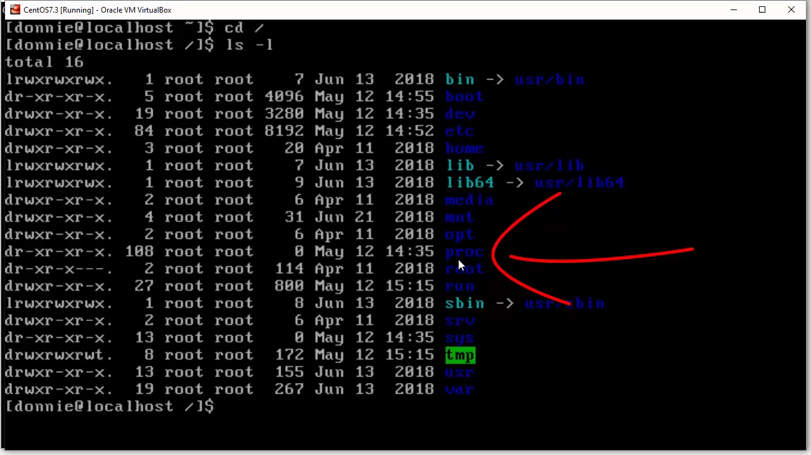

原因：`/proc` 每次开机都由内核**从零重建**，全程只存在于内存（RAM）里；关机即消失，唯一留下的是那个作为挂载点（mount point）的空目录（[【跳转到 00:50】](https://www.youtube.com/watch?v=BuasM8AH8AM&t=50)）。

### 1.2 伪文件的 size 永远是 0

`/proc` 里的"文件"都是**伪文件**（pseudo file）：用 `ls -l` 看它们的大小一律是 0——因为它们根本不占磁盘空间，只存在于内存中（[【跳转到 07:58】](https://www.youtube.com/watch?v=BuasM8AH8AM&t=478)）：

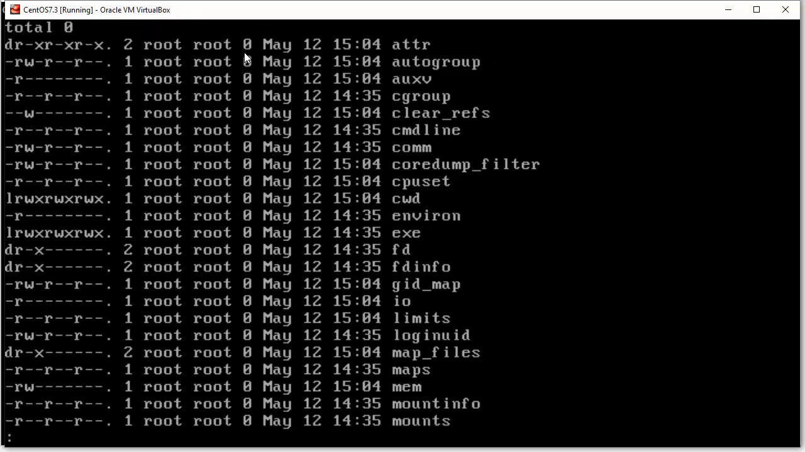

"读"这些文件的动作，实际上是向内核要一份实时数据——这正是 `/proc` 的设计意图。

## 二、数字目录：每个进程一个"档案柜"

### 2.1 目录名就是 PID

打开 `/proc`，最显眼的是一大批以数字命名的目录。**每个数字就是一个进程的 PID**，系统里每个运行中的进程在这里都有自己的目录（[【跳转到 01:15】](https://www.youtube.com/watch?v=BuasM8AH8AM&t=75)）：

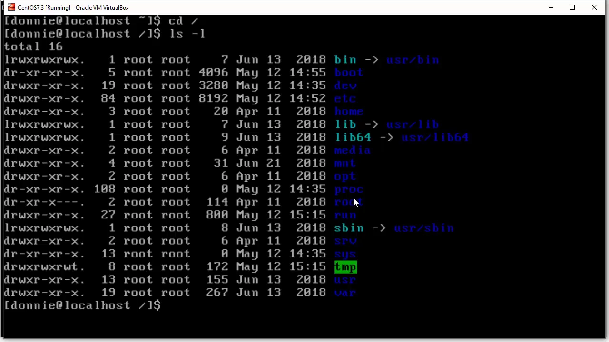

再看归属：这些目录大多属于 root，也有属于普通用户和系统用户的——比如 dbus、chrony（系统服务账号），以及视频作者自己的账号（[【跳转到 01:57】](https://www.youtube.com/watch?v=BuasM8AH8AM&t=117)）：

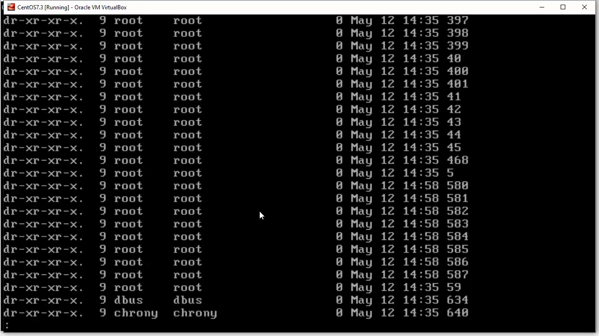

### 2.2 PID 1：systemd（或 init）

数字最小的目录是 `1`，对应 **1 号进程**：在这台 CentOS 上它是 systemd；换成别的发行版，它可能叫 init。它是系统启动后的第一个进程（[【跳转到 03:12】](https://www.youtube.com/watch?v=BuasM8AH8AM&t=192)）：

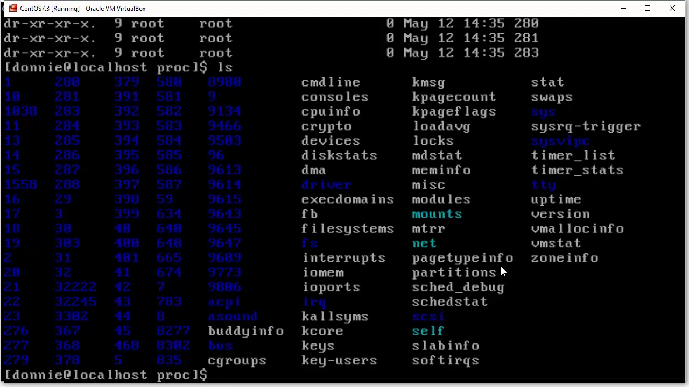

（视频中偶尔传来的响动，是讲者家 14 岁的花猫在显示器后溜达。）

### 2.3 数字之外：名字条目属于内核侧

`/proc` 顶层除了数字目录，还有一批**有名字**的文件与目录。它们与"某个进程"无关，更多反映的是**内核/系统整体**的状态；`top`、`htop` 展示的系统内存、CPU 占用等，读的正是这里的少数几项（[【跳转到 02:22】](https://www.youtube.com/watch?v=BuasM8AH8AM&t=142)）：

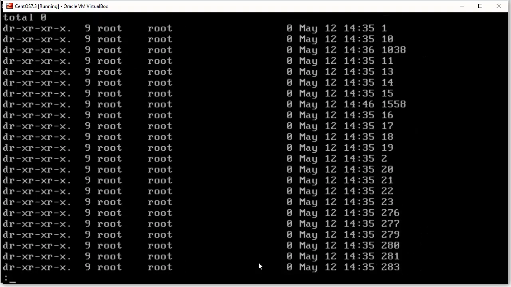

本讲聚焦数字目录；命名条目的更多用法，讲者在另一个播放列表里专门介绍。

## 三、伪文件怎么读：cat、权限与 man 手册

### 3.1 用 cat 读，权限各有不同

进入 `/proc/1`，里面是一堆伪文件。归属与权限一目了然：这个进程属于 root，于是这里多数条目只有 root 能读，少数人人可读（[【跳转到 04:27】](https://www.youtube.com/watch?v=BuasM8AH8AM&t=267)）：

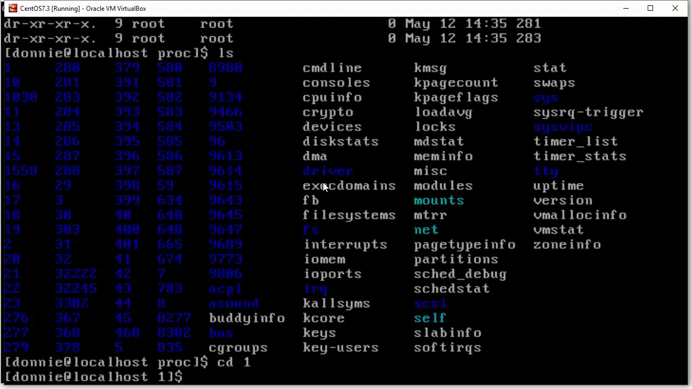

能读的直接 `cat`。比如 `autogroup` 文件内容很简单：`nice 0`——这是该进程的 **nice 值**（调度优先级修正值）为 0（[【跳转到 04:52】](https://www.youtube.com/watch?v=BuasM8AH8AM&t=292)）：

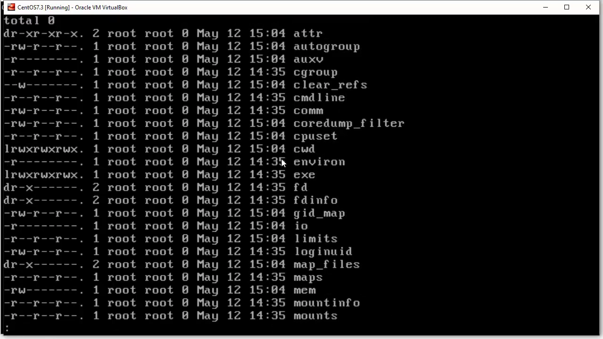

### 3.2 man 5 proc：伪文件字典

每个伪文件是什么意思？有 man 手册：`man 5 proc`。手册开篇就写明：/proc/PID 是"以进程 PID 命名的数值子目录"，其中包含若干伪文件与子目录，随后逐一解释每个条目的含义（[【跳转到 05:23】](https://www.youtube.com/watch?v=BuasM8AH8AM&t=323)）：

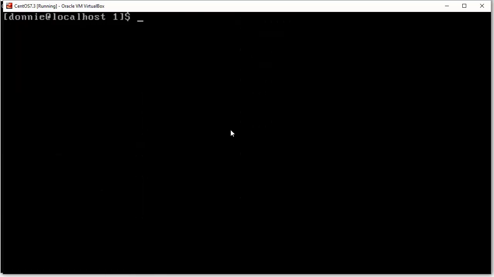

讲者把"读完这份手册"留作作业——日常虽然不必逐个查看（`ps`、`top`、`htop` 已经替你读好了），但熟悉 `/proc` 里有什么，排障时心里更有底（[【跳转到 06:20】](https://www.youtube.com/watch?v=BuasM8AH8AM&t=380)）。

## 四、实操：在 /proc 里找到自己的进程

视频里作者从 `/proc` 中找出了属于自己的两个进程目录（665、783），挑 665 进去一看：即便进程属于普通用户 donnie，其大部分条目的属主依然是 root，部分条目归属 donnie 所在的组（[【跳转到 08:38】](https://www.youtube.com/watch?v=BuasM8AH8AM&t=518)）：

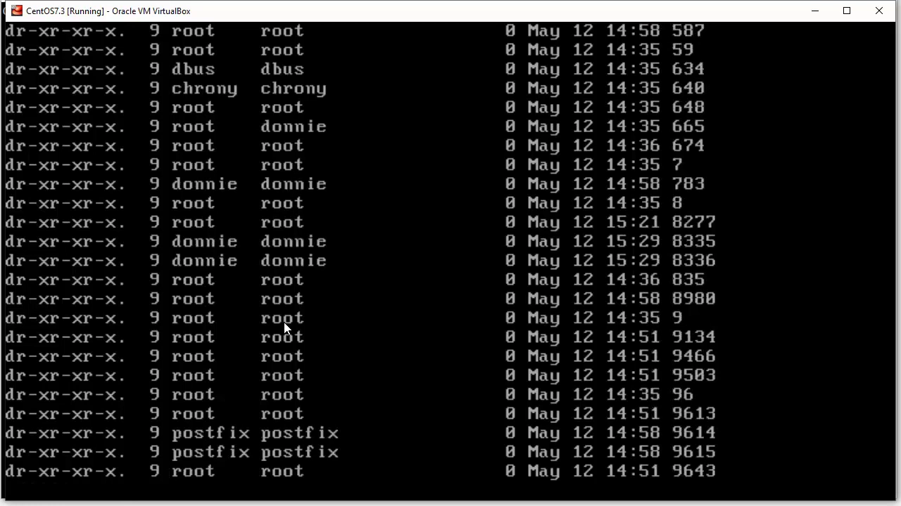

## 五、hidepid=2：把别人的进程藏起来

### 5.1 现象：树莓派上 ps aux 只能看到自己

作者在树莓派（Debian 系统）上敲 `ps aux`——本应显示所有用户的所有进程，结果只有自己的（[【跳转到 09:34】](https://www.youtube.com/watch?v=BuasM8AH8AM&t=574)）：

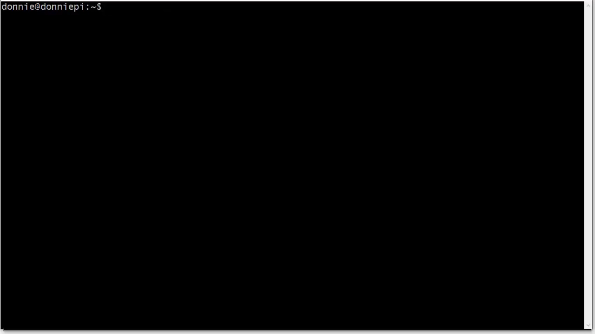

而另一台 CentOS 机器上，同样的命令能看到所有人的进程。差别在哪？

### 5.2 原理：fstab 里的一行挂载选项

答案在 `/etc/fstab`：树莓派上多了一行，把 proc 类型文件系统挂到 `/proc` 时带了 **hidepid=2** 选项（[【跳转到 10:15】](https://www.youtube.com/watch?v=BuasM8AH8AM&t=615)）：

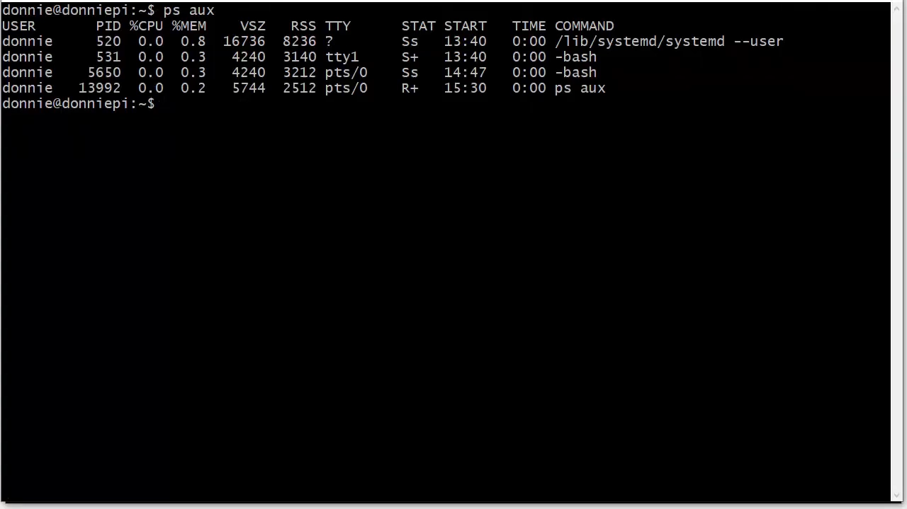

`hidepid=2` 的含义：**只有 root 能看到其他用户的进程**。普通用户登录后，`ps`、`top` 只能看到自己的进程；想看别人的进程，或想 `cd` 进 `/proc` 看别人的目录，都必须 root 权限（[【跳转到 10:40】](https://www.youtube.com/watch?v=BuasM8AH8AM&t=640)）。写好 fstab 后 remount 或重启即可生效。

### 5.3 为什么要藏：安全视角

两个理由（[【跳转到 11:30】](https://www.youtube.com/watch?v=BuasM8AH8AM&t=690)）：

1. **多用户服务器**：大家都能登录的机器上，没必要让用户互相看到对方的进程。
2. **提高攻击成本**：攻击者若只拿到普通账号，看不到系统全貌，就更难摸清这台机器的底细、更难找到入侵路径并提权到 root。

### 5.4 在 CentOS 上实测

作者的 CentOS 机器原本没有这行配置。他把 hidepid=2 写进 fstab（自嘲"没在 CentOS 上试过，相当于无保护攀岩"），重启验证（[【跳转到 13:23】](https://www.youtube.com/watch?v=BuasM8AH8AM&t=803)）：

- `ps aux`：只剩自己的进程；
- `sudo ps aux`：全部进程尽收眼底（[【跳转到 13:48】](https://www.youtube.com/watch?v=BuasM8AH8AM&t=828)）；

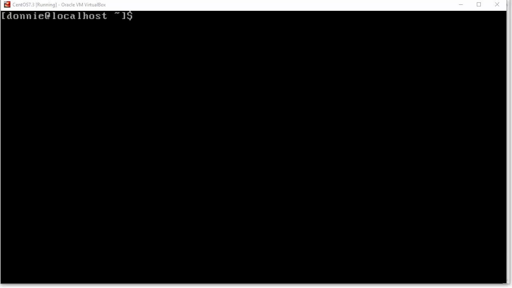

- `top` 同理：`sudo top` 才能看到全部。

结论：这招在 Debian、CentOS 上都有效，当然也适用于任何 Linux 发行版（[【跳转到 14:30】](https://www.youtube.com/watch?v=BuasM8AH8AM&t=870)）。

### 5.5 适用建议

自己家的个人桌面无所谓；**对外的服务器、企业桌面、联网的 IoT 设备**都建议加上 hidepid=2（[【跳转到 14:39】](https://www.youtube.com/watch?v=BuasM8AH8AM&t=879)）。

## 小结

- `/proc` 是**虚拟文件系统**：只在内存、开机重建、关机即空，伪文件 size 恒为 0。
- **数字目录 = 进程 PID**；PID 1 是 systemd（CentOS）/ init（其他发行版）。
- 目录里的伪文件实时反映进程状态；权限因文件而异，`man 5 proc` 是权威字典。
- `ps`/`top`/`htop` 的数据正是从 `/proc` 读的——工具是壳，procfs 是源。
- fstab 挂载选项 **hidepid=2**：普通用户只能看到自己的进程，是多用户服务器与联网设备的低成本安全加固。

## 关键术语速查

| 术语 | 一句话解释 |
| --- | --- |
| 虚拟文件系统（procfs） | 内核在内存中动态生成、不占磁盘的文件系统，挂载于 `/proc` |
| 伪文件（pseudo file） | 看似文件、实为内核数据的接口；size=0，读取即返回实时信息 |
| PID | 进程号；`/proc` 下每个数字目录对应一个运行中的进程 |
| systemd / init | 1 号进程，系统启动后的第一个进程 |
| hidepid=2 | procfs 挂载选项：普通用户只能看到自己的进程，root 不受限 |
| nice 值 | 进程调度优先级的修正值，可从 `/proc/PID/autogroup` 读到 |
