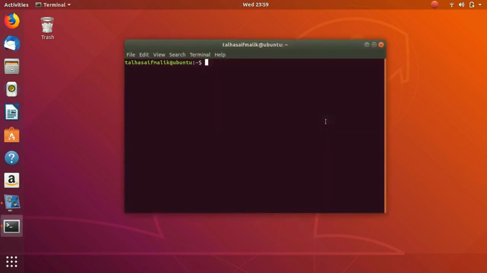
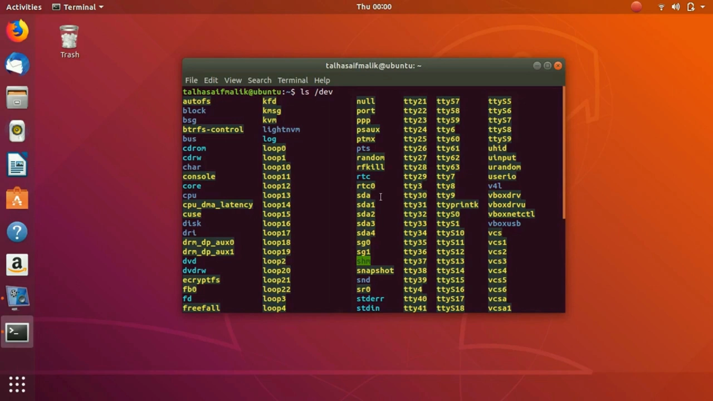
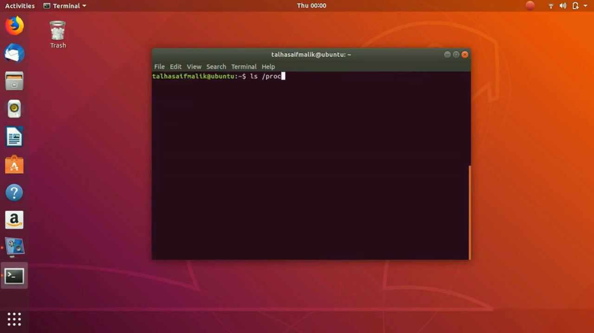
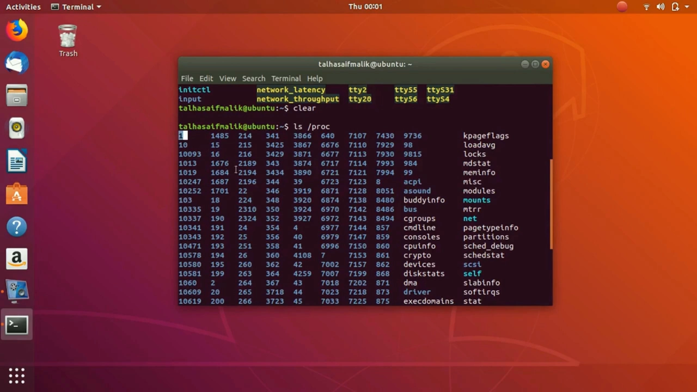
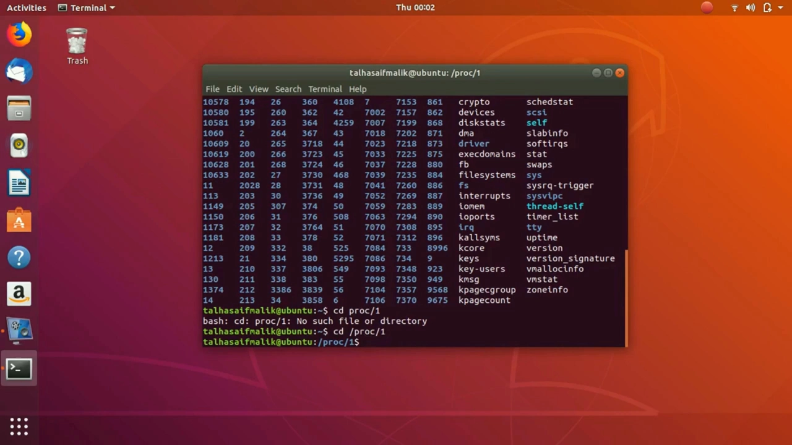
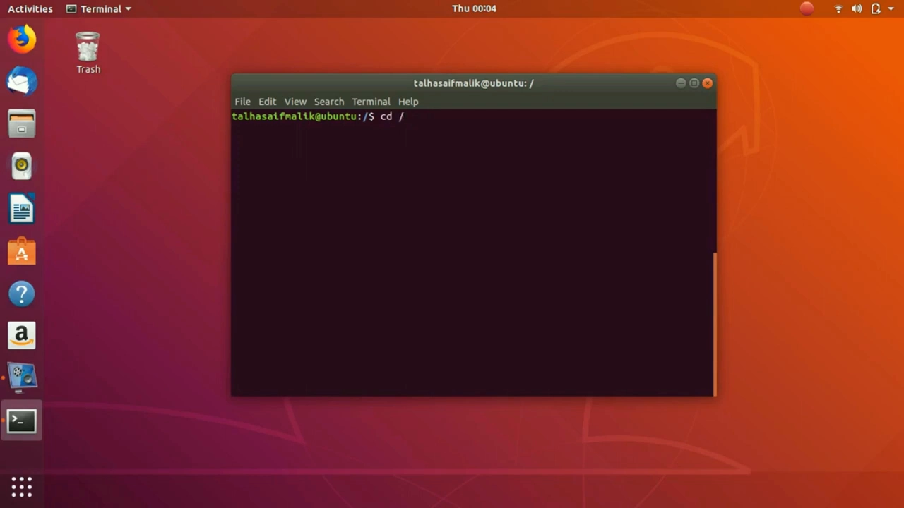
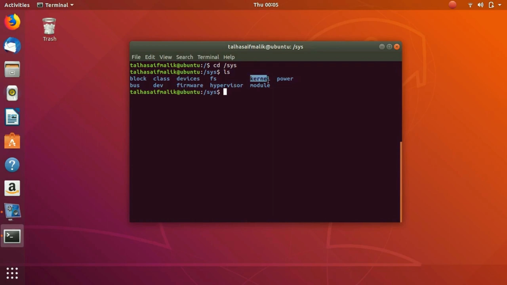
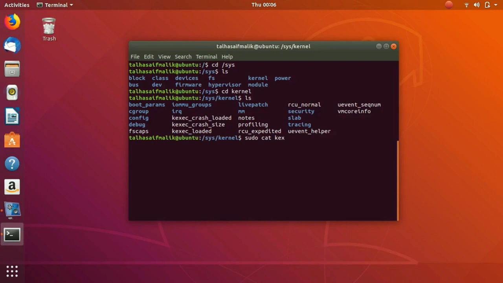

# 伪文件系统：/dev、/proc、/sys——三个通往内核的"文件窗口"

> 视频来源：[12 Pseudo File System dev proc sys — linuxhint](https://www.youtube.com/watch?v=oPoj2gFsoY4)（约 6 分钟，英文讲解，讲师 Linux 课程系列第 12 课）。本文基于视频内容整理，关键知识点附时间戳，可点击跳转到对应画面。

## 本讲要解决的核心问题（SCQA）

**背景**：Linux 有"一切皆文件"的说法，`/dev`、`/proc`、`/sys` 三个目录看起来和别的目录没什么两样。

**冲突**：它们不占硬盘空间，内容却随系统运行实时变化——`/proc` 里的数字每次开机都不一样，`/sys` 里的某些"文件"改一下还能改变系统行为。

**疑问**：这些"文件"到底是什么？为什么能像普通文件一样读写？

**回答（中心思想）**：它们是三个**伪文件系统**（pseudo file system）：`/dev` 是设备树——访问一切设备的入口；`/proc` 暴露进程与系统运行信息；`/sys` 暴露内核与系统的设置。三者都由内核动态生成，都能用 `ls`、`cat` 等基本命令像普通文件一样浏览与读取（部分条目按权限写入）。

## 一、/dev：设备的门牌

`ls /dev`：这里列出的设备并非都以实体形式插在机器上——很多条目是**内核生成的入口**（[【跳转到 00:15】](https://www.youtube.com/watch?v=oPoj2gFsoY4&t=15)）：

比如 sda 代表硬盘：可以对它执行命令、查看甚至恢复硬盘上的数据。想访问设备本身，就要经过这棵**设备树**（device tree）——任何设备都从这里的条目进入（[【跳转到 00:40】](https://www.youtube.com/watch?v=oPoj2gFsoY4&t=40)）：

## 二、/proc：进程的信息中心

`ls /proc`：满屏的数字。**这些数字是进程 ID**——正在运行的进程在这里的编号；其中 1 号是 init 进程，系统的第一个进程（[【跳转到 01:30】](https://www.youtube.com/watch?v=oPoj2gFsoY4&t=90)）：

想知道 1 号进程的状态？进入 `/proc/1`（[【跳转到 01:55】](https://www.youtube.com/watch?v=oPoj2gFsoY4&t=115)）：

`ls` 一下，就能看到描述这个进程的种种文件（[【跳转到 02:20】](https://www.youtube.com/watch?v=oPoj2gFsoY4&t=140)）：

除进程外，`/proc` 里还能看到进程的内存分配情况、以及与网络相关的系统运行信息（[【跳转到 02:34】](https://www.youtube.com/watch?v=oPoj2gFsoY4&t=154)）。

## 三、/sys：内核设置的调节台

`/sys` 里是一批重要目录：block、bus、class、devices、firmware、kernel、module、power——这里是**通往内核与操作系统大量设置的入口**（[【跳转到 03:15】](https://www.youtube.com/watch?v=oPoj2gFsoY4&t=195)）：

进入 `/sys/kernel`，能看到大量**标志（flag）**。以 kexec_crash_loaded 为例：读取它需要管理员权限，所以要 `sudo cat`；输出 0，表示该标志处于**关闭**状态（[【跳转到 04:30】](https://www.youtube.com/watch?v=oPoj2gFsoY4&t=270)）：

这些条目还可以**写入**——设置标志就会改变操作系统的行为。这正是 `/sys` 的核心价值：把内核的"旋钮"做成了文件（[【跳转到 04:55】](https://www.youtube.com/watch?v=oPoj2gFsoY4&t=295)）。

限于时间，视频没有逐个展示每个文件；用学过的基本命令（`ls`、`cat`）就能按同样方式探索所有条目。

## 小结

- `/dev`、`/proc`、`/sys` 都是**伪文件系统**：内核动态生成、不占磁盘、实时变化。
- `/dev` 是设备树：一切设备的访问入口（如 sda = 硬盘）。
- `/proc` 是进程信息中心：数字目录 = PID，1 号是 init；还含内存、网络等系统信息。
- `/sys` 是内核设置入口：block/bus/class 等目录下的大量标志，可读、可（按权限）写。
- 一句话记住：**读伪文件 = 向内核要数据；写伪文件 = 改内核设置**。

## 关键术语速查

| 术语 | 一句话解释 |
| --- | --- |
| 伪文件系统（pseudo file system） | 内核动态生成、不占磁盘的文件系统；/dev、/proc、/sys 都是 |
| 设备树（/dev） | 以文件形式呈现的所有设备入口，如 sda 代表硬盘 |
| /proc | 进程与系统运行信息的实时窗口 |
| /sys | 内核与系统设置的窗口，标志可读取、可（按权限）写入 |
| kexec_crash_loaded | `/sys/kernel` 下的标志文件；示例中读出 0，表示该功能未启用 |
