# Linux 特殊权限：SUID、SGID、粘滞位——普通用户凭什么能改自己的密码？

> 本文整理自 B 站视频《[【Linux基础】25.Linux中的特殊权限](https://www.bilibili.com/video/BV1n94y1F73E/)》（约 29 分钟）。这是史努比 Linux 基础系列的第二十五讲：先用 vim 与 passwd 两个实验引出"进程以谁的身份访问文件"这个关键概念，再逐一讲解 SUID、SGID、SBIT（粘滞位）三个特殊权限位的含义、设置方法（数字模式 4/2/1 与符号模式 u+s/g+s/o+t）并做验证实验，最后补充 chattr/lsattr 隐藏属性（i 锁定与 a 只追加）。全程实机演示，适合初学者跟练。

## 本讲要解决的核心问题（SCQA）

**背景**：Linux 是多用户系统。每个文件都有属主、属组和 rwx 权限，`chmod 755`、`chown` 这两条命令改的就是它们——上节课已经练过：数字模式一位一位算，字符模式 `a-x`、`u+s` 这样加减。

**冲突**：`/etc/shadow` 存着所有用户的密码，普通用户对它"没有任何权限"。可普通用户史努比运行 `passwd` 却能改自己的密码——他对 `/etc/shadow` 既不是属主、也不在属组里，"其他人"三位上更是没有任何权限，这个密码文件怎么就被写成功了？

**疑问**：进程访问文件时，内核到底看的是"哪个用户"的权限？

**回答（中心思想）**：看的是**运行这个进程的用户**对目标文件有没有相应权限——不是看"程序本身"有什么权限。而 **SUID** 允许可执行文件在运行时借用**文件属主的身份**：`passwd` 的属主是 root、权限位上带着 `s`，所以任何用户运行它时都以 root 身份去写 `/etc/shadow`。同一族的特殊权限还有：**SGID** 让目录里新建的文件自动继承目录的属组；**SBIT（粘滞位）**让共享目录里"谁创建的文件谁能删"；**chattr 隐藏属性**则能连 root 都锁在门外。

## 一、两分钟回顾：chmod 与 chown

### 1.1 数字模式与字符模式

视频从 /opt 目录下的 file.txt（权限 644）开始回顾：

- 想给属主、属组、其他人都加上执行权限 x：直接 `chmod 755 file.txt`——644 的每一位加一就是 755，x 就代表 1，这样每一位就都有 x 权限了。这叫**数字模式**。
- 想改回 644：`chmod a-x file.txt`，所有位（a）减去 x。这叫**字符模式**。

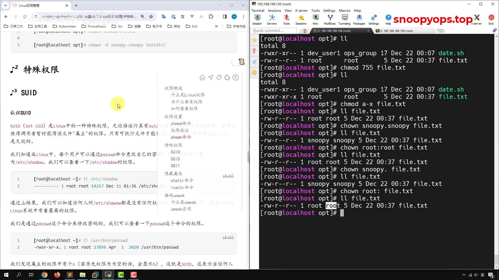

[【跳转到 02:30】](https://www.bilibili.com/video/BV1n94y1F73E/?t=150)

### 1.2 chown：改文件的属主与属组

`chown` 修改文件的所属用户和所属组。比如把 root:root 的 file 改给史努比：

- `chown 史努比:史努比 file`——冒号也可以写成点；
- 只改属主时可以简写成 `chown 史努比 file`；
- 改回去就用 `chown root:root file`。

这些常规操作本讲不再展开，它们是理解后面"特殊权限"的地基：**权限位是按"属主 / 属组 / 其他人"三段去比对身份的**。

## 二、关键概念：进程以"运行它的用户"的身份访问文件

### 2.1 先记住这句话

在讲特殊权限之前，讲师先立了一个概念：

> 进程能够以何种方式访问文件，取决于**运行这个进程的用户**对文件有没有相应的权限。

乍一听很绕，用实验拆开看。

### 2.2 实验：史努比用 vim 改 644 的文件

/root 的 file.txt 权限是 644。切换到史努比用户，运行 `vim /opt/file.txt` 想修改它——注意，vim 装在这台服务器上，本身是一个文件、一个程序；当它运行起来之后，就变成了一个**进程**。

结果：史努比在 vim 里改不动，`wq` 退不出去，`wq!` 强制保存也不行，只能 `q!` 强制退出。

为什么？系统看的**不是 vim 这个程序对文件有什么权限**，而是运行 vim 的史努比对文件有什么权限。史努比不是属主（属主是 root）、不在 root 组里，落在"其他人"段上只有 r（只读），自然写不了。

[【跳转到 03:05】](https://www.bilibili.com/video/BV1n94y1F73E/?t=185)

### 2.3 ps -ef 验证进程的属主

回到第一个窗口用 `ps -ef` 查看当前进程，过滤 vim：

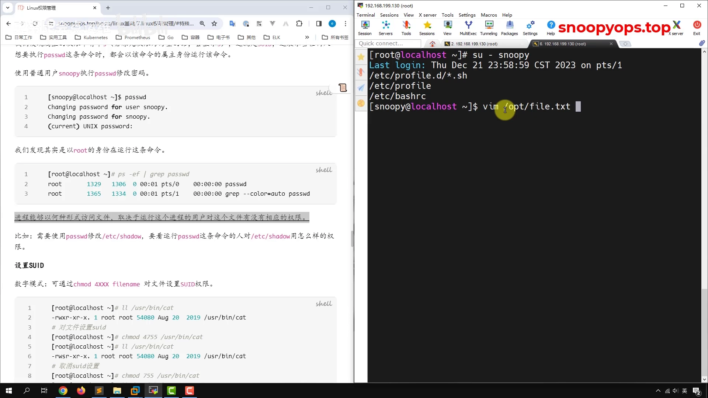

[【跳转到 03:45】](https://www.bilibili.com/video/BV1n94y1F73E/?t=225)

进程列表清清楚楚：**史努比用户在运行 vim /opt/file.txt 这个进程**。判定文件能不能写，就看史努比这个用户对 644 的文件有哪些权限——只有读。这个概念立住了，下面的 SUID 才好理解。

## 三、SUID：passwd 为什么能改 /etc/shadow

### 3.1 现象：毫无权限，密码却改成功了

`/etc/shadow` 存储密码相关信息。先看它的权限：普通用户对它**没有任何权限**（属主、属组、其他人都没有可读可写的份）。

实验一：root 运行 `passwd` 给 root 改密码。改完从 shadow 里过滤 root 那一行，密码散列（加密字符串）变了。这合理——root 是系统最高管理员，在系统里可以做任何事情。

[【跳转到 05:25】](https://www.bilibili.com/video/BV1n94y1F73E/?t=325)

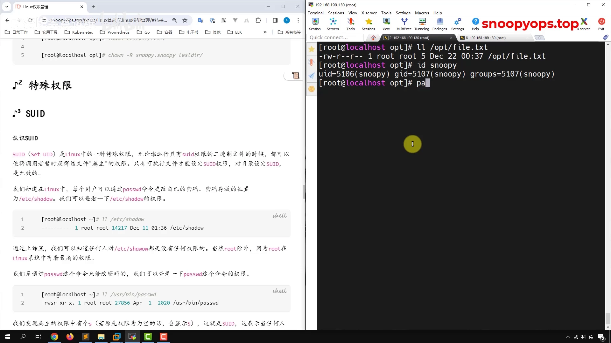

实验二：切到史努比，运行 `passwd` 改史努比自己的密码——提示修改成功，shadow 里史努比那一段同样变了。

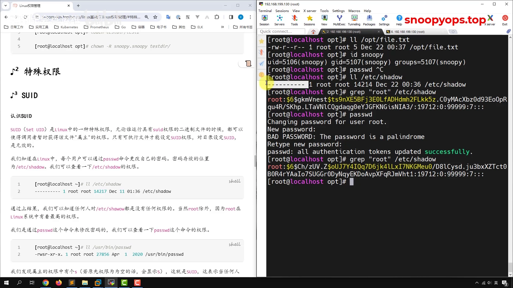

[【跳转到 07:05】](https://www.bilibili.com/video/BV1n94y1F73E/?t=425)

矛盾就在这里：史努比对 /etc/shadow 没有任何权限——不是 root 用户、不属于 root 组，最后三位（其他人）也没有权限。**为什么能修改？**

[【跳转到 08:15】](https://www.bilibili.com/video/BV1n94y1F73E/?t=495)

### 3.2 揭秘：passwd 权限位上的 s

用 `whereis passwd` 找到 passwd 的绝对路径，`ls -l` 看它的权限——权限位里出现了一个 **s**。我们之前只学过 rwx，从来没见过 S。

这个 s 就是 **SUID**。它的含义：

> 任何人运行 passwd 这条命令，都会以**这条命令所属的用户**（对 passwd 而言就是 root）的身份去运行。

于是史努比运行 passwd 时，进程实际是 root 身份，root 对 /etc/shadow 有权限（最高管理员什么都能做），所以 shadow 被成功修改。

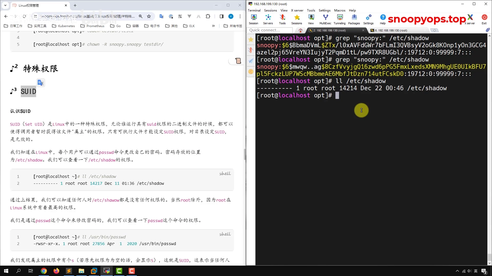

[【跳转到 09:06】](https://www.bilibili.com/video/BV1n94y1F73E/?t=546)

### 3.3 验证：passwd 进程的实际身份是 root

光看权限位还不够，视频做了一个漂亮的验证：输入 `passwd` 让它停在那里不动，然后从另一个窗口过滤进程：

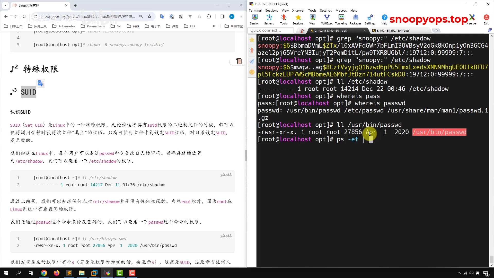

[【跳转到 10:00】](https://www.bilibili.com/video/BV1n94y1F73E/?t=600)

`ps -ef` 显示运行 passwd 的用户是 **root**——可明明是史努比敲的命令。这就是 SUID 生效的直接证据。

### 3.4 实验：给 cat 加上 SUID

为了彻底看清 SUID 的效果，讲师拿 cat 做实验：

1. `whereis cat` 找到路径，`ls -l` 看权限：755，没有特殊位；
2. 史努比运行 `cat /etc/shadow`：被拒绝（史努比对它没有读权限）；
3. 给 cat 加 SUID，两种方式：
   - **数字模式**：SUID 对应 **4000**，直接在 755 前面加个 4：`chmod 4755 /usr/bin/cat`；
   - **符号模式**：`chmod u+s /usr/bin/cat`，给属主（user）加上 s。
4. 再看权限位：出现了 s。

现在任何人执行 cat，都会以 cat 属主（root）的身份执行——史努比再 `cat /etc/shadow`，就不报"权限不允许"了，系统里任何文件都能看。这就是 SUID 的作用。

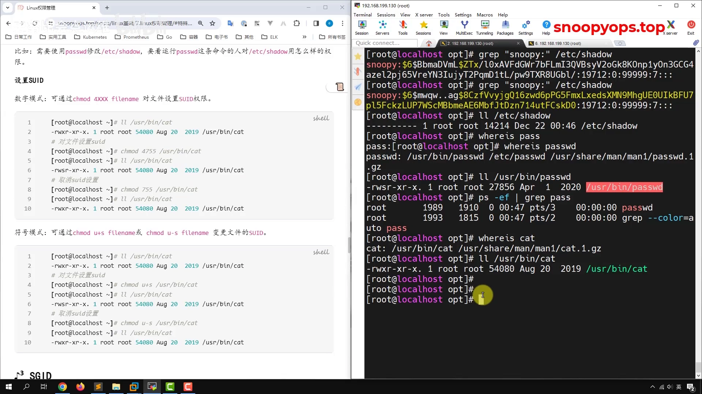

[【跳转到 11:24】](https://www.bilibili.com/video/BV1n94y1F73E/?t=684)

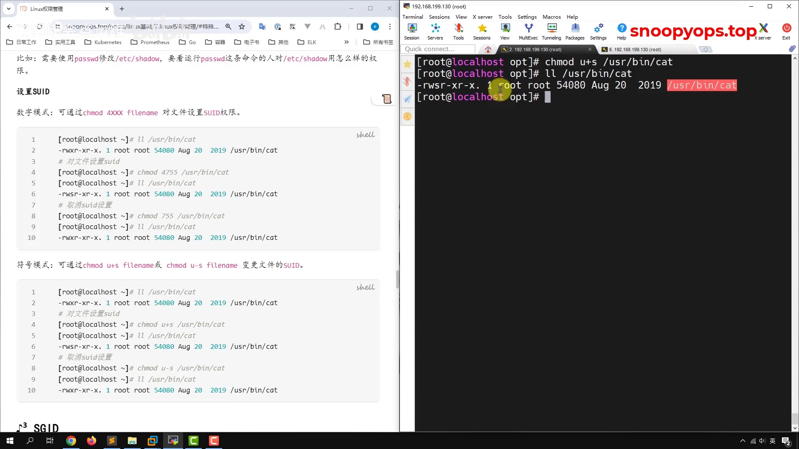

[【跳转到 12:30】](https://www.bilibili.com/video/BV1n94y1F73E/?t=750)

撤销也简单：数字模式改回 `chmod 755 /usr/bin/cat`，或符号模式 `chmod u-s /usr/bin/cat`，权限回归正常。

实验做完记得撤销——给系统命令留一个 SUID 的 cat，等于给所有普通用户开了"读遍全盘"的口子。

## 四、SGID：目录里新建的文件，属组跟着目录走

### 4.1 需求：一个 devops 组的协作目录

SGID 和 SBIT 用得很少，讲师说"做到认识就行"。先用一个需求引入：

> 在 /opt 下建一个 shell 目录，它属于 devops 组；张三、李四都是 devops 组的成员。希望**组员在这个目录下创建的文件，属组自动是 devops**——比如张三创建的文件属于张三用户，但属组是 devops。

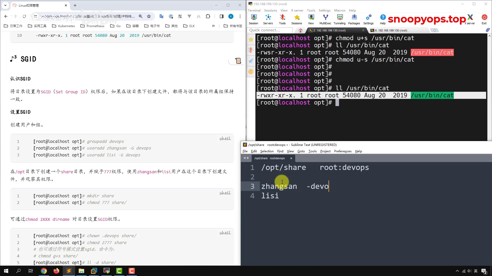

[【跳转到 13:45】](https://www.bilibili.com/video/BV1n94y1F73E/?t=825)

### 4.2 搭建场景

视频里一步一步把场景搭出来：

```bash
groupadd devops                # 创建用户组
useradd 张三 -G devops          # -G（大 G）指定附加组
useradd 李四 -G devops
mkdir /opt/shell
chown :devops /opt/shell       # 点或冒号都可以：chown .devops 也行
ls -ld /opt/shell              # 属组已变成 devops
```

张三这时仍进不了目录、建不了文件——目录还没有 x 权限。于是 `chmod 755 /opt/shell`（视频里讲师一时手误敲成 chown，又改回来用 chmod）。

### 4.3 问题重现：新建文件的属组没有跟着走

张三在目录里创建了文件：属主是张三，**属组也是张三**（张三的主组），并不是 devops。李四创建的文件同样属于李四组。需求没有自动满足——这时候就要用到 SGID。

[【跳转到 17:15】](https://www.bilibili.com/video/BV1n94y1F73E/?t=1035)

### 4.4 设置 SGID：数字 2000 或 g+s

SGID 对应的数字是 **2000**（对照 SUID 的 4000）。目录现在是 775，直接：

```bash
chmod 2775 /opt/shell    # 在前面加个 2
ls -ld /opt/shell        # 属组那一位的 x 变成了 s
```

撤销时视频里出现了一个小插曲：`chmod 775` 居然**没有**把 s 退掉，改用字符模式 `chmod g-s` 才去掉；同样 `chmod g+s` 也可以把 SGID 加上去。

设置好之后再看效果：

- 之前张三建的文件：属组还是张三；
- 现在新建的"张三1"：属主张三，**属组自动变成 devops**；
- 李四新建的"李四1"：属组同样是 devops。

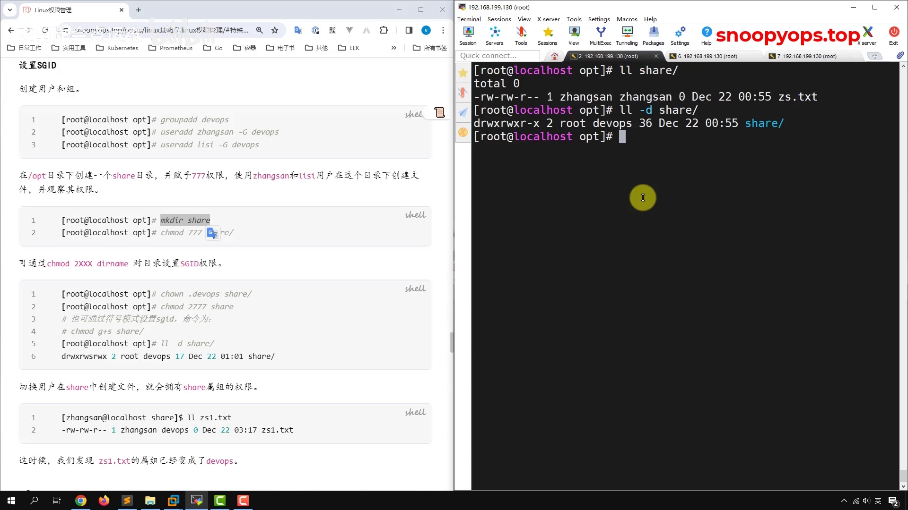

[【跳转到 18:11】](https://www.bilibili.com/video/BV1n94y1F73E/?t=1091)

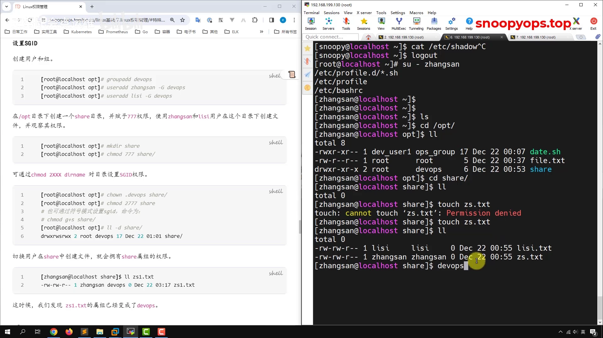

[【跳转到 19:51】](https://www.bilibili.com/video/BV1n94y1F73E/?t=1191)

### 4.5 讲师提示

讲师的原话：这个 SGID 在实际的生产环境中基本上用不到。本讲的目标是认识它的机制——**目录上设 SGID，目录内新建文件的属组继承目录的属组**。

## 五、SBIT（粘滞位）：谁创建，谁才能删

### 5.1 问题：共享目录里能互相删文件

还是刚才的 shell 目录：张三可以删掉李四的文件，李四也可以删掉张三的文件。目录对组内成员开放写权限时，这显然不安全。

### 5.2 /tmp 的 t 位与设置方法

SBIT 也叫**粘滞位**：给目录设置之后，**谁在这个目录下创建的文件，就只能由谁来删**（root 也可以删，其他人删不了）。系统里的 /tmp 目录就是一个现成的例子——权限的最后一位是 t。

[【跳转到 21:19】](https://www.bilibili.com/video/BV1n94y1F73E/?t=1279)

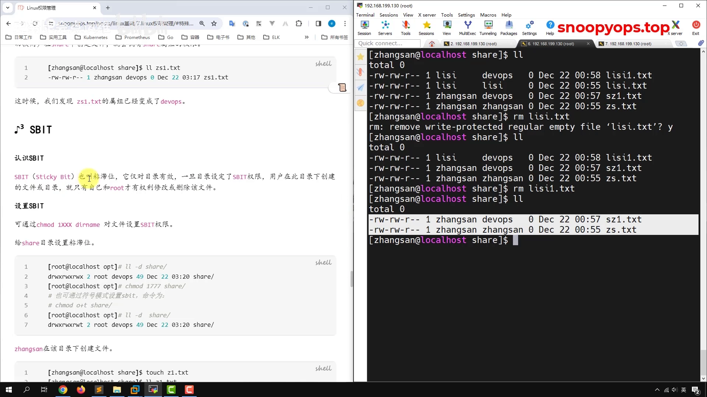

给 shell 目录设置 SBIT，数字是 **1000**：

```bash
chmod 1775 /opt/shell    # 775 前面加个 1，最后一位变成 t
chmod o-t /opt/shell     # 符号模式去掉：o 表示 other
chmod o+t /opt/shell     # 符号模式再加回来
```

### 5.3 验证：设置前后，删除一拒一放

- 设置 SBIT 后：李四创建一个文件，张三去删——报"**操作不被允许**"，删不了了；
- root 把 SBIT 去掉（`o-t`）之后：张三再去 `rm` 李四的文件——又被删掉了。

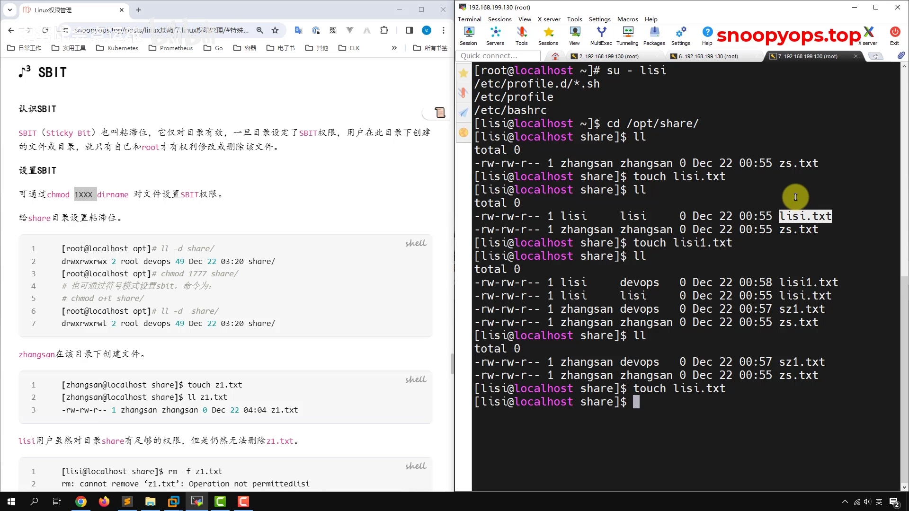

[【跳转到 22:59】](https://www.bilibili.com/video/BV1n94y1F73E/?t=1379)

## 六、隐藏属性：chattr 锁定与只追加

### 6.1 常规属性之外，还有一套"隐藏属性"

常规权限（rwx）用 `ls -l` 就能看到；隐藏属性用 ls 看不出来，需要一对专门的命令：

- `chattr`：设置隐藏属性；
- `lsattr`：查看隐藏属性。

### 6.2 +i：锁定文件，连 root 都动不了

用 root 演示：在 /opt 下创建一个叫"史努比"的文件，权限 644。root 想改就改、想删就删（echo 追加内容也正常）。

然后 `chattr +i 史努比`——i 表示**锁定**这个文件，任何人都修改不了它：

- 直接 `ls -l` 看不出变化，还是 644；
- `lsattr 史努比` 能看到多了一个 i；
- 此时 root 再追加内容：**被拒绝**；想删除：也删不了。

解锁：`chattr -i`。

[【跳转到 24:20】](https://www.bilibili.com/video/BV1n94y1F73E/?t=1460)

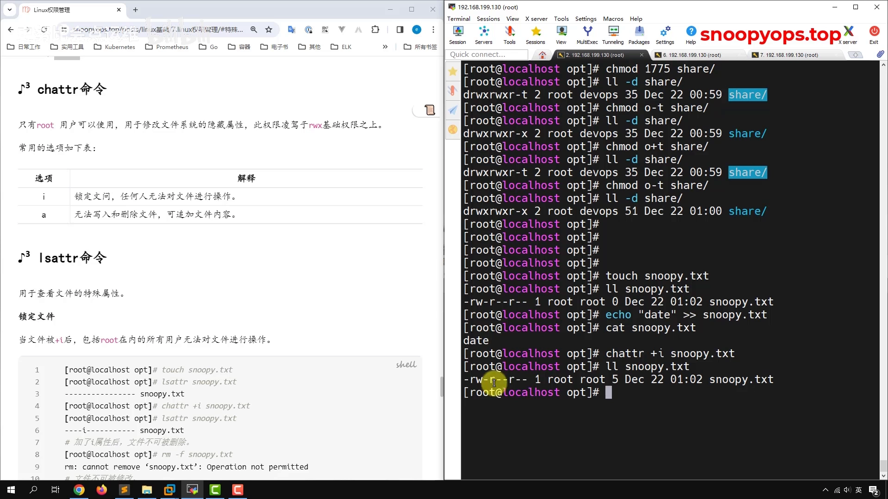

[【跳转到 25:35】](https://www.bilibili.com/video/BV1n94y1F73E/?t=1535)

### 6.3 +a：只允许追加

另一个常用选项是 a：`chattr +a` 之后，这个文件**只可以追加**，除了追加之外不能做任何操作：

- `echo` 追加一行：成功；
- 删除文件：不行；
- `chattr -a` 解除后，才能正常删除。

讲师补充：除了 i 和 a 还有很多选项，因为不常用，不必刻意去记，需要的时候再查。

## 小结

- **进程访问文件，看的是"运行进程的用户"对该文件的权限**——不是程序本身的权限。这是全讲的根基。
- **SUID**（数字 4000 / 符号 `u+s`）：可执行文件属主执行位上的 s。运行它时，进程以**文件属主**的身份运行——passwd 由此能写 /etc/shadow，加了 SUID 的 cat 能读遍全盘。
- **SGID**（数字 2000 / 符号 `g+s`）：目录属组执行位上的 s。目录内新建文件的**属组继承目录属组**（属主跟创建者走，属组跟目录走）。讲师提醒：生产环境基本用不到，认识即可。
- **SBIT / 粘滞位**（数字 1000 / 符号 `o+t`）：权限最后一位的 t。共享目录里**谁创建的文件谁能删**，root 也可以删；系统里的 /tmp 就是范例。
- **隐藏属性**：`chattr +i` 锁定（root 也动不了）、`chattr +a` 只追加；`lsattr` 查看，`-i` / `-a` 解除。
- 三个特殊位都有两种设置方式：数字模式在普通权限前加 4/2/1（如 4755、2775、1775），符号模式 u+s / g+s / o+t。

## 关键术语速查

| 术语 | 一句话解释 |
| --- | --- |
| SUID | 可执行文件属主执行位上的 s；运行时进程以文件属主身份运行 |
| SGID | 目录属组执行位上的 s；目录内新建文件继承目录属组 |
| SBIT / 粘滞位 | 其他人执行位上的 t；共享目录里谁创建谁才能删（root 除外） |
| 数字模式 | 4=SUID、2=SGID、1=SBIT，写在普通权限前面（4755 / 2775 / 1775） |
| 符号模式 | u+s / g+s / o+t 加，u-s / g-s / o-t 减 |
| chattr / lsattr | 设置 / 查看隐藏属性；+i 锁定、+a 只追加 |
| /etc/shadow | 存放用户密码散列的文件，普通用户无任何权限 |
| passwd | 带 SUID 的改密码命令——普通用户能改 /etc/shadow 的谜底 |
