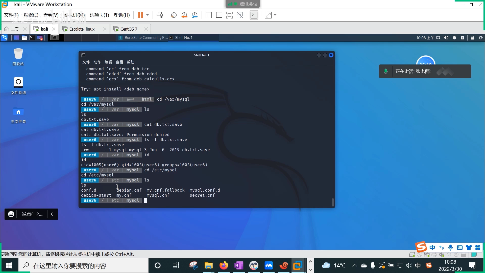
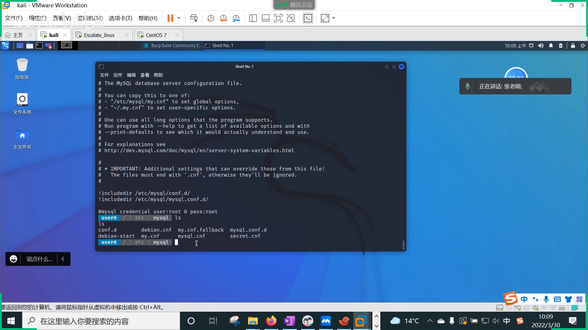
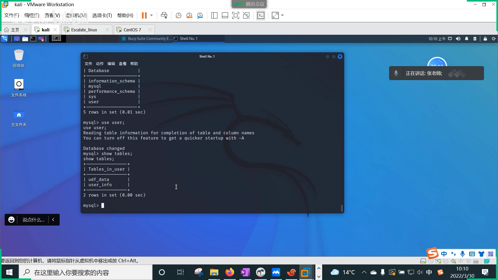
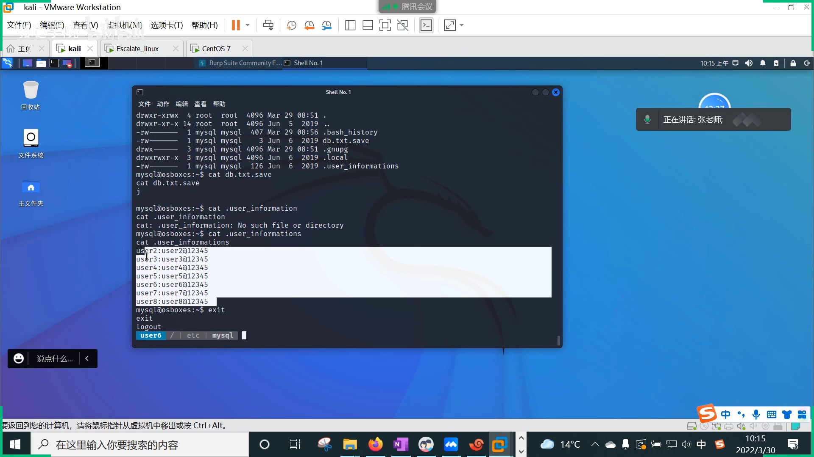
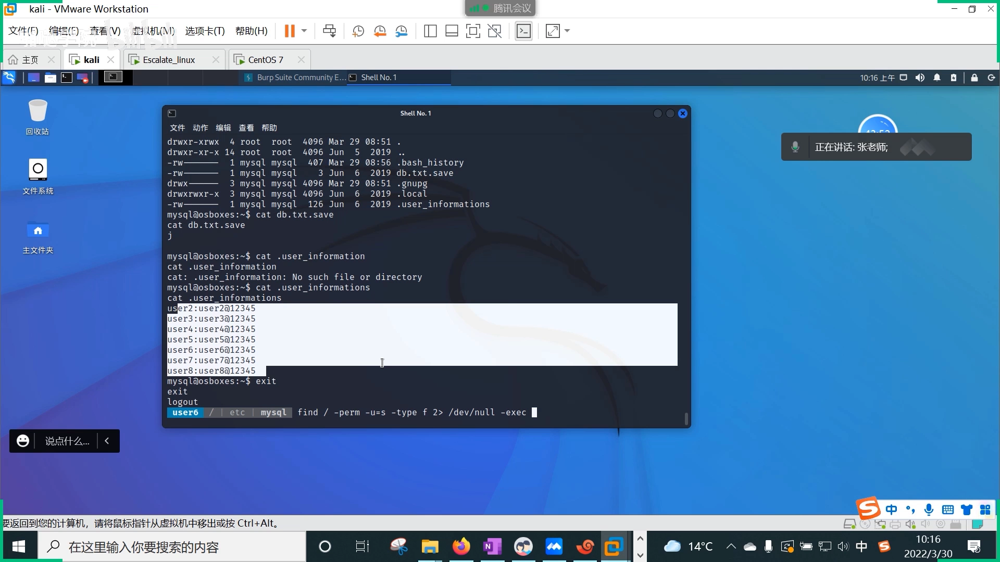
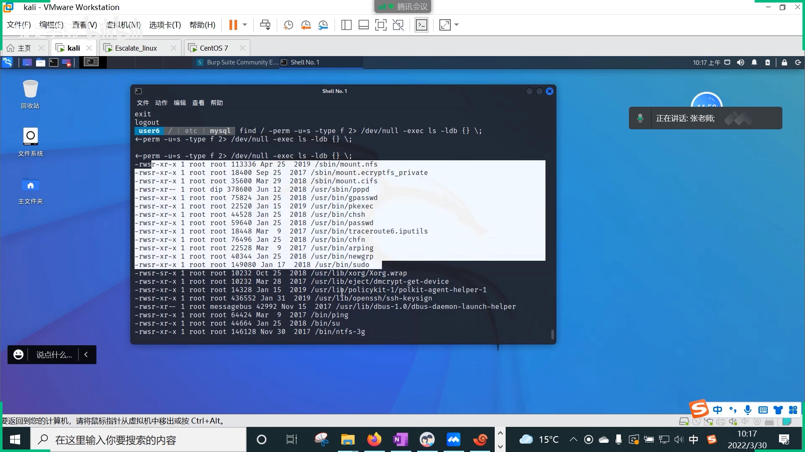
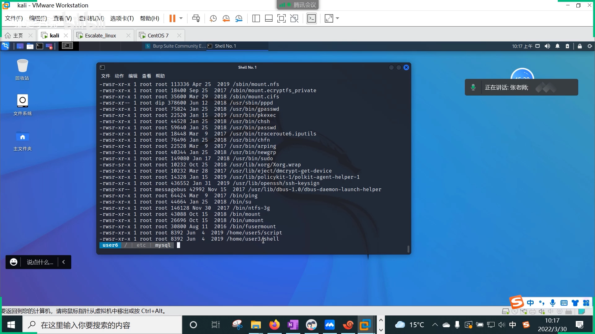
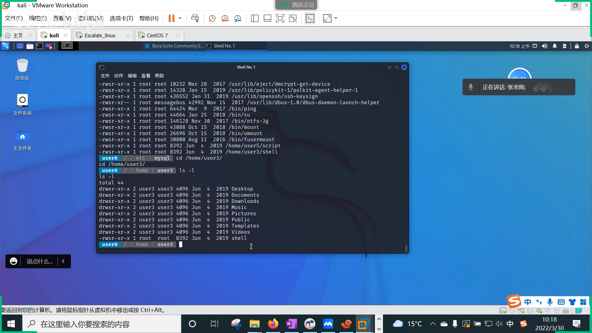

# SUID 提权入门：从敏感信息泄露到 root 身份的两次跳跃

> 本文整理自 B 站视频《[渗透实战，提权方式快速入门之第二节-SUID提权](https://www.bilibili.com/video/BV1MM411v7NW/)》（约 14 分钟）。讲师在 CTF 靶场里演示提权课程的第二节：拿到普通 shell 之后的两条典型越权路径——①程序账号被配了可登录 shell，运维又把账号密码随手留在服务器上，引发敏感信息泄露；②文件被不合理地设置了 SUID 位，执行时以 root 身份运行。并给出信息收集阶段全盘搜索 SUID 文件的经典 `find` 命令。全程靶场实操，适合初学者建立"提权"的整体地图。

## 本讲要解决的核心问题（SCQA）

**背景**：渗透测试拿到靶机的一个普通用户 shell 后，下一步目标是拿到 root（超级管理员）权限。系统里每个账号都有身份：系统账号、程序账号、普通账号；正常情况下，程序账号（如 mysql）不应该能登录系统。

**冲突**：手里只有普通账号——`/etc/shadow` 读不了，直接 su root 又没有密码，当前收集到的账号也"都不是超级管理员"。提权线索到底在哪？

**疑问**：系统里哪些"设计不当"，会把 root 的权力让给普通账号？

**回答（中心思想）**：两条主线——**①敏感信息泄露导致的越权**：程序账号被给了可登录 shell，运维又把密码随手留在配置文件或服务器上，凭据被层层利用（普通账号 → 登录 mysql → 又搜出一层密码）；**②不规范的 SUID 位导致的越权**：本该普通账号使用的文件被设置 SUID 位后，任何账号执行它都以文件属主（root）身份运行，直接越权。信息收集时用 `find / -perm -4000` 全盘搜索 SUID 文件是经典做法。

## 一、从程序账号开始的信息收集

### 1.1 先看"账号"本身

拿到 shell 后怎么做？新一轮信息收集：先查看敏感信息文件，看账号有没有可疑之处。讲师先抛出一个判断题：这个账号是系统账号、程序账号还是普通账号？——是**程序账号**。程序账号一般应该怎么做？比如禁止登录。如果不那样做（比如给程序账号配了可登录 shell），我们怎么利用它？这样做为什么有风险？

[【跳转到 00:50】](https://www.bilibili.com/video/BV1MM411v7NW/?t=50)

### 1.2 顺着 3306 端口与配置文件找 mysql

结合端口看：3306 暴露了。mysql 的数据目录在 `/var/mysql` 下面，存放数据库数据；目录里还有个脚本（备份脚本之类）。配置文件一般要么在 `/usr/local`，要么在 `/etc`，做信息收集时都可以探测，路径比较好找。另外 `find` 也可以用来找。

进到配置目录，发现了一个 **secret** 文件——运维自己能读的、名字就叫"秘密"的配置文件；旁边还有一个 mysql 的配置文件。

[【跳转到 02:30】](https://www.bilibili.com/video/BV1MM411v7NW/?t=150)

[【跳转到 02:55】](https://www.bilibili.com/video/BV1MM411v7NW/?t=175)

## 二、第一种越权：敏感信息泄露

### 2.1 注释里的密码为什么会被留下

这其实就是**敏感信息泄露**：程序员或运维人员想在这个系统上留下自己的一些密码——就像开发经常在代码注释里写上账号密码，交付的时候没有删掉。测试的时候自己写一写怕忘了，信息又太多，用完之后忘记做备份、转存或删除，于是就被利用了。

[【跳转到 04:07】](https://www.bilibili.com/video/BV1MM411v7NW/?t=247)

### 2.2 用泄露的凭据层层登录

密码到手，直接登录：mysql 的登录用户名已经看到了。进去之后看业务库、看 tables，其中 user info 表比较特殊——只有两个字段，一查，里面又存了 **mysql 和它的密码**。

于是再切到 mysql 账号、用刚搜到的密码登录。进来之后再回头看之前没权限的东西：那个 secret 相关的目录，现在能看了——里面是运维人员把**所有账号的用户名和密码**都写了下来。

[【跳转到 04:57】](https://www.bilibili.com/video/BV1MM411v7NW/?t=297)

### 2.3 漏洞点归纳

第一类越权的漏洞点有两个：

1. **程序账号被给了可登录（bash）权限**——让程序账号可以登录系统；
2. **敏感信息暴露**：在配置文件里、或自己电脑上随手保存密码。

讲师强调这并不是特例，为什么把它嵌进 CTF 环境？因为这就是常态：自己电脑上谁没存过网站登录名和密码？就像手机上存隐私一样——装个 APP 它都会提示"能不能读你的照片、能不能读你的什么东西"。这些都是很现实的问题。

[【跳转到 06:12】](https://www.bilibili.com/video/BV1MM411v7NW/?t=372)

### 2.4 第一类越权小结

这一类属于：**基于不规范的登录 shell 而引发的敏感信息泄露**。讲师自评"技术含量几乎没有"，但它确实是网络之中常见的一种泄露方式。

到这里收集到的账号还都不是超级管理员——还没找到 root 权限。怎么拿到 root 账户权限？继续。

[【跳转到 07:52】](https://www.bilibili.com/video/BV1MM411v7NW/?t=472)

## 三、第二种越权：SUID 位

### 3.1 提权的两条思路

已经拿到这么多普通账号的权限，接下来找提权点。系统运维的时候可以看两类东西：

1. **三方应用**：比如 mysql 这种程序，它会有一些漏洞；
2. **操作系统文件的不合理授权**：有些文件被不合理地设置了 **SUID 位**——这个软件本来是普通账号可以用的，被加上 SUID 位后，执行时就相当于（以）超级管理员（的身份）运行。

如果没做合理的控制，这个文件就可以用来越权。

[【跳转到 09:22】](https://www.bilibili.com/video/BV1MM411v7NW/?t=562)

### 3.2 经典做法：find 全盘搜索 SUID 文件

信息收集阶段的经典动作——跑一条 find 命令，遍历整个根目录，用 `-perm` 参数搜索特权文件，搜出来的就是带 SUID 位的文件；再用 `-type f` 限定类型是文件。因为 find 会输出很多东西，把错误信息打到系统的黑洞文件 `/dev/null` 里。另外 find 这个命令本身可以带执行动作（`-exec`），一种是通过 `-exec`，一种是通过管道附加 `xargs`——就是那道"一条命令优雅地找出系统里多少天前的文件再删除"的运维面试题。

[【跳转到 09:47】](https://www.bilibili.com/video/BV1MM411v7NW/?t=587)

[【跳转到 10:37】](https://www.bilibili.com/video/BV1MM411v7NW/?t=637)

### 3.3 区分默认与人为添加

搜索结果里，前面一大批都是比较常见的、**系统默认**就带 SUID 位的命令——经常用这些命令的话会发现它们天生就有这些位。**唯独有两个是管理员人为加上去的**：这两个文件在执行的时候，会以 root 账号身份去执行（越权）。所以这些都是危险的操作。

[【跳转到 11:35】](https://www.bilibili.com/video/BV1MM411v7NW/?t=695)

## 四、实战演示：/home/u23/show

### 4.1 发现 show 的 s 位

切到 /home/u23 下面，看 show 这个文件：首先它是一个可执行文件；其次它还有 s 位（属主执行位上是 s）——也就是说它在执行的时候，有可能做 SUID 越权。

[【跳转到 12:05】](https://www.bilibili.com/video/BV1MM411v7NW/?t=725)

### 4.2 ./show 直接提权

直接运行：`./show`——就直接提权了，看一下现在是谁的身份（已经是 root）。

[【跳转到 12:46】](https://www.bilibili.com/video/BV1MM411v7NW/?t=766)

### 4.3 两类越权对比

- mysql 案例：**程序账号不规范的 shell 设计 + 敏感信息泄露**导致的越权；
- show 案例：**不规范的 SUID 位设计**导致的越权。

同理，show 这个文件本身又能不能被利用？讲师把这个留给了同学们作为作业。

## 小结

- 拿到普通 shell 后，提权前先做新一轮信息收集：看账号（尤其程序账号是否被允许登录）、看端口（如 3306）、翻配置文件。
- **第一类越权**：程序账号被给了可登录 shell + 敏感信息（密码随手留在配置/服务器上）→ 凭据被层层利用。技术含量低，但很常见。
- **第二类越权**：不规范的 SUID 位设计 → 任何账号执行该文件都以 root 身份运行。
- 经典搜索命令：`find / -type f -perm -4000 2>/dev/null`；find 还能用 `-exec` 或管道加 `xargs` 对结果执行动作。
- 搜索结果要区分两类：系统默认自带 SUID（正常）与人为添加的 SUID（危险线索）。
- 防御视角（视频反复强调"没有做合理的控制"）：程序账号应禁止登录；不在服务器和配置文件里留明文密码；不随意给文件设置 SUID 位。

## 关键术语速查

| 术语 | 一句话解释 |
| --- | --- |
| SUID | 文件属主执行位上的 s；执行时进程以文件属主（往往是 root）身份运行 |
| 提权 | 从低权限账号获得更高权限（最终目标是 root）的过程 |
| 程序账号 | 服务进程专用的账号（如 mysql），正常配置下不应能登录系统 |
| 敏感信息泄露 | 密码、凭据被随手留在配置文件/服务器/代码注释里而被利用 |
| `find -perm -4000` | 按权限位搜索 SUID 文件的经典参数组合 |
| `-type f` / `2>/dev/null` | 限定普通文件 / 把错误信息丢进"黑洞"文件，让输出干净 |
| `-exec` / `xargs` | 让 find 对搜索结果执行动作的两种方式 |
| CTF 靶场 | 用于安全演练的模拟环境，本讲的提权演示都在其中完成 |
