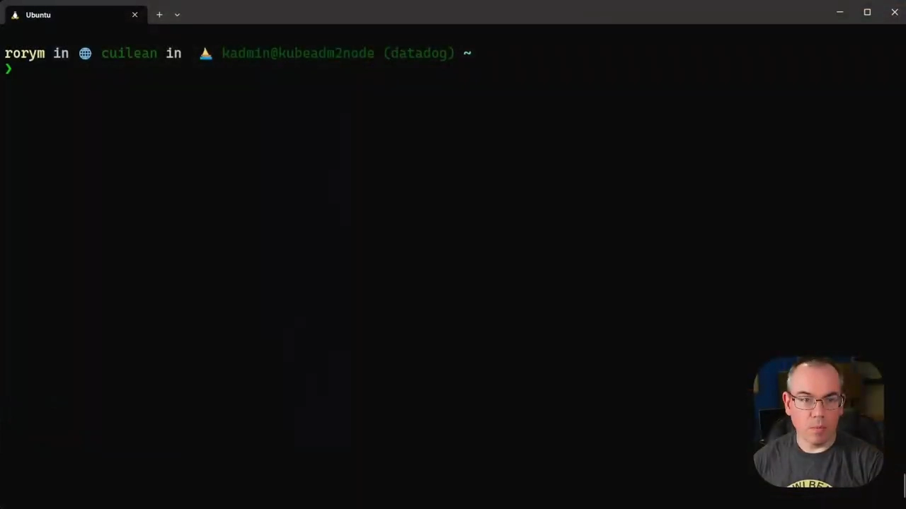
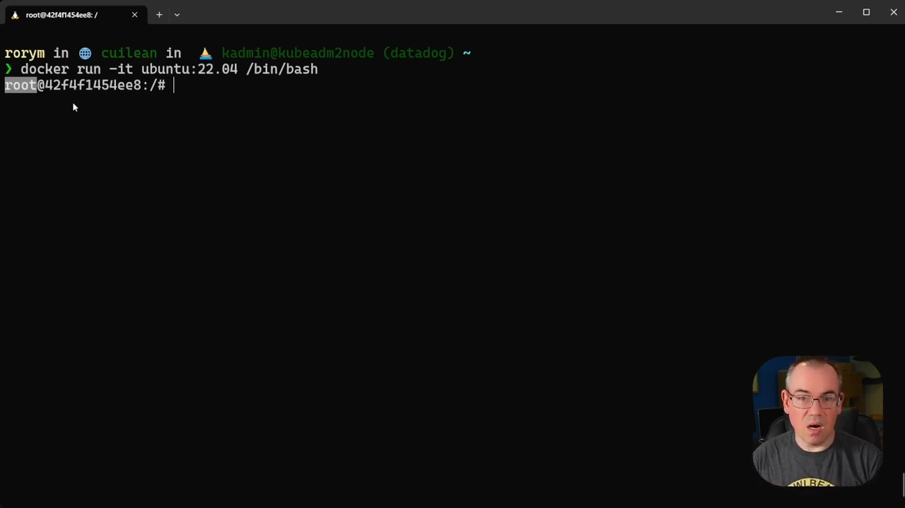
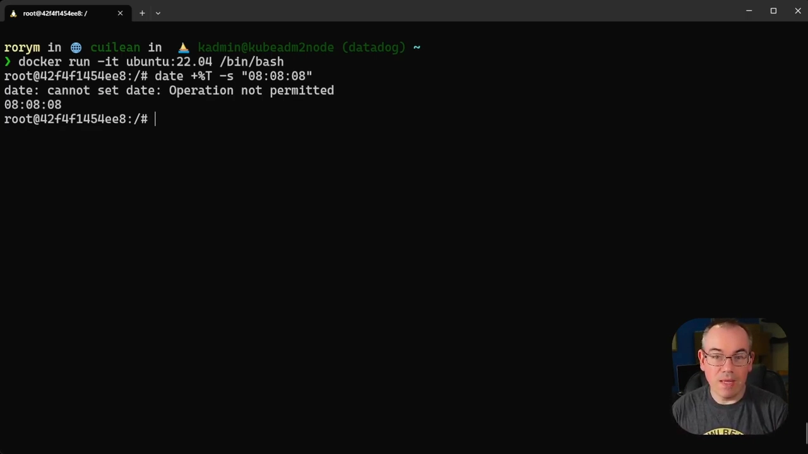
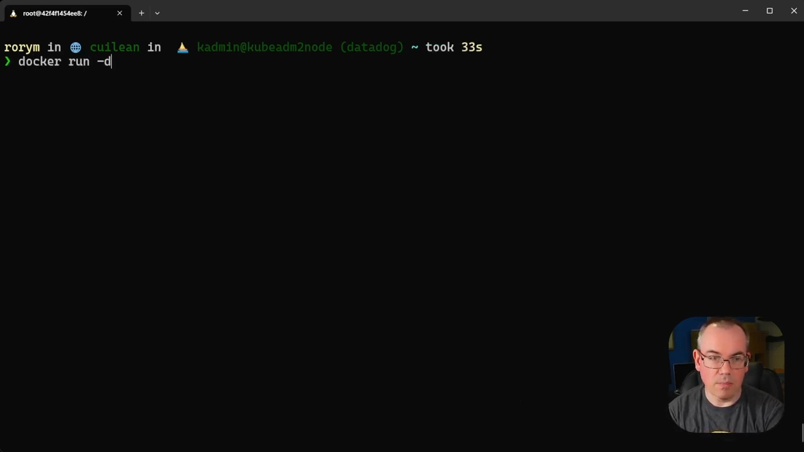
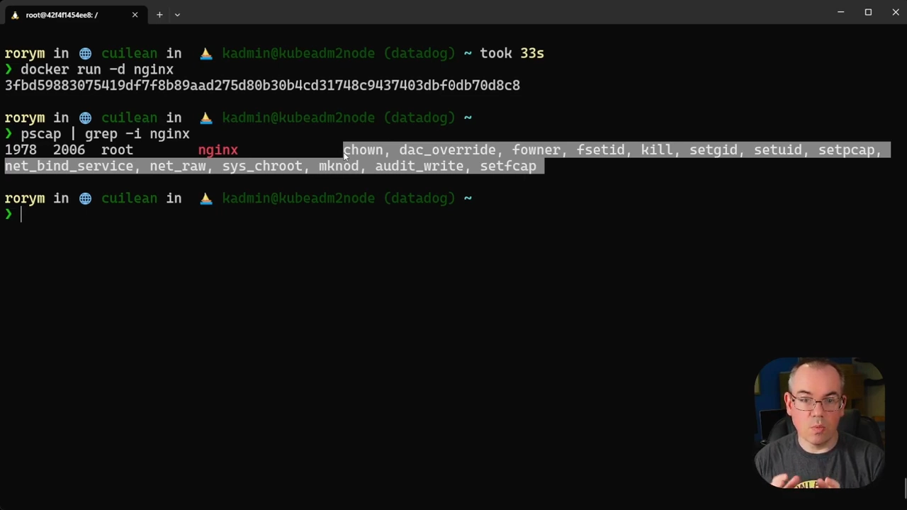

# 容器安全基础：Capabilities 与 Docker 的默认能力集

> 本文整理自 YouTube 视频《[Container Security Fundamentals - Linux Capabilities (Part 1)](https://www.youtube.com/watch?v=lBIvPys7L8w)》（约 8 分钟，Datadog Security Labs"容器安全基础"系列第 6 集）。视频承接该系列前几集的 namespace 主题：容器就是进程，容器里的 root 也不是全能的——Docker 启动容器时只给一小部分能力，容器里改不了系统时间就是最直观的体现。视频用 pscap / filecap 两个工具观察宿主机与容器的能力分配，并以 ping 为例说明"最小授权"的落地。能力集如何收缩加固，见该系列 Part 2。

## 本讲要解决的核心问题（SCQA）

**背景**：这个系列前几集讲了 Linux namespaces：容器是一组被隔离的进程，有自己的 PID/网络/挂载视图；其中也提过，时间没有独立的 namespace，容器和宿主机共享同一个时钟。

**冲突**：在一个 Ubuntu 22.04 容器里，我们明明是 root，时间又没有被 namespace 隔离，执行改系统时间的命令却得到 `Operation not permitted`——按 namespace 的知识，这本该成功。

**疑问**：root 的权力在容器里被拿走了多少？被拿走的是哪些？在宿主机上怎么观察一个进程（包括容器进程）到底有什么能力？

**回答（中心思想）**：内核授权看的是 **capabilities**，而 Docker 为每个容器定义了一套**默认能力集**——足以让大多数容器化工作流跑起来，又刻意排除容易导致提权的高危能力。观察工具有两个：`pscap`（看进程）与 `filecap`（看文件）。容器只是进程，所以 pscap 同样能看容器进程的能力。

## 一、背景：从"全有全无"到 41 项能力

传统 Linux 只有两类用户：root（全部权力）与普通用户（没有 root 式高权限）。想执行 root 式操作，要么用 sudo 让自己以 root 运行，要么给某个二进制设置 setuid root。这些方案都不够好——**不够细粒度，全有或全无**；而很多时候你只需要主机高权限中的一小部分。

于是 Linux 发展出 **capabilities**：允许给**文件或进程**设置 root 总权力的一小部分，不必整包授予。目前 Linux 一共有 **41 种**能力，灵活得多。

（术语衔接：本篇假定你已了解 capabilities 的基本概念；入门可先读本目录姊妹篇《[Root is not enough](Root_is_not_enough_Linux_Capabilities_Explained.md)》。）

## 二、容器实验：root 为什么改不了时间

实验分三步：

1. `docker run -it ubuntu 22.04 bash` 起一个容器，进去就是 root；
2. 系列前几集说过：时间没有独立 namespace，容器内的时间就是宿主机时间；
3. 以 root 身份执行改时间的命令——**失败**，报 `Operation not permitted`。

[【跳转到 01:46】](https://www.youtube.com/watch?v=lBIvPys7L8w&t=106)

既然是 root、又没有被 namespace 隔离，为什么做不了？答案正如本篇主题——**capabilities**：改系统时间所需的能力（`CAP_SYS_TIME`）不在 Docker 给容器的默认能力集里。

[【跳转到 02:36】](https://www.youtube.com/watch?v=lBIvPys7L8w&t=156)

## 三、两个观察工具：pscap 与 filecap

在宿主机上（不限于容器场景）有一组现成的 Linux 工具可以观察能力：

- **pscap**：列出宿主机上拥有全部或部分能力的**进程**。输出显示能力其实已被广泛使用：systemd 的各进程就用细粒度的能力来获得某些特定权限而非 root 的全部，例如 `systemd-resolved` 只有 `net_raw` 一项——这正是 capabilities 的设计意图。

[【跳转到 03:01】](https://www.youtube.com/watch?v=lBIvPys7L8w&t=181)

- **filecap**：扫描文件系统，列出**带文件能力**的文件。给文件设能力的思路与 setuid root 类似，但只授予一小部分权力——能运行该程序的人，运行时就持有所配能力。

（视频命令末尾把错误重定向到 /dev/null，只是为了输出干净。）

## 四、案例：ping 只需要 cap_net_raw

扫描结果里有个有趣的例子：snap 安装的 `ping` 带着文件能力 `net_raw`。原因：ping 要发送 ICMP 网络包（ping 包通常就是 ICMP），而 Linux 上构造 ICMP 包需要 `cap_net_raw`。老式 Linux 里 ping 靠 setuid root 解决——全量授权；现在改用文件能力，**只给它发 ICMP 所需的那一项**。

[【跳转到 04:24】](https://www.youtube.com/watch?v=lBIvPys7L8w&t=264)

这是"最小授权"最直观的落地：程序要什么，就只给什么。

## 五、Docker 的默认能力集：容器进程的能力从哪来

回到容器。`docker run -d nginx` 起一个不加任何特殊参数、原原本本的容器，让它后台运行；然后用 pscap 抓 nginx：

- 系列早期视频说过，**容器只是进程**，所以这个为进程设计的工具照样能用在容器上；
- 输出里 nginx 进程（即我们的容器）挂着一组能力。

[【跳转到 05:44】](https://www.youtube.com/watch?v=lBIvPys7L8w&t=344)

这一组是谁定的？**Docker 项目**。Docker 启动任何新容器都会赋予一套默认能力集，取舍标准是：

- 让尽可能多的容器化工作流**不用特殊配置就能跑**；
- 同时**不允许借这套能力提权**——默认集里刻意排除了一些高危能力，一旦给了它们，用户很容易一路提权到 root。

[【跳转到 06:34】](https://www.youtube.com/watch?v=lBIvPys7L8w&t=394)

对应到本系列的主线：namespace 决定容器"看得到什么"，capabilities 决定容器"做得到什么"——两者配合，才构成容器的权限边界。

## 六、下一步：收缩默认能力集

默认集是"通用起点"，不是"最优解"。视频预告 Part 2 将讲如何在这套默认集的基础上进一步收缩、加固。若想深入了解，Datadog 的 Security Lab 站点上有覆盖这些主题的博客文章。

## 小结

- 容器里的 root 并不全能：**Docker 默认能力集**决定容器进程能做哪些特权操作（root 改不了时间即一例）。
- 容器只是进程，宿主机工具 **pscap** 可以直接观察容器进程的能力。
- **filecap** 观察文件能力；ping 的例子展示了从 setuid root 到单项文件能力的"最小授权"演进。
- Docker 默认集的目标：工作流能跑 + 堵死提权路径。
- 默认集可以再收缩——能力是容器安全加固的重要抓手。

## 关键术语速查

| 术语 | 一句话解释 |
| --- | --- |
| pscap | 列出进程所持能力的工具，可观察容器进程 |
| filecap | 扫描文件系统、列出带文件能力文件的工具 |
| CAP_SYS_TIME | 改系统时间所需能力，不在 Docker 默认集内 |
| cap_net_raw | 构造原始网络包（如 ICMP）所需能力，ping 的最小授权示例 |
| Docker 默认能力集 | Docker 项目为容器定义的能力集合：够用且难提权 |
