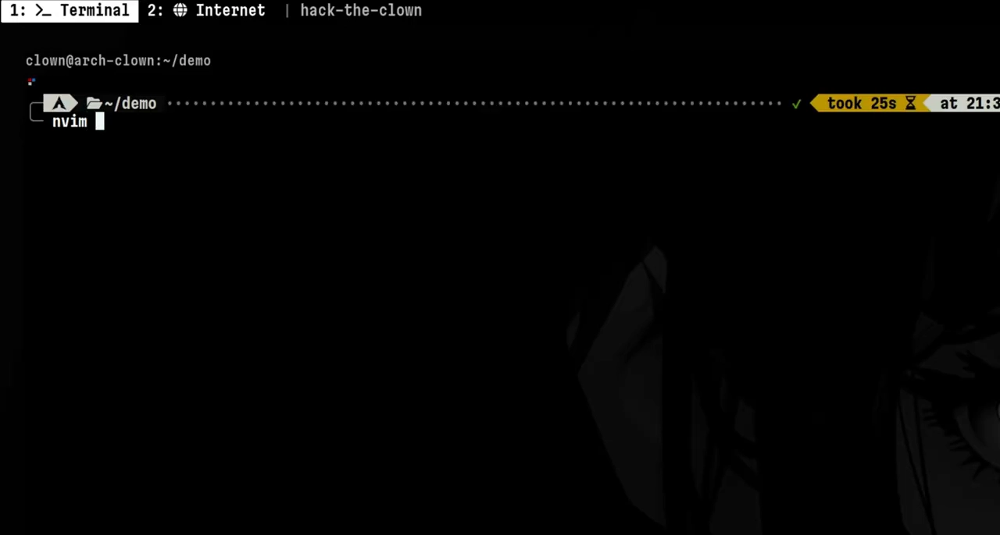
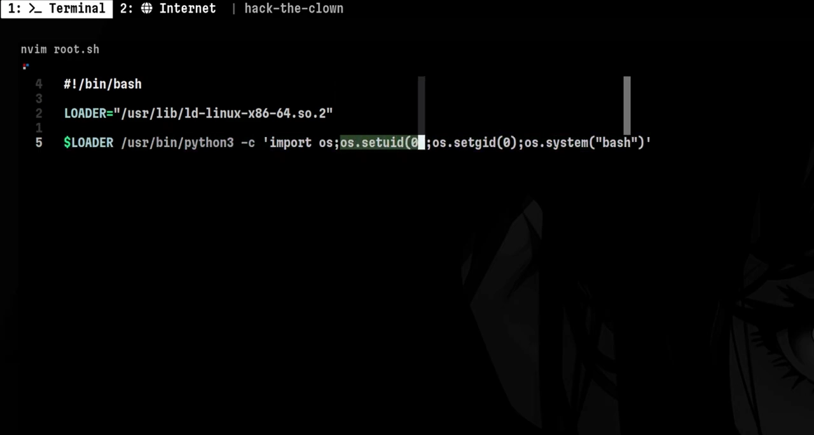
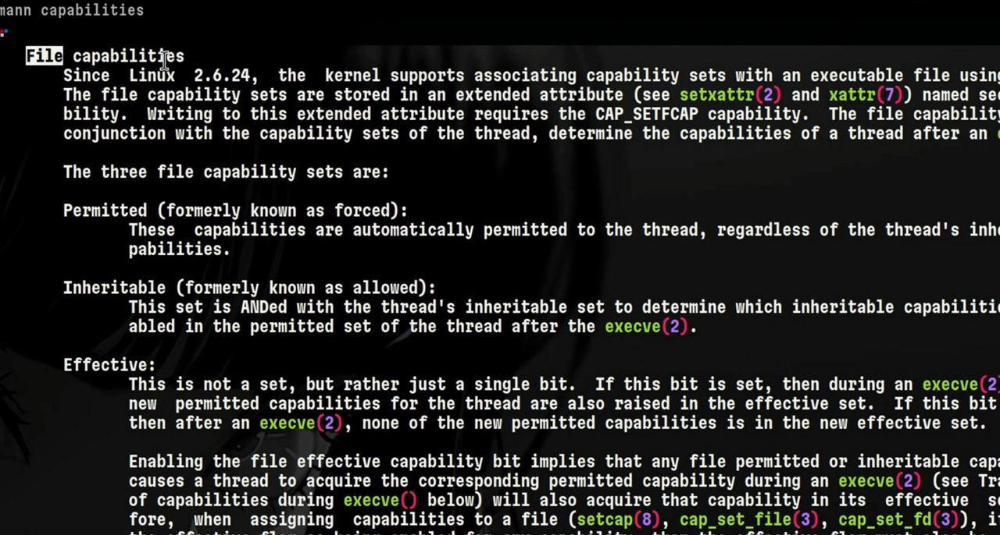
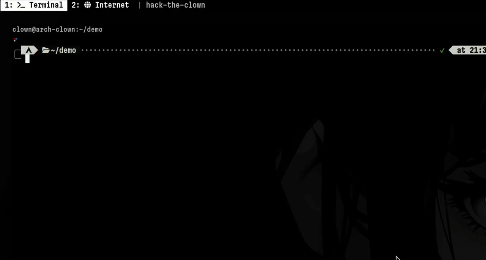
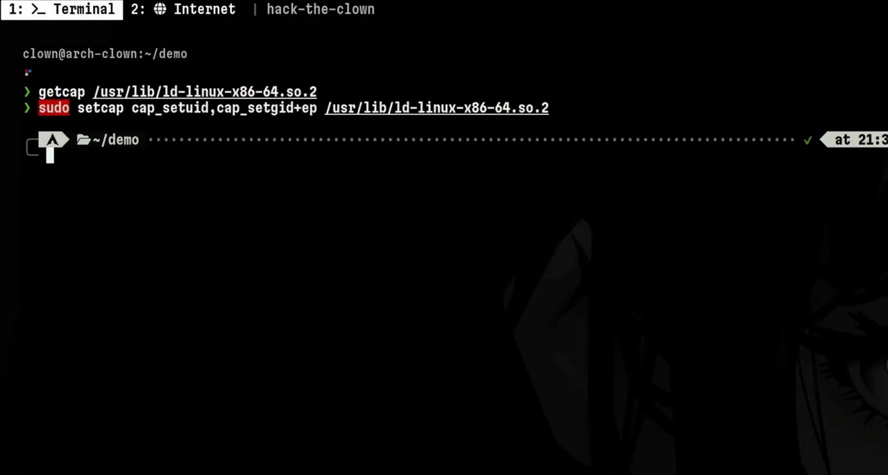
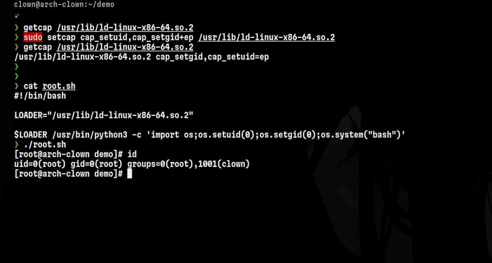

# 文件能力：写在可执行文件上的"部分 root 权"，以及黑客如何滥用它

> 本文整理自 YouTube 视频《[How Hackers Abuse Linux File Capabilities](https://www.youtube.com/watch?v=txo5miQz-SI)》（约 3 分半，频道 Hack the Clown，上篇《[Root is not enough. Linux Capabilities Explained](Root_is_not_enough_Linux_Capabilities_Explained.md)》的续篇）。视频解剖了一个极简后门：给**动态链接器**写入 `cap_setuid`/`cap_setgid` 文件能力，之后经由它启动的程序都能把 UID 置 0、拿到 root shell。全文顺着"脚本为什么先失败、setcap 之后为什么成功"讲清文件能力的三张清单，最后给出三类防御建议。

## 本讲要解决的核心问题（SCQA）

**背景**：上一讲已经确立：内核判定特权操作，看的是**线程上挂的能力集合**；root 的能力也可以被裁剪。

**冲突**：视频里有一个几行的后门脚本，逻辑就是"把进程的 UID/GID 改成 0，再开一个 shell"。直接运行它，却报 `Operation not permitted`——脚本明明就是干这个的。

**疑问**：进程的能力是从哪来的？能不能不把整个程序 setuid root，只把"改 UID"这一项权力**写在文件上**？

**回答（中心思想）**：可以——这就是**文件能力（file capabilities）**。用 `setcap` 把能力写进可执行文件的安全属性，exec 时内核据此给进程授权；文件只有 **permitted / inheritable / effective** 三张清单。后门正是给动态链接器 `setcap 'cap_setuid,cap_setgid=eip'` 后得逞的。理解机制才知道怎么防：定期 `getcap` 巡检磁盘、部署运行时检测、减少不必要的网络暴露。

## 一、后门脚本解剖：它想干什么

后门是一个很简单的 bash 脚本，分三段理解：

- 第三行指向**动态链接器（dynamic link loader）**：任何二进制运行前，都要先由它找到系统里的共享库——帮助二进制定位共享库的程序就是它；
- 最后一行运行这个链接器，并跟一条 python3 命令，还传给 python 解释器一小段脚本；
- 那段 python 脚本做的事只有一件：把**当前进程的 UID 设为 0**——进程由此变成特权进程——GID 同理；最后一部分就是执行一个普通的 bash shell。

[【跳转到 00:00】](https://www.youtube.com/watch?v=txo5miQz-SI&t=0)

[【跳转到 00:18】](https://www.youtube.com/watch?v=txo5miQz-SI&t=18)

所以这个后门本质上就是"以 root 身份开 bash"。但直接一跑，就出问题了。

## 二、报错点：Operation not permitted

运行后门，报 `Operation not permitted`。原因要回到能力机制：

- 上一讲说过，能力是**线程的权限属性**，决定系统调用放不放行；
- 能力也可以**写在文件上**：给二进制设置了能力之后，任何人运行它，它就能执行与所配能力对应的特权操作。

这台机器上，负责启动一切程序的动态链接器**没有**相应的文件能力，所以"把 UID 置 0"这个操作被内核拒绝。

[【跳转到 00:43】](https://www.youtube.com/watch?v=txo5miQz-SI&t=43)

## 三、文件只有三张清单

与线程的五张能力清单相比，**文件**只能有三类能力集合：

- **permitted（允许）**：exec 之后进程最多能拿到的能力；
- **inheritable（可继承）**：exec 时如何从旧进程继承；
- **effective（生效）**：配合前两者决定"拿到就能用"。

本视频聚焦的是 **`cap_setuid`**——操纵运行中进程 UID 的能力（`cap_setgid` 对应 GID）。

[【跳转到 01:21】](https://www.youtube.com/watch?v=txo5miQz-SI&t=81)

## 四、setcap/getcap 实战：后门是如何得逞的

先用 `getcap` 确认：动态链接器目前**没有**任何文件能力——这解释了刚才的失败。

接着用 `setcap` 赋权：给链接器加上 `cap_setuid` 与 `cap_setgid` 两个能力，并告诉内核把它们同时放进 **effective 和 permitted** 集合，对象就是链接器这个文件。

[【跳转到 01:36】](https://www.youtube.com/watch?v=txo5miQz-SI&t=96)

再用 `getcap` 复查，确认设置成功。此时再运行后门：没有任何阻碍——因为链接器已经拥有"把线程 UID 改成 0"的能力，后门成功拿到 root shell。

[【跳转到 01:58】](https://www.youtube.com/watch?v=txo5miQz-SI&t=118)

## 五、攻击者视角与防御

视频特别强调现实前提：**设置文件能力本身需要特权**——普通用户不能给文件 setcap，所以真实场景中攻击者通常已经拿到过 root，然后埋这个后门来维持权限；他可以把它加到任何想要的文件上。

攻击对象也有选择余地：

- 可以直接给 `python3` 二进制设能力，把后门脚本进一步简化，效果同样是"落到 root shell"；
- 而打**动态链接器**的好处是通用：它是各类 Linux 二进制运行时的公共入口，攻击者复用同一处授权就能跑别的命令，不必逐个程序设置。

[【跳转到 02:12】](https://www.youtube.com/watch?v=txo5miQz-SI&t=132)

防御上，视频给出三类建议：

1. 部署**运行时检测**；
2. **定期扫描磁盘**——巡检带文件能力的文件，发现异常授权（谁会需要给动态链接器 cap_setuid？）；
3. **减少网络上不必要的服务暴露**，缩小攻击面。

（补充：`getcap -r / 2>/dev/null` 可递归列出全盘带文件能力的文件，是第 2 条建议的常用落地手段。）

## 小结

- 能力不只挂在线程上，也能**写在文件上**：exec 时内核按文件能力给进程授权。
- 文件只有三张清单：**permitted / inheritable / effective**（进程是五张）。
- `setcap` 一写、`getcap` 一查，就能让任意用户经由该文件获得"改 UID/GID"的权力。
- 动态链接器被设权时影响面最大——它是所有动态链接程序的公共入口。
- 防御三件事：运行时检测、定期 getcap 巡检、减少服务暴露。

## 关键术语速查

| 术语 | 一句话解释 |
| --- | --- |
| 文件能力（file capabilities） | 存在可执行文件安全属性里的能力，exec 时由内核计算生效 |
| setcap / getcap | 给文件写入 / 查询文件能力的命令 |
| cap_setuid / cap_setgid | 操纵运行中进程 UID / GID 的能力 |
| 动态链接器 | 程序启动时负责定位共享库的组件，被滥用时的"公共入口" |
| 后门维持权限 | 攻击者先拿到 root，再埋能力后门，方便随时回来 |
